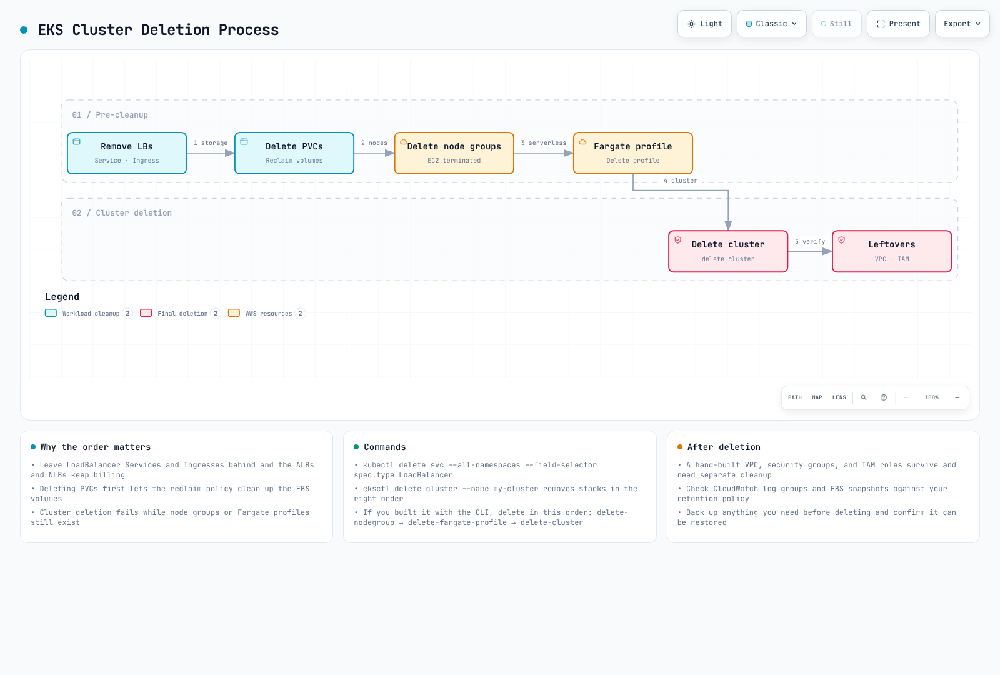

# Part 5: クラスターアクセス、検証、アップグレード、削除

> **最終更新**: 2026年9月11日

このガイドでは、既存の EKS クラスターを扱います。許可されたアカウントとリージョンを使用し、非公開の kubeconfig を使ってください。例は現行の AWS ドキュメントとローカルのパーサーに照らして確認しました。この監査では、AWS に変更を加えたり、クラスターのワークロードを操作したり、本番環境の復旧テストを実行したりしていません。

## クラスターアクセスの設定

### 接続コンテキストを確立する

対象クラスターに合わせて `EXAMPLE_CLUSTER` と `EXAMPLE_REGION` を設定します。現在の AWS CLI identity には、該当する AWS API 権限が必要です。Kubernetes 管理には、すでに許可されている identity を使ってください。必要であれば、オペレーターが引き受けを許可されている role を `ADMIN_ROLE_ARN` に設定します。kubeconfig 自体が権限を付与するわけではありません。初期管理権限はクラスターの bootstrap/access 設定によって決まり、「作成者だけ」という一律の規則ではありません。

以下の変数と helper function には、専用の Bash session を1つ使ってください。必要な手順だけを実行し、アップグレードと削除は別々に実施します。

```bash
set -euo pipefail
umask 077
: "${EXAMPLE_CLUSTER:?Set the existing cluster name}"
: "${EXAMPLE_REGION:?Set the Region}"
EKS_REVIEW_DIR=$(mktemp -d /tmp/eks-lifecycle-review.XXXXXX)
ADMIN_KUBECONFIG="$EKS_REVIEW_DIR/admin.kubeconfig"
aws eks describe-cluster --name "$EXAMPLE_CLUSTER" --region "$EXAMPLE_REGION" \
  --query cluster --output json > "$EKS_REVIEW_DIR/cluster-before.json"
jq -e '{arn,createdAt} | (.arn | type == "string") and (.createdAt != null)' \
  "$EKS_REVIEW_DIR/cluster-before.json" >/dev/null
EXPECTED_CLUSTER_ARN=$(jq -er '.arn' "$EKS_REVIEW_DIR/cluster-before.json")
EXPECTED_CLUSTER_CREATED=$(jq -er '.createdAt | tostring' "$EKS_REVIEW_DIR/cluster-before.json")
CLUSTER_KUBERNETES_VERSION=$(jq -er '.version' "$EKS_REVIEW_DIR/cluster-before.json")
KUBECONFIG_ARGS=(--name "$EXAMPLE_CLUSTER" --region "$EXAMPLE_REGION"
  --kubeconfig "$ADMIN_KUBECONFIG" --alias "$EXAMPLE_CLUSTER-review")
if [ -n "${ADMIN_ROLE_ARN:-}" ]; then
  KUBECONFIG_ARGS+=(--role-arn "$ADMIN_ROLE_ARN")
fi
aws eks update-kubeconfig "${KUBECONFIG_ARGS[@]}"
```
この設定では、記録されたレビュー用ディレクトリに private kubeconfig を書き込み、既定の context は変更しません。`--kubeconfig` を指定しない場合、AWS CLI は `KUBECONFIG` または既定の `~/.kube/config` から出力先を選びます。すべての環境で出力先が同じとは限りません。

<!-- Audit 2026-09-11: parent asset repair required. Material correction: access-policy and RBAC permissions are additive; RBAC cannot narrow AmazonEKSClusterAdminPolicy. The narrowing in Arrow 3 and the footer's --as principal effective EKS permissions claim are wrong; test actual IAM credentials. Rebuild the diagram as alternative/additive authorization paths.


[🔍 View interactive diagram](https://www.atomai.click/kubernetes-docs/archmaps/en-eks-02-eks-cluster-creation-part5-0.html)
-->

Access Entry では、EKS access policy、RBAC を使う Kubernetes group、またはその両方を使用できます。権限は**加算**されます。namespace の RoleBinding によって、EKS cluster-admin access policy の権限を狭めることはできません。この例では、広範な access policy を追加せず、カスタム group と namespace RBAC を使います。

### EKS の更新完了を待つ

設定やバージョンの変更は非同期で進行します。返された update ID を使い、エラーがあれば処理を止めてください。`ACTIVE` や `InProgress` を一度確認しただけで完了と判断しないでください。

```bash
# Additional describe-update arguments can identify a node group or add-on.
wait_eks_update() {
  local update_id="$1"
  shift
  local update_json update_status attempt
  for attempt in $(seq 1 120); do
    update_json=$(aws eks describe-update --name "$EXAMPLE_CLUSTER" \
      --region "$EXAMPLE_REGION" --update-id "$update_id" "$@" --output json) || return 1
    update_status=$(printf '%s' "$update_json" | jq -er '.update.status') || return 1
    case "$update_status" in
      Successful) return 0 ;;
      Failed|Cancelled)
        printf '%s' "$update_json" | jq '.update.errors' >&2
        return 1 ;;
      InProgress) sleep 10 ;;
      *) printf 'Unexpected update status: %s\n' "$update_status" >&2; return 1 ;;
    esac
  done
  printf 'Update %s did not finish within this wait window; inspect it before retrying.\n' "$update_id" >&2
  return 1
}
```
### 方法1: Access Entry と範囲を限定した RBAC

最初に認証 mode を確認します。従来の `CONFIG_MAP` クラスターでは、移行内容を確認したうえで `API_AND_CONFIG_MAP` を有効にできます。`API` クラスターは Access Entry に対応しているため、ConfigMap access を再度有効にしようとしないでください。一方向の移行中も、管理者と node の access を維持します。

```bash
AUTH_MODE=$(aws eks describe-cluster --name "$EXAMPLE_CLUSTER" --region "$EXAMPLE_REGION" \
  --query cluster.accessConfig.authenticationMode --output text)
case "$AUTH_MODE" in
  CONFIG_MAP)
    AUTH_UPDATE_ID=$(aws eks update-cluster-config --name "$EXAMPLE_CLUSTER" \
      --region "$EXAMPLE_REGION" --access-config authenticationMode=API_AND_CONFIG_MAP \
      --query update.id --output text)
    wait_eks_update "$AUTH_UPDATE_ID"
    ;;
  API_AND_CONFIG_MAP|API)
    printf '%s\n' 'Access entries are already enabled.'
    ;;
  *)
    printf 'Unexpected authentication mode: %s\n' "$AUTH_MODE" >&2
    exit 1
    ;;
esac
```
専用の**既存 developer IAM role**を使い、唯一の administrator role は使わないでください。生成する group と namespace により、無関係な binding を避けられます。assumed-role session を識別できるよう、username は EKS に生成させてください。この namespace に限定する例で `system:masters` を group に使うのは適切ではありません。

```bash
# Use a separate, existing developer IAM role; retain the administrator's access.
: "${DEVELOPER_ROLE_ARN:?Existing role that the test operator can assume}"
ACCESS_NAMESPACE="eks-access-$(date +%s)-$$"
DEVELOPER_GROUP="$ACCESS_NAMESPACE-developers"
kubectl --kubeconfig "$ADMIN_KUBECONFIG" create namespace "$ACCESS_NAMESPACE"
ACCESS_NAMESPACE_UID=$(kubectl --kubeconfig "$ADMIN_KUBECONFIG" \
  get namespace "$ACCESS_NAMESPACE" -o jsonpath='{.metadata.uid}')
: "${ACCESS_NAMESPACE_UID:?}"
jq -n --arg name "$ACCESS_NAMESPACE" --arg uid "$ACCESS_NAMESPACE_UID" \
  '{namespace:$name,namespaceUID:$uid}' > "$EKS_REVIEW_DIR/access-namespace.json"
kubectl --kubeconfig "$ADMIN_KUBECONFIG" label namespace "$ACCESS_NAMESPACE" \
  pod-security.kubernetes.io/enforce=restricted \
  "pod-security.kubernetes.io/enforce-version=v$CLUSTER_KUBERNETES_VERSION"

# Creation fails rather than rewriting an existing principal's entry.
aws eks create-access-entry --cluster-name "$EXAMPLE_CLUSTER" --region "$EXAMPLE_REGION" \
  --principal-arn "$DEVELOPER_ROLE_ARN" --type STANDARD \
  --kubernetes-groups "$DEVELOPER_GROUP" \
  --query accessEntry --output json > "$EKS_REVIEW_DIR/created-access-entry.json"
```
対応する Role と Group binding を作成し、developer role 自身でテストします。この Role は Secret の直接読み取りや RBAC/namespace の管理権限を付与しません。一方、workload はその namespace 内で利用できる identity と Secret を引き続き使えます。より強い隔離が必要な場合は、admission control で許可する service account と mount を制限してください。

```bash
kubectl --kubeconfig "$ADMIN_KUBECONFIG" -n "$ACCESS_NAMESPACE" create -f - <<EOF
apiVersion: rbac.authorization.k8s.io/v1
kind: Role
metadata:
  name: developer
rules:
- apiGroups: [""]
  resources: ["pods", "pods/log"]
  verbs: ["get", "list", "watch"]
- apiGroups: [""]
  resources: ["services", "configmaps"]
  verbs: ["get", "list", "watch", "create", "update", "patch", "delete"]
- apiGroups: ["apps"]
  resources: ["deployments", "statefulsets"]
  verbs: ["get", "list", "watch", "create", "update", "patch", "delete"]
---
apiVersion: rbac.authorization.k8s.io/v1
kind: RoleBinding
metadata:
  name: developer-binding
subjects:
- kind: Group
  name: $DEVELOPER_GROUP
  apiGroup: rbac.authorization.k8s.io
roleRef:
  kind: Role
  name: developer
  apiGroup: rbac.authorization.k8s.io
EOF

DEVELOPER_KUBECONFIG="$EKS_REVIEW_DIR/developer.kubeconfig"
aws eks update-kubeconfig --name "$EXAMPLE_CLUSTER" --region "$EXAMPLE_REGION" \
  --role-arn "$DEVELOPER_ROLE_ARN" --kubeconfig "$DEVELOPER_KUBECONFIG" \
  --alias "$EXAMPLE_CLUSTER-developer"

# Allow for access-entry propagation; test using the role, not --as impersonation.
kubectl --kubeconfig "$DEVELOPER_KUBECONFIG" auth can-i list pods -n "$ACCESS_NAMESPACE"
kubectl --kubeconfig "$DEVELOPER_KUBECONFIG" -n "$ACCESS_NAMESPACE" get pods
NODE_DELETE_ALLOWED=$(kubectl --kubeconfig "$DEVELOPER_KUBECONFIG" auth can-i delete nodes 2>"$EKS_REVIEW_DIR/can-i-errors.txt") || {
  # kubectl returns nonzero for an ordinary "no"; distinguish other failures.
  [ "$NODE_DELETE_ALLOWED" = no ] || exit 1
}
[ "$NODE_DELETE_ALLOWED" = no ] || {
  printf '%s\n' 'Unexpected cluster-wide permission; review all access policies and RBAC bindings.' >&2
  exit 1
}
```
Access Entry の反映には時間がかかるため、エラーを確認し、伝播を待ってから再試行します。`kubectl --as`/`--as-group` による impersonation test は Kubernetes RBAC を検証するもので、IAM principal の EKS access-policy 権限を検証するものではありません。同様に、`auth can-i --list` だけでは EKS access policy の権限をすべて確認できません。IAM user も principal としてサポートされていますが、一時 credential を使える role を優先してください。既存 user を使う場合は、適切に設定した独自の credential 経路が必要です。

### 方法2: 従来の aws-auth の移行


[🔍 インタラクティブな図を表示](https://www.atomai.click/kubernetes-docs/archmaps/en-eks-02-eks-cluster-creation-part5-1.html)

この方法は、クラスターの認証 mode に ConfigMap access が含まれている場合に限って使います。実際の ConfigMap 全体を保持してください。node role 1つだけを含むサンプルで置き換えてはいけません。対応する Access Entry を検証するまでは、既存の managed node と Fargate の mapping を残してください。どちらの方法も IaC で管理でき、対応する AWS/Kubernetes log で監査できます。

```bash
kubectl --kubeconfig "$ADMIN_KUBECONFIG" -n kube-system get configmap aws-auth -o yaml   > "$EKS_REVIEW_DIR/aws-auth-before.yaml"
kubectl --kubeconfig "$ADMIN_KUBECONFIG" -n kube-system edit configmap aws-auth
```
既存の `mapRoles`/`mapUsers` YAML に、レビュー済みの role/user entry だけを、RoleBinding と同じカスタム Group を使ってマージします。node の username/group と無関係な mapping はすべて維持してください。従来の aws-auth の role ARN 制約は Access Entry と異なるため、任意の ARN を手作業で正規化せず、文書化された移行手順に従います。同じ principal が両方の仕組みに登録されている場合は、Access Entry の mapping が優先されます。移行した identity を検証するときも、別の administrator session を維持してください。

## クラスターの検証

### 想定する compute と system component を確認する

<!-- Audit 2026-09-11: parent asset repair required. Footer criteria are incomplete: Running does not mean Ready, a default StorageClass is not universally required, LoadBalancer does not prove AWS LBC without class/ownership, and log group existence does not prove delivery. The main flow is usable after caption/footer correction.


[🔍 View interactive diagram](https://www.atomai.click/kubernetes-docs/archmaps/en-eks-02-eks-cluster-creation-part5-2.html)
-->

```bash
kubectl --kubeconfig "$ADMIN_KUBECONFIG" get nodes -o wide
kubectl --kubeconfig "$ADMIN_KUBECONFIG" get pods -n kube-system -o wide
aws eks list-addons --cluster-name "$EXAMPLE_CLUSTER" --region "$EXAMPLE_REGION"
```
想定した node 数と readiness、Deployment/DaemonSet の rollout status、add-on の状態を確認します。`Running` は Pod の phase であり、container が Ready であることを示すものではありません。Job が正常終了して `Succeeded` になるのは適切な場合があります。node が空の一覧は、一般的な EC2 クラスターでは正常ではありません。Auto Mode、Fargate、Hybrid Nodes では system component の構成が異なります。既定の StorageClass が必要なのは、それを使う workload がある場合だけです。

### 自分が所有する HTTP test をデプロイする

この一般的な Linux の例では、新しい namespace に小さな HTTP responder を作成します。public load balancer を自動的に作らずに、scheduling、image pull、DNS、ClusterIP Service をテストします。組織共通の policy により DNS/HTTP の承認済み例外が必要な場合があります。この例では policy を無効にしません。

```bash
VALIDATION_NAMESPACE="eks-validation-$(date +%s)-$$"
kubectl --kubeconfig "$ADMIN_KUBECONFIG" create namespace "$VALIDATION_NAMESPACE"
VALIDATION_NAMESPACE_UID=$(kubectl --kubeconfig "$ADMIN_KUBECONFIG" \
  get namespace "$VALIDATION_NAMESPACE" -o jsonpath='{.metadata.uid}')
: "${VALIDATION_NAMESPACE_UID:?}"
jq -n --arg name "$VALIDATION_NAMESPACE" --arg uid "$VALIDATION_NAMESPACE_UID" \
  '{namespace:$name,namespaceUID:$uid}' > "$EKS_REVIEW_DIR/validation-namespace.json"
kubectl --kubeconfig "$ADMIN_KUBECONFIG" label namespace "$VALIDATION_NAMESPACE" \
  pod-security.kubernetes.io/enforce=restricted \
  "pod-security.kubernetes.io/enforce-version=v$CLUSTER_KUBERNETES_VERSION"
kubectl --kubeconfig "$ADMIN_KUBECONFIG" -n "$VALIDATION_NAMESPACE" create -f - <<'EOF'
apiVersion: apps/v1
kind: Deployment
metadata:
  name: http-validation
spec:
  replicas: 3
  selector:
    matchLabels: {app: http-validation}
  template:
    metadata:
      labels: {app: http-validation}
    spec:
      automountServiceAccountToken: false
      securityContext:
        runAsNonRoot: true
        runAsUser: 1000
        runAsGroup: 1000
        fsGroup: 1000
        seccompProfile: {type: RuntimeDefault}
      containers:
      - name: server
        image: public.ecr.aws/docker/library/busybox:1.38.0
        command: [sh, -c]
        args:
        - 'printf "%s\n" eks-validation-ok > /work/index.html && exec httpd -f -p 8080 -h /work'
        ports:
        - containerPort: 8080
        readinessProbe:
          httpGet: {path: /, port: 8080}
        resources:
          requests: {cpu: 50m, memory: 32Mi}
          limits: {cpu: 200m, memory: 64Mi}
        securityContext:
          allowPrivilegeEscalation: false
          readOnlyRootFilesystem: true
          capabilities: {drop: [ALL]}
        volumeMounts:
        - {name: work, mountPath: /work}
      volumes:
      - name: work
        emptyDir: {}
---
apiVersion: v1
kind: Service
metadata:
  name: http-validation
spec:
  type: ClusterIP
  selector: {app: http-validation}
  ports:
  - {port: 8080, targetPort: 8080, protocol: TCP}
EOF
kubectl --kubeconfig "$ADMIN_KUBECONFIG" -n "$VALIDATION_NAMESPACE" \
  rollout status deployment/http-validation --timeout=180s
```

```bash
kubectl --kubeconfig "$ADMIN_KUBECONFIG" -n "$VALIDATION_NAMESPACE" create -f - <<'EOF'
apiVersion: batch/v1
kind: Job
metadata:
  name: dns-http-check
spec:
  backoffLimit: 0
  template:
    spec:
      restartPolicy: Never
      automountServiceAccountToken: false
      securityContext:
        runAsNonRoot: true
        runAsUser: 1000
        seccompProfile: {type: RuntimeDefault}
      containers:
      - name: client
        image: public.ecr.aws/docker/library/busybox:1.38.0
        command: [sh, -c]
        args:
        - |
          set -eu
          nslookup http-validation
          response=$(wget -qO- -T 5 http://http-validation:8080/) || exit 1
          [ "$response" = eks-validation-ok ]
          printf '%s\n' 'DNS and Service HTTP check passed'
        resources:
          requests: {cpu: 10m, memory: 16Mi}
          limits: {cpu: 100m, memory: 32Mi}
        securityContext:
          allowPrivilegeEscalation: false
          readOnlyRootFilesystem: true
          capabilities: {drop: [ALL]}
EOF
kubectl --kubeconfig "$ADMIN_KUBECONFIG" -n "$VALIDATION_NAMESPACE" \
  wait --for=condition=complete job/dns-http-check --timeout=120s
kubectl --kubeconfig "$ADMIN_KUBECONFIG" -n "$VALIDATION_NAMESPACE" logs job/dns-http-check
```
この test の成功が確認するのは、この通信経路だけです。すべての networking、storage、application 要件を満たすことを示すものではありません。任意の load balancer test では、導入済みで使用が許可された controller、レビュー済みの scheme、subnet/security rule、および通常の compute または Auto Mode に合った `loadBalancerClass` が必要です。AWS は通常、`status.loadBalancer.ingress` に外部 IP ではなく hostname を返します。この test は課金対象の resource を作るため、削除手順も含めてください。port-forward はデバッグに役立ちますが、通常の Service/load-balancer data path を通りません。

```bash
CURRENT_VALIDATION_UID=$(kubectl --kubeconfig "${ADMIN_KUBECONFIG:?}" \
  get namespace "${VALIDATION_NAMESPACE:?}" --ignore-not-found \
  -o jsonpath='{.metadata.uid}') || exit 1
if [ -z "$CURRENT_VALIDATION_UID" ]; then
  printf '%s\n' 'Validation namespace is already absent.'
elif [ "$CURRENT_VALIDATION_UID" = "${VALIDATION_NAMESPACE_UID:?Recorded UID required}" ]; then
  kubectl --kubeconfig "$ADMIN_KUBECONFIG" delete namespace "$VALIDATION_NAMESPACE" --wait=true
else
  printf '%s\n' 'Namespace identity changed; no deletion attempted.' >&2
  exit 1
fi
```
### 実際の log 配信を確認する

新しい event が必要なら、control-plane logging を事前に有効にします。正しい Region で有効な log type と stream の timestamp を確認してください。log group が存在するだけでは配信の証明になりません。配信はベストエフォートで、stream はローテーションします。log を公開レポートにそのまま出さず、適切な権限で該当する実際の event を確認してください。

```bash
aws eks describe-cluster --name "$EXAMPLE_CLUSTER" --region "$EXAMPLE_REGION" \
  --query cluster.logging
aws logs describe-log-streams --region "$EXAMPLE_REGION" \
  --log-group-name "/aws/eks/$EXAMPLE_CLUSTER/cluster" \
  --order-by LastEventTime --descending --max-items 5 \
  --query 'logStreams[].{stream:logStreamName,lastEvent:lastEventTimestamp}'
```
worker の kubelet/container log には個別の収集経路が必要です。EKS control-plane log を有効にしただけでは収集されません。

## クラスターのアップグレード

<!-- Audit 2026-09-11: parent asset repair required. Material correction: the footer incorrectly denies EKS control plane rollback; AWS currently supports conditional rollback to the previous minor version within 7 days. The 1.31 copy target/1.29→1.30→1.31 sequence is stale; track the update ID’s Successful status, not ACTIVE alone. Preserve the compatible component sequence/preflight.


[🔍 View interactive diagram](https://www.atomai.click/kubernetes-docs/archmaps/en-eks-02-eks-cluster-creation-part5-3.html)
-->

EKS version calendar と upgrade insights を確認します。削除された API、workload/data backup、capacity、互換性のある add-on version をレビューしてください。control plane をアップグレードする前に、EKS の手順に従って managed/Fargate node を現在の minor version に合わせ、self-managed/Hybrid node も推奨どおり更新します。kubelet の version は API server より新しくしてはいけません。以下の API workflow は事前の準備状況の確認に代わるものではありません。Terraform/eksctl で管理される resource には、その所有元の workflow を使います。

```bash
# Read the EKS release catalog; add-on versions are not the cluster release catalog.
aws eks describe-cluster-versions --region "$EXAMPLE_REGION" \
  --query 'clusterVersions[].{version:clusterVersion,status:versionStatus,standardEnd:endOfStandardSupportDate,extendedEnd:endOfExtendedSupportDate}' \
  --output table

: "${NEXT_KUBERNETES_VERSION:?Select the next supported minor after readiness review}"
CURRENT_KUBERNETES_VERSION=$(aws eks describe-cluster --name "$EXAMPLE_CLUSTER" \
  --region "$EXAMPLE_REGION" --query cluster.version --output text)
if [[ "$CURRENT_KUBERNETES_VERSION" =~ ^1\.([0-9]+)$ ]]; then
  EXPECTED_NEXT_VERSION="1.$((BASH_REMATCH[1] + 1))"
else
  printf '%s\n' 'Unexpected version; stop and inspect.' >&2
  exit 1
fi
[ "$NEXT_KUBERNETES_VERSION" = "$EXPECTED_NEXT_VERSION" ] || {
  printf '%s\n' 'This upgrade workflow only permits the next minor version.' >&2
  exit 1
}
CLUSTER_UPDATE_ID=$(aws eks update-cluster-version --name "$EXAMPLE_CLUSTER" \
  --region "$EXAMPLE_REGION" --kubernetes-version "$NEXT_KUBERNETES_VERSION" \
  --query update.id --output text)
wait_eks_update "$CLUSTER_UPDATE_ID"
```
### Node と add-on を更新する

レビュー済みの managed node group ごとに、先に update strategy、PDB、余剰 capacity、persistent volume の制約を確認します。強制 eviction を通常の回避策として使わないでください。

```bash
# Configure/review node update strategy and PDB/capacity prerequisites separately first.
: "${NODEGROUP_TO_UPDATE:?Select an owned managed node group}"
NODE_UPDATE_ID=$(aws eks update-nodegroup-version --cluster-name "$EXAMPLE_CLUSTER" \
  --region "$EXAMPLE_REGION" --nodegroup-name "$NODEGROUP_TO_UPDATE" \
  --query update.id --output text)
wait_eks_update "$NODE_UPDATE_ID" --nodegroup-name "$NODEGROUP_TO_UPDATE"
```
self-managed/Hybrid node には、独自の image/package と drain lifecycle が必要です。Auto Mode は node lifecycle を管理します。既存の Fargate Pod は、現在の version に更新するために計画的な置き換えが必要になる場合があります。Cluster Autoscaler などの controller を移行先 minor version に合わせてください。各 add-on の互換性手順に従い、control-plane 更新前に必要となる前提更新を判断します。

```bash
: "${ADDON_NAME:?Select an existing managed add-on}"
TARGET_CLUSTER_VERSION=$(aws eks describe-cluster --name "$EXAMPLE_CLUSTER" \
  --region "$EXAMPLE_REGION" --query cluster.version --output text)
aws eks describe-addon --cluster-name "$EXAMPLE_CLUSTER" --region "$EXAMPLE_REGION" \
  --addon-name "$ADDON_NAME" > "$EKS_REVIEW_DIR/addon-before.json"
aws eks describe-addon-versions --region "$EXAMPLE_REGION" --addon-name "$ADDON_NAME" \
  --kubernetes-version "$TARGET_CLUSTER_VERSION"

: "${REVIEWED_ADDON_VERSION:?Choose a compatible build before inspecting its schema}"
aws eks describe-addon-configuration --region "$EXAMPLE_REGION" --addon-name "$ADDON_NAME" \
  --addon-version "$REVIEWED_ADDON_VERSION" --query configurationSchema --output text \
  > "$EKS_REVIEW_DIR/addon-target-schema.json"
# Preserve the configuration string, whether the service returned JSON or YAML.
jq -er '(.addon.configurationValues // "{}") |
  if type != "string" then error("Unexpected configurationValues type")
  elif . == "" then "{}" else . end' \
  "$EKS_REVIEW_DIR/addon-before.json" > "$EKS_REVIEW_DIR/addon-values-reviewed.txt"
# Stop here to review this file against the target schema, plus IAM and direct customizations.
```
適用する前に、保存済みの設定を移行先 schema と照らして確認します。`configurationValues` に含まれていない Kubernetes への直接変更も記録してください。managed CoreDNS では、カスタム Corefile をサポート対象の `corefile` 設定 key に置きます。`PRESERVE` は設定の所有者を明確にしたり、schema をレビューしたりする代わりにはなりません。

```bash
: "${REVIEWED_ADDON_VERSION:?Use the reviewed compatible build}"
ADDON_UPDATE_ID=$(aws eks update-addon --cluster-name "$EXAMPLE_CLUSTER" \
  --region "$EXAMPLE_REGION" --addon-name "$ADDON_NAME" \
  --addon-version "$REVIEWED_ADDON_VERSION" --resolve-conflicts PRESERVE \
  --configuration-values "file://$EKS_REVIEW_DIR/addon-values-reviewed.txt" \
  --query update.id --output text)
wait_eks_update "$ADDON_UPDATE_ID" --addon-name "$ADDON_NAME"
aws eks describe-addon --cluster-name "$EXAMPLE_CLUSTER" --region "$EXAMPLE_REGION" \
  --addon-name "$ADDON_NAME" --query 'addon.{status:status,version:addonVersion,health:health}'
```
EKS は、インプレースアップグレードから7日以内であれば、条件を満たした場合に前の minor version への rollback を現在サポートしています。etcd、workload 設定、persistent data は巻き戻りません。互換性のある node/add-on を準備し、rollback の適格条件をすべて確認してください。Auto Mode は独自の node rollback を処理します。「downgrade は不可能」という一律の説明や、常に元に戻せるという保証に頼らないでください。

## クラスターの削除

<!-- Audit 2026-09-11: parent asset repair required. The bulk all-namespaces service deletion example and unconditional PVC deletion flow need owned-resource inventory/data retention guards; Retain vs Delete/CSI cleanup waits matter. Specifyallownedgroups/profileswaitersandoriginalIaCowner;retentionbackupbeforedeletion.


[🔍 View interactive diagram](https://www.atomai.click/kubernetes-docs/archmaps/en-eks-02-eks-cluster-creation-part5-4.html)
-->

廃止作業は別途レビューして実行します。対象アカウント/Region、クラスター identity、backup/restore の必要性、関連 resource ごとの所有者を確認してください。まず inventory を取り、PVC 全体や全 namespace の Service を一括削除する command は使わないでください。

```bash
# Read-only inventory: review ownership and data retention before selecting any deletion.
kubectl --kubeconfig "$ADMIN_KUBECONFIG" get services,ingresses -A
kubectl --kubeconfig "$ADMIN_KUBECONFIG" get pvc -A
kubectl --kubeconfig "$ADMIN_KUBECONFIG" get pv
aws eks list-nodegroups --cluster-name "$EXAMPLE_CLUSTER" --region "$EXAMPLE_REGION"
aws eks list-fargate-profiles --cluster-name "$EXAMPLE_CLUSTER" --region "$EXAMPLE_REGION"
aws eks list-capabilities --cluster-name "$EXAMPLE_CLUSTER" --region "$EXAMPLE_REGION"
```
レビュー済みの Service/Ingress と data resource だけを、その所有元を通じて削除します。`Delete` reclaim policy では PVC の削除が storage の削除につながる可能性があります。`Retain`、snapshot、backup、finalizer は別途扱う必要があります。application を停止し、controller と IAM 権限が残っている間に、想定した storage/load balancer の cleanup 完了を待ちます。EKS node-group の一覧には managed group だけが表示されます。self-managed ASG/instance と Hybrid Node は別途 inventory を取ります。

### 元の resource owner を使う

階層化された Terraform project では、Part 4 に保存したレビュー済みの逆順 destroy plan を使います。eksctl で作成したクラスターでは、resource/data の事前条件を満たした後に削除手順に従い、完了を待ってください。

```bash
eksctl delete cluster --name "${EXAMPLE_CLUSTER:?}" --region "${EXAMPLE_REGION:?}" --wait
```
Terraform または CloudFormation が所有する resource を API で削除し、state/stack が整合したままだと考えてはいけません。API が所有するクラスターでは、最終削除の前に、所有する managed group、Fargate profile、EKS Capability をすべて処理してください。ACK、Argo CD、kro などの Capability にはそれぞれ独自の cleanup policy があります。deletion protection はレビュー済みの所有元 workflow からのみ無効にします。以下の確認手順は有効なままであれば停止します。

```bash
check_retirement_cluster() {
  [ "${RETIREMENT_REVIEWED:?Set yes only after this cluster retirement is reviewed}" = yes ] || return 1
  local current_cluster
  current_cluster=$(aws eks describe-cluster --name "$EXAMPLE_CLUSTER" --region "$EXAMPLE_REGION" \
    --query cluster --output json) || return 1
  printf '%s' "$current_cluster" |
    jq -e --arg arn "${EXPECTED_CLUSTER_ARN:?}" --arg created "${EXPECTED_CLUSTER_CREATED:?}" \
      '.arn == $arn and (.createdAt | tostring) == $created and .deletionProtection != true' \
      >/dev/null || {
        printf '%s\n' 'Cluster identity changed or deletion protection is enabled; stop.' >&2
        return 1
      }
}
```

```bash
# For an API-owned group, after workload/data cleanup and ownership review.
: "${NODEGROUP_TO_DELETE:?Select a reviewed managed node group}"
aws eks describe-nodegroup --cluster-name "$EXAMPLE_CLUSTER" --region "$EXAMPLE_REGION" \
  --nodegroup-name "$NODEGROUP_TO_DELETE" --query 'nodegroup.{arn:nodegroupArn,status:status}'
if [ "${RETIREMENT_REVIEWED:?Set yes only for this reviewed cluster retirement}" = yes ]; then
  check_retirement_cluster
  aws eks delete-nodegroup --cluster-name "$EXAMPLE_CLUSTER" --region "$EXAMPLE_REGION" \
    --nodegroup-name "$NODEGROUP_TO_DELETE"
  aws eks wait nodegroup-deleted --cluster-name "$EXAMPLE_CLUSTER" --region "$EXAMPLE_REGION" \
    --nodegroup-name "$NODEGROUP_TO_DELETE"
fi
```

```bash
# Delete profiles serially; another profile cannot be deleted while one is DELETING.
: "${FARGATE_PROFILE_TO_DELETE:?Select a reviewed Fargate profile}"
aws eks describe-fargate-profile --cluster-name "$EXAMPLE_CLUSTER" --region "$EXAMPLE_REGION" \
  --fargate-profile-name "$FARGATE_PROFILE_TO_DELETE"
if [ "${RETIREMENT_REVIEWED:?}" = yes ]; then
  check_retirement_cluster
  aws eks delete-fargate-profile --cluster-name "$EXAMPLE_CLUSTER" --region "$EXAMPLE_REGION" \
    --fargate-profile-name "$FARGATE_PROFILE_TO_DELETE"
  aws eks wait fargate-profile-deleted --cluster-name "$EXAMPLE_CLUSTER" --region "$EXAMPLE_REGION" \
    --fargate-profile-name "$FARGATE_PROFILE_TO_DELETE"
fi
```
レビュー済みの各所有 resource について同じ手順を繰り返し、Fargate profile は順番に削除します。Capability と self-managed infrastructure の cleanup は、文書化された各所有元の手順で完了します。その後、記録されたクラスター identity と managed resource 一覧が空であることを確認してから、最後の API call を実行します。

```bash
# Final API-owned-cluster step. It does not disable deletion protection or delete capabilities.
[ "${RETIREMENT_REVIEWED:?}" = yes ] || exit 1
check_retirement_cluster
aws eks describe-cluster --name "$EXAMPLE_CLUSTER" --region "$EXAMPLE_REGION" \
  --query cluster --output json > "$EKS_REVIEW_DIR/cluster-before-delete.json"
jq -e --arg arn "${EXPECTED_CLUSTER_ARN:?}" --arg created "${EXPECTED_CLUSTER_CREATED:?}" \
  '.arn == $arn and (.createdAt | tostring) == $created and .deletionProtection != true' \
  "$EKS_REVIEW_DIR/cluster-before-delete.json" >/dev/null || {
    printf '%s\n' 'Cluster identity changed or deletion protection is enabled; stop.' >&2
    exit 1
  }
aws eks list-nodegroups --cluster-name "$EXAMPLE_CLUSTER" --region "$EXAMPLE_REGION" \
  > "$EKS_REVIEW_DIR/remaining-nodegroups.json"
aws eks list-fargate-profiles --cluster-name "$EXAMPLE_CLUSTER" --region "$EXAMPLE_REGION" \
  > "$EKS_REVIEW_DIR/remaining-fargate.json"
aws eks list-capabilities --cluster-name "$EXAMPLE_CLUSTER" --region "$EXAMPLE_REGION" \
  > "$EKS_REVIEW_DIR/remaining-capabilities.json"
jq -e '.nodegroups | type == "array" and length == 0' \
  "$EKS_REVIEW_DIR/remaining-nodegroups.json" >/dev/null
jq -e '.fargateProfileNames | type == "array" and length == 0' \
  "$EKS_REVIEW_DIR/remaining-fargate.json" >/dev/null
jq -e '.capabilities | type == "array" and length == 0' \
  "$EKS_REVIEW_DIR/remaining-capabilities.json" >/dev/null
aws eks delete-cluster --name "$EXAMPLE_CLUSTER" --region "$EXAMPLE_REGION"
aws eks wait cluster-deleted --name "$EXAMPLE_CLUSTER" --region "$EXAMPLE_REGION"
```
### 残存 resource と保持要件を確認する

ドキュメントに記載されたとおり、Auto Mode のクラスターを削除すると、管理対象 node/EC2 instance と load balancer も削除されます。共有 VPC resource を任意に削除してよいわけではありません。保持する volume/snapshot、NAT gateway/EIP、ENI、security group、IAM role、OIDC provider、log group を、記録した所有者と保持計画に照らして確認します。

該当する場合は、元の VPC/IAM Terraform state または CloudFormation stack を使います。単独の `delete-vpc` command は依存関係を考慮した teardown ではありません。汎用名の `EKSClusterRole`/`EKSNodeRole` policy をデタッチしたり、共有 role を名前だけで削除したりしないでください。監査/復旧に必要な log group と暗号化 key を保持します。EKS control plane を削除しても、それらを消去すべきとは限りません。

## クイズ

[EKS クラスター作成 - Part 5 クイズ](../quizzes/eks/02-eks-cluster-creation-part5-quiz.md)に挑戦して、この章で学んだ内容を確認してください。

## 参考資料

- [Access Entry の group](https://docs.aws.amazon.com/eks/latest/userguide/create-k8s-group-access-entry.html)
- [Access policy による認可](https://docs.aws.amazon.com/eks/latest/userguide/access-policies.html)
- [Access の移行](https://docs.aws.amazon.com/eks/latest/userguide/migrating-access-entries.html)
- [EKS version のライフサイクル](https://docs.aws.amazon.com/eks/latest/userguide/kubernetes-versions.html)
- [クラスターのアップグレード](https://docs.aws.amazon.com/eks/latest/userguide/update-cluster.html)
- [クラスターの rollback](https://docs.aws.amazon.com/eks/latest/userguide/rollback-cluster.html)
- [Control-plane logging](https://docs.aws.amazon.com/eks/latest/userguide/control-plane-logs.html)
- [クラスターの削除](https://docs.aws.amazon.com/eks/latest/userguide/delete-cluster.html)
