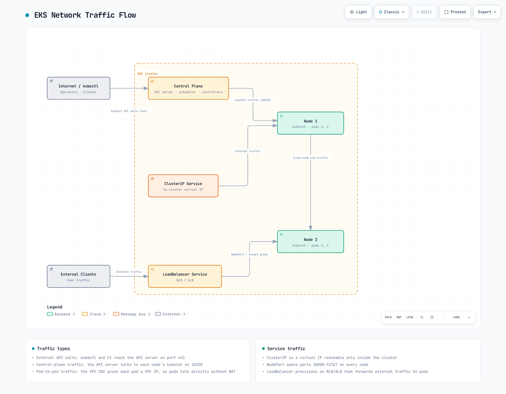
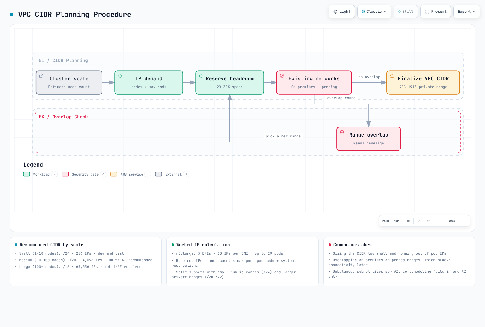
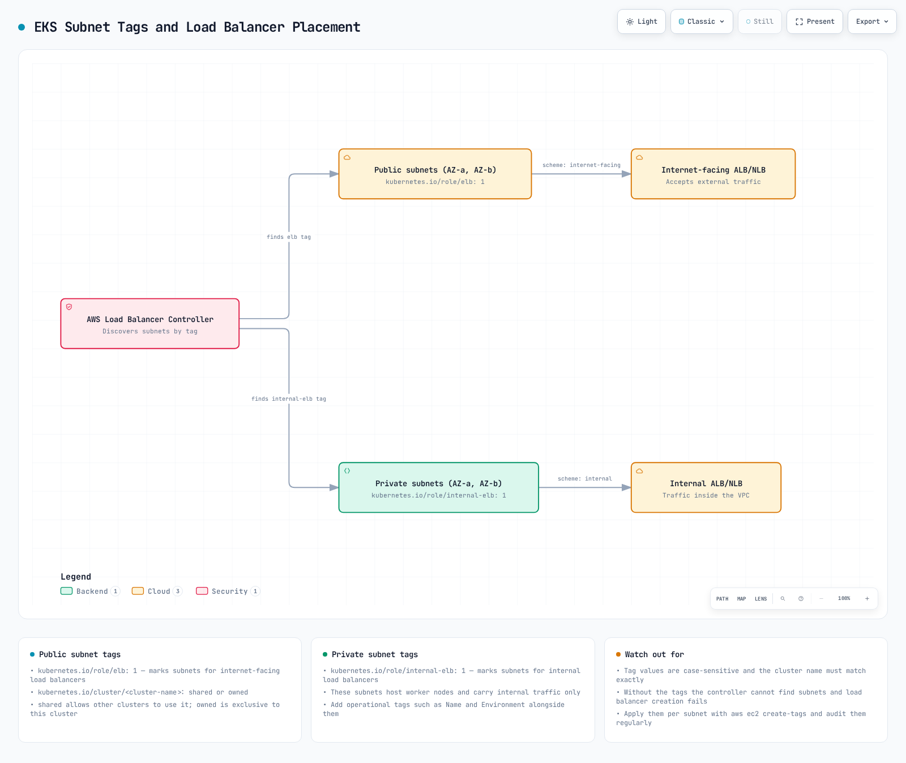
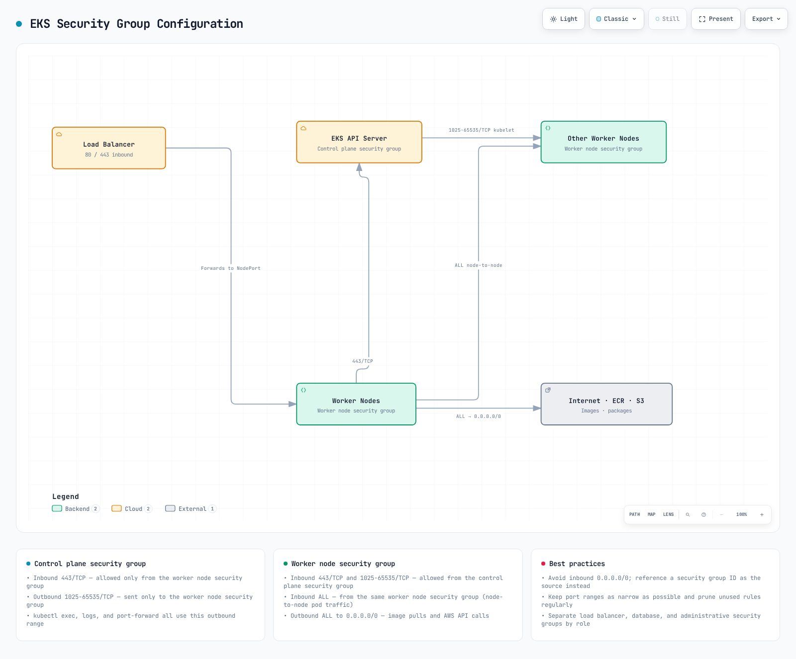

# EKS ネットワーキング

> **最終更新日**: 2026年9月11日

## 概要

この章では、一般的な EKS クラスターの VPC／サブネット計画とセキュリティグループ経路を扱います。AWS は AWS 管理インフラストラクチャ上でコントロールプレーンを管理します。顧客 VPC 内には、クラスター接続用 ENI、ノード／Pod インターフェース、ロードバランサーやエンドポイントのリソースが配置されます。顧客 VPC の境界を、マネージドコントロールプレーンやリージョンの S3／ECR／STS サービスが物理的に存在する場所と解釈しないでください。

## EKS ネットワーキングアーキテクチャ

<!-- Audit 2026-09-11: parent asset repair required. MoveAWS-managedcontrolplaneandregionalS3/ECR/STSservicesoutsidethecustomerVPCboundary;showcustomerclusterENIs/interfaceendpointendsinsideVPC. ScopeNATpathasIPv4internetexample,notalltraffic.


[🔍 View interactive diagram](https://www.atomai.click/kubernetes-docs/archmaps/en-eks-03-eks-networking-part1-0.html)
-->

| コンポーネント | 役割 |
| --- | --- |
| VPC とサブネット | アドレス／ルーティングの境界。各サブネットは1つの AZ に属します |
| ルートテーブル | 宛先範囲ごとの次ホップを選択します |
| Internet Gateway | VPC にアタッチされ、パブリックサブネットからの経路先になります |
| パブリック NAT Gateway | パブリックサブネットに配置し、EIP と IGW への経路を設定した場合、プライベート IPv4 の共通インターネット送信経路を提供します |
| セキュリティグループ | 対応するネットワークインターフェース／リソースに関連付けるステートフルなルールです |
| ネットワーク ACL | サブネット境界で適用するステートレスなルールです。必要な戻り通信も許可します |
| CNI | Pod のネットワーキングを構成します。動作は選択した実装／モードによって異なります |

### トラフィック経路

<!-- Audit 2026-09-11: parent asset repair required. NodePortusesallocatedportsfromthedefaultrange,nottheentire30000–32767rangeoneverynode;separateNLBServicefromALBIngress/GatewayandIPvsinstancetargetpaths. KOPNGfooterappearscropped;parentfullPagecapture.


[🔍 View interactive diagram](https://www.atomai.click/kubernetes-docs/archmaps/en-eks-03-eks-networking-part1-1.html)
-->

Pod 間通信は、同じノード内で完結する場合と、ノードのインターフェースや VPC ルートを越える場合があります。同一ノード内の通信が VPC ファブリックを通るとは限らないため、VPC Flow Logs はすべての Pod 通信を記録するものではありません。Service 通信は構成済みの Service proxy 経路と選択されたバックエンドを使います。Service は専用の転送アプライアンスではありません。外部 ingress／egress はスキーム、ルート、ターゲットタイプ、セキュリティ制御に依存します。コントロールプレーンの通信はアプリケーション通信とは別の経路です。


[🔍 インタラクティブ図を表示](https://www.atomai.click/kubernetes-docs/archmaps/en-eks-03-eks-networking-part1-2.html)

この図は、パブリック ingress と AZ ごとの NAT を使う IPv4 egress の例です。すべての EKS クラスターにパブリックサブネットや NAT が必要という意味ではありません。完全なプライベートエンドポイント、集中型 egress、ネイティブ IPv6 には、それぞれ異なる要件とコストがあります。

## VPC とサブネットの要件

<!-- Audit 2026-09-11: parent asset repair required. InternetaccessisnotuniversalEKSprerequisite;fullyprivateendpointsareanalternative. IGWattachesVPC,notpublicsubnet. Replacearbitrarysmall/mediumCIDRswithmeasuredplanninginputs.


[🔍 View interactive diagram](https://www.atomai.click/kubernetes-docs/archmaps/en-eks-03-eks-networking-part1-3.html)
-->

- リージョン EKS クラスターでは、少なくとも2つの AZ にある適格なサブネットを選びます。各クラスターサブネットには EKS 用に最低6個の空き IP アドレスが必要で、AWS は最低16個を推奨しています。アップグレード時に置き換えられるコントロールプレーン ENI やほかのリソースのための余裕も確保してください。
- VPC の DNS support と DNS hostnames を有効にします。クラスターサブネットとノード／Pod サブネットは同一である必要はありませんが、必要な経路をルーティングできるようにします。
- ノードには Kubernetes API、イメージレジストリ、利用する AWS サービスへのアクセスが必要です。必ずしもパブリックインターネットは不要で、プライベートエンドポイントやミラーを使えます。EKS AWS サービス用エンドポイントは、クラスター Kubernetes API エンドポイントとは別です。
- `controlPlaneEgressMode=CUSTOMER_ROUTED` を有効にしている場合は、カスタムのコントロールプレーン egress を確認します。クラスターサブネットのルートとセキュリティルールから、必要な webhook／OIDC 等のエンドポイントに到達できる必要があります。
- クラスターサブネットを変更しても、元の VPC／AZ セットに関する制約は引き継がれます。VPC CIDR の追加がすべてのコントロールプレーン操作に即時反映されるとは限りません。AWS の説明では、反映に最大1時間かかる場合があります。

### CIDR の計画

<!-- Audit 2026-09-11: parent asset repair required. Removeuniversal1–10node/24,10–100node/20,100+node/16and20–30%headroomguarantees;countreserved/ENI/warm/controlplane/LB/upgradeIPs. RFC1918onlylabeltoobroad;nonoverlapandsupportedCIDRrulesmatter.


[🔍 View interactive diagram](https://www.atomai.click/kubernetes-docs/archmaps/en-eks-03-eks-networking-part1-4.html)
-->

想定ノード数、通常および branch ENI の Pod、warm pool／prefix block、コントロールプレーンインターフェース、ロードバランサー／エンドポイント、成長分、更新時の容量を基にアドレスを計画します。Service CIDR、接続先 VPC、オンプレミスネットワークとの重複も確認してください。ノード数だけでは安全な VPC CIDR を決められず、一律の20～30%予備容量も普遍的なルールではありません。

以下は**IPv4 アドレスの総数**であり、クラスター規模の推奨値でも、利用可能な Pod 容量でもありません。

| CIDR | アドレス総数 |
| --- | ---: |
| /24 | 256 |
| /22 | 1,024 |
| /20 | 4,096 |
| /16 | 65,536 |

通常の AWS IPv4 サブネットでは先頭4個と末尾1個が予約されます。そのため /24 の割り当て可能数は251、/22 は1,019ですが、ワークロードやインフラが消費する前の値です。これは VPC 全体で5個ではなくサブネットごとの予約です。BYOIP には文書化された例外があります。既存サブネットの CIDR はそのまま拡張できません。Prefix delegation には連続したアドレスブロックが必要で、新しいアドレス空間を作るものではありません。

### サブネット設計例

<!-- Audit 2026-09-11: parent asset repair required. Private10.0.2.0/22and10.0.6.0/22arenoncanonical;canonicalfirstoverlapspublicsubnets. Use10.0.4.0/22and10.0.8.0/22;showzonalpublicNATplacementandIGWroute;rawIPcountsnotusable.


[🔍 View interactive diagram](https://www.atomai.click/kubernetes-docs/archmaps/en-eks-03-eks-networking-part1-5.html)
-->

`10.0.0.0/16` の VPC では、次の範囲は境界が揃い、相互に重複しません。これはパブリックロードバランサーと AZ ごとの NAT を使う設計例で、測定に基づくサイジングではありません。パブリックサブネットには IGW へのルートが関連付けられます。タグや名前だけではパブリックになりません。プライベートノードは NAT または適切なプライベートサービスエンドポイントを利用できます。

| 種類 | AZ | CIDR | 用途の例 |
| --- | --- | --- | --- |
| パブリック | us-west-2a | 10.0.0.0/24 | パブリックロードバランサーと AZ ごとの NAT |
| パブリック | us-west-2b | 10.0.1.0/24 | パブリックロードバランサーと AZ ごとの NAT |
| プライベート | us-west-2a | 10.0.4.0/22 | ワーカーノード／Pod |
| プライベート | us-west-2b | 10.0.8.0/22 | ワーカーノード／Pod |

以前の `10.0.2.0/22` と `10.0.6.0/22` はネットワーク境界に揃っていません。AWS は CIDR を正規化するため、最初の範囲は `10.0.0.0/22` となってパブリックサブネットと重複します。プロビジョニング前に境界と重複を検証してください。AZ 内で完結する NAT 経路は AZ 間 NAT への依存を避けますが、冗長性、ルート、ワークロード配置も確認が必要です。

### サブネット検出タグ

<!-- Audit 2026-09-11: parent asset repair required. Tagrequirementsdependcontroller/version/features;LBC>=2.12.1canuseSubnetDiscoveryByReachabilitywithoutroletags. owned/sharedarenotsecurityisolation;privatesubnetscanhaveegress. Removewithouttagsalwaysfailsclaim.


[🔍 View interactive diagram](https://www.atomai.click/kubernetes-docs/archmaps/en-eks-03-eks-networking-part1-6.html)
-->

検出動作は選択したコントローラーとバージョンに依存します。AWS Load Balancer Controller 3.5 では role tag がパブリック／内部サブネットの選択に使われ、値は `1` または空文字列が有効です。新しい LBC で、以前の cluster ownership tag が常に必要というわけではありません。role tag の候補がない場合、LBC 2.12.1 以降は `SubnetDiscoveryByReachability` が有効であれば、ルートベースの検出を使えます。cluster tag による絞り込み、空き IP、AZ ごとの選択も影響します。EKS Auto Mode には独自の文書化されたタグ要件があります。

- インターネット向け配置: `kubernetes.io/role/elb`
- 内部向け配置: `kubernetes.io/role/internal-elb`
- `kubernetes.io/cluster/<cluster-name>` は絞り込み／優先順位に影響する場合があります。`owned`／`shared` はセキュリティ境界でも、自動ルーティング規則でもありません。

```bash
# After reviewing subnet ownership and its associated routes, tag the intended public subnet.
aws ec2 describe-subnets --region "${EXAMPLE_REGION:?}" --subnet-ids "${PUBLIC_SUBNET_ID:?}" \
  --query 'Subnets[].{id:SubnetId,vpc:VpcId,cidr:CidrBlock,free:AvailableIpAddressCount,tags:Tags}'
aws ec2 create-tags --region "$EXAMPLE_REGION" --resources "$PUBLIC_SUBNET_ID" \
  --tags Key=kubernetes.io/role/elb,Value=1
```

確認済みのプライベート／内部配置には `internal-elb` role tag を使います。任意の既存サブネットにタグを付けたり、未調査の検出失敗を避けるため cluster tag の確認を無効にしたりしないでください。明示的なサブネット選択も、ロードバランサーの適格要件を満たす必要があります。

### セキュリティグループの経路

<!-- Audit 2026-09-11: parent asset repair required. Replace1025–65535kubeletrangewithactualTCP10250;distinguishprivateAPI443,DNS53,webhook/workloadports,andstatefulSGvsNACLreturnports. EKSdefaultclusterSGmaybesharedwithMNG;publicAPIusesCIDRs;alloutboundnotuniversalneed.


[🔍 View interactive diagram](https://www.atomai.click/kubernetes-docs/archmaps/en-eks-03-eks-networking-part1-7.html)
-->

EKS はデフォルトのクラスターセキュリティグループを作成し、クラスター ENI と通常はマネージドノードのインターフェースに関連付けます。すべてが共通の2グループ構成になるわけではありません。追加のクラスター SG が自動的にノード SG になるわけではなく、カスタム Launch Template の SG や Pod セキュリティグループで経路は変わります。ルールを編集する前に、実際の関連付けを確認してください。

```bash
aws eks describe-cluster --name "${EXAMPLE_CLUSTER:?}" --region "${EXAMPLE_REGION:?}" \
  --query 'cluster.resourcesVpcConfig.{clusterSG:clusterSecurityGroupId,additionalSGs:securityGroupIds,subnets:subnetIds,public:endpointPublicAccess,private:endpointPrivateAccess,publicCIDRs:publicAccessCidrs}'
```

| 通信 | 代表的な宛先ポート | 確認する範囲 |
| --- | --- | --- |
| ノード／許可された接続クライアント → プライベート Kubernetes API | TCP 443 | クラスターエンドポイント SG と許可された送信元 |
| コントロールプレーン → kubelet | TCP 10250 | 対象ノード SG とルート |
| ノード／Pod → DNS バックエンド | UDP／TCP 53 | 実際の CoreDNS／NodeLocal DNS 経路 |
| コントロールプレーン → admission webhook | 設定されたバックエンドポート | webhook Service／Endpoint と SG 経路 |
| アプリケーション／ロードバランサー → ワークロード | 設定されたアプリケーション／ヘルスチェックポート | ターゲットタイプ、ターゲット SG、ヘルスチェック |

デフォルトのクラスター SG の送信を絞る場合、AWS が示す最小セットはクラスター SG 宛ての TCP 443、TCP 10250、TCP／UDP 53 と、実際に必要なアプリケーション、ノード間、Service の通信です。以前の `1025–65535` kubelet 範囲はこの最小要件ではありません。SG はステートフルなため、戻り通信にエフェメラルポート範囲を無条件に開く必要はありません。NACL はステートレスなので、対応する戻り経路も許可します。

デフォルトの自己 ingress／egress と EFA ルールはクラスター更新時に再作成される場合があります。狭い SG を追加しても、別のアタッチ済み SG に広い許可があれば打ち消せません。パブリック API アクセスは `publicAccessCidrs` で制御し、クラスター SG はプライベートエンドポイント経路を制御します。レジストリや AWS API への egress を確認し、すべてのクラスターに `ALL → 0.0.0.0/0` が必要と決めつけず、適切なエンドポイントやルートを利用してください。

## 次のステップとクイズ

[EKS ネットワーキング Part 2](./03-eks-networking-part2.md) では、Service、ロードバランシング、ポリシーを扱います。[Part 1 のクイズ](../quizzes/eks/03-eks-networking-part1-quiz.md)で理解度を確認してください。

## 参考資料

- [EKS VPC／サブネット](https://docs.aws.amazon.com/eks/latest/userguide/network-reqs.html)
- [プライベートクラスター](https://docs.aws.amazon.com/eks/latest/userguide/private-clusters.html)
- [サブネットのサイジング](https://docs.aws.amazon.com/vpc/latest/userguide/subnet-sizing.html)
- [セキュリティグループ](https://docs.aws.amazon.com/eks/latest/userguide/sec-group-reqs.html)
- [LBC のサブネット検出](https://github.com/kubernetes-sigs/aws-load-balancer-controller/blob/v3.5.0/docs/deploy/subnet_discovery.md)
