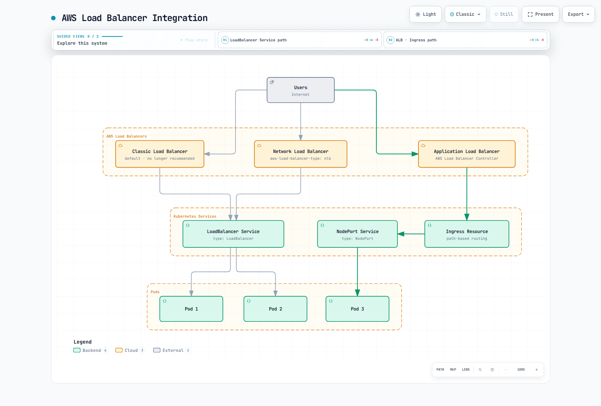
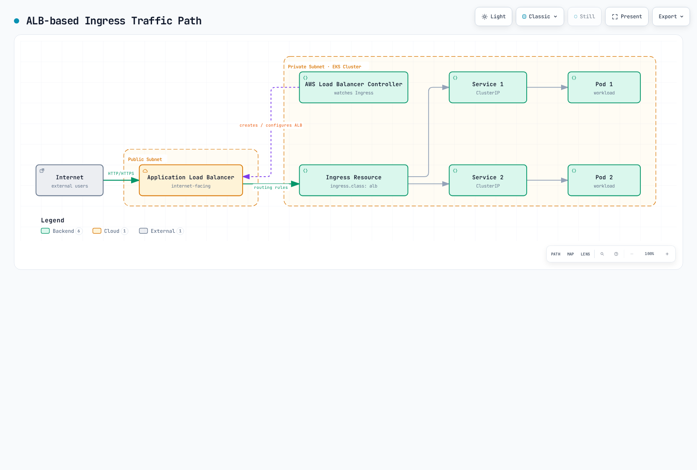
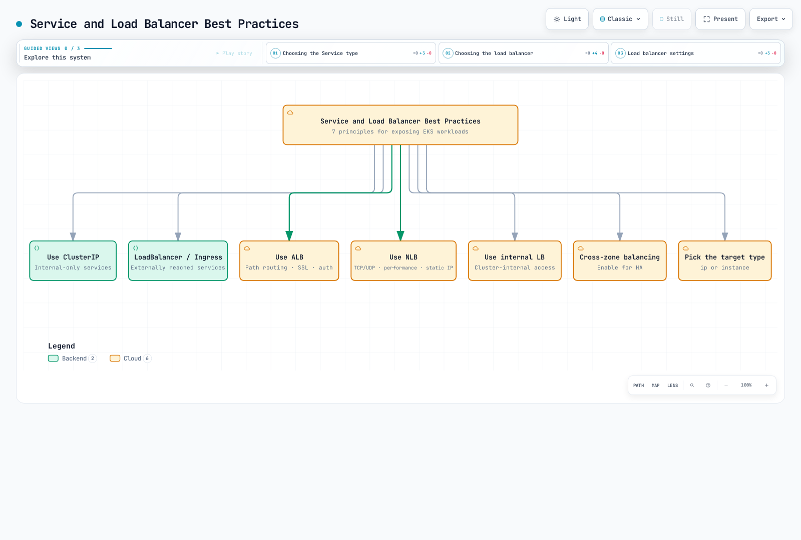
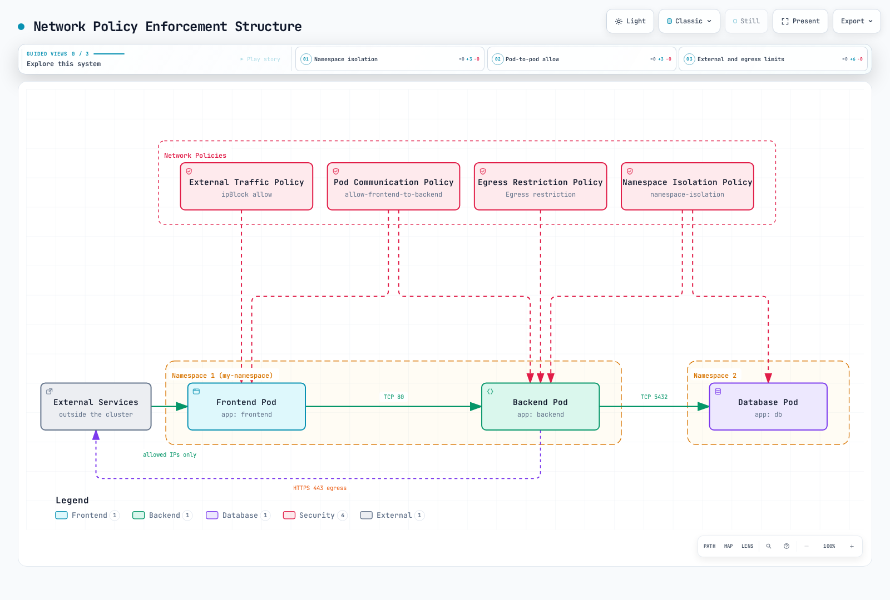
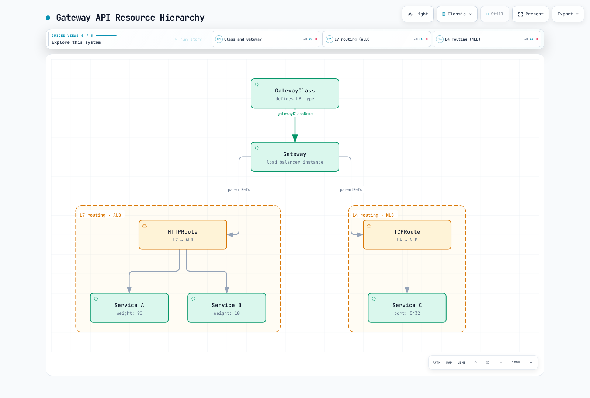

# EKSネットワーキング - パート2: Service、負荷分散、ネットワークポリシー

> **検証済み例のバージョン**: EKS Kubernetes 1.36、AWS Load Balancer Controller 3.6.0、Gateway API 1.6.0
> **最終更新**: 2026年10月16日

## 概要

このドキュメントでは、Amazon EKSにおけるService、負荷分散、ネットワークポリシーを説明します。Kubernetes Serviceを使ったアプリケーションの公開、AWSロードバランサーとの統合、NetworkPolicyを使ったPod間通信の制御を扱います。

## Kubernetes Serviceの種類

Kubernetesには次のService typeがあります。


[🔍 インタラクティブ図を表示](https://www.atomai.click/kubernetes-docs/archmaps/en-eks-03-eks-networking-part2-0.html)

1. **ClusterIP**: クラスター内ルーティング用のService仮想IPです。認可境界ではありません。
2. **NodePort**: 対象Nodeアドレスと割り当てportを通じて公開します。ルーティングとfirewall ruleの影響を受けます。
3. **LoadBalancer**: インストール済みロードバランサー実装が調整するServiceです。ロードバランサーをinternalにすることもできます。
4. **ExternalName**: 外部Serviceを指すCNAMEレコードを提供します。

### ClusterIP Service

ClusterIPがデフォルトtypeです。仮想IPはクラスター内ネットワーク用で、namespace分離や認証を実施するものではありません。headless Service（`clusterIP: None`）は代わりにDNS経由でendpoint addressを公開します。

```yaml
apiVersion: v1
kind: Service
metadata:
  name: my-service
spec:
  selector:
    app: my-app
  ports:
  - port: 80
    targetPort: 8080
  type: ClusterIP
```

### NodePort Service

NodePortは通常、設定済みNode addressと30000–32767（デフォルト範囲）のportを使います。実際の到達性はNode readiness、service-proxy設定、`externalTrafficPolicy`、route、security ruleによって決まります。単一Serviceのために範囲全体を開く必要はありません。

```yaml
apiVersion: v1
kind: Service
metadata:
  name: my-service
spec:
  selector:
    app: my-app
  ports:
  - port: 80
    targetPort: 8080
    nodePort: 30080
  type: NodePort
```

### LoadBalancer Service

インストール済みcontrollerがこのServiceを調整します。例ではLBCを明示的に選び、Pod IPをtargetとするinternal NLBを作成します。ALBはIngressまたはALB Gatewayで設定します。EKS Auto Modeでは`eks.amazonaws.com/nlb`と固有の対応設定を使います。同じ`my-service`の2つのバージョンを同時に適用しないでください。

```yaml
apiVersion: v1
kind: Service
metadata:
  name: my-service
  annotations:
    service.beta.kubernetes.io/aws-load-balancer-scheme: internal
    service.beta.kubernetes.io/aws-load-balancer-nlb-target-type: ip
spec:
  type: LoadBalancer
  loadBalancerClass: service.k8s.aws/nlb
  allocateLoadBalancerNodePorts: false
  selector:
    app: my-app
  ports:
  - port: 80
    targetPort: 8080
```

### ExternalName Service

ExternalName Serviceは外部Serviceを指すCNAMEレコードを提供します。通信のproxy、TLS、port、firewall accessの設定は行いません。HTTP Host headerと証明書名は引き続き宛先に一致させる必要があります。

```yaml
apiVersion: v1
kind: Service
metadata:
  name: my-service
spec:
  type: ExternalName
  externalName: my-service.example.com
```

## AWSロードバランサーとの統合

EKSはKubernetes ServiceとAWSロードバランサーを統合し、アプリケーションをクラスター外から利用できるようにします。

<!-- Diagram repair pending: see batch report.


[🔍 インタラクティブ図を表示](https://www.atomai.click/kubernetes-docs/archmaps/en-eks-03-eks-networking-part2-1.html)
-->

### Classic Load Balancer (CLB)

従来のAWS service-controller経路ではCLBを作成する場合がありました。これは現行LBCのデフォルトではありません。LBC 2.5以降は通常、新規LoadBalancer ServiceにNLB classを割り当てます。既存Serviceを移行する前に実controller、class、resource ownershipを確認してください。ownership annotationをその場で変更するとresource漏れや公開範囲の変化が起きる場合があります。

### Network Load Balancer (NLB)

上の明示的なNLB例を使います。以下はそのServiceへマージする**annotation断片**であり、単独manifestではありません。
```yaml
metadata:
  annotations:
    service.beta.kubernetes.io/aws-load-balancer-scheme: internal
    service.beta.kubernetes.io/aws-load-balancer-nlb-target-type: ip
    service.beta.kubernetes.io/aws-load-balancer-attributes: load_balancing.cross_zone.enabled=true
    service.beta.kubernetes.io/aws-load-balancer-target-group-attributes: preserve_client_ip.enabled=true
```
`aws-load-balancer-nlb-target-type`はtarget typeを選択します。`preserve_client_ip.enabled`が変えるのは送信元IPの扱いで、target typeではありません。Cross-zone balancingはcapacity、可用性、費用を踏まえて決めてください。ゾーンごとのtargetと障害時の動作を確認します。Proxy Protocol v2は任意ですが、backend側にparserが必要です。通常のHTTP serverで有効にするとrequestが壊れる場合があります。

### Application Load Balancer (ALB)

ALBを使うにはAWS Load Balancer Controllerをインストールし、Ingress resourceを使います。



[🔍 インタラクティブ図を表示](https://www.atomai.click/kubernetes-docs/archmaps/en-eks-03-eks-networking-part2-2.html)

1. platform ownerとcontrollerを準備します。以下のcommandは固定IAM policyを取得して固定chartをrenderしますが、IAM trustは設定しません。まず、review済みPod Identity associationまたはIRSA role/OIDC trust、およびrelease policyを設定した`kube-system/aws-load-balancer-controller` ServiceAccountを用意します。既存installationは元のHelm/IaC ownershipを維持してください。subnet discovery、API/Webhook接続、利用可能なkubeconfigも確認します。
```bash
set -euo pipefail
: "${CLUSTER_NAME:?Set the existing cluster name}"
: "${AWS_REGION:?Set the cluster Region}"
: "${VPC_ID:?Set the cluster VPC ID}"
curl --fail --show-error --location \
  https://raw.githubusercontent.com/kubernetes-sigs/aws-load-balancer-controller/v3.6.0/docs/install/iam_policy.json \
  --output lbc-iam-policy-v3.6.0.json
helm repo add eks https://aws.github.io/eks-charts
helm repo update eks
helm template aws-load-balancer-controller eks/aws-load-balancer-controller \
  --version 3.6.0 --namespace kube-system \
  --set-string clusterName="$CLUSTER_NAME" \
  --set-string region="$AWS_REGION" --set-string vpcId="$VPC_ID" \
  --set serviceAccount.create=false \
  --set-string serviceAccount.name=aws-load-balancer-controller \
  > lbc-rendered.yaml
```
render済みresourceをreviewしIAM前提条件を満たしてから、クラスターに変更を適用します。CRDは文書化されたrelease手順でupgradeしてください。Helm upgradeだけではすべてのCRDが自動upgradeされません。
```bash
helm upgrade --install aws-load-balancer-controller eks/aws-load-balancer-controller \
  --version 3.6.0 --namespace kube-system \
  --set-string clusterName="$CLUSTER_NAME" \
  --set-string region="$AWS_REGION" --set-string vpcId="$VPC_ID" \
  --set serviceAccount.create=false \
  --set-string serviceAccount.name=aws-load-balancer-controller
kubectl -n kube-system rollout status deployment/aws-load-balancer-controller --timeout=180s
```
2. `spec.ingressClassName: alb`を指定したIngressを作成します。追加のload balancerを作らないよう、最初の例の**ClusterIP** `my-service`をbackendとして使います。選択されるPodが実際に8080でlistenしている必要があります。上図は論理的な設定を示します。trafficはIngress API objectやcontroller Podを経由しません。
```yaml
apiVersion: networking.k8s.io/v1
kind: Ingress
metadata:
  name: my-ingress
  annotations:
    alb.ingress.kubernetes.io/scheme: internal
    alb.ingress.kubernetes.io/target-type: ip
spec:
  ingressClassName: alb
  rules:
  - http:
      paths:
      - path: /
        pathType: Prefix
        backend:
          service:
            name: my-service
            port:
              number: 80
```
HTTPSでは、この断片をIngressにマージし、ACM ARNとsecurity groupを同一Region/VPCの実resourceに置き換えます。custom frontend SGは自分で設定してください。backend ruleを管理するかは別の選択です。action annotationを参照しない限り、それだけではredirectは追加されません。下の`ssl-redirect`は文書化された簡易設定です。
```yaml
metadata:
  annotations:
    alb.ingress.kubernetes.io/listen-ports: '[{"HTTP":80},{"HTTPS":443}]'
    alb.ingress.kubernetes.io/certificate-arn: arn:aws:acm:us-west-2:123456789012:certificate/00000000-0000-4000-8000-000000000000
    alb.ingress.kubernetes.io/ssl-redirect: "443"
    alb.ingress.kubernetes.io/security-groups: sg-0123456789abcdef0
    alb.ingress.kubernetes.io/manage-backend-security-group-rules: "true"
```

### Serviceとロードバランサーのベストプラクティス

<!-- Diagram repair pending: see batch report.


[🔍 インタラクティブ図を表示](https://www.atomai.click/kubernetes-docs/archmaps/en-eks-03-eks-networking-part2-3.html)
-->

1. **内部ServiceにClusterIPを使う**: クラスター内だけからアクセスするServiceにはClusterIP typeを使います。
2. **外部ServiceにLoadBalancerまたはIngressを使う**: 外部アクセスが必要なServiceにはLoadBalancer typeまたはIngress resourceを使います。
3. **ALBを使う**: path-based routing、SSL終端、認証などの機能が必要な場合にALBを使います。
4. **NLBを使う**: TCP/UDP traffic、高性能、static IPが必要な場合にNLBを使います。
5. **internal load balancerを使う**: 接続済みVPCや許可されたオンプレミスを含むprivate route clientにはinternal load balancerを使います。クラスター内clientには通常ClusterIPで十分です。
6. **cross-zone balancingを有効にする**: cross-zoneの動作をtarget capacity、ゾーン障害テスト、転送費用と照らして評価します。有効にするだけで高可用性が保証されるわけではありません。
7. **適切なtarget typeを選ぶ**: Pod IPを直接targetにする場合は`ip`、Node IPをtargetにする場合は`instance`を選択します。

## NetworkPolicy

NetworkPolicyはenforcement実装が有効な場合、選択したPodと方向に対するL3/L4 trafficをfilterします。Amazon VPC CNIは、対応するEC2/Linux構成でnative network-policy機能を備えています。必ずしも別のCNIをインストールする必要はありません。[AWSガイド](https://docs.aws.amazon.com/eks/latest/userguide/cni-network-policy.html)で、正確なadd-on版、kernel/compute制限、standard/strict mode、managed Pod要件を確認してください。

<!-- Diagram repair pending: see batch report.


[🔍 インタラクティブ図を表示](https://www.atomai.click/kubernetes-docs/archmaps/en-eks-03-eks-networking-part2-4.html)
-->

### NetworkPolicy実装の選択

EKS管理のVPC CNI add-onでは、`describe-addon-configuration`を確認し、既存設定の無関係な項目を維持したうえで、add-on ownerを通じて以下の断片をマージします。policy objectの存在だけでなく、TCP通信を許可する場合と拒否する場合の両方を試してenforcementを検証します。
```json
{"enableNetworkPolicy":"true"}
```
Calicoは代替policy engineです。VPC CNIと組み合わせる場合は、`cni.type: AmazonVPC`、Pod IP annotationの権限、版の互換性を含む[公式EKS policy-only手順](https://docs.tigera.io/calico/latest/getting-started/kubernetes/managed-public-cloud/eks)に従ってください。VPC CNIのnative enforcementを同時に有効にしないでください。既存VPC CNIクラスターへVXLAN networking manifestを適用してもpolicy-only installationにはなりません。ネットワークを置き換えるには別途migration設計が必要です。

### デフォルトNetworkPolicy

選択するNetworkPolicyがなければ、その方向についてPodはisolationされません。route、security group、その他の制御は引き続き適用されます。Ingressとegressは別々にisolationされ、一致する複数policyの許可は加算されます。両方向がisolationされる場合は、送信元のegressと宛先のingressの両方が接続を許可する必要があります。応答trafficは暗黙に許可されます。以下は組み合わせて全体を狭めるpolicy例ではありません。後述のnamespace全体向けingress許可は、後のfrontend限定例が制限する想定のtrafficも許可します。

### Namespace分離policy

このpolicyは`my-namespace`の全Podを選択し、**ingressだけ**をisolationします。同一namespaceからの全port ingressを許可し、egressは制限しません。先にnamespaceと対象workload labelを作成してください。

```yaml
apiVersion: networking.k8s.io/v1
kind: NetworkPolicy
metadata:
  name: namespace-isolation
  namespace: my-namespace
spec:
  podSelector: {}
  policyTypes:
  - Ingress
  ingress:
  - from:
    - podSelector: {}
```

### 特定Pod間の通信許可policy

特定labelを持つPod間の通信だけを許可するpolicyです。

```yaml
apiVersion: networking.k8s.io/v1
kind: NetworkPolicy
metadata:
  name: allow-frontend-to-backend
  namespace: my-namespace
spec:
  podSelector:
    matchLabels:
      app: backend
  policyTypes:
  - Ingress
  ingress:
  - from:
    - podSelector:
        matchLabels:
          app: frontend
    ports:
    - protocol: TCP
      port: 80
```

### 外部traffic制限policy

source CIDRからのingressを許可する例です。他の加算的なpolicyも適用されます。評価対象はpolicy enforcement pointで見えるsource IPです。NAT、NodePort、load balancerによりIPが変わる場合があります。frontend load balancerのSGやWAF ruleの代わりにはなりません。

```yaml
apiVersion: networking.k8s.io/v1
kind: NetworkPolicy
metadata:
  name: allow-external-traffic
  namespace: my-namespace
spec:
  podSelector:
    matchLabels:
      app: web
  policyTypes:
  - Ingress
  ingress:
  - from:
    - ipBlock:
        cidr: 192.168.1.0/24
        except:
        - 192.168.1.10/32
    ports:
    - protocol: TCP
      port: 80
```

### Egress traffic制限policy

特定宛先だけにegressを許可するpolicyです。`203.0.113.0/24`は文書用範囲なので、承認済みの実外部宛先に置き換えてください。DNS許可は通常のCoreDNS Podを前提としており、NodeLocal DNSなど別設計では変更が必要です。`0.0.0.0/0`からRFC1918範囲を除外しても、特定の外部Serviceを指定できず、instance metadataを確実に保護できるわけでもありません。

```yaml
apiVersion: networking.k8s.io/v1
kind: NetworkPolicy
metadata:
  name: limit-egress-traffic
  namespace: my-namespace
spec:
  podSelector:
    matchLabels:
      app: web
  policyTypes:
  - Egress
  egress:
  - to:
    - podSelector:
        matchLabels:
          app: db
    ports:
    - protocol: TCP
      port: 5432
  - to:
    - ipBlock:
        cidr: 203.0.113.0/24
    ports:
    - protocol: TCP
      port: 443
  - to:
    - namespaceSelector:
        matchLabels:
          kubernetes.io/metadata.name: kube-system
      podSelector:
        matchLabels:
          k8s-app: kube-dns
    ports:
    - protocol: UDP
      port: 53
    - protocol: TCP
      port: 53
```

### NetworkPolicyのベストプラクティス


[🔍 インタラクティブ図を表示](https://www.atomai.click/kubernetes-docs/archmaps/en-eks-03-eks-networking-part2-5.html)

1. **default deny policyを適用する**: 既定ですべてのtrafficを拒否し、必要なtrafficだけ明示的に許可します。
2. **namespaceを分離する**: namespace間通信を制限してセキュリティを高めます。
3. **最小権限の原則を適用する**: 必要最小限の通信だけを許可します。
4. **egress trafficを制限する**: Podから外部へ向かうtrafficを制限します。
5. **policyをテストする**: 意図しない通信遮断を防ぐため、適用前にNetworkPolicyをテストします。

---

## Gateway API

### 概要

Gateway APIではインフラ所有者（GatewayClass/Gateway）とアプリケーションrouteを分離します。LBCでは**ALB GatewayとNLB Gatewayを分けます**。1つのGatewayでL4とL7のrouteを混在できません。controllerが文書化する機能範囲内で、ALBはHTTPRoute/GRPCRoute、NLBはTCPRoute/UDPRoute/TLSRouteをサポートします。

<!-- Diagram repair pending: see batch report.


[🔍 インタラクティブ図を表示](https://www.atomai.click/kubernetes-docs/archmaps/en-eks-03-eks-networking-part2-6.html)
-->

### 前提条件

例はLBC **3.6.0**と、そのreleaseが示すGateway API **1.6.0**を対象とします。3.6.0は3.5.0と同じGateway API 1.6.0 CRDを使いますが、release noteではcontroller upgrade前にAWS提供の最新CRD（chart CRDとLBC Gateway CRD）の適用を求めています。以前のL4対応は2.13.3、L7は2.14.0からです。「2.13以降はすべて対応」は誤りです。3.6.0ではcontrollerがCRDを検出し、`NLBGatewayAPI`/`ALBGatewayAPI`をデフォルトで有効にします。`EnableGatewayAPI` gateはありません。TCPRouteとUDPRouteは標準channelのv1 resourceです。古いexperimental CRDをそのままインストールしないでください。
```bash
set -euo pipefail
curl --fail --show-error --location \
  https://github.com/kubernetes-sigs/gateway-api/releases/download/v1.6.0/standard-install.yaml \
  --output gateway-standard-v1.6.0.yaml
curl --fail --show-error --location \
  https://raw.githubusercontent.com/kubernetes-sigs/aws-load-balancer-controller/v3.6.0/config/crd/gateway/gateway-crds.yaml \
  --output lbc-gateway-crds-v3.6.0.yaml
```
クラスター全体に及ぶこれらの更新を適用する前に、download内容と既存CRDのowner/stored versionを確認します。既存installationではrelease migration手順に従ってください。CRDがない状態でcontrollerが起動した場合は、CRD確立後にcontrollerを再起動または再調整します。
```bash
kubectl apply --server-side -f gateway-standard-v1.6.0.yaml
kubectl apply --server-side -f lbc-gateway-crds-v3.6.0.yaml
kubectl get crd gateways.gateway.networking.k8s.io \
  tcproutes.gateway.networking.k8s.io udproutes.gateway.networking.k8s.io \
  loadbalancerconfigurations.gateway.k8s.aws
```

### GatewayClassとGatewayの設定

専用の`gateway-demo` namespaceと、名前付きbackend Service/ready workloadを先に作成します。ACM ARNとsource CIDRを置き換え、証明書をALBがそのRegionで利用できる状態にします。これは設定例であり、本番デプロイを実行したものではありません。参照先のデフォルトTargetGroupConfigurationはClusterIP backendでIP targetを使わせます。設定しなければcontrollerのデフォルトがNodePortを必要とするinstance targetになる場合があります。このLBC固有のHTTPS方式ではLoadBalancerConfiguration経由でACMを設定し、未対応の`tls.certificateRefs`は意図的に省いています。
```yaml
apiVersion: gateway.networking.k8s.io/v1
kind: GatewayClass
metadata:
  name: amazon-alb
spec:
  controllerName: gateway.k8s.aws/alb
---
apiVersion: gateway.k8s.aws/v1
kind: TargetGroupConfiguration
metadata:
  name: ip-targets
  namespace: gateway-demo
spec:
  defaultConfiguration:
    targetType: ip
---
apiVersion: gateway.k8s.aws/v1
kind: LoadBalancerConfiguration
metadata:
  name: alb-config
  namespace: gateway-demo
spec:
  scheme: internal
  sourceRanges:
  - 10.0.0.0/16
  defaultTargetGroupConfiguration:
    name: ip-targets
  listenerConfigurations:
  - protocolPort: HTTPS:443
    defaultCertificate: arn:aws:acm:us-west-2:123456789012:certificate/00000000-0000-4000-8000-000000000000
---
apiVersion: gateway.networking.k8s.io/v1
kind: Gateway
metadata:
  name: my-hotel-gateway
  namespace: gateway-demo
spec:
  gatewayClassName: amazon-alb
  infrastructure:
    parametersRef:
      group: gateway.k8s.aws
      kind: LoadBalancerConfiguration
      name: alb-config
  listeners:
  - name: https
    protocol: HTTPS
    port: 443
    hostname: app.example.com
    allowedRoutes:
      namespaces:
        from: Same
```

### HTTPRouteの例（L7 → ALB）

90/10のweightは`/api`に一致する対象requestに適用されます。正確なrequest数の保証でも、health-based failover policyでもありません。このrouteはhostnameが一致するHTTPS listenerにattachします。backend portにはService portを指定します。namespaceをまたぐroute/backendには、対応するallowedRoutes/ReferenceGrant設定が必要です。
```yaml
apiVersion: gateway.networking.k8s.io/v1
kind: HTTPRoute
metadata:
  name: app-route
  namespace: gateway-demo
spec:
  parentRefs:
  - name: my-hotel-gateway
    sectionName: https
  hostnames:
  - app.example.com
  rules:
  - matches:
    - path:
        type: PathPrefix
        value: /api
    backendRefs:
    - name: api-service
      port: 80
      weight: 90
    - name: api-service-v2
      port: 80
      weight: 10
  - matches:
    - path:
        type: PathPrefix
        value: /
    backendRefs:
    - name: frontend-service
      port: 80
```

### TCPRouteの例（L4 → NLB）

この独立したinternal NLB Gatewayは`ip-targets`を再利用します。`postgres-service`が`gateway-demo`内に存在し、Serviceのtarget portでreadyかつroute可能なtargetを持つ必要があります。TCP listenerはbyteを転送しますが、database認証やTLS自体は設定しません。
```yaml
apiVersion: gateway.networking.k8s.io/v1
kind: GatewayClass
metadata:
  name: amazon-nlb
spec:
  controllerName: gateway.k8s.aws/nlb
---
apiVersion: gateway.k8s.aws/v1
kind: LoadBalancerConfiguration
metadata:
  name: nlb-config
  namespace: gateway-demo
spec:
  scheme: internal
  sourceRanges:
  - 10.0.0.0/16
  defaultTargetGroupConfiguration:
    name: ip-targets
---
apiVersion: gateway.networking.k8s.io/v1
kind: Gateway
metadata:
  name: my-nlb-gateway
  namespace: gateway-demo
spec:
  gatewayClassName: amazon-nlb
  infrastructure:
    parametersRef:
      group: gateway.k8s.aws
      kind: LoadBalancerConfiguration
      name: nlb-config
  listeners:
  - name: tcp
    protocol: TCP
    port: 5432
    allowedRoutes:
      namespaces:
        from: Same
---
apiVersion: gateway.networking.k8s.io/v1
kind: TCPRoute
metadata:
  name: db-route
  namespace: gateway-demo
spec:
  parentRefs:
  - name: my-nlb-gateway
    sectionName: tcp
  rules:
  - backendRefs:
    - name: postgres-service
      port: 5432
```

### QUIC/HTTP3対応

ALB HTTPS listenerが自動的にHTTP/3へ対応する**わけではありません**。LBC 3.6.0で文書化されるQUICは、`listenerConfigurations[].quicEnabled`を使う**NLB UDP/TCP_UDP listener**向けです。IP targetとsecurity groupが関連付けられていないNLBが必要です。backend自身がQUIC/HTTP3を終端する必要があります。以下はUDP:443とUDPRouteを持つ別NLB Gateway用の設定部品で、ALB設定でも完全なdeploymentでもありません。SGなし設計を選ぶ前にtarget側securityとhealth checkを計画してください。
```yaml
apiVersion: gateway.k8s.aws/v1
kind: LoadBalancerConfiguration
metadata:
  name: quic-config
  namespace: gateway-demo
spec:
  scheme: internal
  disableSecurityGroup: true
  defaultTargetGroupConfiguration:
    name: ip-targets
  listenerConfigurations:
  - protocolPort: UDP:443
    quicEnabled: true
```

### 証明書の検出

静的証明書には`LoadBalancerConfiguration.spec.listenerConfigurations[].defaultCertificate`を使い、追加ARNは`certificates`に指定します。secure listenerを使う場合は、listenerとattachされたrouteのhostnameから一致するACM証明書をLBCが検出する方法もあります。HTTPRouteだけではHTTPS listenerも証明書も作成されません。このLBC releaseはKubernetes Secretを指すGateway `certificateRefs`に対応していません。そのSecretを作成してもACMへimportされません。

### Security Group

デフォルトではLBCがfrontend/backend SG経路を管理します。custom frontend SGはLoadBalancerConfigurationで設定し、`gateway.k8s.aws/security-group-ids`は**使いません**。証明書、scheme、target設定を維持して以下の項目を`alb-config`へマージし、frontend ruleは別途設定してください。明示指定したfrontend SGに対する追加filterとして`sourceRanges`を使うことはできません。backend ruleの所有者を確認し、必要なtarget/health-check portのみ許可します。
```yaml
apiVersion: gateway.k8s.aws/v1
kind: LoadBalancerConfiguration
metadata:
  name: alb-config
  namespace: gateway-demo
spec:
  securityGroups:
  - sg-0123456789abcdef0
  manageBackendSecurityGroupRules: true
```

### Out-of-Band Target Group

LBC extensionではKubernetes TargetGroupBindingでなく、`group: ""`、`kind: TargetGroupName`、**既存AWS target-group名**を使います。登録、lifecycle、protocol、VPC、load balancerとの関連付け互換性は外部ownerの責任です。この例は前述のroot-path routeに代わるものです。同じlistenerに競合するroot matchを作成しないでください。
```yaml
apiVersion: gateway.networking.k8s.io/v1
kind: HTTPRoute
metadata:
  name: oob-route
  namespace: gateway-demo
spec:
  parentRefs:
  - name: my-hotel-gateway
    sectionName: https
  hostnames:
  - app.example.com
  rules:
  - backendRefs:
    - group: ""
      kind: TargetGroupName
      name: existing-target-group
      weight: 1
```

### Gateway APIとIngressの比較

| 機能 | LBCのIngress | LBC 3.6.0のGateway API |
|---|---|---|
| routing | host/pathとcontroller annotation | HTTPRoute/GRPCRoute matchと対応extension |
| L4 | 独立したNLB Serviceを使う | TCPRoute/UDPRoute/TLSRouteを使う独立NLB Gateway |
| traffic split | 参照するweighted-forward action | route backendのweight |
| ownership | IngressClassとIngress | GatewayClass、Gateway、Routeの役割 |
| TLS証明書 | ACM annotation/検出 | ACM LoadBalancerConfiguration/検出。Secret certificateRefsなし |
| portability | controller固有annotation | controller conformanceを確認。すべての標準filterに対応するわけではない |

公式資料: [LBC Gateway API](https://kubernetes-sigs.github.io/aws-load-balancer-controller/latest/guide/gateway/gateway/)、[LoadBalancerConfiguration](https://kubernetes-sigs.github.io/aws-load-balancer-controller/latest/guide/gateway/loadbalancerconfig/)、[Kubernetes Service](https://kubernetes.io/docs/concepts/services-networking/service/)、[NetworkPolicy](https://kubernetes.io/docs/concepts/services-networking/network-policies/)。

## クイズ

この章で学んだことを確認するには、[トピッククイズ](../quizzes/eks/03-eks-networking-part2-quiz.md)を試してください。
