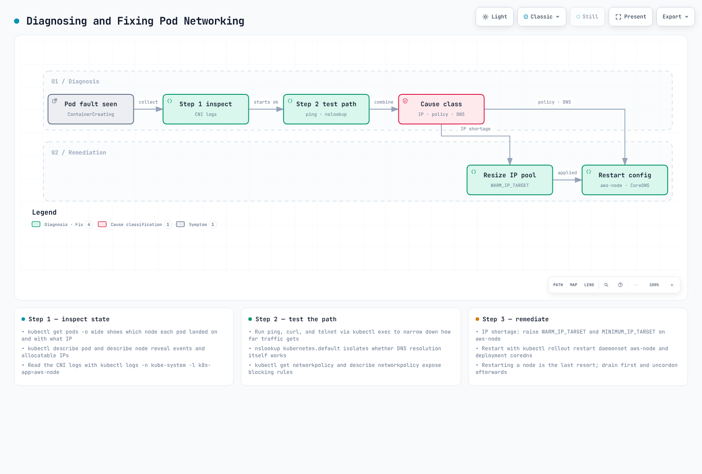

# パート3: トラブルシューティング

> **確認済みの例のバージョン**: EKS Kubernetes 1.36、Amazon VPC CNI 1.23.2
> **最終更新日**: 2026年10月16日

## 概要

このドキュメントでは、Amazon EKSネットワーキングのパフォーマンス最適化、トラブルシューティング手法、高度なユースケースを扱います。ネットワークパフォーマンスの最適化、よくあるネットワーク問題の解決、高度なネットワーク機能の活用方法を説明します。

## ネットワークパフォーマンスの最適化

EKSクラスターのネットワークパフォーマンスを最適化する方法はいくつかあります。

<!-- Diagram repair pending: see batch report.


[🔍 インタラクティブな図を表示](https://www.atomai.click/kubernetes-docs/archmaps/en-eks-03-eks-networking-part3-0.html)
-->

### インスタンスタイプの選択

C5/M5/R5はENA対応ファミリーの例であり、旧世代を選ぶことを推奨するものではありません。実際に使うインスタンスタイプのベースライン／バースト帯域幅、パケット処理数、コネクショントラッキング、ENAキュー、単一フローの上限、ワークロードのCPUを比較してください。サイズを大きくすれば必ずレイテンシーが改善するわけではなく、100 GbpsがすべてのENAの一律の上限というわけでもありません。

[公式のM5仕様](https://docs.aws.amazon.com/ec2/latest/instancetypes/gp.html)では、**m5.largeはベースライン0.75 Gbps／バースト時最大10 Gbps**、**m5.24xlargeは25 Gbps**とされています。これはインスタンスの上限であり、アプリケーションで測定したスループットではありません。持続的なトラフィック、宛先、単一フローの制限が支配的になる場合があります。ファミリー名から推測せず、利用するリージョンで照会してください。
```bash
set -euo pipefail
: "${AWS_REGION:?Set the instance Region}"
aws ec2 describe-instance-types --region "$AWS_REGION" \
  --instance-types m5.large m5.24xlarge \
  --query 'InstanceTypes[].{Type:InstanceType,Network:NetworkInfo.NetworkPerformance,Cards:NetworkInfo.NetworkCards,ENIs:NetworkInfo.MaximumNetworkInterfaces,IPsPerENI:NetworkInfo.Ipv4AddressesPerInterface}'
```

### クラスターのネットワーキングモード

EKSは複数のネットワーキングモードをサポートしており、それぞれパフォーマンス特性が異なります。


[🔍 インタラクティブな図を表示](https://www.atomai.click/kubernetes-docs/archmaps/en-eks-03-eks-networking-part3-1.html)

1. **Amazon VPC CNI（通常のEC2ノード）**:
   * VPCのIPアドレスをPodに直接割り当てます。
   * ネイティブVPCアドレスを使用しますが、スループットとレイテンシーは引き続きインスタンスや経路の上限に左右されます。プレフィックス委任が主に変えるのはIP割り当てとPod密度であり、パケット経路のレイテンシーではありません。
   * 各ノードが割り当てられるIPアドレス数には上限があります。
2. **カスタムネットワーキング**:
   * 特定のサブネットからPodにIPアドレスを割り当てられます。
   * 適切にルーティングされたセカンダリVPC CIDRを、同じVPC／AZ内のENIConfigサブネット経由で利用できます。既存サブネット自体をその場で拡張する機能ではありません。
   * ネットワークトポロジーをより細かく制御できます。
3. **代替CNIプラグイン**:
   * CalicoやCiliumなどの代替CNIプラグインも使用できます。
   * 機能とパフォーマンスの差は、ポリシー専用／チェーン／オーバーレイの各モード、暗号化、ワークロードによって異なります。対応するコンピュートでは、ネイティブVPC CNIもNetworkPolicyをサポートします。Auto ModeとHybrid Nodesはネットワークや運用のモデルが異なるため、通常のEC2向け手順に従ってCNIを置き換えないでください。

### MTUの最適化

VPC **CNIで実際に使われる環境変数は`ENI_MTU`ではなく`AWS_VPC_ENI_MTU`です**。バージョン1.23.2では既定値は9001です。`POD_MTU`はPodの仮想インターフェイスを制御し、未設定の場合はENIのMTUから値を導きます。設定を変更する前に、initコンテナとメインコンテナの両方を確認してください。
```bash
kubectl -n kube-system get daemonset aws-node -o json > aws-node-current.json
python3 - <<'PY'
import json
with open("aws-node-current.json") as stream:
    spec = json.load(stream)["spec"]["template"]["spec"]
for field in ("initContainers", "containers"):
    for container in spec.get(field, []):
        settings = {e["name"]: e.get("value", "<valueFrom>")
                    for e in container.get("env", [])
                    if e["name"] in {"AWS_VPC_ENI_MTU", "POD_MTU",
                      "DISABLE_TCP_EARLY_DEMUX", "POD_SECURITY_GROUP_ENFORCING_MODE"}}
        print(field, container["name"], settings)
PY
```

パスのテストで1500が適切だと確認できた場合は、この**Helm valuesの断片**を既存の設定管理者の構成にマージしてください。EKSアドオンの場合は、正確な設定スキーマを確認し、Helm管理のDaemonSetを直接パッチするのではなく、既存の値を維持してください。ENI／Podインターフェイスの変更には、計画的なノード／Podの入れ替えが必要になることがあります。新しく作成されたインターフェイスと既存のワークロードを別々に確認してください。
```yaml
env:
  AWS_VPC_ENI_MTU: "1500"
  POD_MTU: "1500"
```

ジャンボフレームはパケットのオーバーヘッドを減らせますが、**実際の通信経路全体**がそのパケットサイズに対応する必要があります。セキュリティグループやサブネットはMTUを設定するデバイスではありません。インターネットゲートウェイやVPN経路のMTUは一般に1500に制限されます。ゲートウェイ、ピアリング、トンネル、ロードバランサーにもそれぞれ上限があります。パスMTU探索に必要なICMPの「fragmentation needed」／IPv6 Packet Too Bigメッセージを許可してください。小さいpingが成功しても、大きなアプリケーションパケットが通る証拠にはなりません。IPv4のCNI範囲は576～9001、IPv6は1280～9001です。有効な設定値であることは、エンドツーエンドで適切である証明にはなりません。

### TCPの最適化

**TCP early demux:** これは汎用的なスループット切り替え機能ではありません。Podのセキュリティグループの**strictモード**に関する記載済みのケースでは、無効にするとkubeletのTCPプローブがbranch ENIのPodに届くようになります。この設定先は`aws-node`のメインコンテナではなく、`aws-vpc-cni-init`です。standardモードでは、この回避策は不要です。モードと障害経路を確認してから適用してください。Helm設定の断片は次のとおりです。
```yaml
init:
  env:
    DISABLE_TCP_EARLY_DEMUX: "true"
```

**Keepalive:** TCP keepaliveは、アプリケーションがソケットで有効にした場合に限り、長時間接続の無通信や切断を検出します。HTTP接続プーリングとは別の機能であり、短時間の接続を高速化するものではありません。まず、影響を受けるホスト／ネットワーク名前空間の値を確認してください。管理者のノートPCで`sysctl`を実行しても、そのPCの値が表示されるだけで、EKSノードの値は分かりません。
```bash
sysctl net.ipv4.tcp_keepalive_time net.ipv4.tcp_keepalive_intvl \
  net.ipv4.tcp_keepalive_probes net.ipv4.tcp_rmem net.ipv4.tcp_wmem \
  net.core.rmem_max net.core.wmem_max
```

元の60/15/6という値は、**測定済みの値ではない調整例**であり、本番環境で一律に使う既定値ではありません。対応するLinuxカーネルを使い、`hostNetwork`ではないワークロードの場合、これらのsysctlはKubernetes 1.29以降で安全なPod sysctlとして扱われます。既存のPod `securityContext`にsysctlだけをマージし、ほかの設定を維持してください。
```yaml
spec:
  template:
    spec:
      securityContext:
        sysctls:
        - name: net.ipv4.tcp_keepalive_time
          value: "60"
        - name: net.ipv4.tcp_keepalive_intvl
          value: "15"
        - name: net.ipv4.tcp_keepalive_probes
          value: "6"
```

**バッファ:** 帯域遅延積はバイト単位で計算し、調整の実験に使います: `bandwidth_bits_per_second × RTT_seconds / 8`。TCPの自動調整、並列フロー、ソケット単位の上書き、メモリ全体への負荷も影響します。以前の最大値16,777,216バイト（16 MiB）と、`4096 87380 16777216`／`4096 65536 16777216`の組み合わせは例であり、最適値として測定されたものではありません。`tcp_rmem`／`tcp_wmem`はKubernetes 1.32以降、カーネル4.15以降で安全なPod sysctlです。`net.core.*`設定も同じように許可・分離できると決めつけないでください。ノードレベルの変更はノードの管理者が管理する設定を使い、変更前後のエラー、レイテンシー、スループット、メモリを比較してください。

### ノード配置と局所性

以下は同じDeploymentに対する、互いに代替可能なスケジューリング例です。まず同じnamespace内に`app=cache`のPodを用意してください。preferred設定は配置を強制せず、すでに稼働中のPodも移動しません。Pythonサーバーは学習用のサンプルです。再現性のため、承認済みのイメージダイジェストを固定してください。局所性だけでなく、レプリカの分散とノード／AZ障害への耐性も考慮してください。同じノードへの配置は障害ドメインを共有します。

ノード配置と局所性を最適化すると、ネットワークパフォーマンスを改善できる場合があります。


[🔍 インタラクティブな図を表示](https://www.atomai.click/kubernetes-docs/archmaps/en-eks-03-eks-networking-part3-2.html)

1. **Availability Zone内の局所性**:
   * 頻繁に通信するPodを同じAvailability Zoneに配置して、レイテンシーを減らします。
   * Pod affinityとanti-affinityでPodの配置を制御します。

```yaml
apiVersion: apps/v1
kind: Deployment
metadata:
  name: web-server
spec:
  replicas: 3
  selector:
    matchLabels:
      app: web
  template:
    metadata:
      labels:
        app: web
    spec:
      automountServiceAccountToken: false
      securityContext:
        runAsNonRoot: true
        runAsUser: 10001
        runAsGroup: 10001
        seccompProfile:
          type: RuntimeDefault
      containers:
      - name: http
        image: python:3.13-alpine
        command:
        - python
        - -u
        - -c
        args:
        - |
          import os
          from http.server import BaseHTTPRequestHandler, HTTPServer
          class Handler(BaseHTTPRequestHandler):
              def do_GET(self):
                  self.send_response(200)
                  self.end_headers()
                  self.wfile.write((os.environ["APP_NAME"] + "\n").encode())
          HTTPServer(("0.0.0.0", 8080), Handler).serve_forever()
        env:
        - name: APP_NAME
          value: web
        ports:
        - name: http
          containerPort: 8080
        readinessProbe:
          httpGet:
            path: /health
            port: http
        resources:
          requests:
            cpu: 50m
            memory: 32Mi
          limits:
            cpu: 200m
            memory: 64Mi
        securityContext:
          allowPrivilegeEscalation: false
          readOnlyRootFilesystem: true
          capabilities:
            drop:
            - ALL
      affinity:
        podAffinity:
          preferredDuringSchedulingIgnoredDuringExecution:
          - weight: 100
            podAffinityTerm:
              labelSelector:
                matchExpressions:
                - key: app
                  operator: In
                  values:
                  - cache
              topologyKey: topology.kubernetes.io/zone
```

2. **ノード内の局所性**:
   * 頻繁に通信するPodを同じノードに配置して、ネットワークホップを減らします。
   * レイテンシーに敏感なアプリケーションで特に有効です。

```yaml
apiVersion: apps/v1
kind: Deployment
metadata:
  name: web-server
spec:
  replicas: 3
  selector:
    matchLabels:
      app: web
  template:
    metadata:
      labels:
        app: web
    spec:
      automountServiceAccountToken: false
      securityContext:
        runAsNonRoot: true
        runAsUser: 10001
        runAsGroup: 10001
        seccompProfile:
          type: RuntimeDefault
      containers:
      - name: http
        image: python:3.13-alpine
        command:
        - python
        - -u
        - -c
        args:
        - |
          import os
          from http.server import BaseHTTPRequestHandler, HTTPServer
          class Handler(BaseHTTPRequestHandler):
              def do_GET(self):
                  self.send_response(200)
                  self.end_headers()
                  self.wfile.write((os.environ["APP_NAME"] + "\n").encode())
          HTTPServer(("0.0.0.0", 8080), Handler).serve_forever()
        env:
        - name: APP_NAME
          value: web
        ports:
        - name: http
          containerPort: 8080
        readinessProbe:
          httpGet:
            path: /health
            port: http
        resources:
          requests:
            cpu: 50m
            memory: 32Mi
          limits:
            cpu: 200m
            memory: 64Mi
        securityContext:
          allowPrivilegeEscalation: false
          readOnlyRootFilesystem: true
          capabilities:
            drop:
            - ALL
      affinity:
        podAffinity:
          preferredDuringSchedulingIgnoredDuringExecution:
          - weight: 100
            podAffinityTerm:
              labelSelector:
                matchExpressions:
                - key: app
                  operator: In
                  values:
                  - cache
              topologyKey: kubernetes.io/hostname
```

3. **Serviceトラフィックの優先設定**:

この例では、対応するService proxyと`trafficDistribution: PreferSameZone`を使います。同じゾーン内のReadyなエンドポイントが優先され、存在しない場合は別のゾーンにフォールバックします。通信を分離したり、AZ間通信の費用を保証したりする設定ではありません。ゾーン内に十分な容量を確保してください。方式を切り替える場合は、優先順位の高い`service.kubernetes.io/topology-mode: Auto`アノテーションが設定されていないか確認し、あれば削除してください。`internalTrafficPolicy: Local`／`externalTrafficPolicy: Local`はそれぞれのトラフィックに対して、より厳密なノード内動作を要求し、優先されます。ローカルにエンドポイントがないとトラフィックが失われることがあります。
```yaml
apiVersion: v1
kind: Service
metadata:
  name: my-service
spec:
  selector:
    app: my-app
  ports:
  - port: 80
    targetPort: 8080
  type: ClusterIP
  trafficDistribution: PreferSameZone
```

### NetworkPolicyの最適化

KubernetesのNetworkPolicyによる許可ルールは加算的に評価されます。ルールの順序やポリシー名によって「最初に一致したルールを適用する」わけではありません。よく使うルールを先に置くことも、移植可能な最適化ではありません。Calicoのtier／orderや他ベンダーのポリシーは別のAPIです。必要なingress／egressの分離を維持しながら、重複や不要と確認できたルールを、その管理者を通じて削除してください。実際の負荷で、選択したエンジンのポリシー反映時間、ルール／map使用量、CPU、パケットドロップを測定してください。ポリシー数だけではボトルネックとは判断できません。

## ネットワーキングのトラブルシューティング

EKSクラスターで起きる一般的なネットワーク問題と、その対処方法を見ていきます。


[🔍 インタラクティブな図を表示](https://www.atomai.click/kubernetes-docs/archmaps/en-eks-03-eks-networking-part3-3.html)

### Podネットワーキングの問題

<!-- Diagram repair pending: see batch report.


[🔍 インタラクティブな図を表示](https://www.atomai.click/kubernetes-docs/archmaps/en-eks-03-eks-networking-part3-4.html)
-->

実際のPodイベントから調査を始めてください。`ContainerCreating`はCNI／IPAM、イメージ、ボリューム、ランタイムの問題でも発生し、IP不足を示すとは限りません。影響を受けたノード、サブネットの空きアドレス、ENI／IP上限、プレフィックスの断片化、APIエラーやスロットリング、CNIログを突き合わせてください。
```bash
set -euo pipefail
: "${APP_NAMESPACE:?Set the affected namespace}"
: "${APP_POD:?Set the affected Pod}"
: "${APP_SERVICE:?Set the affected Service}"
kubectl -n "$APP_NAMESPACE" describe pod "$APP_POD"
kubectl -n "$APP_NAMESPACE" get events --field-selector "involvedObject.name=$APP_POD" --sort-by=.metadata.creationTimestamp
kubectl -n "$APP_NAMESPACE" get service "$APP_SERVICE" -o yaml
kubectl -n "$APP_NAMESPACE" get endpointslices \
  -l "kubernetes.io/service-name=$APP_SERVICE" -o yaml
kubectl -n "$APP_NAMESPACE" get networkpolicy
kubectl -n kube-system logs -l k8s-app=aws-node -c aws-node --tail=200 --prefix=true
```

**IP割り当て:** `WARM_IP_TARGET`を増やすと、予備アドレスを多く確保するため、サブネットのIP不足を悪化させる場合があります。観測した割り当て／起動上の要件と空き容量に合わせてのみ、warm targetを調整してください。連続した/28を確保できないサブネットでは、空きIPの合計数が多くてもプレフィックスを割り当てられません。ノードサイズを変えてもサブネットは拡張されません。ボトルネックを特定してから、サブネットやプレフィックスの予約、対応するノード密度、段階的なネットワーク移行を計画してください。

**接続性:** 同一ノード内、ノード間、AZ間、Pod IP、Serviceの各経路を、アプリケーションが実際に使うTCP／UDPプロトコルで比較してください。DNS障害、診断ツールの不在、ICMPの遮断だけではNetworkPolicyによる拒否と判断できません。以下の例では、記載したツールがある承認済みの診断Podがすでに存在することを前提にしています。クラスターのDNSサフィックスと接続先URLを環境に合わせてください。このコマンドを使うためだけに、本番Podへ特権ツールをインストールしないでください。
```bash
set -euo pipefail
: "${APP_NAMESPACE:?Set the affected namespace}"
: "${DIAGNOSTIC_POD:?Set a running diagnostic Pod with curl and DNS tools}"
: "${TARGET_URL:?Set the real application URL and port}"
kubectl -n "$APP_NAMESPACE" exec "$DIAGNOSTIC_POD" -- cat /etc/resolv.conf
kubectl -n "$APP_NAMESPACE" exec "$DIAGNOSTIC_POD" -- nslookup kubernetes.default.svc.cluster.local
kubectl -n "$APP_NAMESPACE" exec "$DIAGNOSTIC_POD" -- curl \
  --fail --show-error --max-time 10 "$TARGET_URL"
```

**DNS:** `dnsPolicy`／`dnsConfig`、`resolv.conf`、DNS Service／EndpointSlices、CoreDNSのイベント／ログ、上流への到達性を確認してください。`nslookup`と`dig`は代替ツールであり、アプリケーションイメージに必ず含まれているとは限りません。Auto ModeのネイティブDNSは管理経路が異なります。従来のCoreDNS Deploymentが見当たらないだけで障害とは限りません。再起動を検討する前に、管理対象アドオンの設定と根拠となる情報を保存してください。

### Serviceとロードバランシングの問題


[🔍 インタラクティブな図を表示](https://www.atomai.click/kubernetes-docs/archmaps/en-eks-03-eks-networking-part3-5.html)

**Serviceの経路:** namespace、selectorラベル、実際にlistenしているポート、Serviceのport／targetPort、readiness、EndpointSliceのアドレスと状態を確認してください。バックエンド数が多いと切り詰められることがある古いEndpoints APIではなく、EndpointSlicesを使ってください。その後、実際のService proxy／CNIモードとトラフィックポリシーや局所性の優先設定を確認します。

**ロードバランサー／Ingress:** まず所有するコントローラーとclassを特定してください。通常のLBCでは、Ingressイベント、コントローラーログ、AWSのtarget health理由コードを調べます。Auto Modeは管理対象コントローラーを使うため、診断経路が異なります。scheme／クライアント到達性、サブネット検出／設定、フロントエンドとtargetのSGルール、実際のtarget type、ヘルスチェックのポート／パス、証明書／SNI、DNSを確認してください。サブネットタグがあってもルートは作成されません。また、コントローラーが「Running」でもtargetの正常性は保証されません。
```bash
set -euo pipefail
: "${APP_NAMESPACE:?Set the affected namespace}"
: "${INGRESS_NAME:?Set the affected Ingress}"
: "${AWS_REGION:?Set the load balancer Region}"
: "${TARGET_GROUP_ARN:?Set the target group identified from this Ingress}"
kubectl -n "$APP_NAMESPACE" describe ingress "$INGRESS_NAME"
kubectl -n kube-system logs -l app.kubernetes.io/name=aws-load-balancer-controller --tail=200 --prefix=true
aws elbv2 describe-target-health --region "$AWS_REGION" --target-group-arn "$TARGET_GROUP_ARN"
```

確認した原因を一度に1つだけ変更し、ロールバック手段を確保したうえで、同じ正常系／異常系のアプリケーションチェックを繰り返してください。上記コマンドは診断例です。この監査ではEKSクラスターに対して実行していません。

公式リファレンス: [EC2の帯域幅](https://docs.aws.amazon.com/AWSEC2/latest/UserGuide/ec2-instance-network-bandwidth.html)、[MTU](https://docs.aws.amazon.com/AWSEC2/latest/UserGuide/network_mtu.html)、[VPC CNI 1.23.2の設定](https://github.com/aws/amazon-vpc-cni-k8s/blob/v1.23.2/README.md)、[Kubernetesのsysctl](https://kubernetes.io/docs/tasks/administer-cluster/sysctl-cluster/)、[Serviceのトラフィック分散](https://kubernetes.io/docs/reference/networking/virtual-ips/)。

## クイズ

この章の内容を確認するには、[トピック別クイズ](../quizzes/eks/03-eks-networking-part3-quiz.md)に挑戦してください。
