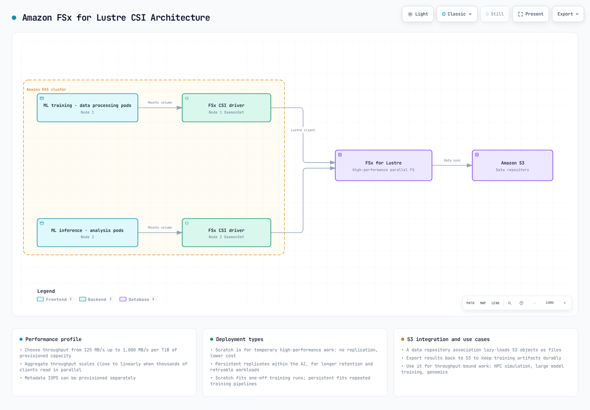
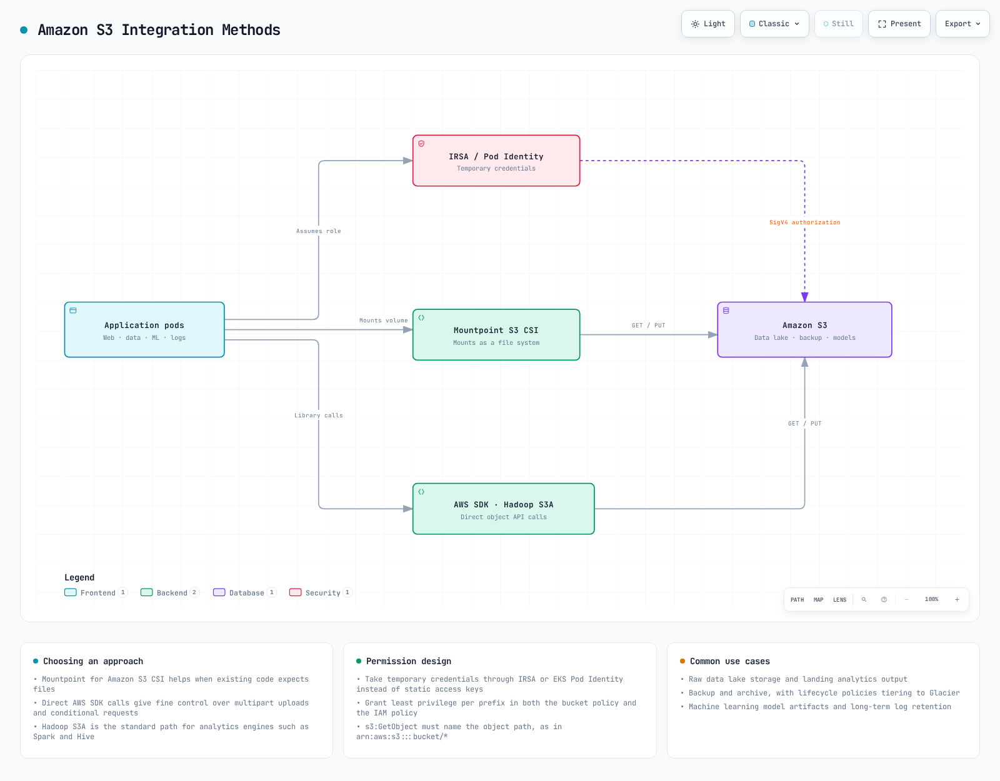

# パート2: ストレージクラス

> **最終更新日**: 2026年10月16日

このドキュメントは、Amazon EKS ストレージシリーズの第2部です。FSx for Lustre、Amazon S3、スナップショット、ボリューム拡張、パフォーマンス最適化について説明します。

## 目次

1. [Amazon FSx for Lustre](04-eks-storage-part2.md#amazon-fsx-for-lustre)
2. [Amazon S3 ストレージ統合](04-eks-storage-part2.md#amazon-s3-storage-integration)
3. [スナップショットとバックアップ](04-eks-storage-part2.md#snapshots-and-backups)
4. [ボリュームの拡張とサイズ変更](04-eks-storage-part2.md#volume-expansion-and-resizing)
5. [ボリュームのクローン作成](04-eks-storage-part2.md#volume-cloning)
6. [Multi-Attach EBS](04-eks-storage-part2.md#multi-attach-ebs)
7. [Mountpoint for S3 CSI の詳細](04-eks-storage-part2.md#mountpoint-for-s3-csi-deep-dive)
8. [ストレージパフォーマンスの最適化](04-eks-storage-part2.md#storage-performance-optimization)

## Amazon FSx for Lustre

FSx for Lustre は、サポート対象の HPC/ML/分析ワークロード向けの並列ファイルシステムです。パフォーマンスは、デプロイメント/ストレージタイプ、容量、プロビジョニングされたスループット、クライアント、ネットワークによって異なります。小規模なサンプルファイルシステムでは、宣伝されている集約最大値がすべて得られるわけではありません。

この図は、任意で利用できる S3 データリポジトリ統合を示しています。インポート/エクスポートポリシー、タスク、権限を設定する必要があります。CSI ボリュームを作成しただけでは、自動的な双方向同期は確立されません。



[🔍 インタラクティブ図を表示](https://www.atomai.click/kubernetes-docs/archmaps/en-eks-04-eks-storage-part2-0.html)

### FSx for Lustre CSI Driver のインストール

インフラストラクチャの所有者がサポートする EKS アドオンまたは公開済み Helm リリースを使用してください。以下のマネージドアドオンの例では、`CSI_ADDON_NAME=aws-fsx-csi-driver` を設定します。`kube-system/fsx-csi-controller-sa` 用に、レビュー済みの FSx driver 権限と Pod Identity の信頼設定/agent を備えたロールを準備してください。IRSA も、OIDC の信頼設定と対応するアドオンのロールオプションを使用してサポートされます。Pod Identity agent が必要なのはその ID 方式を利用する場合であり、IRSA の場合は不要です。Fargate は、サポート対象の FSx CSI node 環境ではありません。Linux カーネル/Lustre クライアントと実際のコンピューティング環境がサポート対象であることを確認してください。

`eksctl --role-only` で作成したロールは、Kubernetes ServiceAccount ではありません。マネージドアドオンは ServiceAccount を作成します。Helm をインストールする場合は、実際の ServiceAccount を作成するか参照し、意図した ID を関連付けてください。ServiceAccount を準備せずに、ロールのみを作成して `serviceAccount.create=false` を指定しないでください。
```bash
set -euo pipefail
: "${CLUSTER_NAME:?Set the existing cluster name}"
: "${AWS_REGION:?Set the cluster Region}"
: "${CSI_ADDON_NAME:?Use aws-fsx-csi-driver}"
case "$CSI_ADDON_NAME" in
  aws-fsx-csi-driver) ;;
  *) echo "Unexpected add-on"; exit 1 ;;
esac
KUBERNETES_VERSION=$(aws eks describe-cluster --region "$AWS_REGION" --name "$CLUSTER_NAME" \
  --query cluster.version --output text)
CLUSTER_ENDPOINT=$(aws eks describe-cluster --region "$AWS_REGION" --name "$CLUSTER_NAME" \
  --query cluster.endpoint --output text)
CURRENT_ENDPOINT=$(kubectl config view --minify -o jsonpath='{.clusters[0].cluster.server}')
test "$CURRENT_ENDPOINT" = "$CLUSTER_ENDPOINT" || { echo "kubeconfig points to another cluster"; exit 1; }
aws eks describe-addon-versions --region "$AWS_REGION" --addon-name "$CSI_ADDON_NAME" \
  --kubernetes-version "$KUBERNETES_VERSION" --output json > csi-addon-versions.json
aws eks list-addons --region "$AWS_REGION" --cluster-name "$CLUSTER_NAME" --output json
```

```bash
set -euo pipefail
: "${CSI_ADDON_VERSION:?Choose a reviewed compatible version from csi-addon-versions.json}"
: "${CSI_ROLE_ARN:?Set the prepared Pod Identity role ARN}"
: "${CLUSTER_NAME:?Run the inspection step first}"
: "${AWS_REGION:?Run the inspection step first}"
: "${CSI_ADDON_NAME:?Run the inspection step first}"
case "$CSI_ADDON_NAME" in
  aws-fsx-csi-driver) CSI_SA=fsx-csi-controller-sa; CSI_PREFIX=fsx-csi ;;
  *) echo "Unexpected add-on"; exit 1 ;;
esac
python3 - "$CSI_ADDON_NAME" "$CSI_ADDON_VERSION" <<'PY'
import json, sys
with open("csi-addon-versions.json") as stream:
    catalog = json.load(stream)
versions = [v["addonVersion"] for a in catalog["addons"]
            if a["addonName"] == sys.argv[1] for v in a["addonVersions"]]
if sys.argv[2] not in versions:
    raise SystemExit("Version not present in the inspected compatible catalog")
PY
aws eks list-addons --region "$AWS_REGION" --cluster-name "$CLUSTER_NAME" \
  --output json > csi-existing-addons.json
python3 - "$CSI_ADDON_NAME" <<'PY'
import json, sys
with open("csi-existing-addons.json") as stream:
    names = json.load(stream)["addons"]
if sys.argv[1] in names:
    raise SystemExit("Existing add-on: use its owner's update procedure")
PY
EXISTING_CSI=$(kubectl -n kube-system get "deployment/$CSI_PREFIX-controller" \
  "daemonset/$CSI_PREFIX-node" --ignore-not-found -o name)
test -z "$EXISTING_CSI" || { echo "Existing CSI installation: review its owner"; exit 1; }
aws eks describe-addon-configuration --region "$AWS_REGION" \
  --addon-name "$CSI_ADDON_NAME" --addon-version "$CSI_ADDON_VERSION"
aws eks create-addon --region "$AWS_REGION" --cluster-name "$CLUSTER_NAME" \
  --addon-name "$CSI_ADDON_NAME" --addon-version "$CSI_ADDON_VERSION" \
  --pod-identity-associations "serviceAccount=$CSI_SA,roleArn=$CSI_ROLE_ARN" \
  --resolve-conflicts NONE
aws eks wait addon-active --region "$AWS_REGION" --cluster-name "$CLUSTER_NAME" \
  --addon-name "$CSI_ADDON_NAME"
```
この手順は、既存のインストールがある場合は停止します。移行や更新は、その所有者を通じて行ってください。アドオンが Active であることは、ファイルシステムのマウント成功を証明するものではありません。以下の例では、パート1で用意した専用の `storage-demo` namespace を再利用し、クラスター全体に適用されるリソース名がレビュー済みであることを前提とします。

### FSx for Lustre ファイルシステムの作成

**動的プロビジョニングと静的プロビジョニングのどちらかを選択してください。** 動的プロビジョニングでは PVC からファイルシステムが作成されます。動的クラスが既存のファイルシステムを引き継ぐことを期待して、先に別のファイルシステムを作成しないでください。以下の任意の手動手順は、静的プロビジョニング用です。サポート対象の AZ 内にある承認済みサブネットと、必要なクライアント/ファイルシステム通信ルールを設定済みの Lustre SG を選択してください。`Subnets[0]` を選択したり、TCP 988 だけでサポート対象の設計に必要な設定がすべて完了すると想定したりしないでください。この例ではクラスターの VPC が必要です。接続された VPC を使う設計では、別途ルーティング/セキュリティのレビューが必要です。実行すると課金対象のリソースが作成されます。失敗時にも、返された ID は保持してください。
```bash
set -euo pipefail
: "${CLUSTER_NAME:?Set the existing cluster}"
: "${AWS_REGION:?Set the filesystem Region}"
: "${FSX_SUBNET_ID:?Select an approved subnet in a supported AZ}"
: "${FSX_SECURITY_GROUP_ID:?Set the reviewed Lustre filesystem SG}"
: "${FSX_CREATION_TOKEN:?Set a unique stable token for this new filesystem}"
FSX_SETUP_DIR=$(mktemp -d -t eks-fsx-setup.XXXXXX)
printf 'Creation records: %s\n' "$FSX_SETUP_DIR"
VPC_ID=$(aws eks describe-cluster --region "$AWS_REGION" --name "$CLUSTER_NAME" \
  --query cluster.resourcesVpcConfig.vpcId --output text)
aws ec2 describe-subnets --region "$AWS_REGION" --subnet-ids "$FSX_SUBNET_ID" \
  --output json > "$FSX_SETUP_DIR/subnet.json"
aws ec2 describe-security-groups --region "$AWS_REGION" --group-ids "$FSX_SECURITY_GROUP_ID" \
  --output json > "$FSX_SETUP_DIR/sg.json"
python3 - "$FSX_SETUP_DIR" "$VPC_ID" <<'PY'
import pathlib, json, sys
root, vpc = pathlib.Path(sys.argv[1]), sys.argv[2]
subnets = json.loads((root / "subnet.json").read_text())["Subnets"]
groups = json.loads((root / "sg.json").read_text())["SecurityGroups"]
if len(subnets) != 1 or len(groups) != 1 or subnets[0]["VpcId"] != vpc or groups[0]["VpcId"] != vpc:
    raise SystemExit("This example requires one subnet and SG in the cluster VPC")
PY
aws fsx create-file-system --region "$AWS_REGION" --file-system-type LUSTRE \
  --client-request-token "$FSX_CREATION_TOKEN" --storage-capacity 1200 --storage-type SSD \
  --subnet-ids "$FSX_SUBNET_ID" --security-group-ids "$FSX_SECURITY_GROUP_ID" \
  --lustre-configuration DeploymentType=SCRATCH_2,DataCompressionType=NONE \
  --tags Key=Name,Value=eks-lustre-demo --output json > "$FSX_SETUP_DIR/created.json"
FSX_FILE_SYSTEM_ID=$(python3 - "$FSX_SETUP_DIR/created.json" <<'PY'
import json, sys
with open(sys.argv[1]) as stream:
    print(json.load(stream)["FileSystem"]["FileSystemId"])
PY
)
FSX_READY=false
for ((attempt=0; attempt<60; attempt++)); do
  STATE=$(aws fsx describe-file-systems --region "$AWS_REGION" --file-system-ids "$FSX_FILE_SYSTEM_ID" \
    --query 'FileSystems[0].Lifecycle' --output text)
  case "$STATE" in
    AVAILABLE) FSX_READY=true; break ;;
    CREATING) sleep 10 ;;
    *) echo "Unexpected filesystem state: $STATE"; exit 1 ;;
  esac
done
test "$FSX_READY" = true || { echo "Filesystem creation still pending; inspect recorded ID"; exit 1; }
aws fsx describe-file-systems --region "$AWS_REGION" --file-system-ids "$FSX_FILE_SYSTEM_ID" \
  --query 'FileSystems[0].{Id:FileSystemId,State:Lifecycle,DNS:DNSName,MountName:LustreConfiguration.MountName,CapacityGiB:StorageCapacity}' \
  --output json > "$FSX_SETUP_DIR/available.json"
cat "$FSX_SETUP_DIR/available.json"
```


### FSx for Lustre Storage Class の作成

**動的**プロビジョニングでは、実際のサブネットとセキュリティグループをクラスに指定してください。容量は PVC の要求から決まり、無視される `storageCapacity` クラスパラメータから取得されるわけではありません。SCRATCH_2 と、永続タイプ専用の単位あたりスループット/バックアップ設定を組み合わせないでください。返されたマウント名は、静的 PV の volumeAttributes に指定する値であり、`mountName` クラスパラメータではありません。
```yaml
apiVersion: storage.k8s.io/v1
kind: StorageClass
metadata:
  name: fsx-lustre-sc
provisioner: fsx.csi.aws.com
reclaimPolicy: Retain
parameters:
  subnetId: subnet-0123456789abcdef0
  securityGroupIds: sg-0123456789abcdef0
  deploymentType: SCRATCH_2
  dataCompressionType: NONE
```


### PVC の作成と Pod へのマウント

この読み取り専用コンシューマーで確認できるのは、マウントにアクセスできることだけです。GPU ワークロードでもスループットベンチマークでもないため、この確認に CUDA イメージは不要です。UID/GID 1000 と、実際のクライアントネットワーク経路に合わせてファイルシステム権限を準備してください。
```yaml
apiVersion: v1
kind: PersistentVolumeClaim
metadata:
  name: fsx-claim
  namespace: storage-demo
spec:
  accessModes:
  - ReadWriteMany
  storageClassName: fsx-lustre-sc
  resources:
    requests:
      storage: 1200Gi
```

```yaml
apiVersion: v1
kind: Pod
metadata:
  name: app-with-fsx
  namespace: storage-demo
spec:
  automountServiceAccountToken: false
  securityContext:
    runAsNonRoot: true
    runAsUser: 1000
    runAsGroup: 1000
    fsGroup: 1000
    seccompProfile:
      type: RuntimeDefault
  containers:
  - name: app
    image: busybox:1.38.0
    command:
    - sh
    - -c
    args:
    - test -r /data && sleep 3600
    securityContext:
      allowPrivilegeEscalation: false
      readOnlyRootFilesystem: true
      capabilities:
        drop:
        - ALL
    resources:
      requests:
        cpu: 10m
        memory: 16Mi
      limits:
        cpu: 100m
        memory: 64Mi
    volumeMounts:
    - name: data
      mountPath: /data
      readOnly: true
  volumes:
  - name: data
    persistentVolumeClaim:
      claimName: fsx-claim
```


### FSx for Lustre マウントの静的プロビジョニング

既存ファイルシステムの実際の ID、DNSName、MountName、容量を使用してください。これは動的 PVC の代替手段です。以下のプレースホルダーを参照結果の値に置き換えてから、予約済みの静的 PV/PVC をバインドしてください。`storageClassName: ""` にすると、デフォルトの動的プロビジョニングが無効になります。コンシューマーでは `fsx-static-claim` を使用してください。
```bash
set -euo pipefail
: "${AWS_REGION:?Set the filesystem Region}"
: "${FSX_FILE_SYSTEM_ID:?Set the owned existing filesystem ID}"
aws fsx describe-file-systems --region "$AWS_REGION" --file-system-ids "$FSX_FILE_SYSTEM_ID" \
  --query 'FileSystems[0].{Id:FileSystemId,State:Lifecycle,DNS:DNSName,MountName:LustreConfiguration.MountName,CapacityGiB:StorageCapacity}' \
  --output json
```

```yaml
apiVersion: v1
kind: PersistentVolume
metadata:
  name: fsx-lustre-static
spec:
  capacity:
    storage: 1200Gi
  volumeMode: Filesystem
  accessModes:
  - ReadWriteMany
  persistentVolumeReclaimPolicy: Retain
  storageClassName: ''
  claimRef:
    namespace: storage-demo
    name: fsx-static-claim
  csi:
    driver: fsx.csi.aws.com
    volumeHandle: fs-0123456789abcdef0
    volumeAttributes:
      dnsname: replace-with-filesystem-dns.example.internal
      mountname: replace-with-mountname
---
apiVersion: v1
kind: PersistentVolumeClaim
metadata:
  name: fsx-static-claim
  namespace: storage-demo
spec:
  accessModes:
  - ReadWriteMany
  storageClassName: ''
  volumeName: fsx-lustre-static
  resources:
    requests:
      storage: 1200Gi
```


### FSx for Lustre のデプロイメントタイプ

- **SCRATCH_1/SCRATCH_2** は、一時的で再現可能なデータ向けです。PV としてマウントしただけで、スクラッチストレージに永続的なデプロイメントのレプリケーション/復旧機能が備わるわけではありません。SCRATCH_2 では、バースト/パフォーマンス特性と暗号化特性が異なります。
- **PERSISTENT_1/PERSISTENT_2** は、ストレージ/スループット/レイテンシの機能が異なる永続的なデプロイメントの選択肢です。PERSISTENT_2 は、すべての Region/AZ 構成で利用できるわけではありません。
- スループットのフィールドは、選択したデプロイメント/ストレージタイプに合わせてください。PERSISTENT_2 SSD では、125/250/500/1000 MB/s/TiB の選択肢がサポートされます。他のデプロイメント/ストレージの組み合わせでは異なります。Retain は Kubernetes のライフサイクルポリシーであり、スクラッチストレージのデータ耐久性を高めるものではありません。

### vLLM 向け FSx for Lustre の設定

vLLM は LLM 推論/サービングのプロジェクトであり、「Vector Language Model」ではありません。以下はモデルファイル用ストレージ割り当ての例であり、最適化済みまたは測定済みの vLLM デプロイメントではありません。モデルの読み込みは、ファイル形式、CPU によるデシリアライズ、キャッシュ状態、GPU の初期化にも左右されます。すでに圧縮済みのデータでは、圧縮によってオーバーヘッドが増えることがあります。実測してください。
```yaml
apiVersion: storage.k8s.io/v1
kind: StorageClass
metadata:
  name: fsx-lustre-vllm
provisioner: fsx.csi.aws.com
reclaimPolicy: Retain
parameters:
  subnetId: subnet-0123456789abcdef0
  securityGroupIds: sg-0123456789abcdef0
  deploymentType: PERSISTENT_2
  dataCompressionType: LZ4
  perUnitStorageThroughput: '1000'
---
apiVersion: v1
kind: PersistentVolumeClaim
metadata:
  name: vllm-models
  namespace: storage-demo
spec:
  accessModes:
  - ReadWriteMany
  storageClassName: fsx-lustre-vllm
  resources:
    requests:
      storage: 4800Gi
```

## Amazon S3 ストレージ統合

S3 はオブジェクトストレージです。アプリケーションは S3 API を直接使用でき、Hadoop は S3A を使用できます。また、Mountpoint CSI は、文書化された制限の範囲内で、既存のバケットをファイルシステムインターフェイス経由で公開できます。これらの方法は、相互に置き換え可能な POSIX ファイルシステムではありません。パート1で説明した S3 Files も別の統合方式であり、独自の EFS CSI 要件があります。



[🔍 インタラクティブ図を表示](https://www.atomai.click/kubernetes-docs/archmaps/en-eks-04-eks-storage-part2-1.html)

### S3 アクセスのための Pod Identity または IRSA

パート1で用意した専用の `storage-demo` namespace を再利用してください。既存のバケット、Region、対象のバケット/プレフィックスにスコープを限定した IAM ロールを準備します。この例のポリシーでは、1つのバケットの一覧表示と、`training/` の読み取りのみを許可します。書き込みは許可しません。SSE-KMS オブジェクトには、適切なキーのポリシーと、スコープを限定した KMS 復号権限も必要です。バケットポリシー、エンドポイント、クロスアカウントの信頼設定によって、さらに制限される場合があります。

```json
{
  "Version": "2012-10-17",
  "Statement": [
    {
      "Sid": "ListOneBucket",
      "Effect": "Allow",
      "Action": [
        "s3:ListBucket"
      ],
      "Resource": "arn:aws:s3:::replace-with-owned-data-bucket"
    },
    {
      "Sid": "ReadTrainingPrefix",
      "Effect": "Allow",
      "Action": [
        "s3:GetObject"
      ],
      "Resource": "arn:aws:s3:::replace-with-owned-data-bucket/training/*"
    }
  ]
}
```

以下の ServiceAccount は **IRSA** の例です。例示用 ARN を、OIDC 信頼設定でこのクラスター、`system:serviceaccount:storage-demo:s3-access-sa`、STS audience のみを許可する、準備済みのロールの ARN に置き換えてください。アノテーションだけでは、そのロールや信頼設定は作成されません。**EKS Pod Identity** を使用する場合は IRSA アノテーションを省略し、サポート対象の agent とともに、このアプリケーションアカウントに対するレビュー済みの関連付けを作成してください。意図しないフォールバックとして両方を設定しないでください。マニフェストに静的な AWS キーを含めないでください。

```yaml
apiVersion: v1
kind: ServiceAccount
metadata:
  name: s3-access-sa
  namespace: storage-demo
  annotations:
    eks.amazonaws.com/role-arn: arn:aws:iam::111122223333:role/storage-demo-s3-reader
```

### S3 アクセス用 Pod の設定

この範囲を限定した読み取り専用の listing Job では、公式 AWS CLI イメージと準備済みのアカウントを使用します。使用前にバケットと Region を置き換えてください。非特権 CLI プロセスが使用できるよう、コンテナ内の書き込み可能ディレクトリは専用にしています。終了ステータスだけでは、アプリケーションが意図したすべてのオブジェクトを読めることの証明にはなりません。Job とログを確認し、認可された代表的なオブジェクトも別途確認してください。

```yaml
apiVersion: batch/v1
kind: Job
metadata:
  name: s3-read-check
  namespace: storage-demo
spec:
  backoffLimit: 0
  activeDeadlineSeconds: 120
  template:
    spec:
      serviceAccountName: s3-access-sa
      restartPolicy: Never
      securityContext:
        runAsNonRoot: true
        runAsUser: 1000
        runAsGroup: 1000
        fsGroup: 1000
        seccompProfile:
          type: RuntimeDefault
      containers:
      - name: reader
        image: public.ecr.aws/aws-cli/aws-cli:2.36.43
        command:
        - aws
        args:
        - s3api
        - list-objects-v2
        - --bucket
        - replace-with-owned-data-bucket
        - --prefix
        - training/
        - --max-items
        - '5'
        env:
        - name: AWS_REGION
          value: us-west-2
        - name: AWS_EC2_METADATA_DISABLED
          value: 'true'
        securityContext:
          allowPrivilegeEscalation: false
          readOnlyRootFilesystem: true
          capabilities:
            drop:
            - ALL
        resources:
          requests:
            cpu: 100m
            memory: 128Mi
          limits:
            cpu: 500m
            memory: 256Mi
        volumeMounts:
        - name: private-home
          mountPath: /root
        - name: tmp
          mountPath: /tmp
      volumes:
      - name: private-home
        emptyDir: {}
      - name: tmp
        emptyDir: {}
```

### Hadoop S3A によるアクセス

S3A は Hadoop の `s3a://` ファイルシステム実装であり、Kubernetes のボリュームマウントではありません。Hadoop 3.5.0 は AWS SDK for Java v2 を使用します。バージョンを一致させた `hadoop-common`/`hadoop-aws` と、互換性のある shaded SDK バンドルを含むイメージをビルドし、レビューしてください。以下のプレースホルダーは、公開済みのすぐに実行できるイメージではありません。このイメージには、PATH 上の `hadoop`、`/opt/hadoop/etc/hadoop`、UID 1000 のサポートが必要です。`hadoop-aws` は、必要な他の任意ツールと統合してください。バンドルされた SDK がサポートしていれば、v2 のデフォルト認証情報プロバイダーで選択したワークロード ID を利用できます。v1 の `com.amazonaws` プロバイダークラスを再利用しないでください。

```yaml
apiVersion: v1
kind: ConfigMap
metadata:
  name: hadoop-s3a-config
  namespace: storage-demo
data:
  core-site.xml: |
    <?xml version="1.0" encoding="UTF-8"?>
    <configuration>
      <property>
        <name>fs.s3a.aws.credentials.provider</name>
        <value>software.amazon.awssdk.auth.credentials.DefaultCredentialsProvider</value>
      </property>
      <property>
        <name>fs.s3a.endpoint.region</name>
        <value>us-west-2</value>
      </property>
    </configuration>
---
apiVersion: batch/v1
kind: Job
metadata:
  name: hadoop-s3a-read-check
  namespace: storage-demo
spec:
  backoffLimit: 0
  activeDeadlineSeconds: 120
  template:
    spec:
      serviceAccountName: s3-access-sa
      restartPolicy: Never
      securityContext:
        runAsNonRoot: true
        runAsUser: 1000
        runAsGroup: 1000
        fsGroup: 1000
        seccompProfile:
          type: RuntimeDefault
      containers:
      - name: hadoop
        image: registry.example.com/reviewed-hadoop-s3a:3.5.0
        command:
        - hadoop
        args:
        - fs
        - -ls
        - s3a://replace-with-owned-data-bucket/training/
        env:
        - name: AWS_REGION
          value: us-west-2
        - name: AWS_EC2_METADATA_DISABLED
          value: 'true'
        - name: HADOOP_CONF_DIR
          value: /opt/hadoop/etc/hadoop
        - name: HADOOP_OPTIONAL_TOOLS
          value: hadoop-aws
        securityContext:
          allowPrivilegeEscalation: false
          readOnlyRootFilesystem: true
          capabilities:
            drop:
            - ALL
        resources:
          requests:
            cpu: 100m
            memory: 128Mi
          limits:
            cpu: 500m
            memory: 256Mi
        volumeMounts:
        - name: tmp
          mountPath: /tmp
        - name: hadoop-config
          mountPath: /opt/hadoop/etc/hadoop/core-site.xml
          subPath: core-site.xml
          readOnly: true
      volumes:
      - name: tmp
        emptyDir: {}
      - name: hadoop-config
        configMap:
          name: hadoop-s3a-config
```

subPath で ConfigMap のキーを1つだけマウントすると、イメージ内の他の Hadoop 設定ファイルが保持されます。subPath マウントには ConfigMap の更新がリアルタイムで反映されません。設定を変更した場合は Job を再作成してください。

### Mountpoint CSI で既存のバケットをマウントする

レビュー済みの上流バージョンの組み合わせは、CSI 2.8.0 と、それにバンドルされた Mountpoint 1.23.0 です。スタンドアロンの Mountpoint 1.24.0 に更新しても、CSI イメージが自動的に変わるわけではありません。実際の EKS アドオンバージョンとコンピューティング環境の互換性を確認してください。この上流 CSI リリースには Kubernetes 1.31 以降が必要であり、AL2/Ubuntu 22.04 はサポート対象外になっています。既存のインフラストラクチャ所有者を優先してください。マネージドアドオンや既存 driver の上に Helm をインストールしないでください。

別途所有する Helm インストールでは、まず**公開済みの Chart** をレンダリングしてレビューしてください。`--kube-version` には、実際のクラスターのバージョンを指定してください。Git のチェックアウトに含まれる Chart はサポート対象の配布物ではありません。配布時のガードを回避しないでください。選択した所有者を通じてデプロイする前に、特権を持つ node コンポーネント、CRD の所有権、`mount-s3` namespace をレビューしてください。

```bash
set -euo pipefail
helm repo add aws-mountpoint-s3-csi-driver https://awslabs.github.io/mountpoint-s3-csi-driver
helm repo update aws-mountpoint-s3-csi-driver
helm template aws-mountpoint-s3-csi-driver \
  aws-mountpoint-s3-csi-driver/aws-mountpoint-s3-csi-driver \
  --version 2.8.0 --namespace kube-system --kube-version 1.36.0 --include-crds \
  > s3-driver-review.yaml
```

公開済みの Chart は、デフォルトで `s3-csi-driver-sa` と `s3-csi-driver-controller-sa` を作成します。以下の PV では、**Pod レベルの認証情報**として `s3-access-sa` を明示的に選択しています。このボリュームでは、driver レベルの認証情報は無視されます。IRSA と EKS Pod Identity のどちらもサポートされています。準備が整ったと判断するには、Helm のレンダリング成功だけでなく、実際の driver/ID のインストールが必要です。

Mountpoint CSI は、既存のバケットを使った**静的プロビジョニング**を使用します。以前の例にある動的 StorageClass は使用しません。2つの storageClassName フィールドを空にしたまま、明示的な PV/PVC の事前バインドと、クラスター内で一意の volumeHandle を使用してください。容量フィールドは Kubernetes のバインディング用メタデータを満たすためのものであり、S3 バケットの容量を作成または制限するものではありません。バケット、プレフィックス、Region はまとめて置き換えてください。読み取り専用マウントと IAM 権限は、それぞれ独立した制御です。

```yaml
apiVersion: v1
kind: PersistentVolume
metadata:
  name: s3-training-pv
spec:
  capacity:
    storage: 1Ti
  volumeMode: Filesystem
  accessModes:
  - ReadOnlyMany
  persistentVolumeReclaimPolicy: Retain
  storageClassName: ''
  claimRef:
    namespace: storage-demo
    name: training-data
  mountOptions:
  - read-only
  - region us-west-2
  - prefix training/
  - allow-other
  - uid 1000
  - gid 1000
  - dir-mode 0750
  - file-mode 0440
  csi:
    driver: s3.csi.aws.com
    volumeHandle: storage-demo-s3-training-v1
    volumeAttributes:
      bucketName: replace-with-owned-data-bucket
      authenticationSource: pod
      stsRegion: us-west-2
---
apiVersion: v1
kind: PersistentVolumeClaim
metadata:
  name: training-data
  namespace: storage-demo
spec:
  accessModes:
  - ReadOnlyMany
  storageClassName: ''
  volumeName: s3-training-pv
  resources:
    requests:
      storage: 1Ti
```


```yaml
apiVersion: v1
kind: Pod
metadata:
  name: app-with-s3
  namespace: storage-demo
spec:
  serviceAccountName: s3-access-sa
  securityContext:
    runAsNonRoot: true
    runAsUser: 1000
    runAsGroup: 1000
    seccompProfile:
      type: RuntimeDefault
  containers:
  - name: reader
    image: busybox:1.38.0
    command:
    - sh
    - -c
    args:
    - ls -la /data && sleep 3600
    securityContext:
      allowPrivilegeEscalation: false
      readOnlyRootFilesystem: true
      capabilities:
        drop:
        - ALL
    resources:
      requests:
        cpu: 10m
        memory: 16Mi
      limits:
        cpu: 100m
        memory: 64Mi
    volumeMounts:
    - name: data
      mountPath: /data
      readOnly: true
  volumes:
  - name: data
    persistentVolumeClaim:
      claimName: training-data
      readOnly: true
```

マウントオプションは、ファイルシステム上の所有者を UID/GID 1000 に割り当てます。S3 オブジェクトの所有者を変更するものではありません。`allow-other` を指定すると、driver が作成したマウントにアプリケーションの UID からアクセスできます。このマウントを読み取るアプリケーションコンテナに、AWS CLI や FUSE の特権は不要です。

### S3 のユースケース

データレイク、モデルリポジトリ、アーカイブ、静的アセット、監査用オブジェクトには S3 を利用できます。オブジェクトバージョン、条件付きリクエスト、または Mountpoint のファイルシステム契約外の機能が必要な場合は、API によるアクセスを選択してください。ランダム更新や POSIX ロックが必要な書き込み可能データベースディレクトリには、別のストレージ設計が必要です。

## スナップショットとバックアップ

CSI スナップショットには、使用する driver/backend のサポートが必要です。PVC だけでスナップショットがサポートされるわけではありません。以下の EBS の例では、ブロックボリュームの特定時点の状態を取得します。必要に応じて、アプリケーションを静止/フラッシュするか、データベース対応バックアップ/WAL アーカイブを使用してください。スナップショットの成功は、アプリケーションの整合性やデータベースの特定時点への復旧を証明するものではありません。


[🔍 インタラクティブ図を表示](https://www.atomai.click/kubernetes-docs/archmaps/en-eks-04-eks-storage-part2-2.html)

### Snapshot Controller の準備

まず、既存のスナップショット CRD、controller の所有者、CSI snapshotter を確認してください。互換性のある EKS アドオン、またはバージョンを固定してレビュー済みの external-snapshotter リリースを使用してください。既存のインストールに floating master の CRD を適用しないでください。External-snapshotter 8.6.0 はレビュー済み上流バージョンの参考例であり、すべてのアドオンを自動的にアップグレードすべき対象ではありません。パート1の driver と namespace の前提条件も適用されます。

```bash
set -euo pipefail
kubectl get crd volumesnapshots.snapshot.storage.k8s.io \
  volumesnapshotcontents.snapshot.storage.k8s.io volumesnapshotclasses.snapshot.storage.k8s.io
kubectl -n storage-demo get pvc ebs-claim -o yaml
```

### Class と Snapshot の作成

Class の driver は PV の driver と一致している必要があります。この手動管理の Class では Retain を使用します。Kubernetes のスナップショットを削除しても、保持されている EBS スナップショットは自動的には削除されません。所有者とコストを追跡し、このポリシーを以下の Velero のライフサイクルと混同しないでください。この EBS の例では、snapshotter-secret パラメータを空にする必要はありません。

```yaml
apiVersion: snapshot.storage.k8s.io/v1
kind: VolumeSnapshotClass
metadata:
  name: ebs-snapshot-class
driver: ebs.csi.aws.com
deletionPolicy: Retain
```


```yaml
apiVersion: snapshot.storage.k8s.io/v1
kind: VolumeSnapshot
metadata:
  name: ebs-part2-snapshot
  namespace: storage-demo
  labels:
    storage-demo: ebs
spec:
  volumeSnapshotClassName: ebs-snapshot-class
  source:
    persistentVolumeClaimName: ebs-claim
```


```bash
set -euo pipefail
kubectl -n storage-demo wait --for=jsonpath='{.status.readyToUse}'=true \
  volumesnapshot/ebs-part2-snapshot --timeout=300s
kubectl -n storage-demo get volumesnapshot ebs-part2-snapshot -o yaml
```

### 新しい PVC への復元

`readyToUse=true` になったら、restoreSize とバインドされた content/driver を確認してください。同じ namespace に、restoreSize 以上の容量を指定した別名の PVC を使用します。この 20Gi の例では、スナップショットのサイズがそれ以下であることを前提としています。稼働中の claim はそのままにしてください。WaitForFirstConsumer では、互換性のあるコンシューマーがスケジュールされるまで、候補の PVC が Pending のままになることがあります。制御された切り替えを行う前に、分離された互換性のあるアプリケーションで復元データを検証してください。

```yaml
apiVersion: v1
kind: PersistentVolumeClaim
metadata:
  name: ebs-part2-restored
  namespace: storage-demo
spec:
  accessModes:
  - ReadWriteOnce
  storageClassName: ebs-gp3
  resources:
    requests:
      storage: 20Gi
  dataSource:
    name: ebs-part2-snapshot
    kind: VolumeSnapshot
    apiGroup: snapshot.storage.k8s.io
```

### Velero によるバックアップのスケジュール設定

レビュー済みの組み合わせは、Velero 1.18.4 と AWS plugin 1.14.4 です。インストール前に CLI リリースのチェックサムと plugin の互換性を確認してください。CSI サポートは Velero に統合されていますが、この経路では引き続き `EnableCSI` が必要です。古い独立した CSI plugin を追加しないでください。非公開のバックアップバケット/プレフィックス、ネットワークアクセス、スコープを限定した IAM/KMS 権限、`velero/velero` 用の IRSA ロールを準備します。以下では、リソースを作成せずに、新規インストール用マニフェストをレビュー用にレンダリングします。

```bash
set -euo pipefail
: "${BACKUP_BUCKET:?Set the existing private backup bucket}"
: "${VELERO_ROLE_ARN:?Set the reviewed IRSA role for system:serviceaccount:velero:velero}"
: "${AWS_REGION:?Set the bucket/snapshot Region for this example}"
velero install --provider aws \
  --plugins velero/velero-plugin-for-aws:v1.14.4 \
  --bucket "$BACKUP_BUCKET" --prefix eks-storage-demo \
  --backup-location-config "region=$AWS_REGION" \
  --snapshot-location-config "region=$AWS_REGION" \
  --features EnableCSI --no-secret \
  --sa-annotations "eks.amazonaws.com/role-arn=$VELERO_ROLE_ARN" \
  --dry-run -o yaml > velero-review.yaml
```

この CLI の dry-run でも、有効な kubeconfig を使用してください。レンダリングは認可テストでもバックアップテストでもありません。既存の Velero/CRD インストールを上書きしないでください。デフォルトの ServiceAccount は IRSA アノテーション付きで作成されます。代わりに `--service-account-name` を使用すると、既存のアカウントが選択され、`--sa-annotations` は無視されます。Pod Identity も別の選択肢ですが、独自の関連付け/agent 設定が必要です。静的な認証情報ファイルは不要です。

CSI Class を選択する場合、driver ごとにデフォルト Class を1つだけラベル付けするか、サポート対象のバックアップ/スケジュールアノテーションを使って Class を選択してください。以下の Class は、既存の Class とあわせてレビューしてください。

```yaml
apiVersion: snapshot.storage.k8s.io/v1
kind: VolumeSnapshotClass
metadata:
  name: ebs-velero-snapshots
  labels:
    velero.io/csi-volumesnapshot-class: 'true'
driver: ebs.csi.aws.com
deletionPolicy: Retain
```

**CSI バックアップスナップショットのライフサイクルは Velero が管理します。** バックアップの有効期限が切れるか削除されると、Velero は VolumeSnapshotContent の削除ポリシーを Delete に変更し、元の Class が Retain を使用していた場合でもスナップショットを削除します。バックアップ TTL と、独立した保持/アーカイブ手順は慎重に設定してください。S3 上の Velero バックアップに、すべてのボリュームデータが必ず含まれるわけではありません。CSI スナップショット、ファイルシステムバックアップ、データムーバーは、それぞれ異なる経路です。たとえば FSx CSI 1.10.0 は CSI スナップショットを実装していません。サポート対象の FSx/アプリケーションバックアップ方式を使用してください。

```bash
set -euo pipefail
velero schedule create storage-demo-daily --schedule="0 1 * * *" \
  --include-namespaces=storage-demo --ttl=168h0m0s -o yaml > velero-schedule-review.yaml
```

このスケジュールコマンドも YAML の出力のみを行います。レビュー済みのスケジュールを所有者を通じてデプロイし、実際の Backup phase、エラー、スナップショット/データムーバーの完了状況、復元テストを確認してください。スケジュールされたスナップショットだけでは、任意の時点へのデータベース PITR は実現しません。

復旧時には、ハードコードされた過去のタイムスタンプではなく、実際に検証済みのバックアップを選択してください。`-o yaml` を指定しても、このコマンドは API の検出を行い、選択した Backup を読み取るため、対象クラスターに対する読み取りアクセス権が必要です。このマニフェストのプレビューでは、要求するリソースタイプを限定して namespace をマッピングします。送信前に依存関係と plugin の復元アクションを確認してください。復元先の namespace が分離されていること、名前が競合しないこと、ストレージクラス/CSI driver/KMS/AZ のマッピングが有効であることを確認してください。これは本番復旧の完全な手順書ではありません。

```bash
set -euo pipefail
: "${VERIFIED_BACKUP:?Choose an actual completed backup after checking its contents/errors}"
velero restore create storage-demo-recovery-review --from-backup "$VERIFIED_BACKUP" \
  --namespace-mappings storage-demo:storage-recovery \
  --include-namespaces storage-demo \
  --include-resources persistentvolumes,persistentvolumeclaims,volumesnapshots.snapshot.storage.k8s.io,volumesnapshotcontents.snapshot.storage.k8s.io \
  --restore-volumes=true -o yaml > velero-restore-review.yaml
```

復元されたデータがアプリケーションのチェックに合格した後でのみ、復元したワークロードを開始してください。ロールバックの経路も確保してください。クラスターをまたぐ CSI 復元には、一致する driver 名と、アクセス可能なスナップショット/キーが必要です。namespace をマッピングしただけでは、クラウドリソースを移植できません。

## ボリュームの拡張とサイズ変更


[🔍 インタラクティブ図を表示](https://www.atomai.click/kubernetes-docs/archmaps/en-eks-04-eks-storage-part2-3.html)

`allowVolumeExpansion: true` を指定し、CSI driver/ファイルシステムが拡張をサポートする Class を使用してください。バインド済み claim の既存の storageClassName は変更しないでください。サイズ変更を切り替えるための設定ではありません。この例ではパート1の `ebs-gp3` を再利用し、claim の要求サイズだけを増やします。すでに claim のサイズがそれより大きい場合に縮小しないよう、まず現在の要求サイズ/容量を確認してください。
```yaml
apiVersion: storage.k8s.io/v1
kind: StorageClass
metadata:
  name: ebs-gp3
provisioner: ebs.csi.aws.com
volumeBindingMode: WaitForFirstConsumer
reclaimPolicy: Retain
allowVolumeExpansion: true
parameters:
  type: gp3
  encrypted: 'true'
  csi.storage.k8s.io/fstype: ext4
```

```bash
set -euo pipefail
kubectl -n storage-demo get pvc ebs-claim -o yaml
kubectl -n storage-demo patch pvc ebs-claim --type merge \
  -p '{"spec":{"resources":{"requests":{"storage":"20Gi"}}}}'
kubectl -n storage-demo describe pvc ebs-claim
```
サポートされている場合、CSI がバックエンドとファイルシステムを拡張します。PVC の condition、controller/node のログ、マウント後の容量を確認してください。必要であれば、driver の文書に記載されている再マウント/再起動の手順に従ってください。アプリケーションコンテナ内で、推測した `/dev/xvdf` に対して `resize2fs` を実行しないでください。サイズ変更を回避するために PV の容量を編集してはいけません。クォータ/コスト上限を計画し、前回のサイズ変更が保留中に自動拡張を繰り返さないでください。

## ボリュームのクローン作成

現在の EBS CSI は `dataSource` と CSI のクローン機能を通じた PVC クローンをサポートしています。EBS CSI 1.67.0 は、隠れたスナップショットを使うと想定した方式ではなく、ネイティブ EBS ボリュームコピー（`CopyVolumes`）を使用します。使用前に、デプロイされている driver/アドオンのサポート状況を確認してください。コピー先は独立したボリュームですが、使用可能な状態と初期化が完全に完了した状態は異なります。


一般的な PVC の dataSource ワークフローでは、同じ namespace 内のバインド済みソース、互換性のある volume mode/driver、ソース以上の要求サイズを使用してください。storageClassName を明示的に指定してください。省略するとデフォルトクラスのルールが適用され、ソースから自動的に引き継がれるわけではありません。ネイティブ EBS コピーは、ソースと同じ AZ に配置されます。アプリケーションを適切に静止/フラッシュしない場合、クラッシュ整合性のコピーになります。1つのソースから同時に初期化できるコピーは1つだけであり、アカウント/Region のクォータも適用されます。

この専用のトレーニング用ソースを使うことで、本番 namespace に未検証のデータベースクローンを起動せずに済みます。writer と reader の**両方**で、例示されている AZ を実際にサポートされている AZ に置き換えてください。seed Job はソース PVC を使用し、既存のマーカーを上書きせずに1つ作成してから終了します。

```yaml
apiVersion: v1
kind: PersistentVolumeClaim
metadata:
  name: ebs-clone-source
  namespace: storage-demo
spec:
  accessModes:
  - ReadWriteOnce
  storageClassName: ebs-gp3
  resources:
    requests:
      storage: 10Gi
---
apiVersion: batch/v1
kind: Job
metadata:
  name: ebs-clone-seed
  namespace: storage-demo
spec:
  backoffLimit: 0
  template:
    metadata:
      labels:
        app: ebs-clone-seed
    spec:
      restartPolicy: Never
      automountServiceAccountToken: false
      nodeSelector:
        topology.kubernetes.io/zone: us-west-2a
      securityContext:
        runAsNonRoot: true
        runAsUser: 1000
        runAsGroup: 1000
        fsGroup: 1000
        seccompProfile:
          type: RuntimeDefault
      containers:
      - name: writer
        image: busybox:1.38.0
        command:
        - sh
        - -c
        args:
        - |
          set -eu
          (set -C; printf 'clone-demo\n' > /data/seed.txt)
          sync
        securityContext:
          allowPrivilegeEscalation: false
          readOnlyRootFilesystem: true
          capabilities:
            drop:
            - ALL
        resources:
          requests:
            cpu: 10m
            memory: 16Mi
          limits:
            cpu: 100m
            memory: 64Mi
        volumeMounts:
        - name: data
          mountPath: /data
      volumes:
      - name: data
        persistentVolumeClaim:
          claimName: ebs-clone-source
```

```bash
kubectl -n storage-demo wait --for=condition=complete job/ebs-clone-seed --timeout=300s
kubectl -n storage-demo get pvc ebs-clone-source -o yaml
```
seed Job が完了した後に、別のクローンと読み取り専用コンシューマーを作成します。マーカーの確認は、検証すべき内容の例です。このレビューでは、クラウド上のコピーを実行していません。データベースをコピーしても、既存のデータベースパスワードはリセットされません。後でデータベースとして起動する場合、コピー先は互換性のあるデータベースバージョンを使用する必要があります。
```yaml
apiVersion: v1
kind: PersistentVolumeClaim
metadata:
  name: ebs-clone
  namespace: storage-demo
spec:
  accessModes:
  - ReadWriteOnce
  storageClassName: ebs-gp3
  resources:
    requests:
      storage: 10Gi
  dataSource:
    kind: PersistentVolumeClaim
    name: ebs-clone-source
---
apiVersion: v1
kind: Pod
metadata:
  name: app-with-clone
  namespace: storage-demo
spec:
  automountServiceAccountToken: false
  securityContext:
    runAsNonRoot: true
    runAsUser: 1000
    runAsGroup: 1000
    fsGroup: 1000
    seccompProfile:
      type: RuntimeDefault
  containers:
  - name: app
    image: busybox:1.38.0
    command:
    - sh
    - -c
    args:
    - test "$(cat /data/seed.txt)" = clone-demo && sleep 3600
    securityContext:
      allowPrivilegeEscalation: false
      readOnlyRootFilesystem: true
      capabilities:
        drop:
        - ALL
    resources:
      requests:
        cpu: 10m
        memory: 16Mi
      limits:
        cpu: 100m
        memory: 64Mi
    volumeMounts:
    - name: data
      mountPath: /data
      readOnly: true
  volumes:
  - name: data
    persistentVolumeClaim:
      claimName: ebs-clone
  nodeSelector:
    topology.kubernetes.io/zone: us-west-2a
```
| 特性 | PVC/ネイティブボリュームコピー | スナップショットからの復元 |
|---|---|---|
| ソース | 既存のボリューム/PVC | 保持された特定時点のスナップショット |
| 使用可能になるタイミング | バックグラウンドの初期化完了前に使用可能 | スナップショット/復元と初期化の状態による |
| 配置 | ネイティブ EBS コピーはソースと同じ AZ に残る | 新しい復元ボリュームは、許可された別の AZ を対象にできる |
| 整合性 | アプリケーションの静止が必要な場合がある | アプリケーション対応バックアップが必要な場合がある |
| Namespace | 通常の PVC dataSource は同じ namespace 内 | スナップショットオブジェクトは namespace に属する。namespace/クラスターをまたいでインポートするには、明示的なサポート対象ワークフローが必要 |
| コスト/保持 | コピー処理と新しいボリュームの料金。ライフサイクルは独立 | スナップショットストレージと復元ボリュームの料金。削除ポリシーは別々 |

「1ステップ」と「2ステップ」の違いから速度、ストレージのオーバーヘッド、RPO を推定しないでください。ネイティブボリュームコピーは高速スナップショット復元やプロビジョニング済み初期化レートをサポートしていません。実際のコピー初期化に関するガイダンスを使用してください。

## Multi-Attach EBS

EC2 サービスは、対象となる io1/io2 ボリュームについて、同じ AZ 内の互換性のある Nitro インスタンス最大16台まで Multi-Attach をサポートします。ただし、ボリュームタイプ/Region に関する制限があります。**EBS CSI 1.66.0 の動的プロビジョニングでは、io2 + ReadWriteMany + volumeMode: Block がサポートされ**、その機能を通じて Multi-Attach が有効になります。この経路では `multiAttachEnabled` は StorageClass のサポート対象スイッチではありません。RWOP は1つの Pod に制限するモードであり、Multi-Attach のアクセスモードではありません。


共有ブロックデバイスを使用しても、アプリケーションの書き込み調整機能は提供されません。通常の ext4/XFS を複数ノードから独立して読み書き可能な状態でマウントしてはいけません。適切な調整機能を持つアプリケーション/クラスター化ファイルシステムと、フェンシング設計を使用してください。io2 は NVMe reservation fencing をサポートしますが、アプリケーションが正しく使用する必要があります。以下のアタッチメントのみのデモでは、**デバイスへの I/O もフォーマットも行いません**。一致するラベル/アンチアフィニティの条件を満たすには、ボリュームの AZ 内に適切な node が2台必要です。実際のワークロードでは、この待機するだけのコンテナではなく、レビュー済みのデバイスアクセスと調整機能が必要です。
```yaml
apiVersion: storage.k8s.io/v1
kind: StorageClass
metadata:
  name: ebs-io2-multi-attach
provisioner: ebs.csi.aws.com
volumeBindingMode: WaitForFirstConsumer
reclaimPolicy: Retain
allowVolumeExpansion: true
parameters:
  type: io2
  iops: '10000'
  encrypted: 'true'
---
apiVersion: v1
kind: PersistentVolumeClaim
metadata:
  name: shared-block-pvc
  namespace: storage-demo
spec:
  accessModes:
  - ReadWriteMany
  volumeMode: Block
  storageClassName: ebs-io2-multi-attach
  resources:
    requests:
      storage: 100Gi
---
apiVersion: v1
kind: Pod
metadata:
  name: shared-block-a
  namespace: storage-demo
  labels:
    app: shared-block-demo
spec:
  automountServiceAccountToken: false
  securityContext:
    runAsNonRoot: true
    runAsUser: 1000
    runAsGroup: 1000
    seccompProfile:
      type: RuntimeDefault
  affinity:
    podAntiAffinity:
      requiredDuringSchedulingIgnoredDuringExecution:
      - labelSelector:
          matchLabels:
            app: shared-block-demo
        topologyKey: kubernetes.io/hostname
  containers:
  - name: attachment-only
    image: busybox:1.38.0
    command:
    - sleep
    - '3600'
    securityContext:
      allowPrivilegeEscalation: false
      readOnlyRootFilesystem: true
      capabilities:
        drop:
        - ALL
    resources:
      requests:
        cpu: 10m
        memory: 16Mi
      limits:
        cpu: 100m
        memory: 64Mi
    volumeDevices:
    - name: shared
      devicePath: /dev/ebs-shared
  volumes:
  - name: shared
    persistentVolumeClaim:
      claimName: shared-block-pvc
---
apiVersion: v1
kind: Pod
metadata:
  name: shared-block-b
  namespace: storage-demo
  labels:
    app: shared-block-demo
spec:
  automountServiceAccountToken: false
  securityContext:
    runAsNonRoot: true
    runAsUser: 1000
    runAsGroup: 1000
    seccompProfile:
      type: RuntimeDefault
  affinity:
    podAntiAffinity:
      requiredDuringSchedulingIgnoredDuringExecution:
      - labelSelector:
          matchLabels:
            app: shared-block-demo
        topologyKey: kubernetes.io/hostname
  containers:
  - name: attachment-only
    image: busybox:1.38.0
    command:
    - sleep
    - '3600'
    securityContext:
      allowPrivilegeEscalation: false
      readOnlyRootFilesystem: true
      capabilities:
        drop:
        - ALL
    resources:
      requests:
        cpu: 10m
        memory: 16Mi
      limits:
        cpu: 100m
        memory: 64Mi
    volumeDevices:
    - name: shared
      devicePath: /dev/ebs-shared
  volumes:
  - name: shared
    persistentVolumeClaim:
      claimName: shared-block-pvc
```
サービスの条件を満たす io2 Multi-Attach ボリュームでは、サイズ/IOPS の変更がサポートされます。「オンラインでのサイズ変更はできない」という一律の主張は正しくありません。io1 の変更サポートは異なります。Multi-Attach の有効化/無効化には、ボリュームがアタッチされていないことが必要です。安全なサイズ変更手順は、引き続き CSI/ファイルシステム/アプリケーションのサポートによって決まります。共有ボリュームで障害が発生すると、アタッチされたすべてのインスタンスに影響することがあります。Retain やアタッチメントの設定は、バックアップ戦略ではありません。

## Mountpoint for S3 CSI の詳細

以下の動作は、CSI 2.8.0 にバンドルされた Mountpoint 1.23.0 を基準に確認しています。新しいスタンドアロンオプションを採用する前に、実際にインストールされているバージョンを確認してください。


### パフォーマンス特性

大きなオブジェクトのシーケンシャル読み取りや、新規オブジェクトへのシーケンシャル書き込みは、よく適合するユースケースです。Mountpoint は自動的に先読みします。ランダムな範囲読み取りもサポートされていますが、オブジェクトサイズ、リクエストレート、ネットワーク、キャッシュ状態、アプリケーションの並行性によって結果は異なります。任意の場所に対するランダムなインプレース書き込みはサポートされていません。単に遅い最適化方法というだけではありません。

**過去に示された未検証の数値:** 以前の英語版では、再現可能なセットアップや追跡可能な出典なしに、以下の集約値を記載していました。これらは過去の主張として保持しており、現在のサービス制限、このレビューで測定した結果、サイジングの保証を示すものではありません。

| 過去に示された操作 | 元の主張 |
|---|---|
| シーケンシャル読み取り、大容量ファイル | 最大100Gbpsの集約値 |
| シーケンシャル書き込み、新規ファイル | 最大50Gbpsの集約値 |
| 小規模なランダム読み取り | レイテンシが高くスループットが低い。ワークロードに依存 |

以前の「優れている/良好/中程度」という定性的な評価も、同様に管理されたベンチマークに基づくものではありません。

### ファイルシステムと整合性の制限

- S3 は読み取り/一覧表示について強い整合性を提供します。Mountpoint のキャッシュは、TTL の間、意図的に古いメタデータ/コンテンツや否定エントリを保持することがあります。S3 自体が結果整合性であるとは説明しないでください。
- 新しいファイルはシーケンシャルに書き込まれます。既存のオブジェクトを置き換えるには `allow-overwrite` と切り詰めるモードでの open が必要です。任意のランダム更新は引き続きサポートされません。
- Availability Zone 内の S3 Express One Zone ディレクトリバケットでは、`incremental-upload` による追加書き込みと、個別ファイルのアトミックな名前変更がサポートされます。汎用バケットでは、このバージョンの Mountpoint を通じたファイルの名前変更はサポートされません。ディレクトリの名前変更もサポートされません。Local Zone 内のディレクトリバケットでは、サポートされる機能が異なります。置き換えのための名前変更には、上書き権限/オプションも必要です。
- 削除は `allow-delete` と IAM 権限によって明示的に有効にする必要があります。読み取り専用の例では、どちらも有効にしていません。追加書き込みが常に「新しいオブジェクトバージョンを作成する」操作とは限りません。
- ハードリンク/シンボリックリンク、chmod/chown、拡張属性、POSIX ロック、デバイスファイル、通常のスパースファイルの動作はサポートされません。これらの操作がないことを前提に、データベースの正しさを判断しないでください。

### キャッシュの設定

Mountpoint CLI オプションは StorageClass パラメータではなく、**PV.spec.mountOptions** に指定します。値は `metadata-ttl 300` のようなオプション文字列です。Mountpoint 1.23 では、メタデータ TTL の単位は秒、スタンドアロンの `max-cache-size` は **MiB**、read/write-part-size は **バイト**です。8 MiB は 8,388,608 バイトです。以前の prefetch-bytes/read-ahead/max-read-parallelism/max-cache-size-mb/cache-block-size の例は、1.23 CLI の有効なフラグではありません。

CSI v2 では、**Mountpoint Pod** 用のキャッシュストレージが作成されます。通常、その Pod は `mount-s3` に配置されます。アプリケーション Pod の emptyDir が、そのキャッシュになるわけではありません。以下の代替となる静的 PV では、driver がサイズ上限を適用する、ディスクベースの 10Gi emptyDir キャッシュを使用します。Memory を指定した場合は NVMe ではなく tmpfs RAM を意味します。実際のバケット/プレフィックス/Region に置き換え、専用の事前バインド PVC を使用してください。

```yaml
apiVersion: v1
kind: PersistentVolume
metadata:
  name: s3-training-cached-pv
spec:
  capacity:
    storage: 1Ti
  volumeMode: Filesystem
  accessModes:
  - ReadOnlyMany
  persistentVolumeReclaimPolicy: Retain
  storageClassName: ''
  claimRef:
    namespace: storage-demo
    name: training-data-cached
  mountOptions:
  - read-only
  - region us-west-2
  - prefix training/
  - allow-other
  - uid 1000
  - gid 1000
  - dir-mode 0750
  - file-mode 0440
  - metadata-ttl 300
  - read-part-size 8388608
  csi:
    driver: s3.csi.aws.com
    volumeHandle: storage-demo-s3-training-cached-v1
    volumeAttributes:
      bucketName: replace-with-owned-data-bucket
      authenticationSource: pod
      stsRegion: us-west-2
      cache: emptyDir
      cacheEmptyDirSizeLimit: 10Gi
      cacheEmptyDirMedium: ''
---
apiVersion: v1
kind: PersistentVolumeClaim
metadata:
  name: training-data-cached
  namespace: storage-demo
spec:
  accessModes:
  - ReadOnlyMany
  storageClassName: ''
  volumeName: s3-training-cached-pv
  resources:
    requests:
      storage: 1Ti
```

TTL を300秒にすると、その期間は外部での変更が見えないことがあります。この点が問題になる場合は、不変のバージョン付きデータセットプレフィックスを使用してください。キャッシュされたコンテンツはローカルストレージに平文で保存されるため、脅威モデルには node/ストレージへのアクセスも含めてください。キャッシュ容量、退避、Mountpoint Pod のメモリは、トレーニングコンテナとは別に見積もってください。`cache: ephemeral`、そのストレージクラス、要求フィールドを使用する別のサポート対象オプションとして、ephemeral PVC キャッシュがあります。そのライフサイクルとコストを評価してください。従来のホストキャッシュパスを渡せば CSI v2 でも引き続き使われると想定しないでください。

### 大規模データセットのトレーニング例

これは**未実行の統合テンプレート**であり、最適化済みの p4d ベンチマークではありません。`/opt/training/train.py` を含むレビュー済みの GPU 互換イメージ、スケジュール可能な GPU 4台/device plugin、上記のアカウントとキャッシュ済みデータ PVC、UID/GID 1000 からアクセスできる書き込み可能な RWX `reviewed-model-output-rwx` PVC を準備してください。スクリプトは、示されている引数を実装し、個別の出力ディレクトリを作成する必要があります。デプロイ前にすべてのプレースホルダーを解決してください。

```yaml
apiVersion: batch/v1
kind: Job
metadata:
  name: s3-sharded-training
  namespace: storage-demo
spec:
  completions: 4
  parallelism: 4
  completionMode: Indexed
  backoffLimit: 0
  activeDeadlineSeconds: 7200
  template:
    spec:
      serviceAccountName: s3-access-sa
      restartPolicy: Never
      securityContext:
        runAsNonRoot: true
        runAsUser: 1000
        runAsGroup: 1000
        fsGroup: 1000
        seccompProfile:
          type: RuntimeDefault
      containers:
      - name: trainer
        image: registry.example.com/reviewed-trainer:replace-me
        command:
        - sh
        - -c
        args:
        - exec python /opt/training/train.py --data-dir=/data --shard-index="$JOB_COMPLETION_INDEX"
          --shard-count=4 --output-dir="/models/$JOB_COMPLETION_INDEX"
        env:
        - name: JOB_COMPLETION_INDEX
          valueFrom:
            fieldRef:
              fieldPath: metadata.annotations['batch.kubernetes.io/job-completion-index']
        resources:
          requests:
            cpu: '4'
            memory: 16Gi
            nvidia.com/gpu: 1
          limits:
            cpu: '8'
            memory: 32Gi
            nvidia.com/gpu: 1
        securityContext:
          allowPrivilegeEscalation: false
          readOnlyRootFilesystem: true
          capabilities:
            drop:
            - ALL
        volumeMounts:
        - name: data
          mountPath: /data
          readOnly: true
        - name: output
          mountPath: /models
        - name: tmp
          mountPath: /tmp
      volumes:
      - name: data
        persistentVolumeClaim:
          claimName: training-data-cached
          readOnly: true
      - name: output
        persistentVolumeClaim:
          claimName: reviewed-model-output-rwx
      - name: tmp
        emptyDir: {}
```

4つの Indexed completions は独立したデータシャードで、それぞれが GPU を1台使用します。分散トレーニングのランデブー、勾配同期、一度限りの副作用が実現されるわけではありません。出力処理は再試行に安全なものにしてください。以前の 4-GPU/8-GPU の例は、異なる構成を例示したものであり、比較測定ではありません。実測した要件に基づいて、実際のハードウェア/リソースを選択してください。

### S3、EFS、FSx の選択

| 考慮事項 | Mountpoint/S3 | EFS | FSx for Lustre |
|---|---|---|---|
| インターフェイス | オブジェクトベースのファイルシステム機能の一部 | マネージド NFS ファイルシステム | 並列 Lustre ファイルシステム |
| 一般的な適合用途 | 大規模で不変の入力データセット | 共有アプリケーションファイル | サポート対象の HPC/ML 並列 I/O |
| 書き込み | 文書化されたシーケンシャル/上書き、およびバケット固有の追加書き込み制限 | アプリケーションによる調整を伴うファイルシステムへの書き込み | アプリケーションによる調整を伴うファイルシステムへの書き込み |
| サイジングの根拠 | リクエストの種類、キャッシュ、ネットワーク、オブジェクト構成 | パフォーマンス/スループットモード、クライアント、アクセスパターン | デプロイメント、容量、スループット、クライアント、ストライピング |
| コスト/同時実行性 | リクエスト、転送、キャッシュ、クライアント制限を測定 | スループット/ストレージ/クライアント制限を測定 | 割り当て/スループット/クライアント制限を測定 |

サービス名だけから、コストが一律に低い/中程度/高い、またはクライアント数が無制限であると判断することはできません。

## ストレージパフォーマンスの最適化

EKS におけるストレージパフォーマンスの最適化について、さまざまな戦略を見ていきましょう。


[🔍 インタラクティブ図を表示](https://www.atomai.click/kubernetes-docs/archmaps/en-eks-04-eks-storage-part2-4.html)

### EBS パフォーマンスの最適化

実測したワークロード要件とインスタンスの EBS 上限に基づいて、ボリュームタイプとプロビジョニングする IOPS/スループットを選択してください。以前に示した 16,000 IOPS/1,000 MiB/s は、引き続き有効な設定例ですが、現在の gp3 の普遍的な最大値ではありません。Region 内の gp3 では、サイズ/IOPS の制約に応じて最大 80,000 IOPS/2,000 MiB/s がサポートされますが、Outposts の上限はより低くなります。最大値のプロビジョニングが必要または十分だと想定しないでください。

空のボリュームには初期化は不要です。スナップショットから復元したボリュームとネイティブコピーでは、初期化時のレイテンシが発生する場合があり、その手順も異なります。**ゼロを書き込むと既存データが破壊されるため、安全な初期化手順ではありません。** まず、対象のボリュームを特定してください。スナップショットから復元する場合は、サポートされているプロビジョニング済み初期化レート、高速スナップショット復元、または文書に記載された読み取りベースの手順を評価してください。これらの高速化機能はネイティブコピーには適用されません。以下は、認可された node 環境でメタデータを確認するだけのコマンドです。
```bash
lsblk -o NAME,SERIAL,SIZE,TYPE,MOUNTPOINT
```

### EFS パフォーマンスの最適化

AWS は、高い並行性を持つワークロードを含め、General Purpose パフォーマンスモードを推奨しています。Max I/O は前世代の選択肢であり、操作レイテンシがより高くなります。実測した需要に合わせてスループットモードを設定してください。マウントオプションは Pod.spec.volumes ではなく、StorageClass または PV に設定します。

これは新しい claim 用の代替 Class です。EFS helper が推奨する RPC サイズ 1 MiB、hard マウント、タイムアウト、noresvport は、出発点でありベンチマークではありません。`retrans=2` は、再試行後にさらに復旧を試みます。hard マウントは、2回試行した時点でリクエストを放棄する設定ではありません。パート1と同様に、ファイルシステム ID とアクセスポイント ID を準備してください。
```yaml
apiVersion: storage.k8s.io/v1
kind: StorageClass
metadata:
  name: efs-tuned
provisioner: efs.csi.aws.com
reclaimPolicy: Retain
mountOptions:
- tls
- rsize=1048576
- wsize=1048576
- hard
- timeo=600
- retrans=2
- noresvport
parameters:
  provisioningMode: efs-ap
  fileSystemId: fs-0123456789abcdef0
  directoryPerms: '750'
  uid: '1000'
  gid: '1000'
  basePath: /storage-demo
  ensureUniqueDirectory: 'true'
```

### FSx for Lustre パフォーマンスの最適化

デプロイメント/ストレージ/スループットとクライアント容量をあわせて選択してください。ファイルサイズ、同時実行性、実測したボトルネックに基づいて Lustre のストライピングを計画してください。ストライプ数を増やせば常に速くなるわけではありません。サポート対象の PV/StorageClass マウントオプションを使用し、競合する `noatime` と `relatime` を併用せず、いずれか1つの atime ポリシーを選択してください。圧縮の効果はデータによって異なります。`s3ImportPath` はサポート対象の CSI パラメータですが、インポート/エクスポートの利用可否と自動化は、選択した FSx 統合によって異なります。

### vLLM ワークロード向けストレージの最適化

クラスのみの `storageCapacity` フィールドではなく、前述の明示的な Class/PVC 割り当てを再利用してください。コールド/ウォーム状態でのモデル読み込み、メタデータアクセス、CPU/GPU の初期化、同時利用者をベンチマークしてください。量子化/シャーディングは、ファイル構成だけでなくモデルのメモリ/コンピューティングの動作も変えるものであり、自動的なストレージ最適化ではありません。EFA が効果を発揮するのは、サポート対象のファイルシステム/クライアントまたは通信スタックの場合に限られます。EFA 対応 GPU インスタンスを選択しただけで、すべてのストレージ経路が高速化するわけではありません。

## まとめ

このドキュメントでは、Amazon EKS における FSx for Lustre、S3、スナップショット、ボリューム拡張、パフォーマンスの最適化について説明しました。ストレージの選択肢ごとに特性やユースケースが異なるため、アプリケーションの要件に適したストレージソリューションを選択し、最適化することが重要です。

次のパートでは、EKS ストレージの監視、トラブルシューティング、コスト最適化、セキュリティについて説明します。

## 参考資料

* [Amazon FSx for Lustre CSI Driver](https://github.com/kubernetes-sigs/aws-fsx-csi-driver)
* [Amazon S3 CSI Driver](https://github.com/awslabs/mountpoint-s3-csi-driver)
* [Kubernetes Volume Snapshots](https://kubernetes.io/docs/concepts/storage/volume-snapshots/)
* [Velero のバックアップと復元](https://velero.io/docs/)
* [Amazon EKS ストレージのベストプラクティス](https://docs.aws.amazon.com/eks/latest/best-practices/storage.html)

* [Mountpoint CSI 2.8 の設定](https://github.com/awslabs/mountpoint-s3-csi-driver/blob/v2.8.0/docs/CONFIGURATION.md)
* [Mountpoint CSI 2.8 のキャッシュ](https://github.com/awslabs/mountpoint-s3-csi-driver/blob/v2.8.0/docs/CACHING.md)
* [Mountpoint 1.23 のファイルシステムセマンティクス](https://github.com/awslabs/mountpoint-s3/blob/mountpoint-s3-1.23.0/doc/SEMANTICS.md)
* [Hadoop 3.5 の S3A 認証](https://hadoop.apache.org/docs/r3.5.0/hadoop-aws/tools/hadoop-aws/index.html)
* [Velero 1.18 の CSI スナップショットライフサイクル](https://velero.io/docs/v1.18/csi/)
* [Velero AWS plugin の互換性](https://github.com/velero-io/velero-plugin-for-aws)
* [EBS ネイティブコピー](https://docs.aws.amazon.com/ebs/latest/userguide/ebs-copying-volume.html)
* [EBS Multi-Attach](https://docs.aws.amazon.com/ebs/latest/userguide/ebs-volumes-multi.html)
* [FSx CSI アドオンの ID](https://docs.aws.amazon.com/eks/latest/userguide/fsx-csi-create.html)

## クイズ

この章で学んだ内容を確認するには、[トピック別クイズ](../quizzes/eks/04-eks-storage-part2-quiz.md)に挑戦してください。
