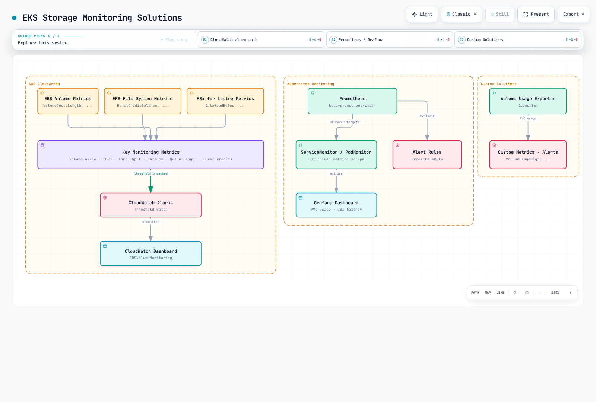
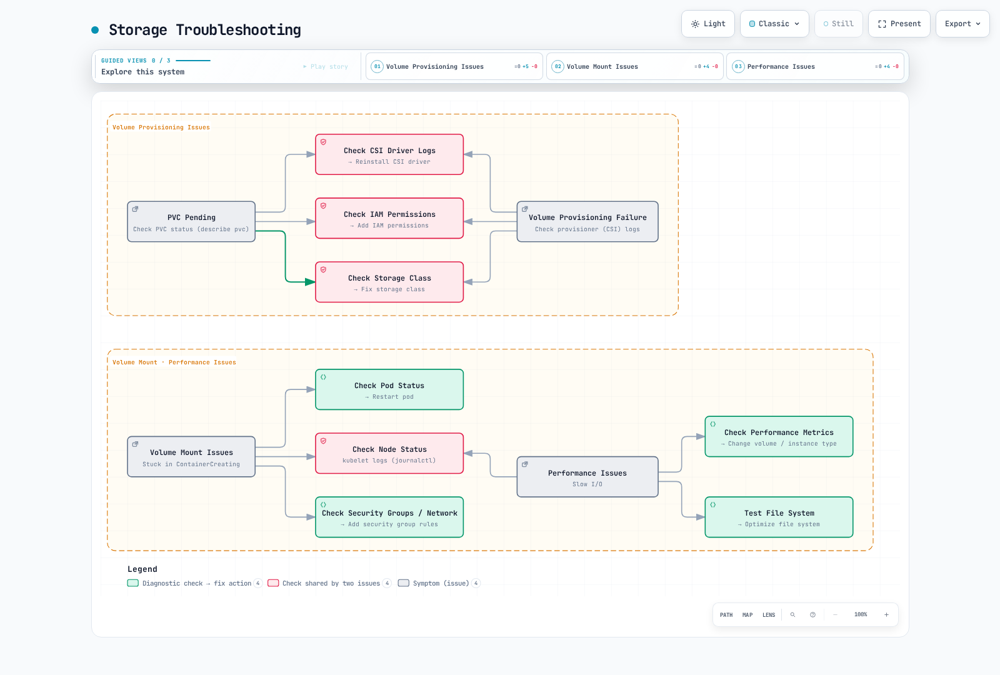
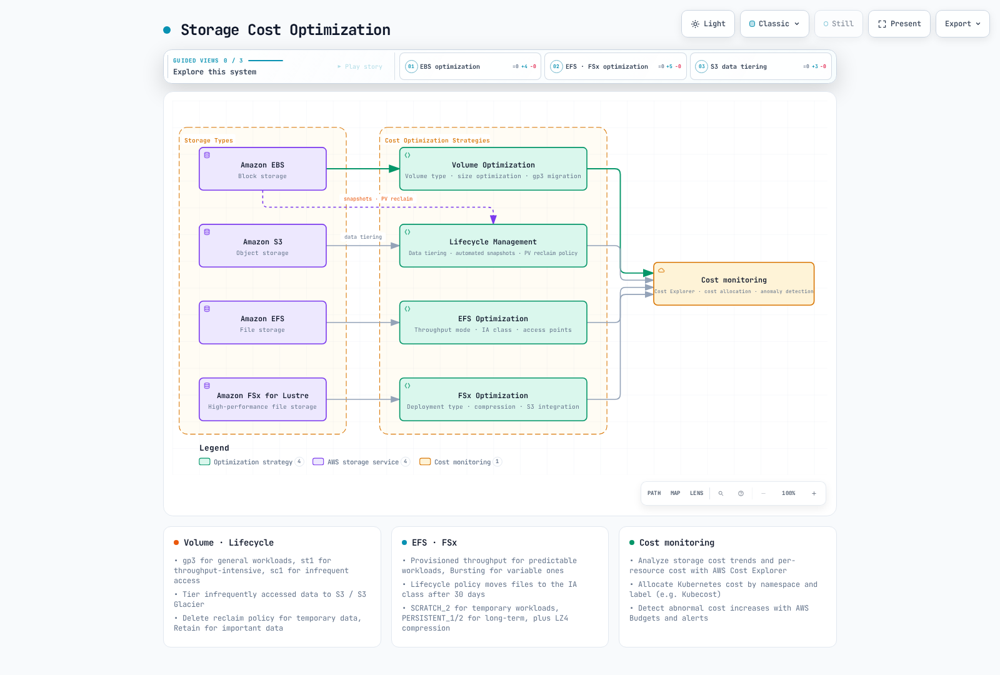
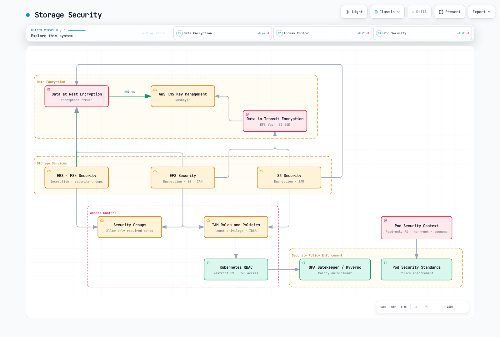
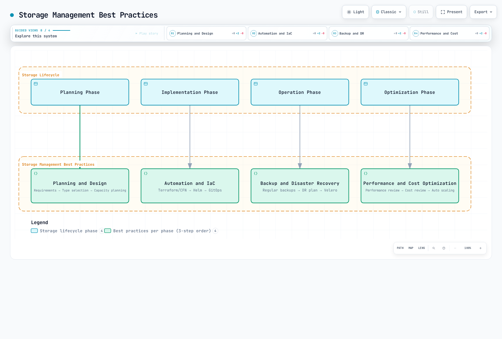

# Amazon EKS ストレージ 第3部：モニタリング、トラブルシューティング、コスト最適化、セキュリティ

> **最終更新日**：2026年10月16日

本書は Amazon EKS ストレージシリーズの第3部（最終部）で、ストレージのモニタリング、トラブルシューティング、コスト最適化、セキュリティを扱います。

## 目次

1. [ストレージのモニタリング](#storage-monitoring)
2. [ストレージのトラブルシューティング](#storage-troubleshooting)
3. [ストレージコストの最適化](#storage-cost-optimization)
4. [ストレージのセキュリティ](#storage-security)
5. [ストレージ管理のベストプラクティス](#storage-management-best-practices)

## ストレージのモニタリング {#storage-monitoring}

バックエンド、Kubernetes、アプリケーションの各観測結果を組み合わせます。バックエンドの I/O カウンターではファイルシステムの空き容量は測れず、Kubernetes の Ready 状態でもデータベースの整合性は確認できません。アラームを作成する前に、単位、ディメンション、集計期間、欠損データの扱いを記録してください。

<!-- 図の修正待ち：ServiceMonitor は Prometheus の検出設定であり、node-exporter は PVC 使用量のエクスポーターではありません。


[🔍 インタラクティブな図を見る](https://www.atomai.click/kubernetes-docs/archmaps/en-eks-04-eks-storage-part3-0.html)
-->

### CloudWatch によるモニタリング

EBS/EFS/FSx は、Kubernetes エクスポーターを介さずに各サービスのメトリクスを公開します。CloudWatch のクエリや可視化には、引き続き適切な IAM 権限が必要です。get-dashboard 呼び出しで取得できるのは既存ダッシュボードの定義であり、ダッシュボードの作成やメトリクスの有効化は行いません。

#### EBS ボリュームメトリクス

| メトリクス | 正しい解釈 |
|---|---|
| VolumeReadBytes / VolumeWriteBytes | Sum は選択期間中に転送されたバイト数です。期間の秒数で割ると bytes/s になります |
| VolumeReadOps / VolumeWriteOps | Sum は完了した操作数です。期間の秒数で割ると IOPS になります |
| VolumeTotalReadTime / VolumeTotalWriteTime | Sum は操作時間の累積秒数です。0操作の場合を考慮し、対応する操作の Sum で割ると平均秒/操作になります |
| VolumeQueueLength | 保留中 I/O のゲージです。Average/Maximum を使うと、継続的なキューとピークを区別しやすくなります |
| BurstBalance | gp2、st1、sc1 の残存クレジットです。gp3 のクレジットメトリクスではありません |

対応する Nitro アタッチメントでは、現在のメトリクスに VolumeAvgIOPS（Ops/s）、VolumeAvgThroughput（KiB/s）、VolumeAvgReadLatency/VolumeAvgWriteLatency（ミリ秒）、I/O 超過・停止チェックも含まれます。各メトリクスの Multi-Attach、コンピューティング、ゾーンに関する制約を確認してください。標準ボリュームメトリクスはアタッチ済みボリュームについて公開されます。データ欠損を自動的に使用量ゼロとして扱わないでください。操作が重なると、既存の時間カウンターは実際の経過時間を超える場合があります。

#### EFS ファイルシステムのメトリクス

TotalIOBytes、DataReadIOBytes、DataWriteIOBytes、MetadataIOBytes はバイト数を表し、正規化済みの転送速度ではありません。該当する Sum を期間で割ると bytes/s になります。MeteredIOBytes は読み取り割引を含む EFS のスループット計測値で、生の転送バイト数とは同一視できません。PermittedThroughput は速度です。期間と単位をそろえて比較し、必要に応じて ClientConnections、モードに応じた PercentIOLimit、ストレージクラスを監視してください。BurstCreditBalance が適用されるのは Bursting スループットであり、Elastic スループットではありません。

#### FSx for Lustre のメトリクス

DataReadBytes/DataWriteBytes と DataReadOperations/DataWriteOperations は FileSystemId を使います。Sum を期間で割ると、スループットまたは operations/s になります。**NetworkThroughputUtilization は有効なメトリクスです**。オブジェクトストレージサーバー（OSS）単位で、FileSystemId と FileServer のディメンションを持ち、使用率をパーセントで示します。FreeDataStorageCapacity は FileSystemId と StorageTargetId を持つ OST 単位です。ターゲットごとの偏りと対応する容量ゲージを確認してください。ゲージを時間で合計しても、現在の空き容量にはなりません。

LogicalDiskUsage と PhysicalDiskUsage も有効なメトリクスです。圧縮前の論理バイト数と圧縮後の物理バイト数を示します。ファイルシステム単位の集計は圧縮率の評価に役立ちますが、プロビジョニング済み容量に対する料金を使用量ベースの料金に変えるものではありません。

### Prometheus と Grafana によるモニタリング

既存の監視基盤の管理者と連携し、その基盤を再利用してください。新規導入をレビューする場合、公開済みの kube-prometheus-stack chart 92.9.0 は operator 0.94.1 を使った検証済みの参考例です。既存クラスターを自動的にアップグレードする指示ではありません。次の設定はマニフェストのレンダリングのみを行います。`monitoring/grafana-admin` に admin-user/admin-password キーを用意し、この章の拡張可能な ebs-gp3 クラスを使ってください。実際のクラスターのバージョン、ストレージサイズ、保持期間に合わせて調整します。アラート配信、Grafana の永続化と可用性、kubelet の TLS/認証の既定値は、デプロイ先ごとにレビューが必要です。

```yaml
grafana:
  admin:
    existingSecret: grafana-admin
    userKey: admin-user
    passwordKey: admin-password
prometheus:
  prometheusSpec:
    retention: 14d
    storageSpec:
      volumeClaimTemplate:
        spec:
          storageClassName: ebs-gp3
          accessModes:
          - ReadWriteOnce
          resources:
            requests:
              storage: 20Gi
```


```bash
set -euo pipefail
helm repo add prometheus-community https://prometheus-community.github.io/helm-charts
helm repo update prometheus-community
helm template prometheus prometheus-community/kube-prometheus-stack \
  --version 92.9.0 --namespace monitoring --kube-version 1.36.0 \
  --include-crds -f monitoring-values.yaml > monitoring-review.yaml
```

ServiceMonitor は **Service** を選択し、そのエンドポイントを対象にします。namespaceSelector と Prometheus インスタンスの ServiceMonitor セレクターの両方が一致する必要があります。EBS CSI 1.66 の Helm chart では controller.enableMetrics の既定値は false です。この chart で管理するインストールでは、既存の管理者と値を確認してください。これらの値は driver の 3301 メトリクスエンドポイント、sidecar のメトリクス Service、生成される ServiceMonitor を有効にします。実際の Prometheus セレクターに合う release ラベルを指定してください。

```yaml
controller:
  enableMetrics: true
  serviceMonitor:
    labels:
      release: prometheus
```

EKS マネージドアドオンでは設定項目が異なる場合があります。Helm の値を適用するのではなく、そのバージョン、設定、実際のリソースを調べてください。次の単独 ServiceMonitor は、所有者が例示された Service をすでに公開していて、一致する monitor を作成していない場合に限る**代替案**です。同等の monitor が生成済みなら、これと併用しないでください。

```yaml
apiVersion: monitoring.coreos.com/v1
kind: ServiceMonitor
metadata:
  name: csi-metrics-reviewed
  namespace: monitoring
  labels:
    release: prometheus
spec:
  namespaceSelector:
    matchNames:
    - kube-system
  selector:
    matchLabels:
      app: ebs-csi-controller
  endpoints:
  - port: metrics
    path: /metrics
    interval: 30s
```


```bash
set -euo pipefail
kubectl -n kube-system get svc ebs-csi-controller -o yaml
kubectl -n kube-system get endpointslice \
  -l kubernetes.io/service-name=ebs-csi-controller -o wide
kubectl -n monitoring get prometheus -o yaml
```

選択した target が Up で、意図したメトリクスを公開していることを確認してください。driver と provisioner/attacher/resizer/snapshotter はそれぞれ別のメトリクスエンドポイントを持ちます。driver の Service 1つでは全 sidecar を収集できません。CSI API 操作のレイテンシと、アプリケーション/EBS のデータ I/O レイテンシは別のものです。

### ファイルシステム使用量とアラート

CSI driver が必要なボリューム統計を実装している場合は、認証済み kubelet メトリクスの kubelet_volume_stats_* を使います。kube-state-metrics はオブジェクトの状態や要求に関する情報を提供し、node-exporter はホストのファイルシステムメトリクスを提供します。node-exporter の DaemonSet を追加でインストールしても、PVC 単位の使用量メトリクスは生成されません。kube-prometheus-stack には node-exporter の選択肢がすでに含まれています。ホストのマウントや権限を重複させないでください。

raw block ボリュームや統計をサポートしない driver では、ファイルシステム容量が公開されない場合があります。EFS access point/PVC の要求はディレクトリ単位のクォータではなく、報告される容量が共有ファイルシステム全体を表す場合があります。container_fs_usage_bytes はあらゆる PVC に使える測定値ではありません。collector、mount、namespace/claim の対応関係を検証し、メトリクス欠損は別に扱ってください。

次のルールは、重複した claim を合算せず max を使って、同一スクレイプの重複を排除します。フェデレーションデータには信頼できる cluster ラベルが必要です。容量ゼロの系列は除外します。予測にはゲージと直近の傾向を使います。対処する前に、スクレイプ欠損、claim の再作成やサイズ変更、ワークロードの変化を確認してください。読み取り専用/静的データセットや、オペレーターへのページ通知が不要な他の claim に合わせてセレクターを調整します。

```yaml
apiVersion: monitoring.coreos.com/v1
kind: PrometheusRule
metadata:
  name: storage-alerts
  namespace: monitoring
  labels:
    release: prometheus
spec:
  groups:
  - name: storage-reviewed
    rules:
    - record: pvc:storage_used_bytes:max
      expr: max by (cluster, namespace, persistentvolumeclaim) (kubelet_volume_stats_used_bytes)
    - record: pvc:storage_capacity_bytes:max
      expr: max by (cluster, namespace, persistentvolumeclaim) (kubelet_volume_stats_capacity_bytes)
    - alert: VolumeUsageHigh
      expr: (pvc:storage_used_bytes:max / pvc:storage_capacity_bytes:max > 0.85) and
        (pvc:storage_capacity_bytes:max > 0)
      for: 10m
      labels:
        severity: warning
      annotations:
        summary: Volume usage high ({{ $value | humanizePercentage }})
        description: PVC {{ $labels.namespace }}/{{ $labels.persistentvolumeclaim
          }} requires capacity review.
    - alert: VolumeMayFillIn24Hours
      expr: (predict_linear(pvc:storage_used_bytes:max[6h], 86400) > pvc:storage_capacity_bytes:max)
        and (pvc:storage_capacity_bytes:max > 0) and (delta(pvc:storage_used_bytes:max[1h])
        > 0)
      for: 10m
      labels:
        severity: warning
      annotations:
        summary: Recent trend projects capacity exhaustion
        description: Review the trend and workload for PVC {{ $labels.namespace }}/{{
          $labels.persistentvolumeclaim }}; this is not a guarantee.
```

namespace/release ラベルが Prometheus ルールのセレクターと一致している必要があります。ルールの構文と合成シナリオを検証し、意図したデプロイ環境で実メトリクスの網羅性とアラート経路を確認してください。このレビューでは実メトリクスの収集もアラート配信も実行していません。

## ストレージのトラブルシューティング {#storage-troubleshooting}

まずオブジェクトの識別情報とイベントを確認します。Pending、ContainerCreating、I/O の低速化は原因が異なることがあります。イメージの取得、スケジューリング、アプリケーションの Ready 状態が、必ずしもストレージ障害を示すわけではありません。図はトリアージの手引きであり、症状と原因の対応を網羅するものではありません。



[🔍 インタラクティブな図を見る](https://www.atomai.click/kubernetes-docs/archmaps/en-eks-04-eks-storage-part3-1.html)

### プロビジョニングと WaitForFirstConsumer

ワークロードが実際に使う namespace、claim、consumer を確認します。推測で広範なアクセスを許可するのではなく、参照されている class、controller のイベント、driver の ID/KMS 権限、クォータ、ノードのアタッチ上限を調べてください。

```bash
set -euo pipefail
: "${NAMESPACE:?Set the workload namespace}"
: "${PVC_NAME:?Set the claim name}"
: "${POD_NAME:?Set its intended consumer Pod}"
kubectl -n "$NAMESPACE" get pvc "$PVC_NAME" -o yaml
kubectl -n "$NAMESPACE" describe pvc "$PVC_NAME"
kubectl -n "$NAMESPACE" describe pod "$POD_NAME"
kubectl get storageclass
kubectl get nodes -L topology.kubernetes.io/zone
```


```bash
set -euo pipefail
: "${CSI_CONTROLLER_POD:?Select the actual controller Pod}"
: "${CSI_CONTAINER:?Select the relevant driver/sidecar container}"
kubectl -n kube-system get pod "$CSI_CONTROLLER_POD" \
  -o jsonpath='{.spec.containers[*].name}'
kubectl -n kube-system logs "$CSI_CONTROLLER_POD" -c "$CSI_CONTAINER" --since=15m --tail=200
```

WaitForFirstConsumer は、スケジュール可能な consumer がトポロジーを決めるまで、新しい PVC を意図的に Pending のままにします。新規の未バインド PVC に、ノードプールが移動すべき AZ がすでに決まっているわけではありません。Pod のセレクター、affinity、taint、リソース、ストレージトポロジーを調べてください。spec.nodeName を指定するとスケジューラーを迂回し、このバインド経路を妨げる場合があります。サポートされているスケジューリング制約を使ってください。バインド後は、EBS PV の AZ/ノード affinity が重要です。Pending を解消する目的で claim を削除したり、PV の容量を編集したりしないでください。

### マウント失敗

attach エラー、node publish/mount エラー、ファイルシステム client の不足、ID/権限エラー、アプリケーションの権限を区別します。ログを読むときは該当する CSI driver/sidecar コンテナを選択してください。複数コンテナの Pod で既定のログを見ても、すべてのコンポーネントは確認できません。必要に応じて VolumeAttachment、バインド済み PV の driver/handle、割り当て先ノードを調べます。

EFS では、マウント対象と DNS、および実際の mount client から TCP 2049 に到達できることを確認します。Lustre では TCP 988 と 1018–1023、およびサービスの client/server ルールが必要です。EFA 構成には追加のセキュリティグループ参照要件があります。NACL の戻りトラフィックとルートも確認してください。ICMP ping の失敗だけでは NFS が利用不可とは判断できません。また AWS CLI コンテナに ping/telnet/mount 用のツールが含まれる保証はありません。Pod からのネットワークテストは、ノード起点の CSI マウントとは送信元やセキュリティグループが異なる場合があります。

### I/O の低速化

測定した操作サイズ、キューイング、アプリケーションの並行数、プロビジョニング済みボリューム性能、インスタンスの EBS 上限、初期化状態を確認します。次の移植可能な Python の時間計算は、境界を含む5分間隔を使います。VolumeReadOps Sum/300 は読み取り IOPS です。Average をそのまま速度と解釈する方法とは異なります。

```bash
set -euo pipefail
: "${AWS_REGION:?Set the volume Region}"
: "${EBS_VOLUME_ID:?Set the verified owned EBS volume ID}"
read -r START_TIME END_TIME < <(python3 - <<'PY'
import datetime, time
end = int(time.time()) // 300 * 300
fmt = lambda value: datetime.datetime.fromtimestamp(value, datetime.timezone.utc).strftime("%Y-%m-%dT%H:%M:%SZ")
print(fmt(end - 3600), fmt(end))
PY
)
aws cloudwatch get-metric-statistics --region "$AWS_REGION" \
  --namespace AWS/EBS --metric-name VolumeReadOps \
  --dimensions "Name=VolumeId,Value=$EBS_VOLUME_ID" \
  --start-time "$START_TIME" --end-time "$END_TIME" \
  --period 300 --statistics Sum --output json > ebs-read-ops.json
python3 - ebs-read-ops.json <<'PY'
import json, sys
with open(sys.argv[1]) as stream:
    points = json.load(stream)["Datapoints"]
for point in sorted(points, key=lambda p: p["Timestamp"]):
    print(point["Timestamp"], "read IOPS:", point["Sum"] / 300)
if not points:
    print("No datapoints: check dimensions, attachment/activity, Region and publication delay")
PY
```

ファイルシステムへの書き込みテストには、検証済みマウント上の使用許可を得た一時ディレクトリを使ってください。このスクリプトは意図したテスト環境内に保存します。一意な 64 MiB ファイルを作成し、自身が作成したファイルとディレクトリだけを削除します。読み取りがキャッシュに当たる場合があるため、この時間からコールドストレージの性能は判断できません。ライブデータに対する予測可能な `/data/test` の上書きや、raw device へのゼロ書き込みは実行しないでください。

```bash
set -euo pipefail
: "${STORAGE_TEST_DIR:?Set an approved disposable directory on the verified disposable filesystem mount}"
test -d "$STORAGE_TEST_DIR" && test -w "$STORAGE_TEST_DIR"
STORAGE_TEST_PATH=$(mktemp -d "$STORAGE_TEST_DIR/storage-test.XXXXXX")
cleanup() { rm -f -- "$STORAGE_TEST_PATH/payload"; rmdir -- "$STORAGE_TEST_PATH"; }
trap cleanup EXIT
time dd if=/dev/zero of="$STORAGE_TEST_PATH/payload" bs=1M count=64 conv=fsync
time dd if="$STORAGE_TEST_PATH/payload" of=/dev/null bs=1M
```

このレビューではストレージベンチマークを実行していません。断片化は証拠を要する仮説として扱ってください。ファイルシステムの再作成/フォーマットはデータ移行であり、最初に行う通常の修正ではありません。nvme0n1 の I/O scheduler を推測で変更しないでください。別ボリュームや root device の可能性があり、最新の blk-mq では scheduler 名や対応状況が異なります。

EFS では General Purpose モード、実際のスループットモード、client の上限、メタデータ負荷、並行数が重要です。ハードマウント/TLS と適切な timeout/retry 動作を含む、Part 2 でサポートされている mount-helper オプションを使ってください。実測したワークロードでは、ファイルをまとめることや、より逐次的なアクセスが役立つ場合がありますが、アプリケーションのデータ配置変更が常に有効とは限りません。

## ストレージコストの最適化 {#storage-cost-optimization}

レイテンシ、耐久性、復旧、所有権の要件を維持しながら、ワークロードの総コストを最適化します。コンピューティングの割引、割り当て済みストレージ、プロビジョニング済み性能、リクエスト/転送料金、保持するバックアップは、それぞれ別のコストです。

<!-- 図の修正待ち：各ストレージサービスを実際の最適化戦略に対応させてください。S3 を FSx の最適化に、FSx を EFS の最適化に割り当てないでください。


[🔍 インタラクティブな図を見る](https://www.atomai.click/kubernetes-docs/archmaps/en-eks-04-eks-storage-part3-2.html)
-->

### ボリュームの種類、サイズ、移行

gp3 と実際の gp2 のコスト/性能を比較し、適したアクセスパターンの場合だけ HDD タイプを検討します。根拠のない最大サイズではなく、測定に基づく余裕とアラームを設定してください。EBS/PVC の容量は通常、縮小ではなく拡張します。割り当て容量を減らすには、小さい新規ボリュームへのサポート対象の移行とデータ検証が必要です。

gp3 StorageClass の作成や default 指定だけでは、既存の gp2 ボリュームは移行され**ません**。default class を変更すると、無関係な新規 claim にも影響します。Part 1 で名前を指定した class を再利用してください。既存ボリュームでは、デプロイ済み driver がサポートする変更手順か、テスト済みのバックアップ/復元による新規 claim への移行を選びます。ストレージを変更する前に、所有権、アプリケーションの整合性、ロールバックを確認してください。

### ライフサイクルと保持

VolumeSnapshotClass は driver/保持動作を定義しますが、スナップショットのスケジュール作成も、経過時間による削除も行いません。バックアップ管理者のスケジュールと保持ポリシーを使ってください。Part 2 では、元の class が Retain であっても削除され得る Velero の CSI スナップショットライフサイクルを説明しています。

PV が Available または Released でも、自動的に破棄してよいとは限りません。Bound でも利用中である証拠にはなりません。クリーンアップ前に claimRef/UID、ワークロード所有者、スナップショット、保持義務、実際のバックエンドリソースを一覧化してください。Retain は課金対象のリソースを残す場合があり、Delete の動作は driver に依存します。EFS access point の削除は、そのファイルシステム/データの削除と同じではありません。S3/Archive への階層化にも、アプリケーションに適合した復元/アクセス計画が必要です。

### EFS コストの最適化

AWS は予測しにくいスパイク状のワークロードに Elastic スループットを推奨しています。既知の継続需要には Provisioned、容量/クレジットモデルに合う場合は Bursting と比較してください。実際に計測された I/O と現在の料金を使います。推奨パフォーマンスモードは General Purpose です。access point は異なる POSIX ID を使ってファイルシステムを共有できますが、PVC ごとの容量を確保したり、アプリケーションごとの自動課金を提供したりはしません。

変更案を出す前に、既存のライフサイクル設定全体を読み取ってください。

```bash
set -euo pipefail
: "${AWS_REGION:?Set the filesystem Region}"
: "${EFS_FILE_SYSTEM_ID:?Set the owned filesystem ID}"
aws efs describe-file-systems --region "$AWS_REGION" --file-system-id "$EFS_FILE_SYSTEM_ID" \
  --output json > efs-filesystem-review.json
aws efs describe-lifecycle-configuration --region "$AWS_REGION" \
  --file-system-id "$EFS_FILE_SYSTEM_ID" --output json > efs-lifecycle-before.json
```

put-lifecycle-configuration リクエストはファイルシステム設定を更新するため、レビュー済みの配列では意図した既存の移行設定をすべて残してください。空の配列はライフサイクル管理を無効にします。各ポリシーオブジェクトには1つの移行設定を指定します。Archive はサポート対象の General Purpose/Elastic 構成が必要で、IA より後の移行期間を指定します。コスト分析では IA/Archive のアクセス料金と最低保管期間の料金を含めてください。単一の30日例で既存ポリシーを無条件に上書きしないでください。

### FSx for Lustre とコスト配賦

再作成できるデータだけに scratch を選び、必要なライフサイクルに応じた persistent のデプロイ/ストレージオプションを使います。LZ4 で物理データ量を減らせる場合がありますが、すでにプロビジョニング済みの SSD 割り当て料金が自動的に下がるわけではありません。選択したストレージ料金モデル、圧縮率、スループット/CPU への影響を評価してください。S3 リポジトリ統合には、バケット名だけでなく、設定済みのインポート/エクスポート/リリース動作が必要です。

Cost Explorer と Kubernetes の配賦ツールには、請求データの設定、該当する場合のコスト配賦タグの有効化、PVC/PV とクラウドリソース ID の対応検証が必要です。namespace ラベルだけでは、すべての AWS 料金に自動でタグが付きません。保持中のボリューム/スナップショット、リクエスト/転送料金、テレメトリの保持を追跡してください。EC2 Reserved Instances/Compute Savings Plans は対象となるコンピューティング費用を変えますが、EBS/EFS/FSx の個別のストレージ料金は自動的には下がりません。

## ストレージのセキュリティ {#storage-security}

バックエンド、ノード/マウント経路、Kubernetes コントロールプレーンをそれぞれ保護します。class 名、namespace ポリシー、コンテナの root を読み取り専用にする設定だけでは、書き込み可能な PVC の内容を保護できません。

<!-- 図の修正待ち：TLS、保存時の鍵管理、IAM、ネットワークルール、RBAC、admission は別々の制御です。RBAC も PSS もバックエンド暗号化の証明にはなりません。


[🔍 インタラクティブな図を見る](https://www.atomai.click/kubernetes-docs/archmaps/en-eks-04-eks-storage-part3-3.html)
-->

### データの暗号化

EBS 暗号化はボリュームのプロビジョニング時に指定します。StorageClass を変更しても既存ボリュームは遡及的に暗号化されません。この新規 class の例では、暗号化した gp3 ストレージ、遅延トポロジーバインド、明示的な保持を要求します。カスタマー管理キーが必要なら、実際にレビューした kmsKeyId を加え、キーのポリシーと driver の権限付与を準備してください。サンプル ARN は実際に使えるキーではありません。

```yaml
apiVersion: storage.k8s.io/v1
kind: StorageClass
metadata:
  name: ebs-encrypted
provisioner: ebs.csi.aws.com
volumeBindingMode: WaitForFirstConsumer
reclaimPolicy: Retain
allowVolumeExpansion: true
parameters:
  type: gp3
  encrypted: 'true'
  csi.storage.k8s.io/fstype: ext4
```

EFS の暗号化は Part 1 のガード付きインフラ手順を使ってファイルシステムの作成時に設定します。既存の非暗号化データには、マウントオプションではなく、暗号化済みファイルシステムへのサポート対象の移行が必要です。FSx for Lustre は保存データを自動的に暗号化します。scratch ファイルシステムはサービス管理キーを使い、選択可能な AWS 管理キー/カスタマー管理 KMS キーを選べるのは **persistent-filesystem** です。SCRATCH_2 の例に customer kms-key-id を渡さないでください。

実際のクラウドリソースを調べ、EBS ID とバインド済み PV の volumeHandles を照合し、アカウント/リージョンを確認してください。customer key を選択していない scratch FSx の応答だけを根拠に、暗号化されていないとは判断できません。

```bash
set -euo pipefail
: "${AWS_REGION:?Set the resources Region}"
: "${EBS_VOLUME_ID:?Identify the actual volume from its bound PV}"
: "${EFS_FILE_SYSTEM_ID:?Set the owned EFS filesystem ID}"
: "${FSX_FILE_SYSTEM_ID:?Set the owned FSx filesystem ID}"
aws ec2 describe-volumes --region "$AWS_REGION" --volume-ids "$EBS_VOLUME_ID" \
  --query 'Volumes[0].{Id:VolumeId,Encrypted:Encrypted,KmsKeyId:KmsKeyId}' --output json
aws efs describe-file-systems --region "$AWS_REGION" --file-system-id "$EFS_FILE_SYSTEM_ID" \
  --query 'FileSystems[0].{Id:FileSystemId,Encrypted:Encrypted,KmsKeyId:KmsKeyId}' --output json
aws fsx describe-file-systems --region "$AWS_REGION" --file-system-ids "$FSX_FILE_SYSTEM_ID" \
  --query 'FileSystems[0].{Id:FileSystemId,Type:LustreConfiguration.DeploymentType,KmsKeyId:KmsKeyId}' --output json
```

転送中のデータには、サポート対象の EFS CSI/mount-helper `tls` オプションを使い、実際のマウント経路で有効になっていることを確認します。FSx の転送中暗号化は、サポートされるファイルシステム/client/インスタンス構成に依存します。サービスのガイダンスに従ってください。**S3 HTTPS/TLS は転送を保護します。`aws s3 cp --sse AES256` は SSE-S3 の保存時暗号化を選択します。このフラグは** TLS を有効にしません。HTTPS endpoint と証明書検証を使い、安全な転送を必須にする bucket policy も確認してください。KMS キーポリシーと転送用証明書の管理は別のものです。

### アクセス制御

Part 1 で準備した CSI identity を使います。controller 用にサポートされる Pod Identity/IRSA role と正確な driver 権限、および該当する場合は KMS 権限付与が必要です。無関係な eksctl コマンドで既存のマネージドアドオン ServiceAccount を再作成したり、controller 権限をすべてのノード/アプリケーションに付与したりしないでください。Mountpoint の Pod 単位 identity、EFS IAM マウント、ファイルシステムの POSIX/access point identity では、認可経路が異なります。

ネットワークアクセスでは、実際の client/ノードの送信元セキュリティグループから EFS マウントターゲットの TCP 2049 への通信を許可します。Lustre では、必要な自己/client 間トラフィックを含め、client と file server の間で仕様に記載された TCP 988 と 1018–1023 のルールが必要です。EFA 対応 Lustre では、代わりに指定されたセキュリティグループ参照付きの全トラフィックルールが必要です。インターネット全体を許可する CIDR で代替してはいけません。SG に加えて、ルート、DNS、NACL、実際の CSI マウント送信元を確認してください。Kubernetes Pod NetworkPolicy が、ノード起点のすべてのファイルシステム接続を自動的に制御するわけではありません。

次の namespace スコープの reader は PVC オブジェクトを参照できますが、作成、サイズ変更、削除はできません。cluster スコープの PV 参照には、別途レビューした ClusterRole が必要です。どちらの role もファイルの内容を直接制御しません。namespace で Pod を作成できる主体は、その PVC をマウントできる場合があります。そのため Pod 作成権限、workload identity、POSIX/access point 権限、テナント分離も制御する必要があります。

```yaml
apiVersion: v1
kind: ServiceAccount
metadata:
  name: storage-auditor
  namespace: storage-demo
automountServiceAccountToken: false
---
apiVersion: rbac.authorization.k8s.io/v1
kind: Role
metadata:
  name: pvc-reader
  namespace: storage-demo
rules:
- apiGroups:
  - ''
  resources:
  - persistentvolumeclaims
  verbs:
  - get
  - list
  - watch
---
apiVersion: rbac.authorization.k8s.io/v1
kind: RoleBinding
metadata:
  name: pvc-reader
  namespace: storage-demo
subjects:
- kind: ServiceAccount
  name: storage-auditor
  namespace: storage-demo
roleRef:
  apiGroup: rbac.authorization.k8s.io
  kind: Role
  name: pvc-reader
```

### Pod のセキュリティコンテキスト

次の完全な例では、Pod レベルの runAsUser/runAsGroup/fsGroup/seccomp と、コンテナレベルの allowPrivilegeEscalation/capabilities/readOnlyRootFilesystem を分けています。定義されていない data volume や、提示されていない書き込み可能な実行時パスを使う nginx image ではなく、準備済みの暗号化 class と宣言済み PVC を使います。namespace ポリシーのバージョンは、レビュー済み Kubernetes 1.36 の例に合わせています。クラスターに適したポリシーバージョンを選んでください。

```yaml
apiVersion: v1
kind: Namespace
metadata:
  name: secure-ns
  labels:
    pod-security.kubernetes.io/enforce: restricted
    pod-security.kubernetes.io/enforce-version: v1.36
---
apiVersion: v1
kind: PersistentVolumeClaim
metadata:
  name: secure-data
  namespace: secure-ns
spec:
  accessModes:
  - ReadWriteOnce
  storageClassName: ebs-encrypted
  resources:
    requests:
      storage: 10Gi
---
apiVersion: v1
kind: Pod
metadata:
  name: secure-pod
  namespace: secure-ns
spec:
  automountServiceAccountToken: false
  securityContext:
    runAsNonRoot: true
    runAsUser: 1000
    runAsGroup: 1000
    fsGroup: 1000
    seccompProfile:
      type: RuntimeDefault
  containers:
  - name: app
    image: busybox:1.38.0
    command:
    - sh
    - -c
    args:
    - test -w /data && sleep 3600
    securityContext:
      allowPrivilegeEscalation: false
      readOnlyRootFilesystem: true
      capabilities:
        drop:
        - ALL
    resources:
      requests:
        cpu: 10m
        memory: 16Mi
      limits:
        cpu: 100m
        memory: 64Mi
    volumeMounts:
    - name: data
      mountPath: /data
  volumes:
  - name: data
    persistentVolumeClaim:
      claimName: secure-data
```

root を読み取り専用にしても `/data` は読み取り専用になりません。このワークロードは書き込み可能な PVC を意図的に確認します。fsGroup の動作は CSI/ファイルシステムに依存します。EFS access point が別の POSIX identity を強制する場合もあります。SELinux/AppArmor プロファイルには、実際のノード/runtime のサポートと準備済みポリシーが必要です。根拠のない MCS label や profile 名をコピーしないでください。Pod Security Standards は Pod 設定を制約しますが、クラウドボリュームを暗号化したり IAM 権限を付与したりはしません。ホストアクセスを持つモニタリング/CSI node agent には、個別にレビューした namespace/セキュリティ設計が必要です。

### セキュリティポリシーの適用

PVC 名のパターンや StorageClass の許可リストだけでは、EBS 暗号化を証明できません。次の **Kyverno ValidatingPolicy** は、Kyverno 1.19.1 と CRD で確認された提供中の `policies.kyverno.io/v1` API を使います。インストール済み controller/CRD と、適切な admission 管理が必要です。このリリースでは従来の ClusterPolicy 例は非推奨です。API に互換性があると決めつけず、意図して移行してください。

```yaml
apiVersion: policies.kyverno.io/v1
kind: ValidatingPolicy
metadata:
  name: require-declared-ebs-encryption
spec:
  validationActions:
  - Deny
  failurePolicy: Fail
  matchConstraints:
    resourceRules:
    - apiGroups:
      - storage.k8s.io
      apiVersions:
      - v1
      resources:
      - storageclasses
      operations:
      - CREATE
      - UPDATE
      scope: Cluster
  validations:
  - expression: '!(object.provisioner in [''ebs.csi.aws.com'', ''ebs.csi.eks.amazonaws.com''])
      || (has(object.parameters) && ''encrypted'' in object.parameters && object.parameters[''encrypted'']
      == ''true'')'
    message: EBS StorageClasses must explicitly request encryption.
```

このポリシーは **EBS StorageClass の作成/更新で宣言された暗号化パラメーター**を検査し、Auto Mode provisioner も対象にします。既存の AWS ボリューム、static PV、スナップショット内容、対象外の match/bypass 経路は検査しません。StorageClass/PV の管理を制限し、admission に加えてバックエンドのコンプライアンスチェックも行ってください。広範囲に適用する前に、代表的なリソースで展開し、ポリシーレポート/webhook の健全性を監視します。既存データの暗号化には別途移行が必要です。

## ストレージ管理のベストプラクティス {#storage-management-best-practices}



[🔍 インタラクティブな図を見る](https://www.atomai.click/kubernetes-docs/archmaps/en-eks-04-eks-storage-part3-4.html)

### 計画と容量

レイテンシ/IOPS/スループット、容量増加、読み書きパターン、並行数、可用性、耐久性、RPO/RTO をそれぞれ記録します。要件に基づき、block、共有 NFS、並列 Lustre、object access を選びます。実測に基づく余裕と、範囲を限定した拡張手順を用意してください。autoscaler や PVC のサイズ変更は、アプリケーションのレプリケーションや任意の容量縮小を提供するものではありません。

### バックアップと災害復旧

一意なバックアップ識別子と保持責任者を定めた、サポート済みのスケジュールを使います。固定 snapshot 名を繰り返し作る shell cron は、最初のオブジェクト作成後に失敗します。daily-backup という名前の Velero backup を一度作ってもスケジュールにはなりません。Part 2 のレビュー済み Velero/CSI 導入方法とデータベース整合性要件に沿って、次のコマンドはレビュー用の日次スケジュールを出力します。

```bash
velero schedule create storage-daily --schedule="0 0 * * *" \
  --include-namespaces=storage-demo --ttl=720h0m0s -o yaml > storage-schedule-review.yaml
```

所有者のレビュー後にデプロイし、バックアップの欠落/失敗をアラートし、分離された環境への復元を試験します。S3 内のバックアップが、ボリュームの全バイトを含まずネイティブ snapshot を参照する場合があります。AZ/リージョンをまたぐ復旧には、アクセス可能なデータ、キー、driver/ストレージの対応、アプリケーション検証が必要です。管理された切り替えが成功するまでソースを保持し、スケジュールから RPO/RTO を主張せず、測定した復旧時間を記録してください。

### Infrastructure as Code と GitOps

Part 1/Part 2 のガード付きファイルシステム作成例、または provider/schema のバージョン、サブネット/マウントターゲット/セキュリティグループ設定、削除保護をレビューした所有済み Terraform/CloudFormation module を使います。ファイルシステムだけを定義する Terraform resource は、EKS ですぐ使えるマウント経路にはなりません。バックアップ保持と IaC の destroy/prune 動作を分けてください。

Helm values は chart 固有の入力です。たとえば custom `storage.encrypted: true` value は、template が対応する実リソースフィールドに割り当てない限り何も起こしません。デプロイ前に、レンダリングした StorageClass/PVC/workload を検証してください。GitOps の prune、chart のアンインストール、claim の保持設定はデータに異なる影響を与えます。各リソースの管理者を記録し、ライフサイクル変更は一時データで試験します。

次のファイルシステム resource は暗号化と Elastic throughput を要求し、教材用の30日 IA ポリシーと Terraform destroy guard を追加します。作成 token をプロジェクト固有の安定した値に置き換え、provider/アカウント/リージョンを設定し、レビュー済みのネットワーク/マウントターゲット resource を追加してください。prevent_destroy は Terraform 操作のガードであり、バックアップではなく、外部からのすべての削除を防ぐものでもありません。

```hcl
resource "aws_efs_file_system" "example" {
  creation_token   = "example"
  performance_mode = "generalPurpose"
  throughput_mode  = "elastic"
  encrypted        = true

  lifecycle_policy {
    transition_to_ia = "AFTER_30_DAYS"
  }

  lifecycle {
    prevent_destroy = true
  }

  tags = {
    Name = "ExampleFileSystem"
  }
}
```

### 継続的なレビュー

ワークロードの変化に応じて、ボトルネック、プロビジョニング上限、保持コスト、セキュリティ制御を見直してください。リソース所有権、バックアップ/復旧、削除の影響を確認するまでは、クリーンアップレポートを読み取り専用のままにします。変更はアラートして範囲を限定したうえで提案してから自動化してください。この章の例はローカルで検証した参考構成です。バックエンド性能、admission のデプロイ、復旧は、意図した環境で引き続き検証が必要です。

## まとめ

本書では、Amazon EKS ストレージのモニタリング、トラブルシューティング、コスト最適化、セキュリティを扱いました。効果的なストレージ管理は、EKS クラスターの性能、信頼性、費用対効果を確保するうえで重要です。

ストレージ要件はアプリケーションによって異なります。ワークロードの特性を把握して適切なストレージソリューションを選び、定期的なモニタリング、トラブルシューティング、コスト最適化、セキュリティレビューを通じてストレージリソースを管理してください。

## 参考資料

- [Amazon EKS ストレージのベストプラクティス](https://docs.aws.amazon.com/eks/latest/best-practices/storage.html)
- [Kubernetes ストレージのトラブルシューティング](https://kubernetes.io/docs/tasks/debug-application-cluster/debug-application/#debugging-pods)
- [Kubernetes ストレージのセキュリティ](https://kubernetes.io/docs/concepts/security/)

- [EBS CloudWatch メトリクス](https://docs.aws.amazon.com/ebs/latest/userguide/using_cloudwatch_ebs.html)
- [FSx Lustre のメトリクスディメンション](https://docs.aws.amazon.com/fsx/latest/LustreGuide/fs-metrics.html)
- [EFS パフォーマンスモード](https://docs.aws.amazon.com/efs/latest/ug/performance.html)
- [EFS ライフサイクル API](https://docs.aws.amazon.com/efs/latest/APIReference/API_PutLifecycleConfiguration.html)
- [FSx の保存時暗号化](https://docs.aws.amazon.com/fsx/latest/LustreGuide/encryption-at-rest.html)
- [FSx のネットワークアクセス](https://docs.aws.amazon.com/fsx/latest/LustreGuide/limit-access-security-groups.html)
- [S3 の保存時暗号化](https://docs.aws.amazon.com/AmazonS3/latest/userguide/UsingServerSideEncryption.html)
- [Kyverno CEL 移行ガイド](https://kyverno.io/docs/guides/migration-to-cel/)

## クイズ

この章の学習内容を確認するには、[トピック別クイズ](../quizzes/eks/04-eks-storage-part3-quiz.md)に挑戦してください。
