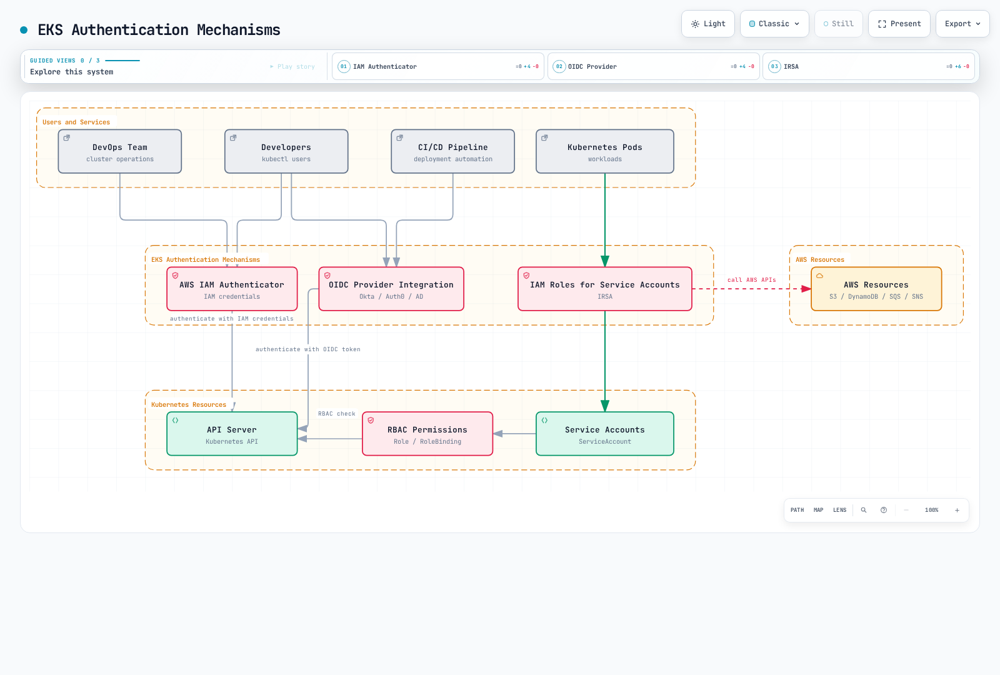

# EKS クラスターアクセス認証: IAM とアクセスエントリ

> **最終更新日**: 2026年11月21日

このページは、[Amazon EKS Security](./05-eks-security.md) の「IAM and Authentication」セクションを詳しく分割したものです。人間および自動化で使用する IAM プリンシパルが Kubernetes API に対して認証され、権限を付与される仕組み、EKS クラスターのロールとプロビジョニングを実行する呼び出し元の権限、名前空間スコープの RBAC およびアクセス ポリシーを使用するアクセスエントリについて説明します。ワークロード（Pod）が AWS 認証情報を取得する方法については、[IRSA and the OIDC Provider](./05-eks-security-irsa-oidc.md) および [EKS Pod Identity](./05-eks-security-pod-identity.md) を参照してください。これらの例では、ここで準備する `security-demo` 名前空間を再利用します。

## 目次

1. [アイデンティティと認可のレイヤー](#identities-and-authorization-layers)
2. [クラスターのロールとプロビジョニングの呼び出し元](#cluster-role-and-provisioning-caller)
3. [アクセスエントリと名前空間の認可](#access-entries-and-namespace-authorization)

## アイデンティティと認可のレイヤー

| アイデンティティ/制御 | 目的 |
|---|---|
| 人間/自動化で使用する IAM プリンシパル | 設定済みの IAM マッピング/アクセスエントリ経路を通じてクラスターアクセスを認証する |
| Kubernetes RBAC と EKS アクセスポリシー | Kubernetes 操作を認可する。許可は加算的に適用される |
| 外部 OIDC アイデンティティプロバイダー | クライアント/クレーム設定を用いた Kubernetes API ユーザーログイン用に個別に設定する |
| EKS クラスター IAM ロール | EKS サービスがクラスターの AWS API を呼び出せるようにする |
| EC2 ノード IAM ロール | ブートストラップと必要なノードエージェントの AWS 操作をサポートする |
| IRSA または EKS Pod Identity ロール | アプリケーションに一時的な AWS 認証情報を付与する |
| Kubernetes ServiceAccount トークン | RBAC 権限の範囲内で、Pod を Kubernetes API に対して認証する |

IRSA に使用する IAM OIDC プロバイダーは、Kubernetes ユーザーログイン用に関連付ける外部 OIDC プロバイダーとは別のものです。アプリケーションに対する AWS 権限によって、Kubernetes API の権限が自動的に付与されることはありません。

<!-- 図の修正待ち: IRSA/Pod Identity はワークロードに AWS 認証情報を付与します。通常の Pod から Kubernetes API への経路では、Kubernetes ServiceAccount トークン/RBAC を使用します。


[🔍 インタラクティブな図を表示](https://www.atomai.click/kubernetes-docs/archmaps/en-eks-05-eks-security-2.html)
-->

## クラスターのロールとプロビジョニングの呼び出し元

標準的な EKS クラスターのロールは、EKS サービスを信頼します。これは信頼関係であり、人間である開発者の権限ポリシーではありません。

```json
{
  "Version": "2012-10-17",
  "Statement": [
    {
      "Effect": "Allow",
      "Principal": {
        "Service": "eks.amazonaws.com"
      },
      "Action": "sts:AssumeRole"
    }
  ]
}
```

このロールには、サービス操作のために AmazonEKSClusterPolicy、またはサポートされているカスタムポリシーが必要です。Auto Mode には追加のロール/ポリシー要件があります。プロビジョニングを実行する呼び出し元には、選択した設定に必要なアクションと、意図したロールを渡す権限が別途必要です。現在の認可リファレンスでは、リソース ARN によるスコープ指定がない CreateCluster が記載されているため、そこではサポートされているリクエスト条件を使用してください。リソース ARN をサポートするアクション/PassRole については、スコープを指定してください。開発者ロールに AmazonEKSClusterPolicy をアタッチしても、Kubernetes アプリケーションへのアクセス権は付与されません。

## アクセスエントリと名前空間の認可

IAM によるクラスターアクセスには、サポートされているアクセスエントリ API を優先して使用してください。現在のモードを確認し、移行前に既存の管理者/ノードのマッピングを維持してください。CONFIG_MAP から API_AND_CONFIG_MAP/API への移行は、自由に元に戻せる切り替えではありません。ノードロールを省いた短いサンプルで aws-auth を上書きしないでください。API のみのモードを選ぶ前に、すべてのアイデンティティ、ポリシー、ノード、および復旧手段を確認してください。

```bash
set -euo pipefail
: "${CLUSTER_NAME:?Set the existing cluster name}"
: "${AWS_REGION:?Set its Region}"
aws eks describe-cluster --name "$CLUSTER_NAME" --region "$AWS_REGION" \
  --query 'cluster.{Name:name,Status:status,Endpoint:endpoint,Access:accessConfig}' --output json
```

以下の例では、承認済みの IAM 開発者ロールが準備済みであること、クラスターがすでにアクセスエントリをサポートしていること、およびプラットフォーム運用者が必要な権限を持っていることを前提としています。専用の名前空間は、その所有者を通じて準備してください。この Pod Security Admission のバージョンは、レビュー済みの EKS 1.36 の例に合わせています。対象クラスターに適したバージョンを選択してください。

```yaml
apiVersion: v1
kind: Namespace
metadata:
  name: security-demo
  labels:
    pod-security.kubernetes.io/enforce: restricted
    pod-security.kubernetes.io/enforce-version: v1.36
```

```bash
set -euo pipefail
: "${CLUSTER_NAME:?Set the verified cluster name}"
: "${AWS_REGION:?Set its Region}"
: "${DEVELOPER_ROLE_ARN:?Set a prepared IAM role ARN, not an STS session ARN}"
MODE=$(aws eks describe-cluster --name "$CLUSTER_NAME" --region "$AWS_REGION" \
  --query cluster.accessConfig.authenticationMode --output text)
case "$MODE" in
  API|API_AND_CONFIG_MAP) ;;
  *) echo "Access entries are not enabled; review the migration first"; exit 1 ;;
esac
aws eks list-access-entries --cluster-name "$CLUSTER_NAME" --region "$AWS_REGION" \
  --output json > security-access-entries.json
python3 - "$DEVELOPER_ROLE_ARN" <<'PY'
import json, sys
with open("security-access-entries.json") as stream:
    existing = json.load(stream)["accessEntries"]
if sys.argv[1] in existing:
    raise SystemExit("Entry already exists; inspect its groups/policies instead of overwriting")
PY
aws eks create-access-entry --cluster-name "$CLUSTER_NAME" --region "$AWS_REGION" \
  --principal-arn "$DEVELOPER_ROLE_ARN" --type STANDARD \
  --kubernetes-groups security-demo-developers
```

```yaml
apiVersion: rbac.authorization.k8s.io/v1
kind: Role
metadata:
  name: developer
  namespace: security-demo
rules:
- apiGroups:
  - ''
  resources:
  - pods
  verbs:
  - get
  - list
  - watch
- apiGroups:
  - apps
  resources:
  - deployments
  verbs:
  - get
  - list
  - watch
  - create
  - update
  - patch
- apiGroups:
  - batch
  resources:
  - jobs
  verbs:
  - get
  - list
  - watch
  - create
  - update
  - patch
---
apiVersion: rbac.authorization.k8s.io/v1
kind: RoleBinding
metadata:
  name: developer
  namespace: security-demo
subjects:
- kind: Group
  name: security-demo-developers
  apiGroup: rbac.authorization.k8s.io
roleRef:
  kind: Role
  name: developer
  apiGroup: rbac.authorization.k8s.io
```

このエントリは IAM プリンシパルをグループにマッピングし、RoleBinding によってそのグループに上記の名前空間権限を付与します。グループ名だけでは名前空間の境界は確立されません。ワークロードコントローラーの作成権限があると、その名前空間内の ServiceAccount、Secret、PVC を使用する Pod を作成できる可能性があります。テナントを分離し、適切なアドミッション制御と所有権管理を通じて、ワークロードおよび ServiceAccount の使用を制限してください。

個別にレビューした閲覧者用エントリでは、カスタム RBAC の代わりに EKS アクセスポリシーを使用できます。この名前空間の閲覧権限を追加する前に、エントリの現在のグループと関連付けられているポリシーを確認してください。

```bash
set -euo pipefail
: "${CLUSTER_NAME:?Set the verified cluster name}"
: "${AWS_REGION:?Set its Region}"
: "${VIEWER_ROLE_ARN:?Set the IAM principal of a prepared, reviewed access entry}"
aws eks list-associated-access-policies --cluster-name "$CLUSTER_NAME" --region "$AWS_REGION" \
  --principal-arn "$VIEWER_ROLE_ARN"
aws eks associate-access-policy --cluster-name "$CLUSTER_NAME" --region "$AWS_REGION" \
  --principal-arn "$VIEWER_ROLE_ARN" \
  --policy-arn arn:aws:eks::aws:cluster-access-policy/AmazonEKSViewPolicy \
  --access-scope type=namespace,namespaces=security-demo
```

View を追加しても、より広範な RBAC/アクセスポリシーの付与は取り消されません。更新の反映には時間がかかる場合があります。実際に使用する IAM ログインでテストしてください。kubectl --as は Kubernetes の偽装/RBAC をテストするものであり、IAM アクセスポリシー経路を検証するものではありません。kubeconfig はクライアントが接続するクラスターと認証情報の仕組みを指定しますが、それ自体で権限を付与するものではありません。

IAM の eks:DescribeCluster/ListClusters は、AWS の管理/検出操作をサポートします。eks:AccessKubernetesApi は、コンソールでの表示に必要な権限です。eks:namespaces 条件はアクセスポリシー関連付けリクエストをフィルタリングするものであり、kubectl API 呼び出しに対する一般的な名前空間フィルターではありません。

## 参考資料

- [EKS アクセスエントリ](https://docs.aws.amazon.com/eks/latest/userguide/access-entries.html)
- [EKS アクセスポリシー](https://docs.aws.amazon.com/eks/latest/userguide/access-policies.html)
- [Kubernetes RBAC](https://kubernetes.io/docs/reference/access-authn-authz/rbac/)

## 次のステップ

- 次へ: [IRSA and the OIDC Provider](./05-eks-security-irsa-oidc.md)
- 関連項目: [EKS Pod Identity](./05-eks-security-pod-identity.md)
- 概要に戻る: [Amazon EKS Security](./05-eks-security.md)

## クイズ

この章で学んだことを確認するには、[トピック別クイズ](../quizzes/eks/05-eks-security-cluster-access-quiz.md)に挑戦してください。
