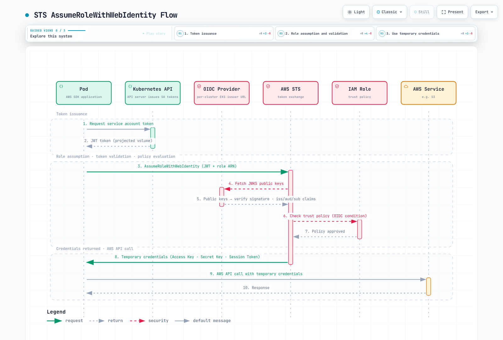

# IRSA と OIDC Provider

> **最終更新日**: 2026年11月21日

このページでは、[Amazon EKS Security](./05-eks-security.md) の「OIDC Provider Deep Dive」セクションを詳しく解説します。クラスターの OIDC issuer と IAM OIDC provider の関係、IRSA トークンが STS を通じて一時的な認証情報になる仕組み、Discovery/JWKS の確認、そして範囲を限定した IRSA role と Job の例を取り上げます。例では、[cluster access](./05-eks-security-cluster-access.md#access-entries-and-namespace-authorization) ページで準備した `security-demo` namespace を使用します。IRSA のフローを順を追って示した図は、[How IRSA works](../security/17-eks-workload-identity-migration.md#irsa-flow) にもあります。

## 目次

1. [OIDC Issuer と IAM OIDC Provider](#oidc-issuer-and-iam-oidc-provider)
2. [IRSA トークンと Role の交換](#irsa-token-and-role-exchange)
3. [Discovery と JWKS の確認](#discovery-and-jwks-inspection)
4. [範囲を限定した IRSA の例](#a-scoped-irsa-example)

## OIDC Issuer と IAM OIDC Provider

EKS はクラスターの OIDC issuer と公開署名鍵を提供します。このエンドポイントだけでは、IAM OIDC provider が作成されたり、role の引き受けが許可されたりするわけではありません。IRSA を使うには、role のアカウントに意図した IAM OIDC provider が存在し、role が正しい issuer/subject/audience 条件でその provider を信頼し、workload が互換性のある SDK を使用している必要があります。



[🔍 インタラクティブな図を表示](https://www.atomai.click/kubernetes-docs/archmaps/en-eks-05-eks-security-3.html)

## IRSA トークンと Role の交換

IRSA webhook は、条件を満たす Pod に投影トークンと role の設定を追加します。SDK は AssumeRoleWithWebIdentity を使って web identity token を STS と交換します。STS は issuer、署名、トークン、role の信頼設定を検証し、一時的な AWS 認証情報を返します。アプリケーションはその認証情報を使って、許可された AWS 操作を行います。Kubernetes は投影トークンをローテーションし、SDK は AWS 認証情報を更新します。これらの有効期間は異なります。

これは、意図的に古い、または期限切れのタイムスタンプとプレースホルダーの ID を使った、**デコード後のペイロード形式の例**です。署名済みトークンでも、認証テストでもありません。以下の audience は IRSA の経路用です。Pod Identity では別の audience を使用します。

```json
{
  "aud": [
    "sts.amazonaws.com"
  ],
  "exp": 1234567890,
  "iat": 1234567800,
  "iss": "https://oidc.eks.us-west-2.amazonaws.com/id/REPLACE_WITH_CLUSTER_ISSUER_ID",
  "kubernetes.io": {
    "namespace": "security-demo",
    "pod": {
      "name": "irsa-read-check-example",
      "uid": "example-pod-uid"
    },
    "serviceaccount": {
      "name": "irsa-reader",
      "uid": "example-serviceaccount-uid"
    }
  },
  "sub": "system:serviceaccount:security-demo:irsa-reader"
}
```

JSON をデコードできるかどうかだけでなく、issuer、audience、有効期限、想定される subject を検証してください。生のトークン、AWS のシークレットアクセスキー、セッショントークンは、例やログに含めないでください。role は、明示的に許可された複数の ServiceAccount または issuer を信頼できます。IRSA では、ServiceAccount ごとに role を必ず1つ用意する必要はありません。

## Discovery と JWKS の確認

実際のクラスターから取得した issuer を使用してください。この診断スクリプトは、公開されている discovery/JWKS ドキュメントを取得し、discovery issuer と HTTPS スキームを確認します。workload token や IAM 権限は検証しません。

```bash
set -euo pipefail
: "${CLUSTER_NAME:?Set the verified cluster}"
: "${AWS_REGION:?Set its Region}"
OIDC_URL=$(aws eks describe-cluster --name "$CLUSTER_NAME" --region "$AWS_REGION" \
  --query cluster.identity.oidc.issuer --output text)
case "$OIDC_URL" in https://*) ;; *) echo "Unexpected issuer URL"; exit 1 ;; esac
curl --fail --silent --show-error --proto '=https' --connect-timeout 5 --max-time 20 \
  "${OIDC_URL%/}/.well-known/openid-configuration" > oidc-discovery.json
JWKS_URI=$(python3 - "$OIDC_URL" <<'PY'
import json, sys, urllib.parse
with open("oidc-discovery.json") as stream:
    doc = json.load(stream)
if doc["issuer"] != sys.argv[1]:
    raise SystemExit("Discovery issuer does not match the cluster issuer")
uri = doc["jwks_uri"]
parsed = urllib.parse.urlparse(uri)
if parsed.scheme != "https" or not parsed.hostname or parsed.username or parsed.password:
    raise SystemExit("JWKS must be an HTTPS URL without embedded credentials")
print(uri)
PY
)
curl --fail --silent --show-error --proto '=https' --connect-timeout 5 --max-time 20 \
  "$JWKS_URI" > oidc-jwks.json
python3 - <<'PY'
import json
with open("oidc-jwks.json") as stream:
    keys = json.load(stream).get("keys")
if not isinstance(keys, list) or not keys or not all(isinstance(k, dict) and "kty" in k for k in keys):
    raise SystemExit("Unexpected JWKS response")
print("Fetched", len(keys), "public keys; no token signature was validated")
PY
```

自動検証器は、Cache-Control に従って鍵をキャッシュし、レビュー済みの JWT ライブラリを使用して、署名鍵のローテーションや不明な kid に対応する必要があります。EKS は OIDC 署名鍵を7日ごとにローテーションします。現在の EKS では、インターネットへのアウトバウンド接続がない検証器向けに、クラスターの OIDC discovery/JWKS 用 PrivateLink interface endpoint `com.amazonaws.region-code.oidc-eks` もサポートされています。この endpoint のリージョンと DNS の要件を確認してください。EKS 管理 API endpoint は別のサービスです。

## 範囲を限定した IRSA の例

IAM OIDC provider、role、bucket は、それぞれの管理者を通じて準備してください。アカウント、issuer のホスト名とパス全体、role ARN を一貫して置き換えてください。IPv6 クラスターでは、デュアルスタックの issuer ホスト名を使用できます。この例では、security-demo/irsa-reader と STS audience だけを関連付けます。これは新しい role 信頼設定の例であり、既存 role の他の信頼ステートメントを置き換えるものではありません。

```json
{
  "Version": "2012-10-17",
  "Statement": [
    {
      "Effect": "Allow",
      "Principal": {
        "Federated": "arn:aws:iam::111122223333:oidc-provider/oidc.eks.us-west-2.amazonaws.com/id/REPLACE_WITH_CLUSTER_ISSUER_ID"
      },
      "Action": "sts:AssumeRoleWithWebIdentity",
      "Condition": {
        "StringEquals": {
          "oidc.eks.us-west-2.amazonaws.com/id/REPLACE_WITH_CLUSTER_ISSUER_ID:sub": "system:serviceaccount:security-demo:irsa-reader",
          "oidc.eks.us-west-2.amazonaws.com/id/REPLACE_WITH_CLUSTER_ISSUER_ID:aud": "sts.amazonaws.com"
        }
      }
    }
  ]
}
```

読み取り用のポリシーでは、特定の bucket prefix に対するアクセスを許可します。オブジェクトでカスタマー管理型の暗号化キーを使う場合は、必要な KMS 権限だけを追加し、bucket/endpoint のポリシーを確認してください。この1つの prefix を使う例では、アカウント全体に適用される AmazonS3ReadOnlyAccess ポリシーは必要ありません。

```json
{
  "Version": "2012-10-17",
  "Statement": [
    {
      "Effect": "Allow",
      "Action": [
        "s3:ListBucket"
      ],
      "Resource": "arn:aws:s3:::replace-with-owned-security-bucket",
      "Condition": {
        "StringLike": {
          "s3:prefix": [
            "security-demo/",
            "security-demo/*"
          ]
        }
      }
    },
    {
      "Effect": "Allow",
      "Action": [
        "s3:GetObject"
      ],
      "Resource": "arn:aws:s3:::replace-with-owned-security-bucket/security-demo/*"
    }
  ]
}
```

[security-demo namespace](./05-eks-security-cluster-access.md#access-entries-and-namespace-authorization) と role を準備した後、以下の ServiceAccount と、範囲を限定した一覧取得用 Job を作成します。AWS CLI の公式イメージにはクライアントが含まれていますが、任意の amazonlinux:2 イメージに含まれているとは限りません。bucket/リージョン/role の値を置き換えてください。この Job は機密情報の値を出力せずに prefix を一覧表示します。この操作が成功しても、すべてのアプリケーションの GetObject/KMS 権限があることの証明にはなりません。

```yaml
apiVersion: v1
kind: ServiceAccount
metadata:
  name: irsa-reader
  namespace: security-demo
  annotations:
    eks.amazonaws.com/role-arn: arn:aws:iam::111122223333:role/SecurityDemoIRSAReader
---
apiVersion: batch/v1
kind: Job
metadata:
  name: irsa-read-check
  namespace: security-demo
spec:
  backoffLimit: 0
  activeDeadlineSeconds: 120
  template:
    spec:
      serviceAccountName: irsa-reader
      restartPolicy: Never
      securityContext:
        runAsNonRoot: true
        runAsUser: 1000
        runAsGroup: 1000
        fsGroup: 1000
        seccompProfile:
          type: RuntimeDefault
      containers:
      - name: reader
        image: public.ecr.aws/aws-cli/aws-cli:2.36.43
        command:
        - aws
        args:
        - s3api
        - list-objects-v2
        - --bucket
        - replace-with-owned-security-bucket
        - --prefix
        - security-demo/
        - --max-items
        - '5'
        env:
        - name: AWS_REGION
          value: us-west-2
        - name: AWS_EC2_METADATA_DISABLED
          value: 'true'
        securityContext:
          allowPrivilegeEscalation: false
          readOnlyRootFilesystem: true
          capabilities:
            drop:
            - ALL
        resources:
          requests:
            cpu: 100m
            memory: 128Mi
          limits:
            cpu: 500m
            memory: 256Mi
        volumeMounts:
        - name: private-home
          mountPath: /root
        - name: tmp
          mountPath: /tmp
      volumes:
      - name: private-home
        emptyDir: {}
      - name: tmp
        emptyDir: {}
      nodeSelector:
        kubernetes.io/os: linux
```

## 参考資料

- [EKS IRSA](https://docs.aws.amazon.com/eks/latest/userguide/iam-roles-for-service-accounts.html)
- [IRSA の最小 SDK バージョン](https://docs.aws.amazon.com/eks/latest/userguide/iam-roles-for-service-accounts-minimum-sdk.html)
- [EKS ノードの IAM 権限を IRSA と Pod Identity に移行する](../security/17-eks-workload-identity-migration.md)

## 次のステップ

- 前へ: [EKS クラスターアクセス認証: IAM と Access Entries](./05-eks-security-cluster-access.md)
- 次へ: [EKS Pod Identity](./05-eks-security-pod-identity.md)
- 概要に戻る: [Amazon EKS Security](./05-eks-security.md)

## クイズ

この章で学んだ内容を確認するには、[トピック別クイズ](../quizzes/eks/05-eks-security-irsa-oidc-quiz.md)に挑戦してください。
