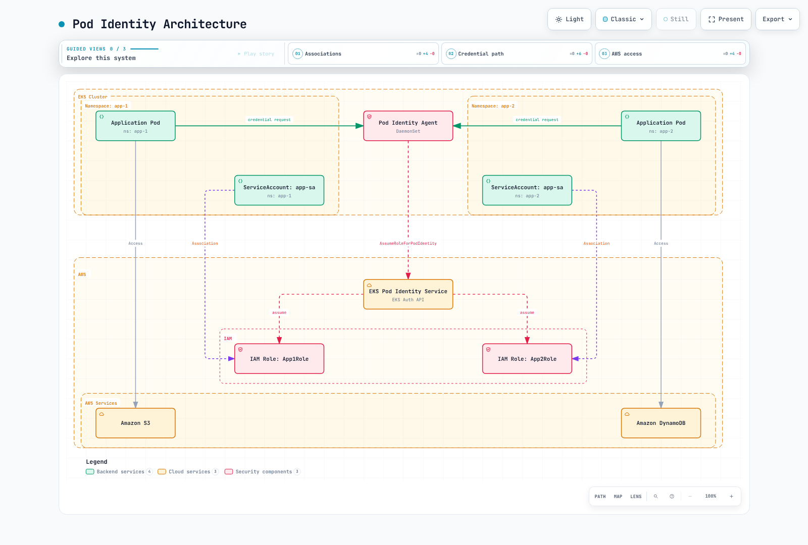

# EKS Pod Identity

> **最終更新日**: 2026年11月21日

このページは、[Amazon EKS Security](./05-eks-security.md) の「EKS Pod Identity」セクションを詳しく分割したものです。Pod Identity Agent と認証情報のフロー、ロールの信頼関係と関連付けの準備、クロスアカウントおよびキャッシュに関する考慮事項の設定リファレンスです。IRSA との比較、本番環境での移行順序、ライブデモについては、ワークブック [EKS ノードの IAM 権限を IRSA と Pod Identity に移行する](../security/17-eks-workload-identity-migration.md) を参照してください。そのため、このページでは概要のみを説明し、ワークブックへのリンクを掲載しています。

## 目次

1. [Pod Identity が提供するもの](#what-pod-identity-provides)
2. [IRSA との比較](#comparison-with-irsa)
3. [Agent と認証情報のフロー](#agent-and-credential-flow)
4. [ロールと関連付けの準備](#prepared-role-and-association)
5. [クロスアカウントとキャッシュに関する考慮事項](#cross-account-and-cache-considerations)
6. [IRSA から Pod Identity への移行手順](#irsa-to-pod-identity-migration-procedure)

## Pod Identity が提供するもの

EKS Pod Identity は、SDK のコンテナ認証情報プロバイダーと EKS Auth を通じて、一時的な AWS 認証情報を提供します。Pod Identity の関連付けは、クラスター、名前空間、ServiceAccount を IAM ロールに対応付けるものです。ServiceAccount を作成することも、Kubernetes RBAC 権限を付与することもありません。

## IRSA との比較

2 つのメカニズムの違い（クラスターごとの設定、信頼ポリシー、スケールの上限、クロスアカウント、職務分掌）については、ワークブックの [IRSA と Pod Identity の比較](../security/17-eks-workload-identity-migration.md#irsa-and-pod-identity-compared) 表を参照してください。このページの設定例を読む際は、次の違いを念頭に置いてください。

- **信頼関係と紐付け**: IRSA は、issuer、subject、audience の信頼条件を設定した IAM OIDC プロバイダーを使用します。Pod Identity は、`pods.eks.amazonaws.com` のロール信頼関係と EKS API の関連付けを使用します。
- **認証情報の経路**: IRSA では、SDK がウェブアイデンティティトークンを STS と交換します（[IRSA の仕組み](../security/17-eks-workload-identity-migration.md#irsa-flow)）。Pod Identity では、SDK がノードエージェントのコンテナ認証情報エンドポイントを呼び出し、エージェントが EKS Auth から認証情報を取得します（[EKS Pod Identity の仕組み](../security/17-eks-workload-identity-migration.md#pod-identity-flow)）。
- **セッションタグ**: Pod Identity の Kubernetes セッションタグはデフォルトで有効ですが、意図的に無効化できます。セッションタグは引き受けたロールのセッションにラベルを付けるものであり、アプリケーションが作成するすべての AWS リソースに自動的にタグを付けるわけではありません。

設定が簡単になっても、IAM、ネットワーク、SDK、アプリケーションの検証が不要になるわけではありません。

## Agent と認証情報のフロー

<!-- Diagram repair pending: SDK calls container credential endpoint; agent calls EKS Auth AssumeRoleForPodIdentity, not STS directly or arbitrary request interception.


[🔍 View interactive diagram](https://www.atomai.click/kubernetes-docs/archmaps/en-eks-05-eks-security-4.html)
-->

関連付けが設定されている新規作成の Pod には、EKS によって audience が pods.eks.amazonaws.com のトークン、トークンファイルの環境変数、コンテナ認証情報 URI が挿入されます。SDK はエージェントのエンドポイント（通常は 169.254.170.23/v1/credentials）を呼び出します。エージェントは **EKS Auth の AssumeRoleForPodIdentity** を呼び出し、返された認証情報を SDK が利用できるようにします。エージェントは、すべてのアプリケーションリクエストを透過的に横取りするものではありません。アプリケーションは引き続き、自身の認証情報を使って AWS サービスを直接呼び出します。手順ごとのフロー図は、[EKS Pod Identity の仕組み](../security/17-eks-workload-identity-migration.md#pod-identity-flow)を参照してください。

標準のサポート対象 EC2 ノードでは、Pod Identity Agent アドオン/DaemonSet を使用します。Auto Mode では、マネージドノードの機能として提供されます。Hybrid Nodes では、ドキュメントに記載された OS、エージェント、ノード認証情報の設定（ノードの `nodeadm` 設定で `spec.hybrid.enableCredentialsFile: true`、エージェントアドオンで `daemonsets.hybrid.create` を指定し、Bottlerocket では別の設定を使用します。[Hybrid Nodes のアドオン配置と Pod Identity](../eks-hybrid-nodes/04-node-bootstrap.md#add-on-placement-and-pod-identity)を参照）を使ってサポートされています。標準 EC2 エージェントの設定をそのまま流用しないでください。EKS Fargate はこの Pod Identity エージェントの経路をサポートしていません。また、Windows ノード、Outposts、EKS Anywhere もサポートしていません。実際のコンピューティング環境のサポート状況と、ノードの EKS Auth 権限およびネットワークアクセスを確認してください。

## ロールと関連付けの準備

標準のマネージドエージェントをインストールする場合は、クラスターの実際のバージョンと、互換性のあるアドオンカタログを管理者に確認してください。古い v1.0.0 ビルドをハードコードしたり、Auto Mode や別の管理者が所有する環境にエージェントを重複してインストールしたりしないでください。

```bash
set -euo pipefail
: "${CLUSTER_NAME:?Set the existing cluster}"
: "${AWS_REGION:?Set its Region}"
EKS_VERSION=$(aws eks describe-cluster --name "$CLUSTER_NAME" --region "$AWS_REGION" \
  --query cluster.version --output text)
aws eks describe-addon-versions --addon-name eks-pod-identity-agent \
  --kubernetes-version "$EKS_VERSION" --region "$AWS_REGION" --output json
```

同一アカウント内の IAM ロールを用意し、[IRSA の例にある、対象を限定した S3 読み取りポリシー](./05-eks-security-irsa-oidc.md#a-scoped-irsa-example)と、以下の信頼関係を設定してください。アカウントとクラスターの値は、両方まとめて置き換えてください。この例ではデフォルトのセッションタグを使用します。タグを無効にする場合は、これらの条件を見直す必要があります。呼び出し元には、適切な関連付け権限と、対象ロールに対する iam:PassRole が必要です。

```json
{
  "Version": "2012-10-17",
  "Statement": [
    {
      "Effect": "Allow",
      "Principal": {
        "Service": "pods.eks.amazonaws.com"
      },
      "Action": [
        "sts:AssumeRole",
        "sts:TagSession"
      ],
      "Condition": {
        "StringEquals": {
          "aws:RequestTag/eks-cluster-arn": "arn:aws:eks:us-west-2:111122223333:cluster/my-cluster",
          "aws:RequestTag/kubernetes-namespace": "security-demo",
          "aws:RequestTag/kubernetes-service-account": "podid-reader"
        }
      }
    }
  ]
}
```

以下の新規関連付けの例では、既存の関連付けを上書きしません。IAM ロールの作成、エージェントのインストール、Kubernetes アカウントの作成は行いません。

```bash
set -euo pipefail
: "${CLUSTER_NAME:?Set the verified cluster}"
: "${AWS_REGION:?Set its Region}"
: "${POD_ID_ROLE_ARN:?Set the prepared same-account role matching the trust example}"
aws eks list-pod-identity-associations --cluster-name "$CLUSTER_NAME" --region "$AWS_REGION" \
  --namespace security-demo --service-account podid-reader --output json > podid-associations-before.json
python3 - <<'PY'
import json
with open("podid-associations-before.json") as stream:
    existing = json.load(stream)["associations"]
if existing:
    raise SystemExit("Association exists; review its owner/configuration before changing it")
PY
aws eks create-pod-identity-association --cluster-name "$CLUSTER_NAME" --region "$AWS_REGION" \
  --namespace security-demo --service-account podid-reader --role-arn "$POD_ID_ROLE_ARN"
```

関連付けが反映された後、ServiceAccount と、実行時間を制限した新しいテスト Job を作成してください。IAM ロールの信頼関係、名前空間、アカウント名、バケットのプレフィックスが一致している必要があります。関連付けの作成前に作成された Pod には、設定を挿入するために再作成が必要な場合があります。実際に選択されたプロバイダーと代表的な権限を確認してください。認証情報やトークンのファイルを出力しないでください。

```yaml
apiVersion: v1
kind: ServiceAccount
metadata:
  name: podid-reader
  namespace: security-demo
---
apiVersion: batch/v1
kind: Job
metadata:
  name: podid-read-check
  namespace: security-demo
spec:
  backoffLimit: 0
  activeDeadlineSeconds: 120
  template:
    spec:
      serviceAccountName: podid-reader
      restartPolicy: Never
      securityContext:
        runAsNonRoot: true
        runAsUser: 1000
        runAsGroup: 1000
        fsGroup: 1000
        seccompProfile:
          type: RuntimeDefault
      containers:
      - name: reader
        image: public.ecr.aws/aws-cli/aws-cli:2.36.43
        command:
        - aws
        args:
        - s3api
        - list-objects-v2
        - --bucket
        - replace-with-owned-security-bucket
        - --prefix
        - security-demo/
        - --max-items
        - '5'
        env:
        - name: AWS_REGION
          value: us-west-2
        - name: AWS_EC2_METADATA_DISABLED
          value: 'true'
        securityContext:
          allowPrivilegeEscalation: false
          readOnlyRootFilesystem: true
          capabilities:
            drop:
            - ALL
        resources:
          requests:
            cpu: 100m
            memory: 128Mi
          limits:
            cpu: 500m
            memory: 256Mi
        volumeMounts:
        - name: private-home
          mountPath: /root
        - name: tmp
          mountPath: /tmp
      volumes:
      - name: private-home
        emptyDir: {}
      - name: tmp
        emptyDir: {}
      nodeSelector:
        kubernetes.io/os: linux
```



[🔍 インタラクティブ図を表示](https://www.atomai.click/kubernetes-docs/archmaps/en-eks-05-eks-security-5.html)

## クロスアカウントとキャッシュに関する考慮事項

関連付けのロールは、EKS クラスターと同じアカウントに存在する必要があります。オプションのターゲット IAM ロールは別のアカウントに置くことができます。その場合、Pod Identity は同一アカウント内のロールからそのターゲットロールへとロールを連鎖させ、信頼関係とロール引き受け権限の両方を設定します。任意の別アカウントのロールを、関連付けのロールとして直接指定できるということではありません。

現在のターゲットロールガイドには、ターゲットロールを使用しない場合はキャッシュされた認証情報が 6 時間、使用する場合は 59 分間保持されると記載されています。関連付けを変更しても、そのキャッシュはリセットされません。Pod を再作成すれば、新しい設定をより早く取得できます。アプリケーションでの実際の更新・失効動作を確認してください。新しい関連付けのセッションポリシーオプションでは、セッションタグを無効にする必要があります。また、ターゲットロールが設定されている場合は、そのロールを制限します。タグを必須とする信頼条件と、レビューなしに組み合わせないでください。

## IRSA から Pod Identity への移行手順

手順の順序とカナリアコマンドについては、ワークブックの[本番クラスターの移行順序](../security/17-eks-workload-identity-migration.md#migration-order-for-production-clusters)に従ってください。1 つのアプリの 3 つのコピーを対象とする測定済みの移行については、[ライブデモ](../security/17-eks-workload-identity-migration.md#live-demo)を参照してください。このページでは、移行前に確認すべき点だけを取り上げます。

移行の準備を始める前に、既存の IRSA 信頼関係と ServiceAccount の設定を保存してください。ロールの信頼関係を Pod Identity サービスプリンシパルだけに置き換えると、認証情報の更新時に既存の利用者が影響を受ける可能性があります。以下のコマンドは設定を記録するだけです。

```bash
set -euo pipefail
: "${IRSA_ROLE_NAME:?Set the existing role whose trust must be preserved}"
: "${WORKLOAD_NAMESPACE:?Set the workload namespace}"
: "${SERVICE_ACCOUNT:?Set the existing application ServiceAccount}"
aws iam get-role --role-name "$IRSA_ROLE_NAME" \
  --query Role.AssumeRolePolicyDocument --output json > irsa-trust-before.json
kubectl -n "$WORKLOAD_NAMESPACE" get serviceaccount "$SERVICE_ACCOUNT" \
  -o yaml > irsa-serviceaccount-before.yaml
```

- 実際のコンピューティング環境のサポート状況、互換性のある SDK/コンテナ認証情報プロバイダー、Pod Identity Agent または組み込み機能、準備済みの IAM ロール権限を、まず確認してください。
- レビュー済みの Pod Identity 信頼ステートメントを、管理者を通じて既存の信頼ポリシーに統合してください。すべての利用者の移行が完了するまで、IRSA の issuer、subject、audience の条件と、無関係でも有効なステートメントは残してください。
- 1 つの ServiceAccount に IRSA のアノテーションと関連付けの両方がある場合、EKS が Pod Identity の環境変数を挿入するのは**新しい Pod**のみで、IRSA の環境変数は挿入しません。実行中の Pod は再作成されるまで IRSA の環境変数を保持するため、管理されたロールアウトで切り替え、後から未使用のアノテーションを削除してください。本番用 ServiceAccount に関連付けを設定すると、それを使用するすべての新しい Pod が切り替わるため、まず別の ServiceAccount を使ったカナリアで検証してください。それまでは、本番の IRSA アノテーションを削除したり、本番 Deployment を再起動したりしないでください。
- 同じ IAM ロールを示す get-caller-identity の成功だけでは、IRSA と Pod Identity を判別できません。トークンやシークレット値を出力せずに、新しい Pod に挿入された環境変数名と、意図した AWS アクセスを確認してください。また、明示的な認証情報など、SDK のチェーンで先に評価されるプロバイダーが使われていないことも確認してください。
- ワークロード設定について、検証済みの切り戻し手段を用意してください。残っている利用者をすべて把握し、移行の完了を確認した後に限り、古い IRSA 信頼関係を削除してください。

## 参考資料

- [EKS Pod Identity](https://docs.aws.amazon.com/eks/latest/userguide/pod-identities.html)
- [Pod Identity の仕組み](https://docs.aws.amazon.com/eks/latest/userguide/pod-id-how-it-works.html)
- [Hybrid アドオンと Pod Identity](https://docs.aws.amazon.com/eks/latest/userguide/hybrid-nodes-add-ons.html)
- [EKS ノードの IAM 権限を IRSA と Pod Identity に移行する](../security/17-eks-workload-identity-migration.md)

## 次のステップ

- 前へ: [IRSA と OIDC プロバイダー](./05-eks-security-irsa-oidc.md)
- 次へ: [Amazon EKS Security - クラスターエンドポイントのアクセス制御](./05-eks-security.md#cluster-endpoint-access-control)
- 関連項目: [EKS クラスターアクセス認証: IAM と Access Entries](./05-eks-security-cluster-access.md)
- 概要に戻る: [Amazon EKS Security](./05-eks-security.md)

## クイズ

この章で学んだことを確認するには、[トピック別クイズ](../quizzes/eks/05-eks-security-pod-identity-quiz.md)に挑戦してください。
