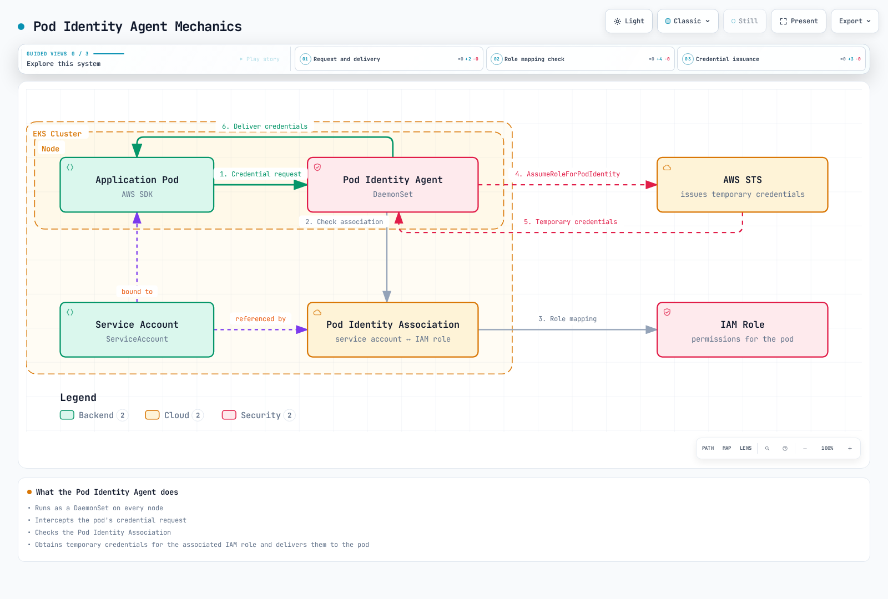
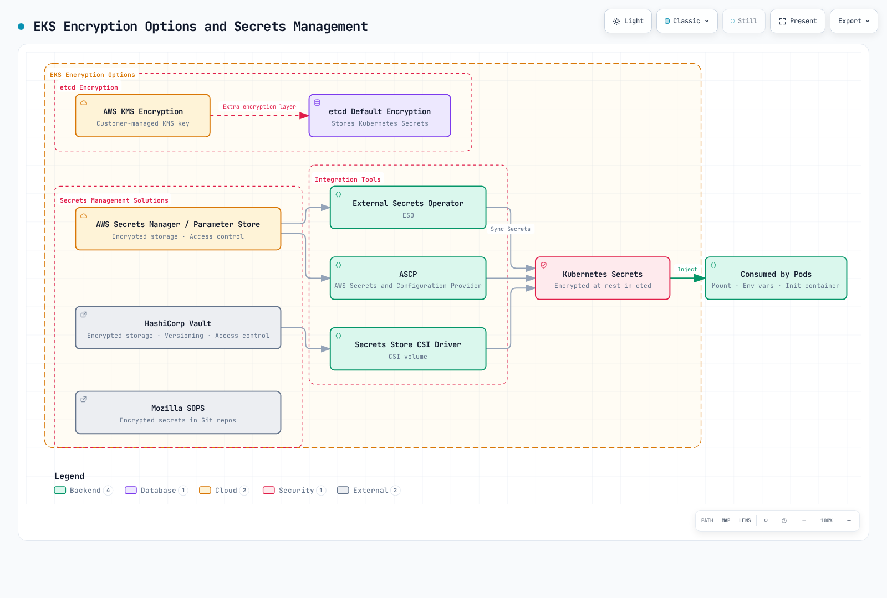
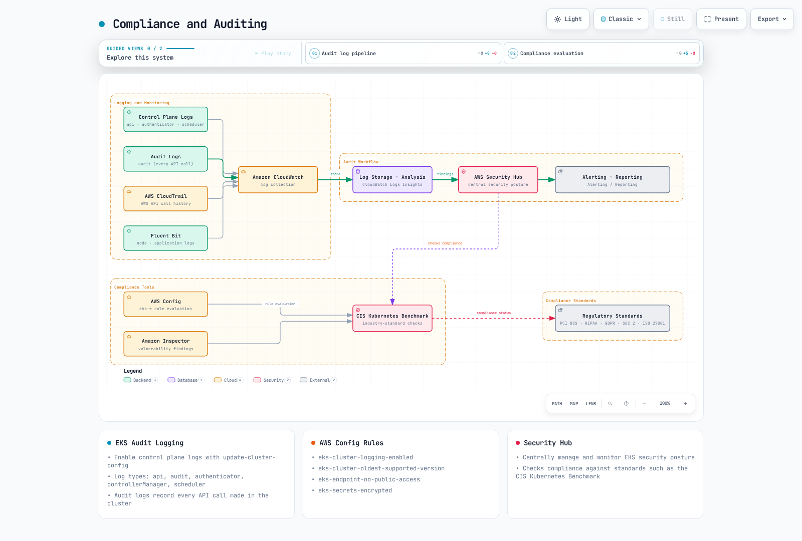

# Amazon EKS のセキュリティ

> **サポート対象バージョン**: EKS 標準サポート 1.34～1.37、延長サポート 1.31～1.33（2026年10月12日確認）
> **最終更新**: 2026年10月16日

Amazon EKS（Elastic Kubernetes Service）でワークロードを安全に運用するには、複数のセキュリティレイヤーとベストプラクティスを理解し、適用する必要があります。このページでは、EKS クラスターのセキュリティを強化するための主要な概念、構成要素、実践方法を説明します。

## 目次

1. [EKS セキュリティの概要](#eks-security-overview)
2. [セキュリティ対策](#security-practices)
3. [IAM と認証](#iam-and-authentication)
4. [OIDC プロバイダーの詳細](#oidc-provider-deep-dive)
5. [EKS Pod Identity](#eks-pod-identity)
6. [クラスターエンドポイントのアクセス制御](#cluster-endpoint-access-control)
7. [ネットワークセキュリティ](#network-security)
8. [Pod のセキュリティ](#pod-security)
9. [Bottlerocket と読み取り専用 OS](#bottlerocket-and-read-only-os)
10. [IAM 権限境界](#iam-permission-boundaries)
11. [暗号化とシークレット管理](#encryption-and-secrets-management)
12. [コンプライアンスと監査](#compliance-and-auditing)
13. [セキュリティの監視と検知](#security-monitoring-and-detection)
14. [EKS セキュリティのベストプラクティス](#eks-security-best-practices)
15. [金融サービスにおける EKS セキュリティの考慮事項](#eks-security-considerations-for-financial-services)

## EKS セキュリティの概要 {#eks-security-overview}

インフラストラクチャ、クラスターアクセス、ワークロードの各制御を分けて考えます。コントロールプレーンは AWS が管理します。ノードと OS の責任範囲は、EC2 のセルフマネージド／マネージドノード、Fargate、Auto Mode、Hybrid Nodes のいずれを使うかで異なります。一方、アプリケーションイメージ、ID、データの取り扱い、ワークロードポリシーは引き続きお客様の責任です。一般的な EC2 ノードの図は、Auto Mode や Fargate のホスト OS をお客様がパッチ適用することを意味しません。


[🔍 インタラクティブな図を表示](https://www.atomai.click/kubernetes-docs/archmaps/en-eks-05-eks-security-0.html)

## セキュリティ対策 {#security-practices}

制御ごとに適用範囲を明確にし、複数の対策を組み合わせます。単一のツールだけでゼロトラストを実現したり、ワークロードの安全性を証明したりすることはできません。脅威モデルに応じて、呼び出し元／ワークロードの ID を検証し、意図した操作だけを許可し、ネットワーク経路を制限し、必要な証跡を収集してください。

<!-- 図の修正待ち: ネットワークポリシーはトラフィックをフィルタリングします。姿勢評価の検出結果は、継続的なリクエスト認証やゼロトラストの完全な実施を意味しません。


[🔍 インタラクティブな図を表示](https://www.atomai.click/kubernetes-docs/archmaps/en-eks-05-eks-security-1.html)
-->

### ID とネットワークの制御

IRSA と Pod Identity はワークロードに AWS 認証情報を提供します。NetworkPolicy は、対応する実装の範囲でネットワーク通信をフィルタリングします。アドミッションエンジンは設定した Kubernetes リクエストを検査します。保守されている互換性のあるサービスメッシュを使えば、mTLS やアプリケーション通信ポリシーを追加できます。AWS App Mesh は2026年9月30日にサポート終了となるため、新規導入の標準候補にせず、既存環境には移行計画を用意してください。

### サプライチェーンのセキュリティ

SLSA などのレビュー済みビルド／来歴管理プロセスを使い、SBOM でコンポーネントを一覧化し、該当する脆弱性をスキャンし、意図した署名者 ID に対して成果物の署名を検証します。Syft は SBOM ツール、Grype は脆弱性スキャナーです。ECR/Inspector などのスキャナーには、それぞれ対象範囲と更新要件があります。署名やスキャンは、コードに危険がないことの証明ではありません。ビルド ID、リポジトリ、アドミッション設定も保護してください。

現在の ECR は AWS Signer を使ったマネージドイメージ署名と、Notation による手動署名をサポートします。署名とアドミッション時の検証は別の手順です。レジストリのフィルター、署名プロファイルの権限、検証側の信頼設定をパイプラインに合わせてください。

### ランタイム検知とポリシー・アズ・コード

GuardDuty EKS Protection は、CloudWatch の監査ログとは独立した EKS 監査ログストリームを分析します。Runtime Monitoring は別のエージェントベース機能です。現在の対象は EKS on EC2 と Auto Mode で、プラットフォーム／エージェント要件があり、EKS Fargate と Hybrid Nodes は対象外です。CloudWatch への監査ログ配信も別途設定します。Security Hub CSPM は設定済みのコントロールを評価し、Security Hub は検出結果を関連付けられます。いずれもアプリケーションの認可や、すべての規制要件の評価に代わるものではありません。

必要なカーネル、コントローラー、API、メタデータ連携を備えた Falco、Gatekeeper、Kyverno などのサポート対象ツールを使ってください。gVisor/Kata などの追加サンドボックスランタイムには、互換性のあるノード／ランタイム設計が必要で、すべての EKS コンピュート方式で使えるわけではありません。ポリシー、イメージ、OS の強化は個別のリスクを下げますが、あらゆるエスケープや悪意ある操作を不可能にする保証ではありません。

ポリシー・アズ・コードのツールも適用段階が異なります。Gatekeeper/Kyverno は Kubernetes アドミッション、CloudFormation Guard や Sentinel はインフラストラクチャ変更、AWS Config は対応するデプロイ済みリソース設定を評価します。Detective などの調査ツールは設定済みデータソースに依存します。これらの役割をランタイム防止と混同しないでください。

## IAM と認証 {#iam-and-authentication}

| ID／制御 | 目的 |
|---|---|
| 人または自動化の IAM プリンシパル | 設定済みの IAM マッピング／アクセスエントリ経路でクラスターアクセスを認証する |
| Kubernetes RBAC と EKS アクセスポリシー | Kubernetes 操作を認可する。許可は加算される |
| 外部 OIDC ID プロバイダー | クライアント／クレーム設定を別途行い、Kubernetes API のユーザーログインに使う |
| EKS クラスター IAM ロール | EKS サービスが AWS API を呼び出すことを許可する |
| EC2 ノード IAM ロール | ブートストラップと必要なノードエージェントの AWS 操作を支援する |
| IRSA または EKS Pod Identity ロール | アプリケーションに一時的な AWS 認証情報を渡す |
| Kubernetes ServiceAccount トークン | RBAC 権限の範囲で Pod から Kubernetes API への認証に使う |

IRSA 用 IAM OIDC プロバイダーと、Kubernetes ユーザーログインに関連付ける外部 OIDC プロバイダーは別物です。アプリケーションの AWS 権限が Kubernetes API 権限を自動的に付与することはありません。

<!-- 図の修正待ち: IRSA／Pod Identity はワークロードに AWS 認証情報を提供します。通常の Pod から Kubernetes API への経路では、Kubernetes ServiceAccount のトークンと RBAC を使います。


[🔍 インタラクティブな図を表示](https://www.atomai.click/kubernetes-docs/archmaps/en-eks-05-eks-security-2.html)
-->

### クラスターのロールと作成者

標準的な EKS クラスターロールは EKS サービスを信頼します。これはサービスとの信頼関係であり、人間の開発者の権限ポリシーではありません。

```json
{
  "Version": "2012-10-17",
  "Statement": [
    {
      "Effect": "Allow",
      "Principal": {
        "Service": "eks.amazonaws.com"
      },
      "Action": "sts:AssumeRole"
    }
  ]
}
```

このロールには、サービス操作に必要な AmazonEKSClusterPolicy またはサポート対象のカスタムポリシーが必要です。Auto Mode には追加のロール／ポリシー要件があります。クラスター作成を実行する呼び出し元には、選択した設定に必要なアクションと、対象ロールを渡す権限が別途必要です。現行の認可リファレンスでは CreateCluster をリソース ARN でスコープできないため、対応するリクエスト条件を使います。リソース ARN に対応するアクションや PassRole はスコープしてください。開発者ロールに AmazonEKSClusterPolicy を付けても Kubernetes アプリケーションへのアクセス権にはなりません。

### アクセスエントリと名前空間の認可

IAM によるクラスターアクセスには、サポート対象のアクセスエントリ API を優先してください。移行前に現在のモードを確認し、既存の管理者／ノードのマッピングを保持します。CONFIG_MAP から API_AND_CONFIG_MAP/API への移行は自由に元へ戻せる切り替えではありません。ノードロールを省いた短いサンプルで aws-auth を上書きしないでください。API のみのモードを選ぶ前に、すべての ID、ポリシー、ノード、復旧経路を確認します。

```bash
set -euo pipefail
: "${CLUSTER_NAME:?Set the existing cluster name}"
: "${AWS_REGION:?Set its Region}"
aws eks describe-cluster --name "$CLUSTER_NAME" --region "$AWS_REGION" \
  --query 'cluster.{Name:name,Status:status,Endpoint:endpoint,Access:accessConfig}' --output json
```

次の例は、準備済みで承認された IAM 開発者ロール、アクセスエントリに対応する既存クラスター、プラットフォーム運用者の権限を前提とします。専用名前空間はその所有者が準備してください。Pod Security Admission のバージョンはレビュー対象の EKS 1.36 の例に合わせています。実際のクラスターに応じて選択してください。

```yaml
apiVersion: v1
kind: Namespace
metadata:
  name: security-demo
  labels:
    pod-security.kubernetes.io/enforce: restricted
    pod-security.kubernetes.io/enforce-version: v1.36
```


```bash
set -euo pipefail
: "${CLUSTER_NAME:?Set the verified cluster name}"
: "${AWS_REGION:?Set its Region}"
: "${DEVELOPER_ROLE_ARN:?Set a prepared IAM role ARN, not an STS session ARN}"
MODE=$(aws eks describe-cluster --name "$CLUSTER_NAME" --region "$AWS_REGION" \
  --query cluster.accessConfig.authenticationMode --output text)
case "$MODE" in
  API|API_AND_CONFIG_MAP) ;;
  *) echo "Access entries are not enabled; review the migration first"; exit 1 ;;
esac
aws eks list-access-entries --cluster-name "$CLUSTER_NAME" --region "$AWS_REGION" \
  --output json > security-access-entries.json
python3 - "$DEVELOPER_ROLE_ARN" <<'PY'
import json, sys
with open("security-access-entries.json") as stream:
    existing = json.load(stream)["accessEntries"]
if sys.argv[1] in existing:
    raise SystemExit("Entry already exists; inspect its groups/policies instead of overwriting")
PY
aws eks create-access-entry --cluster-name "$CLUSTER_NAME" --region "$AWS_REGION" \
  --principal-arn "$DEVELOPER_ROLE_ARN" --type STANDARD \
  --kubernetes-groups security-demo-developers
```


```yaml
apiVersion: rbac.authorization.k8s.io/v1
kind: Role
metadata:
  name: developer
  namespace: security-demo
rules:
- apiGroups:
  - ''
  resources:
  - pods
  verbs:
  - get
  - list
  - watch
- apiGroups:
  - apps
  resources:
  - deployments
  verbs:
  - get
  - list
  - watch
  - create
  - update
  - patch
- apiGroups:
  - batch
  resources:
  - jobs
  verbs:
  - get
  - list
  - watch
  - create
  - update
  - patch
---
apiVersion: rbac.authorization.k8s.io/v1
kind: RoleBinding
metadata:
  name: developer
  namespace: security-demo
subjects:
- kind: Group
  name: security-demo-developers
  apiGroup: rbac.authorization.k8s.io
roleRef:
  kind: Role
  name: developer
  apiGroup: rbac.authorization.k8s.io
```

アクセスエントリは IAM プリンシパルをグループに対応付け、RoleBinding はそのグループに例示した名前空間権限を与えます。グループ名だけでは名前空間境界になりません。ワークロードコントローラーの作成権限を持つユーザーは、その名前空間の ServiceAccount、Secret、PVC を使う Pod を作成できる場合があります。適切なアドミッションと所有権管理で、テナントとワークロード／サービスアカウントの利用を分離してください。

別途レビュー済みの閲覧者エントリには、カスタム RBAC の代わりに EKS アクセスポリシーを使えます。名前空間の閲覧許可を追加する前に、エントリの既存グループと関連付け済みポリシーを確認してください。

```bash
set -euo pipefail
: "${CLUSTER_NAME:?Set the verified cluster name}"
: "${AWS_REGION:?Set its Region}"
: "${VIEWER_ROLE_ARN:?Set the IAM principal of a prepared, reviewed access entry}"
aws eks list-associated-access-policies --cluster-name "$CLUSTER_NAME" --region "$AWS_REGION" \
  --principal-arn "$VIEWER_ROLE_ARN"
aws eks associate-access-policy --cluster-name "$CLUSTER_NAME" --region "$AWS_REGION" \
  --principal-arn "$VIEWER_ROLE_ARN" \
  --policy-arn arn:aws:eks::aws:cluster-access-policy/AmazonEKSViewPolicy \
  --access-scope type=namespace,namespaces=security-demo
```

閲覧ポリシーを追加しても、より広い RBAC／アクセスポリシーの許可は取り消されません。変更の反映には時間がかかることがあります。実際に想定する IAM ログインでテストしてください。kubectl --as は Kubernetes のなりすまし／RBAC を試すもので、IAM アクセスポリシー経路の検証にはなりません。kubeconfig はクラスターと認証情報の仕組みをクライアントに示すだけで、権限を付与しません。

IAM の eks:DescribeCluster/ListClusters は AWS 管理／検出操作を支援します。eks:AccessKubernetesApi はコンソールでの閲覧権限です。eks:namespaces 条件はアクセスポリシー関連付けリクエストを絞り込むものであり、kubectl API 呼び出し全般の名前空間フィルターではありません。

## OIDC プロバイダーの詳細 {#oidc-provider-deep-dive}

EKS はクラスター OIDC issuer と公開署名鍵を公開します。そのエンドポイントだけで IAM OIDC プロバイダーが作成されたり、ロール引き受けが許可されたりするわけではありません。IRSA では、ロールを置くアカウントに目的の IAM OIDC プロバイダーがあり、ロールが正しい issuer／subject／audience 条件で信頼し、ワークロードが互換性のある SDK を使う必要があります。


[🔍 インタラクティブな図を表示](https://www.atomai.click/kubernetes-docs/archmaps/en-eks-05-eks-security-3.html)

### IRSA のトークンとロール交換

IRSA webhook は対象 Pod に投影トークン／ロール設定を追加します。SDK は AssumeRoleWithWebIdentity を使い、ウェブ ID トークンを STS と交換します。STS は issuer、署名、トークン、ロール信頼を検証し、一時的な AWS 認証情報を返します。アプリケーションは許可された AWS 操作にその認証情報を使います。Kubernetes は投影トークンをローテーションし、SDK は AWS 認証情報を更新します。両者の有効期間は異なります。

次は、意図的に古い／期限切れの時刻とプレースホルダー ID を含む、**デコード済みペイロードの例示形式**です。署名済みトークンでも認証テストでもありません。ここでの STS audience は IRSA 用で、Pod Identity では異なる audience を使います。

```json
{
  "aud": [
    "sts.amazonaws.com"
  ],
  "exp": 1234567890,
  "iat": 1234567800,
  "iss": "https://oidc.eks.us-west-2.amazonaws.com/id/REPLACE_WITH_CLUSTER_ISSUER_ID",
  "kubernetes.io": {
    "namespace": "security-demo",
    "pod": {
      "name": "irsa-read-check-example",
      "uid": "example-pod-uid"
    },
    "serviceaccount": {
      "name": "irsa-reader",
      "uid": "example-serviceaccount-uid"
    }
  },
  "sub": "system:serviceaccount:security-demo:irsa-reader"
}
```

JSON をデコードできるかだけでなく、issuer、audience、有効期限、期待する subject を検証します。生トークン、AWS シークレットアクセスキー、セッショントークンを例やログに出さないでください。ロールは明示的に許可した複数のサービスアカウントや issuer を信頼できます。IRSA で ServiceAccount ごとにロールを必ず1つにする必要はありません。

### Discovery と JWKS の確認

実際のクラスターから返された issuer を使います。この診断例は公開 discovery/JWKS 文書を取得し、discovery の issuer と HTTPS スキームを確認します。ワークロードトークンや IAM 権限は検証しません。

```bash
set -euo pipefail
: "${CLUSTER_NAME:?Set the verified cluster}"
: "${AWS_REGION:?Set its Region}"
OIDC_URL=$(aws eks describe-cluster --name "$CLUSTER_NAME" --region "$AWS_REGION" \
  --query cluster.identity.oidc.issuer --output text)
case "$OIDC_URL" in https://*) ;; *) echo "Unexpected issuer URL"; exit 1 ;; esac
curl --fail --silent --show-error --proto '=https' --connect-timeout 5 --max-time 20 \
  "${OIDC_URL%/}/.well-known/openid-configuration" > oidc-discovery.json
JWKS_URI=$(python3 - "$OIDC_URL" <<'PY'
import json, sys, urllib.parse
with open("oidc-discovery.json") as stream:
    doc = json.load(stream)
if doc["issuer"] != sys.argv[1]:
    raise SystemExit("Discovery issuer does not match the cluster issuer")
uri = doc["jwks_uri"]
parsed = urllib.parse.urlparse(uri)
if parsed.scheme != "https" or not parsed.hostname or parsed.username or parsed.password:
    raise SystemExit("JWKS must be an HTTPS URL without embedded credentials")
print(uri)
PY
)
curl --fail --silent --show-error --proto '=https' --connect-timeout 5 --max-time 20 \
  "$JWKS_URI" > oidc-jwks.json
python3 - <<'PY'
import json
with open("oidc-jwks.json") as stream:
    keys = json.load(stream).get("keys")
if not isinstance(keys, list) or not keys or not all(isinstance(k, dict) and "kty" in k for k in keys):
    raise SystemExit("Unexpected JWKS response")
print("Fetched", len(keys), "public keys; no token signature was validated")
PY
```

自動検証器は Cache-Control に従って鍵をキャッシュし、レビュー済み JWT ライブラリで署名鍵のローテーションや未知の kid を処理する必要があります。EKS は OIDC 署名鍵を7日ごとにローテーションします。現行 EKS は、インターネットへの送信経路がない検証器向けに、クラスター OIDC discovery/JWKS 用 PrivateLink インターフェイスエンドポイント `com.amazonaws.region-code.oidc-eks` もサポートしています。そのリージョン／DNS 要件を確認してください。EKS 管理 API のエンドポイントは別サービスです。

### スコープを絞った IRSA の例

IAM OIDC プロバイダー、ロール、バケットは各所有者が準備してください。アカウント、issuer のホスト名とパス全体、ロール ARN を一貫して置き換えます。IPv6 クラスターではデュアルスタックの issuer ホスト名を使う場合があります。この例は security-demo/irsa-reader と STS audience のみを結び付ける新規ロール用の信頼設定であり、既存ロールの他の信頼ステートメントを置き換えるものではありません。

```json
{
  "Version": "2012-10-17",
  "Statement": [
    {
      "Effect": "Allow",
      "Principal": {
        "Federated": "arn:aws:iam::111122223333:oidc-provider/oidc.eks.us-west-2.amazonaws.com/id/REPLACE_WITH_CLUSTER_ISSUER_ID"
      },
      "Action": "sts:AssumeRoleWithWebIdentity",
      "Condition": {
        "StringEquals": {
          "oidc.eks.us-west-2.amazonaws.com/id/REPLACE_WITH_CLUSTER_ISSUER_ID:sub": "system:serviceaccount:security-demo:irsa-reader",
          "oidc.eks.us-west-2.amazonaws.com/id/REPLACE_WITH_CLUSTER_ISSUER_ID:aud": "sts.amazonaws.com"
        }
      }
    }
  ]
}
```

読み取りポリシーは特定バケットのプレフィックスだけを許可します。オブジェクトがカスタマーマネージド暗号化キーを使う場合に必要な KMS 権限だけを追加し、バケット／エンドポイントポリシーも確認してください。この1プレフィックスの例にアカウント全体の AmazonS3ReadOnlyAccess は不要です。

```json
{
  "Version": "2012-10-17",
  "Statement": [
    {
      "Effect": "Allow",
      "Action": [
        "s3:ListBucket"
      ],
      "Resource": "arn:aws:s3:::replace-with-owned-security-bucket",
      "Condition": {
        "StringLike": {
          "s3:prefix": [
            "security-demo/",
            "security-demo/*"
          ]
        }
      }
    },
    {
      "Effect": "Allow",
      "Action": [
        "s3:GetObject"
      ],
      "Resource": "arn:aws:s3:::replace-with-owned-security-bucket/security-demo/*"
    }
  ]
}
```

security-demo 名前空間とロールの準備後、次の ServiceAccount と範囲を限定した一覧表示 Job を作成します。公式 AWS CLI イメージにはクライアントが含まれますが、任意の amazonlinux:2 イメージに含まれる保証はありません。バケット、リージョン、ロールの値を置き換えてください。Job は秘密値を表示せずにプレフィックスを列挙します。この操作の成功は、すべてのアプリケーションの GetObject/KMS 権限の証明ではありません。

```yaml
apiVersion: v1
kind: ServiceAccount
metadata:
  name: irsa-reader
  namespace: security-demo
  annotations:
    eks.amazonaws.com/role-arn: arn:aws:iam::111122223333:role/SecurityDemoIRSAReader
---
apiVersion: batch/v1
kind: Job
metadata:
  name: irsa-read-check
  namespace: security-demo
spec:
  backoffLimit: 0
  activeDeadlineSeconds: 120
  template:
    spec:
      serviceAccountName: irsa-reader
      restartPolicy: Never
      securityContext:
        runAsNonRoot: true
        runAsUser: 1000
        runAsGroup: 1000
        fsGroup: 1000
        seccompProfile:
          type: RuntimeDefault
      containers:
      - name: reader
        image: public.ecr.aws/aws-cli/aws-cli:2.36.43
        command:
        - aws
        args:
        - s3api
        - list-objects-v2
        - --bucket
        - replace-with-owned-security-bucket
        - --prefix
        - security-demo/
        - --max-items
        - '5'
        env:
        - name: AWS_REGION
          value: us-west-2
        - name: AWS_EC2_METADATA_DISABLED
          value: 'true'
        securityContext:
          allowPrivilegeEscalation: false
          readOnlyRootFilesystem: true
          capabilities:
            drop:
            - ALL
        resources:
          requests:
            cpu: 100m
            memory: 128Mi
          limits:
            cpu: 500m
            memory: 256Mi
        volumeMounts:
        - name: private-home
          mountPath: /root
        - name: tmp
          mountPath: /tmp
      volumes:
      - name: private-home
        emptyDir: {}
      - name: tmp
        emptyDir: {}
      nodeSelector:
        kubernetes.io/os: linux
```

## EKS Pod Identity

EKS Pod Identity は SDK のコンテナ認証情報プロバイダーと EKS Auth を通じて一時的な AWS 認証情報を提供します。Pod Identity 関連付けは、クラスター／名前空間／ServiceAccount と IAM ロールの対応付けです。ServiceAccount の作成や Kubernetes RBAC 権限の付与は行いません。

### IRSA との比較

| 項目 | IRSA | EKS Pod Identity |
|---|---|---|
| 信頼 | IAM OIDC プロバイダーと issuer/subject/audience の信頼 | pods.eks.amazonaws.com のロール信頼と関連付け |
| ロールの再利用 | IAM ポリシー制限内で複数の許可 subject/issuer を利用可能 | 適切な関連付け／信頼条件により再利用可能 |
| Kubernetes セッションタグ | 標準 IRSA 経路では自動付与されない | デフォルトで有効。意図して無効化することも可能 |
| 認証情報プロバイダー | STS とのウェブ ID 交換 | EKS Auth が支えるコンテナ認証情報エンドポイント |
| クロスアカウント | ロールアカウントでの直接 OIDC 信頼またはロールチェーン | 同一アカウントの関連付けロールから任意の対象ロールへチェーン |
| 更新 | Kubernetes がトークンをローテーションし、SDK が AWS 認証情報を更新 | Kubernetes が投影トークンをローテーションし、エージェント／サービスのキャッシュと SDK が認証情報を処理 |

セッションタグは引き受けたロールのセッションを分類するもので、アプリケーションが作成するすべての AWS リソースに自動でタグを付けるものではありません。設定が簡単でも、IAM、ネットワーク、SDK、アプリケーションの検証は必要です。

### エージェントと認証情報の流れ

<!-- 図の修正待ち: SDK はコンテナ認証情報エンドポイントを呼び出し、エージェントは EKS Auth の AssumeRoleForPodIdentity を呼び出します。STS を直接呼び出すのでも、任意のリクエストを横取りするのでもありません。


[🔍 インタラクティブな図を表示](https://www.atomai.click/kubernetes-docs/archmaps/en-eks-05-eks-security-4.html)
-->

関連付け済みの新規 Pod には、audience `pods.eks.amazonaws.com` のトークン、トークンファイルの環境変数、コンテナ認証情報 URI が EKS から注入されます。SDK はエージェントのエンドポイント（通常 `169.254.170.23/v1/credentials`）を呼び出します。エージェントは EKS Auth の **AssumeRoleForPodIdentity** を呼び出し、返された認証情報を SDK に提供します。すべてのアプリケーション要求を透過的に横取りするのではなく、アプリケーションは受け取った認証情報で AWS サービスを直接呼び出します。

対応する標準 EC2 ノードでは Pod Identity Agent アドオン／DaemonSet を使います。Auto Mode はマネージドノードの一部としてこの機能を提供します。Hybrid Nodes では、文書化された OS、エージェント、ノード認証情報の設定でサポートされます。標準 EC2 のエージェント設定をそのまま流用しないでください。EKS Fargate はこの Pod Identity エージェント経路をサポートしません。実際のコンピュート方式と、ノードの EKS Auth 権限／ネットワーク接続を確認します。

### ロールと関連付けの準備

標準のマネージドエージェントを使う場合、実際のクラスターのバージョンと互換性のあるアドオンカタログを所有者と確認してください。古い v1.0.0 ビルドを固定したり、Auto Mode や別の所有者が管理するエージェントと重複してインストールしたりしないでください。

```bash
set -euo pipefail
: "${CLUSTER_NAME:?Set the existing cluster}"
: "${AWS_REGION:?Set its Region}"
EKS_VERSION=$(aws eks describe-cluster --name "$CLUSTER_NAME" --region "$AWS_REGION" \
  --query cluster.version --output text)
aws eks describe-addon-versions --addon-name eks-pod-identity-agent \
  --kubernetes-version "$EKS_VERSION" --region "$AWS_REGION" --output json
```

先ほどのスコープ限定 S3 読み取りポリシーを使う同一アカウントの IAM ロールと、次の信頼関係を準備します。アカウントとクラスターの値は一緒に置き換えてください。この例はデフォルトのセッションタグを前提とします。タグを無効にする場合は条件を見直します。呼び出し元には関連付けに必要な権限と、対象ロールへの iam:PassRole が必要です。

```json
{
  "Version": "2012-10-17",
  "Statement": [
    {
      "Effect": "Allow",
      "Principal": {
        "Service": "pods.eks.amazonaws.com"
      },
      "Action": [
        "sts:AssumeRole",
        "sts:TagSession"
      ],
      "Condition": {
        "StringEquals": {
          "aws:RequestTag/eks-cluster-arn": "arn:aws:eks:us-west-2:111122223333:cluster/my-cluster",
          "aws:RequestTag/kubernetes-namespace": "security-demo",
          "aws:RequestTag/kubernetes-service-account": "podid-reader"
        }
      }
    }
  ]
}
```

次の新規関連付け例は既存の関連付けを上書きしません。IAM ロール、エージェント、Kubernetes アカウントの作成は行いません。

```bash
set -euo pipefail
: "${CLUSTER_NAME:?Set the verified cluster}"
: "${AWS_REGION:?Set its Region}"
: "${POD_ID_ROLE_ARN:?Set the prepared same-account role matching the trust example}"
aws eks list-pod-identity-associations --cluster-name "$CLUSTER_NAME" --region "$AWS_REGION" \
  --namespace security-demo --service-account podid-reader --output json > podid-associations-before.json
python3 - <<'PY'
import json
with open("podid-associations-before.json") as stream:
    existing = json.load(stream)["associations"]
if existing:
    raise SystemExit("Association exists; review its owner/configuration before changing it")
PY
aws eks create-pod-identity-association --cluster-name "$CLUSTER_NAME" --region "$AWS_REGION" \
  --namespace security-demo --service-account podid-reader --role-arn "$POD_ID_ROLE_ARN"
```

関連付けが反映された後、ServiceAccount と新しい範囲限定テスト Job を作成します。IAM ロール信頼、名前空間、アカウント名、バケットプレフィックスを一致させてください。関連付け前に作られた Pod は注入設定を受けるために再作成が必要な場合があります。実際に選ばれたプロバイダーと代表的な権限を確認し、認証情報／トークンファイルを表示しないでください。

```yaml
apiVersion: v1
kind: ServiceAccount
metadata:
  name: podid-reader
  namespace: security-demo
---
apiVersion: batch/v1
kind: Job
metadata:
  name: podid-read-check
  namespace: security-demo
spec:
  backoffLimit: 0
  activeDeadlineSeconds: 120
  template:
    spec:
      serviceAccountName: podid-reader
      restartPolicy: Never
      securityContext:
        runAsNonRoot: true
        runAsUser: 1000
        runAsGroup: 1000
        fsGroup: 1000
        seccompProfile:
          type: RuntimeDefault
      containers:
      - name: reader
        image: public.ecr.aws/aws-cli/aws-cli:2.36.43
        command:
        - aws
        args:
        - s3api
        - list-objects-v2
        - --bucket
        - replace-with-owned-security-bucket
        - --prefix
        - security-demo/
        - --max-items
        - '5'
        env:
        - name: AWS_REGION
          value: us-west-2
        - name: AWS_EC2_METADATA_DISABLED
          value: 'true'
        securityContext:
          allowPrivilegeEscalation: false
          readOnlyRootFilesystem: true
          capabilities:
            drop:
            - ALL
        resources:
          requests:
            cpu: 100m
            memory: 128Mi
          limits:
            cpu: 500m
            memory: 256Mi
        volumeMounts:
        - name: private-home
          mountPath: /root
        - name: tmp
          mountPath: /tmp
      volumes:
      - name: private-home
        emptyDir: {}
      - name: tmp
        emptyDir: {}
      nodeSelector:
        kubernetes.io/os: linux
```


[🔍 インタラクティブな図を表示](https://www.atomai.click/kubernetes-docs/archmaps/en-eks-05-eks-security-5.html)

### クロスアカウントとキャッシュに関する考慮事項

関連付けロールは EKS クラスターと同じアカウントに置く必要があります。任意の対象 IAM ロールは別アカウントにも置けます。Pod Identity は同一アカウントのロールから対象ロールへチェーンし、双方に信頼と AssumeRole 権限を設定します。別アカウントの任意のロールを関連付けロールとして直接指定できるわけではありません。

現行の対象ロールガイドでは、対象ロールを使わない場合の認証情報キャッシュは6時間、対象ロールを使う場合は59分とされています。関連付けを変更してもキャッシュはリセットされません。Pod を再作成すると新しい設定をより早く取得できます。アプリケーションで実際の更新／失効挙動を確認してください。新しい関連付けのセッションポリシー機能にはセッションタグの無効化が必要で、対象ロールを設定するとそのロールも制約します。タグを必須とする信頼条件と未検証のまま組み合わせないでください。

### IRSA から Pod Identity への移行手順

移行準備の前に、現在の IRSA 信頼設定と ServiceAccount 設定を保存してください。既存の利用者が認証情報を更新する時に失敗するおそれがあるため、ロール信頼を Pod Identity サービスプリンシパルだけに置き換えないでください。次の例は設定の記録のみを行います。

```bash
set -euo pipefail
: "${IRSA_ROLE_NAME:?Set the existing role whose trust must be preserved}"
: "${WORKLOAD_NAMESPACE:?Set the workload namespace}"
: "${SERVICE_ACCOUNT:?Set the existing application ServiceAccount}"
aws iam get-role --role-name "$IRSA_ROLE_NAME" \
  --query Role.AssumeRolePolicyDocument --output json > irsa-trust-before.json
kubectl -n "$WORKLOAD_NAMESPACE" get serviceaccount "$SERVICE_ACCOUNT" \
  -o yaml > irsa-serviceaccount-before.yaml
```

1. 実際のコンピュート方式、互換性のある SDK／コンテナ認証情報プロバイダー、Pod Identity エージェントまたは組み込み機能、準備済み IAM ロールの権限を確認します。
2. 所有者と確認した Pod Identity 信頼ステートメントを既存の信頼ポリシーに統合します。すべての利用者が移行するまで IRSA の issuer／subject／audience 条件と、無関係な有効ステートメントを保持します。
3. 範囲を限定した関連付けと、意図した Pod Identity 認証経路だけを使う別 ServiceAccount のカナリアを作成します。この検証前に本番 IRSA アノテーションを削除したり、本番デプロイを再起動したりしないでください。
4. トークンやシークレット値を表示せず、実際に選択された認証情報プロバイダーと目的の AWS アクセスを確認します。関連付け後も SDK の認証情報チェーン上位にある認証情報が使われることがあります。同じ IAM ロールを示す get-caller-identity の成功だけでは、IRSA と Pod Identity を区別できません。
5. 管理されたロールアウトで対象ワークロードを移行し、注入設定に応じて Pod を再作成し、アプリケーションの動作と更新を確認します。ServiceAccount のアノテーション変更は、既存 Pod の環境変数を書き換えません。
6. ワークロード設定を戻すための検証済み経路を維持します。残存するすべての利用者を洗い出し、移行完了を確認してから古い IRSA 信頼を削除します。

これは対象環境で検証すべき移行手順であり、この文書のレビュー中に移行を実行したという意味ではありません。

## クラスターエンドポイントのアクセス制御 {#cluster-endpoint-access-control}

エンドポイント設定はネットワーク到達性を定めますが、API 操作は引き続き認証と認可で制御されます。ツールの既定値を前提とせず、運用要件に応じた接続経路を選び、実際の設定を確認してください。

| パブリック | プライベート | ネットワーク動作 |
|---|---|---|
| 有効 | 無効 | クライアントとノードにはパブリックアドレスへの経路が必要。CIDR 制限には実際のパブリック送信元アドレスを含める |
| 無効 | 有効 | VPC／プライベート経路、DNS、セキュリティグループが必要。承認済み接続ネットワークも含めて確認する |
| 有効 | 有効 | クラスター VPC 内からの要求はプライベート経路を使い、許可された外部クライアントはパブリック経路を使える |

パブリックアドレスがあるだけでは、EC2 から EKS への通信が AWS ネットワーク外を通る証明にはなりません。プライベートアクセスを有効にしても、呼び出し元の認可、VPN／DNS 設定、復旧経路は自動的には用意されません。EKS では少なくとも1つのアクセスモードが必要です。

### 既存設定の確認と保存

関連するブロックは同じシェルで実行し、新しいレビュー用ディレクトリを保持してください。Kubernetes のログインとは別に、エンドポイント設定を確認／復旧できる AWS 管理 ID を使います。ここで保存するのは変更可能なエンドポイントアクセス項目だけです。無関係な VPC 設定や、後述する一方向の egress モードは復元しません。

```bash
set -euo pipefail
umask 077
: "${CLUSTER_NAME:?Set the existing cluster name}"
: "${AWS_REGION:?Set its Region}"
ENDPOINT_REVIEW_DIR=$(mktemp -d -t eks-endpoint-review.XXXXXX)
printf 'Review records: %s\n' "$ENDPOINT_REVIEW_DIR"
aws eks describe-cluster --name "$CLUSTER_NAME" --region "$AWS_REGION" \
  --query cluster --output json > "$ENDPOINT_REVIEW_DIR/cluster-before.json"
python3 - "$ENDPOINT_REVIEW_DIR" "$CLUSTER_NAME" <<'PY'
import json, pathlib, sys, urllib.parse
root = pathlib.Path(sys.argv[1])
cluster = json.loads((root / "cluster-before.json").read_text())
if cluster["name"] != sys.argv[2] or cluster["status"] != "ACTIVE":
    raise SystemExit("Unexpected cluster or cluster is not ACTIVE")
endpoint = urllib.parse.urlparse(cluster["endpoint"])
if endpoint.scheme != "https" or not endpoint.hostname or endpoint.username or endpoint.password:
    raise SystemExit("Unexpected Kubernetes endpoint")
(root / "endpoint-host.txt").write_text(endpoint.hostname + "\n")
config = cluster["resourcesVpcConfig"]
before = {k: config[k] for k in ["endpointPublicAccess", "endpointPrivateAccess", "publicAccessCidrs"] if k in config}
(root / "endpoint-before.json").write_text(json.dumps(before, indent=2) + "\n")
(root / "endpoint-private.json").write_text(json.dumps({"endpointPublicAccess": False, "endpointPrivateAccess": True}, indent=2) + "\n")
(root / "ssm-remote-host.json").write_text(json.dumps({"host": [endpoint.hostname], "portNumber": ["443"], "localPortNumber": ["6443"]}, indent=2) + "\n")
print(json.dumps(before, indent=2))
PY
```

### パブリックアドレス経路の制限

パブリック許可リストには、承認された実際の NAT／VPN／オフィスの送信元アドレスを指定します。10.0.0.0/8 などのプライベートレンジは、パブリック送信元アドレスを表しません。203.0.113.0/24 などのドキュメント用レンジはプレースホルダーで、実際のオフィスネットワークではありません。

ネットワーク所有者が用意した JSON 配列を PUBLIC_EGRESS_CIDRS に設定します。この範囲限定例は IPv4 CIDR を受け付け、明らかなプライベート／デフォルト／文書用レンジを拒否しますが、所有権や現在のクライアントが含まれることまでは証明しません。対象範囲、クォータ、クラスターの IP ファミリー対応を確認してください。デュアルスタック／IPv6 設定には別途検証済みの許可リストが必要です。

```bash
set -euo pipefail
: "${ENDPOINT_REVIEW_DIR:?Run the inspection step in this shell first}"
: "${PUBLIC_EGRESS_CIDRS:?Set a JSON array of approved actual public IPv4 egress CIDRs}"
python3 - "$ENDPOINT_REVIEW_DIR" "$PUBLIC_EGRESS_CIDRS" <<'PY'
import ipaddress, json, pathlib, sys
values = json.loads(sys.argv[2])
if not isinstance(values, list) or not values:
    raise SystemExit("Provide a nonempty reviewed CIDR list")
cidrs = []
for value in values:
    network = ipaddress.ip_network(value, strict=True)
    if network.version != 4 or network.prefixlen == 0 or not network.is_global or network.is_multicast or network.is_reserved:
        raise SystemExit("This IPv4 example requires actual public egress CIDRs, not private/default/documentation ranges")
    cidrs.append(str(network))
if len(cidrs) != len(set(cidrs)):
    raise SystemExit("Remove duplicate CIDRs")
desired = {"endpointPublicAccess": True, "endpointPrivateAccess": True, "publicAccessCidrs": cidrs}
path = pathlib.Path(sys.argv[1]) / "endpoint-public-restricted.json"
path.write_text(json.dumps(desired, indent=2) + "\n")
print(json.dumps(desired, indent=2))
PY
```

予定されるパブリック制限設定は、プライベートアクセスも有効にします。プライベートアクセスなしでは、ノード／Fargate のパブリック送信元アドレスを許可に残さないと、ノードから API への通信が失敗する場合があります。ENDPOINT_CHANGE=public-restricted を選ぶ前に生成 JSON を確認してください。

### プライベート接続経路


[🔍 インタラクティブな図を表示](https://www.atomai.click/kubernetes-docs/archmaps/en-eks-05-eks-security-6.html)


[🔍 インタラクティブな図を表示](https://www.atomai.click/kubernetes-docs/archmaps/en-eks-05-eks-security-7.html)

VPN、Direct Connect/TGW、承認済み管理ホストは、ルート、DNS、セキュリティグループ、認可を正しく設定すれば利用できます。Client VPN の作成コマンド1つだけでは、サブネット関連付け、認可ルール、ルート、証明書、接続ログは設定されません。AWS CLI イメージを実行する Deployment は、SSM 管理対象の踏み台を作ったり kubectl/SSM Agent をインストールしたりしません。

SSM のリモートホスト転送には、SSM Agent 3.1.1374.0 以降、Session Manager の IAM／ネットワークアクセス、ローカルの Session Manager プラグイン、EKS プライベートエンドポイントへの DNS／ルーティングを備えた管理ホストを準備します。プライベートエンドポイントが有効であり、ホストから実際に名前解決とプライベート経路への到達ができることを確認してください。最初の端末では転送セッションを継続します。

```bash
set -euo pipefail
: "${AWS_REGION:?Set the cluster/managed-instance Region for this example}"
: "${MANAGED_INSTANCE_ID:?Set the prepared SSM-managed instance with a private route to EKS}"
: "${ENDPOINT_REVIEW_DIR:?Use the endpoint inspection directory}"
aws ssm start-session --region "$AWS_REGION" --target "$MANAGED_INSTANCE_ID" \
  --document-name AWS-StartPortForwardingSessionToRemoteHost \
  --parameters "file://$ENDPOINT_REVIEW_DIR/ssm-remote-host.json"
```

2つ目の端末では同じクラスターの kubeconfig を使い、CA と意図した IAM exec 認証を維持します。実際の TLS サーバー名を保ったままローカル接続してください。ホスト名の不一致を隠すために証明書検証を無効にしないでください。

```bash
set -euo pipefail
: "${ENDPOINT_REVIEW_DIR:?Set the same review directory in this second terminal}"
: "${CLUSTER_KUBECONFIG:?Set the kubeconfig for this same EKS cluster and intended IAM identity}"
EKS_ENDPOINT_HOST=$(cat "$ENDPOINT_REVIEW_DIR/endpoint-host.txt")
kubectl --kubeconfig "$CLUSTER_KUBECONFIG" \
  --server https://127.0.0.1:6443 --tls-server-name "$EKS_ENDPOINT_HOST" \
  --request-timeout=10s -n security-demo get pods
```

リモートホスト文書は指定した EKS ホストへ転送します。旧 AWS-StartPortForwardingSession 文書はマネージドインスタンス上のポートへ転送するもので、そのインスタンスの443番へ転送しても EKS API サーバーにはなりません。トンネルやヘルスチェックの成功だけでは、認可やプライベートルートの検証になりません。パブリックアクセスを削除する前に、意図した API 操作、DNS／プライベートアドレス、実際の経路を確認します。

### レビュー済みエンドポイント変更の適用

プライベートアクセスを有効にし、意図したプライベートクライアント経路を検証した後、ENDPOINT_CHANGE=private を選ぶ前に設定を改めて取得します。次の例は、異なるクラスター／アカウント、エンドポイント設定の変更、プライベートアクセスを先に有効にしていない状態への移行を拒否します。読み取りと確認はアトミック処理ではありません。所有者と調整してください。

```bash
set -euo pipefail
: "${CLUSTER_NAME:?Use the inspected cluster}"
: "${AWS_REGION:?Use its Region}"
: "${ENDPOINT_REVIEW_DIR:?Use the review directory}"
: "${ENDPOINT_CHANGE:?Choose public-restricted or private after validating the intended route}"
case "$ENDPOINT_CHANGE" in
  public-restricted|private) ;;
  *) echo "Unexpected endpoint change"; exit 1 ;;
esac
test -f "$ENDPOINT_REVIEW_DIR/endpoint-$ENDPOINT_CHANGE.json"
aws eks describe-cluster --name "$CLUSTER_NAME" --region "$AWS_REGION" \
  --query cluster --output json > "$ENDPOINT_REVIEW_DIR/cluster-current.json"
python3 - "$ENDPOINT_REVIEW_DIR" "$CLUSTER_NAME" "$ENDPOINT_CHANGE" <<'PY'
import json, pathlib, sys
root = pathlib.Path(sys.argv[1])
before = json.loads((root / "cluster-before.json").read_text())
current = json.loads((root / "cluster-current.json").read_text())
keys = ["endpointPublicAccess", "endpointPrivateAccess", "publicAccessCidrs"]
if current["name"] != sys.argv[2] or current["arn"] != before["arn"] or current["status"] != "ACTIVE":
    raise SystemExit("Cluster identity/state differs from the reviewed target")
if any(current["resourcesVpcConfig"].get(k) != before["resourcesVpcConfig"].get(k) for k in keys):
    raise SystemExit("Endpoint configuration changed; inspect and review again")
if sys.argv[3] == "private" and current["resourcesVpcConfig"].get("endpointPrivateAccess") is not True:
    raise SystemExit("Enable and verify private access before disabling public access")
PY
aws eks update-cluster-config --name "$CLUSTER_NAME" --region "$AWS_REGION" \
  --resources-vpc-config "file://$ENDPOINT_REVIEW_DIR/endpoint-$ENDPOINT_CHANGE.json" \
  --output json > "$ENDPOINT_REVIEW_DIR/update-response.json"
EKS_UPDATE_ID=$(python3 - "$ENDPOINT_REVIEW_DIR/update-response.json" <<'PY'
import json, sys
with open(sys.argv[1]) as stream:
    print(json.load(stream)["update"]["id"])
PY
)
UPDATE_DONE=false
for ((attempt=0; attempt<60; attempt++)); do
  STATE=$(aws eks describe-update --name "$CLUSTER_NAME" --region "$AWS_REGION" \
    --update-id "$EKS_UPDATE_ID" --query update.status --output text)
  case "$STATE" in
    Successful) UPDATE_DONE=true; break ;;
    InProgress) sleep 10 ;;
    *) echo "Update $EKS_UPDATE_ID status: $STATE; inspect before further changes"; exit 1 ;;
  esac
done
test "$UPDATE_DONE" = true || { echo "Update still pending; inspect $EKS_UPDATE_ID"; exit 1; }
aws eks describe-cluster --name "$CLUSTER_NAME" --region "$AWS_REGION" \
  --query cluster.resourcesVpcConfig --output json
```

クラスターが ACTIVE であることだけでなく、返された更新 ID と Successful 状態を使って更新を確認します。タイムアウト時は既存操作を調査し、同じ変更をすぐ再送しないでください。その後、実際の API 経路を再確認します。以前のエンドポイント項目と AWS 管理の復旧アクセスを保持してください。このレビューではライブのエンドポイント変更を実行していません。

### プライベート AWS サービスの依存関係

| 経路 | 関連するエンドポイント／依存関係 |
|---|---|
| Kubernetes API | クラスターのプライベートエンドポイントアクセスとルート／DNS／セキュリティグループ |
| AWS EKS 管理 API | 管理 API へのプライベートアクセスが必要な場合の eks インターフェイスエンドポイント |
| Pod Identity エージェント | ノードがパブリック egress を使えない場合の eks-auth インターフェイスエンドポイント |
| OIDC discovery/JWKS ツール | oidc-eks インターフェイスエンドポイント。公開鍵データは匿名で取得でき、既定のエンドポイントポリシーが適用される |
| IRSA 認証情報交換 | OIDC 鍵取得とは別のリージョン STS エンドポイント |
| ECR イメージ取得 | ecr.api/ecr.dkr インターフェイスと、S3 レイヤーダウンロード経路 |
| その他のコントローラー／アプリ | 実際に使う EC2、Logs、Secrets Manager、SSM などのサービス依存関係のみ |

EKS のインターフェイスエンドポイントは Kubernetes API エンドポイントではありません。S3 ゲートウェイエンドポイントはルートテーブルを使い、インターフェイスエンドポイントはサブネット／セキュリティグループ／プライベート DNS を使います。エンドポイント種別を確認せず、全サービスを1つのループで作成しないでください。OIDC PrivateLink は STS のトークン検証を変えず、IRSA ロールを認可もしません。作成章に従って、所有するネットワーク／ID／コンピュート設定全体を準備してください。ここにあるエンドポイント例だけでは本番クラスターを作成できません。

### 顧客ルーティング型コントロールプレーン egress（2026年6月）

CUSTOMER_ROUTED は2026年6月18日に発表された、サポート対象の EKS コントロールプレーン egress モードです。別個の egress ENI を作るのではなく、サブネット内の既存のクロスアカウントクラスター ENI を使います。アドミッション webhook、OIDC discovery、集約 API サーバーなど、顧客向け API サーバー呼び出しに適用されます。

**一度有効にすると元に戻せません。CUSTOMER_ROUTED から AWS_MANAGED へ戻すことはできません。** 保存した設定や Kubernetes バージョンのロールバックで元に戻せると説明しないでください。新しい経路で問題が起きた場合は、ルーティング／接続性を修正します。

```bash
set -euo pipefail
: "${CLUSTER_NAME:?Set the existing cluster}"
: "${AWS_REGION:?Set its Region}"
aws eks describe-cluster --name "$CLUSTER_NAME" --region "$AWS_REGION" \
  --query 'cluster.{Status:status,Vpc:resourcesVpcConfig,IPFamily:kubernetesNetworkConfig.ipFamily}' --output json
```

切り替え前に webhook／OIDC／集約 API の宛先とポートを洗い出します。クラスター ENI サブネットからのルート、アウトバウンド SG ルール、NACL の戻り通信、DNS を確認してください。VPC DHCP オプションには AmazonProvidedDNS が必要です。Route 53 プライベートゾーン／Resolver 転送と、実際の宛先への外部 DNS 解決も動作する必要があります。宛先に応じて NAT、ファイアウォール、集中ルーティングなどを使います。IPv6 クラスターでは文書化された IPv4／IPv6 経路が必要で、IPv4 のみの依存先には IPv4 経路も必要です。

そのレビュー後、次は実際の API オプションを指定する例です。この監査では構文をオフラインで確認しただけで、AWS クラスターに対して実行していません。

```bash
set -euo pipefail
: "${CLUSTER_NAME:?Set the reviewed cluster}"
: "${AWS_REGION:?Set its Region}"
# One-way change: complete subnet route/SG/NACL/DNS and dependency checks first.
aws eks update-cluster-config --name "$CLUSTER_NAME" --region "$AWS_REGION" \
  --resources-vpc-config controlPlaneEgressMode=CUSTOMER_ROUTED --output json
```

返された更新 ID を記録し、DescribeUpdate が Successful になるまで確認します。ACTIVE だけでは不十分です。その後、設定した webhook、ユーザー OIDC、集約 API 経路を実際にテストします。ローカル CLI パーサーのテストで VPC 接続性が証明されたと主張しないでください。

| 通信 | この設定の影響 |
|---|---|
| 顧客向け API サーバー egress | 設定済みの顧客 VPC 経路を使う |
| Kubelet API の10250番 | クラスター ENI／ノード経路を使い、外部 egress 装置を経由しない |
| etcd、CloudWatch Logs、EKS 内部通信 | EKS 管理経路を継続利用する |
| EKS Capabilities コントローラー（マネージド ArgoCD/ACK/KRO など） | 別のマネージドインフラストラクチャで実行され、この機能では経路変更されない |
| アプリケーションから STS/EKS Auth/S3 への呼び出し | ワークロード／ノードのネットワークを使い、この API サーバーモードの対象外 |

この機能自体に追加料金はありませんが、NAT／ファイアウォール／PrivateLink／ログ記録用リソースにはそれぞれ料金がかかります。ネットワークフローの証跡が必要なら Flow Logs を設定してください。Flow Logs は暗号化済みペイロードを自動公開せず、アプリケーション認可を証明するものでもありません。

#### リクエスト単位の SCP 例

eks:controlPlaneEgressMode キーは、CreateCluster/UpdateClusterConfig リクエストで指定されたモードを評価します。存在条件のない StringNotEquals の Deny は、キーを省略したリクエストにも一致します。次の例は新規クラスターでモードを必須にし、更新時に明示された異なるモードを拒否します。一方、キーを省略した無関係の更新は許可します。

```json
{
  "Version": "2012-10-17",
  "Statement": [
    {
      "Sid": "RequireCustomerRoutedForNewClusters",
      "Effect": "Deny",
      "Action": "eks:CreateCluster",
      "Resource": "*",
      "Condition": {
        "StringNotEquals": {
          "eks:controlPlaneEgressMode": "CUSTOMER_ROUTED"
        }
      }
    },
    {
      "Sid": "RejectExplicitOtherEgressMode",
      "Effect": "Deny",
      "Action": "eks:UpdateClusterConfig",
      "Resource": "*",
      "Condition": {
        "Null": {
          "eks:controlPlaneEgressMode": "false"
        },
        "StringNotEquals": {
          "eks:controlPlaneEgressMode": "CUSTOMER_ROUTED"
        }
      }
    }
  ]
}
```

これは意図的なリクエストガードであり、既存クラスターを自動移行しません。この例では既存 AWS_MANAGED クラスターに対する無関係な更新は引き続き可能です。組織で別の段階的な移行方針が必要なら、別途モデル化します。SCP は IAM 権限を付与せず、ルーティング／DNS も設定しません。デプロイ前にポリシー継承を確認し、組織所有者と代表的な許可／拒否リクエストをテストしてください。

## ネットワークセキュリティ {#network-security}

セキュリティグループ、ルーティング、NetworkPolicy、アプリケーション認証をそれぞれのレイヤーで使います。図は従来型ネットワーク構成を示しています。パブリック踏み台やプライベート AWS エンドポイントは任意の構成要素であり、すべての EKS クラスターに標準で備わるものではありません。


[🔍 インタラクティブな図を表示](https://www.atomai.click/kubernetes-docs/archmaps/en-eks-05-eks-security-8.html)

### セキュリティグループと必要な経路

API／ノード通信では、ノードから API への TCP443 と、コントロールプレーンから kubelet への TCP10250 を許可します。DNS、webhook、ワークロードには実際の宛先ポートが追加で必要な場合があります。「ノード間通信」として TCP1025～65535 を一律に開放する必要はありません。セキュリティグループはステートフルですが、NACL と戻り経路のルールは別です。

実際の ENI／ノードに付いたセキュリティグループを確認してください。カスタム起動テンプレートの SG 設定が EKS の既定ルールをすべて引き継ぐとは限りません。Security Groups for Pods と Auto Mode NodeClass の Pod セキュリティグループセレクターは別の仕組みで、対応範囲／動作も異なります。SG が抽象的なインスタンスレイヤーだけに限定されるわけではありません。選択したコンピュート／CNI と実際の送信元インターフェイスを確認します。

### NetworkPolicy の動作

NetworkPolicy の適用には、対応する実装が構成済みである必要があります。YAML を作成しただけではパケットをフィルタリングしません。既存のネットワーク所有者がサポートする EKS VPC CNI のポリシー機能か、意図して選定した互換ネットワークスタックを使います。バージョン未固定の Calico マニフェストや、無関係な Cilium 設定を既存クラスターに導入しないでください。Auto Mode はネットワーク自体を管理するため、任意の CNI への置き換え先ではありません。

ポリシーは加算されます。分離された接続を許可するには、送信元の egress と宛先の ingress の両方で許可が必要です。ルール順は deny/allow の優先順位ではありません。podSelector だけならポリシーの名前空間内の相手を選択します。同じ peer 内の namespaceSelector と podSelector は AND 条件です。別々の peer エントリは選択肢として結合されます。

### 分離ポリシーの演習

この例は、新規デモ名前空間、強制機能のある CNI を使う Linux EC2 ネットワーク、kube-system 内で k8s-app=kube-dns ラベルを持つ従来型 CoreDNS Deployment を前提とします。準備済みの frontend/API/database Pod は app=frontend/api/database ラベルを持ち、API は8080番、デモメトリクスは9090番、データベースは5432番で待ち受けます。ポリシーはこれらのアプリケーションをデプロイしません。

デフォルト拒否は送受信の両方に適用されます。DNS と意図した送信元／宛先の各通信を明示的に許可してください。依存関係を洗い出さずに既存の本番名前空間へ適用しないでください。

```yaml
apiVersion: v1
kind: Namespace
metadata:
  name: security-network-demo
  labels:
    pod-security.kubernetes.io/enforce: restricted
    pod-security.kubernetes.io/enforce-version: v1.36
---
apiVersion: v1
kind: Namespace
metadata:
  name: security-monitoring-demo
---
apiVersion: networking.k8s.io/v1
kind: NetworkPolicy
metadata:
  name: default-deny
  namespace: security-network-demo
spec:
  podSelector: {}
  policyTypes:
  - Ingress
  - Egress
---
apiVersion: networking.k8s.io/v1
kind: NetworkPolicy
metadata:
  name: allow-dns
  namespace: security-network-demo
spec:
  podSelector: {}
  policyTypes:
  - Egress
  egress:
  - to:
    - namespaceSelector:
        matchLabels:
          kubernetes.io/metadata.name: kube-system
      podSelector:
        matchLabels:
          k8s-app: kube-dns
    ports:
    - protocol: UDP
      port: 53
    - protocol: TCP
      port: 53
---
apiVersion: networking.k8s.io/v1
kind: NetworkPolicy
metadata:
  name: frontend-to-api
  namespace: security-network-demo
spec:
  podSelector:
    matchLabels:
      app: frontend
  policyTypes:
  - Egress
  egress:
  - to:
    - podSelector:
        matchLabels:
          app: api
    ports:
    - protocol: TCP
      port: 8080
---
apiVersion: networking.k8s.io/v1
kind: NetworkPolicy
metadata:
  name: api-ingress
  namespace: security-network-demo
spec:
  podSelector:
    matchLabels:
      app: api
  policyTypes:
  - Ingress
  ingress:
  - from:
    - podSelector:
        matchLabels:
          app: frontend
    ports:
    - protocol: TCP
      port: 8080
---
apiVersion: networking.k8s.io/v1
kind: NetworkPolicy
metadata:
  name: api-to-database
  namespace: security-network-demo
spec:
  podSelector:
    matchLabels:
      app: api
  policyTypes:
  - Egress
  egress:
  - to:
    - podSelector:
        matchLabels:
          app: database
    ports:
    - protocol: TCP
      port: 5432
---
apiVersion: networking.k8s.io/v1
kind: NetworkPolicy
metadata:
  name: database-ingress
  namespace: security-network-demo
spec:
  podSelector:
    matchLabels:
      app: database
  policyTypes:
  - Ingress
  ingress:
  - from:
    - podSelector:
        matchLabels:
          app: api
    ports:
    - protocol: TCP
      port: 5432
---
apiVersion: networking.k8s.io/v1
kind: NetworkPolicy
metadata:
  name: monitor-api
  namespace: security-network-demo
spec:
  podSelector:
    matchLabels:
      app: api
  policyTypes:
  - Ingress
  ingress:
  - from:
    - namespaceSelector:
        matchLabels:
          kubernetes.io/metadata.name: security-monitoring-demo
      podSelector:
        matchLabels:
          app: prometheus
    ports:
    - protocol: TCP
      port: 9090
```

監視 Pod にも egress 許可が必要です。この別のデモポリシーは API メトリクスと従来型 DNS 経路だけを許可するもので、本番向け Prometheus ネットワークポリシー全体ではありません。

```yaml
apiVersion: networking.k8s.io/v1
kind: NetworkPolicy
metadata:
  name: prometheus-to-demo-api
  namespace: security-monitoring-demo
spec:
  podSelector:
    matchLabels:
      app: prometheus
  policyTypes:
  - Egress
  egress:
  - to:
    - namespaceSelector:
        matchLabels:
          kubernetes.io/metadata.name: security-network-demo
      podSelector:
        matchLabels:
          app: api
    ports:
    - protocol: TCP
      port: 9090
  - to:
    - namespaceSelector:
        matchLabels:
          kubernetes.io/metadata.name: kube-system
      podSelector:
        matchLabels:
          k8s-app: kube-dns
    ports:
    - protocol: UDP
      port: 53
    - protocol: TCP
      port: 53
```

純粋な Auto Mode は従来型 Deployment ではなく、ノードローカル CoreDNS を使います。NodeLocal DNS やカスタムリゾルバーの経路も異なる場合があります。DNS ルールを応用する前に、実際の名前解決経路を調べてください。ラベルはセレクターであり、暗号学的なワークロード ID ではありません。ワークロードを作成／再ラベルできる主体を制御し、必要に応じてアプリケーション認可を使ってください。

### 外部宛先と検証の限界

次の文書用アドレスは、接続演習の前に承認済みの実際の宛先へ置き換える必要があります。これは IP／ポートを1つ許可する例であり、AWS サービスや FQDN の許可リストではありません。

```yaml
apiVersion: networking.k8s.io/v1
kind: NetworkPolicy
metadata:
  name: approved-https-example
  namespace: security-network-demo
spec:
  podSelector:
    matchLabels:
      app: external-client
  policyTypes:
  - Egress
  egress:
  - to:
    - ipBlock:
        cidr: 203.0.113.10/32
    ports:
    - protocol: TCP
      port: 443
```

443番で 0.0.0.0/0 を許可すると広範なパブリック宛先への通信を許します。プライベート／リンクローカル範囲を除外しても、信頼できるサービスを特定できるわけではありません。標準 NetworkPolicy はドメイン名を永続的な許可リストに解決せず、IAM 認可も提供しません。ノード／hostNetwork の例外、NAT の順序、実装固有の動作もあるため、IMDS 隔離の唯一の対策にはできません。

実際の CNI で新しい接続の許可／拒否をテストします。ポリシー変更の反映は非同期の場合があり、既存接続の処理は実装に依存します。このレビューでは合成セレクター／ポートケースを確認しましたが、パケットフィルタリング、DNS 解決、ライブ通信は実行していません。

## Pod のセキュリティ {#pod-security}

Pod Security Standards はプロファイルを定義し、Pod Security Admission (PSA) は名前空間で選択したポリシーを強制します。PSA は Kubernetes 1.25 で安定版になりました。PodSecurityPolicy は1.21で非推奨、**1.25で削除**されています。現在の EKS にデプロイできる API ではありません。名前に PSP を含む Gatekeeper 制約は別のカスタムリソースであり、削除済み API ではありません。


[🔍 インタラクティブな図を表示](https://www.atomai.click/kubernetes-docs/archmaps/en-eks-05-eks-security-9.html)

### バージョン付きプロファイルと強制

| プロファイル | 意味 |
|---|---|
| Privileged | この PSS プロファイルによる制限なし。他の認可／アドミッション制御は適用される |
| Baseline | 既知の権限昇格につながる設定を制限する基本ルール |
| Restricted | 対応する非 root、ケーパビリティ、seccomp など、さらに厳しい要件を追加 |

名前空間の enforce は違反する Pod リクエストを拒否します。audit と warn は違反を記録／報告しますが、コントローラーへの apply 成功だけで Pod が稼働できると証明するものではありません。Deployment/Job テンプレートに対して audit/warn は問題を報告できますが、enforce は生成された Pod に適用されます。kubectl apply の結果だけでなく、ロールアウトとイベントを確認してください。名前空間ポリシーを変更しても既存 Pod は遡って退去されません。

### Linux セキュリティコンテキストの完全な例

次は実在イメージを使い、アプリケーションの書き込み可能な実行パスを持たない、小規模な Linux ID／セキュリティコンテキストのデモです。nginx アプリケーションのデプロイ例ではありません。実際のクラスターに適した PSS バージョンを選んでください。この例はレビュー対象の EKS 1.36 ポリシーに固定されています。

```yaml
apiVersion: v1
kind: Namespace
metadata:
  name: security-demo
  labels:
    pod-security.kubernetes.io/enforce: restricted
    pod-security.kubernetes.io/enforce-version: v1.36
    pod-security.kubernetes.io/audit: restricted
    pod-security.kubernetes.io/audit-version: v1.36
    pod-security.kubernetes.io/warn: restricted
    pod-security.kubernetes.io/warn-version: v1.36
---
apiVersion: v1
kind: Pod
metadata:
  name: security-context-demo
  namespace: security-demo
spec:
  automountServiceAccountToken: false
  nodeSelector:
    kubernetes.io/os: linux
  securityContext:
    runAsNonRoot: true
    runAsUser: 1000
    runAsGroup: 1000
    seccompProfile:
      type: RuntimeDefault
  containers:
  - name: app
    image: busybox:1.38.0
    command:
    - sh
    - -c
    args:
    - id && sleep 3600
    securityContext:
      allowPrivilegeEscalation: false
      readOnlyRootFilesystem: true
      capabilities:
        drop:
        - ALL
    resources:
      requests:
        cpu: 10m
        memory: 16Mi
      limits:
        cpu: 100m
        memory: 64Mi
```

Pod レベルの runAsUser/runAsGroup/runAsNonRoot/seccomp 設定と、コンテナレベルの allowPrivilegeEscalation／capabilities は別です。fsGroup はボリューム所有権に関する Pod レベル設定で、ドライバー／ファイルシステムによって動作が異なり、コンテナケーパビリティではありません。readOnlyRootFilesystem はアプリケーション互換性を確認して追加する強化策であり、PSS Restricted の一律要件でも、マウント済み PVC をすべて読み取り専用にする設定でもありません。

実アプリケーションではイメージの UID/GID、書き込み可能な tmp/cache/socket ボリューム、probe ポートを準備します。root 前提の nginx イメージが任意の UID と読み取り専用 root で必要パスなしに起動できると想定しないでください。標準的な制御はリスクを下げますが、すべてのカーネル／ランタイムエスケープが不可能になる証明ではありません。

### アドミッションポリシーの例

所有者が管理する互換ポリシーエンジンと実際の CRD を使ってください。Kyverno 1.19.1 は policies.kyverno.io/v1 ValidatingPolicy API を提供し、従来の ClusterPolicy 形式はこのリリースで非推奨です。次の範囲限定例は security-demo のみに適用し、通常、init、ephemeral コンテナを検査します。privileged の省略時は false として許可され、privileged:true は拒否されます。

```yaml
apiVersion: policies.kyverno.io/v1
kind: ValidatingPolicy
metadata:
  name: demo-disallow-privileged
spec:
  validationActions:
  - Deny
  failurePolicy: Fail
  matchConstraints:
    resourceRules:
    - apiGroups:
      - ''
      apiVersions:
      - v1
      resources:
      - pods
      - pods/ephemeralcontainers
      operations:
      - CREATE
      - UPDATE
      scope: Namespaced
  matchConditions:
  - name: demo-namespace
    expression: has(object.metadata.namespace) && object.metadata.namespace == 'security-demo'
  validations:
  - expression: object.spec.containers.all(c, !has(c.securityContext) || !has(c.securityContext.privileged)
      || c.securityContext.privileged == false) && (!has(object.spec.initContainers)
      || object.spec.initContainers.all(c, !has(c.securityContext) || !has(c.securityContext.privileged)
      || c.securityContext.privileged == false)) && (!has(object.spec.ephemeralContainers)
      || object.spec.ephemeralContainers.all(c, !has(c.securityContext) || !has(c.securityContext.privileged)
      || c.securityContext.privileged == false))
    message: Privileged containers, including init and ephemeral containers, are not
      allowed in security-demo.
```

この単一ルールは PSS プロファイルやイメージ署名検証全体の代わりにはなりません。プラットフォーム CSI／監視エージェントと意図的な例外は別の所有者がレビューし、kube-system にデモポリシーを一括適用しないでください。Gatekeeper で代替する場合も、対応する ConstraintTemplate、制約スキーマ、テスト済み動作が必要です。制約種別を推測して書くだけでは不十分です。

この CEL ポリシーは公開済み CRD と実際の Kyverno CLI に対し、privileged の省略／false、通常／init／ephemeral コンテナでの true、別名前空間のケースを検証しました。ライブのアドミッション webhook、Pod デプロイ、ポリシー強制は実行していません。本番で強制する前に既存リソースとコントローラーロールアウトを確認します。

## Bottlerocket と読み取り専用 OS {#bottlerocket-and-read-only-os}

Bottlerocket はホスト側ソフトウェアを小さくし、API 管理の設定とイメージベースの更新を行う Linux コンテナホストです。root ファイルシステムが読み取り専用でも、すべてのストレージが不変になったり、カーネル／ランタイムの脆弱性がなくなったりするわけではありません。

### API による設定

通常、ホストはインストール済み SSH サーバーやパッケージマネージャーではなく API を通じて管理します。control/admin ホストコンテナはアクセス方法と権限が異なります。SSM/SSH の入口、ノード IAM、ローカル API ソケットへのアクセスを保護してください。このソケットへアクセスできるとホスト設定を変更できます。control コンテナを有効にするだけでは SSM 登録、権限、ネットワーク接続は設定されません。

```bash
# Run inside an authorized Bottlerocket control container.
apiclient get settings.host-containers.admin
apiclient get settings.updates
apiclient get settings.motd
```

承認済みの設定変更には `apiclient set motd="EKS Bottlerocket node"` を使えます。`set` コマンドは**コミットと適用を自動で行う**ため、関連サービスが再起動する場合があります。単独の `apiclient commit` コマンドはありません。低レベルのステージ済みトランザクションでは API の commit-and-apply 操作を使います。

ユーザーデータは Bash ではなく TOML です。次は実際のクラスター用に生成したブートストラップ設定へ統合する設定断片であり、クラスターエンドポイント、CA、その他すべてのブートストラップ要件を含みません。

```toml
[settings]
motd = "EKS Bottlerocket node"

[settings.host-containers.admin]
enabled = false
```

### SELinux とファイルシステムの完全性

SELinux は enforcing モードで動作し、プロセス／ファイルラベルに従ってアクセスを制限します。想定されたホストサービスには特権アクセスが必要な場合があり、十分な権限を持つユーザーは一部ラベルを変更できます。これらの制御はリスクを下げますが、あらゆるコンテナエスケープに対する証明ではありません。

EKS Kubernetes 1.37 では、対応構成において SELinux ボリュームマウントが安定版で既定有効です。Pod が `seLinuxOptions` を設定し、CSI ドライバーが `seLinuxMount: true` を宣言する場合に適用されます。マウントに付けられる SELinux ラベルは1つだけです。同じノード上の別 Pod が別の SELinux ラベル、`seLinuxChangePolicy`、権限レベルで同じボリュームを使っていると、Pod が `ContainerCreating` のままになる場合があります。SELinux が有効でないノードには影響しません。アップグレード前に `seLinuxMount: true` のドライバーを調べ、同じボリュームを使う Pod 間で `seLinuxOptions.level` と `seLinuxChangePolicy` を揃えます（`Recursive` は従来の再ラベル動作を維持します）。[EKS 標準サポートリリースノート](https://docs.aws.amazon.com/eks/latest/userguide/kubernetes-versions-standard.html)の Kubernetes 1.37 の説明を参照してください。

root ファイルシステムは dm-verity を使い、読み込み時に保護ブロックをハッシュツリーで検証します。これは起動時にすべてのファイルがスキャン済みだという意味ではありません。ログ、コンテナイメージ、アプリケーションボリューム、設定には変更可能なストレージが含まれます。`/etc` の一部は一時的なため、サポートされた仕組みで設定してください。


[🔍 インタラクティブな図を表示](https://www.atomai.click/kubernetes-docs/archmaps/en-eks-05-eks-security-11.html)

### インプレース更新とノード置き換え

Bottlerocket は**イメージのインプレース更新をサポートします**。`apiclient update check` で適用可能な更新を確認し、`apiclient update apply` で代替パーティションへ書き込み、次回起動時に選択します。更新と同時に明示しない限り、再起動は別途必要であり、停止を伴います。生の apiclient/SSM 更新コマンドは Kubernetes ワークロードを drain しません。

Kubernetes では、Bottlerocket の文書は Brupop によるインプレース更新のオーケストレーションを推奨しています。EKS マネージドノードグループ更新では、代わりにインスタンスを置き換えられます。フリートごとに調整された管理主体を1つ選び、バージョン／バリアント互換性、容量、PDB、ローカルデータ、ワークロード健全性を確認し、小規模なロールアウトを検証してください。A/B パーティションには復旧機構がありますが、あらゆるアプリケーション／ブートストラップ障害からの自動復旧を保証しません。

`settings.updates.version-lock` は `1.64.0` のような完全なバージョン、または `latest` を受け付けます。`1.15.%` はサポートされるワイルドカード固定ではありません。固定設定が制御するのは更新対象の選択であり、自動更新のスケジュールや成功ではありません。検証済みの独自リポジトリを運用する意図がない限り、バリアントの更新リポジトリ設定を保持してください。汎用の更新 URL に置き換えないでください。

### EKS マネージドノードグループの例

既存の所有クラスター向けにクラスター名、リージョン、バージョン、サイズを変更してから `bottlerocket-nodegroup.yaml` として保存します。eksctl のマネージドノードグループ設定と生成済みブートストラップ設定を使います。リソース作成前に Bottlerocket AMI バリアントがクラスターのバージョンとインスタンスアーキテクチャに対応すること、プライベートサブネットの egress／エンドポイント、ノードロール、ワークロード／CNI の別 ID を確認してください。前述の OS リリース番号は構文例であり、全ノードをそのリリースへ上げる指示ではありません。

```yaml
apiVersion: eksctl.io/v1alpha5
kind: ClusterConfig
metadata:
  name: secure-cluster
  region: us-west-2
  version: "1.36"
managedNodeGroups:
  - name: bottlerocket-ng
    amiFamily: Bottlerocket
    instanceType: m5.large
    privateNetworking: true
    minSize: 2
    desiredCapacity: 3
    maxSize: 5
    volumeSize: 100
    volumeType: gp3
    volumeEncrypted: true
    updateConfig:
      maxUnavailable: 1
    bottlerocket:
      enableAdminContainer: false
      settings:
        motd: "EKS Bottlerocket node"
        host-containers:
          control:
            enabled: true
```

レビュー済みのデプロイでは `eksctl create nodegroup --config-file bottlerocket-nodegroup.yaml` を使います。ノード境界の例を完成させるためだけに、すべてのノードへアプリケーションの Secrets Manager 権限や CSI コントローラーのボリューム管理権限を付与しないでください。各ワークロードにはサポート対象の独立した ID を与えます。有効化した機能に応じて、ノードに必要な EKS Auth／レジストリ／SSM 権限を確認してください。

フリートを変更する前に、マネージドノードグループとノードが実際に報告する OS を調べます。kubectl コンテキストが同じ所有クラスターを指していることを確認してください。

```bash
set -euo pipefail
: "${CLUSTER_NAME:?Set the owned cluster name}"
: "${NODEGROUP_NAME:?Set the owned managed node group name}"
: "${AWS_REGION:?Set the cluster Region}"
aws eks describe-nodegroup --region "$AWS_REGION" \
  --cluster-name "$CLUSTER_NAME" --nodegroup-name "$NODEGROUP_NAME" \
  --query 'nodegroup.{Name:nodegroupName,Status:status,AMIType:amiType,Release:releaseVersion,Kubernetes:version,Role:nodeRole,Update:updateConfig,Health:health.issues}'
kubectl get nodes -l "eks.amazonaws.com/nodegroup=$NODEGROUP_NAME" \
  -o custom-columns='NAME:.metadata.name,OS:.status.nodeInfo.osImage,KUBELET:.status.nodeInfo.kubeletVersion'
```

AMI リリースだけでは、その後の API 設定変更や OS のインプレース更新を完全には追跡できません。期待する設定、更新結果、稼働中ノードの一覧を保管してください。ノード置き換えには明示的な健全性／ロールバック計画が必要です。確認せずに drain、emptyDir 削除、ノードグループ削除を連鎖させないでください。

ここでは TOML 構文、公開済み eksctl 設定スキーマ、シェル構文を検証しました。Bottlerocket ノード、更新、SSM セッション、ノードグループは作成／実行していません。

主な参考資料: [Bottlerocket API クライアント](https://github.com/bottlerocket-os/bottlerocket-core-kit/tree/v15.0.0/sources/api/apiclient)、[インプレース更新](https://bottlerocket.dev/en/os/1.64.x/update/methods/in-place/)、[ノード置き換え](https://bottlerocket.dev/en/os/1.64.x/update/methods/node-replacement/)、[バージョン固定](https://bottlerocket.dev/en/os/1.64.x/update/locking-to-a-specific-release/)、[dm-verity](https://docs.kernel.org/admin-guide/device-mapper/verity.html)。

## IAM 権限境界 {#iam-permission-boundaries}

権限境界は IAM ユーザー／ロールに ID ベースポリシーが付与できる範囲を制限するもので、それ自体が権限を付与するわけではありません。ID ポリシーの経路では、適用されるセッション／Organizations ポリシーと明示的 Deny を考慮したうえで、ID ポリシーと境界の許可の積集合がアクションを決めます。


[🔍 インタラクティブな図を表示](https://www.atomai.click/kubernetes-docs/archmaps/en-eks-05-eks-security-12.html)

この図は ID ポリシーの経路を表しており、すべての IAM 認可ケースに当てはまるわけではありません。同一アカウントのリソースポリシーがユーザー ARN やロールセッション ARN に直接許可する場合、暗黙の Deny に対する扱いが異なることがあります。明示的 Deny は引き続き適用されます。境界があらゆるリソースベース許可に対する無条件の上限だと思わず、正確なプリンシパルとリソースポリシーを確認してください。境界を持つプリンシパルに対するリソースポリシーの `NotPrincipal` と `Deny` の組み合わせを避け、文書化されたプリンシパル ARN 条件のパターンを使います。

### 範囲を限定したワークロード境界

次の境界例は1つのバケットの一覧表示とオブジェクト読み取りだけを許可します。所有するリソースのバケットに置き換え、別途 ID ポリシーと正しい IRSA/Pod Identity 信頼を設定してください。SSE-KMS オブジェクトでは、対象 KMS キーの権限とキーポリシーも確認します。この S3 専用境界は意図的に KMS アクションを許可しません。

```json
{
  "Version": "2012-10-17",
  "Statement": [
    {
      "Sid": "ListOwnedBucket",
      "Effect": "Allow",
      "Action": "s3:ListBucket",
      "Resource": "arn:aws:s3:::amzn-s3-demo-app-bucket"
    },
    {
      "Sid": "ReadOwnedObjects",
      "Effect": "Allow",
      "Action": "s3:GetObject",
      "Resource": "arn:aws:s3:::amzn-s3-demo-app-bucket/*"
    }
  ]
}
```

レビュー済みの境界を、ロールの既存 IaC／所有権プロセスで適用し、許可／拒否の両方を確認してください。Pod ロールにも境界を使えますが、関連付け、信頼、セッションの要件は満たす必要があります。委任された管理者が必須の境界を外したり、置き換えたり、ポリシーバージョンを変更したりできないようにしてください。

この境界を EKS ノードロールへ付けないでください。ノードの要件は有効機能に応じて異なり、EKS ノード検出、レジストリ取得、`eks-auth:AssumeRoleForPodIdentity`、SSM 操作を含む場合があります。不完全な許可リストはノードや認証情報を動作不能にし得ます。カナリアでノード境界を試す前に、実際のノードポリシーと機能依存関係を洗い出してください。アプリケーションのシークレット権限や CSI/CNI コントローラー権限は、すべてのノードに加えるのではなく、サポート対象のワークロード ID に割り当てます。

### 最小権限のパターン

**Kubernetes 名前空間アクセス:** 認証の節で示した名前空間スコープの EKS アクセスポリシー付きアクセスエントリ、または RBAC Role/RoleBinding を使います。`eks:AccessKubernetesApi` は EKS コンソールで Kubernetes オブジェクトを閲覧する権限であり、kubectl 用の一般的な名前空間 RBAC 権限ではありません。`eks:namespaces` は `AssociateAccessPolicy`/`DisassociateAccessPolicy` リクエストに対する ArrayOfString 条件で、`AccessKubernetesApi` に対する条件ではありません。IAM の `DescribeCluster`/`ListClusters` だけでは Kubernetes 操作を許可しません。複数の許可は加算され、狭い関連付けが既存のクラスター全体の許可を消すことはありません。

**リポジトリ単位のイメージ取得:** イメージ読み取りアクションは承認済みリポジトリ ARN に限定できます。`GetAuthorizationToken` は `Resource: "*"` を必要としますが、その認証権限だけでイメージ取得を許可するわけではありません。

```json
{
  "Version": "2012-10-17",
  "Statement": [
    {
      "Sid": "PullApprovedRepository",
      "Effect": "Allow",
      "Action": [
        "ecr:GetDownloadUrlForLayer",
        "ecr:BatchGetImage",
        "ecr:BatchCheckLayerAvailability"
      ],
      "Resource": "arn:aws:ecr:us-west-2:123456789012:repository/approved-*"
    },
    {
      "Sid": "RegistryAuthentication",
      "Effect": "Allow",
      "Action": "ecr:GetAuthorizationToken",
      "Resource": "*"
    }
  ]
}
```

**S3 バケット ABAC:** 現在の S3 汎用バケットは ListBucket/GetObject などの操作でバケットタグ条件をサポートしますが、**そのバケットで ABAC を先に有効にする必要があります**。既定では無効です。次の IAM ポリシーが参照するのはオブジェクトタグではなくバケットの Environment タグです。

```json
{
  "Version": "2012-10-17",
  "Statement": [
    {
      "Sid": "ListMatchingEnvironment",
      "Effect": "Allow",
      "Action": "s3:ListBucket",
      "Resource": "arn:aws:s3:::amzn-s3-demo-app-bucket",
      "Condition": {
        "StringEquals": {
          "aws:ResourceTag/Environment": "${aws:PrincipalTag/Environment}"
        }
      }
    },
    {
      "Sid": "ReadMatchingEnvironment",
      "Effect": "Allow",
      "Action": "s3:GetObject",
      "Resource": "arn:aws:s3:::amzn-s3-demo-app-bucket/*",
      "Condition": {
        "StringEquals": {
          "aws:ResourceTag/Environment": "${aws:PrincipalTag/Environment}"
        }
      }
    }
  ]
}
```

別途管理されたプリンシパル／セッションが、実際に一致する Environment タグを持つ必要があります。Kubernetes オブジェクトや Pod Identity 関連付けリソースへのタグ付けで、その任意のプリンシパルタグが自動付与されるわけではありません。ABAC を有効化する前に既存バケットポリシーを監査し、タグや ABAC 状態を変更できる主体を制限します。有効化後のバケットタグ変更には S3 `TagResource`/`UntagResource` を使います。`PutBucketTagging`/`DeleteBucketTagging` は使えなくなります。`aws s3api get-bucket-abac --bucket YOUR_OWNED_BUCKET --region YOUR_REGION` で状態を確認します。この例は ABAC を有効化せず、バケットも変更しません。

### Organizations SCP によるガードレール

SCP はメンバーアカウントの対象プリンシパルを制約しますが、権限を付与せず、管理アカウントやサービスリンクロールには適用されません。SCP は Kubernetes RBAC やネットワーク制御の代わりではありません。より広範囲へ適用する前に限定 OU／アカウントでテストし、所有する復旧経路を残します。Deny のみの例は、Organizations 階層に必要な Allow ポリシーがある前提です。

たとえば次の削除ガードレールは、明示的に指定した1つの運用者ロールを Deny の対象外にします。アカウント／ロールをレビュー済みの復旧用プリンシパルに置き換えてください。この例外自体が削除権限を付与するわけではありません。

```json
{
  "Version": "2012-10-17",
  "Statement": [
    {
      "Sid": "RestrictClusterDeletion",
      "Effect": "Deny",
      "Action": "eks:DeleteCluster",
      "Resource": "*",
      "Condition": {
        "ArnNotEquals": {
          "aws:PrincipalArn": "arn:aws:iam::123456789012:role/EKSDeletionOperator"
        }
      }
    }
  ]
}
```

### EKS の新しい IAM 条件キー7種（2026年4月）

2026年4月20日の発表は有効です。各条件は、現行サービス認可リファレンスにそのキーが示されているアクションだけに使ってください。

| キー | 型 | 対応アクション |
|---|---|---|
| `eks:endpointPublicAccess`、`eks:endpointPrivateAccess` | Bool | CreateCluster、UpdateClusterConfig |
| `eks:encryptionConfigProviderKeyArns` | ArrayOfARN | CreateCluster、AssociateEncryptionConfig |
| `eks:kubernetesVersion` | String | CreateCluster、UpdateClusterVersion |
| `eks:controlPlaneScalingTier` | String | CreateCluster、UpdateClusterConfig |
| `eks:deletionProtection` | Bool | CreateCluster、UpdateClusterConfig |
| `eks:zonalShiftEnabled` | Bool | CreateCluster、UpdateClusterConfig |

次は**リクエストに対するガードレールの例**で、組織ポリシー全体ではありません。作成時にプライベートのみのエンドポイント設定とカスタマーマネージドキーを明示させ、更新時には明示的なエンドポイント弱体化を拒否します。また、このレビュー用の例示的な承認バージョン一覧を使います。サポート期間に応じた組織ポリシーとして一覧を保守してください。既存クラスターのアップグレード指示ではありません。

```json
{
  "Version": "2012-10-17",
  "Statement": [
    {
      "Sid": "RequireExplicitPrivateOnlyCreation",
      "Effect": "Deny",
      "Action": "eks:CreateCluster",
      "Resource": "*",
      "Condition": {
        "BoolIfExists": {
          "eks:endpointPublicAccess": "true"
        }
      }
    },
    {
      "Sid": "RequireExplicitPrivateEndpointCreation",
      "Effect": "Deny",
      "Action": "eks:CreateCluster",
      "Resource": "*",
      "Condition": {
        "BoolIfExists": {
          "eks:endpointPrivateAccess": "false"
        }
      }
    },
    {
      "Sid": "DenyEnablingPublicEndpoint",
      "Effect": "Deny",
      "Action": "eks:UpdateClusterConfig",
      "Resource": "*",
      "Condition": {
        "Bool": {
          "eks:endpointPublicAccess": "true"
        }
      }
    },
    {
      "Sid": "DenyDisablingPrivateEndpoint",
      "Effect": "Deny",
      "Action": "eks:UpdateClusterConfig",
      "Resource": "*",
      "Condition": {
        "Bool": {
          "eks:endpointPrivateAccess": "false"
        }
      }
    },
    {
      "Sid": "RequireCustomerKeyAtCreation",
      "Effect": "Deny",
      "Action": "eks:CreateCluster",
      "Resource": "*",
      "Condition": {
        "Null": {
          "eks:encryptionConfigProviderKeyArns": "true"
        }
      }
    },
    {
      "Sid": "RequireReviewedVersion",
      "Effect": "Deny",
      "Action": [
        "eks:CreateCluster",
        "eks:UpdateClusterVersion"
      ],
      "Resource": "*",
      "Condition": {
        "StringNotEquals": {
          "eks:kubernetesVersion": [
            "1.34",
            "1.35",
            "1.36"
          ]
        }
      }
    }
  ]
}
```

作成時のステートメントは、API 既定値が適用される場合でも、エンドポイント項目の省略を意図的に拒否します。更新時は IfExists を付けない Bool 条件を使うため、これらの項目を省略した無関係な更新は拒否されません。条件が調べるのはリクエストであり、現在のクラスター全体の状態ではありません。既存クラスターの修復も行いません。

カスタマーキー条件が確認するのはキーの存在だけです。承認キーの許可リストには適切な set/ARN 演算子と、ArrayOfARN キーの欠落値処理が必要です。この条件は UpdateClusterConfig では使えません。顧客キーを必須にするのは所有権／制御上の要件です。EKS 1.28 以降では Kubernetes API データは AWS 所有 KMS v2 機構で既定暗号化されます。CreateCluster はクラスターのリソース ARN によるスコープに対応しないため、例ではリクエスト条件を付けて `Resource: "*"` を使います。

JSON と条件の真理値表を絞ったテストをローカルで行いました。SCP のアタッチ、IAM ロール変更、AWS ポリシー認可シミュレーションは実行していません。ロールアウト前に組織／リソースポリシー全体の文脈を検証してください。

主な参考資料: [IAM 境界](https://docs.aws.amazon.com/IAM/latest/UserGuide/access_policies_boundaries.html)、[SCP の効果](https://docs.aws.amazon.com/organizations/latest/userguide/orgs_manage_policies_scps.html)、[EKS 認可リファレンス](https://docs.aws.amazon.com/service-authorization/latest/reference/list_eks.html)、[EKS 条件キー発表](https://aws.amazon.com/about-aws/whats-new/2026/04/amazon-eks-iam-condition-keys/)、[S3 ABAC の有効化](https://docs.aws.amazon.com/AmazonS3/latest/userguide/buckets-tagging-enable-abac.html)、[バケットタグ条件](https://docs.aws.amazon.com/AmazonS3/latest/userguide/buckets-tagging.html)。

## 暗号化とシークレット管理 {#encryption-and-secrets-management}

### 既定の暗号化と顧客キーの所有権

Kubernetes 1.28 以降の EKS クラスターは、Secret と ConfigMap を含む**すべての Kubernetes API データ**を AWS 所有キーによる既定の KMS v2 エンベロープ暗号化で暗号化します。これは既存の etcd ディスク暗号化とは別の仕組みです。カスタマーマネージド KMS キーに変えると鍵の所有権／制御が変わりますが、現行 EKS クラスターが未暗号化状態から暗号化されるという意味ではありません。顧客キーを選ぶ前に、grant、鍵の可用性、ローテーション、削除保護を確認してください。この制御はノード上のアプリケーションデータ、EBS/EFS ボリューム、ネットワーク通信を暗号化しません。

Secret マニフェストの Base64 エンコードは暗号化ではありません。API 認可、アドミッション権限、バックアップ、ノードアクセス、ワークロードアクセスも引き続き重要です。API 経由で Secret の読み取りを許可されたプリンシパルは、保存時暗号化があっても内容を取得できます。

<!-- 監査メモ: 図の修正が必要です。KMS v2 の AWS 所有キーによる既定方式と顧客キーを区別し、ESO による同期と ASCP によるファイルマウントを別経路として示してください。


[🔍 インタラクティブな図を表示](https://www.atomai.click/kubernetes-docs/archmaps/en-eks-05-eks-security-13.html)
-->

### シークレットの受け渡し経路を1つ選ぶ

| 連携 | 結果と運用上の境界 |
|---|---|
| External Secrets Operator (ESO) | 設定済みバックエンドを読み取り Kubernetes Secret を作成する。アプリケーションは通常の Secret ボリューム／環境変数参照を使う |
| ASCP と Secrets Store CSI Driver | バックエンドの値をファイルとしてマウントする。Kubernetes Secret への同期は別途有効化する機能 |
| SOPS | 保存／レビュー用ファイルを暗号化する。利用可能な Kubernetes Secret データを適用する前に、管理されたデプロイプロセスで復号が必要 |

ESO と CSI 同期の両方に同じ Secret を管理させないでください。選んだプロバイダー／ドライバーの現行ノード対応と ID 方式を確認します。CSI ノードプラグインは Fargate やすべての Hybrid 構成で使えるわけではありません。

### 名前空間を限定した IRSA ID による ESO

**新規の所有環境へのインストール**向けに、chart／アプリケーション 2.10.0 と `external-secrets.io/v1` API を固定した例です。既存の Helm リリースと CRD 所有権を先に確認してください。既存インストールでは、2つ目のコントローラーを起動するのではなく移行手順を確認します。chart は Kubernetes 1.36 向けにローカルレンダリングしましたが、EKS にはデプロイしていません。

```bash
helm repo add external-secrets https://charts.external-secrets.io
helm repo update external-secrets
helm install external-secrets external-secrets/external-secrets \
  --version 2.10.0 --namespace external-secrets --create-namespace \
  --set installCRDs=true --wait --timeout 5m
```

承認済みシークレット入力手順で `username` と `password` の項目を含む Secrets Manager JSON シークレットを準備します。すべての例で正確な ARN、アカウント、リージョン、ロールを置き換えてください。ロールの IRSA 信頼は、実際の IAM OIDC プロバイダーと正確な名前空間／サービスアカウント subject を使う必要があります。デュアルスタック issuer の場合も含め、issuer のホスト名／パス全体を置き換えます。

```json
{
  "Version": "2012-10-17",
  "Statement": [
    {
      "Effect": "Allow",
      "Principal": {
        "Federated": "arn:aws:iam::123456789012:oidc-provider/oidc.eks.us-west-2.amazonaws.com/id/EXAMPLEOIDCID"
      },
      "Action": "sts:AssumeRoleWithWebIdentity",
      "Condition": {
        "StringEquals": {
          "oidc.eks.us-west-2.amazonaws.com/id/EXAMPLEOIDCID:aud": "sts.amazonaws.com",
          "oidc.eks.us-west-2.amazonaws.com/id/EXAMPLEOIDCID:sub": "system:serviceaccount:security-secrets-demo:eso-reader"
        }
      }
    }
  ]
}
```

次の明示したリモートキーの読み取りポリシーは、そのシークレットに限定できます。カスタマーマネージド KMS キーを使う場合は、そのキーに対する適切な `kms:Decrypt` 権限を追加し、キーポリシーも満たしてください。次の例自体には KMS 許可がありません。

```json
{
  "Version": "2012-10-17",
  "Statement": [
    {
      "Effect": "Allow",
      "Action": [
        "secretsmanager:GetSecretValue",
        "secretsmanager:DescribeSecret"
      ],
      "Resource": "arn:aws:secretsmanager:us-west-2:123456789012:secret:training/db-credentials-ABC123"
    }
  ]
}
```

ServiceAccount、SecretStore、ExternalSecret は同じ名前空間に置きます。ESO は参照された ServiceAccount 用の短期トークンを要求します。そのアカウントで自動トークンマウントを無効にしても TokenRequest 操作は妨げられません。コントローラーには chart が必要とする Kubernetes RBAC と Kubernetes API、リージョン STS、Secrets Manager へのネットワークアクセスが必要です。

```yaml
apiVersion: v1
kind: Namespace
metadata:
  name: security-secrets-demo
  labels:
    pod-security.kubernetes.io/enforce: restricted
    pod-security.kubernetes.io/enforce-version: v1.36
---
apiVersion: v1
kind: ServiceAccount
metadata:
  name: eso-reader
  namespace: security-secrets-demo
  annotations:
    eks.amazonaws.com/role-arn: arn:aws:iam::123456789012:role/EKSSecretReader
automountServiceAccountToken: false
---
apiVersion: external-secrets.io/v1
kind: SecretStore
metadata:
  name: aws-secretsmanager
  namespace: security-secrets-demo
spec:
  provider:
    aws:
      service: SecretsManager
      region: us-west-2
      auth:
        jwt:
          serviceAccountRef:
            name: eso-reader
---
apiVersion: external-secrets.io/v1
kind: ExternalSecret
metadata:
  name: db-credentials
  namespace: security-secrets-demo
spec:
  refreshPolicy: Periodic
  refreshInterval: 1h
  secretStoreRef:
    name: aws-secretsmanager
    kind: SecretStore
  target:
    name: eso-db-credentials
    creationPolicy: Owner
    deletionPolicy: Retain
  data:
    - secretKey: username
      remoteRef:
        key: arn:aws:secretsmanager:us-west-2:123456789012:secret:training/db-credentials-ABC123
        property: username
    - secretKey: password
      remoteRef:
        key: arn:aws:secretsmanager:us-west-2:123456789012:secret:training/db-credentials-ABC123
        property: password
```

ここで `creationPolicy: Owner` は ExternalSecret に `eso-db-credentials` Secret の所有権を与えます。ExternalSecret を削除すると、その Secret もガベージコレクションされる場合があります。`deletionPolicy: Retain` が対象とするのはバックエンド Secret がなくなった場合であり、所有者によるガベージコレクションから保護する設定ではありません。Secret データを表示せず SecretStore/ExternalSecret の Ready 条件とイベントを確認してください。

**Pod Identity を使う場合:** ESO コントローラー自身の ServiceAccount をロールに関連付け、ストアの `auth` ブロックを省略してコントローラーの認証情報チェーンを使います。`auth.jwt.serviceAccountRef` を残したまま、ESO が任意の Pod Identity 関連付けアカウントになりすますと期待しないでください。ストア単位の IRSA とコントローラーの Pod Identity は別経路です。結果として生じるコントローラー全体の信頼境界を確認してください。

### ローテーションとアプリケーションの再読み込み

バックエンドのローテーション、同期、アプリケーションの再読み込みは別々の手順です。Secrets Manager は対応するシークレットで設定済みローテーションをサポートしますが、Parameter Store には同じ組み込み認証情報ローテーション手順がありません。ここでの ESO の1時間間隔は即時更新を保証しません。Secret ボリュームは通常、最終的に更新されますが、subPath マウントには反映されず、既存環境変数も変わりません。アプリケーションはファイルを再オープン／再読み込みするか、認証情報に応じた重複有効期間／ロールバックを備えた管理ロールアウトを行う必要があります。

`aws secretsmanager rotate-secret` は既定で即時ローテーションします。`--no-rotate-immediately` を付けても Lambda ローテーション設定をテストし、AWSPENDING バージョンを作成／削除することがあります。以前にスケジュールした日付／間隔ベースのローテーションが実行される場合もあります。読み取り専用の検証コマンドではありません。実行前にローテーション関数、権限、ネットワーク経路、スケジュールを確認してください。このレビューではシークレットローテーションを実行していません。

### 暗号化ファイル用 SOPS

SOPS は getsops プロジェクトが保守しています。「Mozilla SOPS」は歴史的な由来です。検証済みリリース／ツールを使ってください。次の SOPS 3.13.3 の構文は、レビュー済み AWS KMS キーで Kubernetes Secret の data/stringData を暗号化します。平文を Git の外に置き、コマンド引数にシークレット値を渡さず、シェルトレースを有効にしないでください。

```bash
set -euo pipefail
umask 077
: "${SOPS_KMS_ARN:?Set the reviewed KMS key ARN}"
: "${PLAINTEXT_FILE:?Set a protected YAML file outside the Git working tree}"
: "${ENCRYPTED_FILE:?Set a new output path for the encrypted YAML}"
test -f "$PLAINTEXT_FILE"
test ! -e "$ENCRYPTED_FILE"
sops encrypt --kms "$SOPS_KMS_ARN" \
  --input-type yaml --output-type yaml \
  --encrypted-regex '^(data|stringData)$' \
  --output "$ENCRYPTED_FILE" "$PLAINTEXT_FILE"
```

この正規表現で残るメタデータやその他の項目は平文です。Kubernetes Secret ファイル用で、任意 YAML 用ではありません。`.sops.yaml` の作成ルールを使う場合、`path_regex` が照合するのは入力パス（または `--filename-override`）であり、シェルのリダイレクト先ではありません。ステージする前に暗号化出力を確認してください。KMS の利用には実際の呼び出し元の権限とキーポリシーも必要です。

承認済みローカル確認では、復号先に権限を限定した一時ファイルを使い、終了時に削除します。CI ログに平文を表示しないでください。

```bash
set -euo pipefail
umask 077
: "${ENCRYPTED_FILE:?Set the reviewed encrypted YAML path}"
review_dir=$(mktemp -d "${TMPDIR:-/tmp}/eks-secret-review.XXXXXXXX")
trap 'rm -rf -- "$review_dir"' EXIT
sops decrypt --output "$review_dir/secret.yaml" "$ENCRYPTED_FILE"
# Use this private file only in an authorized local validation step.
# Do not print it, commit it, or enable shell tracing.
test -s "$review_dir/secret.yaml"
```

一時ファイルを削除しても、あらゆるファイルシステムで安全消去が保証されるわけではありません。実行環境とバックアップを保護してください。Terraform の `sensitive` は選択した表示を隠しますが、それだけで state から値が除去されるわけではありません。実際の Secret 値を例示用 Terraform リソースや保護されていない plan/state に入れないでください。

検証では公開 ESO CRD/chart、ネイティブ Kubernetes スキーマ、age を用いた合成 SOPS データを利用しました。AWS KMS の暗号化／復号、シークレット取得、コントローラー調整、アプリケーションローテーションは環境依存の確認項目であり、ここでは実行していません。

主な参考資料: [EKS エンベロープ暗号化](https://docs.aws.amazon.com/eks/latest/userguide/envelope-encryption.html)、[ESO 2.10 の AWS 認証](https://github.com/external-secrets/external-secrets/blob/v2.10.0/docs/provider/aws-access.md)、[ESO リリース](https://github.com/external-secrets/external-secrets/releases/tag/helm-chart-2.10.0)、[Kubernetes Secret](https://kubernetes.io/docs/concepts/configuration/secret/)、[Secrets Manager ローテーション CLI](https://docs.aws.amazon.com/cli/latest/reference/secretsmanager/rotate-secret.html)、[SOPS](https://getsops.io/docs/)。

## コンプライアンスと監査 {#compliance-and-auditing}

### EKS コントロールプレーン監査ログ

Kubernetes 監査ログは監査ポリシー／レベルで選択したリクエストを記録します。すべてのリクエスト本文やワークロード内のあらゆる動作を無条件で記録するものではありません。CloudTrail は AWS API アクティビティを記録し、アプリケーションデータへのアクセスにはアプリケーション／サービス固有のログが必要な場合があります。これらの情報源は互いに補完します。

まず実際のクラスターのログ設定を確認します。EKS コントロールプレーンログの CloudWatch 配信はベストエフォートで、通常数分以内に届きますが、取り込み／保存料金が発生します。保持期間、アクセス制御、下流への配信、ログ欠落の検知を設定してください。エクスポートを有効にしても、未配信だった過去イベントは記録されません。

```bash
set -euo pipefail
: "${CLUSTER_NAME:?Set the owned cluster name}"
: "${AWS_REGION:?Set the cluster Region}"
aws eks describe-cluster --name "$CLUSTER_NAME" --region "$AWS_REGION" \
  --query 'cluster.{ARN:arn,Status:status,Logging:logging}'
```

<!-- 監査メモ: 図の修正が必要です。Security Hub が受け取るのは検出結果であり、すべての生ログではありません。また、Config／Inspector の検査だけで CIS Kubernetes や規制への準拠が証明されるわけではありません。


[🔍 インタラクティブな図を表示](https://www.atomai.click/kubernetes-docs/archmaps/en-eks-05-eks-security-14.html)
-->

承認済みのログ変更では、次の例が5種類のログタイプを有効にし、返された更新を確認します。実行前にサブネットの IP 要件、アカウント／クラスター ID、既存の更新状態を確認してください。

```bash
set -euo pipefail
: "${CLUSTER_NAME:?Set the reviewed cluster name}"
: "${AWS_REGION:?Set the cluster Region}"
UPDATE_ID=$(aws eks update-cluster-config \
  --name "$CLUSTER_NAME" --region "$AWS_REGION" \
  --logging '{"clusterLogging":[{"types":["api","audit","authenticator","controllerManager","scheduler"],"enabled":true}]}' \
  --query 'update.id' --output text)
if [[ -z "$UPDATE_ID" || "$UPDATE_ID" == None ]]; then
  printf '%s\n' 'No update ID returned; inspect the request result.' >&2
  exit 1
fi
aws eks describe-update --name "$CLUSTER_NAME" --region "$AWS_REGION" \
  --update-id "$UPDATE_ID" \
  --query 'update.{ID:id,Status:status,Errors:errors}'
```

最後の DescribeUpdate 呼び出しは状態確認であり、waiter ではありません。Successful または終端失敗が報告されるまで再確認し、設定済みログタイプと `/aws/eks/CLUSTER_NAME/cluster` への実際のログ到着を確認してください。UpdateClusterConfig が ID を返しただけでロールアウト成功と報告しないでください。

### AWS Config と Security Hub CSPM

正確なマネージドルール、パラメーター、リージョンでの提供状況を確認してください。名前の似たログルールは両方とも有効です。

| ルール | 検査内容 |
|---|---|
| `eks-cluster-logging-enabled` | すべてのコントロールプレーンログ種別が有効か定期確認。パラメーターなし |
| `eks-cluster-log-enabled` | 設定変更時のチェック。任意の `logTypes` CSV でログ種別を選択 |
| `eks-cluster-oldest-supported-version` | 指定された `oldestVersionSupported` と比較。自動更新されるサポートカタログではなく、この値を保守する |
| `eks-endpoint-no-public-access` | エンドポイントがパブリックアクセス可能か確認 |
| `eks-secrets-encrypted` | 明示的な encryptionConfig/Secret と任意の `kmsKeyArns` を確認。検出結果があっても現行 EKS API データが平文保存されている証拠にはならない |

Security Hub CSPM は AWS Foundational Security Best Practices (FSBP) や対応 CIS AWS Foundations など、有効化した標準のサポート対象コントロールを評価します。FSBP は CIS Kubernetes Benchmark ではありません。コントロールやスコアの合格は、アプリケーションの認証、Kubernetes ハードニング全体の監査、PCI DSS/HIPAA／プライバシー法への準拠を証明しません。AWS Config の記録、対応リソース／リージョン、コントロール状態、中央管理設定が結果に影響します。

有効化済みで自分が管理する CSPM アカウント／リージョンでは `aws securityhub describe-hub --region YOUR_REGION` と `aws securityhub get-enabled-standards --region YOUR_REGION` を確認します。FSBP のサブスクリプション ARN は `standards/aws-foundational-security-best-practices/v/1.0.0` で終わります。これを CIS と呼ばないでください。中央設定を使う場合、標準の有効化／変更は委任管理者と調整します。

現行 Security Hub の OCSF 検出結果フローと CSPM の ASFF イベントは別スキーマです。EventBridge では CSPM は `Security Hub Findings - Imported`、V2 イベントは `Findings Imported V2` を使います。実際のスキーマを合わせ、代表イベントをテストしてください。いずれの連携も、CloudWatch の生ログすべてが自動的に検出結果へ取り込まれる意味ではありません。

## セキュリティの監視と検知 {#security-monitoring-and-detection}

監査ベースの脅威検知、エージェントによるランタイム情報、セキュリティ態勢評価、インシデント対応にはそれぞれ別の制御を使います。サービスを有効化しただけでは、クラスター／ノード全体の網羅や通知配信成功を証明できません。


[🔍 インタラクティブな図を表示](https://www.atomai.click/kubernetes-docs/archmaps/en-eks-05-eks-security-15.html)

### GuardDuty の監査／ランタイム対象範囲

**EKS Protection** は GuardDuty 独自のストリームを通じて Kubernetes 監査ログを分析します。調査用にお客様の CloudWatch 監査ログエクスポートを有効化するのは有用ですが、GuardDuty の EKS 監査分析に必須ではありません。

**Runtime Monitoring** は GuardDuty セキュリティエージェントとそのデータエンドポイントを使います。現行の EKS ランタイム対象は EC2 ベースのノードと EKS Auto Mode で、EKS Fargate と Hybrid Nodes は対象外です。公開されているエージェント／OS／Kubernetes の対応表と、実際のリソースの対象状態を確認してください。古い OS が技術的なエージェント対応表に載っていても、その OS のサポート期間が延長されるわけではありません。

```bash
set -euo pipefail
: "${AWS_REGION:?Set the reviewed Region}"
: "${DETECTOR_ID:?Select the owned regional detector; do not pick an arbitrary first result}"
aws guardduty get-detector --region "$AWS_REGION" --detector-id "$DETECTOR_ID" \
  --query '{Status:Status,Features:Features}'
aws guardduty list-coverage --region "$AWS_REGION" --detector-id "$DETECTOR_ID"
```

レビュー済み機能設定では、現行の名称を区別します。

```json
[
  {
    "Name": "EKS_AUDIT_LOGS",
    "Status": "ENABLED"
  },
  {
    "Name": "RUNTIME_MONITORING",
    "Status": "ENABLED"
  }
]
```

これは機能ペイロードの例で、アカウント全体の展開手順ではありません。既存のリージョン検出器と組織ポリシーを確認します。旧 `EKS_RUNTIME_MONITORING` が有効なら、文書化された `RUNTIME_MONITORING` への移行手順に従い、新旧の互換性のないモードを同時に有効にしないでください。

エージェント管理を手動／自動のどちらにするか意図して選びます。自動管理はエージェントを展開し、GuardDuty データエンドポイント／セキュリティグループを作成する場合があります。対象／除外タグと編集権限はカバレッジに影響します。手動管理にはサポート対象エージェントと到達可能なデータエンドポイントが必要です。カバレッジと制御された検出結果／通知経路をテストしてください。API 成功応答だけから保護が機能していると判断しないでください。

### Falco ランタイムルール

Falco はルールに照らしてランタイムイベントを評価します。次の演習値は安定版 chart 9.2.0 / Falco 0.45.0、最新 eBPF に対応した Linux EC2 ノード、chart のコンテナメタデータプラグインを前提とします。Fargate、Hybrid Nodes、すべての Auto Mode 構成で検証したものではありません。インストール前に、レンダリング結果の特権／ホストアクセス、ランタイムソケット、カーネル／BTF 要件、スケジューリング、名前空間アドミッション例外を確認してください。

`falco-demo-values.yaml` として保存します。これは同梱の Terminal shell in container ルールを書き換えるのではなく、固有名のシェル監査ルールを追加します。成功した exec イベントと terminal チェックを含み、正当な管理用シェルにも一致する場合があります。出力にコマンドライン引数を含めず、Kubernetes メタデータ連携が有効だとは仮定しません。

```yaml
driver:
  kind: modern_ebpf
  loader:
    enabled: false
falcoctl:
  artifact:
    follow:
      enabled: false
customRules:
  eks-shell-demo.yaml: |
    - rule: Interactive shell in container - EKS demo
      desc: Audit successful shell execution with a terminal; tune expected administrative use.
      condition: evt.type in (execve, execveat) and evt.rawres=0 and container.id != host and proc.name in (bash,
        sh, dash, ash, zsh, ksh) and proc.tty != 0
      output: Interactive container shell | container_id=%container.id user_uid=%user.uid process=%proc.name parent=%proc.pname
        terminal=%proc.tty
      priority: NOTICE
      source: syscall
      tags:
      - container
      - audit
```

新しい所有インストールで前述の確認を終えた後、`falcosecurity` リポジトリ（`https://falcosecurity.github.io/charts`）を登録し、`helm install falco falcosecurity/falco --version 9.2.0 --namespace falco --create-namespace -f falco-demo-values.yaml --wait --timeout 5m` を実行します。既存リリースは所有者のアップグレード手順に従ってください。

artifact follow を無効にしても、Pod 起動時には設定済みルール／プラグイン artifact がインストールされます。既定の `falco-rules:5` はメジャーバージョンタグなので、chart の固定だけではルールバンドルを不変にできません。本番ロールアウトでは実際の OCI artifact も確認／固定してください。Pod／名前空間の出力には互換 Kubernetes メタデータコレクター／プラグインと RBAC が必要です。ルールに `%k8s.pod.name` と書くだけでは提供されません。

独自ルールと未定義マクロの否定対照を、実際の Falco 0.45.0 と container plugin 0.7.4 で、すべてのランタイムコレクターを無効にした `--validate` モードで確認しました。パーサー警告を受け、古い `evt.dir` 条件を取り除きました。Helm レンダリングも確認しましたが、システムコール取得、カーネルドライバー、BPF アタッチ、クラスターインストール、実際のアラートは実施していません。

主な参考資料: [EKS ログ](https://docs.aws.amazon.com/eks/latest/userguide/control-plane-logs.html)、[全ログ種別 Config ルール](https://docs.aws.amazon.com/config/latest/developerguide/eks-cluster-logging-enabled.html)、[選択ログ種別 Config ルール](https://docs.aws.amazon.com/config/latest/developerguide/eks-cluster-log-enabled.html)、[CSPM 標準](https://docs.aws.amazon.com/securityhub/latest/userguide/standards-view-manage.html)、[ASFF イベント](https://docs.aws.amazon.com/securityhub/latest/userguide/securityhub-cwe-event-formats.html)、[V2 イベント](https://docs.aws.amazon.com/securityhub/latest/userguide/securityhub-v2-cwe-event-formats.html)、[GuardDuty EKS Protection](https://docs.aws.amazon.com/guardduty/latest/ug/kubernetes-protection.html)、[GuardDuty ランタイム](https://docs.aws.amazon.com/guardduty/latest/ug/how-runtime-monitoring-works-eks.html)、[Falco chart 9.2.0](https://github.com/falcosecurity/charts/releases/tag/falco-9.2.0)。

## EKS セキュリティのベストプラクティス {#eks-security-best-practices}

### クラスターのセキュリティ強化

1. **サポート対象の互換バージョンを維持する:** ワークロード、ノード、CNI/CSI、アドオンの互換性を確認し、AWS のサポート期間内で EKS をアップグレードします。アップストリーム Kubernetes の最新版を自動的に選ばないでください。
2. **プライベート API エンドポイントを使う:** インターネットからの API サーバーアクセスを制限します。
3. **最小権限の原則を適用する:** IAM ロールと RBAC に適用します。
4. **セキュリティグループを制限する:** 必要なポートだけを許可します。
5. **ネットワークポリシーを適用する:** Pod 間通信を制限します。

### ノードとコンテナのセキュリティ

1. **パッチ適用済みノードイメージを維持する:** クラスターとアーキテクチャに対応するサポート対象 OS/AMI を選び、カナリアで更新を検証します。
2. **イメージをスキャンして検証する:** 設定済み ECR/Inspector などのスキャナーを使い、必要なゲートでイメージ来歴／署名を検証します。スキャンでも、すべてのバックドア／脆弱性がないことは証明できません。
3. **ノード更新を調整する:** 制御されたインスタンス置き換え、またはサポート対象 Bottlerocket インプレース更新を使います。旧容量を廃止する前に容量、PDB、ローカルデータ、ワークロードの健全性を確認します。
4. **コンテナを非 root ユーザーで動かす:** 権限を抑制します。
5. **読み取り専用ファイルシステムを使う:** 可能な場合はコンテナの root ファイルシステムを読み取り専用でマウントします。

### 継続的なセキュリティ監視

1. **監査ログを有効にする:** EKS コントロールプレーン監査ログを有効にします。
2. **GuardDuty の対象範囲を検証する:** EKS Protection による監査分析と、エージェントベース Runtime Monitoring を区別し、実際のノードカバレッジを確認します。
3. **Security Hub を連携する:** CSPM コントロールと検出結果の取り込み／スキーマを確認し、インシデント経路と対応責任者をテストします。
4. **定期的なセキュリティ評価を行う:** 該当する CIS/EKS ベンチマークとバージョンを使い、マネージドサービスの例外と手動確認を記録します。
5. **インシデント対応計画を整備する:** EKS クラスター向け計画を作成し、テストします。

## 金融サービスにおける EKS セキュリティの考慮事項 {#eks-security-considerations-for-financial-services}

以下は対象を限定した金融ワークロードの設計上の考慮事項であり、認証チェックリストでも、この例が本番テスト済みという主張でもありません。責任者であるセキュリティ／コンプライアンス担当者と、管轄地域、データ種別、契約要件、制御証跡を特定してください。

### 規制への準拠

1. **PCI DSS:** カード決済データを処理するワークロードに対する PCI DSS 要件。
2. **GDPR/CCPA:** 個人識別情報 (PII) を対象とするデータ保護法令。
3. **金融規制:** 国内の金融規制要件（例: 金融監督院のガイドライン）。

### データセキュリティ

1. **転送中の暗号化:** 現行の承認済み TLS プロトコル／暗号方式を選び、各ホップを確認します。ALB リスナーの TLS だけでは、ALB から Pod までが平文ならその区間は暗号化されません。
2. **保存データの暗号化:** 各データストア、ボリューム、バックアップ、API データ経路の暗号化と鍵の所有権を設定／検証します。
3. **データ分類:** 機密度で分類し、適切な制御を適用します。
4. **データアクセスログ:** 必要な監査範囲と保持期間を決め、配信を検証し、認証情報や機微なペイロードがログに出ないよう保護します。

### 高可用性と災害復旧

1. **マルチ AZ 展開:** ワークロードレプリカを分散し、ストレージ／データベース／AZ 障害時の動作を検証します。マネージドのマルチ AZ コントロールプレーンだけで各アプリケーションが高可用になるわけではありません。
2. **災害復旧計画:** 定期バックアップと復旧テストを含めます。
3. **事業継続:** 金融サービスに適切な RTO（目標復旧時間）と RPO（目標復旧時点）を定義します。

### 金融サービス向け EKS セキュリティ構成例


[🔍 インタラクティブな図を表示](https://www.atomai.click/kubernetes-docs/archmaps/en-eks-05-eks-security-16.html)

これは制御配置の論理図です。WAF は対応する ingress リソースに関連付けられ、独立したルーティングホップではありません。実際の TLS 終端／再暗号化、ネットワーク経路、データサービス権限、検出結果のカバレッジ、対応手順を定義してください。この図は規制準拠や本番稼働の検証を証明しません。

## まとめ

EKS のセキュリティは IAM と Kubernetes 認可、ワークロードのアドミッション、ネットワーク制御、暗号化、保守されたノードイメージ、可視性のあるインシデント対応を組み合わせます。各制御には適用範囲と障害モードがあります。有効化した機能やサンプルマニフェストを保護の証明とみなさず、デプロイ後の動作と例外を確認してください。

金融サービスなど厳しい規制がある業界では、追加のセキュリティ制御とコンプライアンス要件を考慮する必要があります。定期的なセキュリティ評価、脆弱性スキャン、継続的な監視を通じて、EKS 環境のセキュリティ態勢を維持してください。

## 参考資料

- [Amazon EKS セキュリティのベストプラクティス](https://docs.aws.amazon.com/eks/latest/best-practices/security.html)
- [Kubernetes セキュリティのベストプラクティス](https://kubernetes.io/docs/concepts/security/overview/)
- [CIS Kubernetes Benchmark](https://www.cisecurity.org/benchmark/kubernetes)
- [AWS Security Hub](https://aws.amazon.com/security-hub/)
- [Amazon GuardDuty](https://aws.amazon.com/guardduty/)
- [Amazon EKS 顧客ルーティング型コントロールプレーン egress（2026-06-18）](https://aws.amazon.com/about-aws/whats-new/2026/06/amazon-eks-customer-routed-control-plane-egress/)
- [Amazon EKS の新しい IAM 条件キー（2026-04-20）](https://aws.amazon.com/about-aws/whats-new/2026/04/amazon-eks-iam-condition-keys/)

## クイズ

この章の理解を確認するには、[トピック別クイズ](../quizzes/eks/05-eks-security-quiz.md)に挑戦してください。
