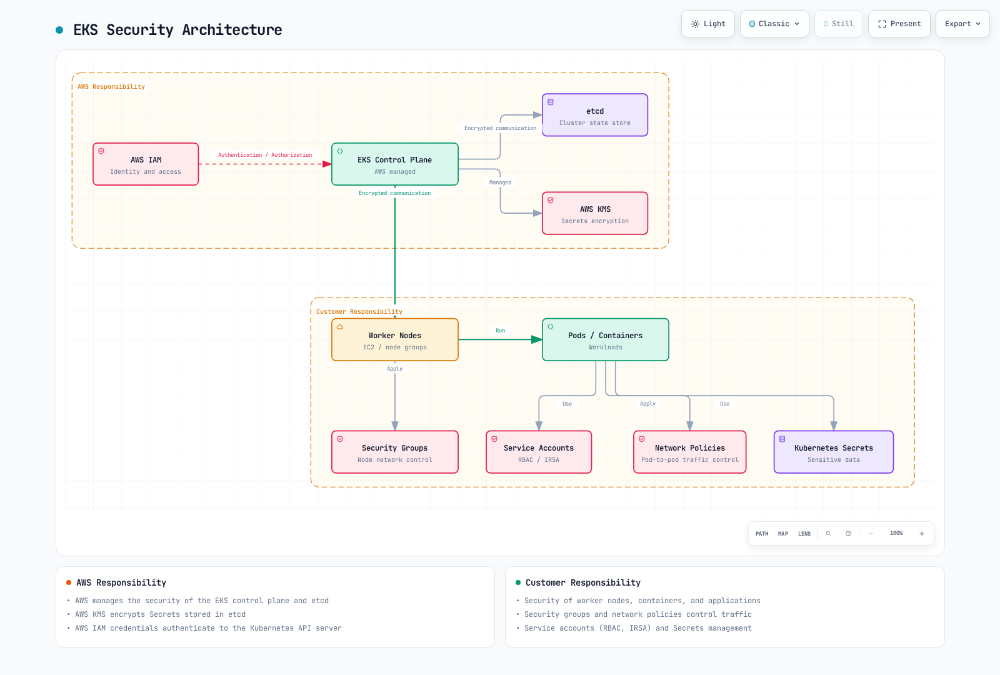
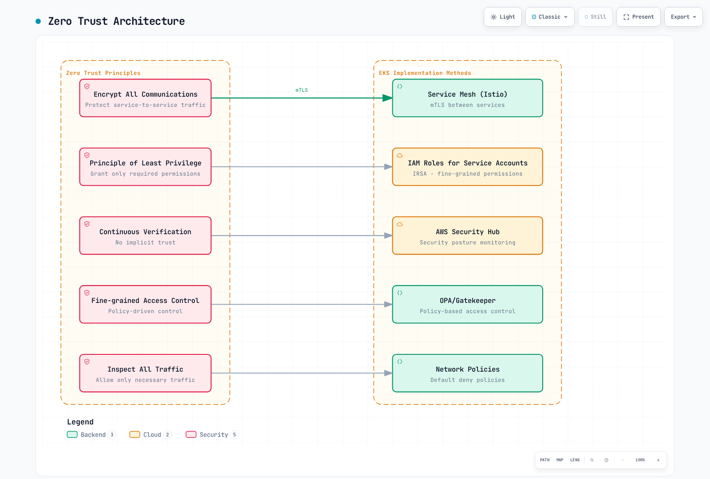
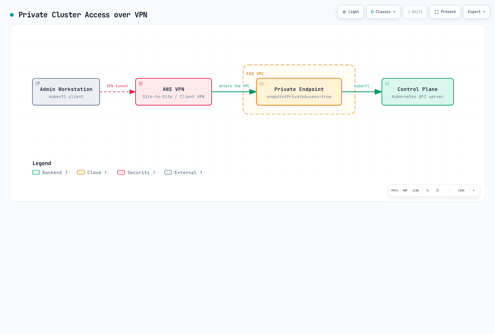
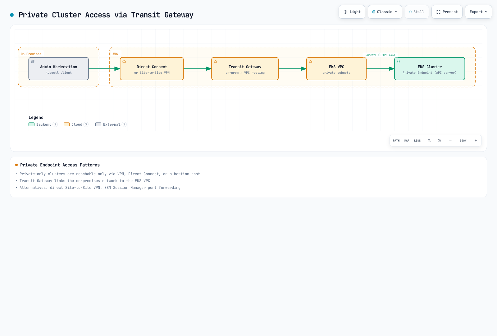
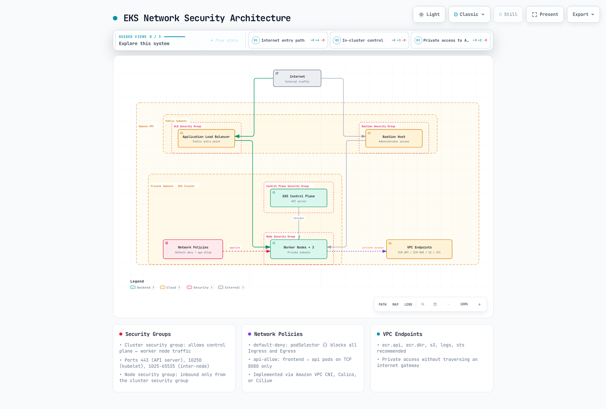
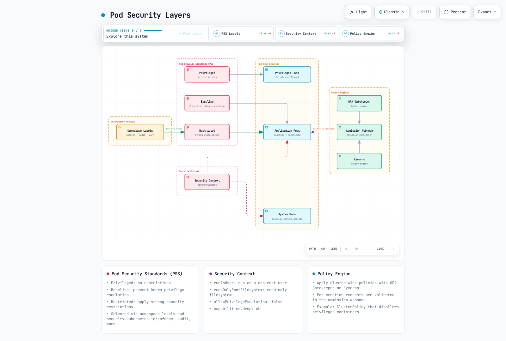
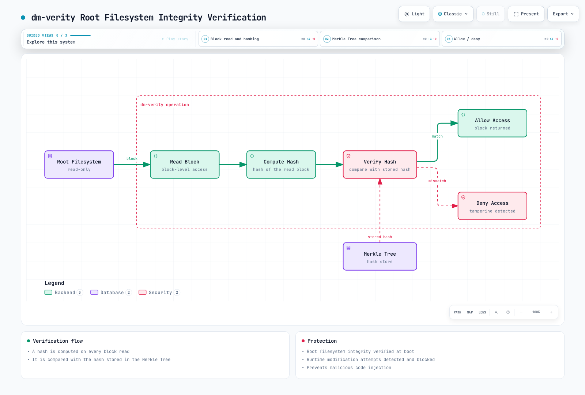
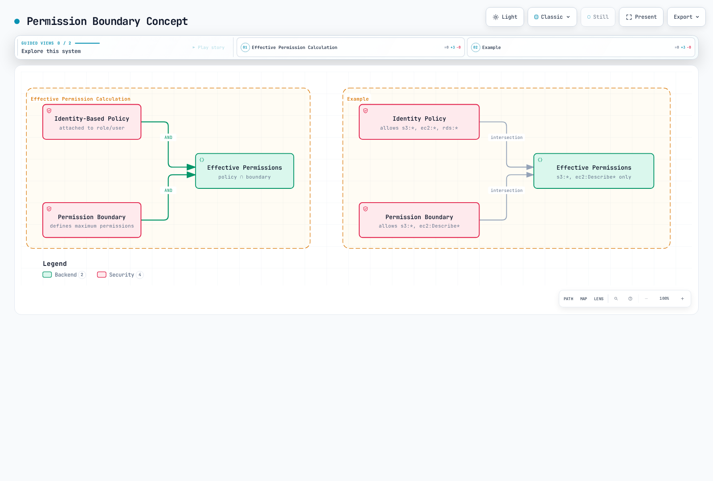
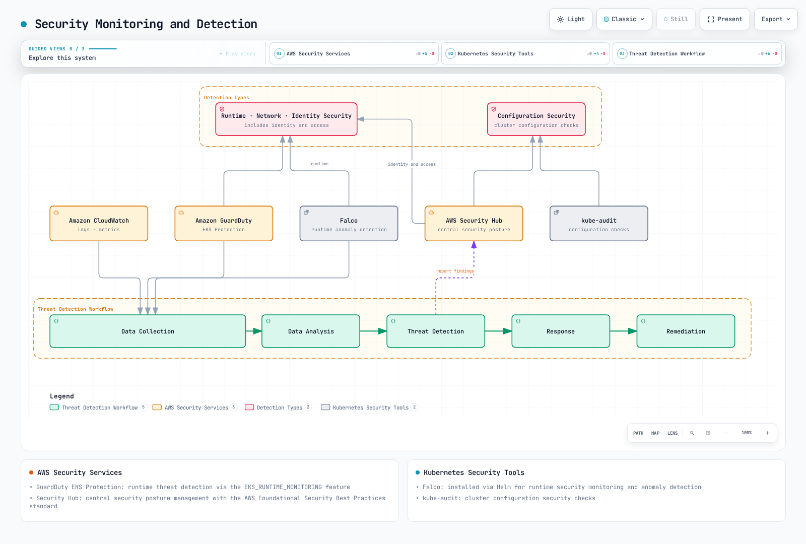
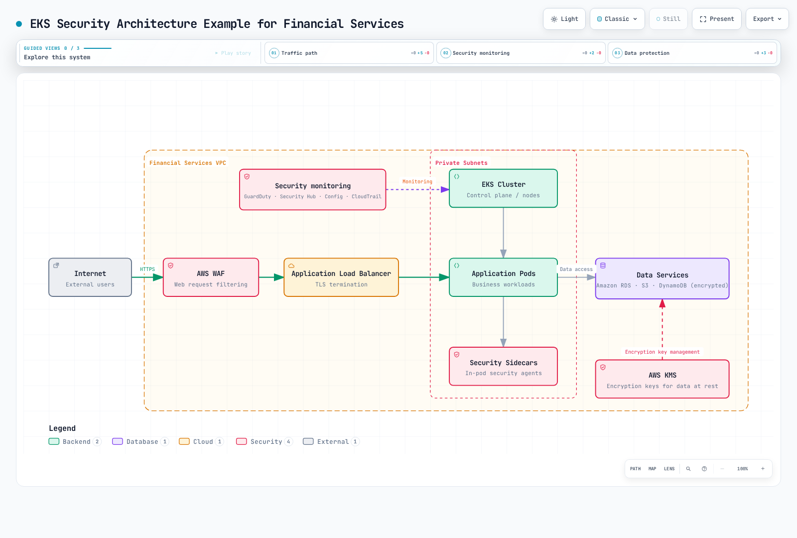

# Amazon EKS のセキュリティ

> **サポート対象バージョン**: EKS 標準サポート 1.34～1.37、延長サポート 1.31～1.33（2026年10月12日確認）
> **最終更新日**: 2026年11月21日

Amazon EKS（Elastic Kubernetes Service）でワークロードを安全に実行するには、さまざまなセキュリティレイヤーとベストプラクティスを理解し、実装する必要があります。このドキュメントでは、EKS クラスターのセキュリティを強化するための重要な概念、コンポーネント、ベストプラクティスについて説明します。

## 目次

1. [EKS のセキュリティ概要](#eks-security-overview)
2. [セキュリティ対策](#security-practices)
3. [IAM と認証](#iam-and-authentication)
4. [OIDC プロバイダーの詳細](#oidc-provider-deep-dive)
5. [EKS Pod Identity](#eks-pod-identity)
6. [クラスターエンドポイントのアクセス制御](#cluster-endpoint-access-control)
7. [ネットワークセキュリティ](#network-security)
8. [Pod のセキュリティ](#pod-security)
9. [Bottlerocket と読み取り専用 OS](#bottlerocket-and-read-only-os)
10. [IAM 権限境界](#iam-permission-boundaries)
11. [暗号化とシークレット管理](#encryption-and-secrets-management)
12. [コンプライアンスと監査](#compliance-and-auditing)
13. [セキュリティの監視と検出](#security-monitoring-and-detection)
14. [EKS セキュリティのベストプラクティス](#eks-security-best-practices)
15. [金融サービスにおける EKS セキュリティの考慮事項](#eks-security-considerations-for-financial-services)

## EKS のセキュリティ概要

インフラストラクチャ、クラスターアクセス、ワークロード制御を分けて考えます。AWS はコントロールプレーンを管理します。ノードと OS の責任範囲は、EC2 のセルフマネージドノード、マネージドノード、Fargate、Auto Mode、Hybrid Nodes のどれを使うかによって異なります。アプリケーションイメージ、ID、データの取り扱い、ワークロードポリシーについては、引き続きお客様が責任を負います。一般的な EC2 ノードの図は、お客様が Auto Mode や Fargate のホスト OS にパッチを適用することを意味しません。



[🔍 インタラクティブな図を見る](https://www.atomai.click/kubernetes-docs/archmaps/en-eks-05-eks-security-0.html)

## セキュリティ対策

対象範囲を明確にした複数の制御を使用します。単一のツールだけでゼロトラストを実現したり、ワークロードの安全性を証明したりすることはできません。呼び出し元やワークロードの ID を検証し、意図した操作を認可し、ネットワーク経路を制限し、脅威モデルに適した証跡を収集します。

<!-- Diagram repair pending: network policies filter traffic; posture findings are not continuous request authentication or complete zero-trust enforcement.


[🔍 View interactive diagram](https://www.atomai.click/kubernetes-docs/archmaps/en-eks-05-eks-security-1.html)
-->

### ID とネットワークの制御

IRSA と Pod Identity はワークロードに AWS 認証情報を提供し、NetworkPolicy はサポート対象のネットワークフィルタリングを行います。アドミッションエンジンは、設定された Kubernetes リクエストを検査します。互換性があり、保守されているサービスメッシュを使えば、mTLS とアプリケーションのトラフィックポリシーを追加できます。AWS App Mesh は2026年9月30日にサポート終了となるため、既存のデプロイには移行計画が必要であり、新規利用時の標準的な推奨とはしません。

### サプライチェーンのセキュリティ

SLSA などのレビュー済みビルド／来歴プロセスを使用し、SBOM でコンポーネントを一覧化し、関連する脆弱性をスキャンして、意図した署名者 ID に対してアーティファクトの署名を検証します。Syft は SBOM ツール、Grype は脆弱性スキャナーです。ECR/Inspector などのスキャナーには、個別の対象範囲と更新要件があります。署名済み、またはスキャン済みのイメージだからといって、そのコードに害がないことが証明されるわけではありません。ビルド ID、リポジトリ、アドミッション設定も保護してください。

現在の ECR は、AWS Signer によるマネージドイメージ署名と、Notation による手動署名の両方をサポートしています。署名とアドミッション時の検証は別の手順です。レジストリのフィルター、署名プロファイルの権限、検証側の信頼設定を、意図したパイプラインに合わせる必要があります。

### ランタイム検出とポリシー・アズ・コード

GuardDuty EKS Protection は、独立した EKS 監査ログストリームを分析します。Runtime Monitoring はエージェントベースの別機能です。現在のサポート対象には、プラットフォーム／エージェント要件を満たす EC2 上および Auto Mode の EKS が含まれ、EKS Fargate と Hybrid Nodes は対象外です。CloudWatch への監査ログ配信は別途設定します。Security Hub CSPM は設定済みのコントロールを評価し、Security Hub は検出結果を関連付けることができます。いずれも、アプリケーションの認可や、すべての規制要件を満たしているかの評価に代わるものではありません。

必要なカーネル、コントローラー、API、メタデータ連携を備えた、サポート対象のランタイムツールやポリシーエンジン（Falco、Gatekeeper、Kyverno など）を使用してください。gVisor/Kata などの追加サンドボックスランタイムには、互換性のあるノード／ランタイム設計が必要であり、すべての EKS コンピューティング経路で利用できるわけではありません。ポリシー、イメージ、OS の強化は特定のリスクを低減しますが、あらゆるエスケープや悪意ある操作が不可能であることを保証しません。

ポリシー・アズ・コードのツールは、実行段階もそれぞれ異なります。Gatekeeper/Kyverno は Kubernetes のアドミッションを評価し、CloudFormation Guard や Sentinel はインフラストラクチャの変更を評価し、AWS Config はサポート対象リソースのデプロイ済み設定を評価できます。Detective などの調査ツールは、設定済みのデータソースに依存します。これらの役割をランタイム防止と混同しないでください。

## IAM と認証

人間や自動化に用いる IAM プリンシパルは、設定済みの IAM マッピング／アクセスエントリ経路を通じて認証されます。Kubernetes RBAC と EKS アクセスポリシーが Kubernetes 操作を認可し、許可設定は加算的に適用されます。EKS クラスターのロールとノードロールは、それぞれサービスとノードによる AWS 呼び出しに使用されるものであり、開発者の Kubernetes 権限ではありません。IRSA に使う IAM OIDC プロバイダーは、Kubernetes ユーザーログインに使う外部 OIDC プロバイダーとは別物です。また、アプリケーションに AWS 権限を与えても、Kubernetes API 権限は付与されません。認証モードを変更する前に、管理者／ノードのマッピングを維持し、`kubectl --as` ではなく実際の IAM ログインで権限を検証してください。

詳細: [EKS クラスターアクセス認証: IAM とアクセスエントリ](./05-eks-security-cluster-access.md)

## OIDC プロバイダーの詳細

クラスターの OIDC 発行者と、EKS が公開する署名用公開鍵だけでは、IAM OIDC プロバイダーは作成されず、ロールの引き受けも認可されません。IRSA には、ロールのアカウントにある IAM OIDC プロバイダー、発行者・サブジェクト・オーディエンスを範囲指定したロール信頼ポリシー、投影されたトークンを STS AssumeRoleWithWebIdentity で交換する互換性のある SDK が必要です。EKS は OIDC 署名鍵を7日ごとにローテーションするため、カスタムの検証処理では Cache-Control を尊重し、未知の kid 値を適切に処理する必要があります。

詳細: [IRSA と OIDC プロバイダー](./05-eks-security-irsa-oidc.md)

## EKS Pod Identity

EKS Pod Identity は、EKS API の関連付け（クラスター、namespace、ServiceAccount と IAM ロールの対応）と `pods.eks.amazonaws.com` のロール信頼を通じて、Pod に一時的な AWS 認証情報を提供します。SDK はノードエージェントのコンテナ認証情報エンドポイントを呼び出し、エージェントは EKS Auth 上の AssumeRoleForPodIdentity を通じて認証情報を取得します。関連付け先のロールはクラスターと同じアカウントにある必要があります。他のアカウントのリソースには、対象ロールを連鎖してアクセスします。IRSA との比較、移行順序、ライブデモについては、[EKS ノードの IAM 権限を IRSA と Pod Identity に移行する](../security/17-eks-workload-identity-migration.md)を参照してください。

詳細: [EKS Pod Identity](./05-eks-security-pod-identity.md)

## クラスターエンドポイントのアクセス制御

エンドポイント設定はネットワーク到達性を決定しますが、API 操作の認証と認可は引き続き必要です。運用要件に基づいてアクセス経路を選び、ツールの既定値を前提とせず、実際の設定を確認してください。

| パブリック | プライベート | ネットワーク動作 |
|---|---|---|
| 有効 | 無効 | クライアントとノードはパブリックアドレスへの経路を必要とします。CIDR 制限には実際のパブリック送信元アドレスを含める必要があります |
| 無効 | 有効 | 承認済みの接続ネットワークを含め、VPC／プライベート経路、DNS、セキュリティグループのルールが必要です |
| 有効 | 有効 | クラスター VPC 内からのリクエストにはプライベート経路が使われ、許可された外部クライアントはパブリックアクセスを利用できます |

パブリックアドレスがあるからといって、EC2 から EKS へのトラフィックが AWS ネットワークの外に出るとは限りません。プライベートアクセスを有効にしても、呼び出し元が自動的に認可されたり、VPN／DNS が設定されたり、復旧経路が確保されたりするわけではありません。EKS では、少なくとも1つのアクセスモードが必要です。

### 既存設定の確認と保存

関連するブロックは同じシェルで実行し、新しいレビュー用ディレクトリを保持してください。エンドポイント設定を確認／復旧できる AWS 管理用 ID を、Kubernetes ログインとは別に使用します。以下では、復旧用に変更可能なエンドポイントアクセスフィールドのみを記録します。無関係な VPC 設定や、後述する一方向のエグレスモードの復元は試みません。

```bash
set -euo pipefail
umask 077
: "${CLUSTER_NAME:?Set the existing cluster name}"
: "${AWS_REGION:?Set its Region}"
ENDPOINT_REVIEW_DIR=$(mktemp -d -t eks-endpoint-review.XXXXXX)
printf 'Review records: %s\n' "$ENDPOINT_REVIEW_DIR"
aws eks describe-cluster --name "$CLUSTER_NAME" --region "$AWS_REGION" \
  --query cluster --output json > "$ENDPOINT_REVIEW_DIR/cluster-before.json"
python3 - "$ENDPOINT_REVIEW_DIR" "$CLUSTER_NAME" <<'PY'
import json, pathlib, sys, urllib.parse
root = pathlib.Path(sys.argv[1])
cluster = json.loads((root / "cluster-before.json").read_text())
if cluster["name"] != sys.argv[2] or cluster["status"] != "ACTIVE":
    raise SystemExit("Unexpected cluster or cluster is not ACTIVE")
endpoint = urllib.parse.urlparse(cluster["endpoint"])
if endpoint.scheme != "https" or not endpoint.hostname or endpoint.username or endpoint.password:
    raise SystemExit("Unexpected Kubernetes endpoint")
(root / "endpoint-host.txt").write_text(endpoint.hostname + "\n")
config = cluster["resourcesVpcConfig"]
before = {k: config[k] for k in ["endpointPublicAccess", "endpointPrivateAccess", "publicAccessCidrs"] if k in config}
(root / "endpoint-before.json").write_text(json.dumps(before, indent=2) + "\n")
(root / "endpoint-private.json").write_text(json.dumps({"endpointPublicAccess": False, "endpointPrivateAccess": True}, indent=2) + "\n")
(root / "ssm-remote-host.json").write_text(json.dumps({"host": [endpoint.hostname], "portNumber": ["443"], "localPortNumber": ["6443"]}, indent=2) + "\n")
print(json.dumps(before, indent=2))
PY
```

### パブリックアドレス経路を制限する

パブリック許可リストには、実際に承認されたパブリック NAT／VPN／オフィスの送信元アドレスを含める必要があります。10.0.0.0/8 などのプライベート範囲は、パブリック送信元アドレスを表しません。203.0.113.0/24 などのドキュメント用アドレス範囲はプレースホルダーであり、実際のオフィスネットワークとしては機能しません。

ネットワーク管理者から提供された JSON 配列を PUBLIC_EGRESS_CIDRS に設定してください。この制限付きの例は IPv4 CIDR を受け入れ、明らかなプライベート／デフォルト／ドキュメント用範囲を拒否しますが、所有者であることや、現在のクライアントが範囲に含まれることを証明するものではありません。範囲、クォータ、クラスターの IP ファミリー対応を確認してください。デュアルスタック／IPv6 設定には、別途検証済みの許可リストが必要です。

```bash
set -euo pipefail
: "${ENDPOINT_REVIEW_DIR:?Run the inspection step in this shell first}"
: "${PUBLIC_EGRESS_CIDRS:?Set a JSON array of approved actual public IPv4 egress CIDRs}"
python3 - "$ENDPOINT_REVIEW_DIR" "$PUBLIC_EGRESS_CIDRS" <<'PY'
import ipaddress, json, pathlib, sys
values = json.loads(sys.argv[2])
if not isinstance(values, list) or not values:
    raise SystemExit("Provide a nonempty reviewed CIDR list")
cidrs = []
for value in values:
    network = ipaddress.ip_network(value, strict=True)
    if network.version != 4 or network.prefixlen == 0 or not network.is_global or network.is_multicast or network.is_reserved:
        raise SystemExit("This IPv4 example requires actual public egress CIDRs, not private/default/documentation ranges")
    cidrs.append(str(network))
if len(cidrs) != len(set(cidrs)):
    raise SystemExit("Remove duplicate CIDRs")
desired = {"endpointPublicAccess": True, "endpointPrivateAccess": True, "publicAccessCidrs": cidrs}
path = pathlib.Path(sys.argv[1]) / "endpoint-public-restricted.json"
path.write_text(json.dumps(desired, indent=2) + "\n")
print(json.dumps(desired, indent=2))
PY
```

予定するパブリック制限設定では、プライベートアクセスも有効になります。プライベートアクセスを有効にしない場合、ノード／Fargate のパブリックエグレスアドレスを許可したままにしないと、ノードから API への通信が失敗する可能性があります。ENDPOINT_CHANGE=public-restricted を選ぶ前に、生成された JSON を確認してください。

### プライベート接続経路



[🔍 インタラクティブな図を見る](https://www.atomai.click/kubernetes-docs/archmaps/en-eks-05-eks-security-6.html)



[🔍 インタラクティブな図を見る](https://www.atomai.click/kubernetes-docs/archmaps/en-eks-05-eks-security-7.html)

VPN、Direct Connect/TGW、承認済みの管理ホストは接続経路の候補ですが、ルート、DNS、セキュリティグループ、認可が設定されている必要があります。Client VPN の作成コマンドを1つ実行しただけでは、サブネットの関連付け、認可ルール、ルート、証明書、接続ログは設定されません。AWS CLI イメージを実行する Deployment を作成しても、SSM マネージド踏み台が作成されたり、kubectl／SSM Agent がインストールされたりするわけではありません。

SSM のリモートホスト転送を使うには、SSM Agent 3.1.1374.0 以降を備えたマネージドホスト、Session Manager の IAM／ネットワークアクセス、ローカルの Session Manager プラグイン、プライベート EKS エンドポイントへの DNS／ルーティングを準備してください。プライベートエンドポイントアクセスが有効であり、ホストが実際にプライベート経路を名前解決して到達できることを確認します。転送セッションは、最初のターミナルで実行したままにしてください。

```bash
set -euo pipefail
: "${AWS_REGION:?Set the cluster/managed-instance Region for this example}"
: "${MANAGED_INSTANCE_ID:?Set the prepared SSM-managed instance with a private route to EKS}"
: "${ENDPOINT_REVIEW_DIR:?Use the endpoint inspection directory}"
aws ssm start-session --region "$AWS_REGION" --target "$MANAGED_INSTANCE_ID" \
  --document-name AWS-StartPortForwardingSessionToRemoteHost \
  --parameters "file://$ENDPOINT_REVIEW_DIR/ssm-remote-host.json"
```

2つ目のターミナルでは、同じクラスターの kubeconfig を使用し、CA と意図した IAM exec 認証を維持してください。実際の TLS サーバー名を保持したままローカルに接続します。ホスト名の不一致を隠すために証明書検証を無効にしないでください。

```bash
set -euo pipefail
: "${ENDPOINT_REVIEW_DIR:?Set the same review directory in this second terminal}"
: "${CLUSTER_KUBECONFIG:?Set the kubeconfig for this same EKS cluster and intended IAM identity}"
EKS_ENDPOINT_HOST=$(cat "$ENDPOINT_REVIEW_DIR/endpoint-host.txt")
kubectl --kubeconfig "$CLUSTER_KUBECONFIG" \
  --server https://127.0.0.1:6443 --tls-server-name "$EKS_ENDPOINT_HOST" \
  --request-timeout=10s -n security-demo get pods
```

リモートホスト用ドキュメントは、指定された EKS ホストへ転送します。旧 AWS-StartPortForwardingSession ドキュメントは、マネージドインスタンス自身のポートを転送するものです。そのインスタンスのポート 443 を転送しても、そのインスタンスが EKS API サーバーになるわけではありません。トンネルやヘルスチェックが成功しただけでは、認可やプライベート経路を検証したことになりません。パブリックアクセスを削除する前に、意図した API 操作、DNS／プライベートアドレス、実際の経路を確認してください。

### レビュー済みのエンドポイント変更を適用する

プライベートアクセスを有効にし、意図したプライベートクライアント経路を検証した後、ENDPOINT_CHANGE=private を選択する前に、新しい確認スナップショットを取得してください。以下の処理では、クラスター／アカウントが異なる場合、エンドポイント設定が変更されている場合、またはプライベートアクセスを有効にする前にプライベート専用へ移行しようとする場合は処理を中止します。読み取り／確認は不可分なトランザクションではありません。変更は所有者と調整してください。

```bash
set -euo pipefail
: "${CLUSTER_NAME:?Use the inspected cluster}"
: "${AWS_REGION:?Use its Region}"
: "${ENDPOINT_REVIEW_DIR:?Use the review directory}"
: "${ENDPOINT_CHANGE:?Choose public-restricted or private after validating the intended route}"
case "$ENDPOINT_CHANGE" in
  public-restricted|private) ;;
  *) echo "Unexpected endpoint change"; exit 1 ;;
esac
test -f "$ENDPOINT_REVIEW_DIR/endpoint-$ENDPOINT_CHANGE.json"
aws eks describe-cluster --name "$CLUSTER_NAME" --region "$AWS_REGION" \
  --query cluster --output json > "$ENDPOINT_REVIEW_DIR/cluster-current.json"
python3 - "$ENDPOINT_REVIEW_DIR" "$CLUSTER_NAME" "$ENDPOINT_CHANGE" <<'PY'
import json, pathlib, sys
root = pathlib.Path(sys.argv[1])
before = json.loads((root / "cluster-before.json").read_text())
current = json.loads((root / "cluster-current.json").read_text())
keys = ["endpointPublicAccess", "endpointPrivateAccess", "publicAccessCidrs"]
if current["name"] != sys.argv[2] or current["arn"] != before["arn"] or current["status"] != "ACTIVE":
    raise SystemExit("Cluster identity/state differs from the reviewed target")
if any(current["resourcesVpcConfig"].get(k) != before["resourcesVpcConfig"].get(k) for k in keys):
    raise SystemExit("Endpoint configuration changed; inspect and review again")
if sys.argv[3] == "private" and current["resourcesVpcConfig"].get("endpointPrivateAccess") is not True:
    raise SystemExit("Enable and verify private access before disabling public access")
PY
aws eks update-cluster-config --name "$CLUSTER_NAME" --region "$AWS_REGION" \
  --resources-vpc-config "file://$ENDPOINT_REVIEW_DIR/endpoint-$ENDPOINT_CHANGE.json" \
  --output json > "$ENDPOINT_REVIEW_DIR/update-response.json"
EKS_UPDATE_ID=$(python3 - "$ENDPOINT_REVIEW_DIR/update-response.json" <<'PY'
import json, sys
with open(sys.argv[1]) as stream:
    print(json.load(stream)["update"]["id"])
PY
)
UPDATE_DONE=false
for ((attempt=0; attempt<60; attempt++)); do
  STATE=$(aws eks describe-update --name "$CLUSTER_NAME" --region "$AWS_REGION" \
    --update-id "$EKS_UPDATE_ID" --query update.status --output text)
  case "$STATE" in
    Successful) UPDATE_DONE=true; break ;;
    InProgress) sleep 10 ;;
    *) echo "Update $EKS_UPDATE_ID status: $STATE; inspect before further changes"; exit 1 ;;
  esac
done
test "$UPDATE_DONE" = true || { echo "Update still pending; inspect $EKS_UPDATE_ID"; exit 1; }
aws eks describe-cluster --name "$CLUSTER_NAME" --region "$AWS_REGION" \
  --query cluster.resourcesVpcConfig --output json
```

変更の確認には、返された更新 ID と Successful 状態を使ってください。クラスターが ACTIVE であることだけでは不十分です。タイムアウトした場合は、既存の操作を確認する必要があります。盲目的に別の変更を送信しないでください。完了後、実際の API 経路を再確認してください。以前のエンドポイントフィールドと AWS 管理用の復旧アクセスを利用できる状態にしておいてください。このレビューでは実際のエンドポイント変更は行っていません。

### プライベートな AWS サービス依存関係

| 経路 | 関連するエンドポイント／依存関係 |
|---|---|
| Kubernetes API | クラスターエンドポイントのプライベートアクセスと、そのルート／DNS／セキュリティグループ |
| AWS EKS 管理 API | プライベートな管理アクセスが必要な場合の eks インターフェイスエンドポイント |
| Pod Identity エージェント | ノードがパブリックエグレスを使えない場合の eks-auth インターフェイスエンドポイント |
| OIDC ディスカバリー／JWKS ツール | oidc-eks インターフェイスエンドポイント。公開鍵データは匿名で取得でき、エンドポイントポリシーはデフォルトのみ |
| IRSA 認証情報の交換 | OIDC 鍵の取得とは別のリージョナル STS エンドポイント |
| ECR イメージの取得 | ecr.api/ecr.dkr インターフェイスに加えて、動作する S3 レイヤーダウンロード経路 |
| その他のコントローラー／アプリ | 実際に依存する EC2、Logs、Secrets Manager、SSM、その他のサービスのみ |

EKS インターフェイスエンドポイントは Kubernetes API エンドポイントではありません。S3 ゲートウェイエンドポイントはルートテーブルを使用し、インターフェイスエンドポイントはサブネット／セキュリティグループ／プライベート DNS を使用します。エンドポイントタイプを省略した単一のループですべてのサービスを作成しないでください。OIDC PrivateLink によって STS のトークン検証が変わったり、IRSA ロールが認可されたりすることはありません。作成に関する章を使って、所有するネットワーク／ID／コンピューティング設定全体を準備してください。ここにあるエンドポイントの抜粋は、本番対応のクラスター構築手順ではありません。

### お客様側でルーティングするコントロールプレーンエグレス（2026年6月）

2026年6月18日に発表された CUSTOMER_ROUTED は、サポート対象の EKS コントロールプレーンエグレスモードです。別個のエグレス ENI を作成するのではなく、サブネット内に既にあるクロスアカウントのクラスター用ネットワークインターフェイスを使用します。アドミッション Webhook、OIDC ディスカバリー、集約 API サーバーなど、顧客向けの API サーバー呼び出しに適用されます。

**この切り替えは一方向です。CUSTOMER_ROUTED を有効にすると、クラスターを AWS_MANAGED に戻すことはできません。** 保存済み設定や Kubernetes バージョンのロールバックで、このモードを元に戻せると説明しないでください。新しい経路で障害が発生した場合は、ルーティング／接続性を修正してください。

```bash
set -euo pipefail
: "${CLUSTER_NAME:?Set the existing cluster}"
: "${AWS_REGION:?Set its Region}"
aws eks describe-cluster --name "$CLUSTER_NAME" --region "$AWS_REGION" \
  --query 'cluster.{Status:status,Vpc:resourcesVpcConfig,IPFamily:kubernetesNetworkConfig.ipFamily}' --output json
```

切り替え前に、Webhook／OIDC／集約 API の接続先とポートを一覧化してください。クラスター ENI サブネットからのルート、アウトバウンド SG ルール、NACL の戻りトラフィック、DNS を確認します。VPC DHCP オプションには AmazonProvidedDNS が含まれていなければなりません。また、Route53 プライベートゾーン／Resolver 転送と外部 DNS 名前解決が、実際の接続先に対して機能する必要があります。接続先に応じて、NAT、ファイアウォール、集中ルーティングをエグレス経路に使用できます。IPv6 クラスターでは、文書化された IPv4 と IPv6 の経路が必要です。IPv4 のみを使用する依存先には、動作する IPv4 経路が引き続き必要です。

このレビューを完了した後、以下が実際の API オプションです。この監査ではオフラインで構文確認を行いましたが、AWS クラスターに対して実行していません。

```bash
set -euo pipefail
: "${CLUSTER_NAME:?Set the reviewed cluster}"
: "${AWS_REGION:?Set its Region}"
# One-way change: complete subnet route/SG/NACL/DNS and dependency checks first.
aws eks update-cluster-config --name "$CLUSTER_NAME" --region "$AWS_REGION" \
  --resources-vpc-config controlPlaneEgressMode=CUSTOMER_ROUTED --output json
```

返された更新 ID を記録し、DescribeUpdate が Successful になるまで確認してください。ACTIVE だけでは不十分です。その後、実際に設定した Webhook、ユーザー OIDC、集約 API の経路をテストしてください。ローカル CLI パーサーのテストによって VPC 接続性が証明されたとは主張しないでください。

| トラフィック | この設定の影響 |
|---|---|
| 顧客向け API サーバーのエグレス | 設定済みのお客様側 VPC 経路を使用 |
| Kubelet API のポート10250 | クラスター ENI／ノード経路を使用し、外部エグレスデバイスは経由しない |
| etcd、CloudWatch Logs、内部 EKS トラフィック | EKS 管理の経路を引き続き使用 |
| EKS Capabilities のコントローラー（マネージド ArgoCD/ACK/KRO など） | 別のマネージドインフラストラクチャで実行され、この機能によるルーティング変更の対象外 |
| アプリケーションから STS/EKS Auth/S3 への呼び出し | ワークロード／ノードのネットワークに従い、この API サーバーモードの制御対象外 |

この機能は EKS リージョンで追加の機能料金なしで利用できますが、NAT／ファイアウォール／PrivateLink／ログ記録リソースにはそれぞれ料金が発生します。ネットワークフローの証跡が必要な場合は Flow Logs を設定してください。Flow Logs は暗号化されたペイロードを自動的に公開するものでも、アプリケーション認可を証明するものでもありません。

#### リクエスト単位の SCP の例

eks:controlPlaneEgressMode キーは、CreateCluster/UpdateClusterConfig リクエストで指定されたモードを評価します。存在条件を伴わない StringNotEquals の Deny は、キーが省略された場合にも一致します。以下の例では、新規クラスターにはモードを必須とし、更新時に明示的に異なるモードが指定された場合は拒否します。一方で、モードを省略した無関係な更新リクエストは許可します。

```json
{
  "Version": "2012-10-17",
  "Statement": [
    {
      "Sid": "RequireCustomerRoutedForNewClusters",
      "Effect": "Deny",
      "Action": "eks:CreateCluster",
      "Resource": "*",
      "Condition": {
        "StringNotEquals": {
          "eks:controlPlaneEgressMode": "CUSTOMER_ROUTED"
        }
      }
    },
    {
      "Sid": "RejectExplicitOtherEgressMode",
      "Effect": "Deny",
      "Action": "eks:UpdateClusterConfig",
      "Resource": "*",
      "Condition": {
        "Null": {
          "eks:controlPlaneEgressMode": "false"
        },
        "StringNotEquals": {
          "eks:controlPlaneEgressMode": "CUSTOMER_ROUTED"
        }
      }
    }
  ]
}
```

これは意図的なリクエスト制限であり、既存クラスターを自動移行するものではありません。この例では、既存の AWS_MANAGED クラスターでも無関係な更新を実行できます。異なる展開ポリシーが必要な組織は、別途そのポリシーをモデル化してください。SCP は IAM 権限を付与せず、ルーティング／DNS も設定しません。デプロイ前に、ポリシーの継承関係を確認し、組織の責任者と代表的な許可／拒否リクエストをテストしてください。

## ネットワークセキュリティ

セキュリティグループ、ルーティング、NetworkPolicy、アプリケーション認証を、それぞれのレイヤーに応じて使用してください。図は従来型のネットワークレイアウトを示しています。パブリック踏み台とプライベート AWS エンドポイントは任意のコンポーネントであり、実際に設定が必要です。すべての EKS クラスターに本来備わっているものではありません。



[🔍 インタラクティブな図を見る](https://www.atomai.click/kubernetes-docs/archmaps/en-eks-05-eks-security-8.html)

### セキュリティグループと必要な経路

API／ノード間の経路には、ノードから API への TCP443 と、コントロールプレーンから kubelet への TCP10250 の通信を許可します。DNS、Webhook、ワークロードには、実際の接続先に応じて追加ポートが必要になる場合があります。「ノード間通信」として TCP1025～65535 を開放する一般的な要件はありません。セキュリティグループはステートフルですが、NACL とその戻り経路のルールは別です。

実際の ENI／ノードに関連付けられているセキュリティグループを確認してください。カスタムの起動テンプレートで SG を設定しても、EKS のデフォルトルールがすべて自動的に継承されるわけではありません。Security Groups for Pods と Auto Mode NodeClass の Pod セキュリティグループセレクターは、それぞれ異なる仕組みであり、固有のサポート／動作があります。SG の適用対象は、抽象的なインスタンス単位のレイヤーに限られません。選択したコンピューティング方式／CNI と実際の送信元インターフェイスを確認してください。

### NetworkPolicy の動作

NetworkPolicy には、サポート対象で設定済みの適用機能が必要です。YAML を作成しただけでは、パケットはフィルタリングされません。既存ネットワーク管理者がサポートする EKS VPC CNI のポリシー機能、または意図的に選択した互換性のあるネットワークスタックを使用してください。既存クラスターに、変更可能な Calico マニフェストや無関係な Cilium 設定をインストールしないでください。Auto Mode はネットワークを自ら管理するため、任意の CNI 置き換えをインストールする対象ではありません。

ポリシーは加算的に適用されます。接続を分離するには、送信元の egress と宛先の ingress の両方で許可する必要があります。ルールの順序は deny/allow の優先順位ではありません。podSelector のみを指定すると、ポリシーと同じ namespace 内のピアが選択されます。同じピア内の namespaceSelector と podSelector は AND 条件です。個別のピアエントリは、選択肢として OR で結合されます。

### 分離ポリシーの演習

この例では、新しく作成したデモ用 namespace、適用機能を持つ CNI を使用した Linux EC2 ネットワーク、kube-system 内で k8s-app=kube-dns のラベルが付いた従来型 CoreDNS Deployment を使用します。また、app=frontend/api/database のラベルが付いた準備済みの frontend/API/database Pod を想定します。API は 8080 で待ち受け、デモ用メトリクスを 9090 で公開し、データベースは 5432 で待ち受けます。これらのポリシーはアプリケーションをデプロイしません。

デフォルト拒否には ingress と egress の両方が含まれます。DNS と意図した各送信元／宛先の通信を明示的に許可します。すべての依存関係を確認せずに、既存の本番 namespace にこれらの前提を適用しないでください。

```yaml
apiVersion: v1
kind: Namespace
metadata:
  name: security-network-demo
  labels:
    pod-security.kubernetes.io/enforce: restricted
    pod-security.kubernetes.io/enforce-version: v1.36
---
apiVersion: v1
kind: Namespace
metadata:
  name: security-monitoring-demo
---
apiVersion: networking.k8s.io/v1
kind: NetworkPolicy
metadata:
  name: default-deny
  namespace: security-network-demo
spec:
  podSelector: {}
  policyTypes:
  - Ingress
  - Egress
---
apiVersion: networking.k8s.io/v1
kind: NetworkPolicy
metadata:
  name: allow-dns
  namespace: security-network-demo
spec:
  podSelector: {}
  policyTypes:
  - Egress
  egress:
  - to:
    - namespaceSelector:
        matchLabels:
          kubernetes.io/metadata.name: kube-system
      podSelector:
        matchLabels:
          k8s-app: kube-dns
    ports:
    - protocol: UDP
      port: 53
    - protocol: TCP
      port: 53
---
apiVersion: networking.k8s.io/v1
kind: NetworkPolicy
metadata:
  name: frontend-to-api
  namespace: security-network-demo
spec:
  podSelector:
    matchLabels:
      app: frontend
  policyTypes:
  - Egress
  egress:
  - to:
    - podSelector:
        matchLabels:
          app: api
    ports:
    - protocol: TCP
      port: 8080
---
apiVersion: networking.k8s.io/v1
kind: NetworkPolicy
metadata:
  name: api-ingress
  namespace: security-network-demo
spec:
  podSelector:
    matchLabels:
      app: api
  policyTypes:
  - Ingress
  ingress:
  - from:
    - podSelector:
        matchLabels:
          app: frontend
    ports:
    - protocol: TCP
      port: 8080
---
apiVersion: networking.k8s.io/v1
kind: NetworkPolicy
metadata:
  name: api-to-database
  namespace: security-network-demo
spec:
  podSelector:
    matchLabels:
      app: api
  policyTypes:
  - Egress
  egress:
  - to:
    - podSelector:
        matchLabels:
          app: database
    ports:
    - protocol: TCP
      port: 5432
---
apiVersion: networking.k8s.io/v1
kind: NetworkPolicy
metadata:
  name: database-ingress
  namespace: security-network-demo
spec:
  podSelector:
    matchLabels:
      app: database
  policyTypes:
  - Ingress
  ingress:
  - from:
    - podSelector:
        matchLabels:
          app: api
    ports:
    - protocol: TCP
      port: 5432
---
apiVersion: networking.k8s.io/v1
kind: NetworkPolicy
metadata:
  name: monitor-api
  namespace: security-network-demo
spec:
  podSelector:
    matchLabels:
      app: api
  policyTypes:
  - Ingress
  ingress:
  - from:
    - namespaceSelector:
        matchLabels:
          kubernetes.io/metadata.name: security-monitoring-demo
      podSelector:
        matchLabels:
          app: prometheus
    ports:
    - protocol: TCP
      port: 9090
```

監視 Pod にも egress の許可が必要です。以下の別のデモ用ポリシーは、API メトリクスと従来型 DNS 経路を許可します。本番用 Prometheus ネットワークポリシーとして完全なものではありません。

```yaml
apiVersion: networking.k8s.io/v1
kind: NetworkPolicy
metadata:
  name: prometheus-to-demo-api
  namespace: security-monitoring-demo
spec:
  podSelector:
    matchLabels:
      app: prometheus
  policyTypes:
  - Egress
  egress:
  - to:
    - namespaceSelector:
        matchLabels:
          kubernetes.io/metadata.name: security-network-demo
      podSelector:
        matchLabels:
          app: api
    ports:
    - protocol: TCP
      port: 9090
  - to:
    - namespaceSelector:
        matchLabels:
          kubernetes.io/metadata.name: kube-system
      podSelector:
        matchLabels:
          k8s-app: kube-dns
    ports:
    - protocol: UDP
      port: 53
    - protocol: TCP
      port: 53
```

純粋な Auto Mode では、従来型 Deployment ではなくノードローカルの CoreDNS を使用します。また、NodeLocal DNS／カスタムリゾルバー経路も異なる場合があります。DNS ルールを調整する前に、実際のリゾルバー経路を確認してください。ラベルはセレクターであり、暗号学的なワークロード ID ではありません。必要に応じて、ワークロードの作成／ラベル変更権限を管理し、アプリケーション認可も使用してください。

### 外部宛先と検証の限界

以下のドキュメント用アドレスは、接続性の演習を行う前に、承認済みの実際の宛先に置き換える必要があります。これは1つの IP／ポートの許可を例示したものであり、AWS サービス／FQDN の許可リストではありません。

```yaml
apiVersion: networking.k8s.io/v1
kind: NetworkPolicy
metadata:
  name: approved-https-example
  namespace: security-network-demo
spec:
  podSelector:
    matchLabels:
      app: external-client
  policyTypes:
  - Egress
  egress:
  - to:
    - ipBlock:
        cidr: 203.0.113.10/32
    ports:
    - protocol: TCP
      port: 443
```

443 で 0.0.0.0/0 を許可すると、広範なパブリック宛先への接続を許可します。プライベート／リンクローカル範囲を除外しても、信頼できるサービスを特定できるわけではありません。ネイティブ NetworkPolicy は、ドメイン名を永続的な許可リストに変換したり、IAM 認可を提供したりしません。ノード／hostNetwork の例外、NAT の順序、実装固有の動作もあるため、IMDS 分離の唯一の仕組みとして使用することはできません。

実際の CNI で、新規接続について許可と拒否の両方をテストしてください。ポリシー変更の反映には時間がかかる場合があり、既存接続の扱いは実装によって異なります。このレビューでは、合成したセレクター／ポートのケースを確認しましたが、パケットフィルタリング、DNS 名前解決、実トラフィックは実行していません。

## Pod のセキュリティ

Pod Security Standards はプロファイルを定義し、Pod Security Admission（PSA）は選択された namespace ポリシーを適用します。PSA は Kubernetes 1.25 から安定版です。PodSecurityPolicy は 1.21 で非推奨となり、**1.25 で削除されました**。現在の EKS クラスターにデプロイする API ではありません。名前に PSP を含む Gatekeeper 制約は、削除された API とは別のカスタムリソースです。



[🔍 インタラクティブな図を見る](https://www.atomai.click/kubernetes-docs/archmaps/en-eks-05-eks-security-9.html)

### バージョン指定プロファイルと適用

| プロファイル | 意味 |
|---|---|
| Privileged | この PSS プロファイルによる制限はありません。他の認可／アドミッション制御は引き続き適用されます |
| Baseline | 権限を拡大することが知られている設定に対する、基本的な制限セット |
| Restricted | サポート対象の非 root／ケイパビリティ／seccomp 要件など、より厳しい制限を追加 |

namespace の enforce は、違反する Pod リクエストを拒否します。audit と warn は違反を記録／報告しますが、コントローラーによる apply が成功したからといって、Pod が実行できることを証明するものではありません。Deployment／Job のテンプレートでは、audit／warn が問題を報告できますが、enforce は作成される Pod に適用されます。kubectl apply の成功だけでなく、ロールアウトとイベントを確認してください。namespace ポリシーを変更しても、既存 Pod が遡って退避されることはありません。

### Linux の完全なセキュリティコンテキストの例

以下は、実際のイメージを使い、アプリケーションの書き込み可能なランタイムパスを持たない、簡潔な Linux ID／セキュリティコンテキストのデモです。nginx アプリケーションのデプロイ例ではありません。実際のクラスターに適した PSS バージョンを使用してください。この例では、レビュー済みの EKS 1.36 ポリシーを指定しています。

```yaml
apiVersion: v1
kind: Namespace
metadata:
  name: security-demo
  labels:
    pod-security.kubernetes.io/enforce: restricted
    pod-security.kubernetes.io/enforce-version: v1.36
    pod-security.kubernetes.io/audit: restricted
    pod-security.kubernetes.io/audit-version: v1.36
    pod-security.kubernetes.io/warn: restricted
    pod-security.kubernetes.io/warn-version: v1.36
---
apiVersion: v1
kind: Pod
metadata:
  name: security-context-demo
  namespace: security-demo
spec:
  automountServiceAccountToken: false
  nodeSelector:
    kubernetes.io/os: linux
  securityContext:
    runAsNonRoot: true
    runAsUser: 1000
    runAsGroup: 1000
    seccompProfile:
      type: RuntimeDefault
  containers:
  - name: app
    image: busybox:1.38.0
    command:
    - sh
    - -c
    args:
    - id && sleep 3600
    securityContext:
      allowPrivilegeEscalation: false
      readOnlyRootFilesystem: true
      capabilities:
        drop:
        - ALL
    resources:
      requests:
        cpu: 10m
        memory: 16Mi
      limits:
        cpu: 100m
        memory: 64Mi
```

Pod レベルの runAsUser/runAsGroup/runAsNonRoot/seccomp 設定は、コンテナレベルの allowPrivilegeEscalation や capabilities とは別です。fsGroup は Pod レベルのボリューム所有権設定であり、ドライバー／ファイルシステムごとに動作が異なります。コンテナケイパビリティではありません。readOnlyRootFilesystem はアプリケーションとの互換性を考慮した追加の強化策であり、PSS Restricted の普遍的な要件ではありません。また、すべてのマウント済み PVC を読み取り専用にするものでもありません。

実際のアプリケーションでは、イメージの UID/GID、書き込み可能な tmp/cache/socket ボリューム、プローブポートを準備してください。root を前提とする nginx イメージが、任意の UID と読み取り専用 root で、必要なパスもないまま起動できると想定しないでください。標準的な制御はリスクを低減しますが、あらゆるカーネル／ランタイムのエスケープが不可能であることを証明するものではありません。

### アドミッションポリシーの例

互換性があり、管理下にあるポリシーエンジンのインストールと、実際に使用されている CRD を使ってください。Kyverno 1.19.1 は policies.kyverno.io/v1 ValidatingPolicy API を提供します。同リリースでは旧 ClusterPolicy 形式は非推奨です。以下の限定的な例は security-demo にのみ適用され、通常のコンテナ、init コンテナ、ephemeral コンテナを検査します。privileged が省略されている場合は false として扱われ、許可されます。privileged:true は拒否されます。

```yaml
apiVersion: policies.kyverno.io/v1
kind: ValidatingPolicy
metadata:
  name: demo-disallow-privileged
spec:
  validationActions:
  - Deny
  failurePolicy: Fail
  matchConstraints:
    resourceRules:
    - apiGroups:
      - ''
      apiVersions:
      - v1
      resources:
      - pods
      - pods/ephemeralcontainers
      operations:
      - CREATE
      - UPDATE
      scope: Namespaced
  matchConditions:
  - name: demo-namespace
    expression: has(object.metadata.namespace) && object.metadata.namespace == 'security-demo'
  validations:
  - expression: object.spec.containers.all(c, !has(c.securityContext) || !has(c.securityContext.privileged)
      || c.securityContext.privileged == false) && (!has(object.spec.initContainers)
      || object.spec.initContainers.all(c, !has(c.securityContext) || !has(c.securityContext.privileged)
      || c.securityContext.privileged == false)) && (!has(object.spec.ephemeralContainers)
      || object.spec.ephemeralContainers.all(c, !has(c.securityContext) || !has(c.securityContext.privileged)
      || c.securityContext.privileged == false))
    message: Privileged containers, including init and ephemeral containers, are not
      allowed in security-demo.
```

このルール1つで、PSS プロファイルやイメージ署名検証を完全に代替できるわけではありません。プラットフォームの CSI／監視エージェントや意図的な例外は、別途レビューした管理下に置いてください。デモ用ポリシーを kube-system に一律に適用しないでください。Gatekeeper の代替案でも、制約テンプレート、制約スキーマ、検証済みの動作が必要であり、推測した制約種別を指定するだけでは不十分です。

この CEL ポリシーは、リリース済み CRD と実際の Kyverno CLI を使い、省略／false、通常／init／ephemeral コンテナでの true、別 namespace のケースを確認しました。ライブのアドミッション Webhook、Pod のデプロイ、ポリシー適用は実行していません。本番で適用する前に、既存リソースとコントローラーのロールアウトを確認してください。

## Bottlerocket と読み取り専用 OS

Bottlerocket は、ホストソフトウェアの範囲が小さく、API で設定を管理し、イメージベースで更新する Linux コンテナホストです。読み取り専用の root ファイルシステムにしても、すべてのストレージが不変になるわけではなく、カーネル／ランタイムの脆弱性がなくなるわけでもありません。

### API ベースの設定

通常、ホストはインストール済みの SSH サーバーやパッケージマネージャーではなく、API を通じて管理します。control/admin ホストコンテナは、それぞれ異なるアクセス権と権限を持ちます。SSM／SSH のアクセス経路、ノード IAM、ローカル API ソケットへのアクセスを保護してください。このソケットへアクセスできると、ホスト設定を変更できる場合があります。control コンテナを有効にするだけでは、SSM 登録、権限、ネットワーク接続は設定されません。

```bash
# Run inside an authorized Bottlerocket control container.
apiclient get settings.host-containers.admin
apiclient get settings.updates
apiclient get settings.motd
```

承認済みの設定変更を行う場合は、`apiclient set motd="EKS Bottlerocket node"` を使用できます。`set` コマンドは**自動的にコミットして適用**し、影響を受けるサービスを再起動する可能性があります。単独の `apiclient commit` コマンドはありません。低レベルのステージング済みトランザクションでは、API のトランザクション commit-and-apply 操作を使用します。

User data は Bash ではなく TOML です。これは、実際のクラスター用に生成されたブートストラップ設定へマージする設定断片です。クラスターエンドポイント、CA、すべてのブートストラップ要件を含むものではありません。

```toml
[settings]
motd = "EKS Bottlerocket node"

[settings.host-containers.admin]
enabled = false
```

### SELinux とファイルシステムの完全性

SELinux は enforcing モードで動作し、プロセスとファイルのラベルに従ってアクセスを制限します。意図されたホストサービスにも特権アクセスが必要です。また、十分な権限を持つユーザーは一部のラベルを変更できます。これらの制御はリスクを低減しますが、あらゆるコンテナエスケープを防ぐ証明にはなりません。

EKS Kubernetes 1.37 では、SELinux ボリュームマウントは安定版であり、サポート対象の構成ではデフォルトで有効です。この動作は、Pod が `seLinuxOptions` を設定し、CSI ドライバーが `seLinuxMount: true` を宣言している場合に適用されます。マウントに付与できる SELinux ラベルは1つだけです。そのため、同じノード上の別 Pod がすでに同じボリュームを異なる SELinux ラベル、`seLinuxChangePolicy`、または権限レベルで使用している場合、Pod が `ContainerCreating` のままになることがあります。SELinux が有効でないノードには影響しません。アップグレード前に `seLinuxMount: true` のドライバーを確認し、ボリュームを共有する Pod 間で `seLinuxOptions.level` と `seLinuxChangePolicy` を統一してください（`Recursive` は従来の再ラベル動作を維持します）。詳しくは、[EKS 標準サポートのリリースノート](https://docs.aws.amazon.com/eks/latest/userguide/kubernetes-versions-standard.html)の Kubernetes 1.37 の項を参照してください。

root ファイルシステムでは dm-verity を使用します。読み取り時に保護対象ブロックをハッシュツリーと照合して検証します。これは、すべてのファイルが起動時にスキャンされるという意味ではありません。ログ、コンテナイメージ、アプリケーションボリューム、設定には変更可能なストレージが含まれます。また、`/etc` の一部は一時的であり、サポート対象の仕組みを使って設定する必要があります。



[🔍 インタラクティブな図を見る](https://www.atomai.click/kubernetes-docs/archmaps/en-eks-05-eks-security-11.html)

### 更新: インプレース更新かノード置き換えか

Bottlerocket は**インプレースでのイメージ更新をサポートしています**。`apiclient update check` は適用可能な更新を検出し、`apiclient update apply` は代替パーティションに書き込んで、次回起動時にそのパーティションを選択します。更新と明示的に組み合わせない限り、再起動は別個の中断を伴う手順です。apiclient／SSM の更新コマンドだけでは、Kubernetes ワークロードはドレインされません。

Kubernetes では、Bottlerocket のドキュメントはインプレース更新のオーケストレーションに Brupop を推奨しています。EKS マネージドノードグループの更新では、インスタンスを置き換えることもできます。フリート全体で調整役を1つ決め、バージョン／バリアントの互換性、容量、PDB、ローカルデータ、ワークロードの健全性を確認し、小規模なロールアウトで検証してから続行してください。A/B パーティションは復旧の仕組みを提供しますが、あらゆるアプリケーション／ブートストラップ障害からの自動復旧を保証するものではありません。

`settings.updates.version-lock` では、`1.64.0` のような完全なバージョン、または `latest` を指定できます。`1.15.%` はサポート対象のワイルドカードロックではありません。ロックが制御するのは更新の選択であり、自動更新のスケジュールや完了ではありません。検証済みのカスタムリポジトリを意図的に運用する場合を除き、バリアントの更新リポジトリ設定を維持してください。汎用的な更新 URL に置き換えないでください。

### EKS マネージドノードグループの例

既存の所有クラスターに合わせて、クラスター名、リージョン、バージョン、サイズを置き換えた後、以下を `bottlerocket-nodegroup.yaml` として保存します。この例では、eksctl のマネージドノードグループ設定と、生成されたブートストラップ設定を使用します。リソースを作成する前に、Bottlerocket AMI バリアントがクラスターのバージョンとインスタンスアーキテクチャに対応していること、プライベートサブネットのエグレス／エンドポイント、ノードロール、ワークロード／CNI の個別 ID を確認してください。前述の OS リリース番号は構文例であり、すべてのノードをそのリリースにアップグレードする指示ではありません。

```yaml
apiVersion: eksctl.io/v1alpha5
kind: ClusterConfig
metadata:
  name: secure-cluster
  region: us-west-2
  version: "1.36"
managedNodeGroups:
  - name: bottlerocket-ng
    amiFamily: Bottlerocket
    instanceType: m5.large
    privateNetworking: true
    minSize: 2
    desiredCapacity: 3
    maxSize: 5
    volumeSize: 100
    volumeType: gp3
    volumeEncrypted: true
    updateConfig:
      maxUnavailable: 1
    bottlerocket:
      enableAdminContainer: false
      settings:
        motd: "EKS Bottlerocket node"
        host-containers:
          control:
            enabled: true
```

レビュー済みのデプロイでは、作成コマンドは `eksctl create nodegroup --config-file bottlerocket-nodegroup.yaml` です。ノード境界の例を完成させるためだけに、アプリケーションの Secrets Manager 権限や CSI コントローラーのボリューム管理権限をすべてのノードに付与しないでください。これらのワークロードには、それぞれサポート対象の ID を割り当ててください。有効化している機能に応じて、ノードに必要な EKS Auth／レジストリ／SSM の権限を確認してください。

フリートを変更する前に、マネージドノードグループとノードが実際に報告する OS を確認してください。kubectl のコンテキストが同じ所有クラスターを参照していることも確認します。

```bash
set -euo pipefail
: "${CLUSTER_NAME:?Set the owned cluster name}"
: "${NODEGROUP_NAME:?Set the owned managed node group name}"
: "${AWS_REGION:?Set the cluster Region}"
aws eks describe-nodegroup --region "$AWS_REGION" \
  --cluster-name "$CLUSTER_NAME" --nodegroup-name "$NODEGROUP_NAME" \
  --query 'nodegroup.{Name:nodegroupName,Status:status,AMIType:amiType,Release:releaseVersion,Kubernetes:version,Role:nodeRole,Update:updateConfig,Health:health.issues}'
kubectl get nodes -l "eks.amazonaws.com/nodegroup=$NODEGROUP_NAME" \
  -o custom-columns='NAME:.metadata.name,OS:.status.nodeInfo.osImage,KUBELET:.status.nodeInfo.kubeletVersion'
```

AMI リリース情報だけでは、その後に行われた API 設定変更やインプレース OS 更新の完全な監査証跡にはなりません。希望する設定、更新結果、実行中のノード一覧を保持してください。ノード置き換えには明示的な健全性／ロールバック計画が必要です。未確認のまま、emptyDir の削除を伴うドレインとノードグループ削除を連続して実行しないでください。

この検証では、TOML 構文、リリース済み eksctl 設定スキーマ、シェル構文を確認しました。Bottlerocket ノード、更新、SSM セッション、ノードグループの作成や実行は行っていません。

主な参考資料: [Bottlerocket API client](https://github.com/bottlerocket-os/bottlerocket-core-kit/tree/v15.0.0/sources/api/apiclient)、[インプレース更新](https://bottlerocket.dev/en/os/1.64.x/update/methods/in-place/)、[ノード置き換え](https://bottlerocket.dev/en/os/1.64.x/update/methods/node-replacement/)、[バージョンロック](https://bottlerocket.dev/en/os/1.64.x/update/locking-to-a-specific-release/)、[dm-verity](https://docs.kernel.org/admin-guide/device-mapper/verity.html)。

## IAM 権限境界

権限境界は、ID ベースのポリシーが IAM ユーザーまたはロールに付与できる権限を制限します。それ自体が権限を付与することはありません。ID ポリシー経路で許可されるアクションは、適用されるセッション／Organizations ポリシーと明示的な拒否を考慮したうえで、ID ポリシーと境界の共通部分になります。



[🔍 インタラクティブな図を見る](https://www.atomai.click/kubernetes-docs/archmaps/en-eks-05-eks-security-12.html)

この図は ID ポリシー経路を示したものであり、IAM 認可のすべてのケースを表すものではありません。同一アカウント内のリソースポリシーがユーザー ARN やロールセッション ARN に直接権限を付与する場合、暗黙の拒否に対する動作が異なることがあります。明示的な拒否は引き続き重要です。実際のプリンシパルとリソースポリシーを確認してください。権限境界が、リソースベースのあらゆる付与に対する無条件の上限になると想定しないでください。権限境界のあるプリンシパルに対して、リソースポリシーの `NotPrincipal` と `Deny` を組み合わせるのは避け、代わりに文書化された principal ARN 条件パターンを使ってください。

### 範囲を限定したワークロード用境界

以下の例示用境界は、1つのバケットの一覧表示とオブジェクトの読み取りのみを許可します。バケットは所有するリソースに置き換え、別途 ID ポリシーと正しい IRSA／Pod Identity 信頼設定を用意してください。SSE-KMS オブジェクトでは、特定の KMS キーの権限とキーポリシーも確認してください。この S3 専用の境界では KMS アクションを許可しません。

```json
{
  "Version": "2012-10-17",
  "Statement": [
    {
      "Sid": "ListOwnedBucket",
      "Effect": "Allow",
      "Action": "s3:ListBucket",
      "Resource": "arn:aws:s3:::amzn-s3-demo-app-bucket"
    },
    {
      "Sid": "ReadOwnedObjects",
      "Effect": "Allow",
      "Action": "s3:GetObject",
      "Resource": "arn:aws:s3:::amzn-s3-demo-app-bucket/*"
    }
  ]
}
```

レビュー済みの境界は、ロールの既存の IaC／管理プロセスを通じて適用し、許可されるケースと拒否されるケースの両方を検証してください。Pod ロールに境界を適用できますが、関連付け、信頼、セッションの要件は引き続き満たす必要があります。委任された管理者が、必須の境界を置き換えたり削除したり、そのポリシーバージョンを変更したりできないようにしてください。

この境界を EKS ノードロールに適用しないでください。ノードに必要な権限は有効な機能によって異なり、EKS ノードの検出、レジストリからの取得、`eks-auth:AssumeRoleForPodIdentity`、SSM 操作などが含まれる場合があります。手書きの不完全な許可リストでは、ノードや認証情報が機能しなくなる可能性があります。ノード境界をカナリアでテストする前に、実際のノードポリシーと機能依存関係を一覧化してください。アプリケーションのシークレット権限と CSI／CNI コントローラー権限は、すべてのノードに追加するのではなく、サポート対象のワークロード ID に割り当ててください。

### 最小権限のパターン

**Kubernetes namespace アクセス:** namespace を範囲指定した EKS アクセスポリシーを持つアクセスエントリ、または [EKS クラスターアクセス認証](./05-eks-security-cluster-access.md#access-entries-and-namespace-authorization)に示す RBAC Role/RoleBinding を使用します。`eks:AccessKubernetesApi` は、EKS コンソール経由で Kubernetes オブジェクトを表示する権限です。kubectl 用の一般的な namespace RBAC 権限ではありません。`eks:namespaces` は `AssociateAccessPolicy`／`DisassociateAccessPolicy` リクエストに対する ArrayOfString 条件であり、`AccessKubernetesApi` に対する条件ではありません。IAM の `DescribeCluster`／`ListClusters` だけでは Kubernetes 操作は認可されません。複数の許可設定は加算的です。範囲の狭い関連付けを追加しても、既存のクラスター全体への許可は削除されません。

**リポジトリを指定した取得:** イメージ読み取りアクションは、承認済みのリポジトリ ARN に限定できます。`GetAuthorizationToken` には `Resource: "*"` が必要ですが、この認証権限だけでイメージへのアクセスが許可されるわけではありません。

```json
{
  "Version": "2012-10-17",
  "Statement": [
    {
      "Sid": "PullApprovedRepository",
      "Effect": "Allow",
      "Action": [
        "ecr:GetDownloadUrlForLayer",
        "ecr:BatchGetImage",
        "ecr:BatchCheckLayerAvailability"
      ],
      "Resource": "arn:aws:ecr:us-west-2:123456789012:repository/approved-*"
    },
    {
      "Sid": "RegistryAuthentication",
      "Effect": "Allow",
      "Action": "ecr:GetAuthorizationToken",
      "Resource": "*"
    }
  ]
}
```

**S3 バケット ABAC:** 現在の S3 汎用バケットは、ListBucket/GetObject などの操作に対するバケットタグ条件をサポートしていますが、**そのバケットで ABAC を先に有効化する必要があります**。デフォルトでは無効です。以下の IAM ポリシーはオブジェクトのタグではなく、バケットの Environment タグを使用します。

```json
{
  "Version": "2012-10-17",
  "Statement": [
    {
      "Sid": "ListMatchingEnvironment",
      "Effect": "Allow",
      "Action": "s3:ListBucket",
      "Resource": "arn:aws:s3:::amzn-s3-demo-app-bucket",
      "Condition": {
        "StringEquals": {
          "aws:ResourceTag/Environment": "${aws:PrincipalTag/Environment}"
        }
      }
    },
    {
      "Sid": "ReadMatchingEnvironment",
      "Effect": "Allow",
      "Action": "s3:GetObject",
      "Resource": "arn:aws:s3:::amzn-s3-demo-app-bucket/*",
      "Condition": {
        "StringEquals": {
          "aws:ResourceTag/Environment": "${aws:PrincipalTag/Environment}"
        }
      }
    }
  ]
}
```

別途管理されるプリンシパル／セッションに、実際に一致する Environment タグが付いている必要があります。Kubernetes オブジェクトや Pod Identity の関連付けリソースにタグを付けても、任意のプリンシパルタグが自動的に設定されるわけではありません。ABAC を有効にする前に既存のバケットポリシーを監査し、タグや ABAC の状態を変更できるユーザーを制限してください。有効化後にバケットタグを変更する場合は、S3 の `TagResource`／`UntagResource` を使用します。`PutBucketTagging`／`DeleteBucketTagging` は使用できなくなります。`aws s3api get-bucket-abac --bucket YOUR_OWNED_BUCKET --region YOUR_REGION` で状態を確認してください。この例では ABAC の有効化もバケットの変更も行いません。

### Organizations SCP によるガードレール

SCP はメンバーアカウント内の該当プリンシパルを制限しますが、権限を付与するものではなく、管理アカウントやサービスリンクロールには適用されません。SCP は Kubernetes RBAC やネットワーク制御の代わりにはなりません。より広範に適用する前に、限定的な OU／アカウントでテストし、所有する復旧経路を確保してください。以下の拒否のみの例では、Organizations の階層に必要な Allow ポリシーが引き続き存在することを前提としています。

たとえば、以下の削除ガードレールでは、明示的に名前を指定したオペレーターロール1つを Deny の対象外にします。アカウント／ロールはレビュー済みの復旧用プリンシパルに置き換えてください。この例外自体が削除権限を付与するわけではありません。

```json
{
  "Version": "2012-10-17",
  "Statement": [
    {
      "Sid": "RestrictClusterDeletion",
      "Effect": "Deny",
      "Action": "eks:DeleteCluster",
      "Resource": "*",
      "Condition": {
        "ArnNotEquals": {
          "aws:PrincipalArn": "arn:aws:iam::123456789012:role/EKSDeletionOperator"
        }
      }
    }
  ]
}
```

### 7つの新しい EKS IAM 条件キー（2026年4月）

2026年4月20日の発表は有効です。各条件は、現在のサービス認可リファレンスでその条件キーが公開されているアクションに対してのみ使用してください。

| キー | 型 | サポートされるアクション範囲 |
|---|---|---|
| `eks:endpointPublicAccess`, `eks:endpointPrivateAccess` | Bool | CreateCluster、UpdateClusterConfig |
| `eks:encryptionConfigProviderKeyArns` | ArrayOfARN | CreateCluster、AssociateEncryptionConfig |
| `eks:kubernetesVersion` | String | CreateCluster、UpdateClusterVersion |
| `eks:controlPlaneScalingTier` | String | CreateCluster、UpdateClusterConfig |
| `eks:deletionProtection` | Bool | CreateCluster、UpdateClusterConfig |
| `eks:zonalShiftEnabled` | Bool | CreateCluster、UpdateClusterConfig |

以下は**リクエストのガードレールの例**であり、組織ポリシー全体ではありません。作成時にはプライベート専用エンドポイントとカスタマーマネージドキーを明示的に要求し、更新時にエンドポイントのセキュリティを明示的に弱める指定を拒否します。また、このレビュー時点の承認済みバージョンを例示しています。組織のポリシーやサポート期間の変更に応じて、このリストを維持してください。既存クラスターをアップグレードする指示ではありません。

```json
{
  "Version": "2012-10-17",
  "Statement": [
    {
      "Sid": "RequireExplicitPrivateOnlyCreation",
      "Effect": "Deny",
      "Action": "eks:CreateCluster",
      "Resource": "*",
      "Condition": {
        "BoolIfExists": {
          "eks:endpointPublicAccess": "true"
        }
      }
    },
    {
      "Sid": "RequireExplicitPrivateEndpointCreation",
      "Effect": "Deny",
      "Action": "eks:CreateCluster",
      "Resource": "*",
      "Condition": {
        "BoolIfExists": {
          "eks:endpointPrivateAccess": "false"
        }
      }
    },
    {
      "Sid": "DenyEnablingPublicEndpoint",
      "Effect": "Deny",
      "Action": "eks:UpdateClusterConfig",
      "Resource": "*",
      "Condition": {
        "Bool": {
          "eks:endpointPublicAccess": "true"
        }
      }
    },
    {
      "Sid": "DenyDisablingPrivateEndpoint",
      "Effect": "Deny",
      "Action": "eks:UpdateClusterConfig",
      "Resource": "*",
      "Condition": {
        "Bool": {
          "eks:endpointPrivateAccess": "false"
        }
      }
    },
    {
      "Sid": "RequireCustomerKeyAtCreation",
      "Effect": "Deny",
      "Action": "eks:CreateCluster",
      "Resource": "*",
      "Condition": {
        "Null": {
          "eks:encryptionConfigProviderKeyArns": "true"
        }
      }
    },
    {
      "Sid": "RequireReviewedVersion",
      "Effect": "Deny",
      "Action": [
        "eks:CreateCluster",
        "eks:UpdateClusterVersion"
      ],
      "Resource": "*",
      "Condition": {
        "StringNotEquals": {
          "eks:kubernetesVersion": [
            "1.34",
            "1.35",
            "1.36"
          ]
        }
      }
    }
  ]
}
```

作成時のステートメントでは、API のデフォルト値が適用される場合であっても、エンドポイントフィールドが省略されることを意図的に拒否します。更新時のステートメントでは IfExists を指定しない Bool を使っているため、これらのフィールドを省略した無関係な更新は拒否されません。これらの条件が調べるのはリクエストであり、クラスターの現在の状態全体ではありません。また、既存クラスターを修正するものでもありません。

カスタマーキーの条件で確認するのは、キーが指定されていることだけです。承認済みキーの許可リストを設けるには、ArrayOfARN キーに適した set／ARN 演算子と、値が存在しない場合の扱いが必要です。この条件は UpdateClusterConfig では有効ではありません。カスタマーキーの必須化は、所有権／制御上の要件です。EKS 1.28 以降では、AWS 所有の KMS v2 の仕組みにより、Kubernetes API データはすでにすべてデフォルトで暗号化されています。CreateCluster ではクラスターリソース ARN による範囲指定ができないため、リクエスト条件を組み合わせて `Resource: "*"` を使用しています。

JSON と対象条件の真理値表をローカルで確認しました。SCP のアタッチ、IAM ロールの変更、AWS ポリシー認可シミュレーションは行っていません。展開前に、組織／リソースポリシーのコンテキスト全体を検証してください。

主な参考資料: [IAM 境界](https://docs.aws.amazon.com/IAM/latest/UserGuide/access_policies_boundaries.html)、[SCP の効果](https://docs.aws.amazon.com/organizations/latest/userguide/orgs_manage_policies_scps.html)、[EKS 認可リファレンス](https://docs.aws.amazon.com/service-authorization/latest/reference/list_eks.html)、[EKS 条件キーの発表](https://aws.amazon.com/about-aws/whats-new/2026/04/amazon-eks-iam-condition-keys/)、[S3 ABAC の有効化](https://docs.aws.amazon.com/AmazonS3/latest/userguide/buckets-tagging-enable-abac.html)、[バケットタグの条件](https://docs.aws.amazon.com/AmazonS3/latest/userguide/buckets-tagging.html)。

## 暗号化とシークレット管理

### デフォルトの暗号化とカスタマーキーの所有権

Kubernetes 1.28 以降を実行する EKS クラスターでは、Secrets と ConfigMaps を含む**すべての Kubernetes API データ**が、AWS 所有キーを使ったデフォルトの KMS v2 エンベロープ暗号化で暗号化されます。これは、既存の etcd ディスク暗号化とは別のものです。カスタマーマネージド KMS キーに変更すると、キーの所有権／制御が変わります。暗号化されていない現在の EKS クラスターが、その結果として暗号化されるわけではありません。カスタマーキーを選択する前に、グラント、キーの利用可能性、ローテーション、削除保護を確認してください。この制御は、ノード上のアプリケーションデータ、EBS/EFS ボリューム、ネットワーク接続を暗号化しません。

Secret マニフェストの Base64 エンコードは暗号化ではありません。API 認可、アドミッション権限、バックアップ、ノードアクセス、ワークロードアクセスも引き続き重要です。API 経由で Secret の読み取りを許可されたプリンシパルは、保存時に暗号化されていても、その内容を取得できます。

<!-- Audit: parent diagram repair needed: KMS v2 AWS-owned default versus customer key; ESO sync versus ASCP file mount are distinct paths.


[🔍 View interactive diagram](https://www.atomai.click/kubernetes-docs/archmaps/en-eks-05-eks-security-13.html)
-->

### シークレット配信経路を1つ選ぶ

| 連携 | 結果と運用上の境界 |
|---|---|
| External Secrets Operator (ESO) | 設定されたバックエンドを読み取り、Kubernetes Secret に書き込みます。アプリケーションは通常の Secret ボリュームや環境変数参照を使用します |
| Secrets Store CSI Driver と ASCP | バックエンドの値をファイルとしてマウントします。Kubernetes Secret への同期は、別途有効化するドライバー機能です |
| SOPS | ファイルを暗号化して保存／レビューできるようにします。利用可能な Kubernetes Secret データとして適用する前に、管理されたデプロイプロセスで復号する必要があります |

ESO と CSI 同期の両方で、同じ対象 Secret を管理しないでください。選択したプロバイダー／ドライバーの現在のノードサポートと ID の仕組みを確認してください。CSI ノードプラグインは Fargate やすべてのハイブリッド構成で利用できるわけではありません。

### namespace を限定した IRSA ID で ESO を使う

**新規に管理下へインストールする場合**、この例では chart／アプリケーションのバージョンを 2.10.0 に固定し、`external-secrets.io/v1` API を使用します。既存の Helm リリースと CRD の所有状況を先に確認してください。既存インストールに対しては、2つ目のコントローラーを実行するのではなく、移行手順を確認します。この chart は Kubernetes 1.36 向けにローカルでレンダリングしましたが、EKS にはデプロイしていません。

```bash
helm repo add external-secrets https://charts.external-secrets.io
helm repo update external-secrets
helm install external-secrets external-secrets/external-secrets \
  --version 2.10.0 --namespace external-secrets --create-namespace \
  --set installCRDs=true --wait --timeout 5m
```

承認済みのシークレット入力プロセスで、`username` と `password` プロパティを含む Secrets Manager の JSON シークレットを準備してください。各例では、正確な ARN、アカウント、リージョン、ロールに置き換えます。ロールの IRSA 信頼設定では、実際の IAM OIDC プロバイダーと、namespace／ServiceAccount を厳密に指定したサブジェクトを使う必要があります。デュアルスタック形式の issuer を含め、issuer の**ホスト名／パス全体**を置き換えてください。

```json
{
  "Version": "2012-10-17",
  "Statement": [
    {
      "Effect": "Allow",
      "Principal": {
        "Federated": "arn:aws:iam::123456789012:oidc-provider/oidc.eks.us-west-2.amazonaws.com/id/EXAMPLEOIDCID"
      },
      "Action": "sts:AssumeRoleWithWebIdentity",
      "Condition": {
        "StringEquals": {
          "oidc.eks.us-west-2.amazonaws.com/id/EXAMPLEOIDCID:aud": "sts.amazonaws.com",
          "oidc.eks.us-west-2.amazonaws.com/id/EXAMPLEOIDCID:sub": "system:serviceaccount:security-secrets-demo:eso-reader"
        }
      }
    }
  ]
}
```

以下で明示するリモートキーに対する読み取りポリシーは、そのシークレットに範囲を限定できます。カスタマーマネージド KMS キーを使用する場合は、そのキーに対する適切な `kms:Decrypt` 権限を追加し、キーポリシーの条件も満たしてください。以下の例には KMS 権限は含まれていません。

```json
{
  "Version": "2012-10-17",
  "Statement": [
    {
      "Effect": "Allow",
      "Action": [
        "secretsmanager:GetSecretValue",
        "secretsmanager:DescribeSecret"
      ],
      "Resource": "arn:aws:secretsmanager:us-west-2:123456789012:secret:training/db-credentials-ABC123"
    }
  ]
}
```

ServiceAccount、SecretStore、ExternalSecret は同じ namespace を共有します。ESO は参照先の ServiceAccount に対して短期間有効なトークンを要求します。このアカウントで自動トークンマウントを無効にしても、TokenRequest 操作は妨げられません。コントローラーには chart が必要とする Kubernetes RBAC と、Kubernetes API、リージョナル STS、Secrets Manager へのネットワークアクセスが必要です。

```yaml
apiVersion: v1
kind: Namespace
metadata:
  name: security-secrets-demo
  labels:
    pod-security.kubernetes.io/enforce: restricted
    pod-security.kubernetes.io/enforce-version: v1.36
---
apiVersion: v1
kind: ServiceAccount
metadata:
  name: eso-reader
  namespace: security-secrets-demo
  annotations:
    eks.amazonaws.com/role-arn: arn:aws:iam::123456789012:role/EKSSecretReader
automountServiceAccountToken: false
---
apiVersion: external-secrets.io/v1
kind: SecretStore
metadata:
  name: aws-secretsmanager
  namespace: security-secrets-demo
spec:
  provider:
    aws:
      service: SecretsManager
      region: us-west-2
      auth:
        jwt:
          serviceAccountRef:
            name: eso-reader
---
apiVersion: external-secrets.io/v1
kind: ExternalSecret
metadata:
  name: db-credentials
  namespace: security-secrets-demo
spec:
  refreshPolicy: Periodic
  refreshInterval: 1h
  secretStoreRef:
    name: aws-secretsmanager
    kind: SecretStore
  target:
    name: eso-db-credentials
    creationPolicy: Owner
    deletionPolicy: Retain
  data:
    - secretKey: username
      remoteRef:
        key: arn:aws:secretsmanager:us-west-2:123456789012:secret:training/db-credentials-ABC123
        property: username
    - secretKey: password
      remoteRef:
        key: arn:aws:secretsmanager:us-west-2:123456789012:secret:training/db-credentials-ABC123
        property: password
```

ここでの `creationPolicy: Owner` は、ExternalSecret に `eso-db-credentials` の所有権を持たせます。ExternalSecret を削除すると、その Secret がガベージコレクションされる可能性があります。`deletionPolicy: Retain` は、バックエンドのシークレットが見つからない場合の設定であり、所有者によるガベージコレクションを免れるものではありません。Secret のデータを出力せずに、SecretStore／ExternalSecret の Ready 条件とイベントを確認してください。

**Pod Identity を使う場合:** ESO コントローラー自身の ServiceAccount をロールに関連付け、コントローラーの認証情報チェーンを使用するためにストアの `auth` ブロックを省略します。`auth.jwt.serviceAccountRef` を保持したまま、ESO が任意の Pod Identity 関連付け済みアカウントになりすますことを期待しないでください。ストア単位の IRSA とコントローラーの Pod Identity は別の認証経路です。コントローラー全体に及ぶ信頼境界を確認してください。

### ローテーションとアプリケーションの再読み込み

バックエンドのローテーション、同期、アプリケーションの再読み込みは別々の手順です。Secrets Manager は、サポート対象のシークレットに対して設定済みのローテーションをサポートします。Parameter Store には同じ組み込みの認証情報ローテーションワークフローはありません。ここでの ESO の1時間間隔は、即時更新を保証するものではありません。Secret ボリュームは通常、いずれ更新されますが、subPath マウントには更新が反映されず、既存の環境変数も変化しません。アプリケーションではファイルの再オープン／再読み込み、または管理されたロールアウトが必要です。認証情報に応じて、切り替え期間とロールバック方法を適切に設けてください。

`aws secretsmanager rotate-secret` はデフォルトで直ちにローテーションします。`--no-rotate-immediately` を指定しても Lambda のローテーション設定をテストし、AWSPENDING バージョンを作成／削除する場合があります。以前にスケジュールされた間隔／日付ベースのローテーションが実行される可能性もあります。読み取り専用の検証コマンドではありません。実行前に、設定済みのローテーション関数、権限、ネットワーク経路、スケジュールを確認してください。このレビューではシークレットのローテーションを行っていません。

### 暗号化ファイルに SOPS を使う

SOPS は getsops プロジェクトが保守しています。「Mozilla SOPS」は歴史的な起源を示す名称です。検証済みのリリース／ツールをインストールしてください。以下の SOPS 3.13.3 の構文は、レビュー済みの AWS KMS キーを使って Kubernetes Secret の data/stringData フィールドを暗号化します。平文は Git の外に置き、シークレット値をコマンド引数に渡さず、シェルトレースも有効にしないでください。

```bash
set -euo pipefail
umask 077
: "${SOPS_KMS_ARN:?Set the reviewed KMS key ARN}"
: "${PLAINTEXT_FILE:?Set a protected YAML file outside the Git working tree}"
: "${ENCRYPTED_FILE:?Set a new output path for the encrypted YAML}"
test -f "$PLAINTEXT_FILE"
test ! -e "$ENCRYPTED_FILE"
sops encrypt --kms "$SOPS_KMS_ARN" \
  --input-type yaml --output-type yaml \
  --encrypted-regex '^(data|stringData)$' \
  --output "$ENCRYPTED_FILE" "$PLAINTEXT_FILE"
```

この正規表現ではメタデータなどのフィールドが可視のまま残ります。任意の YAML ではなく、Kubernetes Secret ファイル用の設定です。`.sops.yaml` の作成ルールを使う場合、`path_regex` が照合するのは入力パス（または `--filename-override`）であり、シェルのリダイレクト先ではありません。ステージングする前に暗号化された出力を確認してください。KMS へのアクセスには、実際の呼び出し元の権限とキーポリシーが引き続き必要です。

承認済みのローカル確認では、プライベートな一時ファイルに復号し、終了時に削除してください。平文を CI ログに出力しないでください。

```bash
set -euo pipefail
umask 077
: "${ENCRYPTED_FILE:?Set the reviewed encrypted YAML path}"
review_dir=$(mktemp -d "${TMPDIR:-/tmp}/eks-secret-review.XXXXXXXX")
trap 'rm -rf -- "$review_dir"' EXIT
sops decrypt --output "$review_dir/secret.yaml" "$ENCRYPTED_FILE"
# Use this private file only in an authorized local validation step.
# Do not print it, commit it, or enable shell tracing.
test -s "$review_dir/secret.yaml"
```

一時ファイルを削除しても、すべてのファイルシステムで安全に消去されるとは限りません。実行環境とバックアップを保護してください。Terraform の `sensitive` は選択した表示出力を隠しますが、それだけでシークレット値が state に含まれないようにするものではありません。実際のシークレット値を Terraform のリソース例や、保護されていない plan／state アーティファクトに含めないでください。

検証には、リリース済み ESO CRD／chart、ネイティブ Kubernetes スキーマ、合成したローカル age ベースの SOPS データを使用しました。AWS KMS による暗号化／復号、シークレット取得、コントローラーの調整、アプリケーションのローテーションは環境固有の確認事項であり、実行していません。

主な参考資料: [EKS エンベロープ暗号化](https://docs.aws.amazon.com/eks/latest/userguide/envelope-encryption.html)、[ESO 2.10 AWS 認証](https://github.com/external-secrets/external-secrets/blob/v2.10.0/docs/provider/aws-access.md)、[ESO リリース](https://github.com/external-secrets/external-secrets/releases/tag/helm-chart-2.10.0)、[Kubernetes Secrets](https://kubernetes.io/docs/concepts/configuration/secret/)、[Secrets Manager ローテーション CLI](https://docs.aws.amazon.com/cli/latest/reference/secretsmanager/rotate-secret.html)、[SOPS](https://getsops.io/docs/)。

## コンプライアンスと監査

### EKS コントロールプレーン監査ログ

Kubernetes 監査ログには、監査ポリシーとレベルによって選択されたリクエストが記録されます。すべてのリクエスト本文やワークロード内のあらゆる操作を無条件に記録するものではありません。CloudTrail は AWS API のアクティビティを記録し、アプリケーションのデータアクセスにはアプリケーション／サービス固有のログ記録が必要な場合があります。これらの情報源は相互に補完します。

まず実際のクラスターのログ設定を確認してください。EKS コントロールプレーンログの CloudWatch への配信はベストエフォートで、通常は数分以内に届きます。取り込み／保存コストがかかります。保持期間、アクセス制御、後続配信、ログ欠落の検知を設定してください。エクスポートを有効にしても、エクスポートされていなかったイベントが遡って記録されることはありません。

```bash
set -euo pipefail
: "${CLUSTER_NAME:?Set the owned cluster name}"
: "${AWS_REGION:?Set the cluster Region}"
aws eks describe-cluster --name "$CLUSTER_NAME" --region "$AWS_REGION" \
  --query 'cluster.{ARN:arn,Status:status,Logging:logging}'
```

<!-- Audit: parent diagram repair needed: Security Hub receives findings, not all raw logs; Config/Inspector checks do not certify CIS Kubernetes or regulatory compliance.


[🔍 View interactive diagram](https://www.atomai.click/kubernetes-docs/archmaps/en-eks-05-eks-security-14.html)
-->

承認済みのログ設定変更では、以下のコマンドで5種類のログを有効にし、返された更新情報を確認します。実行前に、サブネット IP の要件、アカウント／クラスターの ID、既存の更新状態を確認してください。

```bash
set -euo pipefail
: "${CLUSTER_NAME:?Set the reviewed cluster name}"
: "${AWS_REGION:?Set the cluster Region}"
UPDATE_ID=$(aws eks update-cluster-config \
  --name "$CLUSTER_NAME" --region "$AWS_REGION" \
  --logging '{"clusterLogging":[{"types":["api","audit","authenticator","controllerManager","scheduler"],"enabled":true}]}' \
  --query 'update.id' --output text)
if [[ -z "$UPDATE_ID" || "$UPDATE_ID" == None ]]; then
  printf '%s\n' 'No update ID returned; inspect the request result.' >&2
  exit 1
fi
aws eks describe-update --name "$CLUSTER_NAME" --region "$AWS_REGION" \
  --update-id "$UPDATE_ID" \
  --query 'update.{ID:id,Status:status,Errors:errors}'
```

最後の DescribeUpdate 呼び出しは状態確認であり、完了を待つ処理ではありません。Successful または終端エラーが報告されるまで、呼び出しを繰り返してください。その後、設定されたログタイプと、`/aws/eks/CLUSTER_NAME/cluster` への実際のログ到着を確認します。UpdateClusterConfig が更新 ID を返しただけで、ロールアウトが成功したと報告しないでください。

### AWS Config と Security Hub CSPM

正確なマネージドルールと、そのパラメータ／リージョンでの利用可否を確認してください。名前のよく似た2つのログ記録ルールは、どちらも有効です。

| ルール | 確認内容 |
|---|---|
| `eks-cluster-logging-enabled` | すべてのコントロールプレーンログタイプが有効か定期的に確認します。パラメータはありません |
| `eks-cluster-log-enabled` | 設定変更時に確認します。省略可能な `logTypes` CSV でログタイプを選択します |
| `eks-cluster-oldest-supported-version` | 指定された `oldestVersionSupported` と比較します。自動更新されるサポートカタログではなく、このパラメータを維持してください |
| `eks-endpoint-no-public-access` | エンドポイントがパブリックアクセス可能かどうかを確認します |
| `eks-secrets-encrypted` | 明示的な encryptionConfig/secrets と、省略可能な `kmsKeyArns` を確認します。検出結果があっても、現在の EKS API データが平文で保存されているとは限りません |

Security Hub CSPM は、AWS Foundational Security Best Practices（FSBP）や、サポート対象の CIS AWS Foundations 標準など、有効化された標準のサポート対象コントロールを評価します。FSBP は CIS Kubernetes Benchmark ではありません。コントロールの合格やスコアは、アプリケーションの認証、Kubernetes の完全なハードニング監査、PCI DSS／HIPAA／プライバシー法への準拠を証明するものではありません。AWS Config の記録、サポート対象のリソース／リージョン範囲、コントロールの状態、集中管理設定が結果に影響します。

CSPM がすでに有効化された所有アカウント／リージョンでは、`aws securityhub describe-hub --region YOUR_REGION` と `aws securityhub get-enabled-standards --region YOUR_REGION` を確認してください。FSBP サブスクリプション ARN の末尾は `standards/aws-foundational-security-best-practices/v/1.0.0` です。このサブスクリプションを CIS と呼ばないでください。集中設定を使用している場合は、委任管理者と調整して有効化や標準の変更を行います。

現在の Security Hub OCSF 検出結果ワークフローと CSPM ASFF イベントでは、スキーマが異なります。EventBridge では CSPM は `Security Hub Findings - Imported` を使用し、V2 イベントは `Findings Imported V2` です。実際のスキーマに合わせ、代表的なイベントでテストしてください。どちらの連携を使っても、CloudWatch の未加工ログがすべて自動的に検出結果として取り込まれるわけではありません。

## セキュリティの監視と検出

監査ベースの脅威検出、エージェントベースのランタイムテレメトリ、態勢評価、インシデント対応には、それぞれ別の制御を使用してください。サービスが有効だからといって、クラスター／ノードを完全にカバーしていることや、通知が正常に配信されたことが証明されるわけではありません。



[🔍 インタラクティブな図を見る](https://www.atomai.click/kubernetes-docs/archmaps/en-eks-05-eks-security-15.html)

### GuardDuty の監査／ランタイム対象範囲

**EKS Protection** は、GuardDuty 独自のストリームを通じて Kubernetes 監査ログを分析します。調査に役立つ CloudWatch 監査ログのエクスポートを有効にすることはできますが、GuardDuty による EKS 監査分析の前提条件ではありません。

**Runtime Monitoring** は GuardDuty セキュリティエージェントとそのデータエンドポイントを使用します。現在の EKS ランタイム対象には EC2 ベースのノードと EKS Auto Mode が含まれますが、EKS Fargate と Hybrid Nodes は対象外です。公開されているエージェント／OS／Kubernetes の互換性表と、実際のリソースのカバレッジ状態を確認してください。エージェントの互換性表に古い OS が技術的に記載されていても、その OS のサポート期間が延長されるわけではありません。

```bash
set -euo pipefail
: "${AWS_REGION:?Set the reviewed Region}"
: "${DETECTOR_ID:?Select the owned regional detector; do not pick an arbitrary first result}"
aws guardduty get-detector --region "$AWS_REGION" --detector-id "$DETECTOR_ID" \
  --query '{Status:Status,Features:Features}'
aws guardduty list-coverage --region "$AWS_REGION" --detector-id "$DETECTOR_ID"
```

レビュー済みの機能設定では、現在の名称はそれぞれ別です。

```json
[
  {
    "Name": "EKS_AUDIT_LOGS",
    "Status": "ENABLED"
  },
  {
    "Name": "RUNTIME_MONITORING",
    "Status": "ENABLED"
  }
]
```

これは機能設定ペイロードの例であり、アカウント全体の展開手順ではありません。まず、既存のリージョナル検出器と組織ポリシーを確認してください。旧 `EKS_RUNTIME_MONITORING` が有効な場合は、文書化された移行手順に従って `RUNTIME_MONITORING` に移行してください。互換性のない旧モードと新モードを同時に有効化しないでください。

エージェントを手動管理するか自動管理するかは、意図的に選択してください。自動管理ではエージェントがデプロイされ、GuardDuty データエンドポイント／セキュリティグループが作成される場合があります。対象範囲には包含／除外タグと、その編集権限が影響します。手動管理では、サポート対象エージェントと到達可能なデータエンドポイントが必要です。カバレッジと、管理された検出結果／通知経路をテストしてください。API が成功しただけで保護が機能していると判断しないでください。

### Falco のランタイムルール

Falco はランタイムイベントをルールと照合して評価します。以下のトレーニング用設定は、安定版 chart 9.2.0／Falco 0.45.0、最新の eBPF をサポートする互換性のある Linux EC2 ノード、chart のコンテナメタデータプラグインを使用します。Fargate、Hybrid Nodes、すべての Auto Mode 構成で検証済みのデプロイではありません。インストール前に、レンダリングされた特権／ホストアクセス、ランタイムソケット、カーネル／BTF 要件、スケジューリング、namespace アドミッションの例外を確認してください。

`falco-demo-values.yaml` として保存します。これは、付属の Terminal shell in container ルールを再定義せず、固有名のシェル監査ルールを追加します。成功した exec イベントと端末の有無を確認し、正当な管理用シェルも一致する可能性があります。出力にコマンドライン引数を含めず、Kubernetes メタデータのエンリッチメントが有効だと仮定しません。

```yaml
driver:
  kind: modern_ebpf
  loader:
    enabled: false
falcoctl:
  artifact:
    follow:
      enabled: false
customRules:
  eks-shell-demo.yaml: |
    - rule: Interactive shell in container - EKS demo
      desc: Audit successful shell execution with a terminal; tune expected administrative use.
      condition: evt.type in (execve, execveat) and evt.rawres=0 and container.id != host and proc.name in (bash,
        sh, dash, ash, zsh, ksh) and proc.tty != 0
      output: Interactive container shell | container_id=%container.id user_uid=%user.uid process=%proc.name parent=%proc.pname
        terminal=%proc.tty
      priority: NOTICE
      source: syscall
      tags:
      - container
      - audit
```

それらを確認した後、新規に管理下へインストールする場合は、`falcosecurity` リポジトリを `https://falcosecurity.github.io/charts` として設定したうえで、`helm install falco falcosecurity/falco --version 9.2.0 --namespace falco --create-namespace -f falco-demo-values.yaml --wait --timeout 5m` を実行します。既存リリースでは、所有者が定めるアップグレード手順が必要です。

artifact follow を無効にすると、ルールの定期更新は停止します。chart は引き続き、設定済みのルール／プラグイン artifact を Pod の起動時にインストールします。既定の `falco-rules:5` はメジャーバージョンタグであるため、chart を固定しただけではルールバンドルは不変になりません。本番展開では実際の OCI artifact をレビューして固定してください。Pod／namespace の出力には、互換性のある Kubernetes メタデータコレクター／プラグインと RBAC が必要です。ルールに `%k8s.pod.name` を書くだけでは提供されません。

カスタムルールと、未定義マクロを使ったネガティブコントロールは、実際の Falco 0.45.0 とコンテナプラグイン 0.7.4 を使用し、すべてのランタイムコレクターを無効にした `--validate` モードで確認しました。パーサー警告を受け、旧 `evt.dir` 条件を削除しました。Helm のレンダリングも確認しましたが、システムコールの捕捉、カーネルドライバー、BPF のアタッチ、クラスターへのインストール、実際のアラート発生は行っていません。

主な参考資料: [EKS ログ](https://docs.aws.amazon.com/eks/latest/userguide/control-plane-logs.html)、[全タイプ対象の Config ルール](https://docs.aws.amazon.com/config/latest/developerguide/eks-cluster-logging-enabled.html)、[選択タイプ対象の Config ルール](https://docs.aws.amazon.com/config/latest/developerguide/eks-cluster-log-enabled.html)、[CSPM 標準](https://docs.aws.amazon.com/securityhub/latest/userguide/standards-view-manage.html)、[ASFF イベント](https://docs.aws.amazon.com/securityhub/latest/userguide/securityhub-cwe-event-formats.html)、[V2 イベント](https://docs.aws.amazon.com/securityhub/latest/userguide/securityhub-v2-cwe-event-formats.html)、[GuardDuty EKS Protection](https://docs.aws.amazon.com/guardduty/latest/ug/kubernetes-protection.html)、[GuardDuty ランタイム](https://docs.aws.amazon.com/guardduty/latest/ug/how-runtime-monitoring-works-eks.html)、[Falco chart 9.2.0](https://github.com/falcosecurity/charts/releases/tag/falco-9.2.0)。

## EKS セキュリティのベストプラクティス

### クラスターのセキュリティ強化

1. **サポート対象で互換性のあるバージョンを維持する**: ワークロード、ノード、CNI/CSI、アドオンの互換性を確認したうえで、AWS のサポート期間内に EKS のアップグレードを計画します。アップストリーム Kubernetes の最新バージョンを自動的に選択しないでください
2. **プライベート API エンドポイントを使用する**: インターネットから API サーバーにアクセスできないよう制限します
3. **最小権限の原則を適用する**: IAM ロールと RBAC に最小権限の原則を適用します
4. **セキュリティグループを制限する**: 必要なポートのみを許可するように設定します
5. **ネットワークポリシーを導入する**: ネットワークポリシーを適用して、Pod 間の通信を制限します

### ノードとコンテナのセキュリティ

1. **パッチ適用済みノードイメージを維持する**: クラスターとアーキテクチャに適したサポート対象 OS／AMI を選び、カナリアで更新を検証します
2. **イメージをスキャンして検証する**: 設定済みの ECR/Inspector または他のスキャナーを使い、必要なゲートでイメージの来歴／署名を検証します。スキャンによって、あらゆるバックドアや脆弱性が存在しないと証明されるわけではありません
3. **ノード更新を調整する**: 制御されたインスタンス置き換え、またはサポート対象の Bottlerocket インプレース更新オーケストレーションを使用します。古いキャパシティを廃止する前に、容量、PDB、ローカルデータ、ワークロードの健全性を確認してください
4. **コンテナを非 root ユーザーで実行する**: 権限を制限するため、コンテナを非 root ユーザーで実行します
5. **読み取り専用ファイルシステムを使用する**: 可能な場合は、コンテナの root ファイルシステムを読み取り専用でマウントします

### 継続的なセキュリティ監視

1. **監査ログを有効にする**: EKS コントロールプレーンの監査ログを有効にします
2. **GuardDuty の対象範囲を確認する**: EKS Protection の監査分析とエージェントベースの Runtime Monitoring を区別し、実際のノードカバレッジを確認します
3. **Security Hub との連携**: CSPM コントロールと検出結果の取り込み／スキーマを確認し、インシデントの振り分けと対応責任をテストします
4. **定期的なセキュリティ評価**: 該当する CIS／EKS ベンチマークとバージョンを使用し、マネージドサービスの例外と手動確認事項を記録します
5. **インシデント対応計画を策定する**: EKS クラスターのセキュリティインシデント対応計画を策定し、テストします

## 金融サービスにおける EKS セキュリティの考慮事項

以下は、対象範囲を限定した金融ワークロードの設計上の考慮事項であり、認証チェックリストでも、この例を本番環境でテスト済みとする主張でもありません。適用される法域、データの種類、契約要件、制御の証跡について、担当するセキュリティ／コンプライアンス責任者と確認してください。

### 規制コンプライアンス

1. **PCI DSS**: カード決済データを処理するワークロードに対する PCI DSS 要件への準拠
2. **GDPR/CCPA**: 個人を特定できる情報（PII）に関するデータ保護規制への準拠
3. **金融規制**: 国内の金融規制要件（金融監督院のガイドラインなど）への準拠

### データセキュリティ

1. **転送中の暗号化**: 現在承認されている TLS プロトコル／暗号スイートを選び、各通信区間で検証します。ALB リスナーで TLS を使用しても、ALB から Pod への通信が平文なら、その区間は暗号化されません
2. **保存時のデータ暗号化**: 各データストア、ボリューム、バックアップ、API データ経路について、暗号化とキー所有権を設定／検証します
3. **データ分類**: 機密性に応じてデータを分類し、適切なセキュリティ制御を適用します
4. **データアクセスログ**: 必要な監査範囲と保持期間を定義し、配信を検証するとともに、認証情報や機密ペイロードがログに漏えいしないよう保護します

### 高可用性と災害復旧

1. **マルチ AZ デプロイ**: ワークロードのレプリカを分散し、ストレージ／データベース／AZ 障害時の動作を検証します。マネージドのマルチ AZ コントロールプレーンだけで、すべてのアプリケーションが高可用性になるわけではありません
2. **災害復旧計画**: 定期的なバックアップと復旧テストを含む災害復旧計画を策定します
3. **事業継続性**: 金融サービスに適した RTO（目標復旧時間）と RPO（目標復旧時点）を定義します

### 金融サービス向け EKS セキュリティアーキテクチャの例



[🔍 インタラクティブな図を見る](https://www.atomai.click/kubernetes-docs/archmaps/en-eks-05-eks-security-16.html)

これは制御の配置を論理的に示す図です。WAF はサポート対象の ingress リソースに関連付けられ、別個のルーティングされたネットワークホップではありません。TLS の終端／再暗号化、ネットワーク経路、データサービス権限、検出結果の対象範囲、対応手順を具体的に定義してください。この図は、規制への準拠や本番環境で検証済みであることを示すものではありません。

## 結論

EKS のセキュリティは、IAM と Kubernetes の認可、ワークロードのアドミッション、ネットワーク制御、暗号化、保守されているノードイメージ、可視化されたインシデント対応を組み合わせて実現します。それぞれの制御には固有の対象範囲と障害モードがあります。有効になっている機能やサンプルマニフェストを保護の証明とみなさず、デプロイ後の動作と例外を検証してください。

金融サービスなど厳しい規制のある業界では、追加のセキュリティ制御とコンプライアンス要件を検討する必要があります。定期的なセキュリティ評価、脆弱性スキャン、継続的な監視を通じて、EKS 環境のセキュリティ態勢を維持することが重要です。

## 参考資料

- [Amazon EKS セキュリティのベストプラクティス](https://docs.aws.amazon.com/eks/latest/best-practices/security.html)
- [Kubernetes セキュリティのベストプラクティス](https://kubernetes.io/docs/concepts/security/overview/)
- [CIS Kubernetes Benchmark](https://www.cisecurity.org/benchmark/kubernetes)
- [AWS Security Hub](https://aws.amazon.com/security-hub/)
- [Amazon GuardDuty](https://aws.amazon.com/guardduty/)
- [Amazon EKS のお客様側でルーティングするコントロールプレーンエグレス（2026-06-18）](https://aws.amazon.com/about-aws/whats-new/2026/06/amazon-eks-customer-routed-control-plane-egress/)
- [Amazon EKS の新しい IAM 条件キー（2026-04-20）](https://aws.amazon.com/about-aws/whats-new/2026/04/amazon-eks-iam-condition-keys/)

## クイズ

この章で学んだ内容を確認するには、[トピック別クイズ](../quizzes/eks/05-eks-security-quiz.md)に挑戦してください。
