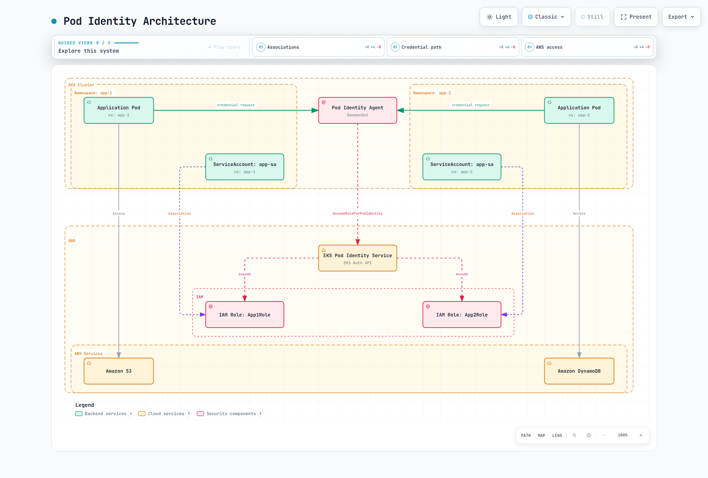
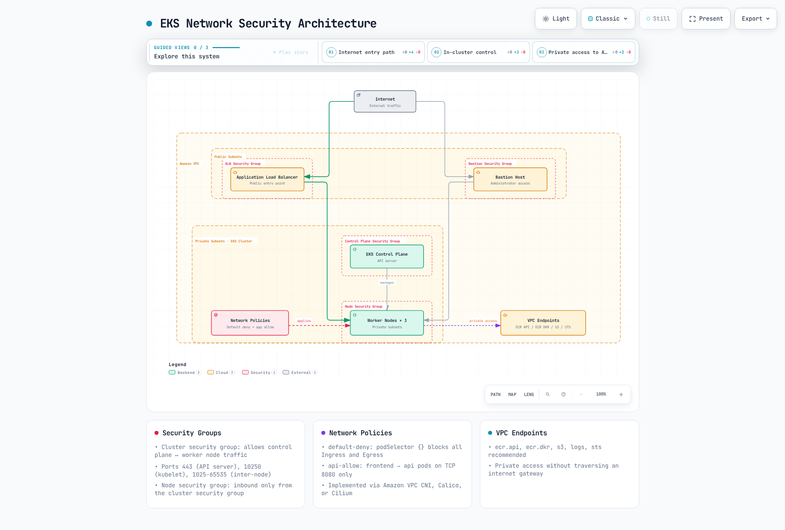
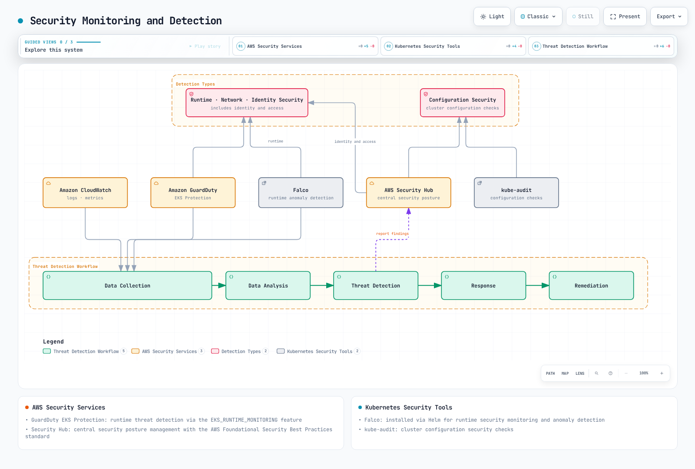

# Amazon EKS のセキュリティ

> **サポート対象バージョン**: EKS 標準サポート 1.34–1.37、延長サポート 1.31–1.33（2026年10月12日確認）
> **最終更新日**: 2026年10月16日

Amazon EKS（Elastic Kubernetes Service）でワークロードを安全に実行するには、さまざまなセキュリティレイヤーとベストプラクティスを理解し、実装する必要があります。このドキュメントでは、EKS クラスターのセキュリティを強化するための主要な概念、コンポーネント、ベストプラクティスについて説明します。

## 目次

1. [EKS セキュリティの概要](#eks-security-overview)
2. [セキュリティ対策](#security-practices)
3. [IAM と認証](#iam-and-authentication)
4. [OIDC プロバイダーの詳細](#oidc-provider-deep-dive)
5. [EKS Pod Identity](#eks-pod-identity)
6. [クラスターエンドポイントのアクセス制御](#cluster-endpoint-access-control)
7. [ネットワークセキュリティ](#network-security)
8. [Pod のセキュリティ](#pod-security)
9. [Bottlerocket と読み取り専用 OS](#bottlerocket-and-read-only-os)
10. [IAM 権限境界](#iam-permission-boundaries)
11. [暗号化とシークレット管理](#encryption-and-secrets-management)
12. [コンプライアンスと監査](#compliance-and-auditing)
13. [セキュリティの監視と検出](#security-monitoring-and-detection)
14. [EKS セキュリティのベストプラクティス](#eks-security-best-practices)
15. [金融サービスにおける EKS セキュリティの考慮事項](#eks-security-considerations-for-financial-services)

## EKS セキュリティの概要 {#eks-security-overview}

インフラストラクチャ、クラスターアクセス、ワークロードの制御を分けて考えます。コントロールプレーンは AWS が管理します。ノード／OS の管理責任は、EC2 のセルフマネージドノードまたはマネージドノード、Fargate、Auto Mode、Hybrid Nodes のいずれを使うかによって異なります。アプリケーションイメージ、ID、データの取り扱い、ワークロードポリシーについては、引き続きお客様が責任を負います。標準的な EC2 ノードの図があるからといって、お客様が Auto Mode／Fargate のホスト OS にパッチを適用する必要があるという意味ではありません。


[🔍 インタラクティブな図を表示](https://www.atomai.click/kubernetes-docs/archmaps/en-eks-05-eks-security-0.html)

## セキュリティ対策 {#security-practices}

スコープを明確にした複数の制御を組み合わせてください。単一のツールだけでゼロトラストが確立されたり、ワークロードの安全性が証明されたりすることはありません。呼び出し元／ワークロードの ID を検証し、意図した操作を認可し、ネットワーク経路を制限するとともに、脅威モデルに適した証跡を収集してください。

<!-- Diagram repair pending: network policies filter traffic; posture findings are not continuous request authentication or complete zero-trust enforcement.


[🔍 View interactive diagram](https://www.atomai.click/kubernetes-docs/archmaps/en-eks-05-eks-security-1.html)
-->

### ID とネットワークの制御

IRSA と Pod Identity はワークロードに AWS 認証情報を提供します。NetworkPolicy はサポート対象のネットワークフィルタリングを行い、アドミッションエンジンは設定された Kubernetes リクエストを検査します。互換性のある、保守されているサービスメッシュを使えば、mTLS やアプリケーショントラフィックポリシーを追加できます。AWS App Mesh は2026年9月30日にサポート終了となるため、既存のデプロイには、新たな標準的推奨として導入するのではなく、移行計画が必要です。

### サプライチェーンのセキュリティ

SLSA などのレビュー済みビルド／来歴管理プロセスを使用し、SBOM でコンポーネントを一覧化し、関連する脆弱性をスキャンし、意図した署名者の ID に対してアーティファクトの署名を検証してください。Syft は SBOM ツール、Grype は脆弱性スキャナーです。ECR/Inspector などのスキャナーには、それぞれ対象範囲と更新要件があります。イメージに署名が付いていることやスキャン済みであることは、そのコードが無害である証明にはなりません。ビルド ID、リポジトリ、アドミッション設定も保護してください。

現在の ECR は、AWS Signer によるマネージドイメージ署名と、Notation による手動署名の両方をサポートしています。署名とアドミッション時の検証は別の手順です。レジストリフィルター、署名プロファイルの権限、検証ツールの信頼設定を、意図したパイプラインに合わせる必要があります。

### ランタイム検出とポリシー・アズ・コード

GuardDuty EKS Protection は、独立した EKS 監査ログストリームを分析します。Runtime Monitoring は別のエージェントベースの機能です。現在のサポート対象には、プラットフォーム／エージェント要件を満たす EKS on EC2 と Auto Mode が含まれますが、EKS Fargate と Hybrid Nodes は対象外です。CloudWatch への監査ログ配信は別途設定します。Security Hub CSPM は設定済みの制御を評価し、Security Hub は検出結果を関連付けることができます。どちらも、アプリケーションの認可や、すべての規制要件の評価に代わるものではありません。

Falco、Gatekeeper、Kyverno など、必要なカーネル、コントローラー、API、メタデータ連携に対応したランタイムツールやポリシーエンジンを使用してください。gVisor/Kata などの追加のサンドボックスランタイムには、互換性のあるノード／ランタイム設計が必要であり、すべての EKS コンピューティング経路で利用できるわけではありません。ポリシー、イメージ、OS の強化によって特定のリスクは軽減できますが、あらゆるエスケープや悪意ある動作が不可能になる保証はありません。

ポリシー・アズ・コードのツールも、それぞれ異なる段階で動作します。Gatekeeper/Kyverno は Kubernetes のアドミッションを評価でき、CloudFormation Guard や Sentinel はインフラストラクチャの変更を評価でき、AWS Config はサポート対象のデプロイ済みリソース設定を評価します。Detective などの調査ツールは、設定済みのデータソースに依存します。これらの役割をランタイム防止と混同しないでください。

## IAM と認証 {#iam-and-authentication}

| ID／制御 | 目的 |
|---|---|
| 人間／自動化の IAM プリンシパル | 設定された IAM マッピング／アクセスエントリ経路を通じてクラスターアクセスを認証する |
| Kubernetes RBAC と EKS アクセスポリシー | Kubernetes 操作を認可する。許可は加算される |
| 外部 OIDC ID プロバイダー | クライアント／クレーム設定を用いて Kubernetes API ユーザーログインを別途構成する |
| EKS クラスター IAM ロール | EKS サービスがクラスターのために AWS API を呼び出せるようにする |
| EC2 ノード IAM ロール | ブートストラップと、ノードエージェントに必要な AWS 操作をサポートする |
| IRSA または EKS Pod Identity ロール | アプリケーションに一時的な AWS 認証情報を提供する |
| Kubernetes ServiceAccount トークン | RBAC 権限の範囲内で、Pod を Kubernetes API に対して認証する |

IRSA で使われる IAM OIDC プロバイダーは、Kubernetes ユーザーログイン用に関連付ける外部 OIDC プロバイダーとは別のものです。アプリケーションの AWS 権限によって、Kubernetes API 権限が自動的に付与されることはありません。

<!-- Diagram repair pending: IRSA/Pod Identity give workload AWS credentials; the ordinary Pod-to-Kubernetes API path uses its Kubernetes ServiceAccount token/RBAC.


[🔍 View interactive diagram](https://www.atomai.click/kubernetes-docs/archmaps/en-eks-05-eks-security-2.html)
-->

### クラスターロールとプロビジョニング呼び出し元

標準的な EKS クラスターロールは、EKS サービスを信頼します。これはその信頼関係であり、人間の開発者に適用される権限ポリシーではありません。

```json
{
  "Version": "2012-10-17",
  "Statement": [
    {
      "Effect": "Allow",
      "Principal": {
        "Service": "eks.amazonaws.com"
      },
      "Action": "sts:AssumeRole"
    }
  ]
}
```

このロールには、サービス操作のために AmazonEKSClusterPolicy、またはサポート対象のカスタムポリシーが必要です。Auto Mode には追加のロール／ポリシー要件があります。プロビジョニング呼び出し元には、選択した設定に必要なアクションと、意図したロールを渡す権限が別途必要です。現在の認可リファレンスでは、CreateCluster はリソース ARN によるスコープ設定に対応していないため、ここではサポート対象のリクエスト条件を使用してください。リソース ARN によるスコープ設定が可能なアクションや PassRole は、スコープを限定してください。開発者ロールに AmazonEKSClusterPolicy をアタッチしても、Kubernetes アプリケーションへのアクセス権は付与されません。

### アクセスエントリと Namespace の認可

IAM によるクラスターアクセスには、サポート対象のアクセスエントリ API を優先してください。現在のモードを確認し、移行前に既存の管理者／ノードマッピングを保持してください。CONFIG_MAP から API_AND_CONFIG_MAP/API への変更は、自由に元へ戻せる切り替えではありません。ノードロールを省いた短いサンプルで aws-auth を上書きしないでください。API のみのモードを選ぶ前に、すべての ID、ポリシー、ノード、復旧経路を確認してください。

```bash
set -euo pipefail
: "${CLUSTER_NAME:?Set the existing cluster name}"
: "${AWS_REGION:?Set its Region}"
aws eks describe-cluster --name "$CLUSTER_NAME" --region "$AWS_REGION" \
  --query 'cluster.{Name:name,Status:status,Endpoint:endpoint,Access:accessConfig}' --output json
```

次の例では、準備済みで承認された IAM 開発者ロール、アクセスエントリをすでにサポートするクラスター、プラットフォーム運用者の権限を前提としています。専用 Namespace は、その所有者を通じて準備してください。Pod Security Admission のバージョンは、レビュー済みの EKS 1.36 の例に合わせています。対象クラスターに適したバージョンを選択してください。

```yaml
apiVersion: v1
kind: Namespace
metadata:
  name: security-demo
  labels:
    pod-security.kubernetes.io/enforce: restricted
    pod-security.kubernetes.io/enforce-version: v1.36
```


```bash
set -euo pipefail
: "${CLUSTER_NAME:?Set the verified cluster name}"
: "${AWS_REGION:?Set its Region}"
: "${DEVELOPER_ROLE_ARN:?Set a prepared IAM role ARN, not an STS session ARN}"
MODE=$(aws eks describe-cluster --name "$CLUSTER_NAME" --region "$AWS_REGION" \
  --query cluster.accessConfig.authenticationMode --output text)
case "$MODE" in
  API|API_AND_CONFIG_MAP) ;;
  *) echo "Access entries are not enabled; review the migration first"; exit 1 ;;
esac
aws eks list-access-entries --cluster-name "$CLUSTER_NAME" --region "$AWS_REGION" \
  --output json > security-access-entries.json
python3 - "$DEVELOPER_ROLE_ARN" <<'PY'
import json, sys
with open("security-access-entries.json") as stream:
    existing = json.load(stream)["accessEntries"]
if sys.argv[1] in existing:
    raise SystemExit("Entry already exists; inspect its groups/policies instead of overwriting")
PY
aws eks create-access-entry --cluster-name "$CLUSTER_NAME" --region "$AWS_REGION" \
  --principal-arn "$DEVELOPER_ROLE_ARN" --type STANDARD \
  --kubernetes-groups security-demo-developers
```


```yaml
apiVersion: rbac.authorization.k8s.io/v1
kind: Role
metadata:
  name: developer
  namespace: security-demo
rules:
- apiGroups:
  - ''
  resources:
  - pods
  verbs:
  - get
  - list
  - watch
- apiGroups:
  - apps
  resources:
  - deployments
  verbs:
  - get
  - list
  - watch
  - create
  - update
  - patch
- apiGroups:
  - batch
  resources:
  - jobs
  verbs:
  - get
  - list
  - watch
  - create
  - update
  - patch
---
apiVersion: rbac.authorization.k8s.io/v1
kind: RoleBinding
metadata:
  name: developer
  namespace: security-demo
subjects:
- kind: Group
  name: security-demo-developers
  apiGroup: rbac.authorization.k8s.io
roleRef:
  kind: Role
  name: developer
  apiGroup: rbac.authorization.k8s.io
```

このエントリは IAM プリンシパルをグループにマッピングし、RoleBinding がそのグループに表示された Namespace 権限を付与します。グループ名だけでは Namespace の境界は確立されません。ワークロードコントローラーを作成する権限があれば、その Namespace 内の ServiceAccount、Secret、PVC を使う Pod を作成できる場合があります。テナントを分離し、適切なアドミッション制御と所有権管理を通じて、ワークロード／ServiceAccount の利用を制限してください。

別途レビュー済みの閲覧者エントリには、カスタム RBAC の代わりに EKS アクセスポリシーを使用できます。この Namespace の閲覧許可を追加する前に、エントリの現在のグループと関連付けられたポリシーを確認してください。

```bash
set -euo pipefail
: "${CLUSTER_NAME:?Set the verified cluster name}"
: "${AWS_REGION:?Set its Region}"
: "${VIEWER_ROLE_ARN:?Set the IAM principal of a prepared, reviewed access entry}"
aws eks list-associated-access-policies --cluster-name "$CLUSTER_NAME" --region "$AWS_REGION" \
  --principal-arn "$VIEWER_ROLE_ARN"
aws eks associate-access-policy --cluster-name "$CLUSTER_NAME" --region "$AWS_REGION" \
  --principal-arn "$VIEWER_ROLE_ARN" \
  --policy-arn arn:aws:eks::aws:cluster-access-policy/AmazonEKSViewPolicy \
  --access-scope type=namespace,namespaces=security-demo
```

View を追加しても、より広範な RBAC／アクセスポリシーの許可は取り消されません。更新の反映には時間がかかる場合があります。実際に意図した IAM ログインを使ってテストしてください。kubectl --as は Kubernetes の偽装／RBAC をテストするものであり、IAM アクセスポリシー経路を証明するものではありません。kubeconfig はクライアントにクラスターと認証情報の仕組みを指定するもので、単体では権限を付与しません。

IAM の eks:DescribeCluster/ListClusters は AWS の管理／検出操作をサポートします。eks:AccessKubernetesApi はコンソールでの表示権限です。eks:namespaces 条件はアクセスポリシー関連付けリクエストをフィルタリングするもので、kubectl API 呼び出し全般に適用される Namespace フィルターではありません。

## OIDC プロバイダーの詳細 {#oidc-provider-deep-dive}

EKS はクラスター OIDC 発行者と公開署名鍵を公開します。そのエンドポイントだけでは、IAM OIDC プロバイダーが作成されたり、ロールの引き受けが認可されたりすることはありません。IRSA を使用するには、ロールを持つアカウントに意図した IAM OIDC プロバイダーが存在し、ロールが正しい発行者／subject／audience 条件を使ってそのプロバイダーを信頼し、ワークロードが互換性のある SDK を使う必要があります。


[🔍 インタラクティブな図を表示](https://www.atomai.click/kubernetes-docs/archmaps/en-eks-05-eks-security-3.html)

### IRSA トークンとロールの交換

IRSA Webhook は、対象となる Pod に投影トークンとロール設定を追加します。SDK は AssumeRoleWithWebIdentity を使い、Web ID トークンを STS と交換します。STS は発行者、署名、トークン、ロールの信頼関係を検証し、一時的な AWS 認証情報を返します。アプリケーションは、その認証情報を使って許可された AWS 操作を実行します。Kubernetes は投影トークンをローテーションし、SDK は AWS 認証情報を更新します。これらの有効期間は異なります。

以下は、意図的に古い／期限切れのタイムスタンプとプレースホルダー ID を使用した、説明用の**デコード済みペイロードの形式**です。署名済みトークンでも、認証テストでもありません。STS の audience は IRSA 経路用です。Pod Identity では別の audience を使います。

```json
{
  "aud": [
    "sts.amazonaws.com"
  ],
  "exp": 1234567890,
  "iat": 1234567800,
  "iss": "https://oidc.eks.us-west-2.amazonaws.com/id/REPLACE_WITH_CLUSTER_ISSUER_ID",
  "kubernetes.io": {
    "namespace": "security-demo",
    "pod": {
      "name": "irsa-read-check-example",
      "uid": "example-pod-uid"
    },
    "serviceaccount": {
      "name": "irsa-reader",
      "uid": "example-serviceaccount-uid"
    }
  },
  "sub": "system:serviceaccount:security-demo:irsa-reader"
}
```

JSON をデコードできるかどうかだけでなく、発行者、audience、有効期限、想定される subject を検証してください。生のトークン、AWS シークレットアクセスキー、セッショントークンを例やログに含めないでください。ロールは、明示的に許可された複数の ServiceAccount や発行者を信頼できます。IRSA では ServiceAccount ごとにロールを1つだけ用意する必要はありません。

### Discovery と JWKS の検査

実際のクラスターから返された発行者を使用してください。この診断コマンドは公開されている discovery／JWKS ドキュメントを取得し、discovery の発行者と HTTPS スキームを検査します。ワークロードトークンや IAM 権限は検証しません。

```bash
set -euo pipefail
: "${CLUSTER_NAME:?Set the verified cluster}"
: "${AWS_REGION:?Set its Region}"
OIDC_URL=$(aws eks describe-cluster --name "$CLUSTER_NAME" --region "$AWS_REGION" \
  --query cluster.identity.oidc.issuer --output text)
case "$OIDC_URL" in https://*) ;; *) echo "Unexpected issuer URL"; exit 1 ;; esac
curl --fail --silent --show-error --proto '=https' --connect-timeout 5 --max-time 20 \
  "${OIDC_URL%/}/.well-known/openid-configuration" > oidc-discovery.json
JWKS_URI=$(python3 - "$OIDC_URL" <<'PY'
import json, sys, urllib.parse
with open("oidc-discovery.json") as stream:
    doc = json.load(stream)
if doc["issuer"] != sys.argv[1]:
    raise SystemExit("Discovery issuer does not match the cluster issuer")
uri = doc["jwks_uri"]
parsed = urllib.parse.urlparse(uri)
if parsed.scheme != "https" or not parsed.hostname or parsed.username or parsed.password:
    raise SystemExit("JWKS must be an HTTPS URL without embedded credentials")
print(uri)
PY
)
curl --fail --silent --show-error --proto '=https' --connect-timeout 5 --max-time 20 \
  "$JWKS_URI" > oidc-jwks.json
python3 - <<'PY'
import json
with open("oidc-jwks.json") as stream:
    keys = json.load(stream).get("keys")
if not isinstance(keys, list) or not keys or not all(isinstance(k, dict) and "kty" in k for k in keys):
    raise SystemExit("Unexpected JWKS response")
print("Fetched", len(keys), "public keys; no token signature was validated")
PY
```

自動検証ツールは Cache-Control に従って鍵をキャッシュし、レビュー済み JWT ライブラリを使って署名鍵のローテーションや不明な kid に対処する必要があります。EKS は OIDC 署名鍵を7日ごとにローテーションします。現在の EKS は、インターネットへの送信経路を持たない検証ツール向けに、クラスター OIDC discovery／JWKS 用の PrivateLink インターフェイスエンドポイント `com.amazonaws.region-code.oidc-eks` もサポートしています。そのエンドポイントのリージョン／DNS 要件を確認してください。EKS 管理 API エンドポイントは別のサービスです。

### スコープを限定した IRSA の例

IAM OIDC プロバイダー、ロール、バケットは、それぞれの所有者を通じて準備してください。アカウント、完全な発行者ホスト名／パス、ロール ARN を一貫して置き換えてください。IPv6 クラスターではデュアルスタックの発行者ホスト名を使用する場合があります。この例では security-demo/irsa-reader と STS audience だけを関連付けます。既存ロールのほかの信頼ステートメントを置き換えるものではなく、新規ロールの信頼設定例です。

```json
{
  "Version": "2012-10-17",
  "Statement": [
    {
      "Effect": "Allow",
      "Principal": {
        "Federated": "arn:aws:iam::111122223333:oidc-provider/oidc.eks.us-west-2.amazonaws.com/id/REPLACE_WITH_CLUSTER_ISSUER_ID"
      },
      "Action": "sts:AssumeRoleWithWebIdentity",
      "Condition": {
        "StringEquals": {
          "oidc.eks.us-west-2.amazonaws.com/id/REPLACE_WITH_CLUSTER_ISSUER_ID:sub": "system:serviceaccount:security-demo:irsa-reader",
          "oidc.eks.us-west-2.amazonaws.com/id/REPLACE_WITH_CLUSTER_ISSUER_ID:aud": "sts.amazonaws.com"
        }
      }
    }
  ]
}
```

読み取りポリシーは特定のバケットプレフィックスを許可します。オブジェクトがカスタマー管理の暗号化キーを使う場合は、必要な KMS 権限だけを追加し、バケット／エンドポイントポリシーも確認してください。この1つのプレフィックスの例に、アカウント全体を対象とする AmazonS3ReadOnlyAccess ポリシーは必要ありません。

```json
{
  "Version": "2012-10-17",
  "Statement": [
    {
      "Effect": "Allow",
      "Action": [
        "s3:ListBucket"
      ],
      "Resource": "arn:aws:s3:::replace-with-owned-security-bucket",
      "Condition": {
        "StringLike": {
          "s3:prefix": [
            "security-demo/",
            "security-demo/*"
          ]
        }
      }
    },
    {
      "Effect": "Allow",
      "Action": [
        "s3:GetObject"
      ],
      "Resource": "arn:aws:s3:::replace-with-owned-security-bucket/security-demo/*"
    }
  ]
}
```

security-demo Namespace とロールを準備した後、次の ServiceAccount と範囲を限定した list Job を作成します。公式 AWS CLI イメージにはクライアントが含まれていますが、任意の amazonlinux:2 イメージに含まれるとは限りません。バケット／リージョン／ロールの値を置き換えてください。この Job はプレフィックスを一覧表示しますが、シークレットの値は出力しません。この操作が成功しても、すべてのアプリケーションの GetObject/KMS 権限が証明されるわけではありません。

```yaml
apiVersion: v1
kind: ServiceAccount
metadata:
  name: irsa-reader
  namespace: security-demo
  annotations:
    eks.amazonaws.com/role-arn: arn:aws:iam::111122223333:role/SecurityDemoIRSAReader
---
apiVersion: batch/v1
kind: Job
metadata:
  name: irsa-read-check
  namespace: security-demo
spec:
  backoffLimit: 0
  activeDeadlineSeconds: 120
  template:
    spec:
      serviceAccountName: irsa-reader
      restartPolicy: Never
      securityContext:
        runAsNonRoot: true
        runAsUser: 1000
        runAsGroup: 1000
        fsGroup: 1000
        seccompProfile:
          type: RuntimeDefault
      containers:
      - name: reader
        image: public.ecr.aws/aws-cli/aws-cli:2.36.43
        command:
        - aws
        args:
        - s3api
        - list-objects-v2
        - --bucket
        - replace-with-owned-security-bucket
        - --prefix
        - security-demo/
        - --max-items
        - '5'
        env:
        - name: AWS_REGION
          value: us-west-2
        - name: AWS_EC2_METADATA_DISABLED
          value: 'true'
        securityContext:
          allowPrivilegeEscalation: false
          readOnlyRootFilesystem: true
          capabilities:
            drop:
            - ALL
        resources:
          requests:
            cpu: 100m
            memory: 128Mi
          limits:
            cpu: 500m
            memory: 256Mi
        volumeMounts:
        - name: private-home
          mountPath: /root
        - name: tmp
          mountPath: /tmp
      volumes:
      - name: private-home
        emptyDir: {}
      - name: tmp
        emptyDir: {}
      nodeSelector:
        kubernetes.io/os: linux
```

## EKS Pod Identity

EKS Pod Identity は、SDK のコンテナ認証情報プロバイダーと EKS Auth を通じて一時的な AWS 認証情報を提供します。Pod Identity association は、クラスター／Namespace／ServiceAccount と IAM ロールの対応付けです。ServiceAccount を作成するものでも、Kubernetes RBAC 権限を付与するものでもありません。

### IRSA との比較

| 特性 | IRSA | EKS Pod Identity |
|---|---|---|
| 信頼関係 | IAM OIDC プロバイダーと発行者／subject／audience の信頼設定 | pods.eks.amazonaws.com に対するロールの信頼設定と association |
| ロールの再利用 | IAM ポリシーの制限内で、複数の許可対象 subject／発行者を設定可能 | 適切な association／信頼条件があれば再利用可能 |
| 組み込み Kubernetes セッションタグ | 標準の EKS IRSA 経路では自動的に付与されない | デフォルトで有効。意図的に無効化することも可能 |
| 認証情報プロバイダー | Web ID を使って STS と交換 | EKS Auth を利用するコンテナ認証情報エンドポイント |
| クロスアカウント | ロールを持つアカウントでの直接 OIDC 信頼、またはロールチェーン | 同一アカウントの association ロールと、必要に応じた対象ロールへのチェーン |
| 更新 | Kubernetes がトークンをローテーションし、SDK が AWS 認証情報を更新 | Kubernetes が投影トークンをローテーションし、エージェント／サービスのキャッシュと SDK が AWS 認証情報を処理 |

セッションタグは引き受けたロールのセッションを示すものであり、アプリケーションが作成するすべての AWS リソースに自動的にタグ付けするものではありません。設定が簡単でも、IAM、ネットワーク、SDK、アプリケーションの検証要件がなくなるわけではありません。

### エージェントと認証情報の流れ

<!-- Diagram repair pending: SDK calls container credential endpoint; agent calls EKS Auth AssumeRoleForPodIdentity, not STS directly or arbitrary request interception.


[🔍 View interactive diagram](https://www.atomai.click/kubernetes-docs/archmaps/en-eks-05-eks-security-4.html)
-->

association が設定された新規 Pod に対し、EKS は audience が pods.eks.amazonaws.com のトークン、トークンファイルを示す環境変数、コンテナ認証情報 URI を注入します。SDK は通常 169.254.170.23/v1/credentials にあるエージェントのエンドポイントを呼び出します。エージェントは **EKS Auth の AssumeRoleForPodIdentity** を呼び出し、返された認証情報を SDK が利用できるようにします。すべてのアプリケーションリクエストを透過的に傍受するものではありません。アプリケーションは引き続き、その認証情報を使って AWS サービスを直接呼び出します。

標準的なサポート対象 EC2 ノードでは、Pod Identity Agent アドオン／DaemonSet を使用します。Auto Mode では、マネージドノードの一部としてこの機能が提供されます。Hybrid Nodes では、ドキュメントに記載された OS、エージェント、ノード認証情報の設定でサポートされています。標準的な EC2 エージェント設定をそのまま流用しないでください。EKS Fargate は、この Pod Identity エージェント経路をサポートしていません。実際のコンピューティング環境のサポート状況と、ノードの EKS Auth 権限／ネットワークアクセスを確認してください。

### 準備済みロールと association

標準のマネージドエージェントをインストールする場合は、所有者を通じて実際のクラスターのバージョンと互換性のあるアドオンカタログを確認してください。古い v1.0.0 ビルドをハードコードしたり、Auto Mode や別の所有者が管理する環境に重複するエージェントをインストールしたりしないでください。

```bash
set -euo pipefail
: "${CLUSTER_NAME:?Set the existing cluster}"
: "${AWS_REGION:?Set its Region}"
EKS_VERSION=$(aws eks describe-cluster --name "$CLUSTER_NAME" --region "$AWS_REGION" \
  --query cluster.version --output text)
aws eks describe-addon-versions --addon-name eks-pod-identity-agent \
  --kubernetes-version "$EKS_VERSION" --region "$AWS_REGION" --output json
```

前述のスコープを限定した S3 読み取りポリシーと、次の信頼関係を使用して、同一アカウント内の IAM ロールを準備してください。アカウント／クラスターの値はまとめて置き換えてください。この例はデフォルトのセッションタグに依存します。タグを無効にする場合は、これらの条件を再確認してください。呼び出し元には、適切な association 権限と、意図したロールに対する iam:PassRole が必要です。

```json
{
  "Version": "2012-10-17",
  "Statement": [
    {
      "Effect": "Allow",
      "Principal": {
        "Service": "pods.eks.amazonaws.com"
      },
      "Action": [
        "sts:AssumeRole",
        "sts:TagSession"
      ],
      "Condition": {
        "StringEquals": {
          "aws:RequestTag/eks-cluster-arn": "arn:aws:eks:us-west-2:111122223333:cluster/my-cluster",
          "aws:RequestTag/kubernetes-namespace": "security-demo",
          "aws:RequestTag/kubernetes-service-account": "podid-reader"
        }
      }
    }
  ]
}
```

次の新規 association の例は、既存の association を上書きしないようにします。IAM ロールの作成、エージェントのインストール、Kubernetes アカウントの作成は行いません。

```bash
set -euo pipefail
: "${CLUSTER_NAME:?Set the verified cluster}"
: "${AWS_REGION:?Set its Region}"
: "${POD_ID_ROLE_ARN:?Set the prepared same-account role matching the trust example}"
aws eks list-pod-identity-associations --cluster-name "$CLUSTER_NAME" --region "$AWS_REGION" \
  --namespace security-demo --service-account podid-reader --output json > podid-associations-before.json
python3 - <<'PY'
import json
with open("podid-associations-before.json") as stream:
    existing = json.load(stream)["associations"]
if existing:
    raise SystemExit("Association exists; review its owner/configuration before changing it")
PY
aws eks create-pod-identity-association --cluster-name "$CLUSTER_NAME" --region "$AWS_REGION" \
  --namespace security-demo --service-account podid-reader --role-arn "$POD_ID_ROLE_ARN"
```

association が反映された後、ServiceAccount と、新しい範囲を限定したテスト Job を作成してください。IAM ロールの信頼設定、Namespace、アカウント名、バケットプレフィックスは一致している必要があります。association 作成前に作成された Pod には、注入された設定を受け取るために再作成が必要な場合があります。実際に選択されたプロバイダーと代表的な権限を確認してください。認証情報／トークンのファイルを出力しないでください。

```yaml
apiVersion: v1
kind: ServiceAccount
metadata:
  name: podid-reader
  namespace: security-demo
---
apiVersion: batch/v1
kind: Job
metadata:
  name: podid-read-check
  namespace: security-demo
spec:
  backoffLimit: 0
  activeDeadlineSeconds: 120
  template:
    spec:
      serviceAccountName: podid-reader
      restartPolicy: Never
      securityContext:
        runAsNonRoot: true
        runAsUser: 1000
        runAsGroup: 1000
        fsGroup: 1000
        seccompProfile:
          type: RuntimeDefault
      containers:
      - name: reader
        image: public.ecr.aws/aws-cli/aws-cli:2.36.43
        command:
        - aws
        args:
        - s3api
        - list-objects-v2
        - --bucket
        - replace-with-owned-security-bucket
        - --prefix
        - security-demo/
        - --max-items
        - '5'
        env:
        - name: AWS_REGION
          value: us-west-2
        - name: AWS_EC2_METADATA_DISABLED
          value: 'true'
        securityContext:
          allowPrivilegeEscalation: false
          readOnlyRootFilesystem: true
          capabilities:
            drop:
            - ALL
        resources:
          requests:
            cpu: 100m
            memory: 128Mi
          limits:
            cpu: 500m
            memory: 256Mi
        volumeMounts:
        - name: private-home
          mountPath: /root
        - name: tmp
          mountPath: /tmp
      volumes:
      - name: private-home
        emptyDir: {}
      - name: tmp
        emptyDir: {}
      nodeSelector:
        kubernetes.io/os: linux
```




[🔍 インタラクティブな図を表示](https://www.atomai.click/kubernetes-docs/archmaps/en-eks-05-eks-security-5.html)

### クロスアカウントとキャッシュに関する考慮事項

association ロールは EKS クラスターと同じアカウントに置く必要があります。任意で別アカウントに置いた IAM ロールを対象ロールとして使用できます。Pod Identity は同一アカウントのロールから対象ロールへチェーンするため、両方の信頼関係と AssumeRole 権限を設定する必要があります。別アカウントのロールを association ロールとして直接アタッチできるという意味ではありません。

現在の対象ロールガイドによると、対象ロールを使わない場合は6時間、対象ロールを使う場合は59分、キャッシュされた認証情報が有効です。association を変更してもキャッシュはリセットされません。Pod を再作成すると、新しい設定をより早く取得できる場合があります。実際のアプリケーションで更新／失効の動作を確認してください。新しい association のセッションポリシーオプションを使用するには、セッションタグを無効にする必要があります。対象ロールを設定した場合は、そのロールを制約します。タグを要求する信頼条件と、未レビューのまま併用しないでください。

### IRSA から Pod Identity への移行手順

移行を準備する前に、既存の IRSA 信頼設定と ServiceAccount の設定を保存してください。ロールの信頼設定を Pod Identity サービスプリンシパルだけに置き換えると、認証情報の更新時に既存の利用者が動作しなくなる可能性があります。次のコマンドは設定を記録するだけです。

```bash
set -euo pipefail
: "${IRSA_ROLE_NAME:?Set the existing role whose trust must be preserved}"
: "${WORKLOAD_NAMESPACE:?Set the workload namespace}"
: "${SERVICE_ACCOUNT:?Set the existing application ServiceAccount}"
aws iam get-role --role-name "$IRSA_ROLE_NAME" \
  --query Role.AssumeRolePolicyDocument --output json > irsa-trust-before.json
kubectl -n "$WORKLOAD_NAMESPACE" get serviceaccount "$SERVICE_ACCOUNT" \
  -o yaml > irsa-serviceaccount-before.yaml
```

1. 実際のコンピューティング環境がサポート対象であること、互換性のある SDK／コンテナ認証情報プロバイダー、Pod Identity Agent または組み込み機能、準備済み IAM ロールの権限を確認します。
2. 所有者を通じてレビュー済みの Pod Identity 信頼ステートメントを既存の信頼ポリシーに統合します。すべての利用者を移行するまで、IRSA の発行者、subject、audience 条件と、この移行と無関係な有効なステートメントを保持します。
3. スコープを限定した association と、意図した Pod Identity 認証情報経路だけを使う別の ServiceAccount によるカナリアを作成します。この検証を終える前に、本番 IRSA アノテーションを削除したり、本番 Deployment を再起動したりしないでください。
4. 実際に使われている認証情報プロバイダーと、意図した AWS アクセスを、トークンやシークレット値を出力せずに確認します。association 作成後も、SDK の認証情報チェーン内の先行する認証情報が引き続き使われることがあります。同じ IAM ロールを示す get-caller-identity の成功だけでは、IRSA と Pod Identity を区別できません。
5. 制御されたロールアウトを通じて対象ワークロードを移行し、注入された設定が必要な場合は Pod を再作成し、アプリケーションの動作と更新を確認します。ServiceAccount のアノテーションを変更しても、既存 Pod の環境変数は書き換わりません。
6. ワークロード設定を元に戻すための、検証済みの経路を維持します。残っている利用者をすべて洗い出し、移行完了を確認した後にのみ、古い IRSA 信頼設定を削除します。

これは移行手順を対象環境で検証するためのものであり、このドキュメントのレビュー中に移行を実行したという主張ではありません。

## クラスターエンドポイントのアクセス制御 {#cluster-endpoint-access-control}

エンドポイントの設定はネットワーク到達性を決めますが、API 操作には引き続き認証と認可が必要です。運用要件に基づいてアクセス経路を選び、ツールのデフォルト値を前提とせず、実際の設定を確認してください。

| パブリック | プライベート | ネットワーク動作 |
|---|---|---|
| 有効 | 無効 | クライアントとノードはパブリックアドレスへの経路を必要とする。制限付き CIDR には、実際のパブリック送信元アドレスを含める必要がある |
| 無効 | 有効 | 承認済みの接続ネットワークを含め、VPC／プライベート経路、DNS、セキュリティグループのルールを通じたアクセスが必要 |
| 有効 | 有効 | クラスター VPC 内からのリクエストはプライベート経路を使い、許可された外部クライアントはパブリックアクセスを利用できる |

パブリックアドレスが設定されていても、EC2 から EKS へのトラフィックが AWS ネットワークの外に出るとは限りません。プライベートアクセスを有効にしても、呼び出し元が自動的に認可されたり、VPN／DNS が設定されたり、復旧経路が用意されたりするわけではありません。EKS では、少なくとも1つのアクセスモードが必要です。

### 既存設定の確認と保持

関連するブロックを同じシェルで実行し、新しいレビュー用ディレクトリを保持してください。エンドポイント設定を確認／復旧できる AWS 管理 ID を使用し、Kubernetes のログインとは分けてください。これは、以下で説明する一方向の egress モードや、無関係な VPC 設定を復元するものではなく、変更可能なエンドポイントアクセス項目だけを復旧用に記録します。

```bash
set -euo pipefail
umask 077
: "${CLUSTER_NAME:?Set the existing cluster name}"
: "${AWS_REGION:?Set its Region}"
ENDPOINT_REVIEW_DIR=$(mktemp -d -t eks-endpoint-review.XXXXXX)
printf 'Review records: %s\n' "$ENDPOINT_REVIEW_DIR"
aws eks describe-cluster --name "$CLUSTER_NAME" --region "$AWS_REGION" \
  --query cluster --output json > "$ENDPOINT_REVIEW_DIR/cluster-before.json"
python3 - "$ENDPOINT_REVIEW_DIR" "$CLUSTER_NAME" <<'PY'
import json, pathlib, sys, urllib.parse
root = pathlib.Path(sys.argv[1])
cluster = json.loads((root / "cluster-before.json").read_text())
if cluster["name"] != sys.argv[2] or cluster["status"] != "ACTIVE":
    raise SystemExit("Unexpected cluster or cluster is not ACTIVE")
endpoint = urllib.parse.urlparse(cluster["endpoint"])
if endpoint.scheme != "https" or not endpoint.hostname or endpoint.username or endpoint.password:
    raise SystemExit("Unexpected Kubernetes endpoint")
(root / "endpoint-host.txt").write_text(endpoint.hostname + "\n")
config = cluster["resourcesVpcConfig"]
before = {k: config[k] for k in ["endpointPublicAccess", "endpointPrivateAccess", "publicAccessCidrs"] if k in config}
(root / "endpoint-before.json").write_text(json.dumps(before, indent=2) + "\n")
(root / "endpoint-private.json").write_text(json.dumps({"endpointPublicAccess": False, "endpointPrivateAccess": True}, indent=2) + "\n")
(root / "ssm-remote-host.json").write_text(json.dumps({"host": [endpoint.hostname], "portNumber": ["443"], "localPortNumber": ["6443"]}, indent=2) + "\n")
print(json.dumps(before, indent=2))
PY
```

### パブリックアドレス経路の制限

パブリック許可リストには、承認済みの実際のパブリック NAT／VPN／オフィスの送信元アドレスを含める必要があります。10.0.0.0/8 などのプライベートアドレス帯は、パブリック送信元アドレスを表しません。203.0.113.0/24 などの文書用アドレス帯はプレースホルダーであり、実際のオフィスネットワークとしては使えません。

ネットワーク管理者から提供された JSON 配列を PUBLIC_EGRESS_CIDRS に設定してください。この範囲を限定した例は IPv4 CIDR を受け付け、明らかなプライベート／デフォルト／文書用アドレス帯を拒否しますが、所有者や現在のクライアントが含まれていることを証明するものではありません。スコープ、クォータ、クラスターの IP ファミリー対応を確認してください。デュアルスタック／IPv6 設定には、別途検証済みの許可リストが必要です。

```bash
set -euo pipefail
: "${ENDPOINT_REVIEW_DIR:?Run the inspection step in this shell first}"
: "${PUBLIC_EGRESS_CIDRS:?Set a JSON array of approved actual public IPv4 egress CIDRs}"
python3 - "$ENDPOINT_REVIEW_DIR" "$PUBLIC_EGRESS_CIDRS" <<'PY'
import ipaddress, json, pathlib, sys
values = json.loads(sys.argv[2])
if not isinstance(values, list) or not values:
    raise SystemExit("Provide a nonempty reviewed CIDR list")
cidrs = []
for value in values:
    network = ipaddress.ip_network(value, strict=True)
    if network.version != 4 or network.prefixlen == 0 or not network.is_global or network.is_multicast or network.is_reserved:
        raise SystemExit("This IPv4 example requires actual public egress CIDRs, not private/default/documentation ranges")
    cidrs.append(str(network))
if len(cidrs) != len(set(cidrs)):
    raise SystemExit("Remove duplicate CIDRs")
desired = {"endpointPublicAccess": True, "endpointPrivateAccess": True, "publicAccessCidrs": cidrs}
path = pathlib.Path(sys.argv[1]) / "endpoint-public-restricted.json"
path.write_text(json.dumps(desired, indent=2) + "\n")
print(json.dumps(desired, indent=2))
PY
```

計画されるパブリックアクセス制限設定では、プライベートアクセスも有効になります。プライベートアクセスを有効にしない場合は、ノード／Fargate のパブリック egress アドレスを許可したままにしなければ、ノードから API への通信が失敗する可能性があります。生成された JSON を確認してから、ENDPOINT_CHANGE=public-restricted を選択してください。

### プライベート接続経路


[🔍 インタラクティブな図を表示](https://www.atomai.click/kubernetes-docs/archmaps/en-eks-05-eks-security-6.html)


[🔍 インタラクティブな図を表示](https://www.atomai.click/kubernetes-docs/archmaps/en-eks-05-eks-security-7.html)

VPN、Direct Connect/TGW、承認済み管理ホストは、ルート、DNS、セキュリティグループ、認可が設定されていれば、接続経路として使用できます。Client VPN の作成コマンドを1つ実行するだけでは、サブネットの関連付け、認可ルール、ルート、証明書、接続ログは設定されません。AWS CLI イメージを実行する Deployment も、SSM 管理の踏み台を作成したり、kubectl／SSM Agent をインストールしたりするものではありません。

SSM リモートホスト転送を使用するには、SSM Agent 3.1.1374.0 以降を備え、Session Manager の IAM／ネットワークアクセスとローカルの Session Manager プラグインがあり、EKS プライベートエンドポイントへの DNS／ルーティングが設定されたマネージドホストを準備してください。プライベートエンドポイントアクセスが有効であり、そのホストが実際にプライベート経路を名前解決／到達できることを確認してください。最初のターミナルで転送セッションを実行したままにします。

```bash
set -euo pipefail
: "${AWS_REGION:?Set the cluster/managed-instance Region for this example}"
: "${MANAGED_INSTANCE_ID:?Set the prepared SSM-managed instance with a private route to EKS}"
: "${ENDPOINT_REVIEW_DIR:?Use the endpoint inspection directory}"
aws ssm start-session --region "$AWS_REGION" --target "$MANAGED_INSTANCE_ID" \
  --document-name AWS-StartPortForwardingSessionToRemoteHost \
  --parameters "file://$ENDPOINT_REVIEW_DIR/ssm-remote-host.json"
```

2つ目のターミナルでは、同じクラスターの kubeconfig を使い、CA と意図した IAM exec 認証を保持してください。実際の TLS サーバー名を維持したままローカル接続します。ホスト名の不一致を隠すために、証明書検証を無効にしないでください。

```bash
set -euo pipefail
: "${ENDPOINT_REVIEW_DIR:?Set the same review directory in this second terminal}"
: "${CLUSTER_KUBECONFIG:?Set the kubeconfig for this same EKS cluster and intended IAM identity}"
EKS_ENDPOINT_HOST=$(cat "$ENDPOINT_REVIEW_DIR/endpoint-host.txt")
kubectl --kubeconfig "$CLUSTER_KUBECONFIG" \
  --server https://127.0.0.1:6443 --tls-server-name "$EKS_ENDPOINT_HOST" \
  --request-timeout=10s -n security-demo get pods
```

リモートホスト用のドキュメントは、指定した EKS ホストに転送します。以前からある AWS-StartPortForwardingSession ドキュメントは、マネージドインスタンス自体のポートに転送します。そのポート 443 に転送しても、そのインスタンスが EKS API サーバーになるわけではありません。トンネルやヘルスチェックが成功しても、認可やプライベート経路が検証されたとは限りません。パブリックアクセスを削除する前に、意図した API 操作、DNS／プライベートアドレス、実際のルートを確認してください。

### レビュー済みのエンドポイント変更を適用する

プライベートアクセスを有効にし、意図したプライベートクライアント経路を検証した後、ENDPOINT_CHANGE=private を選ぶ前に、最新の設定を再確認してスナップショットを取得してください。次のコマンドは、別のクラスター／アカウント、変更済みのエンドポイント設定、プライベートアクセスを有効化する前のプライベート専用化を拒否します。読み取り／チェックはアトミックなトランザクションではありません。変更は所有者と調整してください。

```bash
set -euo pipefail
: "${CLUSTER_NAME:?Use the inspected cluster}"
: "${AWS_REGION:?Use its Region}"
: "${ENDPOINT_REVIEW_DIR:?Use the review directory}"
: "${ENDPOINT_CHANGE:?Choose public-restricted or private after validating the intended route}"
case "$ENDPOINT_CHANGE" in
  public-restricted|private) ;;
  *) echo "Unexpected endpoint change"; exit 1 ;;
esac
test -f "$ENDPOINT_REVIEW_DIR/endpoint-$ENDPOINT_CHANGE.json"
aws eks describe-cluster --name "$CLUSTER_NAME" --region "$AWS_REGION" \
  --query cluster --output json > "$ENDPOINT_REVIEW_DIR/cluster-current.json"
python3 - "$ENDPOINT_REVIEW_DIR" "$CLUSTER_NAME" "$ENDPOINT_CHANGE" <<'PY'
import json, pathlib, sys
root = pathlib.Path(sys.argv[1])
before = json.loads((root / "cluster-before.json").read_text())
current = json.loads((root / "cluster-current.json").read_text())
keys = ["endpointPublicAccess", "endpointPrivateAccess", "publicAccessCidrs"]
if current["name"] != sys.argv[2] or current["arn"] != before["arn"] or current["status"] != "ACTIVE":
    raise SystemExit("Cluster identity/state differs from the reviewed target")
if any(current["resourcesVpcConfig"].get(k) != before["resourcesVpcConfig"].get(k) for k in keys):
    raise SystemExit("Endpoint configuration changed; inspect and review again")
if sys.argv[3] == "private" and current["resourcesVpcConfig"].get("endpointPrivateAccess") is not True:
    raise SystemExit("Enable and verify private access before disabling public access")
PY
aws eks update-cluster-config --name "$CLUSTER_NAME" --region "$AWS_REGION" \
  --resources-vpc-config "file://$ENDPOINT_REVIEW_DIR/endpoint-$ENDPOINT_CHANGE.json" \
  --output json > "$ENDPOINT_REVIEW_DIR/update-response.json"
EKS_UPDATE_ID=$(python3 - "$ENDPOINT_REVIEW_DIR/update-response.json" <<'PY'
import json, sys
with open(sys.argv[1]) as stream:
    print(json.load(stream)["update"]["id"])
PY
)
UPDATE_DONE=false
for ((attempt=0; attempt<60; attempt++)); do
  STATE=$(aws eks describe-update --name "$CLUSTER_NAME" --region "$AWS_REGION" \
    --update-id "$EKS_UPDATE_ID" --query update.status --output text)
  case "$STATE" in
    Successful) UPDATE_DONE=true; break ;;
    InProgress) sleep 10 ;;
    *) echo "Update $EKS_UPDATE_ID status: $STATE; inspect before further changes"; exit 1 ;;
  esac
done
test "$UPDATE_DONE" = true || { echo "Update still pending; inspect $EKS_UPDATE_ID"; exit 1; }
aws eks describe-cluster --name "$CLUSTER_NAME" --region "$AWS_REGION" \
  --query cluster.resourcesVpcConfig --output json
```

クラスターが ACTIVE であることだけではなく、返された update ID と Successful の状態を使って更新を確認してください。タイムアウトした場合は、既存の操作を確認する必要があります。確認せずに別の変更を再送信しないでください。その後、実際の API 経路を再確認してください。以前のエンドポイント項目と AWS 管理者による復旧アクセスを保持してください。このレビューでは、実際のエンドポイント変更は行っていません。

### プライベート AWS サービス依存関係

| 経路 | 関連するエンドポイント／依存関係 |
|---|---|
| Kubernetes API | クラスターエンドポイントのプライベートアクセスと、そのルート／DNS／セキュリティグループ |
| AWS EKS 管理 API | 管理 API へのプライベートアクセスが必要な場合の eks インターフェイスエンドポイント |
| Pod Identity Agent | ノードからパブリック egress を利用できない場合の eks-auth インターフェイスエンドポイント |
| OIDC discovery／JWKS ツール | oidc-eks インターフェイスエンドポイント。公開鍵データは匿名で取得でき、デフォルトのエンドポイントポリシーのみ |
| IRSA の認証情報交換 | OIDC 鍵取得とは別のリージョン別 STS エンドポイント |
| ECR イメージの pull | ecr.api/ecr.dkr インターフェイスと、利用可能な S3 レイヤーダウンロード経路 |
| その他のコントローラー／アプリ | 実際に必要とする EC2、Logs、Secrets Manager、SSM、その他のサービス依存関係のみ |

EKS インターフェイスエンドポイントは Kubernetes API エンドポイントではありません。S3 ゲートウェイエンドポイントはルートテーブルを使い、インターフェイスエンドポイントはサブネット／セキュリティグループ／プライベート DNS を使います。エンドポイントタイプを指定しないまま、すべてのサービスを1つのループで作成しないでください。OIDC PrivateLink は STS のトークン検証を変更せず、IRSA ロールを認可するものでもありません。作成に関する章に従って、所有するネットワーク／ID／コンピューティング設定全体を準備してください。ここにあるエンドポイントの抜粋は、本番環境でそのまま使えるクラスターのデプロイ手順ではありません。

### お客様がルーティングするコントロールプレーン egress（2026年6月）

2026年6月18日に発表された CUSTOMER_ROUTED は、サポート対象の EKS コントロールプレーン egress モードです。別個の egress ENI を作成するのではなく、サブネット内にすでにあるクロスアカウントのクラスター用ネットワークインターフェイスを使用します。アドミッション Webhook、OIDC discovery、集約 API サーバーなど、顧客向け API サーバー呼び出しに適用されます。

**この切り替えは一方向です。CUSTOMER_ROUTED を有効にした後、クラスターを AWS_MANAGED に戻すことはできません。** 保存済み設定や Kubernetes バージョンのロールバックで、このモードを元に戻せるかのように説明しないでください。新しい経路に問題がある場合は、ルーティング／接続性を修正してください。

```bash
set -euo pipefail
: "${CLUSTER_NAME:?Set the existing cluster}"
: "${AWS_REGION:?Set its Region}"
aws eks describe-cluster --name "$CLUSTER_NAME" --region "$AWS_REGION" \
  --query 'cluster.{Status:status,Vpc:resourcesVpcConfig,IPFamily:kubernetesNetworkConfig.ipFamily}' --output json
```

切り替える前に、Webhook／OIDC／集約 API の宛先とポートを洗い出してください。クラスター ENI サブネットからのルート、アウトバウンドセキュリティグループルール、NACL の戻りトラフィック、DNS を確認してください。VPC DHCP オプションには AmazonProvidedDNS が含まれている必要があります。Route 53 プライベートゾーン／Resolver の転送と外部 DNS 名前解決は、実際の宛先で機能する必要があります。宛先に応じて、NAT、ファイアウォール、集中ルーティングを egress 経路として使用できます。IPv6 クラスターでは、ドキュメントに記載された IPv4／IPv6 の両方の経路が必要です。IPv4 のみをサポートする依存先には、引き続き使用可能な IPv4 経路が必要です。

レビューを完了した後、次が実際の API オプションです。この監査ではオフラインで構文を確認しましたが、AWS クラスターに対して実行していません。

```bash
set -euo pipefail
: "${CLUSTER_NAME:?Set the reviewed cluster}"
: "${AWS_REGION:?Set its Region}"
# One-way change: complete subnet route/SG/NACL/DNS and dependency checks first.
aws eks update-cluster-config --name "$CLUSTER_NAME" --region "$AWS_REGION" \
  --resources-vpc-config controlPlaneEgressMode=CUSTOMER_ROUTED --output json
```

返された update ID を記録し、Successful になるまで DescribeUpdate を確認してください。ACTIVE だけでは不十分です。その後、設定済みの Webhook、ユーザー OIDC、集約 API 経路を実際にテストしてください。ローカル CLI パーサーのテストで VPC 接続性が証明されるとは主張しないでください。

| トラフィック | この設定の影響 |
|---|---|
| 顧客向け API サーバー egress | 設定済みのお客様の VPC 経路を使用する |
| Kubelet API ポート10250 | クラスター ENI／ノード経路を使用する。外部 egress デバイスは経由しない |
| etcd、CloudWatch Logs、内部 EKS トラフィック | EKS 管理経路を引き続き使用する |
| EKS Capabilities コントローラー（マネージド ArgoCD/ACK/KRO など） | 別のマネージドインフラストラクチャで実行される。この機能で経路は変更されない |
| STS/EKS Auth/S3 に対するアプリケーション呼び出し | ワークロード／ノードのネットワークに従う。API サーバーのこのモードでは制御されない |

この機能を利用するための追加料金は EKS リージョンではかかりませんが、NAT／ファイアウォール／PrivateLink／ログ関連リソースにはそれぞれ料金が発生します。ネットワークフローの証跡が必要な場合は Flow Logs を設定してください。Flow Logs が暗号化されたペイロードを自動的に公開したり、アプリケーションの認可を証明したりすることはありません。

#### リクエストスコープの SCP の例

eks:controlPlaneEgressMode キーは、CreateCluster/UpdateClusterConfig リクエストで指定されたモードを評価します。存在条件を付けない StringNotEquals による拒否は、キーが省略された場合も一致します。次の例は、新規クラスターでモードを必須とし、更新時に明示的に異なるモードが指定された場合は拒否しつつ、モードを省略した無関係な更新リクエストは許可します。

```json
{
  "Version": "2012-10-17",
  "Statement": [
    {
      "Sid": "RequireCustomerRoutedForNewClusters",
      "Effect": "Deny",
      "Action": "eks:CreateCluster",
      "Resource": "*",
      "Condition": {
        "StringNotEquals": {
          "eks:controlPlaneEgressMode": "CUSTOMER_ROUTED"
        }
      }
    },
    {
      "Sid": "RejectExplicitOtherEgressMode",
      "Effect": "Deny",
      "Action": "eks:UpdateClusterConfig",
      "Resource": "*",
      "Condition": {
        "Null": {
          "eks:controlPlaneEgressMode": "false"
        },
        "StringNotEquals": {
          "eks:controlPlaneEgressMode": "CUSTOMER_ROUTED"
        }
      }
    }
  ]
}
```

これは意図的なリクエストガードであり、既存クラスターの自動移行ではありません。この例では、既存の AWS_MANAGED クラスターに対する無関係な更新は引き続き可能です。異なる展開ポリシーを組織として必要とする場合は、別途モデル化してください。SCP は IAM 権限を付与せず、ルーティング／DNS も設定しません。適用前に、ポリシー継承を確認し、組織管理者と代表的な許可／拒否リクエストをテストしてください。

## ネットワークセキュリティ {#network-security}

セキュリティグループ、ルーティング、NetworkPolicy、アプリケーション認証を、それぞれのレイヤーに使用してください。図は従来型のネットワーク構成を示しています。パブリック踏み台やプライベート AWS エンドポイントは、オプションのコンポーネントです。実際に設定されている必要があり、すべての EKS クラスターに備わっているわけではありません。



[🔍 インタラクティブな図を表示](https://www.atomai.click/kubernetes-docs/archmaps/en-eks-05-eks-security-8.html)

### セキュリティグループと必要な経路

API／ノード間の経路では、ノードから API への TCP443 と、コントロールプレーンから kubelet への TCP10250 を許可してください。DNS、Webhook、ワークロードには、実際の宛先に応じて追加ポートが必要な場合があります。「ノード間通信」として TCP1025–65535 を一律に開放する必要はありません。セキュリティグループはステートフルです。NACL とその戻り経路ルールは別に扱います。

実際の ENI／ノードに関連付けられたセキュリティグループを確認してください。カスタム起動テンプレートのセキュリティグループ設定が、すべての EKS デフォルトルールを自動的に引き継ぐわけではありません。Security Groups for Pods と Auto Mode NodeClass の Pod セキュリティグループセレクターは、それぞれ独立した仕組みで、サポート状況と動作も異なります。セキュリティグループは抽象的なインスタンス専用レイヤーに限られるわけではありません。選択したコンピューティング環境／CNI と実際の送信元インターフェイスを確認してください。

### NetworkPolicy のセマンティクス

NetworkPolicy でパケットをフィルタリングするには、サポート対象の強制実装が設定されている必要があります。YAML を作成しただけでは、パケットはフィルタリングされません。既存のネットワーク管理者がサポートする EKS VPC CNI のポリシー機能を使うか、意図的に選定された互換性のあるネットワークスタックを使用してください。既存クラスターに、floating な Calico マニフェストや無関係な Cilium 設定をインストールしないでください。Auto Mode はネットワークを独自に管理するため、任意の CNI を置き換えるインストール先ではありません。

ポリシーは加算されます。分離された接続では、送信元の egress と宛先の ingress の両方で許可される必要があります。ルール順序は deny/allow の優先順位として機能しません。podSelector だけを指定した場合、ポリシーが属する Namespace 内のピアが選択されます。同じピア内の namespaceSelector と podSelector は AND 条件です。別々のピアエントリは選択肢として組み合わされます。

### 分離されたポリシー演習

この例は、新しいデモ用 Namespace、強制機能のある CNI を使用する Linux EC2 ネットワーク環境、kube-system に k8s-app=kube-dns というラベルが付いた従来型 CoreDNS Deployment がある環境を前提としています。app=frontend/api/database のラベルが付いた準備済み frontend/API/database Pod があり、API は 8080 で待ち受け、デモメトリクスを 9090 で公開し、データベースは 5432 で待ち受けることを前提とします。これらのポリシーはアプリケーションをデプロイしません。

デフォルト拒否は両方向を含みます。DNS と、意図した送信元／宛先の各フローを明示的に設定しています。すべての依存関係を洗い出さずに、既存の本番 Namespace にこれらの前提を適用しないでください。

```yaml
apiVersion: v1
kind: Namespace
metadata:
  name: security-network-demo
  labels:
    pod-security.kubernetes.io/enforce: restricted
    pod-security.kubernetes.io/enforce-version: v1.36
---
apiVersion: v1
kind: Namespace
metadata:
  name: security-monitoring-demo
---
apiVersion: networking.k8s.io/v1
kind: NetworkPolicy
metadata:
  name: default-deny
  namespace: security-network-demo
spec:
  podSelector: {}
  policyTypes:
  - Ingress
  - Egress
---
apiVersion: networking.k8s.io/v1
kind: NetworkPolicy
metadata:
  name: allow-dns
  namespace: security-network-demo
spec:
  podSelector: {}
  policyTypes:
  - Egress
  egress:
  - to:
    - namespaceSelector:
        matchLabels:
          kubernetes.io/metadata.name: kube-system
      podSelector:
        matchLabels:
          k8s-app: kube-dns
    ports:
    - protocol: UDP
      port: 53
    - protocol: TCP
      port: 53
---
apiVersion: networking.k8s.io/v1
kind: NetworkPolicy
metadata:
  name: frontend-to-api
  namespace: security-network-demo
spec:
  podSelector:
    matchLabels:
      app: frontend
  policyTypes:
  - Egress
  egress:
  - to:
    - podSelector:
        matchLabels:
          app: api
    ports:
    - protocol: TCP
      port: 8080
---
apiVersion: networking.k8s.io/v1
kind: NetworkPolicy
metadata:
  name: api-ingress
  namespace: security-network-demo
spec:
  podSelector:
    matchLabels:
      app: api
  policyTypes:
  - Ingress
  ingress:
  - from:
    - podSelector:
        matchLabels:
          app: frontend
    ports:
    - protocol: TCP
      port: 8080
---
apiVersion: networking.k8s.io/v1
kind: NetworkPolicy
metadata:
  name: api-to-database
  namespace: security-network-demo
spec:
  podSelector:
    matchLabels:
      app: api
  policyTypes:
  - Egress
  egress:
  - to:
    - podSelector:
        matchLabels:
          app: database
    ports:
    - protocol: TCP
      port: 5432
---
apiVersion: networking.k8s.io/v1
kind: NetworkPolicy
metadata:
  name: database-ingress
  namespace: security-network-demo
spec:
  podSelector:
    matchLabels:
      app: database
  policyTypes:
  - Ingress
  ingress:
  - from:
    - podSelector:
        matchLabels:
          app: api
    ports:
    - protocol: TCP
      port: 5432
---
apiVersion: networking.k8s.io/v1
kind: NetworkPolicy
metadata:
  name: monitor-api
  namespace: security-network-demo
spec:
  podSelector:
    matchLabels:
      app: api
  policyTypes:
  - Ingress
  ingress:
  - from:
    - namespaceSelector:
        matchLabels:
          kubernetes.io/metadata.name: security-monitoring-demo
      podSelector:
        matchLabels:
          app: prometheus
    ports:
    - protocol: TCP
      port: 9090
```

監視 Pod にも egress 許可が必要です。この別のデモ用ポリシーは、API メトリクスと従来型 DNS の経路を許可します。これは本番 Prometheus 用の完全なネットワークポリシーではありません。

```yaml
apiVersion: networking.k8s.io/v1
kind: NetworkPolicy
metadata:
  name: prometheus-to-demo-api
  namespace: security-monitoring-demo
spec:
  podSelector:
    matchLabels:
      app: prometheus
  policyTypes:
  - Egress
  egress:
  - to:
    - namespaceSelector:
        matchLabels:
          kubernetes.io/metadata.name: security-network-demo
      podSelector:
        matchLabels:
          app: api
    ports:
    - protocol: TCP
      port: 9090
  - to:
    - namespaceSelector:
        matchLabels:
          kubernetes.io/metadata.name: kube-system
      podSelector:
        matchLabels:
          k8s-app: kube-dns
    ports:
    - protocol: UDP
      port: 53
    - protocol: TCP
      port: 53
```

純粋な Auto Mode では、従来型の Deployment ではなくノードローカルの CoreDNS が使われます。NodeLocal DNS やカスタムリゾルバーの経路も異なる場合があります。DNS ルールを適用する前に、実際の名前解決経路を確認してください。ラベルはセレクターであり、暗号学的に保証されたワークロード ID ではありません。ワークロードの作成／ラベル変更を誰ができるかを管理し、必要に応じてアプリケーション認可も使用してください。

### 外部宛先と検証の限界

次のアドレスはドキュメント専用です。接続性を演習する前に、承認済みの実際の宛先に置き換えてください。これは1つの IP／ポートを許可する例であり、AWS サービス／FQDN の許可リストではありません。

```yaml
apiVersion: networking.k8s.io/v1
kind: NetworkPolicy
metadata:
  name: approved-https-example
  namespace: security-network-demo
spec:
  podSelector:
    matchLabels:
      app: external-client
  policyTypes:
  - Egress
  egress:
  - to:
    - ipBlock:
        cidr: 203.0.113.10/32
    ports:
    - protocol: TCP
      port: 443
```

443 で 0.0.0.0/0 を許可すると、広範なパブリック宛先が許可されます。プライベート／リンクローカルアドレス帯を除外しても、信頼できるサービスが特定されるわけではありません。ネイティブ NetworkPolicy はドメインを永続的な許可リストに変換せず、IAM 認可も提供しません。ノード／hostNetwork の例外、NAT の順序、実装固有の動作もあるため、IMDS 分離の唯一の手段にはなりません。

実際の CNI で、新規接続に対する許可／拒否の両方をテストしてください。ポリシー変更の反映には時間がかかる場合があり、既存接続の処理は実装によって異なります。ソースの例は、合成したセレクター／ポートのケースで確認しました。このレビューでは、パケットフィルタリング、DNS 名前解決、実トラフィックのテストは行っていません。

## Pod のセキュリティ {#pod-security}

Pod Security Standards はプロファイルを定義し、Pod Security Admission（PSA）は選択された Namespace ポリシーを適用します。PSA は Kubernetes 1.25 から安定版です。PodSecurityPolicy は1.21で非推奨となり、**1.25で削除されました**。現在の EKS クラスターにデプロイする API ではありません。名前に PSP が含まれる Gatekeeper 制約は別個のカスタムリソースであり、削除済みの API ではありません。


[🔍 インタラクティブな図を表示](https://www.atomai.click/kubernetes-docs/archmaps/en-eks-05-eks-security-9.html)

### バージョン付きプロファイルと適用

| プロファイル | 意味 |
|---|---|
| Privileged | この PSS プロファイルによる制約はない。他の認可／アドミッション制御は引き続き適用される |
| Baseline | 権限を拡大し得る既知の設定に対する基本的な制約 |
| Restricted | サポート対象の非 root／ケイパビリティ／seccomp 要件など、さらに厳しい制約を追加する |

Namespace の enforce は、違反する Pod リクエストを拒否します。Audit と warn は違反を記録／報告しますが、コントローラーの適用が成功したことを、その Pod が実行可能である証拠にするものではありません。Deployment／Job のテンプレートについては、audit／warn が問題を報告する場合がありますが、強制は生成される Pod に適用されます。kubectl apply の成功だけでなく、ロールアウト／イベントも確認してください。Namespace ポリシーを変更しても、既存 Pod が遡って退避されることはありません。

### Linux security context の完全な例

次は、実際のイメージを使い、書き込み可能なアプリケーションランタイムパスを使わない、小規模な Linux ID／security context のデモです。nginx アプリケーションのデプロイではありません。実際のクラスターに適した PSS バージョンを使用してください。この例では、レビュー済みの EKS 1.36 ポリシーに固定しています。

```yaml
apiVersion: v1
kind: Namespace
metadata:
  name: security-demo
  labels:
    pod-security.kubernetes.io/enforce: restricted
    pod-security.kubernetes.io/enforce-version: v1.36
    pod-security.kubernetes.io/audit: restricted
    pod-security.kubernetes.io/audit-version: v1.36
    pod-security.kubernetes.io/warn: restricted
    pod-security.kubernetes.io/warn-version: v1.36
---
apiVersion: v1
kind: Pod
metadata:
  name: security-context-demo
  namespace: security-demo
spec:
  automountServiceAccountToken: false
  nodeSelector:
    kubernetes.io/os: linux
  securityContext:
    runAsNonRoot: true
    runAsUser: 1000
    runAsGroup: 1000
    seccompProfile:
      type: RuntimeDefault
  containers:
  - name: app
    image: busybox:1.38.0
    command:
    - sh
    - -c
    args:
    - id && sleep 3600
    securityContext:
      allowPrivilegeEscalation: false
      readOnlyRootFilesystem: true
      capabilities:
        drop:
        - ALL
    resources:
      requests:
        cpu: 10m
        memory: 16Mi
      limits:
        cpu: 100m
        memory: 64Mi
```

Pod レベルの runAsUser/runAsGroup/runAsNonRoot/seccomp 設定は、コンテナレベルの allowPrivilegeEscalation や capabilities とは別です。fsGroup は Pod レベルのボリューム所有権設定であり、ドライバー／ファイルシステムごとに動作が異なります。コンテナケイパビリティではありません。readOnlyRootFilesystem は、アプリケーションとの互換性がある場合に追加する強化策です。PSS Restricted の普遍的な要件ではなく、マウントされたすべての PVC が読み取り専用になるわけでもありません。

実際のアプリケーションでは、イメージの UID/GID、書き込み可能な tmp／キャッシュ／ソケット用ボリューム、プローブポートを準備してください。root を前提とする nginx イメージが、任意の UID と読み取り専用ルートで、必要なパスの準備なしに起動するとは限りません。標準的な制御はリスクを軽減しますが、あらゆるカーネル／ランタイムのエスケープが不可能だとは証明しません。

### アドミッションポリシーの例

互換性があり、所有者が明確なポリシーエンジンをインストールし、実際の CRD を使用してください。Kyverno 1.19.1 は policies.kyverno.io/v1 ValidatingPolicy API を提供します。このリリースでは、古い ClusterPolicy 形式は非推奨です。次の限定的な例は security-demo のみに適用され、通常のコンテナ、init コンテナ、ephemeral コンテナを検査します。privileged が省略されていればデフォルトの false として許可され、privileged:true は拒否されます。

```yaml
apiVersion: policies.kyverno.io/v1
kind: ValidatingPolicy
metadata:
  name: demo-disallow-privileged
spec:
  validationActions:
  - Deny
  failurePolicy: Fail
  matchConstraints:
    resourceRules:
    - apiGroups:
      - ''
      apiVersions:
      - v1
      resources:
      - pods
      - pods/ephemeralcontainers
      operations:
      - CREATE
      - UPDATE
      scope: Namespaced
  matchConditions:
  - name: demo-namespace
    expression: has(object.metadata.namespace) && object.metadata.namespace == 'security-demo'
  validations:
  - expression: object.spec.containers.all(c, !has(c.securityContext) || !has(c.securityContext.privileged)
      || c.securityContext.privileged == false) && (!has(object.spec.initContainers)
      || object.spec.initContainers.all(c, !has(c.securityContext) || !has(c.securityContext.privileged)
      || c.securityContext.privileged == false)) && (!has(object.spec.ephemeralContainers)
      || object.spec.ephemeralContainers.all(c, !has(c.securityContext) || !has(c.securityContext.privileged)
      || c.securityContext.privileged == false))
    message: Privileged containers, including init and ephemeral containers, are not
      allowed in security-demo.
```

このルール1つだけでは、PSS プロファイルやイメージ署名検証を完全に置き換えることはできません。プラットフォームの CSI／監視エージェントや意図的な例外は、別途レビューした所有権のもとで管理してください。デモ用ポリシーを kube-system に一律適用しないでください。Gatekeeper を代替として使う場合も、推測した制約 kind だけでなく、対応する ConstraintTemplate、制約スキーマ、検証済みの動作が必要です。

CEL ポリシーは、リリース済み CRD と実際の Kyverno CLI を使い、省略／false、通常／init／ephemeral の true、別 Namespace のケースで確認しました。実際の Admission Webhook、Pod デプロイ、ポリシー適用は実行していません。本番で enforce する前に、既存リソースとコントローラーのロールアウトを確認してください。

## Bottlerocket と読み取り専用 OS {#bottlerocket-and-read-only-os}

Bottlerocket は、ホストソフトウェアの範囲が小さく、API で設定を管理し、イメージベースで更新する Linux コンテナホストです。ルートファイルシステムが読み取り専用でも、すべてのストレージが不変になるわけではなく、カーネル／ランタイムの脆弱性がなくなるわけでもありません。

### API による設定

通常、ホストはインストール済みの SSH サーバーやパッケージマネージャーではなく、API を通じて管理します。control/admin ホストコンテナは、それぞれアクセス権と権限が異なります。SSM／SSH のアクセス経路、ノード IAM、ローカル API ソケットへのアクセスを保護してください。そのソケットにアクセスできると、ホスト設定を変更できます。control コンテナを有効にするだけでは、SSM 登録、権限、ネットワーク接続は設定されません。

```bash
# Run inside an authorized Bottlerocket control container.
apiclient get settings.host-containers.admin
apiclient get settings.updates
apiclient get settings.motd
```

承認済みの設定変更には、`apiclient set motd="EKS Bottlerocket node"` を使用できます。`set` コマンドは**コミットして自動的に適用**するため、影響を受けるサービスが再起動する場合があります。単独の `apiclient commit` コマンドはありません。低レベルのステージングトランザクションでは、API の commit-and-apply 操作を使います。

User data は Bash ではなく TOML を使います。これは、実際のクラスター向けに生成されたブートストラップ設定と統合する設定断片です。クラスターエンドポイント、CA、その他すべてのブートストラップ要件を設定するものではありません。

```toml
[settings]
motd = "EKS Bottlerocket node"

[settings.host-containers.admin]
enabled = false
```

### SELinux とファイルシステムの整合性

SELinux は enforcing モードで動作し、プロセスとファイルのラベルに基づいてアクセスを制限します。想定されたホストサービスには引き続き特権アクセスが必要です。また、十分な権限を持つユーザーは一部のラベルを変更できます。これらの制御はリスクを軽減しますが、あらゆるコンテナエスケープを防げる証明ではありません。

EKS Kubernetes 1.37 では、SELinux ボリュームマウントは安定版であり、サポート対象の設定ではデフォルトで有効です。この動作は、Pod に `seLinuxOptions` が設定され、CSI ドライバーが `seLinuxMount: true` を宣言している場合に適用されます。マウントには SELinux ラベルを1つしか指定できないため、同じノード上の別の Pod が異なる SELinux ラベル、`seLinuxChangePolicy`、または権限レベルでそのボリュームをすでに使用していると、Pod が `ContainerCreating` のままになる場合があります。SELinux が有効でないノードには影響しません。アップグレードする前に、`seLinuxMount: true` のドライバーを調べ、ボリュームを共有する Pod の `seLinuxOptions.level` と `seLinuxChangePolicy` を揃えてください（`Recursive` は以前の再ラベル動作を維持します）。[EKS 標準サポートリリースノート](https://docs.aws.amazon.com/eks/latest/userguide/kubernetes-versions-standard.html)の Kubernetes 1.37 の項を参照してください。

ルートファイルシステムでは dm-verity が使われます。読み取り時に保護対象ブロックがハッシュツリーと照合されます。すべてのファイルが起動時にスキャンされるという意味ではありません。ログ、コンテナイメージ、アプリケーションボリューム、設定には変更可能なストレージが含まれます。また、`/etc` の一部は一時的なものであり、サポート対象の仕組みを通じて設定する必要があります。


[🔍 インタラクティブな図を表示](https://www.atomai.click/kubernetes-docs/archmaps/en-eks-05-eks-security-11.html)

### 更新: インプレース更新またはノード置換

Bottlerocket は**インプレースのイメージ更新をサポートしています**。`apiclient update check` は適用可能な更新を検出します。`apiclient update apply` は代替パーティションに書き込み、次回起動時にそのパーティションを選択します。明示的に更新と組み合わせない限り、再起動は別途必要な中断を伴う手順です。apiclient／SSM の更新コマンドを直接実行しても、Kubernetes ワークロードは drain されません。

Kubernetes では、Bottlerocket のドキュメントはインプレース更新の調整に Brupop を推奨しています。EKS マネージドノードグループの更新では、インスタンスを置き換えることもできます。フリートの管理者を一つに調整し、バージョン／バリアントの互換性、キャパシティ、PDB、ローカルデータ、ワークロードの健全性を確認してください。続行する前に、小規模なロールアウトで検証してください。A/B パーティションは復旧の仕組みをサポートしますが、あらゆるアプリケーション／ブートストラップの失敗から自動的に復旧する保証はありません。

`settings.updates.version-lock` が受け付けるのは `1.64.0` のような完全なバージョン、または `latest` です。`1.15.%` はサポート対象のワイルドカードロックではありません。ロックは更新対象の選択を制御するもので、自動更新のスケジュールや正常完了を保証するものではありません。検証済みのカスタムリポジトリを意図的に運用する場合を除き、そのバリアントの更新リポジトリ設定を維持してください。汎用的な updates URL に置き換えないでください。

### EKS マネージドノードグループの例

既存の所有クラスターに合わせて、クラスター名、リージョン、バージョン、サイズを置き換えた後、次を `bottlerocket-nodegroup.yaml` として保存してください。eksctl のマネージドノードグループ設定と、生成されるブートストラップ設定を使用します。リソースを作成する前に、Bottlerocket AMI バリアントがクラスターのバージョンとインスタンスアーキテクチャをサポートしていること、プライベートサブネットの egress／エンドポイント、ノードロール、ワークロード／CNI の個別の ID を確認してください。前述の OS リリース番号は構文例であり、すべてのノードをそのリリースにアップグレードする指示ではありません。

```yaml
apiVersion: eksctl.io/v1alpha5
kind: ClusterConfig
metadata:
  name: secure-cluster
  region: us-west-2
  version: "1.36"
managedNodeGroups:
  - name: bottlerocket-ng
    amiFamily: Bottlerocket
    instanceType: m5.large
    privateNetworking: true
    minSize: 2
    desiredCapacity: 3
    maxSize: 5
    volumeSize: 100
    volumeType: gp3
    volumeEncrypted: true
    updateConfig:
      maxUnavailable: 1
    bottlerocket:
      enableAdminContainer: false
      settings:
        motd: "EKS Bottlerocket node"
        host-containers:
          control:
            enabled: true
```

レビュー済みのデプロイでは、作成コマンドとして `eksctl create nodegroup --config-file bottlerocket-nodegroup.yaml` を使用します。ノードの境界に関する例を完成させるためだけに、すべてのノードにアプリケーションの Secrets Manager 権限や CSI コントローラーのボリューム管理権限を付与しないでください。それらのワークロードには、それぞれサポート対象の ID を割り当ててください。有効化された機能に応じて、ノードに必要な EKS Auth／レジストリ／SSM 権限を確認してください。

フリートを変更する前に、マネージドノードグループとノードから実際に報告されている OS を確認してください。kubectl のコンテキストが同じ所有クラスターを指していることを確認してください。

```bash
set -euo pipefail
: "${CLUSTER_NAME:?Set the owned cluster name}"
: "${NODEGROUP_NAME:?Set the owned managed node group name}"
: "${AWS_REGION:?Set the cluster Region}"
aws eks describe-nodegroup --region "$AWS_REGION" \
  --cluster-name "$CLUSTER_NAME" --nodegroup-name "$NODEGROUP_NAME" \
  --query 'nodegroup.{Name:nodegroupName,Status:status,AMIType:amiType,Release:releaseVersion,Kubernetes:version,Role:nodeRole,Update:updateConfig,Health:health.issues}'
kubectl get nodes -l "eks.amazonaws.com/nodegroup=$NODEGROUP_NAME" \
  -o custom-columns='NAME:.metadata.name,OS:.status.nodeInfo.osImage,KUBELET:.status.nodeInfo.kubeletVersion'
```

AMI のリリース情報だけでは、その後の API 設定変更やインプレース OS 更新の完全な監査証跡にはなりません。望ましい設定、更新結果、稼働中ノードの一覧を保持してください。ノード置換には、明示的な健全性／ロールバック計画が必要です。確認せずに drain、emptyDir の削除、ノードグループ削除を連鎖させないでください。

この検証では、TOML 構文、リリース済み eksctl 設定スキーマ、シェル構文を確認しました。Bottlerocket ノード、更新、SSM セッション、ノードグループは作成も実行もしていません。

主な参考資料: [Bottlerocket API client](https://github.com/bottlerocket-os/bottlerocket-core-kit/tree/v15.0.0/sources/api/apiclient)、[インプレース更新](https://bottlerocket.dev/en/os/1.64.x/update/methods/in-place/)、[ノード置換](https://bottlerocket.dev/en/os/1.64.x/update/methods/node-replacement/)、[バージョンロック](https://bottlerocket.dev/en/os/1.64.x/update/locking-to-a-specific-release/)、[dm-verity](https://docs.kernel.org/admin-guide/device-mapper/verity.html)。

## IAM 権限境界 {#iam-permission-boundaries}

権限境界は、ID ベースのポリシーが IAM ユーザーまたはロールに付与できる権限を制限します。権限境界自体が権限を付与することはありません。ID ポリシー経路では、許可されるアクションは ID ポリシーと境界の共通部分であり、該当するセッション／Organizations ポリシーと明示的な拒否も適用されます。


[🔍 インタラクティブな図を表示](https://www.atomai.click/kubernetes-docs/archmaps/en-eks-05-eks-security-12.html)

図が示すのは ID ポリシー経路であり、すべての IAM 認可ケースではありません。同一アカウントのリソースポリシーがユーザー ARN またはロールセッション ARN に直接許可を付与する場合、暗黙的な拒否への作用が異なることがあります。明示的な拒否は引き続き重要です。実際のプリンシパルとリソースポリシーを確認してください。あらゆるリソースベースの許可に対して権限境界が無条件の上限になるとは限りません。権限境界を持つプリンシパルに対して、リソースポリシーの `NotPrincipal` と `Deny` を組み合わせるのは避けてください。代わりに、ドキュメントに記載された principal-ARN 条件のパターンを使用してください。

### スコープを限定したワークロード境界

この権限境界の例は、1つのバケットの一覧表示と、そのオブジェクトの読み取りだけを許可します。バケットを所有するリソースに置き換え、別の ID ポリシーと適切な IRSA／Pod Identity 信頼設定を用意してください。SSE-KMS オブジェクトについては、該当する KMS キーの権限とキーポリシーも確認してください。この S3 専用の境界では、KMS アクションを許可しません。

```json
{
  "Version": "2012-10-17",
  "Statement": [
    {
      "Sid": "ListOwnedBucket",
      "Effect": "Allow",
      "Action": "s3:ListBucket",
      "Resource": "arn:aws:s3:::amzn-s3-demo-app-bucket"
    },
    {
      "Sid": "ReadOwnedObjects",
      "Effect": "Allow",
      "Action": "s3:GetObject",
      "Resource": "arn:aws:s3:::amzn-s3-demo-app-bucket/*"
    }
  ]
}
```

レビュー済みの境界を、ロールの既存 IaC／所有者のプロセスを通じて適用し、許可／拒否のユースケースを両方確認してください。Pod ロールに境界を設定することはできますが、association、信頼関係、セッションの要件を満たす必要があります。委任された管理者が必須の境界を置き換えたり、削除したり、ポリシーバージョンを変更したりできないようにしてください。

EKS ノードロールにはこの境界をアタッチしないでください。ノードの要件は有効化された機能に依存し、EKS ノード検出、レジストリからのイメージ pull、`eks-auth:AssumeRoleForPodIdentity`、SSM 操作などが含まれる場合があります。手書きで不完全な許可リストを作成すると、ノードや認証情報が動作しなくなる可能性があります。ノード境界をカナリアでテストする前に、実際のノードポリシーと機能依存関係を調査してください。アプリケーションのシークレット権限や CSI/CNI コントローラーの権限は、すべてのノードに追加するのではなく、サポート対象のワークロード ID に設定してください。

### 最小権限のパターン

**Kubernetes Namespace アクセス:** 認証のセクションで示したように、Namespace スコープの EKS アクセスポリシーを持つアクセスエントリ、または RBAC Role/RoleBinding を使用してください。`eks:AccessKubernetesApi` は EKS コンソールで Kubernetes オブジェクトを表示する権限です。kubectl に対する一般的な Namespace RBAC 権限ではありません。`eks:namespaces` は `AssociateAccessPolicy`/`DisassociateAccessPolicy` リクエストに対する ArrayOfString 条件であり、`AccessKubernetesApi` に対する条件ではありません。IAM の `DescribeCluster`/`ListClusters` だけでは Kubernetes 操作は認可されません。複数の許可は加算されるため、狭い範囲の association を追加しても、既存のクラスター全体の許可は削除されません。

**リポジトリスコープの pull:** イメージ読み取りアクションは、承認済みリポジトリの ARN に限定できます。`GetAuthorizationToken` には `Resource: "*"` が必要です。この認証権限だけでは、イメージへのアクセスは許可されません。

```json
{
  "Version": "2012-10-17",
  "Statement": [
    {
      "Sid": "PullApprovedRepository",
      "Effect": "Allow",
      "Action": [
        "ecr:GetDownloadUrlForLayer",
        "ecr:BatchGetImage",
        "ecr:BatchCheckLayerAvailability"
      ],
      "Resource": "arn:aws:ecr:us-west-2:123456789012:repository/approved-*"
    },
    {
      "Sid": "RegistryAuthentication",
      "Effect": "Allow",
      "Action": "ecr:GetAuthorizationToken",
      "Resource": "*"
    }
  ]
}
```

**S3 バケット ABAC:** 現在の S3 汎用バケットは、ListBucket/GetObject などの操作でバケットタグ条件をサポートしていますが、**そのバケットで ABAC を最初に有効化する必要があります**。デフォルトでは無効です。次の IAM ポリシーが参照するのはオブジェクトタグではなく、バケットの Environment タグです。

```json
{
  "Version": "2012-10-17",
  "Statement": [
    {
      "Sid": "ListMatchingEnvironment",
      "Effect": "Allow",
      "Action": "s3:ListBucket",
      "Resource": "arn:aws:s3:::amzn-s3-demo-app-bucket",
      "Condition": {
        "StringEquals": {
          "aws:ResourceTag/Environment": "${aws:PrincipalTag/Environment}"
        }
      }
    },
    {
      "Sid": "ReadMatchingEnvironment",
      "Effect": "Allow",
      "Action": "s3:GetObject",
      "Resource": "arn:aws:s3:::amzn-s3-demo-app-bucket/*",
      "Condition": {
        "StringEquals": {
          "aws:ResourceTag/Environment": "${aws:PrincipalTag/Environment}"
        }
      }
    }
  ]
}
```

別途管理されたプリンシパル／セッションには、実際に一致する Environment タグが必要です。Kubernetes オブジェクトや Pod Identity association リソースにタグを付けても、その任意のプリンシパルタグが自動的に提供されるわけではありません。ABAC を有効にする前に既存のバケットポリシーを監査し、タグや ABAC の状態を変更できる主体を制限してください。有効化後は、バケットタグの変更に S3 の `TagResource`/`UntagResource` を使います。`PutBucketTagging`/`DeleteBucketTagging` は使えなくなります。`aws s3api get-bucket-abac --bucket YOUR_OWNED_BUCKET --region YOUR_REGION` で状態を読み取れます。この例は ABAC を有効化したり、バケットを変更したりしません。

### Organizations SCP ガードレール

SCP はメンバーアカウント内の対象プリンシパルを制約しますが、権限を付与するものではなく、管理アカウントやサービスリンクロールには適用されません。SCP は Kubernetes RBAC やネットワーク制御の代わりにはなりません。広範にアタッチする前に、限定された OU／アカウントでテストし、管理された復旧経路を確保してください。deny のみの例では、Organizations の階層に必要な Allow ポリシーがすでに存在することを前提としています。

たとえば次の削除ガードレールでは、明示的に指定した1つの運用者ロールを、この Deny の対象外にします。アカウント／ロールはレビュー済みの復旧用プリンシパルに置き換えてください。この例外自体は削除権限を付与しません。

```json
{
  "Version": "2012-10-17",
  "Statement": [
    {
      "Sid": "RestrictClusterDeletion",
      "Effect": "Deny",
      "Action": "eks:DeleteCluster",
      "Resource": "*",
      "Condition": {
        "ArnNotEquals": {
          "aws:PrincipalArn": "arn:aws:iam::123456789012:role/EKSDeletionOperator"
        }
      }
    }
  ]
}
```

### 7つの新しい EKS IAM 条件キー（2026年4月）

2026年4月20日の発表は有効です。現在のサービス認可リファレンスで各条件キーが公開されているアクションに限って使用してください。

| キー | 型 | サポート対象アクションの範囲 |
|---|---|---|
| `eks:endpointPublicAccess`, `eks:endpointPrivateAccess` | Bool | CreateCluster、UpdateClusterConfig |
| `eks:encryptionConfigProviderKeyArns` | ArrayOfARN | CreateCluster、AssociateEncryptionConfig |
| `eks:kubernetesVersion` | String | CreateCluster、UpdateClusterVersion |
| `eks:controlPlaneScalingTier` | String | CreateCluster、UpdateClusterConfig |
| `eks:deletionProtection` | Bool | CreateCluster、UpdateClusterConfig |
| `eks:zonalShiftEnabled` | Bool | CreateCluster、UpdateClusterConfig |

次は**リクエストのガードレールの例**であり、完全な組織ポリシーではありません。作成時には明示的なプライベート専用のエンドポイント設定とカスタマー管理キーを必須とし、更新時には明示的なエンドポイントの弱体化を拒否します。また、このレビューで例示した承認済みバージョンの一覧を使用します。組織ポリシーやサポート期間の変更に合わせて、この一覧を維持してください。既存クラスターをアップグレードする指示ではありません。

```json
{
  "Version": "2012-10-17",
  "Statement": [
    {
      "Sid": "RequireExplicitPrivateOnlyCreation",
      "Effect": "Deny",
      "Action": "eks:CreateCluster",
      "Resource": "*",
      "Condition": {
        "BoolIfExists": {
          "eks:endpointPublicAccess": "true"
        }
      }
    },
    {
      "Sid": "RequireExplicitPrivateEndpointCreation",
      "Effect": "Deny",
      "Action": "eks:CreateCluster",
      "Resource": "*",
      "Condition": {
        "BoolIfExists": {
          "eks:endpointPrivateAccess": "false"
        }
      }
    },
    {
      "Sid": "DenyEnablingPublicEndpoint",
      "Effect": "Deny",
      "Action": "eks:UpdateClusterConfig",
      "Resource": "*",
      "Condition": {
        "Bool": {
          "eks:endpointPublicAccess": "true"
        }
      }
    },
    {
      "Sid": "DenyDisablingPrivateEndpoint",
      "Effect": "Deny",
      "Action": "eks:UpdateClusterConfig",
      "Resource": "*",
      "Condition": {
        "Bool": {
          "eks:endpointPrivateAccess": "false"
        }
      }
    },
    {
      "Sid": "RequireCustomerKeyAtCreation",
      "Effect": "Deny",
      "Action": "eks:CreateCluster",
      "Resource": "*",
      "Condition": {
        "Null": {
          "eks:encryptionConfigProviderKeyArns": "true"
        }
      }
    },
    {
      "Sid": "RequireReviewedVersion",
      "Effect": "Deny",
      "Action": [
        "eks:CreateCluster",
        "eks:UpdateClusterVersion"
      ],
      "Resource": "*",
      "Condition": {
        "StringNotEquals": {
          "eks:kubernetesVersion": [
            "1.34",
            "1.35",
            "1.36"
          ]
        }
      }
    }
  ]
}
```

作成用ステートメントでは、API のデフォルトが適用される場合でも、エンドポイント項目の省略を意図的に拒否します。更新用ステートメントでは IfExists を使わない Bool を使用しているため、これらの項目を省略した無関係な更新が拒否されることはありません。これらの条件が検査するのはリクエストであり、クラスターの現在の状態全体ではありません。既存クラスターを修正するものでもありません。

カスタマーキーの条件が確認するのは、キーが存在するかどうかだけです。承認済みキーの許可リストを作るには、ArrayOfARN キーに適切な set／ARN 演算子と、値がない場合の処理が必要です。この条件は UpdateClusterConfig では有効ではありません。カスタマーキーの必須化は、所有権／制御に関する要件です。EKS 1.28 以降では、AWS 所有の KMS v2 の仕組みによって Kubernetes API データがすでにデフォルトで暗号化されています。CreateCluster はクラスターリソース ARN によるスコープ設定をサポートしないため、そのステートメントではリクエスト条件と `Resource: "*"` を使用します。

JSON と、焦点を絞った条件の真理値表をローカルで確認しました。SCP のアタッチ、IAM ロールの変更、AWS ポリシー認可シミュレーションは実施していません。展開前に、組織／リソースポリシー全体のコンテキストを検証してください。

主な参考資料: [IAM の権限境界](https://docs.aws.amazon.com/IAM/latest/UserGuide/access_policies_boundaries.html)、[SCP の効果](https://docs.aws.amazon.com/organizations/latest/userguide/orgs_manage_policies_scps.html)、[EKS 認可リファレンス](https://docs.aws.amazon.com/service-authorization/latest/reference/list_eks.html)、[EKS 条件キーの発表](https://aws.amazon.com/about-aws/whats-new/2026/04/amazon-eks-iam-condition-keys/)、[S3 ABAC の有効化](https://docs.aws.amazon.com/AmazonS3/latest/userguide/buckets-tagging-enable-abac.html)、[バケットタグ条件](https://docs.aws.amazon.com/AmazonS3/latest/userguide/buckets-tagging.html)。

## 暗号化とシークレット管理 {#encryption-and-secrets-management}

### デフォルトの暗号化とカスタマーキーの所有権

Kubernetes 1.28 以降を実行する EKS クラスターでは、Secrets と ConfigMaps を含む**すべての Kubernetes API データ**が、AWS 所有キーを使ったデフォルトの KMS v2 エンベロープ暗号化で暗号化されます。これは既存の etcd ディスク暗号化とは別のものです。カスタマー管理の KMS キーに変更すると、キーの所有権／制御が変わりますが、現在の EKS クラスターが、それまで平文だったのに暗号化されるようになるわけではありません。カスタマーキーを選ぶ前に、グラント、キーの可用性、ローテーション、削除保護を確認してください。この制御は、ノード、EBS/EFS ボリューム上のアプリケーションデータや、ネットワーク接続を暗号化しません。

Secret マニフェストの Base64 エンコードは暗号化ではありません。API 認可、アドミッション権限、バックアップ、ノードアクセス、ワークロードアクセスも引き続き重要です。API 経由で Secret を読み取る権限を持つプリンシパルは、保存時に暗号化されていても、その内容を受け取ります。

<!-- Audit: parent diagram repair needed: KMS v2 AWS-owned default versus customer key; ESO sync versus ASCP file mount are distinct paths.


[🔍 View interactive diagram](https://www.atomai.click/kubernetes-docs/archmaps/en-eks-05-eks-security-13.html)
-->

### シークレットを配信する経路を1つ選ぶ

| 連携 | 結果と運用上の境界 |
|---|---|
| External Secrets Operator（ESO） | 設定されたバックエンドを読み取り、Kubernetes Secret に書き込む。アプリケーションは通常の Secret ボリュームや環境変数参照を使う |
| Secrets Store CSI Driver と ASCP | バックエンドの値をファイルとしてマウントする。Kubernetes Secret への同期は、別途有効にするドライバー機能 |
| SOPS | 保存／レビュー用のファイルを暗号化する。使用可能な Kubernetes Secret データを適用する前に、管理されたデプロイプロセスで復号する必要がある |

同じ対象 Secret を ESO と CSI 同期の両方に管理させないでください。選択したプロバイダー／ドライバーの現在のノードサポートと ID 方式を確認してください。CSI ノードプラグインは、Fargate やすべての Hybrid 設定で利用できるわけではありません。

### Namespace スコープの IRSA を使った ESO

**新規の、所有者が明確なインストール**では、この例は Helm Chart／アプリケーションのバージョンを 2.10.0 に固定し、`external-secrets.io/v1` API を使います。2つ目のコントローラーを実行するのではなく、既存の Helm リリースと CRD の所有者を最初に確認してください。既存インストールについては移行手順を確認してください。この Chart は Kubernetes 1.36 向けにローカルでレンダリングしたものであり、EKS にデプロイしていません。

```bash
helm repo add external-secrets https://charts.external-secrets.io
helm repo update external-secrets
helm install external-secrets external-secrets/external-secrets \
  --version 2.10.0 --namespace external-secrets --create-namespace \
  --set installCRDs=true --wait --timeout 5m
```

承認済みのシークレット入力プロセスを通じて、`username` と `password` のプロパティを持つ Secrets Manager の JSON シークレットを準備してください。すべての例で、その正確な ARN、アカウント、リージョン、ロールに置き換えてください。ロールの IRSA 信頼設定には、実際の IAM OIDC プロバイダーと、正確な Namespace／ServiceAccount subject を使用してください。デュアルスタック形式の発行者を含め、**発行者のホスト名／パス全体**を置き換えてください。

```json
{
  "Version": "2012-10-17",
  "Statement": [
    {
      "Effect": "Allow",
      "Principal": {
        "Federated": "arn:aws:iam::123456789012:oidc-provider/oidc.eks.us-west-2.amazonaws.com/id/EXAMPLEOIDCID"
      },
      "Action": "sts:AssumeRoleWithWebIdentity",
      "Condition": {
        "StringEquals": {
          "oidc.eks.us-west-2.amazonaws.com/id/EXAMPLEOIDCID:aud": "sts.amazonaws.com",
          "oidc.eks.us-west-2.amazonaws.com/id/EXAMPLEOIDCID:sub": "system:serviceaccount:security-secrets-demo:eso-reader"
        }
      }
    }
  ]
}
```

以下で明示するリモートキーに対する読み取りポリシーは、そのシークレットにスコープを限定できます。カスタマー管理 KMS キーを使う場合は、そのキーに対する適切な `kms:Decrypt` 権限を追加し、キーポリシーの要件も満たしてください。次の例では KMS 権限を付与していません。

```json
{
  "Version": "2012-10-17",
  "Statement": [
    {
      "Effect": "Allow",
      "Action": [
        "secretsmanager:GetSecretValue",
        "secretsmanager:DescribeSecret"
      ],
      "Resource": "arn:aws:secretsmanager:us-west-2:123456789012:secret:training/db-credentials-ABC123"
    }
  ]
}
```

ServiceAccount、SecretStore、ExternalSecret は同じ Namespace に配置します。ESO は参照された ServiceAccount の短時間有効なトークンを要求します。そのアカウントで自動トークンマウントを無効にしても、TokenRequest 操作は妨げられません。コントローラーには Chart が必要とする Kubernetes RBAC と、Kubernetes API、リージョン別 STS、Secrets Manager へのネットワークアクセスが必要です。

```yaml
apiVersion: v1
kind: Namespace
metadata:
  name: security-secrets-demo
  labels:
    pod-security.kubernetes.io/enforce: restricted
    pod-security.kubernetes.io/enforce-version: v1.36
---
apiVersion: v1
kind: ServiceAccount
metadata:
  name: eso-reader
  namespace: security-secrets-demo
  annotations:
    eks.amazonaws.com/role-arn: arn:aws:iam::123456789012:role/EKSSecretReader
automountServiceAccountToken: false
---
apiVersion: external-secrets.io/v1
kind: SecretStore
metadata:
  name: aws-secretsmanager
  namespace: security-secrets-demo
spec:
  provider:
    aws:
      service: SecretsManager
      region: us-west-2
      auth:
        jwt:
          serviceAccountRef:
            name: eso-reader
---
apiVersion: external-secrets.io/v1
kind: ExternalSecret
metadata:
  name: db-credentials
  namespace: security-secrets-demo
spec:
  refreshPolicy: Periodic
  refreshInterval: 1h
  secretStoreRef:
    name: aws-secretsmanager
    kind: SecretStore
  target:
    name: eso-db-credentials
    creationPolicy: Owner
    deletionPolicy: Retain
  data:
    - secretKey: username
      remoteRef:
        key: arn:aws:secretsmanager:us-west-2:123456789012:secret:training/db-credentials-ABC123
        property: username
    - secretKey: password
      remoteRef:
        key: arn:aws:secretsmanager:us-west-2:123456789012:secret:training/db-credentials-ABC123
        property: password
```

ここでは `creationPolicy: Owner` によって、ExternalSecret が `eso-db-credentials` を所有します。ExternalSecret を削除すると、その所有者参照に基づいて Secret がガベージコレクションされる場合があります。`deletionPolicy: Retain` は、バックエンドシークレットが見つからない場合の動作に関するものであり、所有者によるガベージコレクションを防ぐものではありません。Secret のデータを出力せずに、SecretStore/ExternalSecret の Ready 状態とイベントを確認してください。

**Pod Identity を代替として使う場合:** ESO コントローラー専用の ServiceAccount をロールに関連付け、コントローラーの認証情報チェーンを使用できるように SecretStore の `auth` ブロックを省略してください。`auth.jwt.serviceAccountRef` を残しても、ESO が任意の Pod Identity 関連付け済みアカウントを偽装するわけではありません。ストア単位の IRSA とコントローラーの Pod Identity は異なる認証経路です。コントローラー全体に及ぶ信頼境界を確認してください。

### ローテーションとアプリケーションの再読み込み

バックエンドでのローテーション、同期、アプリケーションの再読み込みは、それぞれ別の手順です。Secrets Manager は、サポート対象のシークレットに対して、設定済みのローテーションをサポートしています。Parameter Store には同じ組み込み認証情報ローテーションワークフローはありません。この例の ESO の1時間間隔は、即時更新を保証するものではありません。Secret ボリュームは通常、最終的に更新されますが、subPath マウントには更新が反映されず、既存の環境変数も変化しません。アプリケーションは、ファイルを再オープン／再読み込みするか、認証情報に適した切り替え／ロールバック手順を伴う管理されたロールアウトを行う必要があります。

`aws secretsmanager rotate-secret` は、デフォルトで即時ローテーションを実行します。`--no-rotate-immediately` を指定しても Lambda ローテーション設定はテストされ、AWSPENDING バージョンが作成／削除される場合があります。以前にスケジュールした頻度／日付ベースのローテーションが引き続き発生する場合もあります。これは読み取り専用の検証コマンドではありません。実行する前に、設定済みのローテーション関数、権限、ネットワーク経路、スケジュールを確認してください。このレビューではシークレットのローテーションを実施していません。

### 暗号化ファイルに対する SOPS

SOPS は getsops プロジェクトが保守しています。「Mozilla SOPS」は歴史的な由来を示す名称です。検証済みのリリース／ツールを使用してください。次の SOPS 3.13.3 の構文は、レビュー済みの AWS KMS キーを使って Kubernetes Secret の data/stringData フィールドを暗号化します。平文を Git の外に保管し、コマンド引数にシークレット値を渡さず、シェルのトレースを有効にしないでください。

```bash
set -euo pipefail
umask 077
: "${SOPS_KMS_ARN:?Set the reviewed KMS key ARN}"
: "${PLAINTEXT_FILE:?Set a protected YAML file outside the Git working tree}"
: "${ENCRYPTED_FILE:?Set a new output path for the encrypted YAML}"
test -f "$PLAINTEXT_FILE"
test ! -e "$ENCRYPTED_FILE"
sops encrypt --kms "$SOPS_KMS_ARN" \
  --input-type yaml --output-type yaml \
  --encrypted-regex '^(data|stringData)$' \
  --output "$ENCRYPTED_FILE" "$PLAINTEXT_FILE"
```

この正規表現では metadata などのフィールドは暗号化されずに残ります。任意の YAML ではなく、Kubernetes Secret ファイルに特化した設定です。`.sops.yaml` の作成ルールを使う場合、`path_regex` が照合するのは入力パス（または `--filename-override`）であり、シェルのリダイレクト先ではありません。ステージングする前に、暗号化された出力を確認してください。KMS アクセスには、実際の呼び出し元の権限とキーポリシーが引き続き必要です。

認可されたローカル確認では、非公開の一時ファイルに復号し、終了時に削除してください。平文を CI ログに出力しないでください。

```bash
set -euo pipefail
umask 077
: "${ENCRYPTED_FILE:?Set the reviewed encrypted YAML path}"
review_dir=$(mktemp -d "${TMPDIR:-/tmp}/eks-secret-review.XXXXXXXX")
trap 'rm -rf -- "$review_dir"' EXIT
sops decrypt --output "$review_dir/secret.yaml" "$ENCRYPTED_FILE"
# Use this private file only in an authorized local validation step.
# Do not print it, commit it, or enable shell tracing.
test -s "$review_dir/secret.yaml"
```

一時ファイルを削除しても、すべてのファイルシステムで安全な完全消去が保証されるわけではありません。実行環境とバックアップを保護してください。Terraform の `sensitive` は選択した表示出力を隠しますが、それだけでシークレット値が state に保存されなくなるわけではありません。実際のシークレット値を Terraform のリソース例や、保護されていない plan/state アーティファクトに含めないでください。

検証には、リリース済み ESO CRD／Chart、ネイティブ Kubernetes スキーマ、合成したローカル age 暗号化データを使用しました。AWS KMS の暗号化／復号、シークレット取得、コントローラーによる reconcile、アプリケーションのローテーションは環境固有の確認事項であり、実行していません。

主な参考資料: [EKS エンベロープ暗号化](https://docs.aws.amazon.com/eks/latest/userguide/envelope-encryption.html)、[ESO 2.10 の AWS 認証](https://github.com/external-secrets/external-secrets/blob/v2.10.0/docs/provider/aws-access.md)、[ESO リリース](https://github.com/external-secrets/external-secrets/releases/tag/helm-chart-2.10.0)、[Kubernetes Secrets](https://kubernetes.io/docs/concepts/configuration/secret/)、[Secrets Manager ローテーション CLI](https://docs.aws.amazon.com/cli/latest/reference/secretsmanager/rotate-secret.html)、[SOPS](https://getsops.io/docs/)。

## コンプライアンスと監査 {#compliance-and-auditing}

### EKS コントロールプレーン監査ログ

Kubernetes 監査ログは、監査ポリシーとレベルで選択されたリクエストを記録します。すべてのリクエスト本文やワークロード内のすべての動作を無条件に記録するわけではありません。CloudTrail は AWS API のアクティビティを記録します。アプリケーションデータへのアクセスには、アプリケーション／サービス固有のログが必要な場合があります。これらのソースは相互に補完します。

実際のクラスターのログ設定を最初に確認してください。EKS コントロールプレーンログの CloudWatch への配信はベストエフォートであり、通常は数分以内ですが、取り込み／保存コストが発生します。保持期間、アクセス制御、後続配信、ログ欠落の検出を設定してください。エクスポートを有効にしても、エクスポートされなかった過去のイベントが記録されることはありません。

```bash
set -euo pipefail
: "${CLUSTER_NAME:?Set the owned cluster name}"
: "${AWS_REGION:?Set the cluster Region}"
aws eks describe-cluster --name "$CLUSTER_NAME" --region "$AWS_REGION" \
  --query 'cluster.{ARN:arn,Status:status,Logging:logging}'
```

<!-- Audit: parent diagram repair needed: Security Hub receives findings, not all raw logs; Config/Inspector checks do not certify CIS Kubernetes or regulatory compliance.


[🔍 View interactive diagram](https://www.atomai.click/kubernetes-docs/archmaps/en-eks-05-eks-security-14.html)
-->

承認済みのログ設定変更では、次のコマンドで5種類のログを有効にし、返された更新を確認できます。実行前に、サブネットの IP 要件、アカウント／クラスター ID、既存の更新状態を確認してください。

```bash
set -euo pipefail
: "${CLUSTER_NAME:?Set the reviewed cluster name}"
: "${AWS_REGION:?Set the cluster Region}"
UPDATE_ID=$(aws eks update-cluster-config \
  --name "$CLUSTER_NAME" --region "$AWS_REGION" \
  --logging '{"clusterLogging":[{"types":["api","audit","authenticator","controllerManager","scheduler"],"enabled":true}]}' \
  --query 'update.id' --output text)
if [[ -z "$UPDATE_ID" || "$UPDATE_ID" == None ]]; then
  printf '%s\n' 'No update ID returned; inspect the request result.' >&2
  exit 1
fi
aws eks describe-update --name "$CLUSTER_NAME" --region "$AWS_REGION" \
  --update-id "$UPDATE_ID" \
  --query 'update.{ID:id,Status:status,Errors:errors}'
```

最後の DescribeUpdate 呼び出しはステータス確認であり、待機処理ではありません。Successful または終端エラーが報告されるまで繰り返し、設定されたログ種別と `/aws/eks/CLUSTER_NAME/cluster` への実際のログ到着を確認してください。UpdateClusterConfig が ID を返しただけで、ロールアウトが成功したと報告しないでください。

### AWS Config と Security Hub CSPM

正確なマネージドルールと、そのパラメーター／リージョンでの提供状況を確認してください。名前が似た次の2つのログルールは、どちらも有効です。

| ルール | チェック内容 |
|---|---|
| `eks-cluster-logging-enabled` | すべてのコントロールプレーンログ種別が有効か定期的に確認する。パラメーターなし |
| `eks-cluster-log-enabled` | 設定変更時に確認する。任意の `logTypes` CSV でログ種別を選択できる |
| `eks-cluster-oldest-supported-version` | 指定された `oldestVersionSupported` と比較する。自動更新されるサポートカタログではなく、このパラメーターを維持する |
| `eks-endpoint-no-public-access` | エンドポイントがパブリックアクセス可能か確認する |
| `eks-secrets-encrypted` | 明示的な encryptionConfig／Secrets と任意の `kmsKeyArns` を確認する。検出結果があっても、現在の EKS API データが平文で保存されているとは限らない |

Security Hub CSPM は、AWS Foundational Security Best Practices（FSBP）やサポート対象の CIS AWS Foundations 標準など、有効化された標準のサポート対象コントロールを評価します。FSBP は CIS Kubernetes Benchmark ではありません。コントロールが合格したことやスコアが高いことは、アプリケーションの認証、Kubernetes 全体の完全な強化監査、PCI DSS／HIPAA／プライバシー法への準拠を証明するものではありません。AWS Config の記録、サポート対象のリソース／リージョンの範囲、コントロールの状態、集中管理された設定は結果に影響します。

すでに有効化済みの CSPM アカウント／リージョンを所有している場合は、`aws securityhub describe-hub --region YOUR_REGION` と `aws securityhub get-enabled-standards --region YOUR_REGION` を確認してください。FSBP のサブスクリプション ARN は `standards/aws-foundational-security-best-practices/v/1.0.0` で終わります。このサブスクリプションを CIS と呼ばないでください。集中設定を使っている場合は、委任管理者と調整して有効化や標準の変更を行ってください。

現在の Security Hub OCSF 検出結果ワークフローと CSPM ASFF イベントでは、スキーマが異なります。EventBridge では、CSPM は `Security Hub Findings - Imported` を使用し、V2 イベントは `Findings Imported V2` です。実際のスキーマに合わせて一致条件を設定し、代表的なイベントをテストしてください。どちらの連携も、CloudWatch のすべての生ログが検出結果として自動的に取り込まれるという意味ではありません。

## セキュリティの監視と検出 {#security-monitoring-and-detection}

監査ベースの脅威検出、エージェントベースのランタイムテレメトリ、セキュリティ態勢評価、インシデント対応には、それぞれ別の制御を使用してください。サービスが有効であることだけでは、クラスター／ノード全体が対象であることや、通知が正常に配信されることは証明されません。



[🔍 インタラクティブな図を表示](https://www.atomai.click/kubernetes-docs/archmaps/en-eks-05-eks-security-15.html)

### GuardDuty の監査とランタイム対応範囲

**EKS Protection** は、GuardDuty の独立したストリームを通じて Kubernetes 監査ログを分析します。お客様の調査のために CloudWatch 監査ログのエクスポートを有効にすることは有用ですが、GuardDuty の EKS 監査分析に必須ではありません。

**Runtime Monitoring** は GuardDuty セキュリティエージェントとそのデータエンドポイントを使用します。現在の EKS ランタイム対応範囲は、EC2 ベースのノードと EKS Auto Mode をサポートしますが、EKS Fargate と Hybrid Nodes は対象外です。公開されているエージェント／OS／Kubernetes の互換性一覧と、実際のリソースの対応状況を確認してください。エージェントの互換性一覧に古い OS の技術情報があるからといって、その OS のサポート期間が延長されるわけではありません。

```bash
set -euo pipefail
: "${AWS_REGION:?Set the reviewed Region}"
: "${DETECTOR_ID:?Select the owned regional detector; do not pick an arbitrary first result}"
aws guardduty get-detector --region "$AWS_REGION" --detector-id "$DETECTOR_ID" \
  --query '{Status:Status,Features:Features}'
aws guardduty list-coverage --region "$AWS_REGION" --detector-id "$DETECTOR_ID"
```

レビュー済みの機能設定では、現在の名前はそれぞれ異なります。

```json
[
  {
    "Name": "EKS_AUDIT_LOGS",
    "Status": "ENABLED"
  },
  {
    "Name": "RUNTIME_MONITORING",
    "Status": "ENABLED"
  }
]
```

これは機能ペイロードの例であり、アカウント全体のロールアウト手順ではありません。まず既存のリージョン別検出器と組織ポリシーを調査してください。旧 `EKS_RUNTIME_MONITORING` が有効な場合は、ドキュメントに記載された `RUNTIME_MONITORING` への移行に従ってください。互換性のない新旧のモードを同時に有効にしないでください。

エージェント管理は、手動と自動のどちらにするかを意図的に選んでください。自動管理ではエージェントのデプロイや GuardDuty データエンドポイント／セキュリティグループの作成が行われる場合があります。対象／除外タグと、それを編集する権限は、対応範囲に影響します。手動管理では、サポート対象のエージェントと、到達可能なデータエンドポイントが必要です。実際の検出結果／通知経路を管理された方法でテストしてください。API 成功応答だけを根拠に、保護が機能していると推測しないでください。

### Falco ランタイムルール

Falco はルールに基づいてランタイムイベントを評価します。次のトレーニング用の値は、安定版 Chart 9.2.0／Falco 0.45.0、最新の eBPF に対応した互換性のある Linux EC2 ノード、Chart のコンテナメタデータプラグインを前提としています。Fargate、Hybrid Nodes、すべての Auto Mode 設定で検証済みのデプロイではありません。インストール前に、レンダリングされた特権／ホストアクセス、ランタイムソケット、カーネル／BTF 要件、スケジューリング、Namespace のアドミッション例外を確認してください。

`falco-demo-values.yaml` として保存してください。これは、標準で同梱される Terminal shell in container ルールを再定義するのではなく、一意の名前を持つ shell 監査ルールを追加します。成功した exec イベントと端末チェックを含みます。正当な管理者シェルが一致する場合もあります。出力にコマンドライン引数を含めず、Kubernetes メタデータのエンリッチメントが有効だとは前提にしません。

```yaml
driver:
  kind: modern_ebpf
  loader:
    enabled: false
falcoctl:
  artifact:
    follow:
      enabled: false
customRules:
  eks-shell-demo.yaml: |
    - rule: Interactive shell in container - EKS demo
      desc: Audit successful shell execution with a terminal; tune expected administrative use.
      condition: evt.type in (execve, execveat) and evt.rawres=0 and container.id != host and proc.name in (bash,
        sh, dash, ash, zsh, ksh) and proc.tty != 0
      output: Interactive container shell | container_id=%container.id user_uid=%user.uid process=%proc.name parent=%proc.pname
        terminal=%proc.tty
      priority: NOTICE
      source: syscall
      tags:
      - container
      - audit
```

それらの確認を終えた上で、新規の所有環境にインストールする場合は、`https://falcosecurity.github.io/charts` を `falcosecurity` リポジトリとして設定し、`helm install falco falcosecurity/falco --version 9.2.0 --namespace falco --create-namespace -f falco-demo-values.yaml --wait --timeout 5m` を使ってください。既存リリースには、その所有者のアップグレード手順が必要です。

artifact follow を無効にするとルールの定期更新は停止しますが、Chart で設定されたルール／プラグインのアーティファクトは引き続き Pod 起動時にインストールされます。デフォルトの `falco-rules:5` 参照はメジャーバージョンタグであるため、Chart を固定しただけではルールバンドルは不変になりません。本番ロールアウトでは実際の OCI アーティファクトを確認し、バージョンを固定してください。Pod／Namespace の情報を出力するには、互換性のある Kubernetes メタデータコレクター／プラグインと RBAC が必要です。ルールに `%k8s.pod.name` を記述するだけでは提供されません。

カスタムルールと、未定義マクロを使ったネガティブコントロールを、コンテナプラグイン 0.7.4 と実際の Falco 0.45.0 で確認しました。すべてのランタイムコレクターを無効にした `--validate` モードで実行しています。パーサー警告を受けて、古くなった `evt.dir` 条件を削除しました。Helm のレンダリングも確認しましたが、システムコールの取得、カーネルドライバー、BPF アタッチ、クラスターへのインストール、実際のアラートは実行していません。

主な参考資料: [EKS ログ](https://docs.aws.amazon.com/eks/latest/userguide/control-plane-logs.html)、[全種別対応の Config ルール](https://docs.aws.amazon.com/config/latest/developerguide/eks-cluster-logging-enabled.html)、[選択種別対応の Config ルール](https://docs.aws.amazon.com/config/latest/developerguide/eks-cluster-log-enabled.html)、[CSPM 標準](https://docs.aws.amazon.com/securityhub/latest/userguide/standards-view-manage.html)、[ASFF イベント](https://docs.aws.amazon.com/securityhub/latest/userguide/securityhub-cwe-event-formats.html)、[V2 イベント](https://docs.aws.amazon.com/securityhub/latest/userguide/securityhub-v2-cwe-event-formats.html)、[GuardDuty EKS Protection](https://docs.aws.amazon.com/guardduty/latest/ug/kubernetes-protection.html)、[GuardDuty ランタイム](https://docs.aws.amazon.com/guardduty/latest/ug/how-runtime-monitoring-works-eks.html)、[Falco Chart 9.2.0](https://github.com/falcosecurity/charts/releases/tag/falco-9.2.0)。

## EKS セキュリティのベストプラクティス {#eks-security-best-practices}

### クラスターセキュリティの強化

1. **サポート対象で互換性のあるバージョンを維持する**: ワークロード、ノード、CNI/CSI、アドオンとの互換性を確認した上で、AWS のサポート期間内に EKS のアップグレードを計画してください。アップストリーム Kubernetes の最新バージョンを自動的に選ばないでください。
2. **プライベート API エンドポイントを使用する**: インターネットからの API サーバーアクセスを制限します。
3. **最小権限の原則を適用する**: IAM ロールと RBAC に最小権限の原則を適用します。
4. **セキュリティグループを制限する**: 必要なポートだけを許可するようにセキュリティグループを設定します。
5. **ネットワークポリシーを実装する**: Pod 間通信を制限するネットワークポリシーを適用します。

### ノードとコンテナのセキュリティ

1. **パッチ適用済みのノードイメージを維持する**: クラスターとアーキテクチャに適したサポート対象の OS/AMI を選択し、カナリアで更新を検証します。
2. **イメージをスキャンして検証する**: 設定済みの ECR/Inspector またはその他のスキャナーを使い、必要なゲートでイメージの来歴／署名を検証します。どのスキャンも、あらゆるバックドアや脆弱性が存在しないことを証明するものではありません。
3. **ノード更新を調整する**: 制御されたインスタンス置換、またはサポート対象の Bottlerocket インプレース更新の調整を使用します。古いキャパシティを終了する前に、キャパシティ、PDB、ローカルデータ、ワークロードの健全性を確認します。
4. **コンテナを非 root ユーザーで実行する**: 権限を制限するため、コンテナを非 root ユーザーで実行します。
5. **読み取り専用ファイルシステムを使用する**: 可能な場合は、コンテナのルートファイルシステムを読み取り専用でマウントします。

### 継続的なセキュリティ監視

1. **監査ログを有効にする**: EKS コントロールプレーン監査ログを有効にします。
2. **GuardDuty の対応範囲を確認する**: EKS Protection の監査分析と、エージェントベースの Runtime Monitoring を区別し、実際のノード対応範囲を確認します。
3. **Security Hub との連携**: CSPM のコントロールと検出結果の取り込み／スキーマを確認し、インシデントのルーティングと対応の所有者をテストします。
4. **定期的なセキュリティ評価**: 該当する CIS/EKS ベンチマークとバージョンを使用し、マネージドサービスの例外と手動チェックを記録します。
5. **インシデント対応計画を策定する**: EKS クラスターのセキュリティインシデント対応計画を策定し、テストします。

## 金融サービスにおける EKS セキュリティの考慮事項 {#eks-security-considerations-for-financial-services}

以下は、範囲を限定した金融ワークロードの設計上の考慮事項であり、認証チェックリストでも、本番環境でこの例をテスト済みであるという主張でもありません。適用される法域、データの種類、契約上の要件、必要な管理証跡を、担当するセキュリティ／コンプライアンス管理者と判断してください。

### 規制コンプライアンス

1. **PCI DSS**: カード決済データを処理するワークロードに対する PCI DSS 要件への準拠
2. **GDPR/CCPA**: 個人識別情報（PII）に対するデータ保護規制への準拠
3. **金融規制**: 国内の金融規制要件（例: 金融監督当局のガイドライン）への準拠

### データセキュリティ

1. **転送中の暗号化**: 現在承認されている TLS プロトコル／暗号スイートを選び、各ホップで検証してください。ALB リスナーで TLS を使うだけでは、ALB から Pod への平文接続は暗号化されません。
2. **保存データの暗号化**: 各データストア、ボリューム、バックアップ、API データ経路について、暗号化とキーの所有権を設定／検証してください。
3. **データ分類**: 機密性に応じてデータを分類し、適切なセキュリティ制御を適用します。
4. **データアクセスのログ記録**: 必要な監査範囲と保持期間を定義し、配信を確認して、認証情報や機密ペイロードがログに露出しないよう保護します。

### 高可用性と災害復旧

1. **マルチ AZ デプロイ**: ワークロードのレプリカを分散し、ストレージ／データベース／AZ 障害時の動作を確認してください。マネージドのマルチ AZ コントロールプレーンだけでは、すべてのアプリケーションが高可用性になるわけではありません。
2. **災害復旧計画**: 定期的なバックアップと復旧テストを含む災害復旧計画を策定します。
3. **事業継続性**: 金融サービスに適した RTO（目標復旧時間）と RPO（目標復旧時点）を定義します。

### 金融サービス向け EKS セキュリティアーキテクチャの例


[🔍 インタラクティブな図を表示](https://www.atomai.click/kubernetes-docs/archmaps/en-eks-05-eks-security-16.html)

これは制御の配置を論理的に示した図です。WAF はサポート対象のイングレスリソースに関連付けられるものであり、別個のルーティングされたネットワークホップではありません。実際の TLS 終端／再暗号化、ネットワーク経路、データサービス権限、検出結果の対応範囲、対応手順を定義してください。この図は、規制準拠や本番環境での検証済みの準備状況を証明するものではありません。

## 結論

EKS のセキュリティは、IAM と Kubernetes の認可、ワークロードアドミッション、ネットワーク制御、暗号化、保守されたノードイメージ、可視性のあるインシデント対応を組み合わせたものです。それぞれの制御には独自のスコープと障害モードがあります。有効化された機能やサンプルマニフェストを保護の証明と見なすのではなく、デプロイされた実際の動作と例外を検証してください。

金融サービスなど厳格な規制が適用される業界では、追加のセキュリティ制御とコンプライアンス要件を検討してください。定期的なセキュリティ評価、脆弱性スキャン、継続的な監視を通じて、EKS 環境のセキュリティ態勢を維持することが重要です。

## 参考資料

- [Amazon EKS セキュリティのベストプラクティス](https://docs.aws.amazon.com/eks/latest/best-practices/security.html)
- [Kubernetes セキュリティのベストプラクティス](https://kubernetes.io/docs/concepts/security/overview/)
- [CIS Kubernetes Benchmark](https://www.cisecurity.org/benchmark/kubernetes)
- [AWS Security Hub](https://aws.amazon.com/security-hub/)
- [Amazon GuardDuty](https://aws.amazon.com/guardduty/)
- [Amazon EKS Customer-Routed Control Plane Egress（2026-06-18）](https://aws.amazon.com/about-aws/whats-new/2026/06/amazon-eks-customer-routed-control-plane-egress/)
- [Amazon EKS の新しい IAM 条件キー（2026-04-20）](https://aws.amazon.com/about-aws/whats-new/2026/04/amazon-eks-iam-condition-keys/)

## クイズ

この章で学んだ内容を確認するには、[トピック別クイズ](../quizzes/eks/05-eks-security-quiz.md)に挑戦してください。
