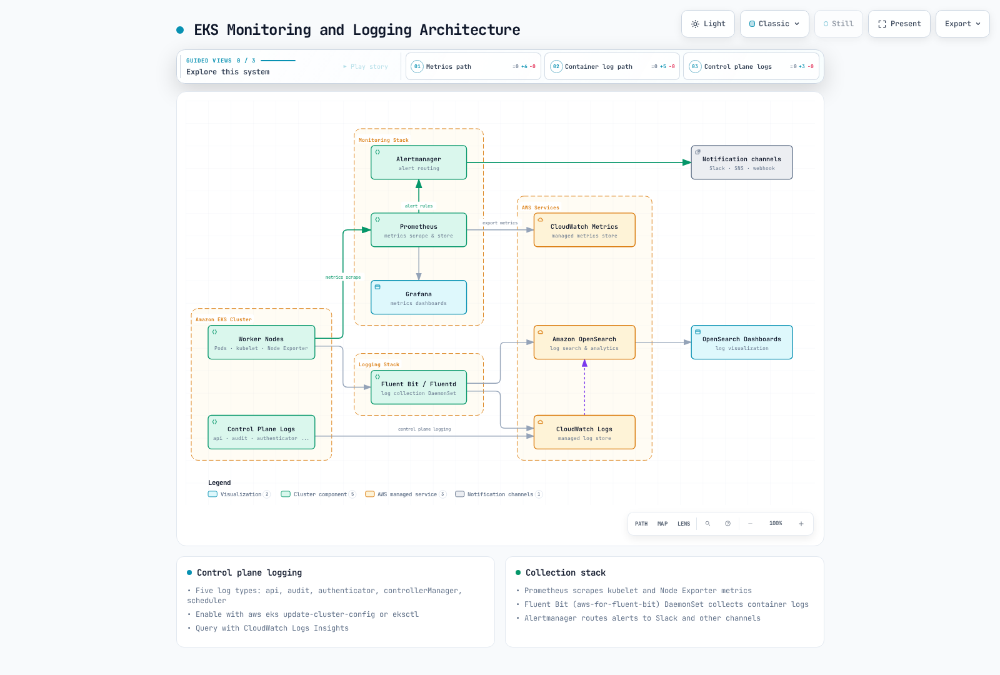
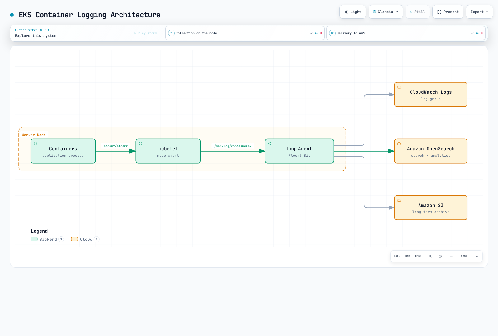
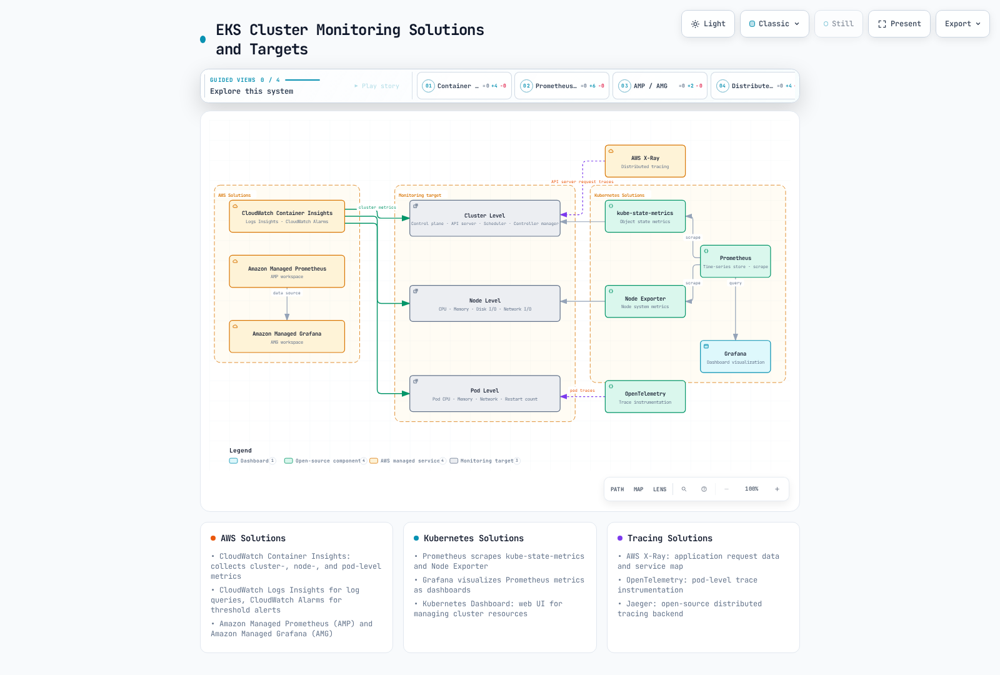
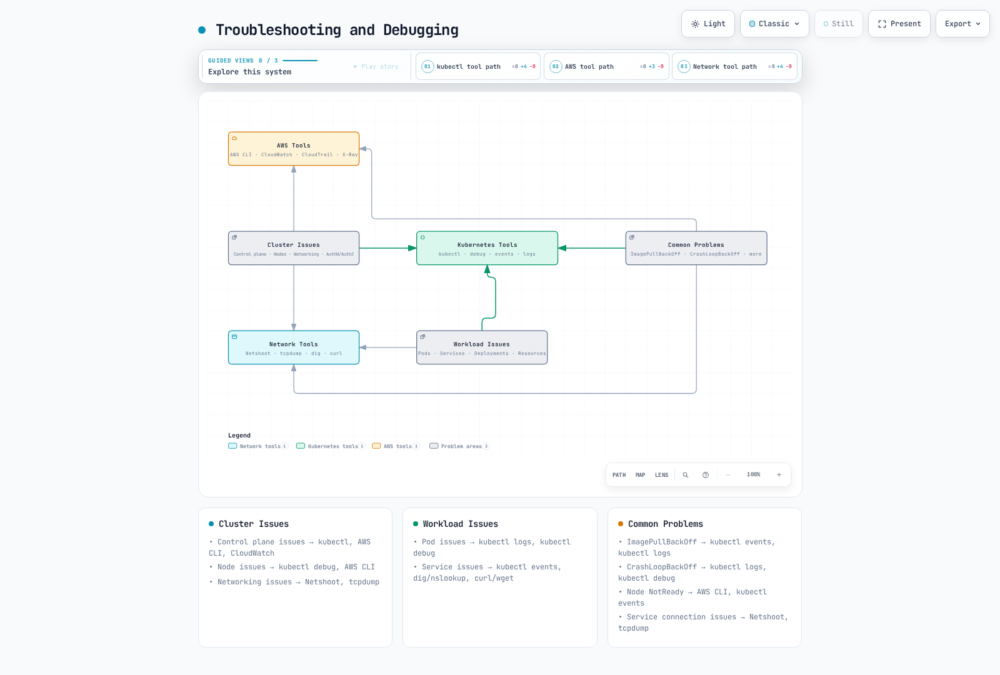

# Amazon EKS のモニタリングとログ

> **最終更新**: 2026年10月16日

Amazon EKS クラスターの信頼性、可用性、性能を維持するには、効果的なモニタリングとログ収集が欠かせません。このガイドでは、EKS のモニタリングとログ収集を実装するためのツール、手法、ベストプラクティスを説明します。

## 目次

1. [モニタリングとログ収集の概要](#monitoring-and-logging-overview)
2. [EKS コントロールプレーンのログ](#eks-control-plane-logging)
3. [コンテナログ](#container-logging)
4. [クラスターのモニタリング](#cluster-monitoring)
5. [アラートとイベント管理](#alerting-and-event-management)
6. [ログ分析と可視化](#log-analysis-and-visualization)
7. [モニタリングとログ収集のベストプラクティス](#monitoring-and-logging-best-practices)
8. [トラブルシューティングとデバッグ](#troubleshooting-and-debugging)

## モニタリングとログ収集の概要 {#monitoring-and-logging-overview}

### モニタリングとログ収集の重要性

Amazon EKS クラスターでモニタリングとログ収集を行う理由は次のとおりです。

1. **可視性:** クラスターの状態、性能、動作を把握できます。
2. **問題の検出:** 問題が重大化する前に早期検出できます。
3. **傾向分析:** 時間の経過に伴う性能とリソース使用量の傾向を特定できます。
4. **キャパシティ計画:** 必要なリソースを予測し、計画できます。
5. **セキュリティと監査:** 調査と、該当する統制に必要な証跡を支援します。
6. **トラブルシューティング:** 問題発生時に迅速な診断と解決を可能にします。

### モニタリングとログ収集のアーキテクチャ

EKS クラスターの包括的なモニタリングとログ収集のアーキテクチャは、次の要素で構成されます。

AWS が管理するコントロールプレーンログは CloudWatch Logs に配信されます。コンテナランタイムは CRI ログファイルを書き込み、kubelet がローテーションとログアクセスを管理し、ノード上のコレクターがファイルを読み取ります。メトリクスとトレースには、それぞれ設定した収集／エクスポート経路を使います。

<!-- 監査メモ: 図を修正してください。コントロールプレーンログは AWS から直接配信され、コンテナランタイムと kubelet はログ書き込み／ローテーションの役割が異なります。


[🔍 インタラクティブな図を表示](https://www.atomai.click/kubernetes-docs/archmaps/en-eks-06-eks-monitoring-logging-0.html)
-->

### モニタリングとログ収集の戦略

効果的な戦略を策定するには、次の手順に従います。

1. **目標の定義:** モニタリングとログ収集の目標および要件を定義します。
2. **メトリクスとログの特定:** 収集する主要なメトリクスとログを特定します。
3. **ツールの選定:** 要件を満たすモニタリングとログ収集のツールを選びます。
4. **ベースラインの確立:** 通常時の動作を示すベースラインを確立します。
5. **アラートの設定:** 重要なイベントとしきい値に対するアラートを設定します。
6. **自動化:** 可能な範囲でモニタリングとログ収集の手順を自動化します。
7. **定期的な見直し:** 戦略を定期的に見直し、改善します。

## EKS コントロールプレーンのログ {#eks-control-plane-logging}

EKS は、選択したマネージドコントロールプレーンのログ種別を CloudWatch Logs にエクスポートします。ノード上のコレクターがマネージドコントロールプレーンのファイルシステムをスクレイプすることはありません。ログ配信はベストエフォートです。アクセス権と保持期間を設定し、ログ欠落を検出できるようにしたうえで、実際にログが届くことを確認します。

### コントロールプレーンのログ種別

| 種別 | 用途 |
|---|---|
| `api` | API サーバーコンポーネントの診断 |
| `audit` | 監査ポリシーとレベルで選択された Kubernetes リクエスト |
| `authenticator` | EKS IAM 認証の診断 |
| `controllerManager` | コアコントローラーマネージャーの操作 |
| `scheduler` | スケジューラーの判断と診断 |

監査ログは、すべてのリクエスト本文やアプリケーションの全動作を無条件に記録するものではありません。Secret に関する記録はメタデータのみの場合があり、監査ポリシーで除外されるイベントもあります。CloudTrail の AWS API 記録と、アプリケーションのデータアクセスログは別々の証跡です。

### ログ設定の確認と有効化

変更前に、所有するクラスターのリージョン、ARN、現在のログ設定、更新状態を確認します。ログ設定の変更には、文書化されたサブネット IP 容量が必要で、CloudWatch の取り込み／保存料金がかかります。

```bash
set -euo pipefail
: "${CLUSTER_NAME:?Set the owned cluster name}"
: "${AWS_REGION:?Set the cluster Region}"
aws eks describe-cluster --name "$CLUSTER_NAME" --region "$AWS_REGION" \
  --query 'cluster.{ARN:arn,Status:status,Logging:logging}'
```

承認済みの変更を行う場合、次のコマンドで5種類のログを有効にし、返された更新を確認します。

```bash
set -euo pipefail
: "${CLUSTER_NAME:?Set the reviewed cluster name}"
: "${AWS_REGION:?Set the cluster Region}"
UPDATE_ID=$(aws eks update-cluster-config \
  --name "$CLUSTER_NAME" --region "$AWS_REGION" \
  --logging '{"clusterLogging":[{"types":["api","audit","authenticator","controllerManager","scheduler"],"enabled":true}]}' \
  --query 'update.id' --output text)
if [[ -z "$UPDATE_ID" || "$UPDATE_ID" == None ]]; then
  printf '%s\n' 'No update ID returned; inspect the request result.' >&2
  exit 1
fi
aws eks describe-update --name "$CLUSTER_NAME" --region "$AWS_REGION" \
  --update-id "$UPDATE_ID" \
  --query 'update.{ID:id,Status:status,Errors:errors}'
```

最後のコマンドは状態確認であり、完了まで待つ waiter ではありません。Successful または終端失敗になるまで DescribeUpdate を繰り返し、実効設定とログの到着を確認します。更新 ID が返っただけでは完了の証明になりません。選択した種別を有効にしても、無関係な既存種別を無効にする必要はありません。明示的な無効化は、保持期間と可視性に関する別の判断です。

レビュー済みの eksctl CLI では、`--approve` を省略すると変更内容をプレビューできます。確認済みの同じクラスターを指す `CLUSTER_NAME` と `AWS_REGION` を設定し、プレビューを確認します。

```bash
set -euo pipefail
: "${CLUSTER_NAME:?Set the verified cluster name}"
: "${AWS_REGION:?Set the cluster Region}"
eksctl utils update-cluster-logging \
  --region "$AWS_REGION" --cluster "$CLUSTER_NAME" \
  --enable-types api,audit,authenticator,controllerManager,scheduler
```

計画をレビューした後、別の apply コマンドを実行します。

```bash
set -euo pipefail
: "${CLUSTER_NAME:?Set the verified cluster name}"
: "${AWS_REGION:?Set the cluster Region}"
eksctl utils update-cluster-logging \
  --region "$AWS_REGION" --cluster "$CLUSTER_NAME" \
  --enable-types api,audit,authenticator,controllerManager,scheduler --approve
```

### コントロールプレーンログのクエリ

実際の `/aws/eks/CLUSTER_NAME/cluster` ロググループを使います。最初の2つの例は、選択したコンポーネントのログストリームに対するテキスト検索の目安であり、完全なエラー率の計測ではありません。

**API の診断:**

```text
fields @timestamp, @message
| filter @logStream like /kube-apiserver-/ and @logStream not like /audit/
| filter @message like /[Ee]rror/
| sort @timestamp desc
| limit 20
```

**IAM 認証の診断:**

```text
fields @timestamp, @message
| filter @logStream like /authenticator/
| filter @message like /[Ff]ailed|[Dd]enied|[Uu]nauthorized/
| sort @timestamp desc
| limit 20
```

**監査拒否:** 生の JSON テキストから文字列 `responseStatus.code` を検索するのではなく、検出した JSON フィールドを使います。サンプルイベントでフィールドの形を確認してください。

```text
fields @timestamp, user.username, verb, objectRef.resource, objectRef.namespace, responseStatus.code
| filter @logStream like /kube-apiserver-audit/
| filter responseStatus.code in [401, 403]
| sort @timestamp desc
| limit 20
```

### 保持期間とコスト管理

返された prefix 検索の中から、対象ロググループの正確な項目を確認します。

```bash
set -euo pipefail
: "${CLUSTER_NAME:?Set the owned cluster name}"
: "${AWS_REGION:?Set the cluster Region}"
aws logs describe-log-groups --region "$AWS_REGION" \
  --log-group-name-prefix "/aws/eks/$CLUSTER_NAME/cluster" \
  --query 'logGroups[].{Name:logGroupName,RetentionDays:retentionInDays,KmsKey:kmsKeyId}'
```

承認済みのポリシーで30日間の保持が求められる場合、変更コマンドは `aws logs put-retention-policy --region "$AWS_REGION" --log-group-name "/aws/eks/$CLUSTER_NAME/cluster" --retention-in-days 30` です。30日はポリシー例であり、すべての環境に適用されるコンプライアンス要件ではありません。保持期間を短縮すると古い証跡が期限切れになり、延長しても削除済みログは復元されません。保持期間だけでは、アーカイブ配信、完全性、コンプライアンスを証明できません。

### EKS Capabilities のログ（GitOps、ACK、kro）

2026年6月4日に発表された機能はサポート対象です。ACK、kro、Argo CD の Capability コントローラーは**クラスターの外部にある AWS 管理インフラストラクチャ**で実行され、CloudWatch Vended Logs を通じて構造化コントローラーログを配信できます。これは Capability ごとの配信設定を使い、標準コントロールプレーンログ5種とは別に構成します。

| Capability | ログ種別 |
|---|---|
| ACK | `EKS_CAPABILITY_ACK_LOGS` |
| kro | `EKS_CAPABILITY_KRO_LOGS` |
| Argo CD | `EKS_CAPABILITY_ARGOCD_APPLICATION_LOGS`、`EKS_CAPABILITY_ARGOCD_APPLICATIONSET_LOGS`、`EKS_CAPABILITY_ARGOCD_COMMITSERVER_LOGS`、`EKS_CAPABILITY_ARGOCD_REPOSERVER_LOGS`、`EKS_CAPABILITY_ARGOCD_SERVER_LOGS` |

配信ソースを設定する前に、実際の Capability ARN を取得します。

```bash
set -euo pipefail
: "${CLUSTER_NAME:?Set the owned cluster name}"
: "${AWS_REGION:?Set the cluster Region}"
: "${CAPABILITY_NAME:?Set the actual capability name}"
aws eks describe-capability --region "$AWS_REGION" \
  --cluster-name "$CLUSTER_NAME" --capability-name "$CAPABILITY_NAME" \
  --query 'capability.capabilityArn' --output text
```

所有者は、その ARN とログ種別を使って PutDeliverySource を設定し、承認済みの宛先を指定して PutDeliveryDestination を設定し、CreateDelivery で両者を接続します。配信を有効にする前に、宛先ポリシー、暗号化、クロスアカウント権限、保持期間を確認してください。

CloudWatch Logs の宛先は Logs Insights クエリに対応します。S3 の宛先は、選択した S3／Athena ワークフローで使うオブジェクトです。Firehose は設定済みの送信先へレコードを送ります。いずれも自動的に CloudWatch Logs Insights で検索できるわけではありません。ACK の記録には、サービスコントローラーを絞り込む `controllerGroup` が含まれます。実際の配信とクエリフィールドを確認し、Vended Logs の料金も考慮してください。

参考資料: [EKS コントロールプレーンログ](https://docs.aws.amazon.com/eks/latest/userguide/control-plane-logs.html)、[監査ポリシーとクエリ例](https://docs.aws.amazon.com/eks/latest/best-practices/auditing-and-logging.html)、[Capability コントローラーログ](https://docs.aws.amazon.com/eks/latest/userguide/capabilities-controller-logs.html)。

## コンテナログ {#container-logging}

コンテナランタイムは stdout/stderr をノードの CRI ログファイルに書き込みます。kubelet がローテーションと Pod のログアクセスを管理し、コレクターがファイルを追尾して選択したバックエンドにレコードを転送します。JSON 形式のアプリケーションメッセージも CRI ラッパーの内側にあるため、コンテナログ全体を Docker JSON として解析してはいけません。

<!-- 監査メモ: 図を修正してください。コントロールプレーンログは AWS から直接配信され、コンテナランタイムと kubelet はログ書き込み／ローテーションの役割が異なります。


[🔍 インタラクティブな図を表示](https://www.atomai.click/kubernetes-docs/archmaps/en-eks-06-eks-monitoring-logging-1.html)
-->

### コレクターの所有者を選ぶ

CloudWatch Observability アドオンにはコンテナログコレクターが含まれます。このスタックを選ぶ場合は、アドオンが管理する設定を使います。以下の単独 Fluent Bit 例は、独立して管理するログパイプライン向けの代替案です。重複排出とコストの計画が明確でない限り、同じファイル／宛先に複数のコレクターを重ねて導入しないでください。

### Fluent Bit の接続例

この例は、AWS チャート 0.2.0 とイメージ 3.4.14（Fluent Bit 5.0.9）を使用します。公開されたリリースと設定を確認済みです。所有する Linux／containerd の EC2 ノードを対象にし、アフィニティ設定では Fargate、Auto Mode、Hybrid のラベルを意図的に除外しています。これらの方式には、それぞれサポート対象の収集方法と ID 設計が必要です。選択したノードの taint はコレクターが許容するため、配置とプラットフォームエージェントの admission 権限を確認してください。

`logging` 名前空間、サービスアカウント `logging/eks-log-collector` 用の最小権限 IRSA ロール `EKSLogWriter`、所有する CloudWatch ロググループを準備します。アカウント、ロール、リージョン、クラスター固有のロググループを一貫して置き換えてください。セキュリティ章に従って IAM OIDC プロバイダーと信頼ポリシーの audience／subject を設定します。コレクターには CloudWatch のストリーム作成／書き込み権限と、リージョン STS／バックエンドへの接続が必要です。これらの IAM 前提条件は Kubernetes メタデータ RBAC とは別です。

`fluent-bit-values.yaml` として保存します。

```yaml
fullnameOverride: eks-log-collector
image:
  tag: 3.4.14
serviceAccount:
  create: true
  name: eks-log-collector
  annotations:
    eks.amazonaws.com/role-arn: arn:aws:iam::123456789012:role/EKSLogWriter
nodeSelector:
  kubernetes.io/os: linux
affinity:
  nodeAffinity:
    requiredDuringSchedulingIgnoredDuringExecution:
      nodeSelectorTerms:
      - matchExpressions:
        - key: eks.amazonaws.com/compute-type
          operator: NotIn
          values:
          - fargate
          - auto
          - hybrid
tolerations:
- operator: Exists
service:
  extraService: 'Flush 5

    Log_Level info

    Daemon Off

    HTTP_Server On

    HTTP_Listen 0.0.0.0

    HTTP_Port 2020

    Health_Check On

    storage.path /var/fluent-bit/state/storage

    storage.sync normal

    storage.checksum On

    storage.backlog.mem_limit 20M

    '
input:
  path: /var/log/containers/*.log
  db: /var/fluent-bit/state/tail.db
  multilineParser: cri
  skipLongLines: 'On'
  extraInputs: 'storage.type filesystem

    Read_from_Head On

    '
filter:
  kubeURL: https://kubernetes.default.svc:443
  mergeLog: 'On'
  mergeLogKey: data
  keepLog: 'On'
  k8sLoggingParser: 'Off'
  k8sLoggingExclude: 'Off'
  extraFilters: 'Use_Kubelet Off

    '
cloudWatch:
  enabled: false
cloudWatchLogs:
  enabled: true
  region: us-west-2
  logGroupName: /aws/eks/my-cluster/application
  logStreamPrefix: unmatched-
  logStreamTemplate: $kubernetes['namespace_name'].$kubernetes['pod_name'].$kubernetes['container_name']
  autoCreateGroup: false
  extraOutputs: 'auto_create_group false

    storage.total_limit_size 512M

    '
volumes:
- name: varlog
  hostPath:
    path: /var/log
    type: Directory
- name: state
  hostPath:
    path: /var/lib/eks-log-collector
    type: DirectoryOrCreate
volumeMounts:
- name: varlog
  mountPath: /var/log
  readOnly: true
- name: state
  mountPath: /var/fluent-bit/state
```

チャート 0.2.0 はネイティブの `cloudWatchLogs` 出力を既定で有効にし、古い `cloudWatch` 出力を無効にします。そのため `cloudWatch.region` だけでは有効なネイティブ出力を設定できません。上記の値は実際の出力先のリージョン／グループを設定し、レコード全体を保持します。`log_key` を使うと選択した値だけが送信され、Kubernetes のコンテキストが失われる可能性があります。

`logStreamTemplate` は record-accessor 構文とフォールバック用プレフィックスを使います。`logStreamPrefix` はリテラルなプレフィックスであり、レコードごとの Kubernetes 式ではありません。CRI マルチラインパーサーがコンテナラッパーを処理し、`Merge_Log` は JSON のアプリケーションフィールドを `data` 配下に置き、`log` フィールドも保持します。ワークロードのアノテーションで、この例のパーサーを選んだり収集対象から外れたりすることはできません。

### レンダリング中のメタデータ RBAC を制限する

公開チャートの広範な ClusterRole には、nodes/proxy と、古い PodSecurityPolicy ルールが含まれます。この API サーバーメタデータ方式では `Use_Kubelet Off` を明示し、選択した Pod／Namespace の読み取り権限だけを必要とします。kubelet proxy アクセスは不要です。この Python 3 + PyYAML の post-renderer を `fluent-bit-rbac.py` として保存します。想定外のチャート ID を黙って残すのではなく、エラーにします。

```python
#!/usr/bin/env python3
"""Helm post-renderer for this pinned, owned metadata-only Fluent Bit setup."""
import sys
import yaml

objects = [obj for obj in yaml.safe_load_all(sys.stdin) if obj is not None]
roles = [obj for obj in objects if obj.get("kind") == "ClusterRole"]
bindings = [obj for obj in objects if obj.get("kind") == "ClusterRoleBinding"]
if len(roles) != 1 or roles[0].get("metadata", {}).get("name") != "eks-log-collector":
    raise SystemExit("Unexpected chart RBAC; review this renderer before proceeding")
if len(bindings) != 1 or bindings[0].get("roleRef", {}).get("name") != "eks-log-collector":
    raise SystemExit("Unexpected chart role binding")
subjects = bindings[0].get("subjects", [])
if len(subjects) != 1 or any(
    subjects[0].get(key) != value
    for key, value in {
        "kind": "ServiceAccount", "name": "eks-log-collector", "namespace": "logging"
    }.items()
):
    raise SystemExit("Unexpected collector identity")
if any(obj.get("kind") == "PodSecurityPolicy" for obj in objects):
    raise SystemExit("Obsolete PodSecurityPolicy output is not supported by this example")
roles[0]["rules"] = [{
    "apiGroups": [""],
    "resources": ["namespaces", "pods"],
    "verbs": ["get", "list", "watch"],
}]
yaml.safe_dump_all(objects, sys.stdout, sort_keys=False)
```

新しい所有リリースでは、値ファイルと renderer を組み合わせてインストールします。

```bash
helm repo add eks https://aws.github.io/eks-charts
helm repo update eks
chmod +x fluent-bit-rbac.py
helm install eks-log-collector eks/aws-for-fluent-bit \
  --version 0.2.0 --namespace logging --create-namespace \
  -f fluent-bit-values.yaml --post-renderer ./fluent-bit-rbac.py \
  --wait --timeout 5m
```

すべてのアップグレードで同じレビュー済み post-renderer を使い、チャート版、リリース ID、名前空間、メタデータ方式を変える際に再検証してください。レンダリングされた ConfigMap は実際の DaemonSet にマウントされます。無関係な ConfigMap を単独で適用しても設定は変わりません。アカウント／IRSA ロールとロググループは前提条件であり、このチャート例が作成するリソースではありません。

### バッファリング、ローテーション、障害時の動作

ホストログは読み取り専用です。チェックポイントとファイルシステムバッファーの状態は、別のノードローカルディレクトリに保存します。tail データベースはオフセットを記録するもので、耐久性のあるバックエンドアーカイブではありません。ノードを置き換えると状態が失われる場合があります。チェックポイントがないときに `Read_from_Head On` を設定すると、保持されたファイルの内容を読み直すため、バックフィルと重複の処理を計画してください。

出力キューの上限 `512M` とバックログメモリ設定は容量例です。出力キューが `storage.total_limit_size` に達すると、Fluent Bit は最も古いチャンクを破棄する場合があります。`Skip_Long_Lines On` も大きすぎるレコードを意図的にスキップします。有限のバッファー、再試行、ノードローカル状態は、欠落のない配信や exactly-once 配信を保証しません。再試行、破棄レコード、ディスク容量、宛先障害を監視し、実際のログ量と停止時間に対して上限を検証してください。

### 任意の OpenSearch への複製

所有する VPC ドメインとコレクターの IAM／FGAC マッピングを準備した後、このオーバーレイを `fluent-bit-opensearch-values.yaml` として保存し、エンドポイントのホスト名を置き換えます。同じレビュー済み Helm 操作に `-f fluent-bit-opensearch-values.yaml` を加えます。CloudWatch を有効にしたままにすると両方の宛先に複製されます。OpenSearch のみを意図的に使う場合に限り、`cloudWatchLogs.enabled=false` を設定します。

```yaml
opensearch:
  enabled: true
  host: vpc-eks-logs-EXAMPLE.us-west-2.es.amazonaws.com
  port: '443'
  tls: 'On'
  awsAuth: 'On'
  awsRegion: us-west-2
  index: eks-logs
  generateId: 'On'
  suppressTypeName: 'On'
  extraOutputs: 'tls.verify On

    storage.total_limit_size 512M

    '
```

TLS 証明書とホスト名を検証し、固定した管理対象のインデックス／ロールオーバー設計を使います。Pod ごとのインデックスパターンは、インデックスやシャードを過剰に増やす可能性があります。`Generate_ID` は再試行時の重複登録を減らしますが、独立した各出力先への配信と障害復旧は別途検証が必要です。一方への書き込み成功は、もう一方にも届いた証明ではありません。

### その他のログ収集スタック

所有するデプロイで必要なパーサー／出力プラグイン、ホストマウント、ID、TLS 設定を用意すれば、Fluentd も選択肢になります。汎用 JSON パーサーでは CRI ラッパーをデコードできません。また、`ssl_verify` を無効にしても証明書エラーは解決しません。旧 Elastic Helm チャートリポジトリはアーカイブ済みです。Elastic を使う場合は、保守された製品／operator のインストール方法を使ってください。

`loki-stack` チャートは非推奨で、Promtail エージェントは2026年3月2日にサポート終了となりました。Loki には、保守された現行デプロイと、Alloy などサポート対象のクライアントを使い、ストレージ、アクセス制御、保持期間を明示してください。専用の設定手順は[Loki ガイド](../observability/logging/01-loki.md)と[コレクターガイド](../observability/logging/05-collectors.md)を参照してください。Promtail エージェントの終了は、別途保守される `lambda-promtail` クライアントには適用されません。

### 構造化アプリケーションログ

以下の既存例は合成したアプリケーションデータであり、新たな計測値でも、この監査で得た記録でもありません。タイムスタンプは元の例示値のままです。

```json
{
  "timestamp": "2025-07-11T13:00:00Z",
  "level": "INFO",
  "message": "Request processed successfully",
  "request_id": "12345",
  "user_id": "user-789",
  "duration_ms": 45,
  "status_code": 200
}
```

設定済みパイプラインでは、CRI レコードが転送時刻を持ち、アプリケーションの JSON は `data` 配下にあります。アプリケーションフィールドで時刻を上書きする前に、タイムゾーンとクロックの動作を確認してください。ユーザー／セッション ID も機微情報や追跡可能な情報になり得るため、最小限にし、認証情報や生のセッショントークンは決して記録しないでください。

次の例は、このコレクターのレコード形状を前提としています。他のコレクターではフィールドパスが異なる場合があります。

```text
fields @timestamp, kubernetes.namespace_name, kubernetes.pod_name, data.level, log
| filter kubernetes.namespace_name = "production"
| filter data.level in ["ERROR", "error"]
| sort @timestamp desc
| limit 100
```

検証では公開チャート／イメージのメタデータ、実際の Helm ConfigMap／DaemonSet の接続、ネイティブ Kubernetes スキーマ、post-renderer の失敗ケースを確認しました。イメージのインストール、コレクタープロセスの起動、AWS へのログ送信、本番ファイルシステムへのアクセスは行っていません。展開前に実際のノード権限、IRSA 認証情報、エンドツーエンドの配信を検証してください。

参考資料: [AWS イメージリリース 3.4.14](https://github.com/aws/aws-for-fluent-bit/releases/tag/v3.4.14)、[CloudWatch 出力](https://docs.fluentbit.io/manual/data-pipeline/outputs/cloudwatch)、[Fluent Bit バッファリング](https://docs.fluentbit.io/manual/data-pipeline/buffering)、[Promtail のライフサイクル](https://grafana.com/docs/loki/latest/send-data/promtail/)。

## クラスターのモニタリング {#cluster-monitoring}

効果的なクラスター監視は、EKS クラスターの状態、性能、リソース使用量を追跡するうえで欠かせません。この節では、EKS クラスターを監視するためのツールと手法を説明します。



[🔍 インタラクティブな図を表示](https://www.atomai.click/kubernetes-docs/archmaps/en-eks-06-eks-monitoring-logging-2.html)

### CloudWatch Container Insights

CloudWatch Observability アドオンは、Container Insights、コンテナログ収集、Application Signals の機能をまとめて提供します。所有する1つのインストールを使い、同じファイルを読む Fluent Bit コレクターが重複しないようにします。データが届くことを期待する前に、ID、サポート対象のノードアクセス、バックエンド接続を設定してください。

#### クラスターと互換性のあるアドオンビルドを確認する

この標準 Linux EC2 例では、適切な EKS Pod Identity エージェントと、クラスターおよび `amazon-cloudwatch/cloudwatch-agent` にスコープを限定した専用 CloudWatch ロールを準備します。操作主体には必要なアドオン／関連付け権限と、承認済みロールを渡す権限が必要です。既存の Helm リリース、ServiceAccount アノテーション、関連付けに加え、EKS アドオン一覧も確認します。既存コレクターを移行／アップグレードする場合は、その所有者の手順に従ってください。

```bash
set -euo pipefail
: "${CLUSTER_NAME:?Set the owned cluster name}"
: "${AWS_REGION:?Set the cluster Region}"
CLUSTER_VERSION=$(aws eks describe-cluster --name "$CLUSTER_NAME" --region "$AWS_REGION" \
  --query cluster.version --output text)
aws eks list-addons --cluster-name "$CLUSTER_NAME" --region "$AWS_REGION"
aws eks describe-addon-versions --region "$AWS_REGION" \
  --addon-name amazon-cloudwatch-observability --kubernetes-version "$CLUSTER_VERSION"
```

ハードコードされた v5.0.0 へダウングレードするのではなく、カタログから互換性のあるレビュー済みビルドを選びます。アドオン設定スキーマはバージョンごとに異なります。ここでのローカル参照レンダリングには Helm チャート 6.6.0 を使いました。このバージョンの Fluent Bit DaemonSet は、エージェントの ID 経路と同じ `cloudwatch-agent` ServiceAccount を使います。

#### Auto Monitor の設定を明示する

新規インストール例では、これを `cloudwatch-config.json` として保存します。アプリケーションの展開をレビューするまでは、既定のコンテナログ設定を残したまま、自動ワークロード選択と自動再起動を無効にします。

```json
{
  "manager": {
    "applicationSignals": {
      "autoMonitor": {
        "monitorAllServices": false,
        "restartPods": false
      }
    }
  }
}
```

この設定が制御するのは Auto Monitor の選択／再起動であり、あらゆるテレメトリソースではありません。既存のアノテーション、カスタムセレクター、手動計測済みアプリケーションは別途確認してください。ローカルに Python 3 と jsonschema がある場合は、選択したビルドのスキーマを取得して設定を検証します。

```bash
set -euo pipefail
: "${AWS_REGION:?Set the cluster Region}"
: "${CLOUDWATCH_ADDON_VERSION:?Choose a reviewed compatible add-on build}"
aws eks describe-addon-configuration --region "$AWS_REGION" \
  --addon-name amazon-cloudwatch-observability --addon-version "$CLOUDWATCH_ADDON_VERSION" \
  --output json > cloudwatch-addon-review.json
python3 - "$CLOUDWATCH_ADDON_VERSION" <<'PY'
import json
import sys
import jsonschema
with open("cloudwatch-addon-review.json") as stream:
    review = json.load(stream)
if review["addonName"] != "amazon-cloudwatch-observability" or review["addonVersion"] != sys.argv[1]:
    raise SystemExit("Returned schema does not match the selected add-on build")
schema = json.loads(review["configurationSchema"])
with open("cloudwatch-config.json") as stream:
    config = json.load(stream)
validator = jsonschema.validators.validator_for(schema)
validator.check_schema(schema)
validator(schema).validate(config)
PY
```

#### 新しい所有インストールを作成する

選択した機能に必要な CloudWatch／trace 権限を、CloudWatch ロールにあらかじめ付与しておく必要があります。次の処理は、レビュー済みスキーマ／ビルドを再確認し、既存アドオンやコレクターの関連付けがあれば停止して、競合するリソースを引き継がないようにします。

```bash
set -euo pipefail
: "${CLUSTER_NAME:?Set the reviewed cluster name}"
: "${AWS_REGION:?Set the cluster Region}"
: "${CLOUDWATCH_ADDON_VERSION:?Set the reviewed, schema-checked compatible build}"
: "${CLOUDWATCH_ROLE_ARN:?Set the prepared CloudWatch Pod Identity role ARN}"
python3 - "$CLOUDWATCH_ADDON_VERSION" <<'PY'
import json
import sys
import jsonschema
with open("cloudwatch-addon-review.json") as stream:
    review = json.load(stream)
if review["addonName"] != "amazon-cloudwatch-observability" or review["addonVersion"] != sys.argv[1]:
    raise SystemExit("Selected add-on build changed; review its schema again")
schema = json.loads(review["configurationSchema"])
with open("cloudwatch-config.json") as stream:
    config = json.load(stream)
jsonschema.validators.validator_for(schema)(schema).validate(config)
PY
EXISTING_ADDONS=$(aws eks list-addons --cluster-name "$CLUSTER_NAME" --region "$AWS_REGION" --output json)
python3 - "$EXISTING_ADDONS" <<'PY'
import json, sys
if "amazon-cloudwatch-observability" in json.loads(sys.argv[1])["addons"]:
    raise SystemExit("Add-on already exists; use its owner's reviewed upgrade procedure")
PY
EXISTING_ASSOCIATIONS=$(aws eks list-pod-identity-associations \
  --cluster-name "$CLUSTER_NAME" --region "$AWS_REGION" \
  --namespace amazon-cloudwatch --service-account cloudwatch-agent --output json)
python3 - "$EXISTING_ASSOCIATIONS" <<'PY'
import json, sys
if json.loads(sys.argv[1])["associations"]:
    raise SystemExit("Collector association already exists; inspect its owner before installation")
PY
ASSOCIATIONS=$(python3 - "$CLOUDWATCH_ROLE_ARN" <<'PY'
import json, sys
print(json.dumps([{"serviceAccount": "cloudwatch-agent", "roleArn": sys.argv[1]}]))
PY
)
aws eks create-addon --cluster-name "$CLUSTER_NAME" --region "$AWS_REGION" \
  --addon-name amazon-cloudwatch-observability --addon-version "$CLOUDWATCH_ADDON_VERSION" \
  --pod-identity-associations "$ASSOCIATIONS" \
  --configuration-values file://cloudwatch-config.json --resolve-conflicts NONE
aws eks describe-addon --cluster-name "$CLUSTER_NAME" --region "$AWS_REGION" \
  --addon-name amazon-cloudwatch-observability \
  --query 'addon.{Status:status,Version:addonVersion,Health:health.issues}'
```

CreateAddon は非同期です。ステータス／ヘルスを確認し、アドオンが ACTIVE になるまで待ってから、エージェント／コレクター Pod、実際の ContainerInsights データポイント、想定したロググループを検証します。リクエスト成功、ACTIVE 状態、ダッシュボードの表示だけでは、データが完全に取り込まれた証明にはなりません。上の最後の DescribeAddon コマンドは確認用であり、waiter ではありません。再試行前に障害と権限を検証してください。未レビューの overwrite や既存設定の消去でインストールを強制しないでください。

#### バージョン 5.0.0 の変更点

2026年2月26日に発表された既定の APM 変更は実際に有効です。バージョン 5.0.0 以降では、新規インストールとアップグレード時に Application Signals Auto Monitor が既定で有効になります。`monitorAllServices` の既定値は true、`restartPods` は false です。対象は service mapping に対応する Deployment、DaemonSet、StatefulSet で、既定では `kube-system` と `amazon-cloudwatch` を除外します。対象範囲内の新規 Pod または再起動した Pod は、ワークロードごとのアノテーションなしで計測される場合があります。すでに実行中の Pod が直ちに再計測される保証はありません。

サポート対象の言語／ワークロードを選び、既存の OpenTelemetry／APM 連携、サンプリング、コストを確認し、再起動のロールアウトを管理してください。明示的な除外設定が優先されます。Container Insights は Linux と Windows の設定に対応しますが、Application Signals は EKS Windows ノードでサポートされません。Fargate と Hybrid のノード収集／ID には文書化されたプラットフォーム固有の方法が必要です。一般的な DaemonSet 例だけから対応を推定しないでください。

#### メトリクス、ダッシュボード、アラーム

Container Insights のコンソールビューで実際のクラスターを選び、公開されたメトリクス名、ディメンション、最近のデータを確認します。ノードの CPU／メモリ／ファイルシステムのメトリクスはノード使用量を示します。Pod の CPU／メモリ使用率は Pod の request ではなく、ノードの limit を分母にします。文書化されたメトリクスでは、Namespace／サービス／クラスターの集計値を利用できますが、異種クラスターの集計パーセンテージが自動的に容量加重の使用率を表すわけではありません。

ダッシュボードはデータの確認に役立ちますが、すべてのアラームを作成したり通知配信を保証したりするものではありません。後の CloudWatch Alarms の例では、ノードメトリクス、Maximum、明示的に選んだディメンションを使います。メトリクスが利用可能か確認し、ワークロードに適したアラームと配信経路を設定してください。

検証では既存の公開チャート、レンダリングされた既定ログ設定と Auto Monitor 引数に加え、スキーマ／所有権／障害フローのモックケース9件を使いました。合成テストスキーマはヘルパーの動作を確認するものであり、上記の実際のビルド固有スキーマの代わりにはなりません。この監査ではアドオン、ワークロード計測、テレメトリエクスポート、AWS リソースを実際に使用していません。

参考資料: [CloudWatch アドオンのインストールと Auto Monitor](https://docs.aws.amazon.com/AmazonCloudWatch/latest/monitoring/install-CloudWatch-Observability-EKS-addon.html)、[既定 APM の発表](https://aws.amazon.com/about-aws/whats-new/2026/02/application-performance-monitoring-cloudwatch-eks/)、[Container Insights メトリクス](https://docs.aws.amazon.com/AmazonCloudWatch/latest/monitoring/Container-Insights-metrics-EKS.html)。

### EKS Node Monitoring Agent

EKS Node Monitoring Agent は、ノードレベルのシステム、ストレージ、ネットワーク、アクセラレーターのヘルス状態を公開します。2026年2月24日にオープンソース化され、EKS Auto Mode に含まれています。別途管理するアドオンをインストールする場合は、リリースを選ぶ前にクラスターの実際のバージョン、既存のアドオン、互換性のあるエージェントバージョンを確認します。

```bash
set -euo pipefail
: "${CLUSTER_NAME:?Set the owned cluster name}"
: "${AWS_REGION:?Set the cluster Region}"
KUBERNETES_VERSION=$(aws eks describe-cluster --name "$CLUSTER_NAME" --region "$AWS_REGION" \
  --query cluster.version --output text)
aws eks list-addons --cluster-name "$CLUSTER_NAME" --region "$AWS_REGION"
aws eks describe-addon-versions --addon-name eks-node-monitoring-agent \
  --kubernetes-version "$KUBERNETES_VERSION" --region "$AWS_REGION"
```

レビュー済みバージョンとサポート対象ノード設定を使い、既存アドオンの所有者を通じてインストールまたは更新します。既存インストールに対するアップグレード手順として、アドオン作成コマンドを使ってはいけません。

Condition 名だけでは、ノードが不健全かどうか分かりません。status と reason を読み、各 Condition の意味を確認してください。`Ready=False` と `MemoryPressure=False` は意味が異なります。

```bash
kubectl get nodes -o jsonpath='{range .items[*]}{.metadata.name}{"\n"}{range .status.conditions[*]}{"  "}{.type}{"="}{.status}{" reason="}{.reason}{"\n"}{end}{end}'
```

モニタリングの有効化と修復の有効化は別です。Auto Mode では自動ノード修復が有効です。マネージドノードグループでは `nodeRepairConfig`、Karpenter では `NodeRepair` feature gate を使います。修復の動作をエージェントによるものとする前に、実際のマネージドノードグループを確認してください。

```bash
set -euo pipefail
: "${CLUSTER_NAME:?Set the owned cluster name}"
: "${NODEGROUP_NAME:?Set an actual managed node group name}"
: "${AWS_REGION:?Set the cluster Region}"
aws eks describe-nodegroup --region "$AWS_REGION" \
  --cluster-name "$CLUSTER_NAME" --nodegroup-name "$NODEGROUP_NAME" \
  --query 'nodegroup.{Name:nodegroupName,Repair:nodeRepairConfig,Health:health.issues}'
```

修復対象になるかは Condition、reason、待機時間、適用されるセーフガードで決まります。文書化された既定動作では、MemoryPressure と DiskPressure に自動修復アクションはありません。すべての報告 Condition やエージェントのインストールを、ノード置き換えの証明として扱わないでください。オープンソースエージェントをカスタマイズする場合も、その Condition の意味を選択した修復設定と照らしてテストしてください。

参考資料: [オープンソース化の発表](https://aws.amazon.com/about-aws/whats-new/2026/02/amazon-eks-node-monitoring-agent-open-source/)、[自動ノード修復](https://docs.aws.amazon.com/eks/latest/userguide/node-repair.html)。

### Prometheus と Grafana

Prometheus は時系列データベース兼モニタリングシステムで、Grafana はメトリクスを可視化するダッシュボードツールです。この2つを組み合わせて EKS クラスターを包括的に監視できます。

#### Amazon Managed Service for Prometheus と Grafana

AMP は取り込んだ Prometheus メトリクスを保存し、クエリします。AMG は設定済みデータソースをクエリしてダッシュボードを表示します。どちらかのワークスペースを作成しても、スクレーパーのデプロイ、AWS ID の付与、データソースへの接続は自動では行われません。この例は所有済みワークスペースを調べ、下記の kube-prometheus-stack リリースを拡張します。Prometheus を2つ目にインストールすることはありません。

**AMP への取り込み ID と値の設定**

ServiceAccount `monitoring/amp-writer` 用の IRSA ロールを準備します。信頼ポリシーには、このクラスターの OIDC プロバイダーと正確な `sub=system:serviceaccount:monitoring:amp-writer`、`aud=sts.amazonaws.com` の条件を指定します。対象ワークスペース ARN に対する `aps:RemoteWrite` を許可します。Prometheus プロセスが投影トークンを受け取り、STS と AMP エンドポイントへ接続できる必要があります。Kubernetes RBAC は別の権限経路です。この例に無関係な Pod Identity 関連付けや静的 AWS キーを追加しないでください。

次の処理はワークスペースを読み取り、レビュー済みチャート 92.9.0 用のオーバーレイを書き出します。文書化された `/api/v1/` の有無いずれのエンドポイント形式も受け付け、`remote_write` を一度だけ追加します。Python 3 が必要です。ワークスペースは作成しません。

```bash
set -euo pipefail
: "${AWS_REGION:?Set the AMP workspace Region}"
: "${AMP_WORKSPACE_ID:?Set the owned AMP workspace ID}"
: "${AMP_WRITE_ROLE_ARN:?Set the prepared IRSA writer role ARN}"
: "${CLUSTER_NAME:?Set the source cluster name}"
aws amp describe-workspace --region "$AWS_REGION" \
  --workspace-id "$AMP_WORKSPACE_ID" --output json > amp-workspace.json
python3 - "$AWS_REGION" "$AMP_WORKSPACE_ID" "$AMP_WRITE_ROLE_ARN" "$CLUSTER_NAME" <<'PY'
import json
import sys
from urllib.parse import urlsplit, urlunsplit

region, workspace_id, role_arn, cluster = sys.argv[1:]
with open("amp-workspace.json") as stream:
    workspace = json.load(stream)["workspace"]
if workspace["workspaceId"] != workspace_id or workspace["status"]["statusCode"] != "ACTIVE":
    raise SystemExit("Review the workspace identity and ACTIVE status")
arn = workspace["arn"].split(":", 5)
if len(arn) != 6 or arn[2] != "aps" or arn[3] != region or arn[5] != "workspace/" + workspace_id:
    raise SystemExit("Workspace ARN does not match the selected Region/ID")
endpoint = urlsplit(workspace["prometheusEndpoint"])
path = endpoint.path.rstrip("/")
if path.endswith("/api/v1"):
    path = path[:-7]
if (endpoint.scheme != "https" or not endpoint.hostname or endpoint.username
        or endpoint.password or endpoint.query or endpoint.fragment
        or path != "/workspaces/" + workspace_id):
    raise SystemExit("Inspect the workspace endpoint before configuring remote write")
remote_write = urlunsplit((endpoint.scheme, endpoint.netloc, path + "/api/v1/remote_write", "", ""))
values = {
    "prometheus": {
        "serviceAccount": {
            "create": True, "name": "amp-writer", "createTokenSecret": True,
            "annotations": {"eks.amazonaws.com/role-arn": role_arn},
        },
        "prometheusSpec": {
            "externalLabels": {"cluster": cluster},
            "remoteWrite": [{"url": remote_write, "sigv4": {"region": region}}],
        },
    },
}
with open("amp-values.json", "w") as stream:
    json.dump(values, stream, indent=2)
    stream.write("\n")
print("Wrote amp-values.json; review it with all existing release values")
PY
```

所有者がレビューしたインストール／アップグレード値では、`amp-values.json` を `monitoring-values.yaml` と組み合わせます。オーバーレイは `remoteWrite` リストを置き換えるため、既存の宛先と外部ラベルを意図的に保持してください。新規リリースでは、下のインストールコマンドに `-f amp-values.json` を追加します。既存リリースでは現在の設定をすべて残し、所有者のアップグレード手順を適用する前に、レンダリング差分とロールアウトを確認してください。ServiceAccount を変えると Prometheus Pod の ID も変わります。チャート 92.9.0 は、既定の API サーバー／kubelet ServiceMonitor 認可に明示的な ServiceAccount token Secret を使います。この Secret を保護し、ローテーション／失効手順に従ってください。これは短命で audience が限定された IRSA トークンとは別物です。すべての依存する監視認証情報を置き換えずに `createTokenSecret` を無効にすると、レンダリングまたは認証に失敗します。

複数レプリカでは、重複スクレイプが無償だと考えず、AMP の文書化された HA 重複排除ラベルとレプリカトポロジーを設定します。実際のワークロードに基づいてカーディナリティ、保持、取り込み予算を定めます。remote-write の失敗／バックログを確認し、対象ワークスペースの最近のデータをクエリしてください。Helm のロールアウト成功は取り込みの証明ではありません。

**AMG の認証とデータソース接続**

```bash
set -euo pipefail
: "${AMG_REGION:?Set the Grafana workspace Region}"
: "${AMG_WORKSPACE_ID:?Set the owned Grafana workspace ID}"
aws grafana describe-workspace --region "$AMG_REGION" \
  --workspace-id "$AMG_WORKSPACE_ID" \
  --query 'workspace.{ID:id,Status:status,Version:grafanaVersion,Endpoint:endpoint,Role:workspaceRoleArn,Authentication:authentication,PermissionType:permissionType}'
```

ワークスペースユーザーの認証（IAM Identity Center／SAML）、Grafana ユーザー権限、ワークスペースの AWS データソース IAM ロールは別々の制御です。Grafana サービスアカウントは Grafana HTTP API の ID です。ADMIN サービスアカウントを作成しても、AMP データソースや `aps:QueryMetrics` 権限は作成されません。メトリクス閲覧のためだけに、広範な API ID をプロビジョニングしないでください。

AMG 12 以降では、Amazon Managed Service for Prometheus データソースプラグインを選択します。この AMG バージョンでは Core Prometheus プラグインから SigV4 サポートが削除され、既存の AMP データソースは AMP プラグインへ移行されます。実際のワークスペースバージョンに合った文書を使ってください。承認済みのワークスペース設定を通じて、対象アカウント／リージョン／ワークスペースを選び、クエリに使う IAM ID を設定し、既知の時系列でテストします。文書化された AWS データソース設定フローではサービス管理権限を使います。カスタマー管理ワークスペースには独自のレビュー済み IAM 設定が必要で、自動的に所有権が移るわけではありません。

クエリロールには通常、ワークスペースにスコープを限定した `aps:QueryMetrics`、`aps:GetSeries`、`aps:GetLabels`、`aps:GetMetricMetadata` が必要です。ディスカバリーなど有効にした機能には追加アクションが必要な場合があります。クエリエンドポイントは `remote_write` の取り込み URL ではありません。ワークスペースを別途プロビジョニングする場合、CLI では `--workspace-name` を使い、`--account-access-type`、認証、権限設定を指定します。サービス管理 IAM の自動化は文書化されたコンソールフローに結び付いています。ワークスペースを使用可能とみなす前に、ID、ユーザー割り当て、ネットワークアクセスをすべて設定してください。

参考資料: [AMP remote write](https://docs.aws.amazon.com/prometheus/latest/userguide/AMP-onboard-ingest-metrics-existing-Prometheus.html)、[AMG AMP プラグイン](https://docs.aws.amazon.com/grafana/latest/userguide/amazon-prometheus-data-source.html)、[AWS データソース設定](https://docs.aws.amazon.com/grafana/latest/userguide/amazon-AMP-adding-AWS-config.html)。この監査ではワークスペース、認証フロー、テレメトリ取り込みを実行していません。

#### Prometheus と Grafana のセルフマネージド構成

この例では、ServiceMonitor と PrometheusRule の例に必要な Prometheus Operator を含む、所有管理下の kube-prometheus-stack リリースを1つ使います。単独の Prometheus チャートに、それらの CRD／コントローラーが自動的に含まれるわけではありません。インストール前に既存の Operator、リリース、CRD の所有者を確認し、既存スタックでは所有者のアップグレード手順に従います。

レビュー済みのベースラインは、EKS 1.36 向けにレンダリングしたチャート 92.9.0／Operator 0.94.1 です。標準 Linux EC2 ノードと、EBS CSI 権限が正しく機能する、暗号化済みの `ebs-gp3` StorageClass を前提とします。Auto Mode や別のストレージ方式では、実際にサポートされるクラスとノード配置を選んでください。以下の保持期間と PVC サイズは割り当て例であり、測定に基づく容量保証ではありません。

承認済みのシークレット管理手順で `monitoring` 名前空間と、`admin-user`／`admin-password` キーを持つ `grafana-admin` Secret を準備します。値を Helm 設定やコマンド引数に共有パスワードとして直接入れず、値ファイルからこの Secret を参照します。以下を `monitoring-values.yaml` として保存します。

```yaml
grafana:
  admin:
    existingSecret: grafana-admin
    userKey: admin-user
    passwordKey: admin-password
  service:
    type: ClusterIP
  rbac:
    namespaced: true
  sidecar:
    dashboards:
      searchNamespace: monitoring
    datasources:
      searchNamespace: monitoring
  persistence:
    enabled: true
    storageClassName: ebs-gp3
    size: 10Gi
    accessModes:
    - ReadWriteOnce
  deploymentStrategy:
    type: Recreate
prometheus:
  prometheusSpec:
    retention: 14d
    storageSpec:
      volumeClaimTemplate:
        spec:
          storageClassName: ebs-gp3
          accessModes:
          - ReadWriteOnce
          resources:
            requests:
              storage: 20Gi
kubeEtcd:
  enabled: false
kubeControllerManager:
  enabled: false
kubeScheduler:
  enabled: false
kubeProxy:
  enabled: false
kubelet:
  serviceMonitor:
    tlsConfig:
      insecureSkipVerify: false
      ca:
        configMap:
          name: kubelet-serving-ca
          key: ca.crt
```

Grafana のダッシュボード／データソース用 sidecar は、名前空間付きの Role で `monitoring` だけを監視します。ClusterIP サービスにはローカルのポートフォワードで接続します。単一レプリカの PVC 例では、ロールアウト時に書き込みが重複しないよう `Recreate` を使うため、置き換え中は UI が停止します。高可用 Grafana の設計ではありません。

チャートは kubelet サーバー証明書の検証を既定でスキップします。この値ファイルでは、信頼する kubelet サーバー CA チェーンを含む `ca.crt` を持つ `monitoring/kubelet-serving-ca` ConfigMap と、スクレイプ先に一致する SAN を持つ証明書を要求します。ノード所有者の証明書管理手順で信頼を確認してください。EKS API サーバーの CA が kubelet サーバー CA になるとは限りません。この前提を満たせない場合、収集を有効にする前に証明書設定を解決してください。ターゲットを正常に見せるため、`insecureSkipVerify` を黙って戻してはいけません。この監査では kubelet の TLS ハンドシェイクをテストしていません。

etcd／controller-manager／scheduler／kube-proxy のスクレイプジョブは、このセットアップでは直接のエンドポイントを用意しないため無効です。実際に到達可能で認可されたエンドポイントを設定してからジョブを有効にしてください。API サーバーまたは CloudWatch のメトリクスは別の情報源であり、存在しないコンポーネント ServiceMonitor のターゲットを動作させるものではありません。

新しい所有リリースでは次を実行します。

```bash
helm repo add prometheus-community https://prometheus-community.github.io/helm-charts
helm repo update prometheus-community
helm install monitoring prometheus-community/kube-prometheus-stack \
  --version 92.9.0 --namespace monitoring --create-namespace \
  -f monitoring-values.yaml --wait --timeout 10m
```

Helm の待機完了は、Operator が作成したすべてのリソース、ターゲット、通知経路が機能する証明ではありません。作成されたリソース、PVC のバインド、Prometheus ターゲットの健全性、メトリクスデータを確認します。

```bash
kubectl get pods,svc,pvc -n monitoring
kubectl get prometheus,alertmanager -n monitoring
```

このコマンドが実行中の間、承認済みシークレットストアの認証情報を使って `http://127.0.0.1:3000` で Grafana にアクセスします。

```bash
kubectl port-forward --address 127.0.0.1 -n monitoring \
  svc/monitoring-grafana 3000:80
```

Grafana のデータベース／PVC とエクスポート済みダッシュボード定義を保護します。Grafana のサポート対象の認証情報ローテーション手順を使ってください。初期設定の Secret を変更しただけで、既存データベースユーザーのパスワードが変わった証拠にはなりません。共有サンプルパスワードで UI を公開しないでください。

チャートのレンダリング結果では、Prometheus サービス `monitoring-kube-prometheus-prometheus`、Grafana サービス `monitoring-grafana`、データソース UID `prometheus` を確認しました。カスタム ServiceMonitor／PrometheusRule は、このリリースが使う `release=monitoring` セレクターに一致させる必要があります。レンダリング済みマニフェストとスキーマ確認はローカルの証拠です。この監査ではスタック、PVC、ログインをライブ環境で試していません。

参考資料: [kube-prometheus-stack チャートとアップグレード手順](https://github.com/prometheus-community/helm-charts/tree/kube-prometheus-stack-92.9.0/charts/kube-prometheus-stack)。

#### 主な Prometheus メトリクス

メトリクスの有無は、ダッシュボード名だけではなく、実際のスクレイプターゲットと権限によって決まります。

- Node exporter は、対応ノードの CPU、メモリ、ファイルシステム、ネットワークの時系列を提供します。
- kubelet／cAdvisor はコンテナリソースのメトリクスを提供し、kube-state-metrics は再起動回数や Ready 状態など Kubernetes オブジェクトの状態を提供します。
- API サーバーは認可された API メトリクスを公開します。etcd／controller-manager／scheduler の直接メトリクスには、それぞれ到達可能なエンドポイントが必要です。上記の設定ではこれらのターゲットを有効にしていません。

時系列がない場合、エクスポーターがない、スクレイプに失敗した、プラットフォームが非対応、メトリクスが変更されたなどの可能性があります。自動的に使用量ゼロやシステム正常を意味するわけではありません。

#### 便利な Grafana ダッシュボード

レビュー済み kube-prometheus-stack リリースに同梱される Kubernetes、node-exporter、API サーバーのダッシュボードを、`prometheus` データソース UID を選んで確認します。コミュニティのダッシュボード ID だけでは、互換性のあるメトリクス／ラベル仕様は保証されません。インポートした各ダッシュボードのクエリ、単位、必要な recording rule、データソース参照を確認してください。グラフにデータがないことは、監視対象のコンポーネントが正常な証拠ではありません。

以前に掲載されたコミュニティ ID は引き続き存在しますが、いくつかのタイトルと想定用途は正確ではありませんでした。カタログで確認した参照先は次のとおりです。インポート／実行時の互換性はテストしていません。

| ID | カタログ上のタイトル | 範囲に関する注記 |
| --- | --- | --- |
| [15661](https://grafana.com/grafana/dashboards/15661-k8s-dashboard-en-20250125/) | K8S Dashboard | 一般的な K8S リソースの概要 |
| [1860](https://grafana.com/grafana/dashboards/1860-node-exporter-full/) | Node Exporter Full | 対応する node-exporter 時系列が必要 |
| [6417](https://grafana.com/grafana/dashboards/6417-kubernetes-cluster-prometheus/) | Kubernetes Cluster (Prometheus) | クラスター／コンテナの概要。カタログ最終更新は2018年 |
| [12006](https://grafana.com/grafana/dashboards/12006-kubernetes-apiserver/) | Kubernetes apiserver | API サーバーのレイテンシ／キャッシュ用。カタログ最終更新は2020年 |
| [13770](https://grafana.com/grafana/dashboards/13770-1-kubernetes-all-in-one-cluster-monitoring-kr/) | 1 Kubernetes All-in-one Cluster Monitoring KR | 書籍の VM 環境向けに最適化された韓国語の統合ダッシュボード |

#### PromQL クエリの例

以下の例は、レビュー済みスタックの job と `metrics_path` ラベルに対応します。Pod では namespace の識別子を、共有 AMP ワークスペースではクラスターラベルも保持してください。Prometheus の external label は外部送信時に付加されますが、ローカル保存された全時系列に自動で現れるわけではありません。max 集計は同じ識別対象に対する重複観測をまとめるもので、異なるワークロードをまとめるものではありません。このパターンを応用する前にラベルを確認してください。

CPU の非 idle 時間を CPU 間で平均したパーセンテージ:

```promql
100 * (1 - avg by (cluster, instance) (max by (cluster, instance, cpu) (rate(node_cpu_seconds_total{job="node-exporter",mode="idle"}[5m]))))
```

コンテナのメモリ working set バイト数が多い Pod の上位10件:

```promql
topk(10, sum by (cluster, namespace, pod) (max by (cluster, namespace, pod, container) (container_memory_working_set_bytes{job="kubelet",metrics_path="/metrics/cadvisor",container!="",container!="POD"})))
```

Pod UID ごとの現在の再起動カウンター。CrashLoopBackOff 検出器ではありません。

```promql
sum by (cluster, namespace, pod, uid) (max by (cluster, namespace, pod, uid, container) (kube_pod_container_status_restarts_total{job="kube-state-metrics"}))
```

ルートファイルシステムの使用不可割合。サイズがゼロのファイルシステムは除きます。

```promql
(100 * (1 - max by (cluster, instance, device, mountpoint, fstype) (node_filesystem_avail_bytes{job="node-exporter",mountpoint="/"}) / max by (cluster, instance, device, mountpoint, fstype) (node_filesystem_size_bytes{job="node-exporter",mountpoint="/"}))) and on (cluster, instance, device, mountpoint, fstype) (max by (cluster, instance, device, mountpoint, fstype) (node_filesystem_size_bytes{job="node-exporter",mountpoint="/"}) > 0)
```

ここで CPU パーセンテージが示すのは非 idle 時間です。メモリの単位はバイトで、再起動は現在の Pod／コンテナの存続期間中のカウンターです。カウンターの変化を見るには、選択した期間で rate／increase を使います。ファイルシステム計算は利用可能容量を使い、一般ユーザーが使えない予約領域を含む場合があります。これらは調査用の例であり、普遍的なしきい値ではありません。

### AWS X-Ray による分散トレーシング

X-Ray は引き続きサポートされるトレースバックエンドです。SDK と daemon は2026年2月25日にセキュリティ修正のみのメンテナンス段階に入りました。現行の AWS タイムラインには、この段階の終了日は記載されていません。新しい計測には、サポート対象の OpenTelemetry／ADOT 連携を使います。X-Ray daemon／collector がトレースを送るのに Kubernetes cluster-admin は不要であり、その Kubernetes ロールが AWS への書き込み権限を付与するわけでもありません。

#### Collector の所有者と前提条件

計測／収集の所有者を1つ選びます。上記 CloudWatch アドオンの Application Signals 経路も代替案です。すでに計測済みのプロセスに SDK エージェントを追加する場合は、重複スパンや競合を確認してください。以下の具体例では OpenTelemetry Operator 0.158.0 と ADOT Collector 0.50.0 を使い、トレースのみのパイプラインを構成します。

collector を適用する前に、各所有者を通じて次の依存関係を準備します。

- 対応する CRD／webhook がある、動作中の Operator。上流が公開するマニフェストは cert-manager を使うため、文書化されたインストール／アップグレード手順に従います。EKS ADOT アドオンも別の所有経路であり、ビルド固有のスキーマがあります。Collector リリースには Operator のインストールマニフェストは含まれません。
- 専用の `tracing-demo` 名前空間と `adot-traces` ServiceAccount。このクラスター用に `sub=system:serviceaccount:tracing-demo:adot-traces`、`aud=sts.amazonaws.com` の条件を持つ IRSA 信頼を準備します。必要な X-Ray 書き込みアクション（このパイプラインでは `PutTraceSegments`）と STS／X-Ray 接続を用意します。この OTLP のみを扱う collector は Kubernetes オブジェクトを検出せず、クラスター全体の RBAC も必要としません。
- `tls.crt`／`tls.key` を持ち、`adot-traces-collector.tracing-demo.svc` に有効なサーバー証明書を含む Secret `tracing-demo/otel-receiver-tls`。アプリケーションに信頼する CA をマウントします。証明書の発行／更新、collector の reload／再起動は運用上の責任です。
- NetworkPolicy を適用する CNI とレビュー済みのアプリケーション egress。この例は `app=my-app` ラベルの付いた default 名前空間の Pod からの ingress を許可し、専用 `tracing-demo` 名前空間内のすべての Pod に適用されます。ラベルはトラフィックを選択するもので、ワークロードの認証や、誰が Pod を作れるかを制御する RBAC の代わりではありません。

Collector URL を Operator マニフェストとして適用せず、公開済みの[Operator リリース](https://github.com/open-telemetry/opentelemetry-operator/releases/tag/v0.158.0)と[ADOT リリース](https://github.com/aws-observability/aws-otel-collector/releases/tag/v0.50.0)を確認します。v1beta1 CRD はオブジェクト形式の `spec.config` を使います。env と exporter の両フィールドで、例のリージョンを一緒に変更してください。

```yaml
apiVersion: opentelemetry.io/v1beta1
kind: OpenTelemetryCollector
metadata:
  name: adot-traces
  namespace: tracing-demo
spec:
  mode: deployment
  replicas: 1
  image: public.ecr.aws/aws-observability/aws-otel-collector:v0.50.0
  serviceAccount: adot-traces
  env:
  - name: AWS_REGION
    value: us-west-2
  - name: AWS_EC2_METADATA_DISABLED
    value: "true"
  resources:
    requests:
      cpu: 100m
      memory: 128Mi
    limits:
      cpu: "1"
      memory: 512Mi
  volumes:
  - name: receiver-tls
    secret:
      secretName: otel-receiver-tls
  volumeMounts:
  - name: receiver-tls
    mountPath: /etc/otel/tls
    readOnly: true
  config:
    receivers:
      otlp:
        protocols:
          http:
            endpoint: 0.0.0.0:4318
            tls:
              cert_file: /etc/otel/tls/tls.crt
              key_file: /etc/otel/tls/tls.key
    processors:
      memory_limiter:
        check_interval: 1s
        limit_percentage: 75
        spike_limit_percentage: 15
      batch: {}
    exporters:
      awsxray:
        region: us-west-2
        local_mode: true
        no_verify_ssl: false
        index_all_attributes: false
        telemetry:
          enabled: false
    extensions:
      health_check:
        endpoint: 0.0.0.0:13133
    service:
      extensions: [health_check]
      pipelines:
        traces:
          receivers: [otlp]
          processors: [memory_limiter, batch]
          exporters: [awsxray]
---
apiVersion: networking.k8s.io/v1
kind: NetworkPolicy
metadata:
  name: tracing-ingress
  namespace: tracing-demo
spec:
  podSelector: {}
  policyTypes: [Ingress]
  ingress:
  - from:
    - namespaceSelector:
        matchLabels:
          kubernetes.io/metadata.name: default
      podSelector:
        matchLabels:
          app: my-app
    ports:
    - protocol: TCP
      port: 4318
```

Operator は OTLP/HTTP ポートから ClusterIP receiver Service を導出します。サービス名は `adot-traces-collector`、名前空間は `tracing-demo`、TCP ポートは 4318 です。receiver はユーザー ID や業務上の認可クレームを検証しません。この例ではサーバー TLS と選択したネットワーク境界を使います。さらに強い分離には、mTLS またはサポート対象の receiver authenticator が必要になる場合があります。アクセスを広げる前に、両端で一貫して設定してください。

collector が要求を受け付けても保存された証拠にはなりません。生成された Deployment／Service、TLS ハンドシェイク、AWS 認証情報の選択、exporter の失敗、X-Ray に到着した既知のトレースを確認します。レプリカ1つでメモリ内バッファーを使う例は、欠落のない高可用パイプラインではありません。ワークロードに応じてバッファー、バックプレッシャー、再試行、障害対応を設計／テストしてください。CRD スキーマ検証ではコンポーネント設定全体を検証できず、collector が起動する証明にもなりません。

#### アプリケーションを計測し、コンテキストを伝播する

Python 3.10 以降のアプリケーションでは、アプリケーションの依存関係ロックで `opentelemetry-sdk==1.44.0` と `opentelemetry-exporter-otlp-proto-http==1.44.0` を揃えます。各サービスを個別に設定し、共有 collector がすべての入力の `service.name` を単一のグローバル値で上書きしないようにします。HTTP exporter の endpoint には `/v1/traces` が含まれます。4317 の gRPC endpoint は異なるプロトコル／設定です。

```bash
export OTEL_SERVICE_NAME=my-app
export CLUSTER_NAME=my-owned-cluster
export OTEL_EXPORTER_OTLP_TRACES_ENDPOINT=https://adot-traces-collector.tracing-demo.svc:4318/v1/traces
export OTEL_EXPORTER_OTLP_TRACES_CERTIFICATE=/etc/otel/ca.crt
```

CA ファイルをアプリケーションコンテナにマウントします。アプリケーション起動時に `RequestTracing` を1つ作り、実際のサーバーハンドラーから `handle_request` を呼びます。正規化した受信ヘッダー名と、渡された送信ヘッダーを使う操作を指定し、graceful shutdown 時に `close` を呼んでください。フレームワーク／クライアントの自動計測で同じ境界を扱うこともできます。その場合、同じ操作を二重に計測しないようにします。

```python
import os
from urllib.parse import urlsplit

from opentelemetry.exporter.otlp.proto.http.trace_exporter import OTLPSpanExporter
from opentelemetry.sdk.resources import Resource
from opentelemetry.sdk.trace import TracerProvider
from opentelemetry.sdk.trace.export import BatchSpanProcessor
from opentelemetry.sdk.trace.sampling import ParentBased, TraceIdRatioBased
from opentelemetry.trace import SpanKind
from opentelemetry.trace.propagation.tracecontext import TraceContextTextMapPropagator


class RequestTracing:
    def __init__(self):
        endpoint = os.environ["OTEL_EXPORTER_OTLP_TRACES_ENDPOINT"]
        parsed = urlsplit(endpoint)
        if parsed.scheme != "https" or parsed.path != "/v1/traces":
            raise ValueError("Set the HTTPS OTLP/HTTP traces endpoint including /v1/traces")
        self.provider = TracerProvider(
            resource=Resource.create({
                "service.name": os.environ["OTEL_SERVICE_NAME"],
                "k8s.cluster.name": os.environ["CLUSTER_NAME"],
            }),
            sampler=ParentBased(TraceIdRatioBased(0.1)),
        )
        exporter = OTLPSpanExporter(
            endpoint=endpoint,
            certificate_file=os.environ["OTEL_EXPORTER_OTLP_TRACES_CERTIFICATE"],
            timeout=10,
        )
        self.provider.add_span_processor(BatchSpanProcessor(exporter))
        self.tracer = self.provider.get_tracer("example.request-handler")
        self.propagator = TraceContextTextMapPropagator()

    def handle_request(self, incoming_headers, operation):
        parent = self.propagator.extract(incoming_headers)
        with self.tracer.start_as_current_span("request", context=parent, kind=SpanKind.SERVER):
            outgoing_headers = {}
            self.propagator.inject(outgoing_headers)
            return operation(outgoing_headers)

    def close(self):
        self.provider.shutdown()
```

この adapter が示すのは W3C tracecontext の伝播とサーバースパン1つであり、HTTP サーバー全体や全クライアントスパンを実装するものではありません。`X-Amzn-Trace-Id` を使う AWS edge 連携には、W3C のみを抽出する設定がそのヘッダーを読むと考えず、サポート対象の propagator／bridge を使います。10% の head sampling は新規 root に対する例で、親の判断を保持しますが、後で発生するすべてのエラーや遅延リクエストの保持を保証できません。tail sampling には、同じトレースの全スパンをまとめて適切なバッファーへルーティングする別設計が必要です。

#### トレースマップと調査

アカウントで利用できる X-Ray／CloudWatch のトレースビューで、トレースマップ、レイテンシ分布、エラー／fault 詳細を確認します。マップに現れるのは、計測、サンプリング、正常配信されたスパンです。エッジが見えないことは、サービス間通信が一度もない証拠ではありません。認証情報、個人データ、上限のないリクエスト属性を除外しながら、適切な期間保持したログ／メトリクスと trace ID を関連付けます。

この監査で検証したのは公開 API／スキーマとローカルの合成動作だけです。collector のデプロイ、ライブ計測、トレースのエクスポート、本番容量テストを行ったとは主張しません。参考資料: [X-Ray のメンテナンス時期](https://aws.amazon.com/blogs/mt/aws-x-ray-sdks-daemon-migration-to-opentelemetry/)、[EKS ADOT の所有経路](https://docs.aws.amazon.com/eks/latest/userguide/opentelemetry.html)、[AWS X-Ray exporter](https://github.com/open-telemetry/opentelemetry-collector-contrib/tree/v0.158.0/exporter/awsxrayexporter)。

### Kubernetes Dashboard

[Kubernetes Dashboard プロジェクト](https://github.com/kubernetes-retired/dashboard)はアーカイブされ、保守されていません。メンテナーは現在の UI として Kubernetes SIG UI の Headlamp を案内しています。古い Dashboard v2.7 の raw manifest と cluster-admin token を使う手順は、現在のインストール方法として使わないでください。

保守されている UI を選び、実際の認証、TLS、認可、アップグレード要件を確認します。セキュリティ章の access entry／RBAC の例に従い、意図した IAM／RBAC ID と名前空間の範囲を使います。UI の既定ユーザーに制限のない cluster-admin ServiceAccount は不要です。管理者 bearer token を公開することは、アクセス設計の代わりになりません。

### カスタムメトリクスとモニタリング

アプリケーション固有のメトリクスを収集／監視するカスタム方式を実装できます。

#### Prometheus クライアントライブラリの統合

Prometheus Java client 1.8.0 API では、現在の `io.prometheus.metrics` パッケージと互換性のある依存関係を使います。既存の Gradle Java プロジェクトで次を設定します。

```groovy
dependencies {
    implementation(platform("io.prometheus:prometheus-metrics-bom:1.8.0"))
    implementation("io.prometheus:prometheus-metrics-core")
    implementation("io.prometheus:prometheus-metrics-exporter-httpserver")
}
```

例を `App.java` として保存します。`main` メソッドはポート9400でメトリクスを公開して待機します。実際のアプリケーションリクエストハンドラーから、実際の操作を指定して `processRequest` を呼び出す必要があります。メトリクス endpoint を起動しただけでは業務リクエスト数にはなりません。合成したリクエスト数を測定値として提示していません。

```java
import io.prometheus.metrics.core.metrics.Counter;
import io.prometheus.metrics.core.metrics.Histogram;
import io.prometheus.metrics.exporter.httpserver.HTTPServer;
import java.io.IOException;

public class App {
    private static final Counter requests = Counter.builder()
        .name("app_requests_total").help("Requests processed by this application.")
        .register();
    private static final Histogram latency = Histogram.builder()
        .name("app_request_latency_seconds").help("Request processing time in seconds.")
        .register();

    public static void processRequest(Runnable operation) {
        requests.inc();
        long started = System.nanoTime();
        try {
            operation.run();
        } finally {
            latency.observe((System.nanoTime() - started) / 1_000_000_000.0);
        }
    }

    public static void main(String[] args) throws IOException, InterruptedException {
        HTTPServer server = HTTPServer.builder().port(9400).buildAndStart();
        Runtime.getRuntime().addShutdownHook(new Thread(server::close));
        Thread.currentThread().join();
    }
}
```

API と依存関係の座標は公開済みの client に照らして確認しました。この監査環境には Java コンパイラー／ランタイムがなく、例をコンパイル／実行していません。展開前にアプリケーションの build、ライフサイクル、リクエスト経路へ統合してください。ラベル数を制限します。request ID、user ID、生の URL は既定のメトリクスディメンションには不適切です。

#### カスタムメトリクスの収集

所有するアプリケーション Pod が `default` 名前空間にあり、`app=my-app` ラベルを持ち、TCP 9400 で `/metrics` を実際に提供すると仮定します。Service は Pod を選択し、ServiceMonitor は Service のラベルと名前付きポートを選択します。`release=monitoring` ラベルと `namespaceSelector` によって、前述のスタックと接続します。

```yaml
apiVersion: v1
kind: Service
metadata:
  name: my-app-metrics
  namespace: default
  labels:
    app: my-app
spec:
  type: ClusterIP
  selector:
    app: my-app
  ports:
  - name: metrics
    port: 9400
    targetPort: 9400
---
apiVersion: monitoring.coreos.com/v1
kind: ServiceMonitor
metadata:
  name: app-monitor
  namespace: monitoring
  labels:
    release: monitoring
spec:
  namespaceSelector:
    matchNames:
    - default
  selector:
    matchLabels:
      app: my-app
  endpoints:
  - port: metrics
    interval: 30s
    path: /metrics
```

Service の EndpointSlice と Prometheus ターゲット状態を確認し、適用されるネットワークポリシー／セキュリティ制御で意図したコレクターだけを許可します。このクラスター内 HTTP メトリクス例にはレビュー済みネットワーク境界が必要です。メトリクス endpoint が必要とする場合は TLS／認証も設定します。ServiceMonitor はアプリケーションを計測せず、存在しないメトリクスサーバーも作りません。

参考資料: [Java client クイックスタート](https://prometheus.github.io/client_java/getting-started/quickstart/)、[Prometheus 設定](https://prometheus.io/docs/prometheus/latest/configuration/configuration/)。

#### カスタムダッシュボード

Grafana でカスタムダッシュボードを作成してアプリケーションメトリクスを可視化します。

1. Grafana にログインします。
2. 「+」アイコンを選び、「Dashboard」を選択します。
3. 「Add panel」を選択します。
4. データソースとして「Prometheus」を選択します。
5. PromQL クエリ（例: `rate(app_requests_total[5m])`）を入力します。
6. パネルのタイトル、説明、可視化の種類を設定します。
7. 「Save」を選択します。

## アラートとイベント管理 {#alerting-and-event-management}

効果的なアラートとイベント管理は、EKS クラスターの問題を迅速に検出し対応するうえで重要です。この節では、EKS のアラート／イベント管理に利用できるツールと手法を説明します。


[🔍 インタラクティブな図を表示](https://www.atomai.click/kubernetes-docs/archmaps/en-eks-06-eks-monitoring-logging-3.html)

### CloudWatch アラーム

アラームを作成する前に、最近のデータポイントと正確なメトリクス名前空間、名前、ディメンション一式を確認します。この例では文書化された ClusterName のみを使う ContainerInsights のノード集計と Maximum を使います。これはノードのホットスポットを示すもので、クラスター全体の容量加重使用率ではありません。影響を受けたノードを特定するには、ノード固有のディメンションを使います。

80／80／85% のしきい値と5分間の評価期間2回は、ポリシー設定例です。2期間でしきい値を超えた Maximum は、10分間の毎秒で飽和が続いた意味ではありません。欠落データは欠落のままであり、使用率が正常な証拠ではありません。PutMetricAlarm は既存アラームを更新するため、名前を再利用する前に定義を確認してください。通知権限、サブスクリプション、配信テストは別途前提条件です。

#### ノード CPU


```bash
set -euo pipefail
: "${CLUSTER_NAME:?Set the verified cluster name}"
: "${AWS_REGION:?Set the metric Region}"
: "${ALARM_PREFIX:?Set a reviewed alarm-name prefix owned by this workflow}"
: "${SNS_TOPIC_ARN:?Set the approved notification topic ARN}"
aws cloudwatch put-metric-alarm --region "$AWS_REGION" \
  --alarm-name "${ALARM_PREFIX}-node-cpu" \
  --alarm-description "Example: maximum reported node cpu utilization exceeds 80 percent" \
  --metric-name node_cpu_utilization --namespace ContainerInsights \
  --statistic Maximum --period 300 --threshold 80 \
  --comparison-operator GreaterThanThreshold \
  --dimensions "Name=ClusterName,Value=$CLUSTER_NAME" \
  --evaluation-periods 2 --datapoints-to-alarm 2 --treat-missing-data missing \
  --alarm-actions "$SNS_TOPIC_ARN"
```

#### ノードメモリ


```bash
set -euo pipefail
: "${CLUSTER_NAME:?Set the verified cluster name}"
: "${AWS_REGION:?Set the metric Region}"
: "${ALARM_PREFIX:?Set a reviewed alarm-name prefix owned by this workflow}"
: "${SNS_TOPIC_ARN:?Set the approved notification topic ARN}"
aws cloudwatch put-metric-alarm --region "$AWS_REGION" \
  --alarm-name "${ALARM_PREFIX}-node-memory" \
  --alarm-description "Example: maximum reported node memory utilization exceeds 80 percent" \
  --metric-name node_memory_utilization --namespace ContainerInsights \
  --statistic Maximum --period 300 --threshold 80 \
  --comparison-operator GreaterThanThreshold \
  --dimensions "Name=ClusterName,Value=$CLUSTER_NAME" \
  --evaluation-periods 2 --datapoints-to-alarm 2 --treat-missing-data missing \
  --alarm-actions "$SNS_TOPIC_ARN"
```

#### ノードファイルシステム


```bash
set -euo pipefail
: "${CLUSTER_NAME:?Set the verified cluster name}"
: "${AWS_REGION:?Set the metric Region}"
: "${ALARM_PREFIX:?Set a reviewed alarm-name prefix owned by this workflow}"
: "${SNS_TOPIC_ARN:?Set the approved notification topic ARN}"
aws cloudwatch put-metric-alarm --region "$AWS_REGION" \
  --alarm-name "${ALARM_PREFIX}-node-disk" \
  --alarm-description "Example: maximum reported node disk utilization exceeds 85 percent" \
  --metric-name node_filesystem_utilization --namespace ContainerInsights \
  --statistic Maximum --period 300 --threshold 85 \
  --comparison-operator GreaterThanThreshold \
  --dimensions "Name=ClusterName,Value=$CLUSTER_NAME" \
  --evaluation-periods 2 --datapoints-to-alarm 2 --treat-missing-data missing \
  --alarm-actions "$SNS_TOPIC_ARN"
```

これらのアラームコマンドは AWS に対して実行していません。参考資料: [Container Insights のメトリクスとディメンション](https://docs.aws.amazon.com/AmazonCloudWatch/latest/monitoring/Container-Insights-metrics-EKS.html)。

### Prometheus Alertmanager

Prometheus はアラートルールを評価し、Alertmanager は生成されたアラートをグループ化、重複排除してルーティングします。任意の名前の ConfigMap を作っても、Operator 管理の Alertmanager が自動的に読み込むわけではありません。レビュー済みスタックは Alertmanager 0.34.0 を使います。設定と認証情報ファイルを明示的に接続してください。

#### Alertmanager の設定

Slack の例では、承認済みシークレット管理手順で `slack-url` キーに実際の webhook URL を入れた `monitoring/notification-credentials` を準備します。認証情報を ConfigMap、リポジトリのテキスト、Helm のコマンド引数に入れないでください。この機密情報を含まないルーティング定義を `alertmanager-config.yaml` として保存します。

```yaml
global:
  resolve_timeout: 5m
route:
  group_by: [cluster, namespace, alertname]
  group_wait: 30s
  group_interval: 5m
  repeat_interval: 4h
  receiver: slack-notifications
  routes:
  - matchers:
    - alertname="Watchdog"
    receiver: discard
receivers:
- name: discard
- name: slack-notifications
  slack_configs:
  - api_url_file: /etc/alertmanager/secrets/notification-credentials/slack-url
    channel: "#eks-alerts"
    send_resolved: true
    title: '[{{ .Status | toUpper }}] {{ .CommonLabels.alertname }}'
    text: '{{ range .Alerts }}{{ .Annotations.summary }} — {{ .Annotations.description }}{{ "\n" }}{{ end }}'
```

Webhook の権限が意図した Slack 宛先に与えられていることを確認します。`channel` フィールドは Slack アプリの権限を上書きしません。この例では、Slack に定期メッセージを送らないよう、常時発火する同梱の Watchdog アラートを破棄します。実際の dead-man／heartbeat 監視には、別の受信先と、外部からの欠落検出が必要です。Watchdog の破棄はアラート配信のテストにはなりません。

対応する `amtool` でファイルをローカル検証し、新規の所有インストールに限り設定 Secret を作成します。既存 Secret／リリースを更新する場合は、その所有者がレビューした手順に従ってください。

```bash
amtool --no-version-check check-config alertmanager-config.yaml
kubectl create secret generic alertmanager-routing -n monitoring \
  --from-file=alertmanager.yaml=alertmanager-config.yaml
```

次を `alertmanager-values.yaml` として保存し、監視リリースのレビュー済み設定すべてと組み合わせます。`configSecret` は Secret を指定し、Operator はその `alertmanager.yaml` キーを期待します。`secrets` は `notification-credentials` を `/etc/alertmanager/secrets/notification-credentials` にマウントします。デプロイ前に、`release=monitoring` で選択される追加の AlertmanagerConfig リソースを確認してください。

```yaml
alertmanager:
  alertmanagerSpec:
    useExistingSecret: true
    configSecret: alertmanager-routing
    secrets:
    - notification-credentials
    alertmanagerConfigSelector:
      matchLabels:
        release: monitoring
    alertmanagerConfigNamespaceSelector:
      matchLabels:
        kubernetes.io/metadata.name: monitoring
```

生成された設定／reload 状態と通知失敗を確認し、ページャーに依存する前に、承認済みのテスト宛先へラベル付きテストアラートを送ってください。ローカルのパース／ルートテストでは、Secret の可用性、webhook 権限、SMTP 接続、実際の配信は証明できません。チャート例はレプリカ1つのため、可用性設計も別途必要です。

#### アラートルールの設定

ルールの `release` ラベルは Prometheus セレクターに一致します。同等の同梱ルールを確認して重複アラートを避けてください。CrashLoopBackOff は Kubernetes の待機理由です。再起動率のしきい値だけでその状態を確認したことにはなりません。以下の例では、該当する kube-state-metrics 時系列を使い、namespace／Pod UID／コンテナまたはノードの識別子を保持します。

```yaml
apiVersion: monitoring.coreos.com/v1
kind: PrometheusRule
metadata:
  name: kubernetes-alerts
  namespace: monitoring
  labels:
    release: monitoring
spec:
  groups:
  - name: kubernetes-example
    rules:
    - alert: KubernetesPodCrashLooping
      expr: max by (cluster, namespace, pod, uid, container) (max_over_time(kube_pod_container_status_waiting_reason{job="kube-state-metrics",reason="CrashLoopBackOff"}[5m])) >= 1
      for: 5m
      labels:
        severity: critical
      annotations:
        summary: "CrashLoopBackOff observed for {{ $labels.namespace }}/{{ $labels.pod }}"
        description: "Inspect container {{ $labels.container }} logs and events; the rule tracks recent waiting reasons, not a restart-count guarantee."
    - alert: KubernetesNodeMemoryPressure
      expr: max by (cluster, node) (kube_node_status_condition{job="kube-state-metrics",condition="MemoryPressure",status="true"}) == 1
      for: 5m
      labels:
        severity: warning
      annotations:
        summary: "Node {{ $labels.node }} reports MemoryPressure"
        description: "Inspect node capacity and workloads; the observed condition has matched for five minutes."
    - alert: KubernetesNodeDiskPressure
      expr: max by (cluster, node) (kube_node_status_condition{job="kube-state-metrics",condition="DiskPressure",status="true"}) == 1
      for: 5m
      labels:
        severity: warning
      annotations:
        summary: "Node {{ $labels.node }} reports DiskPressure"
        description: "Inspect disk space and inodes; the observed condition has matched for five minutes."
```

CrashLoopBackOff ルールは直近の5分間の繰り返しウィンドウを調べます。再起動回数ではありません。ノード pressure は kubelet が観測した Condition であり、一般的な使用率とは異なります。時系列の欠落／古さによってアラートが発火しない場合があるため、スクレイプの健全性とメトリクスの有無を別途監視してください。しきい値と継続時間は例であり、インシデント対応を保証しません。

### EventBridge のイベントルール

イベント名と payload フィールドは、イベントを発行するサービスの公開仕様を使います。EKS から直接発行されるイベントの一覧には、アドオン作成／更新／削除の結果、アドオンのヘルス低下／復旧、Fargate の計画終了が含まれます。以前の例で使われていた汎用的な EKS Cluster State Change／EKS Node Group State Change という名前は公開されていません。CloudTrail 経由で配信される EKS API アクティビティは、異なる detail-type と payload を使います。

#### アドオンのヘルスイベントと CloudTrail API アクティビティ

次は、選択したアカウントとリージョンを対象にした2つの代替案を書き出します。対象はそのアカウント／リージョン内の一致するアクティビティ全体であり、1つのクラスターだけではありません。さらに狭くするには、そのイベント種別の実際に取得したイベントを調べ、文書化されたフィールドをテストします。すべてのイベントに `detail.clusterName` があると仮定しないでください。

```bash
set -euo pipefail
: "${AWS_REGION:?Set the owned Region}"
: "${ACCOUNT_ID:?Set the owned 12-digit AWS account ID}"
python3 - "$AWS_REGION" "$ACCOUNT_ID" <<'PY'
import json
import re
import sys
region, account = sys.argv[1:]
if not re.fullmatch(r"[0-9]{12}", account):
    raise SystemExit("ACCOUNT_ID must contain 12 digits")
base = {"source": ["aws.eks"], "account": [account], "region": [region]}
patterns = {
    "eks-addon-health-pattern.json": dict(base, **{
        "detail-type": ["EKS Addon Health Degraded", "EKS Addon Health Restored"],
    }),
    "eks-update-api-pattern.json": dict(base, **{
        "detail-type": ["AWS API Call via CloudTrail"],
        "detail": {
            "eventSource": ["eks.amazonaws.com"],
            "eventName": ["UpdateClusterVersion", "UpdateNodegroupVersion"],
        },
    }),
}
for filename, pattern in patterns.items():
    with open(filename, "w") as stream:
        json.dump(pattern, stream, indent=2)
        stream.write("\n")
PY
```

CloudTrail パターンは `UpdateClusterVersion` と `UpdateNodegroupVersion` API イベントを照合し、該当するアップグレード／ロールバック要求を含みます。API イベントが記録するのは試行または受け付けられた要求であり、非同期更新の完了ではありません。エラーフィールドを確認し、成功した要求は更新 ID と DescribeUpdate 状態に関連付けてください。対象の CloudTrail 管理イベント配信が設定されていることも確認します。直接配信も CloudTrail 由来の配信もベストエフォートです。サービス状態チェックと失敗監視も使ってください。

#### 所有 SNS ターゲットを接続する

同じアカウント／リージョンで、標準 SNS トピック、確認済みのサブスクリプション、EventBridge ターゲット実行ロールを準備します。ロールは EventBridge を信頼し、対象トピックへの `sns:Publish` と、暗号化時に該当する KMS 権限を許可する必要があります。操作主体にもルール／ターゲットに関する権限と、承認済みロールを渡す権限が必要です。現行の EventBridge は SNS ターゲットの実行ロールに対応します。リソースベースポリシーは代替手段であり、ターゲットを追加すると自動的に設定されるものではありません。

生成されたパターンファイルを1つ選び、新規の所有ルール名を使います。事前確認では既存名があれば停止しますが、PutRule は既存ルールを upsert するため、所有者と同時変更を調整してください。ルールは無効状態で作成され、PutTargets の一部が失敗した場合は処理を停止します。

```bash
set -euo pipefail
: "${AWS_REGION:?Set the reviewed Region}"
: "${ACCOUNT_ID:?Set the reviewed account ID}"
: "${RULE_NAME:?Set a new owned rule name}"
: "${PATTERN_FILE:?Select one reviewed pattern JSON file}"
: "${SNS_TOPIC_ARN:?Set the prepared standard SNS topic ARN}"
: "${EVENTBRIDGE_ROLE_ARN:?Set the prepared EventBridge target execution role ARN}"
python3 - "$AWS_REGION" "$ACCOUNT_ID" "$RULE_NAME" "$PATTERN_FILE" \
  "$SNS_TOPIC_ARN" "$EVENTBRIDGE_ROLE_ARN" <<'PY'
import json
import re
import sys
region, account, name, path, topic, role = sys.argv[1:]
if not re.fullmatch(r"[0-9]{12}", account) or not re.fullmatch(r"[A-Za-z0-9._-]{1,64}", name):
    raise SystemExit("Review the account ID and rule name")
with open(path) as stream:
    pattern = json.load(stream)
if pattern.get("account") != [account] or pattern.get("region") != [region] or pattern.get("source") != ["aws.eks"]:
    raise SystemExit("Pattern scope differs from the selected account/Region/service")
t, r = topic.split(":", 5), role.split(":", 5)
if (len(t) != 6 or len(r) != 6 or t[0] != "arn" or r[0] != "arn"
        or t[1] != r[1] or t[2:5] != ["sns", region, account]
        or r[2:5] != ["iam", "", account] or not r[5].startswith("role/")
        or not t[5] or t[5].endswith(".fifo")):
    raise SystemExit("Use the reviewed same-account standard topic and target role")
with open("eks-event-targets.json", "w") as stream:
    json.dump([{"Id": "ops-sns", "Arn": topic, "RoleArn": role}], stream)
PY
EXISTING=$(aws events list-rules --region "$AWS_REGION" --event-bus-name default \
  --name-prefix "$RULE_NAME" --query 'Rules[].Name' --output json)
python3 - "$RULE_NAME" "$EXISTING" <<'PY'
import json
import sys
if sys.argv[1] in json.loads(sys.argv[2]):
    raise SystemExit("Rule already exists; use its owner's reviewed update procedure")
PY
aws events put-rule --region "$AWS_REGION" --event-bus-name default \
  --name "$RULE_NAME" --state DISABLED --event-pattern "file://$PATTERN_FILE"
aws events put-targets --region "$AWS_REGION" --event-bus-name default \
  --rule "$RULE_NAME" --targets file://eks-event-targets.json \
  --output json > eks-event-targets-result.json
python3 - <<'PY'
import json
with open("eks-event-targets-result.json") as stream:
    result = json.load(stream)
if result["FailedEntryCount"] != 0:
    raise SystemExit("Target configuration failed; inspect FailedEntries before retrying")
print("Rule remains DISABLED; review the target and pattern before enabling")
PY
```

ターゲット応答全体、ロール、サブスクリプション、配信の再試行／dead-letter 方針、代表的な実イベントを確認します。`TestEventPattern` でパターンを確認できますが、ターゲットの権限や配信まではテストしません。レビュー後に限り有効化します。

```bash
aws events enable-rule --region "$AWS_REGION" --event-bus-name default --name "$RULE_NAME"
```

有効化後に一致／失敗した呼び出しを監視し、承認済みのエンドツーエンドイベントで確認します。ルール、ターゲット、API 応答成功だけではアラート配信は保証されません。この監査では EventBridge／SNS リソース、イベント、通知を作成していません。

参考資料: [EKS EventBridge イベント一覧](https://docs.aws.amazon.com/eventbridge/latest/ref/events-ref-eks.html)、[ターゲット権限](https://docs.aws.amazon.com/eventbridge/latest/userguide/eb-use-resource-based.html)。

### Kubernetes Event のモニタリング

Kubernetes Event は、スケジューリング、イメージ取得、再起動、その他のオブジェクト動作を調べるのに役立ちます。短期間保持されるベストエフォートの観測で、同じ事象が集約される場合があります。完全で永続的な監査記録ではありません。まず対象名前空間を調べます。

```bash
kubectl events -n default --types=Warning
kubectl events -n default --types=Warning --watch
```

#### Collector のバージョンと所有者

元の Opsgenie exporter は保守されていません。稼働中の fork は resmoio から mustafaakin/kubernetes-event-exporter に移りました。ここで調べた最新公開リリースは v1.7（2024年2月）です。リポジトリにはその後の開発がありますが、現行の修正済み本番イメージであることは保証されません。活動中のリポジトリや最新タグが古くないことだけで、本番イメージが安全とは判断できません。

以下の参照例は v1.7 の設定／watcher ソースと照合済みです。この設定／CLI 契約を保持し、ビルドプロセスでレビュー／パッチを適用し、UID 65532 で実行し、読み取り専用 root filesystem からマウント済み設定を読める、所有イメージを用意する必要があります。レンダリング時に不変の digest を設定します。公開 `latest` イメージや架空の digest は示していません。この監査ではイメージのビルド、脆弱性レビュー、実行時互換性テストを行っていません。

#### 名前空間の範囲、RBAC、設定

この例は既存の `monitoring` 名前空間で動きますが、`default` にある core/v1 Event だけを監視します。`omitLookup=true` は関連オブジェクトのラベル／annotation を補うための独立 GET 要求を無効にします。そのため Role は `default` の Event 読み取りだけを許可し、Secret やすべての API リソースへのワイルドカード読み取りは許可しません。レプリカ1つのため leader election を無効にし、lease 書き込み権限も付与しません。範囲を変える場合は名前空間、Role、RoleBinding を一致させてください。

これを `event-exporter-template.yaml` として保存します。イメージマーカーを含むため、使用前にレンダリングが必要です。match rule は名前付き receiver を指定し、その receiver は JSON を stdout に出します。既存の所有コンテナログパイプラインで収集できます。この設定では Warning Event だけをエクスポートします。

```yaml
apiVersion: v1
kind: ServiceAccount
metadata:
  name: event-exporter
  namespace: monitoring
---
apiVersion: rbac.authorization.k8s.io/v1
kind: Role
metadata:
  name: event-exporter-read
  namespace: default
rules:
- apiGroups: [""]
  resources: [events]
  verbs: [get, list, watch]
---
apiVersion: rbac.authorization.k8s.io/v1
kind: RoleBinding
metadata:
  name: event-exporter-read
  namespace: default
subjects:
- kind: ServiceAccount
  name: event-exporter
  namespace: monitoring
roleRef:
  apiGroup: rbac.authorization.k8s.io
  kind: Role
  name: event-exporter-read
---
apiVersion: v1
kind: ConfigMap
metadata:
  name: event-exporter-config
  namespace: monitoring
data:
  config.yaml: |
    logLevel: warn
    logFormat: json
    namespace: default
    omitLookup: true
    maxEventAgeSeconds: 60
    metricsNamePrefix: event_exporter_
    leaderElection:
      enabled: false
    route:
      routes:
      - match:
        - type: Warning
          receiver: event-log
    receivers:
    - name: event-log
      stdout:
        deDot: false
---
apiVersion: apps/v1
kind: Deployment
metadata:
  name: event-exporter
  namespace: monitoring
spec:
  replicas: 1
  strategy:
    type: Recreate
  selector:
    matchLabels:
      app: event-exporter
  template:
    metadata:
      labels:
        app: event-exporter
    spec:
      serviceAccountName: event-exporter
      securityContext:
        runAsNonRoot: true
        runAsUser: 65532
        runAsGroup: 65532
        seccompProfile:
          type: RuntimeDefault
      containers:
      - name: event-exporter
        image: REVIEWED_EVENT_EXPORTER_IMAGE
        args:
        - -conf=/etc/event-exporter/config.yaml
        - -metrics-address=127.0.0.1:2112
        resources:
          requests:
            cpu: 50m
            memory: 64Mi
          limits:
            cpu: 250m
            memory: 128Mi
        securityContext:
          allowPrivilegeEscalation: false
          readOnlyRootFilesystem: true
          capabilities:
            drop: [ALL]
        volumeMounts:
        - name: config
          mountPath: /etc/event-exporter
          readOnly: true
      volumes:
      - name: config
        configMap:
          name: event-exporter-config
```

レンダリングには Python 3 と PyYAML が必要です。既存の event-exporter リソースと所有者を最初に調べ、既存インストールでは所有者のアップグレード手順に従います。

```bash
set -euo pipefail
: "${EVENT_EXPORTER_IMAGE:?Set the reviewed, patched image reference including @sha256 digest}"
python3 - "$EVENT_EXPORTER_IMAGE" <<'PY'
import re
import sys
import yaml
image = sys.argv[1]
if not re.fullmatch(r"[A-Za-z0-9][A-Za-z0-9._:/-]*@sha256:[a-f0-9]{64}", image):
    raise SystemExit("Use a reviewed image pinned by SHA256 digest")
with open("event-exporter-template.yaml") as stream:
    objects = list(yaml.safe_load_all(stream))
deployment = next(obj for obj in objects if obj["kind"] == "Deployment")
container = deployment["spec"]["template"]["spec"]["containers"][0]
if container["image"] != "REVIEWED_EVENT_EXPORTER_IMAGE":
    raise SystemExit("Review the template before replacing its image")
container["image"] = image
with open("event-exporter-rendered.yaml", "w") as stream:
    yaml.safe_dump_all(objects, stream, sort_keys=False)
PY
```

新しい所有インストールでは、適用前にレンダリング済みマニフェスト、イメージ取得 ID、API 接続を確認します。ロールアウトの重複レプリカを避けるため Recreate を使いますが、停止時間が生じます。高可用コレクターではありません。

```bash
kubectl apply -f event-exporter-rendered.yaml
kubectl rollout status deployment/event-exporter -n monitoring --timeout=120s
kubectl logs -n monitoring deployment/event-exporter --tail=100
```

#### Event の欠落、重複、アラート payload

調査した v1.7 watcher は add 通知を処理し、update／delete callback を無視します。そのため繰り返し発生する Event の count／series 更新は、エクスポートされた発生回数の信頼できるカウンターではありません。`maxEventAgeSeconds=60` は例示的な取り込み期限であり、バックエンドの保持期間ではありません。起動、throttle、停止中に古いイベントが破棄される場合があります。再リスト／再起動で同じ観測が重複することもあります。運用判断に Event 件数を使う前に、必要な update 処理、バッファリング、永続宛先を選び、テストしてください。

watch／破棄カウンターとログの両方を確認します。この例では exporter のメトリクス listener を loopback に bind します。認可された操作担当者はローカルの port-forward 経由で確認できます。Prometheus に endpoint を自動登録することはありません。

```bash
kubectl port-forward --address 127.0.0.1 -n monitoring \
  deployment/event-exporter 2112:2112
```

port-forward 中は `/metrics` を `http://127.0.0.1:2112/metrics` で読みます。ロールアウトや stdout レコードだけでは CloudWatch／OpenSearch に保存された確認にはなりません。既存ログコレクターと対象宛先を検証します。Event のメッセージには機微な運用情報が含まれる場合があるため、アクセス、フィルタリング、保持期間を確認してください。

webhook URL だけを変えて、生の Kubernetes Event オブジェクトを Alertmanager に送ってはいけません。現行の `/api/v2/alerts` endpoint は alert 配列のスキーマを要求します。旧 `/api/v1/alerts` は現行 API ではありません。意図的な adapter で ID、ラベル、annotation、解決状態を変換する必要があります。上記の stdout／ログ経路は、その adapter があるふりをしません。

参考資料: [保守された exporter リポジトリ](https://github.com/mustafaakin/kubernetes-event-exporter)、[v1.7 watcher](https://github.com/mustafaakin/kubernetes-event-exporter/blob/v1.7/pkg/kube/watcher.go)、[Alertmanager v2 API](https://github.com/prometheus/alertmanager/blob/v0.34.0/api/v2/openapi.yaml)。

### 通知チャネルの統合

実際の Alertmanager バージョンがサポートする receiver を使います。以下は `alertmanager-config.yaml` の receivers 配下に置く設定であり、Kubernetes リソースではありません。使用する receiver を追加し、`route.receiver` または一致する子 route をその正確な名前に変えてから、設定全体を検証し、選んだ Secret を更新します。使われない receiver 項目だけではアラートはルーティングされません。

#### Slack 連携

接続済みの Slack 例はマウント済み webhook ファイルを使います。許可されたチャンネルを確認し、機微情報をレビューせずにアラートのラベル／annotation 全体を送らないでください。実際の Slack token／webhook をリポジトリにコミットする Provider／ConfigMap の例へ入れてはいけません。

#### PagerDuty 連携

Events API v2 連携では、`notification-credentials` に `pagerduty-routing-key` キーを用意します。`routing_key_file` が参照するのはその integration key であり、一般的な PagerDuty REST API token ではありません。critical アラートだけをページングする場合は、レビュー済みの子 route を通します。

```yaml
name: pagerduty-notifications
pagerduty_configs:
- routing_key_file: /etc/alertmanager/secrets/notification-credentials/pagerduty-routing-key
  send_resolved: true
  severity: '{{ if eq .CommonLabels.severity "critical" }}critical{{ else }}warning{{ end }}'
  description: '{{ .CommonLabels.alertname }}'
```

#### Email 連携

予約済みの SMTP ホスト／アドレス／ユーザー例を承認済みメールサービスの設定に置き換え、同じ credential Secret に `smtp-password` を準備します。TLS を必須にし、サーバーの信頼、送信者の認可、配信を確認します。これは Alertmanager の email receiver であり、Flux Provider ではありません。

```yaml
name: email-notifications
email_configs:
- to: oncall@example.com
  from: alerts@example.com
  smarthost: smtp.example.com:587
  auth_username: alerting-user
  auth_password_file: /etc/alertmanager/secrets/notification-credentials/smtp-password
  require_tls: true
  send_resolved: true
```

#### Amazon SNS ネイティブ連携

Alertmanager 0.34.0 にはネイティブ SNS receiver があるため、その経路では未定義の `sns-forwarder` webhook サービスは不要です。例のリージョン／アカウント／トピックを所有する標準トピックに置き換えます。実際の Alertmanager ServiceAccount に、対象トピックへの `sns:Publish` と、暗号化トピックで必要な KMS 権限／ネットワーク接続を満たすサポート対象 AWS ID を付与します。Prometheus またはアプリケーションのロールが自動的に Alertmanager のロールになるわけではありません。静的 AWS アクセスキーは埋め込んでいません。

```yaml
name: sns-notifications
sns_configs:
- sigv4:
    region: us-west-2
  topic_arn: arn:aws:sns:us-west-2:123456789012:eks-alerts
  send_resolved: true
  subject: 'EKS {{ .CommonLabels.alertname }}'
```

トピックのサブスクリプションと宛先ポリシーを確認し、配信を別途テストしてください。FIFO トピックには追加の重複排除／グループ化の考慮事項があります。この断片は標準トピックを対象にしています。receiver をパースしても IAM や SNS publish は実行されません。

Flux notification Provider は、Flux Alert リソースと選択したイベントソースから Flux の調整イベントをルーティングします。Provider が存在するだけで、任意の Prometheus アラートや Kubernetes Event を受け取ることはありません。Alertmanager receiver の設定とは別のワークフローとして管理してください。

参考資料: [Alertmanager の設定と receiver](https://prometheus.io/docs/alerting/latest/configuration/)。

### アラート管理とエスカレーション

アラートを効果的に管理し、エスカレーションする仕組みを実装します。

#### アラート重大度

次の重大度に分類します。

- **Critical:** 直ちに対応が必要な深刻な問題
- **Warning:** 直ちにではないが対応が必要な問題
- **Info:** 情報通知

#### アラートのエスカレーション方針

PagerDuty などのツールを使ってエスカレーション方針を実装します。

1. **初動対応:** オンコール担当に通知します。
2. **エスカレーション1:** 15分以内に応答がない場合、バックアップ担当に通知します。
3. **エスカレーション2:** 30分以内に応答がない場合、チームリードに通知します。
4. **エスカレーション3:** 45分以内に応答がない場合、マネージャーに通知します。

#### アラート疲れの軽減

アラート疲れを軽減する方法を実装します。

1. **アラートのグループ化:** 関連するアラートをまとめて重複通知を減らします。
2. **アラートのフィルタリング:** 重要な通知だけを配信します。
3. **アラートの抑制:** 繰り返しアラートの頻度を制限します。
4. **アラートの時間帯:** 業務時間外に重要でないアラートを配信しません。

## ログ分析と可視化 {#log-analysis-and-visualization}

ログの分析と可視化は、EKS クラスターの問題を診断し、解決するうえで重要です。この節では、EKS ログの分析／可視化に利用できるツールと手法を説明します。


[🔍 インタラクティブな図を表示](https://www.atomai.click/kubernetes-docs/archmaps/en-eks-06-eks-monitoring-logging-4.html)

### CloudWatch Logs Insights

クエリの前に、実際のロググループと範囲を絞った期間を選びます。コンテナ、API／audit、authenticator の各ストリームではスキーマが異なります。上記の単独 Fluent Bit 値ファイルでは、解析済みアプリケーション JSON は `data` 配下、Kubernetes メタデータは `kubernetes` 配下にあり、元の `log` フィールドも保持されます。他のコレクター／設定ではフィールドパスが異なる場合があるため、まず保存済みイベントを調べてください。

#### コンテナログのクエリ

`level` が文字列の構造化アプリケーションログの場合:

```
fields @timestamp, @log, kubernetes.pod_name, data.level, data.message, log
| filter kubernetes.namespace_name = "default"
| filter kubernetes.container_name = "app"
| filter toupper(data.level) = "ERROR"
| sort @timestamp desc
| limit 20
```

プレーンテキストや JSON パースに失敗したレコードには `data.level` がありません。空の結果を「エラーなし」と解釈せず、別途 `log` フィールドを確認してください。

#### 監査ログ内の API エラー応答

監査ログが有効で、レコードに `responseStatus` が含まれる場合は、API サーバーのテキスト全体から `Error` という語を検索せず、数値の response code を使います。

```
fields @timestamp, verb, objectRef.resource, responseStatus.code, user.username
| filter @logStream like /kube-apiserver-audit/
| filter responseStatus.code >= 400
| sort @timestamp desc
| limit 20
```

これは選択した監査ストリーム／期間内に記録された応答を見つけるもので、試行された API リクエストすべてではありません。4xx 応答は呼び出し元／認可の問題である場合があり、コントロールプレーン障害とは限りません。監査ポリシー、stage、取り込み、保持期間がカバレッジに影響します。

#### Authenticator イベントの確認

失敗フィルターを追加する前に、現在の authenticator メッセージ形式を確認します。

```
fields @timestamp, @message
| filter @logStream like /authenticator/
| sort @timestamp desc
| limit 50
```

固定文字列「authentication failed」では実際の失敗を見逃したり、無関係なテキストを拾ったりすることがあります。観測した message／status フィールドと audit の401／403応答を関連付けます。認証と Kubernetes 認可は別の検査です。単一ストリームは両方の完全な証拠ではありません。

#### レベル別ログ件数

同じ構造化アプリケーションスキーマの場合:

```
fields toupper(data.level) as level, kubernetes.namespace_name
| filter ispresent(data.level)
| stats count(*) as log_records by @log, level, kubernetes.namespace_name
| sort log_records desc
```

これはログレコード件数であり、固有リクエスト数やエラー率ではありません。再試行、同じメッセージの繰り返し、コレクターの重複で件数が変わる場合があります。想定した空白区切り形式を任意の JSON／コンテナ／コントロールプレーンログに適用しても、確実な分類はできません。

参考資料: [JSON フィールドの検出](https://docs.aws.amazon.com/AmazonCloudWatch/latest/logs/CWL_AnalyzeLogData-discoverable-fields.html)、[クエリ関数](https://docs.aws.amazon.com/AmazonCloudWatch/latest/logs/CWL_QuerySyntax-operations-functions.html)。

### Amazon OpenSearch Service

Amazon OpenSearch Service（旧 Amazon Elasticsearch Service）で EKS クラスターのログを保存、分析、可視化できます。

#### 所有する OpenSearch ドメインを準備する

プラットフォーム所有者のレビュー済みプロビジョニング手順で準備されたドメインを使います。ワークロードに合わせてサポート対象のエンジン／バージョン、容量、保持ポリシーを選択します。このログ例では、承認済みネットワーク経路、HTTPS、保存時暗号化、ノード間暗号化、fine-grained access control（FGAC）が設定された VPC ドメインを使います。コレクターを設定する前に実際のドメインを調べます。

```bash
set -euo pipefail
: "${AWS_REGION:?Set the owned domain Region}"
: "${OPENSEARCH_DOMAIN:?Set the owned domain name}"
aws opensearch describe-domain --region "$AWS_REGION" \
  --domain-name "$OPENSEARCH_DOMAIN" \
  --query 'DomainStatus.{ARN:ARN,Engine:EngineVersion,Endpoint:Endpoint,EndpointV2:EndpointV2,Endpoints:Endpoints,VPC:VPCOptions,HTTPS:DomainEndpointOptions.EnforceHTTPS,AtRest:EncryptionAtRestOptions.Enabled,NodeToNode:NodeToNodeEncryptionOptions.Enabled,FGAC:AdvancedSecurityOptions.Enabled}'
```

ネットワーク到達性、ドメインアクセスポリシー、FGAC はそれぞれ別の層です。SigV4 コレクター ID はドメイン／IAM ポリシーで許可し、制限された OpenSearch 取り込みロールにマッピングする必要があります。管理権限と取り込み権限を分離します。内部ユーザーデータベース設定でも IAM ID をマッピングできますが、同じリクエストで HTTP basic 認証と SigV4 認証を併用しないでください。

承認済み ID／シークレット管理経路で認証情報を渡します。公開された共有管理者パスワードや、ワイルドカードのパブリックアクセスポリシーは、適切なログ設定ではありません。既存のパブリックドメインを VPC に移行するには、新しいドメインとデータ移行が必要であり、endpoint のインプレース切り替えではありません。既存 Terraform リソースの種類／アドレスを変更するにも、所有権／state の移行計画が必要です。

返された endpoint ホスト名をコレクター設定に使い、CA／ホスト名と承認済み取り込みを検証します。ドメインを調べただけでは、取り込みや本番運用準備のテストにはなりません。

参考資料: [OpenSearch FGAC](https://docs.aws.amazon.com/opensearch-service/latest/developerguide/fgac.html)、[VPC ドメインと移行](https://docs.aws.amazon.com/opensearch-service/latest/developerguide/vpc.html)。

#### Fluent Bit で OpenSearch にログを送る

コンテナログの節にある接続済み Fluent Bit 値、RBAC post-renderer、OpenSearch overlay を使います。所有する実際の endpoint、SigV4 権限、FGAC 取り込みマッピングを指定します。無関係な `fluent-bit-config` ConfigMap を適用しても、別名の ConfigMap を mount している Helm リリースは変更されません。

#### OpenSearch Dashboards でログを可視化する

OpenSearch Dashboards で次の可視化を作成します。

1. **Log Explorer:** ログの検索とフィルタリング
2. **Dashboards:** ログデータに基づくダッシュボードの作成
3. **Visualizations:** ログデータに基づくチャート／グラフの作成
4. **Alerts:** ログパターンに基づくアラートの設定

### Grafana Loki

Grafana Loki は Prometheus に似たラベルベースの方式を使うログ集約システムです。

#### Loki をインストールする

所有するデプロイと Alloy などサポート対象クライアントの設定には、[現行 Loki 設定ガイド](../observability/logging/01-loki.md)を使います。非推奨の loki-stack／Promtail の組み合わせは現行のインストール方法ではありません。本番ログを送る前にストレージ、認証、ラベル／保持ポリシーを設定してください。

#### LogQL クエリの例

以下は、コレクターが namespace／pod のストリームラベルを作り、アプリケーション JSON の最上位に `level` フィールドを保存する前提です。ラベルと JSON 抽出は、CloudWatch／Fluent Bit の `data` ラッパーと自動的に一致するわけではありません。

```logql
{namespace="default"} |= "ERROR"

{namespace="default", pod=~"app-.*"} | json | __error__=""

sum by (level) (
  count_over_time(
    {namespace="default"} | json | __error__="" | level=~"INFO|WARN|ERROR" [5m]
  )
)
```

JSON パーサーのエラーフィルターはパースの後に適用します。メトリクスクエリではパイプラインエラーを除外し、拒否／不正レコードは別途調査してください。フィルターによって収集の問題を隠してはいけません。例のレベルは大文字の構造化ログサンプルと一致します。実データに合わせてフィールド／大文字小文字を調整してください。ストリームラベルの種類を抑え、request ID と user ID は既定の高カーディナリティストリームラベルではなく、管理されたログフィールドに入れます。

#### Grafana ダッシュボードを作成する

Loki データソースを使って Grafana にログダッシュボードを作成します。

1. Grafana にログインします。
2. 「+」アイコンを選び、「Dashboard」を選択します。
3. 「Add panel」を選択します。
4. データソースとして「Loki」を選択します。
5. LogQL クエリを入力します。
6. パネルのタイトル、説明、可視化の種類を設定します。
7. 「Save」を選択します。

### AWS CloudTrail

CloudTrail は EKS クラスター／アドオン／ノードグループ管理など、サポート対象の AWS API アクティビティを記録します。Kubernetes API 監査ログやアプリケーションリクエストログの代わりではありません。準備されていないバケットに重複 trail を作成せず、まずアカウントに既存の組織／アカウント trail があるか調べてください。

```bash
set -euo pipefail
: "${AWS_REGION:?Set the Region to inspect}"
aws cloudtrail describe-trails --region "$AWS_REGION" --include-shadow-trails \
  --query 'trailList[].{Name:Name,ARN:TrailARN,HomeRegion:HomeRegion,Organization:IsOrganizationTrail,MultiRegion:IsMultiRegionTrail}'
```

所有する trail と home Region を選んだ後、次を実行します。

```bash
set -euo pipefail
: "${TRAIL_ARN:?Choose the existing owned trail ARN}"
: "${TRAIL_HOME_REGION:?Use the home Region of the selected trail}"
aws cloudtrail get-trail-status --region "$TRAIL_HOME_REGION" --name "$TRAIL_ARN"
aws cloudtrail get-event-selectors --region "$TRAIL_HOME_REGION" --trail-name "$TRAIL_ARN"
```

ログ記録／配信エラーとイベントセレクターを確認します。新規 trail には、個別にレビュー済みのバケット／配信ポリシー、暗号化／キー権限、保持、所有権設定が必要です。trail リソースを作成しただけではログの保存を証明しません。trail の作成とログ記録開始は別の操作です。

#### 最近の管理イベント

CloudTrail Event history は trail を作成せず利用でき、選択したリージョンの過去90日分の管理イベントを扱います。この読み取り専用の例は、直近1時間を要求し、表示するバッチを最大50件に制限します。

```bash
set -euo pipefail
: "${AWS_REGION:?Set the Region to query}"
python3 - <<'PY'
import datetime
import json
end = datetime.datetime.now(datetime.timezone.utc)
request = {
    "LookupAttributes": [{"AttributeKey": "EventSource", "AttributeValue": "eks.amazonaws.com"}],
    "StartTime": (end - datetime.timedelta(hours=1)).isoformat(),
    "EndTime": end.isoformat(),
}
with open("cloudtrail-lookup.json", "w") as stream:
    json.dump(request, stream, indent=2)
PY
aws cloudtrail lookup-events --region "$AWS_REGION" \
  --cli-input-json file://cloudtrail-lookup.json --max-items 50 --output json
```

CLI が `NextToken` を返した場合は、同じ要求／期間で `--starting-token` を使って残りを確認します。完全な ID／要求／エラー情報は、CloudTrailEvent JSON 文字列を解析してください。Username だけでは完全な呼び出し元特定になりません。Event history は長期保持計画ではなく、すべての data event を含むわけでもありません。

#### 対象となる既存利用者向け CloudTrail Lake

CloudTrail Lake は2026年5月31日に新規利用者への提供を終了し、現在は重大なバグ／セキュリティ更新のみが行われます。既存利用者は文書化された条件に従って引き続き使えます。組織の event data store は新しいメンバーアカウントを対象にできます。既存のアカウントレベル store が新規追加アカウントの Lake 取り込み範囲を自動で拡大するわけではありません。CloudTrail Trails、Insights、Aggregated Events は引き続きサポートされます。新規分析設計では、新たに Lake 登録を必須にせず、AWS の現行 CloudWatch 移行／取り込みガイダンスを確認してください。

利用資格のある既存 store では、Lake の query editor で選んだ実際の ID を `EVENT_DATA_STORE_ID` に置き換えます。`eks_events` のような任意のテーブル別名ではありません。次は元の例示期間である2025年7月1日から11日を保持します。この監査で実行したクエリではなく、store が実際にその期間を保持している必要があります。

```sql
SELECT eventTime, eventName, userIdentity.arn, requestParameters
FROM EVENT_DATA_STORE_ID
WHERE eventSource = 'eks.amazonaws.com'
  AND eventTime >= '2025-07-01 00:00:00'
  AND eventTime < '2025-07-12 00:00:00'
ORDER BY eventTime DESC
```

上限時刻を排他的にすることで、タイムスタンプが秒未満精度であると仮定せず、最終日の全期間を含めます。このクエリは利用可能な EKS AWS 管理アクティビティを返します。個々の ID フィールドは呼び出し元の種類によって異なる場合があります。クエリ実行にはサービス料金がかかる場合があります。

参考資料: [CloudTrail Event history](https://aws.amazon.com/cloudtrail/features/)、[Lake の提供変更](https://docs.aws.amazon.com/awscloudtrail/latest/userguide/cloudtrail-lake-service-availability-change.html)、[event data store の選択](https://docs.aws.amazon.com/help-panel/awscloudtrail/latest/console/query-editor-eds.html)。

### ログ分析のベストプラクティス

EKS クラスターのログを効果的に分析するためのベストプラクティス:

#### 構造化ログ

アプリケーションでは JSON などの構造化ログ形式を使います。

```json
{
  "timestamp": "2025-07-11T13:00:00Z",
  "level": "INFO",
  "message": "Request processed successfully",
  "request_id": "12345",
  "user_id": "user-789",
  "duration_ms": 45,
  "status_code": 200
}
```

#### 相関 ID

上の2025年 JSON 例は、所要時間や架空の識別子を含めて例示です。新しい計測値ではありません。仮名化されていてもユーザー／セッション識別子が機微情報になる場合があります。必要な項目だけを適切なアクセス／保持条件で含めてください。

SLF4J と MDC 対応ログバックエンドを使う Java アプリケーションでは、値域を限定した識別子を使い、ネスト呼び出しでは以前のコンテキストを復元します。この framework 非依存ヘルパーは未定義だった Request 型を除き、UUID の import も含めています。

```java
import java.util.UUID;
import java.util.regex.Pattern;
import org.slf4j.MDC;

public final class CorrelationContext {
    private static final Pattern SAFE_ID = Pattern.compile("[A-Za-z0-9._-]{1,128}");

    public static void run(String suppliedId, Runnable operation) {
        String correlationId = suppliedId != null && SAFE_ID.matcher(suppliedId).matches()
            ? suppliedId : UUID.randomUUID().toString();
        String previous = MDC.get("correlation_id");
        MDC.put("correlation_id", correlationId);
        try {
            operation.run();
        } finally {
            if (previous == null) {
                MDC.remove("correlation_id");
            } else {
                MDC.put("correlation_id", previous);
            }
        }
    }
}
```

抽出した request header と実際の操作を指定し、`CorrelationContext.run` を呼び出します。`correlation_id` を出力するには encoder／pattern を設定してください。MDC に値を格納しただけではログ形式は変わりません。呼び出し元が指定する correlation ID はトレース用メタデータであり、認証ではありません。MDC コンテキストはスレッドに結び付きます。executor／reactive 境界を越えて伝搬し復元するには、バックエンド／framework がサポートする方法を使います。この helper はソースレビュー済みですが、ここには Java コンパイラー／ランタイムがなく、実行していません。

参考資料: [SLF4J MDC API](https://www.slf4j.org/apidocs/org/slf4j/MDC.html)、[Logback MDC とスレッドプール](https://logback.qos.ch/manual/mdc.html)。

#### ログレベルの使用

ログの重要度を示す適切なレベルを使います。

- **ERROR:** アプリケーションのエラーと例外
- **WARN:** 潜在的な問題や予期しない状況
- **INFO:** 一般的なアプリケーションイベント
- **DEBUG:** デバッグに役立つ詳細情報
- **TRACE:** 非常に詳細なデバッグ情報

#### ログ保持ポリシー

承認済みの運用／データアクセス／保存要件から保持期間を選びます。短縮すると保存済みデータが期限切れになる可能性があります。期間を設定しただけでは、コンプライアンスや変更不可の保全は保証されません。所有する CloudWatch ロググループでは、次の操作はログを調べるだけでなく保持期間を変更します。

```bash
set -euo pipefail
: "${AWS_REGION:?Set the log group Region}"
: "${LOG_GROUP:?Set the reviewed owned log group}"
: "${RETENTION_DAYS:?Choose a supported approved retention value such as 30}"
aws logs put-retention-policy --region "$AWS_REGION" \
  --log-group-name "$LOG_GROUP" --retention-in-days "$RETENTION_DAYS"
```

S3 汎用バケットでは、`PutBucketLifecycleConfiguration` がライフサイクル設定全体を置き換えます。関係のない既存ルール、versioning／Object Lock の要件、移行時の最小サイズ設定を調べて保持してください。誤ったバケットを変更しないよう、想定したアカウント所有者も確認します。

```bash
set -euo pipefail
: "${LOG_BUCKET:?Set the owned general purpose S3 bucket}"
: "${ACCOUNT_ID:?Set its expected AWS account ID}"
aws s3api get-bucket-versioning --bucket "$LOG_BUCKET" --expected-bucket-owner "$ACCOUNT_ID"
aws s3api get-bucket-lifecycle-configuration --bucket "$LOG_BUCKET" \
  --expected-bucket-owner "$ACCOUNT_ID" --output json > current-lifecycle.json
```

サービスから `NoSuchLifecycleConfiguration` が返った場合に限り、設定がないことを確認し、新規ポリシー用の `current-lifecycle.json` を `{"Rules":[]}` で初期化します。`AccessDenied` や他の取得失敗を、空ポリシーとして扱ってはいけません。次の例を追加する前に既存ルールを確認します。

この例示的な90日間の current object ポリシーを `log-lifecycle-example.json` として保存します。対象ログを30日後に Standard-IA へ移行し、90日後に current object を期限切れにします。従来の「60日目に Glacier へ移行、90日目に期限切れ」の組み合わせでは、Glacier Flexible Retrieval の最低課金期間が90日のため、同ストレージに置かれるのは名目上30日だけです。この90日例からはその移行を外しています。

```json
{
  "Rules": [
    {
      "ID": "example-logs-expiry-90d",
      "Status": "Enabled",
      "Filter": {
        "Prefix": "logs/"
      },
      "Expiration": {
        "Days": 90
      }
    },
    {
      "ID": "example-logs-standard-ia-30d",
      "Status": "Enabled",
      "Filter": {
        "Prefix": "logs/"
      },
      "Transitions": [
        {
          "Days": 30,
          "StorageClass": "STANDARD_IA"
        }
      ]
    }
  ]
}
```

これらのルールはオブジェクトの経過日数に基づき、既存オブジェクトにも適用されます。アクションは非同期です。実際の移行タイミング、最低期間前の手動削除／上書きで、追加料金が発生する場合があります。Standard-IA の最低課金期間は30日、Glacier Flexible Retrieval は90日、Deep Archive は180日です。さらに長期のアーカイブ計画ではこれらの制約と実際のアクセス／取得費用を考慮してください。これらはサービス仕様であり、測定した節約額ではありません。

レビュー済みのルール追加では、次を `merge-log-lifecycle.py` として保存／実行します。既存の `Rules` を保持し、例の ID と重複する場合は停止します。重なり合うフィルターを解決したり、統合後の保持ポリシーを承認したりするものではありません。

```python
import json

with open("current-lifecycle.json") as stream:
    current = json.load(stream)
with open("log-lifecycle-example.json") as stream:
    example = json.load(stream)
if not isinstance(current.get("Rules"), list) or not isinstance(example.get("Rules"), list):
    raise SystemExit("Both files must contain an explicitly reviewed Rules array")
existing_ids = {rule.get("ID") for rule in current["Rules"] if rule.get("ID")}
new_ids = [rule.get("ID") for rule in example["Rules"]]
if any(not name for name in new_ids) or len(new_ids) != len(set(new_ids)):
    raise SystemExit("Example rules need distinct nonempty IDs")
if existing_ids.intersection(new_ids):
    raise SystemExit("A rule ID already exists; review its owner and changes instead of replacing it")
merged = {"Rules": current["Rules"] + example["Rules"]}
if len(merged["Rules"]) > 1000:
    raise SystemExit("The merged configuration exceeds the lifecycle rule limit")
with open("reviewed-full-lifecycle.json", "w") as stream:
    json.dump(merged, stream, indent=2)
    stream.write("\n")
print("Wrote a candidate preserving existing Rules; review overlaps, retention impact and minimum-size setting")
```

```bash
python3 merge-log-lifecycle.py
```

候補全体を調べ、新しいバケット設定と比較します。この API は置換方式のため、他の書き込み主体とも調整します。2024年9月以降に新規作成／変更された設定では、128 KB 未満のオブジェクトの移行を防ぐのが既定です。変更されていない古い設定は従来の動作を保つ場合があります。サイズフィルターは既定を上書きでき、この設定は他の保持済みルールにも影響する可能性があります。レビュー後に `all_storage_classes_128K` または `varies_by_storage_class` のいずれかを明示的に選びます。利用可能な場合、GET 応答には `TransitionDefaultMinimumObjectSize` が含まれます。

全設定と既存データへの影響をレビューした後に限り、完全なファイルを送信します。

```bash
set -euo pipefail
: "${LOG_BUCKET:?Set the reviewed owned bucket}"
: "${ACCOUNT_ID:?Set its expected AWS account ID}"
: "${TRANSITION_MINIMUM_OBJECT_SIZE:?Choose the reviewed minimum-size behavior}"
aws s3api put-bucket-lifecycle-configuration --bucket "$LOG_BUCKET" \
  --expected-bucket-owner "$ACCOUNT_ID" \
  --transition-default-minimum-object-size "$TRANSITION_MINIMUM_OBJECT_SIZE" \
  --lifecycle-configuration file://reviewed-full-lifecycle.json
```

versioning が有効なバケットで current version を期限切れにすると、通常は delete marker が作成され、noncurrent version は残ります。noncurrent version の期限切れ、delete marker の削除、Object Lock／replication の制限には別途レビューが必要です。この例は全バージョンの削除やバケット空化を行うものではありません。移行されない小さなオブジェクトも期限切れルールには一致します。

この監査では保持ポリシーもオブジェクトライフサイクルアクションも適用していません。参考資料: [ライフサイクル設定の置換 API](https://docs.aws.amazon.com/AmazonS3/latest/API/API_PutBucketLifecycleConfiguration.html)、[移行の制約](https://docs.aws.amazon.com/AmazonS3/latest/userguide/lifecycle-transition-general-considerations.html)、[期限切れ／versioning／最低期間](https://docs.aws.amazon.com/AmazonS3/latest/userguide/lifecycle-expire-general-considerations.html)。

## モニタリングとログ収集のベストプラクティス {#monitoring-and-logging-best-practices}

EKS クラスターにモニタリングとログ収集を効果的に実装するためのベストプラクティスを紹介します。

### モニタリングのベストプラクティス

#### 多層モニタリング

EKS クラスターのすべての層を監視します。

1. **インフラストラクチャ層:** EC2 インスタンス、VPC、サブネット、セキュリティグループ
2. **クラスター層:** コントロールプレーン、ノード、Pod、サービス
3. **アプリケーション層:** アプリケーション性能とユーザー体験

#### ゴールデンシグナルのモニタリング

Google の SRE 本で提唱されている「4つのゴールデンシグナル」を重視します。

1. **レイテンシ:** 要求の処理にかかる時間
2. **トラフィック:** システムへの要求数
3. **エラー:** 失敗した要求の割合
4. **飽和度:** システムの逼迫度（例: メモリ使用量）

#### プロアクティブなモニタリング

傾向と異常を使って、進行中のリスクを特定します。予測は見積もりであり、インシデントを必ず予測できるわけではありません。

1. **傾向分析:** 時間の経過に伴うリソース使用量を分析します。
2. **異常検出:** 異常なパターンを検出します。
3. **予測分析:** 将来のリソース要件を予測します。

#### 自動スケーリング

この例示的な HPA は、所有する `default/my-app` Deployment、稼働中の resource-metrics API、適切な CPU／メモリ request を前提とします。使用率目標は request に対する割合であり、ノード容量やコンテナ limit に対する割合ではありません。複数メトリクスがある場合、HPA は最大のレプリカ推奨値を選びます。メトリクス取得失敗で縮小できない場合もあります。HPA の Condition を確認し、ワークロードに水平スケーリングが本当に有効かテストしてください。

```yaml
apiVersion: autoscaling/v2
kind: HorizontalPodAutoscaler
metadata:
  name: app-hpa
  namespace: default
spec:
  scaleTargetRef:
    apiVersion: apps/v1
    kind: Deployment
    name: my-app
  minReplicas: 2
  maxReplicas: 10
  metrics:
  - type: Resource
    resource:
      name: cpu
      target:
        type: Utilization
        averageUtilization: 70
  - type: Resource
    resource:
      name: memory
      target:
        type: Utilization
        averageUtilization: 80
```

#### ビジネスメトリクスのモニタリング

技術メトリクスに加え、ビジネスメトリクスも監視します。

1. **ユーザー活動:** アクティブユーザー数、セッション時間
2. **トランザクション:** 件数、取引額
3. **コンバージョン率:** ユーザーの成約率、離脱率
4. **SLI/SLO の達成状況:** 指標と定義済み目標を測定します。SLA は結果責任を含む場合がある契約であり、社内 SLO を満たしても契約上の準拠を証明するわけではありません。

### ログ収集のベストプラクティス

#### ログの一元管理

必要なログを承認済み宛先に集め、アクセス、保持、取り込み失敗の監視を明示します。

1. **一貫した形式:** すべてのアプリケーションでログ形式を統一します。
2. **中央リポジトリ:** CloudWatch Logs、OpenSearch、Loki などを使います。
3. **ログ転送:** Fluent Bit や Fluentd などの転送エージェントを使います。

#### コンテキスト情報の追加

ログには十分なコンテキスト情報を含めます。

1. **タイムスタンプ:** 正確な時刻を記録します（ISO 8601 推奨）。
2. **Request ID:** 分散システムで要求を追跡する固有 ID。
3. **承認済み識別子:** user／session ID は機微情報または個人特定情報になり得ます。適切なアクセス／保持条件で、必要な識別子だけを含めてください。
4. **サービス情報:** サービス名、バージョン、インスタンス ID。
5. **エラー詳細:** エラーコード、メッセージ、stack trace。

#### ログレベルのフィルタリング

環境に合わせてログレベルを設定します。

1. **開発環境:** 調査目的に限り DEBUG／TRACE を慎重に使い、テストでもシークレットをフィルタリングします。
2. **ステージング環境:** INFO レベル。
3. **本番環境:** 有用な INFO／WARN のカバレッジを選びます。一時的に DEBUG を有効にする場合は、期間／量を制限し機微情報をフィルタリングします。

#### 機微情報の保護

ログ内の機微情報を保護します。

1. **PII マスキング:** 個人識別情報（PII）をマスクします。
2. **認証情報の除外:** パスワード、token、API key などを記録しません。
3. **暗号化:** 保存時と転送中のログを暗号化します。

### アラートのベストプラクティス

#### アラートの優先度

アラート疲れを減らすため、優先度を設定します。

1. **P1（Critical）:** 直ちに対応が必要な深刻な問題
2. **P2（High）:** サービスで合意した対応時間内に処理する重要な問題。緊急度が高くても、業務時間まで自動的に待つとは限りません。
3. **P3（Medium）:** 計画済み保守中に対応する問題
4. **P4（Low）:** 情報通知

#### アラートのグループ化

以下の route フィールドを前述の Alertmanager 設定全体にマージし、receiver と子 route を保持します。インスタンスごとにグループを自動分割せず、サービスのコンテキストでグループ化してください。

```yaml
route:
  group_by: ['cluster', 'namespace', 'alertname']
  group_wait: 30s
  group_interval: 5m
  repeat_interval: 4h
```

#### 対応可能なアラート

トラブルシューティングに必要な情報をアラートに含めます。

1. **明確なタイトル:** 問題を明確に説明するタイトル
2. **証拠と影響:** 観測した症状と影響を説明し、確認前の原因は仮説として記します。
3. **トラブルシューティング手順:** 調査手順やリンク
4. **関連メトリクスとログ:** 診断に役立つメトリクス／ログへのリンク

#### アラートのテスト

アラートシステムを定期的にテストします。

1. **アラートのシミュレーション:** テストアラートを生成します。
2. **エスカレーションテスト:** エスカレーション経路を確認します。
3. **障害注入:** 管理された環境で障害を注入します。

### コスト最適化のベストプラクティス

#### ログ量の最適化

コストを抑えるためログ量を最適化します。

1. **サンプリング:** 必要なカバレッジを損なわない範囲でサンプリングし、欠落範囲を記録します。必要な監査／エラーログは保持してください。
2. **フィルタリング:** 不要なログを除外します。
3. **圧縮:** ログを圧縮します。

#### メトリクスのカーディナリティ管理

コストを抑えるためカーディナリティを管理します。

1. **ラベル値の制限:** ラベル名の数だけでなく、異なる値とラベルの組み合わせを制限します。
2. **集約:** 詳細なメトリクスをより高い粒度に集約します。
3. **収集解像度:** 必要な信号を残せるスクレイプ間隔／集約を選びます。粗すぎるとピークを見逃す場合があります。

#### ストレージ階層化

費用対効果の高いストレージ階層化を実装します。

1. **ホットストレージ:** 最近のログ、頻繁にアクセスするログ
2. **ウォームストレージ:** アクセス頻度が低いログ
3. **コールドストレージ:** アーカイブ済みログ

## トラブルシューティングとデバッグ {#troubleshooting-and-debugging}

EKS クラスターの問題をトラブルシューティング／デバッグする方法を紹介します。



[🔍 インタラクティブな図を表示](https://www.atomai.click/kubernetes-docs/archmaps/en-eks-06-eks-monitoring-logging-5.html)

### クラスターのトラブルシューティング

#### クラスター状態の確認

```bash
set -euo pipefail
: "${CLUSTER_NAME:?Set the owned cluster name}"
: "${AWS_REGION:?Set the cluster Region}"
LOG_GROUP="/aws/eks/$CLUSTER_NAME/cluster"
aws eks describe-cluster --name "$CLUSTER_NAME" --region "$AWS_REGION" \
  --query 'cluster.{ARN:arn,Status:status,Endpoint:endpoint,Logging:logging}'
aws logs describe-log-streams --region "$AWS_REGION" \
  --log-group-name "$LOG_GROUP" --order-by LastEventTime --descending \
  --max-items 10 --query 'logStreams[].{Name:logStreamName,LastEvent:lastEventTimestamp}'
```

返された実際のログストリームを選んで範囲を限定した GetLogEvents を実行するか、上記のクエリを使います。この確認はログ設定を有効／無効にしません。ログがない場合は、別途レビュー済みの設定手順を使い、更新完了を確認してください。

#### ノードのトラブルシューティング

ノードの Condition を解釈する前に、Kubernetes context を確認し、対象の実ノードを選択します。Node Ready、スケジューリング可能性、アプリケーションの健全性は異なる信号です。

```bash
kubectl config current-context
kubectl get nodes
: "${NODE_NAME:?Choose the node to inspect}"
kubectl describe node "$NODE_NAME"
kubectl get node "$NODE_NAME" -o jsonpath='{.spec.providerID}{"\n"}{.status.nodeInfo.kubeletVersion}{"\n"}{.status.nodeInfo.containerRuntimeVersion}{"\n"}'
```


マネージドノードグループでは、実際のグループ名を指定して状態とヘルスを確認します。この手順は Auto Mode、Fargate、セルフマネージドノードすべてに当てはまるものではありません。

```bash
set -euo pipefail
: "${CLUSTER_NAME:?Set the owned cluster}"
: "${AWS_REGION:?Set its Region}"
: "${NODEGROUP_NAME:?Choose the actual managed node group}"
aws eks describe-nodegroup --region "$AWS_REGION" --cluster-name "$CLUSTER_NAME" \
  --nodegroup-name "$NODEGROUP_NAME" \
  --query 'nodegroup.{Status:status,Version:version,Health:health.issues,Resources:resources}'
```

ノード所有者が承認したアクセス／診断方法を使います。SSH の可否、ログインユーザー、systemd ツールの利用可否はノード OS と構成によって異なり、EKS の普遍的な機能ではありません。Auto Mode、Fargate、Bottlerocket では、それぞれに適用されるマネージド／プラットフォーム手順に従ってください。標準的な systemd 搭載 Linux EC2 ノードで、すでに承認されたセッションを使っている場合は、kubelet ログ、ディスク容量、inode を範囲を限定して確認します。

```bash
sudo journalctl -u kubelet --since "30 minutes ago" --no-pager
df -h
df -i
```

EC2 コンソール出力は、アクセス可能な所有インスタンスの起動障害を調べる際に役立ちますが、kubelet やアプリケーションのログをすべて網羅するものではありません。すべてのノードで Docker が動作すると仮定せず、実際に報告されているランタイムと、その公式診断手順を使ってください。

#### Pod のトラブルシューティング

```bash
set -euo pipefail
: "${NAMESPACE:?Set the owned namespace}"
: "${POD_NAME:?Choose the actual Pod}"
: "${CONTAINER_NAME:?Choose its application container}"
kubectl get pod "$POD_NAME" -n "$NAMESPACE" -o wide
kubectl describe pod "$POD_NAME" -n "$NAMESPACE"
kubectl events -n "$NAMESPACE" --for="pod/$POD_NAME"
kubectl logs "$POD_NAME" -n "$NAMESPACE" -c "$CONTAINER_NAME" --tail=100
```

そのコンテナに以前の終了済みインスタンスが残っている場合は、以前のログも確認します。

```bash
kubectl logs "$POD_NAME" -n "$NAMESPACE" -c "$CONTAINER_NAME" --previous --tail=100
```

以前のログを取得するコマンドが使えるのは、以前の終了済みコンテナインスタンスが存在する場合に限られます。任意の古い Pod や、ノードとともに失われたログを復元するものではありません。終了コード、直近の終了理由、probe、リソースイベントを合わせて読み取ってください。再起動回数だけでは OOM や特定の根本原因を証明できません。アプリケーションイメージで `/bin/bash` が使えるとも限りません。

### ネットワークのトラブルシューティング

#### Service のトラブルシューティング

```bash
set -euo pipefail
: "${NAMESPACE:?Set the service namespace}"
: "${SERVICE_NAME:?Choose the actual Service}"
kubectl get service "$SERVICE_NAME" -n "$NAMESPACE" -o yaml
kubectl get endpointslices.discovery.k8s.io -n "$NAMESPACE" \
  -l "kubernetes.io/service-name=$SERVICE_NAME" -o yaml
kubectl get pods -n "$NAMESPACE" --show-labels
kubectl get networkpolicies -n "$NAMESPACE"
```

現在のエンドポイントを調べるには EndpointSlice を使います。従来の Endpoints API は非推奨ですが、すべての環境で削除済みという意味ではありません。selector、Ready なエンドポイントのアドレス、Service の port／targetPort、protocol を確認します。DNS 解決、エンドポイントの準備完了、ネットワーク到達性は別々の確認項目です。

ローカルの port-forward で選択した Service port を確認できますが、これは診断経路であり、通常の Pod 間 Service 通信やロードバランサーが機能する証明にはなりません。実際の Service port を指定します。

```bash
set -euo pipefail
: "${NAMESPACE:?Set the service namespace}"
: "${SERVICE_NAME:?Choose the Service}"
: "${SERVICE_PORT:?Choose its service port number}"
kubectl port-forward --address 127.0.0.1 -n "$NAMESPACE" \
  "svc/$SERVICE_NAME" "8080:$SERVICE_PORT"
```

#### NetworkPolicy と診断コンテキスト

送信元の egress と宛先の ingress の両方、namespace／Pod selector、DNS アクセス、ポリシーを適用する CNI を確認します。セキュリティグループ、ルート、ネットワーク ACL、サービスメッシュのポリシー、TLS が追加の制御層になる場合もあります。任意の一時 Pod からの probe は、障害が起きているワークロードとラベル、ServiceAccount、セキュリティグループ、サイドカーが異なることがあります。

承認済みの調査では、制限されたプロファイルと互換性のある、レビュー済みの非 root イメージを選択 Pod に一時的な診断コンテナとして追加します。DEBUG_IMAGE には承認済みの digest を設定し、古い BusyBox タグや未レビューの latest イメージは使わないでください。

```bash
set -euo pipefail
: "${NAMESPACE:?Set the owned Pod namespace}"
: "${POD_NAME:?Choose the Pod}"
: "${CONTAINER_NAME:?Choose the target container}"
: "${DEBUG_IMAGE:?Set the reviewed non-root diagnostic image digest}"
kubectl debug "$POD_NAME" -n "$NAMESPACE" -it \
  --image="$DEBUG_IMAGE" --profile=restricted --target="$CONTAINER_NAME" -- sh
```

この操作は Pod を変更して一時コンテナを追加するため、該当する RBAC／admission 権限が必要です。Pod が削除されるまで記録は残り、シェルを終了しても一時コンテナのエントリは削除されません。プロセス namespace の対象化はランタイムの対応状況に依存します。イメージに必要なツールが含まれ、プロファイルで禁止された capability を使わずに動作することを確認してください。診断拒否を回避するため、承認なしに特権プロファイルへ切り替えてはいけません。

診断用シェル内でも対象値を設定してください。ホスト側シェルの変数が自動的に引き継がれるわけではありません。選んだイメージで利用可能なツールを使います。

```bash
: "${SERVICE_DNS:?Set the intended service DNS name inside this shell}"
: "${SERVICE_PORT:?Set its port inside this shell}"
nslookup "$SERVICE_DNS"
nc -zv "$SERVICE_DNS" "$SERVICE_PORT"
```

FQDN が必要な場合は、実際のクラスター DNS suffix を使います。TCP 接続の成功だけでは、HTTP、アプリケーション認証、TLS は検証できません。パケットキャプチャやノードデバッグには、別途レビューされた権限／コンテキストと、範囲を限定したフィルター、時間、保存先が必要です。一般的な非特権 tcpdump コマンドがどこでも使えるわけではありません。切り詰めたキャプチャでも、認証情報やユーザーデータが含まれることがあります。この監査では、診断 Pod、一時コンテナ、パケットキャプチャ、ノードセッションを実行していません。

### ログとモニタリングのトラブルシューティング

#### Fluent Bit のトラブルシューティング

この章で単独の collector としてインストールした構成では、logging namespace 内の DaemonSet と ConfigMap の名前はどちらも `eks-log-collector` です。

```bash
kubectl get daemonset eks-log-collector -n logging
kubectl get pods -n logging -l app.kubernetes.io/instance=eks-log-collector
kubectl logs -n logging -l app.kubernetes.io/instance=eks-log-collector \
  -c aws-for-fluent-bit --prefix --tail=100
kubectl get configmap eks-log-collector -n logging -o yaml
```

CloudWatch アドオンがログ収集を管理している場合は、実際のリソースと `amazon-cloudwatch` を調べます。マウントされた設定、ノードファイルへのアクセス、IRSA／Pod Identity の選択、RBAC、出力先への接続、バッファ／滞留／ドロップの指標を確認してください。無関係な `kube-system/fluent-bit-config` を作成し、それを collector が読み込むと思い込まないでください。共有する前に、設定やログ出力に機密データが含まれないか確認します。

#### Prometheus のトラブルシューティング

```bash
kubectl get prometheus,alertmanager -n monitoring
kubectl get pods,pvc -n monitoring
kubectl get servicemonitors,prometheusrules -n monitoring
kubectl port-forward --address 127.0.0.1 -n monitoring \
  svc/monitoring-kube-prometheus-prometheus 9090:9090
```

ポートフォワード中に `http://127.0.0.1:9090/targets` を開きます。実際の Pod ログ、target のエラー、証明書の信頼設定、名前付き Service port、namespace／label selector、ルール、直近のサンプルを確認してください。ServiceMonitor オブジェクトがあるだけでは、Prometheus がそれを選択していることや、endpoint に到達できることは証明されません。AMP では remote write の失敗／滞留と、対象の workspace を別々に調べます。

#### Grafana のトラブルシューティング

```bash
kubectl get deployment monitoring-grafana -n monitoring
kubectl logs deployment/monitoring-grafana -n monitoring -c grafana --tail=100
kubectl port-forward --address 127.0.0.1 -n monitoring \
  svc/monitoring-grafana 3000:80
```

`http://127.0.0.1:3000` を開き、設定済みのデータソース、認証情報、時間範囲、クエリを確認します。ローカルスタックの Prometheus データソース UID は `prometheus` です。AMG／AMP では別の plugin と IAM 要件があります。ダッシュボードが空白になる原因には、データソース／label／時間範囲の誤りや取り込み失敗があり、利用量がゼロとは限りません。

### よくある問題と解決策

#### ImagePullBackOff エラー

pull エラー、イメージの repository／digest、アーキテクチャ、レジストリ認証、ノードのネットワーク経路を確認します。適切なプライベート endpoint／route があれば、常にインターネット接続が必要なわけではありません。ECR では EC2 ノードまたは Fargate Pod の実行 ID と repository policy を検証します。アプリケーションの IRSA／Pod Identity は、kubelet のイメージ pull ID ではありません。

pull Secret を使うプライベートレジストリでは、承認された認証情報取得手順に従い、認証情報を含む保護された自己完結型の Docker auth JSON ファイルを準備します。認証情報ヘルパーへの参照だけを含むファイルは、Kubernetes の imagePullSecret として十分ではありません。新たに所有する Secret を作るときは、パスワードをコマンド引数に含めず、ファイルパスを渡します。

```bash
set -euo pipefail
: "${NAMESPACE:?Set the owned workload namespace}"
: "${DOCKER_CONFIG_JSON:?Set the protected self-contained registry auth JSON file}"
kubectl create secret generic regcred -n "$NAMESPACE" \
  --type=kubernetes.io/dockerconfigjson \
  --from-file=".dockerconfigjson=$DOCKER_CONFIG_JSON"
```

所有する対象ワークロードだけに Secret を関連付けます。Deployment に対する次の strategic patch は、既存のエントリを保ったまま、指定した `imagePullSecrets` をマージします。Pod template が変更され、rollout が始まるため、先に所有者のデプロイ手順を確認してください。

```bash
set -euo pipefail
: "${NAMESPACE:?Set the owned workload namespace}"
: "${DEPLOYMENT:?Set the owned Deployment name}"
kubectl patch deployment "$DEPLOYMENT" -n "$NAMESPACE" --type=strategic \
  -p '{"spec":{"template":{"spec":{"imagePullSecrets":[{"name":"regcred"}]}}}}'
```

既存 Secret のローテーションには所有者の手順を使い、他のレジストリ参照を保持します。namespace の default ServiceAccount を一律の対処として patch しないでください。Secret を作っただけでは、レジストリへのログイン、イメージの存在、pull 成功は確認できません。

#### CrashLoopBackOff エラー

選択したコンテナの現在／以前のログ、終了コード、終了理由、startup／liveness probe、設定、リソースイベントを関連付けて確認します。OOMKilled、probe 失敗、アプリケーションの終了は異なる原因です。起動時の依存先が利用できないことや、コマンドの誤りでもコンテナは再起動します。通常のイメージに診断ツールがない場合は、上記の限定された診断手順を使います。証拠を収集する前に再起動／削除してはいけません。

#### Node NotReady 状態

Ready 状態／理由、Node／Lease の更新状況、pressure 条件、適切なプラットフォームアクセス経路を通じた実際のランタイム／kubelet 診断を確認します。ディスク容量、inode 枯渇、ネットワーク／API 到達性、ランタイム障害では、必要な対処がそれぞれ異なります。表示が NotReady というだけで、自動修復の契機や安全な drain を推測しないでください。

#### Service 接続の問題

上記の Service から EndpointSlice、Pod までの経路をたどり、その後に送信元／宛先のネットワーク制御とアプリケーションの待受 port／protocol を調べます。障害が起きているワークロードを代表するコンテキストからテストしてください。port-forward、DNS lookup、TCP handshake の成功だけでは、サービスがエンドツーエンドで正常とは判断できません。

### デバッグツール

Kubernetes の状態／イベントには kubectl、対応するマネージドサービスの状態には AWS CLI、接続確認には承認済みコンテキスト内のネットワークツールを使います。証拠を保全し、単なる確認と、Pod 作成、template 変更、ノード drain、ログ設定変更を伴う操作を分けてください。

#### CloudWatch Logs Insights の結果を取得する

StartQuery は最終結果ではなく、非同期クエリ ID を返します。この Bash／Python の例は macOS 専用の `date -v` オプションを使わずに UTC epoch 秒を計算し、回数を制限して polling し、Complete になった後だけ結果を表示します。

```bash
set -euo pipefail
: "${AWS_REGION:?Set the log group Region}"
: "${LOG_GROUP:?Set the owned log group to query}"
python3 - "$LOG_GROUP" <<'PY'
import datetime
import json
import sys
end = datetime.datetime.now(datetime.timezone.utc)
request = {
    "logGroupName": sys.argv[1],
    "startTime": int((end - datetime.timedelta(hours=1)).timestamp()),
    "endTime": int(end.timestamp()),
    "queryString": "fields @timestamp, @message | sort @timestamp desc | limit 50",
}
with open("logs-query-request.json", "w") as stream:
    json.dump(request, stream, indent=2)
PY
STARTED=$(aws logs start-query --region "$AWS_REGION" \
  --cli-input-json file://logs-query-request.json --output json)
QUERY_ID=$(python3 - "$STARTED" <<'PY'
import json
import sys
value = json.loads(sys.argv[1]).get("queryId")
if not isinstance(value, str) or not value:
    raise SystemExit("StartQuery did not return a query ID")
print(value)
PY
)
printf 'Started query %s\n' "$QUERY_ID" >&2
for ((query_attempt = 1; query_attempt <= 20; query_attempt++)); do
  aws logs get-query-results --region "$AWS_REGION" --query-id "$QUERY_ID" \
    --output json > logs-query-result.json
  QUERY_STATE=$(python3 - <<'PY'
import json
with open("logs-query-result.json") as stream:
    print(json.load(stream)["status"])
PY
)
  case "$QUERY_STATE" in
    Complete)
      cat logs-query-result.json
      exit 0
      ;;
    Scheduled|Running)
      if (( query_attempt < 20 )); then sleep 3; fi
      ;;
    *)
      printf 'Query %s ended with status %s; inspect logs-query-result.json\n' "$QUERY_ID" "$QUERY_STATE" >&2
      exit 1
      ;;
  esac
done
printf 'Query %s is still %s; inspect it again or stop it explicitly if no longer needed\n' "$QUERY_ID" "$QUERY_STATE" >&2
exit 2
```

polling の上限はサービス側の timeout ではありません。クエリがまだ実行中なら、後から再確認するか、中止する場合は明示的に StopQuery を使います。対象の log group／時間範囲と必要な IAM 権限を限定し、クエリ料金も考慮してください。この監査では CloudWatch クエリもクラスターのデバッグ操作も実行していません。

## まとめ

このドキュメントでは、Amazon EKS クラスターのモニタリングとログ収集に利用できるツール、手法、ベストプラクティスを見てきました。効果的なモニタリング／ログ戦略を実装すると、クラスターの状態を継続的に把握し、問題を早期に検出して、迅速に対応できます。

主な内容:

1. **モニタリングとログの概要:** モニタリング／ログの重要性とアーキテクチャ
2. **EKS コントロールプレーンログ:** ログの種類と有効化方法
3. **コンテナログ:** Fluent Bit と CloudWatch Container Insights によるログ収集
4. **クラスターのモニタリング:** CloudWatch、Prometheus、Grafana によるモニタリング
5. **アラートとイベント管理:** CloudWatch alarm と Prometheus Alertmanager によるアラート設定
6. **ログ分析と可視化:** CloudWatch Logs Insights、OpenSearch、Grafana Loki による分析
7. **モニタリングとログのベストプラクティス:** 効果的なモニタリング／ログの実践方法
8. **トラブルシューティングとデバッグ:** よくある問題と解決策

EKS クラスターのモニタリングとログ管理は継続的なプロセスです。クラスターとアプリケーションの要件に合わせ、常に改善してください。

## 参考資料

- [Amazon EKS のモニタリングに関するベストプラクティス](https://docs.aws.amazon.com/eks/latest/userguide/eks-observe.html)
- [Amazon EKS のログ記録に関するベストプラクティス](https://docs.aws.amazon.com/prescriptive-guidance/latest/amazon-eks-observability-best-practices/logging-best-practices.html)
- [Kubernetes のモニタリングアーキテクチャ](https://kubernetes.io/docs/tasks/debug-application-cluster/resource-usage-monitoring/)
- [Prometheus ドキュメント](https://prometheus.io/docs/introduction/overview/)
- [Grafana ドキュメント](https://grafana.com/docs/grafana/latest/)
- [Fluent Bit ドキュメント](https://docs.fluentbit.io/manual/)
- [Amazon CloudWatch ドキュメント](https://docs.aws.amazon.com/cloudwatch/)
- [Amazon OpenSearch Service ドキュメント](https://docs.aws.amazon.com/opensearch-service/)

## クイズ

この章で学んだ内容を確認するには、[トピック別クイズ](../quizzes/eks/06-eks-monitoring-logging-quiz.md)に挑戦してください。
