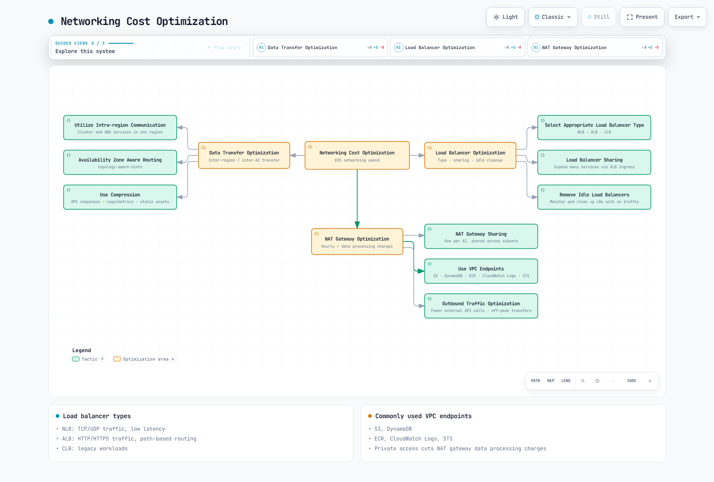

# Amazon EKSのコスト最適化

> **検証範囲**: 現在のAWS料金／サポート文書を確認し、Kubernetesマニフェストを1.36に照らして確認しています。実際のEKSバージョンとアドオンはAWSのサポートカタログで選択してください。
> **最終更新**: 2026年10月16日

Amazon EKS（Elastic Kubernetes Service）を使うと、コンテナ化されたアプリケーションを簡単にデプロイ、管理、スケールできます。一方で、コストを適切に管理することも重要です。このガイドでは、EKSのコストを最適化するための戦略とベストプラクティスを説明します。

以下のコマンドは設定例であり、実際にデプロイした結果や削減額を示すものではありません。適用する前に、アカウント、リージョン、既存リソースの所有者、ワークロード要件、ツールの対応バージョンを確認してください。過去の価格前提は、現在のサービスの動作とは分けて記載します。

## 目次

1. [EKSのコスト構成要素](#eks-cost-components)
2. [FinOpsの原則とEKS](#finops-principles-and-eks)
3. [コンピューティングコストの最適化](#compute-cost-optimization)
4. [ストレージコストの最適化](#storage-cost-optimization)
5. [ネットワークコストの最適化](#networking-cost-optimization)
6. [リソース管理とガバナンス](#resource-management-and-governance)
7. [コストの監視と分析](#cost-monitoring-and-analysis)
8. [コスト最適化のベストプラクティス](#cost-optimization-best-practices)

## EKSのコスト構成要素 {#eks-cost-components}

Amazon EKSの利用料金は、次の要素から成ります。


[🔍 インタラクティブ図を見る](https://www.atomai.click/kubernetes-docs/archmaps/en-eks-07-eks-cost-optimization-0.html)

## FinOpsの原則とEKS {#finops-principles-and-eks}

FinOpsは、テクノロジーから得るビジネス価値を最大化するための運用フレームワークであり、組織文化でもあります。エンジニアリング、財務、ビジネスの各チームが、迅速でデータに基づく意思決定と財務責任を共有します。この章では、その考え方をEKSに適用します。

### FinOpsフレームワークの主要原則

FinOps Foundationは、チーム間の協働、意思決定におけるビジネス価値、利用への責任、適時で正確かつ利用しやすいデータ、中央チームによる支援、クラウドの変動費モデルの意図的な活用を重視しています。以下のEKSプラクティスは、これらの原則の適用例であり、公式の「6原則」フレームワークを別途定義するものではありません。

<!-- Pending parent diagram repair: see /tmp/eks-cost-optimization-audit/diagram-review.json


[🔍 インタラクティブ図を見る](https://www.atomai.click/kubernetes-docs/archmaps/en-eks-07-eks-cost-optimization-1.html)
-->

### EKSへのFinOpsの適用

1. **コストの可視化**
   - KubernetesのNamespace、ラベル、アノテーションを使ってコストを配賦する
   - AWS Cost ExplorerやKubecostなどを統合し、詳細なコストを分析する
   - チーム、アプリケーション、環境ごとに分析する

2. **共同責任モデルの導入**
   - チームごとにコストを配賦して報告する
   - コスト最適化の目標を設定し、進捗を追跡する
   - コスト削減への貢献を評価する

3. **継続的な最適化の自動化**
   - オートスケーリングポリシーを導入する
   - Spotインスタンスを自動的に活用する
   - 無駄の候補を検出し、所有者と保持要件を確認した後にのみリソースを削除する

4. **コストの予測と計画**
   - ワークロードのパターンを分析してコストを予測する
   - Reserved InstancesとSavings Plansを活用する
   - コスト異常を検出して通知する

### FinOpsの最新ツールとテクノロジー

1. **Kubecost**: Kubernetesのコストを監視し、最適化するツール
2. **AWS Cost Anomaly Detection**: 異常なコスト増加を検出するサービス
3. **Karpenter**: ノードを効率的にプロビジョニングし、コストを最適化するツール
4. **Goldilocks**: リソースのrequestsとlimitsを最適化するツール
5. **Vertical Pod Autoscaler**: Podのリソースrequestsを自動調整するツール

### EKSクラスターの料金

公開されているバージョンサポート料金は次のとおりです。

- **標準サポート**: クラスター1つあたり1時間$0.10。
- **延長サポート**: クラスター1つあたり合計1時間$0.60（基本料金$0.10 + 延長サポート料金$0.50）です。「延長クラスター」が別途$0.10であるという意味ではありません。

標準サポートはEKSバージョンのリリースから14か月間で、その後12か月間は延長サポートになります。正確なバージョンの日付とサポートポリシーは[EKSリリースカレンダー](https://docs.aws.amazon.com/eks/latest/userguide/kubernetes-versions.html)で確認してください。Provisioned Control Planeの各ティア、Auto Mode、Hybrid Nodes、EKS Capabilitiesには別料金が発生する場合があります。EC2／Fargate、ストレージ、ネットワーク、可観測性の料金も別です。概要図の$0.10という表示は、バージョンの標準サポート料金だけを示しています。[現在のEKS料金](https://aws.amazon.com/eks/pricing/)を確認してください。

### コンピューティングコスト

EKSクラスターのワーカーノードにかかる料金です。

- **EC2インスタンス**: ノードグループに使用するEC2インスタンスの料金
- **Fargate**: 実測使用量ではなく、プロビジョニングしたPodのvCPU／メモリ構成と実行時間に対する料金。該当するストレージ料金も含めます。

### ストレージコスト

EKSクラスターで使うストレージの料金です。

- **EBSボリューム**: 永続ボリュームに使用するEBSの料金
- **EFS**: 共有ファイルシステムに使用するEFSの料金
- **S3**: オブジェクトストレージに使用するS3の料金

### ネットワークコスト

EKSクラスターのネットワークに関連する料金です。

- **データ転送**: AZ間、リージョン間、インターネットへの転送に適用される料金。正確な方向とサービス経路によって異なります。
- **ロードバランサー**: サービスに使用するロードバランサーの料金
- **NATゲートウェイ**: プライベートサブネットからのアウトバウンド通信に使うNATゲートウェイの料金

### その他のコスト

- **CloudWatch**: 監視とログ記録に使用するCloudWatchの料金
- **ECR**: コンテナイメージの保存に使用するECRの料金
- **その他のAWSサービス**: EKSクラスターと併用するその他のAWSサービスの料金

## コンピューティングコストの最適化 {#compute-cost-optimization}

通常、コンピューティングはEKSクラスターの中で最大のコスト要素です。次の方法で最適化できます。


[🔍 インタラクティブ図を見る](https://www.atomai.click/kubernetes-docs/archmaps/en-eks-07-eks-cost-optimization-2.html)

### 適切なインスタンスタイプの選択

ワークロードに合ったインスタンスタイプを選ぶことが重要です。

#### インスタンスタイプのファミリー選択

ワークロードの特性に応じて選びます。以下は世代の古い例であり、最新世代の推奨ではありません。リージョンでの提供状況、プロセッサアーキテクチャ、AMI、料金を確認してください。

- **汎用（T3、M5、M6）**: コンピューティング、メモリ、ネットワークのバランスが必要なワークロード
- **コンピューティング最適化（C5、C6）**: 高性能プロセッサを必要とする計算負荷の高いワークロード
- **メモリ最適化（R5、R6、X1）**: 大規模インメモリデータベースやキャッシュなど、メモリを多く使うワークロード
- **ストレージ最適化（I3、D2）**: 高いディスクI/Oを必要とするワークロード
- **アクセラレーテッドコンピューティング（P3、G4、Inf1）**: GPUや機械学習アクセラレーターを必要とするワークロード

#### インスタンスサイズの最適化

ワークロードの要件に合うサイズを選びます。

- 大きすぎるインスタンスはリソースの無駄につながります。
- 小さすぎるインスタンスは性能上の問題を引き起こす可能性があります。
- CloudWatch Container InsightsまたはKubernetesメトリクスで実際の使用量を監視し、適切なサイズを選びます。

#### インスタンス世代の検討

新世代への移行を検討するときは、自分のワークロードで測定し、リージョンごとの料金と比較してください。次は以前の世代間の移行例です。x86（`i`）からGraviton（`g`）へ移行する場合は、arm64イメージと依存関係にも互換性が必要です。

- M5の代わりにM6iまたはM6gを使う
- C5の代わりにC6iまたはC6gを使う
- R5の代わりにR6iまたはR6gを使う

### Spotインスタンスの活用

AWSはオンデマンド料金と比較して最大90%のSpot割引を宣伝していますが、実際の価格、利用可能な容量、中断リスクは変動します。アプリケーションがステートレスであることだけでは、中断に耐えられるとは限りません。

#### Spotインスタンスに適したワークロード

- **ステートレスアプリケーション**: 状態を保存しないアプリケーション
- **耐障害性のあるアプリケーション**: インスタンス中断に対応できるアプリケーション
- **バッチ処理ジョブ**: 中断後に再実行できるジョブ
- **CI/CDパイプライン**: ビルドとテストのジョブ

#### マネージドノードグループでのSpot利用

この例は既存クラスターにマネージドノードグループを作成します。Cluster Autoscalerはインストールしません。プライベートサブネット、IAMロール、AMI、インスタンスタイプの多様性を、設定を所有するチームと確認します。スケーリングやIAMの設定はコントローラーの所有者を通じて明示的に行い、広範なアドオン権限をノードロールに付与しないでください。
```bash
eksctl create nodegroup \
  --cluster my-cluster \
  --name my-spot-ng \
  --managed \
  --node-type m5.large \
  --nodes-min 2 \
  --nodes-max 5 \
  --spot
```

#### KarpenterでのSpotプロビジョニング

前提条件は、KarpenterとCRDの導入、範囲を限定したコントローラーIAM、認可済みノードロール、discoveryタグ付きサブネット／セキュリティグループ、中断通知用キューです。EKS 1.36では、現在の互換性表に基づきKarpenter 1.13以降が必要です。次のリソースはコントローラー自体をインストールしません。インスタンスタイプ一覧と制限は例であり、コスト上限ではありません。解決後のAMIも確認してください。`al2023@latest`は更新され続ける選択子であり、ドリフトや置き換えを引き起こす可能性があります。本番変更では、テスト済みのaliasバージョンまたはAMI IDを固定してください。
```yaml
apiVersion: karpenter.sh/v1
kind: NodePool
metadata:
  name: spot
spec:
  template:
    spec:
      requirements:
      - key: karpenter.sh/capacity-type
        operator: In
        values: ["spot"]
      - key: kubernetes.io/arch
        operator: In
        values: ["amd64"]
      - key: node.kubernetes.io/instance-type
        operator: In
        values: ["m5.large", "m5.xlarge", "m5.2xlarge"]
      nodeClassRef:
        group: karpenter.k8s.aws
        kind: EC2NodeClass
        name: spot-class
  limits:
    cpu: 1000
    memory: 1000Gi
  disruption:
    consolidationPolicy: WhenEmpty
    consolidateAfter: 30s
---
apiVersion: karpenter.k8s.aws/v1
kind: EC2NodeClass
metadata:
  name: spot-class
spec:
  role: KarpenterNodeRole-my-cluster
  amiSelectorTerms:
    - alias: al2023@latest
  subnetSelectorTerms:
    - tags:
        karpenter.sh/discovery: my-cluster
  securityGroupSelectorTerms:
    - tags:
        karpenter.sh/discovery: my-cluster
```

#### Spot中断への対応

Spotインスタンスの中断への対応では、次のベストプラクティスに従います。

1. **複数のインスタンスタイプを使う**: 複数のタイプに分散して中断リスクを下げます。
2. **複数のAZを使う**: 複数のAZにインスタンスを配置します。
3. **ノードセットごとに中断対応の所有者を1つ選ぶ**: マネージドノードグループはSpot中断／リバランスをすでに処理します。KarpenterのノードではKarpenter標準の中断キューを設定し、同じノードにNode Termination Handlerを重ねて導入しないでください。自己管理ASGでは[AWS Node Termination Handler](https://github.com/aws/aws-node-termination-handler)を、IMDS方式またはキュー方式のいずれかと、対応する権限／イベント配線を明示して使えます。
4. **アプリケーションの復旧を設計する**: 代替容量が必ず確保されるとは限りません。正常終了、再試行／チェックポイント、障害ドメインをまたぐレプリカを、利用できる中断猶予に合わせます。PDBはEC2によるSpotインスタンスの回収を防げません。

### Savings PlansとReserved Instances

予測可能なワークロードでは、Savings PlansまたはReserved Instancesによって料金を抑えられます。

#### Compute Savings Plans

Compute Savings Plansは1年または3年の契約で、オンデマンド料金から最大66%の割引を提供します。

- **柔軟性**: インスタンスファミリー、サイズ、OS、テナンシー、リージョンにかかわらず適用されます。
- **EC2、Fargate、Lambdaを対象とする**: 複数のコンピューティングサービスに適用されます。

#### EC2 Instance Savings Plans

EC2 Instance Savings Plansは、特定リージョンの特定インスタンスファミリーに対して最大72%の割引を提供します。

- **中程度の柔軟性**: 特定リージョンのインスタンスファミリー内で、サイズとOSをまたいで適用されます。
- **割引率が高い**: Compute Savings Plansよりも高い割引率を提供します。

#### Reserved Instances

AWSは現在、RIの割引を最大72%と案内しています。StandardとConvertibleでは変更／交換の規則が異なり、RegionalとZonalでも適用範囲が異なります。Zonal RIにはそのAZのキャパシティ予約が含まれますが、Regional RIには含まれません。RIは条件に一致する使用量に適用される請求上の特典であり、Kubernetesスケジューラーでも、最大割引を得る保証でもありません。

Savings Plansは1年または3年にわたり対象支出を1時間あたりでコミットし、RIは対象インスタンス使用量にコミットします。rightsizing後の安定したベースラインを使って契約量を決め、未使用コミットメントのリスクも確認します。どちらもSpot使用量に追加割引を適用するものではなく、広告上の最大値はこのクラスターの実測割引ではありません。

### FargateとEC2のコスト比較

FargateとEC2のどちらを使うか決める際は、料金も比較します。

#### Fargateの利点

- **運用負荷の軽減**: ノード管理が不要です。
- **リソースを細かくプロビジョニングできる**: Pod単位で割り当てます。
- **別管理のアイドルワーカーノードがない**: ただし、料金はプロビジョニングしたPodの容量と実行時間に基づき、丸め処理と最低課金時間も適用されます。

#### EC2の利点

- **大規模ワークロードで費用対効果を得やすい**: リソース利用率が高い場合に適します。
- **選択できるインスタンスタイプが多い**: さまざまなワークロードに合わせて選べます。
- **Spotを利用できる**: 追加のコスト削減が可能です。

#### コスト比較の例

**過去の参考値（価格の出典／リージョンは未記録。現在の見積もりやベンチマークではありません）**: vCPU 2基、メモリ4 GBを要求するアプリケーションです。元の単価と計算を以下に残します。EKS固有の予約分とノードのオーバーヘッドは含みません。

**Fargateの料金**:
- vCPU: 1 vCPU-hourあたり$0.04048 × 2 = 1時間あたり$0.08096
- メモリ: 1 GB-hourあたり$0.004445 × 4 = 1時間あたり$0.01778
- 合計: 1時間あたり$0.09874

**EC2の料金（t3.medium）**:
- オンデマンド: 1時間あたり$0.0416
- Spot: 約$0.0125/時間（70%割引と仮定）

**割り当てに関する補足**: EKS FargateではKubernetesコンポーネント用に256 MBが追加され、対応する構成に切り上げられます。この前提では、2 vCPU／4 GBの要求に対してプロビジョニングされるのは**2 vCPU／5 GB**です。同じ過去の料金を使うと、`2 × 0.04048 + 5 × 0.004445 = 0.103185 USD/hour`です。これは算術計算であり、新しい料金見積もりではありません。Linux Fargateの課金はイメージのダウンロードから始まり、最低1分間です。EC2 `t3.medium`の公称容量は2 vCPU／4 GiBですが、OS、Kubernetes、DaemonSetの予約を差し引くと割り当て可能なリソースは少なくなります。このPodを配置できるとは限らず、CPUを継続使用するとT3クレジット料金が発生することもあります。実際に配置可能な容量計画を使って、EBS、ネットワーク、クラスター料金、利用率、運用コストも含めて比較してください。この表から、サービスが同等な場合の勝者を決めることはできません。

### オートスケーリングの最適化

適切なオートスケーリング戦略を導入することでコストを最適化できます。

#### Cluster Autoscaler

Cluster Autoscalerは、スケジュールできないPodに応じてASGをスケールし、要求リソース、再スケジュール、disruptionの確認に基づいて対象ノードを削除します。単に実測CPUが低いかどうかで判断するわけではありません。Kubernetesのマイナーバージョンをクラスターと一致させ、実際のASGにdiscoveryタグを付け、専用のワークロードIAMロールを構成してください。EKS／ノードグループのタグが、すべての下位リソースに自動で伝播するわけではありません。所有者が管理するリリースを準備するには、[上流AWS設定](https://github.com/kubernetes/autoscaler/tree/master/cluster-autoscaler/cloudprovider/aws)と[EKSの推奨事項](https://docs.aws.amazon.com/eks/latest/best-practices/cas.html)を参照してください。

以下のチャート値はCLI引数になります。存在しない`CLUSTER_AUTOSCALER_*`環境変数を設定しても構成されず、編集していない`master`の例を適用しても、クラスター固有のIAMやdiscovery設定にはなりません。以下の時間は調整用の例です。短くすると頻繁な入れ替わりが増える可能性があります。
```yaml
# Values fragment for the upstream cluster-autoscaler Helm chart.
# Merge into the existing release's reviewed values, including workload IAM.
autoDiscovery:
  clusterName: my-cluster
awsRegion: us-west-2
extraArgs:
  expander: least-waste
  scale-down-delay-after-add: 10m
  scale-down-unneeded-time: 10m
  max-node-provision-time: 15m
```

#### Karpenter

Karpenterは固定ASGをサイズ変更するのではなく、NodePool／EC2NodeClassの制約に基づいてノードをプロビジョニングします。起動までの時間とコストは、ワークロードと利用可能な容量によって異なります。前述したコントローラー、IAM、AMIの前提条件も適用されます。ノードの所有権をCluster Autoscaler管理のASGと分けてください。
```yaml
apiVersion: karpenter.sh/v1
kind: NodePool
metadata:
  name: default
spec:
  template:
    spec:
      requirements:
      - key: kubernetes.io/arch
        operator: In
        values: ["amd64"]
      - key: node.kubernetes.io/instance-type
        operator: In
        values: ["m5.large", "m5.xlarge", "m5.2xlarge"]
      nodeClassRef:
        group: karpenter.k8s.aws
        kind: EC2NodeClass
        name: default-class
  limits:
    cpu: 1000
    memory: 1000Gi
  disruption:
    consolidationPolicy: WhenEmpty
    consolidateAfter: 30s
---
apiVersion: karpenter.k8s.aws/v1
kind: EC2NodeClass
metadata:
  name: default-class
spec:
  role: KarpenterNodeRole-my-cluster
  amiSelectorTerms:
    - alias: al2023@latest
  subnetSelectorTerms:
    - tags:
        karpenter.sh/discovery: my-cluster
  securityGroupSelectorTerms:
    - tags:
        karpenter.sh/discovery: my-cluster
```

Karpenterのコスト最適化設定:

- **disruption.consolidateAfter**: Podの追加／削除後、統合を検討するまでの待ち時間。ポリシーとdisruption確認に従います（例: `30s`。旧`ttlSecondsAfterEmpty`を置き換えます）。
- **disruption.consolidationPolicy**: ノード統合ポリシーです。空のノードだけ削除する`WhenEmpty`か、過少利用ノードも統合する`WhenEmptyOrUnderutilized`を選びます。後者は旧`consolidation.enabled: true`に相当します。
- **template.spec.requirements**（`node.kubernetes.io/instance-type`）: 費用対効果の高いインスタンスタイプを指定します。

#### Horizontal Pod Autoscaler（HPA）

HPAはCPU使用率またはカスタムメトリクスに応じてPod数を自動調整します。
```yaml
apiVersion: autoscaling/v2
kind: HorizontalPodAutoscaler
metadata:
  name: app-hpa
spec:
  scaleTargetRef:
    apiVersion: apps/v1
    kind: Deployment
    name: app
  minReplicas: 2
  maxReplicas: 10
  metrics:
  - type: Resource
    resource:
      name: cpu
      target:
        type: Utilization
        averageUtilization: 70
  - type: Resource
    resource:
      name: memory
      target:
        type: Utilization
        averageUtilization: 80
```

CPU／メモリの使用率目標はrequestsに対する割合です。resource metrics APIと対象コンテナのrequestsが必要になります。複数のメトリクスを指定するとHPAは必要なレプリカ数が最大となるメトリクスを選び、メトリクスを取得できない場合はscale-downできないことがあります。レプリカを増やしてもメモリ使用量が下がるとは限らないため、アプリケーションの動作を検証してください。EKSがcontroller-managerのフラグを管理するため、グローバルフラグを編集できると想定せず、HPAごとの`spec.behavior.scaleDown.stabilizationWindowSeconds`を設定します。HPAがrequestsを使用率の分母にしている間は、VPAで同じCPU／メモリrequestsを自動変更しないでください。

#### Vertical Pod Autoscaler（VPA）

VPAはPodのCPU／メモリrequestsを自動調整し、リソース利用を最適化します。
```yaml
apiVersion: autoscaling.k8s.io/v1
kind: VerticalPodAutoscaler
metadata:
  name: app-vpa
spec:
  targetRef:
    apiVersion: apps/v1
    kind: Deployment
    name: app
  updatePolicy:
    updateMode: "Off"
  resourcePolicy:
    containerPolicies:
    - containerName: '*'
      minAllowed:
        cpu: 50m
        memory: 100Mi
      maxAllowed:
        cpu: 1
        memory: 1Gi
```

この例では、上のHPAと競合せず推奨値を集めるために**Off**を使います。最初にVPAコンポーネント／CRDとメトリクス依存関係を導入してください。

- **Off**: 推奨値のみを計算します。
- **Initial**: 新規作成Podにadmission時点でrequestsを設定します。
- **Recreate**: updaterがPodをevictし、コントローラーが推奨値で再作成する場合があります。eviction policy／PDBに従います。
- **Auto**: Recreateの非推奨エイリアスです。新規構成では明示的なモードを選びます。
- In-placeモードには、互換性のあるVPA／Kubernetesリリースと、文書化されたfeature gateが必要です。選んだモードの仕様を確認してください。`InPlaceOrRecreate`はevictionにフォールバックできますが、`InPlace`には再作成のフォールバックがありません。自動更新を有効にする前に上限、disruption、ピーク需要を確認します。

## ストレージコストの最適化 {#storage-cost-optimization}

EKSクラスターでストレージにかかるコストも大きな要素です。次の方法で最適化できます。


[🔍 インタラクティブ図を見る](https://www.atomai.click/kubernetes-docs/archmaps/en-eks-07-eks-cost-optimization-3.html)

### EBSボリュームの最適化

EBSボリュームは主にEKSクラスターの永続ストレージに使われます。

#### 適切なボリュームタイプの選択

ワークロードに適したEBSボリュームタイプを選びます。

- **gp3**: 多くのワークロードに適した汎用SSD
- **gp2**: 旧世代の汎用SSD。gp3への移行を検討します。
- **io1／io2**: 高性能ワークロード向けのProvisioned IOPS SSD
- **st1**: スループットを重視するワークロード向けのThroughput Optimized HDD
- **sc1**: アクセス頻度の低いデータ向けのCold HDD

gp3は容量、IOPS、スループットが別々に課金されます。基準値の3,000 IOPSが、すべてのgp2ボリュームより高いわけではありません。以下の上限は一般的なAWSリージョンの現行ボリューム向けで、容量とIOPS比、インスタンス上限にも左右されます。Outpostsでは上限が異なります。ストレージ料金の$0.08／$0.10はリージョンや日付が記録されていない参考値です。プロビジョニングしたIOPS／スループットも含めて現在の見積もりを取得してください。

| ボリュームタイプ | 基準IOPS | 最大IOPS | 基準スループット | 最大スループット | 1 GBあたりの価格 |
|---|---:|---:|---:|---:|---:|
| gp3 | 3,000 | 80,000 | 125 MiB/s | 2,000 MiB/s | $0.08/GB-month（参考値） |
| gp2 | 3 IOPS/GiB、最低100。小容量で条件を満たす場合はバースト可能 | 16,000 | サイズ／I/Oに依存 | 250 MiB/s | $0.10/GB-month（参考値） |

#### gp3への移行

このクラスは標準のEBS CSIドライバー（`ebs.csi.aws.com`）で新しいgp3ボリュームを作ります。既存ボリュームを移行せず、クラスターのデフォルトも変更しません。Auto Modeは別のprovisioner（`ebs.csi.eks.amazonaws.com`）を使うため、適切なノード／ストレージ移行経路が必要です。導入済みドライバー、IAM／KMS権限、既存クラスの所有者、トポロジーを確認してください。`Retain`は解放後のストレージを所有者の確認まで保持し、その間も料金が発生する場合があります。
```yaml
apiVersion: storage.k8s.io/v1
kind: StorageClass
metadata:
  name: gp3
provisioner: ebs.csi.aws.com
parameters:
  type: gp3
  encrypted: "true"
volumeBindingMode: WaitForFirstConsumer
reclaimPolicy: Retain
allowVolumeExpansion: true
```

既存PVCをgp3に移行する場合:

1. 導入済みのCSIスナップショットコンポーネントを使ってアプリケーション整合性のあるバックアップ／スナップショットを取得し、準備状況と復元アクセスを確認します。
2. gp3クラスを使って**新しい**PVCへ復元します。バインド済みPVCのStorageClassはその場で切り替えられません。
3. 復元をテストし、レビュー済みの切り替え手順でワークロードを移します。復旧を確認するまでは元のボリュームを保持します。

対応構成では、EBS Elastic Volumesによるボリュームタイプのインプレース変更も選択肢です。設定ドリフトを作らないよう、CSI／IaCの所有者と調整してください。[ストレージガイド](04-eks-storage-part1.md)を参照してください。

#### ボリュームサイズの最適化

必要なサイズだけをプロビジョニングします。

- 過剰なサイズのボリュームには不要な料金が発生します。
- ファイルシステムの使用量を監視し、必要なら対応するボリュームを拡張します。EBSボリュームとKubernetes PVCはその場で縮小できません。縮小するには小さい新規ボリュームを作成し、アプリケーションを考慮してデータを移行します。
- `allowVolumeExpansion`は、対応する拡張要求を許可する設定です。使用量の監視や自動リサイズは行いません。自動拡張には別途コントローラー、上限、障害処理の構成が必要です。

#### ボリュームのライフサイクル管理

不要なボリュームを特定して削除します。

- 未使用のPVC／PVを定期的に確認します。
- Podが終了しても、PVC／PVを廃棄してよいとは限りません。Claimやボリュームを削除する前に、StatefulSetの保持設定、待機中のコンシューマー、バックアップ、所有者を確認します。
- PVのreclaim policy（DeleteまたはRetain）を適切に設定します。

### EFSコストの最適化

複数ノードからの共有アクセスを必要とするワークロードにはEFSが適しています。

#### 適切なスループットモードの選択

ワークロードに合うEFSスループットモードを選びます。

- **Bursting Throughput**: 断続的なアクセスパターンに適します。
- **Provisioned Throughput**: 予測可能な性能が必要なワークロードに適します。
- **Elastic Throughput**: 変動の大きいワークロードに適します。

#### ライフサイクル管理

EFSライフサイクルポリシーは、条件を満たしたアクセス頻度の低いファイルをIA／Archiveへ移し、アクセス時にプライマリストレージへ戻すこともできます。アクセス料金、最低課金サイズ／期間、スループットモード、アクセスパターンによって削減額が変わります。以下の例は既存ポリシー配列を出力して確認します。IAルールをその配列内で編集し、Archive／プライマリへの復帰に必要な既存項目を残したうえで、望ましい構成全体を送信してください。
```bash
aws efs describe-lifecycle-configuration \
  --file-system-id fs-1234567890abcdef0 \
  --query LifecyclePolicies --output json > efs-lifecycle-policies.json
# Edit the exported array; an IA rule is {"TransitionToIA":"AFTER_30_DAYS"}.
# Preserve required Archive/return-to-primary rules and review the complete array.
aws efs put-lifecycle-configuration \
  --file-system-id fs-1234567890abcdef0 \
  --lifecycle-policies file://efs-lifecycle-policies.json
```

#### アクセスパターンの最適化

アクセスパターンを最適化してEFSの料金を抑えます。

- 小さなファイルより大きなファイルを使います。
- メタデータ操作を減らします。
- シーケンシャルアクセスを使います。

### S3コストの最適化

S3はログ、バックアップ、静的コンテンツなどを保存する費用対効果の高い選択肢です。

#### ストレージクラスの最適化

ワークロードに合ったS3ストレージクラスを選びます。

- **S3 Standard**: 頻繁にアクセスするデータ
- **S3 Intelligent-Tiering**: アクセスパターンが変化するデータ
- **S3 Standard-IA**: アクセス頻度が低いデータ
- **S3 One Zone-IA**: アクセス頻度が低く、重要度が低いデータ
- **S3 Glacier**: アーカイブデータ

#### ライフサイクルポリシー

この参考ルールは、現行オブジェクトを30日／90日で移行し、365日で期限切れにします。復旧に必要な時間、保持／Object Lock要件、移行／リクエスト料金、最低保存期間を確認してください。新規または変更した構成では、128 KB未満のオブジェクトは移行対象から除外されるのがデフォルトです。バージョニングしたバケットでは、旧バージョンも別途管理してください。現行バージョンの期限切れはdelete markerを作るだけの場合があり、古いデータの料金が残ります。put-bucket-lifecycle-configurationはバケット全体のライフサイクル設定を置き換えるため、無関係なルールもマージして残します。
```json
{
  "Rules": [
    {
      "ID": "Move to IA after 30 days, Glacier after 90 days",
      "Status": "Enabled",
      "Filter": {"Prefix": "logs/"},
      "Transitions": [
        {
          "Days": 30,
          "StorageClass": "STANDARD_IA"
        },
        {
          "Days": 90,
          "StorageClass": "GLACIER"
        }
      ],
      "Expiration": {
        "Days": 365
      }
    }
  ]
}
```

#### S3リクエストの最適化

S3リクエスト料金を最適化します。

- 小さなオブジェクトを大きなオブジェクトにまとめます。
- 不要なLIST操作を減らします。
- Multipart uploadは転送や再試行を効率化できますが、リクエストと未完了パートの保存料金が増えます。中断されたアップロードのabort／cleanupを構成してください。Transfer Accelerationには追加料金が発生することがあり、レイテンシー／スループット向けの機能であって、リクエスト料金を自動的に削減する機能ではありません。

## ネットワークコストの最適化 {#networking-cost-optimization}

データ転送が多い場合など、ネットワークコストが大きくなることがあります。次の方法で最適化します。

<!-- Pending parent diagram repair: see /tmp/eks-cost-optimization-audit/diagram-review.json


[🔍 インタラクティブ図を見る](https://www.atomai.click/kubernetes-docs/archmaps/en-eks-07-eks-cost-optimization-4.html)
-->

### データ転送の最適化

#### リージョン内通信の活用

可能な限り同じリージョン内で通信し、リージョン間データ転送料金を抑えます。

- EKSクラスターと関連するAWSサービスを同じリージョンに配置します。
- 複数リージョンにまたがる場合は、リージョン間データ転送を減らします。

#### AZを考慮したルーティング

AZ間のデータ転送料金を抑えるため、AZを考慮したルーティングを構成します。

- topology-aware service routingを使います。
- 複数AZの可用性を保ちながら、対応している場合はローカルエンドポイントを優先します。`trafficDistribution: PreferSameZone`はKubernetes 1.35以降で安定版です。クラスター／プロキシの実装を確認してください。これはローカルエンドポイントがない場合にフォールバックする優先設定であり、AZ間通信がゼロになる保証ではありません。Podの配置affinityだけではServiceトラフィックをルーティングできません。
```yaml
apiVersion: v1
kind: Service
metadata:
  name: my-service
spec:
  trafficDistribution: PreferSameZone
  selector:
    app: my-app
  ports:
  - port: 80
    targetPort: 8080
  type: ClusterIP
```

#### 圧縮の利用

データ転送前に圧縮して転送量を減らします。

- APIレスポンスの圧縮
- ログとメトリクスの圧縮
- イメージと静的アセットの最適化

### ロードバランサーの最適化

#### 適切なロードバランサータイプの選択

ワークロードに適したロードバランサーを選びます。

- **Network Load Balancer（NLB）**: 低レイテンシーが必要なTCP／UDPトラフィック
- **Application Load Balancer（ALB）**: パスベースルーティングが必要なHTTP／HTTPSトラフィック
- **Classic Load Balancer（CLB）**: レガシーワークロード

#### ロードバランサーの共有

複数のサービスでロードバランサーを共有してコストを抑えます。

- AWS Load Balancer Controllerを使います。
- Ingressリソースを使って複数のサービスを公開します。

標準のAWS Load Balancer Controllerを導入する場合は、正しいチャート、IAM／ServiceAccount、サブネット、セキュリティグループを含む[ネットワークガイド](03-eks-networking-part1.md)を参照してください。既存のコントローラー所有者を通じてください。Auto Modeには異なる組み込み連携があり、同じ導入手順やクラス設定が使えるとは限りません。以下のIngressで参照する2つのBackend Serviceは同じ名前空間に存在し、ポート80を公開する必要があります。IPターゲットモードではPod IPへ到達できる必要があります。これはHTTPルーティングの例です。公開する本番環境では、TLS、DNS、アクセス制御も別途レビューしてください。
```yaml
apiVersion: networking.k8s.io/v1
kind: Ingress
metadata:
  name: shared-ingress
  annotations:
    alb.ingress.kubernetes.io/scheme: internet-facing
    alb.ingress.kubernetes.io/target-type: ip
spec:
  ingressClassName: alb
  rules:
  - host: service1.example.com
    http:
      paths:
      - path: /
        pathType: Prefix
        backend:
          service:
            name: service1
            port:
              number: 80
  - host: service2.example.com
    http:
      paths:
      - path: /
        pathType: Prefix
        backend:
          service:
            name: service2
            port:
              number: 80
```

#### アイドル状態のロードバランサーの削除

使われていないロードバランサーを特定し、削除します。

- トラフィックのないロードバランサーを監視します。
- テスト／開発環境で不要になったロードバランサーを削除します。

### NATゲートウェイの最適化

NATゲートウェイには時間あたりの料金とデータ処理料金が発生します。

#### NATゲートウェイの共有

複数のサブネットでNATゲートウェイを共有するとコストを抑えられます。

- AZ単位のNATゲートウェイでは、同じAZ内のプライベートサブネットがローカルゲートウェイを共有できます。AZごとの可用性と固定時間料金を考慮します。
- 複数AZで1つのAZ単位ゲートウェイを共有すると、AZ間依存と転送料金が発生する可能性があります。これは意図的なトレードオフであり、常に安価な高可用性設計ではありません。現在のリージョンNATオプションは、文書化された可用性／料金モデルに基づき別途評価してください。

#### VPCエンドポイントの利用

実際の通信量に基づき、エンドポイント料金とNAT経路の料金を比較してください。S3／DynamoDBのGateway Endpointには、エンドポイントの時間料金やデータ処理料金が追加されません。ECR、Logs、STSなどのInterface Endpointには別料金があり、DNS／セキュリティグループの構成も必要です。以下は既存のレビュー済みルートテーブルにGateway Endpointを作ります。適切なEndpoint policyを適用してください。ECRからイメージを取得する経路では、ECR API Endpointだけでなく、通常`ecr.api`／`ecr.dkr`のInterface EndpointとS3アクセスの両方が必要です。
```bash
# Create S3 VPC Endpoint
aws ec2 create-vpc-endpoint \
  --vpc-id vpc-1234567890abcdef0 \
  --service-name com.amazonaws.us-west-2.s3 \
  --route-table-ids rtb-1234567890abcdef0

# Create DynamoDB VPC Endpoint
aws ec2 create-vpc-endpoint \
  --vpc-id vpc-1234567890abcdef0 \
  --service-name com.amazonaws.us-west-2.dynamodb \
  --route-table-ids rtb-1234567890abcdef0
```

よく使われるVPCエンドポイント:

- S3
- DynamoDB
- ECR
- CloudWatch Logs
- STS

#### アウトバウンドトラフィックの最適化

NATゲートウェイを通過するアウトバウンド通信を最適化します。

- 不要な外部API呼び出しを減らします。
- スケジュール調整で競合を減らせますが、通常のNAT／データ転送料金には一般的なオフピーク割引はありません。課金対象の転送バイト数または稼働時間を減らしてください。
- データを圧縮します。

## リソース管理とガバナンス {#resource-management-and-governance}

EKSクラスターのコストを抑えるには、効果的なリソース管理とガバナンスが重要です。次の方法で管理できます。


[🔍 インタラクティブ図を見る](https://www.atomai.click/kubernetes-docs/archmaps/en-eks-07-eks-cost-optimization-5.html)

### リソースrequestsとlimitsの最適化

#### 適切なリソースrequestsの設定

アプリケーションの実際のリソース要件に合ったrequestsを設定します。

- 高すぎるrequestsはリソースの無駄になります。
- 低すぎるrequestsは性能上の問題を引き起こす可能性があります。
- VPA（Vertical Pod Autoscaler）を使ってrequestsを最適化します。
```yaml
apiVersion: v1
kind: Pod
metadata:
  name: app
spec:
  containers:
  - name: app
    image: app:latest
    resources:
      requests:
        cpu: 100m
        memory: 256Mi
      limits:
        cpu: 500m
        memory: 512Mi
```

#### リソースlimitsの設定

コンテナのリソース使用が過剰にならないようlimitsを設定します。

- CPU limitは通常throttlingを起こします。低すぎると、ノードにCPUの余裕があってもレイテンシーが悪化する場合があります。
- メモリlimitは事後的に適用され、OOMによる終了につながる場合があります。一時的にも上限を超えないことを保証する設定ではありません。万能な比率ではなく、ワークロードの実測値をもとにrequests／limitsを決めます。

#### QoSクラスの理解

KubernetesのQoS（Quality of Service）クラスを理解し、使い分けます。

ここではコンテナ単位のリソース設定を前提とします。

- **Guaranteed**: すべてのコンテナにCPUとメモリのrequestsがあり、それぞれ対応するlimitsと同じ値です。
- **Burstable**: CPU／メモリのrequestまたはlimitの一部が設定されているものの、Guaranteedの条件を満たしません。
- **BestEffort**: どのコンテナにもCPU／メモリのrequestsまたはlimitsがありません。

QoSはPod Priorityとは異なり、絶対的な退避順序も定めません。ノードに圧力がある場合、kubeletは使用量がrequestsを超えているか、Pod Priority、超過量の相対値を考慮します。ディスク圧迫による退避も異なり、CPU／メモリのQoSではephemeral-storageのrequestsは分類されません。Pod-level resourcesを使う場合は[現在のQoS規則](https://kubernetes.io/docs/concepts/workloads/pods/pod-qos/)を確認してください。

### NamespaceとResourceQuota

#### Namespaceによる分離

Namespaceを使ってリソースを論理的に分けます。

- チーム、環境、アプリケーションごとにNamespaceを作成します。
- Namespaceごとにリソース使用量を監視します。

#### ResourceQuotaの設定

ResourceQuotaは、既存Namespace内で許可されるリソースrequests／limitsとオブジェクト数を制限します。支出上限でも実行時CPU使用量の測定器でもありません。最初に`team-a` Namespaceを作成してください。CPU／メモリのQuotaを設定すると、Podのrequests／limitsが必須になる場合があります。LimitRangeのデフォルト値をワークロード所有者と調整してください。
```yaml
apiVersion: v1
kind: ResourceQuota
metadata:
  name: team-quota
  namespace: team-a
spec:
  hard:
    requests.cpu: "10"
    requests.memory: 20Gi
    limits.cpu: "20"
    limits.memory: 40Gi
    pods: "20"
    services: "10"
    persistentvolumeclaims: "5"
```

#### LimitRangeの設定

Namespace内のコンテナにデフォルトのリソースlimitsを設定するにはLimitRangeを使います。
```yaml
apiVersion: v1
kind: LimitRange
metadata:
  name: default-limits
  namespace: team-a
spec:
  limits:
  - default:
      cpu: 500m
      memory: 512Mi
    defaultRequest:
      cpu: 100m
      memory: 256Mi
    type: Container
```

### コスト配賦とタグ付け

#### AWSリソースのタグ付け

AWSリソースにタグを付け、対象の請求キーを請求管理者を通じて有効化します。EKSクラスターのタグがEC2インスタンス、ASG、EBSボリューム、ロードバランサーへ自動的に伝播するわけではありません。実際のタグ適用範囲と請求処理の遅延を確認してください。明示的なタグ例だけでクラスター全体のコストを配賦できるとは限りません。

- チーム、プロジェクト、環境、コストセンターなどでタグ付けします。
- 一貫したタグ付け方針を設けます。
```bash
# Tag EKS cluster
aws eks tag-resource \
  --resource-arn arn:aws:eks:us-west-2:123456789012:cluster/my-cluster \
  --tags Team=DevOps,Environment=Production,CostCenter=123456

# Tag EC2 instance
aws ec2 create-tags \
  --resources i-1234567890abcdef0 \
  --tags Key=Team,Value=DevOps Key=Environment,Value=Production Key=CostCenter,Value=123456
```

#### Kubernetesラベルとアノテーション

Kubernetesのラベル／アノテーションは、AWSタグとは別のメタデータです。コストツールは選択したワークロードラベルでグループ化できます。Pod単位の集計をする場合は、DeploymentのラベルをPod templateにも設定してください。NamespaceラベルがPodやAWSリソースに自動継承されるわけではありません。AWS split cost allocationと、EKS Podの生成コスト属性には、別途請求設定が必要です。
```yaml
apiVersion: apps/v1
kind: Deployment
metadata:
  name: app
  labels:
    app: app
    team: team-a
    environment: production
    cost-center: "123456"
spec:
  replicas: 3
  selector:
    matchLabels:
      app: app
  template:
    metadata:
      labels:
        app: app
        team: team-a
        environment: production
        cost-center: "123456"
    spec:
      containers:
      - name: app
        image: app:latest
```

#### Kubecostの利用

Kubecostを使ってKubernetesリソースのコストを追跡し、最適化します。

以下のインストール手順を参照し、Kubecost／OpenCostの所有者を1つ選びます。重複するcollectorを導入しないでください。リソースベースの配賦は、請求データセットと合意した共有コスト方針に照合するまでは推定値です。

Kubecostでは次の機能を利用できます。

- Namespace、Deployment、Service、ラベルごとのコスト分析
- コスト最適化の推奨
- コスト配賦とチャージバックのレポート

## コストの監視と分析 {#cost-monitoring-and-analysis}

コストを最適化するには継続的に監視、分析してください。次のツールや方法でEKSクラスターのコストを調べられます。


[🔍 インタラクティブ図を見る](https://www.atomai.click/kubernetes-docs/archmaps/en-eks-07-eks-cost-optimization-6.html)

### AWS Cost Explorer

AWS Cost Explorerは、AWSのコストと使用量を可視化、理解、管理するツールです。

#### コスト分析

AWS Cost ExplorerでEKSのコストを分析します。

- サービスごとのコスト分析
- タグごとのコスト分析
- 時系列のコスト傾向分析
```bash
# Get cost data using AWS CLI
aws ce get-cost-and-usage \
  --time-period Start=2025-06-01,End=2025-07-01 \
  --granularity MONTHLY \
  --metrics "UnblendedCost" "AmortizedCost" \
  --group-by Type=DIMENSION,Key=SERVICE Type=TAG,Key=Environment
```

2025年の日付は過去の構文例であり、現在のコスト報告ではありません。利用可能なUTC請求期間を選び、終了日は排他的に指定してください。最初の応答だけで完了と判断せず、`NextPageToken`を処理します。コストの集計基準は分けて比較し、異なる基準を合算したり、互換性のない単位の`UsageQuantity`を集計したりしないでください。サービス／タグ別の集計には未タグ値が含まれ、EKSクラスターだけのコストになるとは限りません。

#### Cost Anomaly Detection

AWS Cost Anomaly Detectionで異常なコスト増加を検出します。

1. AWS Management Consoleにログインします。
2. AWS Cost Managementに移動します。
3. 「Cost Anomaly Detection」を選びます。
4. 「Create anomaly monitor」をクリックします。
5. 監視タイプと通知設定を構成します。

#### AWS Budgetsの設定

以下は月額$1,000、80%のしきい値を使う実際の予算通知を作成します。アカウントとメールアドレスは承認済みの値に置き換えてください。請求設定でBudgetsの正規タグフィルター（例: `user:Environment$Production`）を確認します。このフィルターはサービスをまたいでタグ付きコストを抽出します。ServiceをEKSに限定すると、EC2、ストレージ、その他クラスターのコストを除外します。未タグ／共有コストは別途配賦してください。Budgetsは遅延した請求データを処理し、支出を強制的に止める上限ではありません。既存予算はその所有者と調整してください。ここでは過去に固定した有効期限を設定していません。
```bash
# Create budget using AWS CLI
aws budgets create-budget \
  --account-id 123456789012 \
  --budget file://budget.json \
  --notifications-with-subscribers file://notifications.json
```

budget.json:
```json
{
  "BudgetName": "Tagged Production Workloads",
  "BudgetLimit": {
    "Amount": "1000",
    "Unit": "USD"
  },
  "BudgetType": "COST",
  "CostFilters": {
    "TagKeyValue": [
      "user:Environment$Production"
    ]
  },
  "TimeUnit": "MONTHLY"
}
```

notifications.json:
```json
[
  {
    "Notification": {
      "ComparisonOperator": "GREATER_THAN",
      "NotificationType": "ACTUAL",
      "Threshold": 80,
      "ThresholdType": "PERCENTAGE"
    },
    "Subscribers": [
      {
        "Address": "email@example.com",
        "SubscriptionType": "EMAIL"
      }
    ]
  }
]
```

### Kubecost

KubecostはKubernetesクラスターのコストを監視、最適化する専用ツールです。

#### Kubecostのインストール

確認対象のチャート／アプリケーションは、現在のリポジトリにある**3.3.1**です。Kubecost 3.xはClickHouseとfinops-agentによる直接収集を使います。2.xの`cost-analyzer`導入手順や、同梱Prometheus／node-exporterの値を再利用しないでください。適用前に、ライセンス、Kubernetes互換性、StorageClass／PVCサイズ、クラスターID、ネットワーク収集、アクセス制御を[チャート文書](https://github.com/kubecost/cost-analyzer-helm-chart)で確認してください。既存の2.xリリースは文書化された移行手順に従ってください。これはインプレースアップグレード手順ではありません。実環境への導入や本番対応を確認したとは述べていません。[FinOpsプラットフォームガイド](../ops/13-finops-cost-platform.md)ではOpenCostと請求照合も扱います。
```bash
helm repo add kubecost https://kubecost.github.io/kubecost/
helm repo update kubecost
helm show values kubecost/kubecost --version 3.3.1 > kubecost-values.yaml
# Edit this file for the reviewed cluster ID, storage, license, and collection settings.
helm template kubecost kubecost/kubecost --version 3.3.1 \
  --namespace kubecost -f kubecost-values.yaml > kubecost-rendered.yaml
# Install a NEW release only after reviewing the rendered resources and prerequisites.
helm install kubecost kubecost/kubecost --version 3.3.1 \
  --namespace kubecost --create-namespace -f kubecost-values.yaml
```

#### Kubecostダッシュボード

Kubecostダッシュボードには次の情報が表示されます。

- Namespace、Deployment、Service、ノードごとのコスト
- リソース効率と使用率
- コスト最適化の推奨
- コスト配賦とチャージバックのレポート

#### Kubecostアラート

導入済みのKubecostエディション／バージョンで文書化されているアラート機構を使い、通知先、認証情報、予算期間、集計方法、配信方法を明示的に設定してください。任意の`cost-analyzer-alerts` ConfigMapに`alerts.json`を置いても、自動的に読み込まれるわけではありません。旧例では有効なスキーマやマウントも確認されていません。上記のAWS Budgets例は、請求に関する別の具体的な通知です。[FinOpsガイド](../ops/13-finops-cost-platform.md)では配賦レポートの手順を説明しています。アラートに依存する前に合成テストで配信を検証し、しきい値超過だけでなく欠落／古いデータも監視してください。

### CloudWatch Container Insights

CloudWatch Container InsightsでEKSクラスターのリソース使用量を監視します。

#### Container Insightsの有効化

Container InsightsはCloudWatch agent／observability add-onが収集するノード／ワークロードのテレメトリです。`containerinsights`は`eksctl utils update-cluster-logging`のEKSコントロールプレーンログタイプではありません。互換性のあるアドオン、IAM連携、構成、プラットフォームごとの収集経路は[監視ガイド](06-eks-monitoring-logging.md)を参照してください。collectorの所有者は1つにし、メトリクス／ログが実際に届くことを確認します。アドオン／agentのテレメトリにも料金が発生する場合があります。

#### リソース使用量の監視

CloudWatchダッシュボードでは、次のメトリクスを監視できます。

- CPUとメモリの使用量
- ディスク／ネットワークI/O
- コンテナの再起動回数
- ノードの状態

#### コスト最適化に役立つ情報

CloudWatch Container Insightsのデータを分析し、コスト最適化の機会を見つけます。

- 過剰プロビジョニングされたリソースを特定する
- リソース使用率が低いノードを特定する
- リソースrequestsと実使用量の差を分析する

### カスタムコストダッシュボード

EKSクラスターのコストを総合的に把握するため、カスタムダッシュボードを作成できます。

#### Grafanaダッシュボード

PrometheusとGrafanaを使ってカスタムコストダッシュボードを作成します。

1. Prometheusでリソース使用量メトリクスを収集します。
2. Grafanaでコストダッシュボードを作成します。
3. Cost Explorer／CURの結果を取得するには、別途実装し、認証した請求データパイプラインまたは対応データソースを使います。Prometheusの使用量メトリクスにパネルを追加しても、実際の請求データにはなりません。ブラウザ向けダッシュボードJSONに請求認証情報を含めないでください。

#### コスト最適化スコア

定義式、対象範囲、期間を記録したうえで、次の指標を別々に追跡してください。普遍的なコスト最適化スコアはなく、どの比率も単独では無駄や金銭的削減を証明しません。

- リソースrequestsと使用量の比率
- ノード使用率
- Spotインスタンス使用率
- アイドルリソースの比率

## コスト最適化のベストプラクティス {#cost-optimization-best-practices}

EKSクラスターのコストを最適化するベストプラクティスを説明します。


[🔍 インタラクティブ図を見る](https://www.atomai.click/kubernetes-docs/archmaps/en-eks-07-eks-cost-optimization-7.html)

### 一般的なベストプラクティス

#### 継続的なコスト最適化

コスト最適化は一度きりの作業ではなく、継続的なプロセスです。

1. **測定**: 現在のコストとリソース使用量を測定します。
2. **分析**: コスト要因と最適化の機会を分析します。
3. **最適化**: コスト最適化の方法を導入します。
4. **監視**: 結果を監視し、必要に応じて調整します。
5. **反復**: このプロセスを繰り返します。

#### コストを意識する文化の醸成

組織にコストを意識する文化を築きます。

- チームにコストの可視性を提供します。
- コスト最適化の目標を設定します。
- コスト削減への貢献を評価し、報います。
- コスト最適化のベストプラクティスを共有します。

#### 自動化の活用

自動化によってコストを最適化します。

- オートスケーリングを導入します。
- 使用量に基づいてリソースをプロビジョニングします。
- コスト異常の検出と通知を自動化します。
- 削除候補を自動的に特定します。所有者、保持要件、依存関係、復旧方法を確認した後にのみ削除してください。

### ワークロード別の最適化

#### 開発／テスト環境

開発／テスト環境のコストを最適化します。

- 使用していない環境を自動停止します。
- Spotインスタンスを使います。
- リソースlimitsを設定します。
- 共有環境の利用を検討します。
```yaml
apiVersion: v1
kind: ServiceAccount
metadata:
  name: dev-app-scaler
  namespace: dev
---
apiVersion: rbac.authorization.k8s.io/v1
kind: Role
metadata:
  name: dev-app-scaler
  namespace: dev
rules:
- apiGroups: ["apps"]
  resources: ["deployments"]
  resourceNames: ["dev-app"]
  verbs: ["get"]
- apiGroups: ["apps"]
  resources: ["deployments/scale"]
  resourceNames: ["dev-app"]
  verbs: ["get", "patch", "update"]
---
apiVersion: rbac.authorization.k8s.io/v1
kind: RoleBinding
metadata:
  name: dev-app-scaler
  namespace: dev
subjects:
- kind: ServiceAccount
  name: dev-app-scaler
  namespace: dev
roleRef:
  apiGroup: rbac.authorization.k8s.io
  kind: Role
  name: dev-app-scaler
---
apiVersion: batch/v1
kind: CronJob
metadata:
  name: dev-app-shutdown
  namespace: dev
spec:
  suspend: true
  schedule: "0 20 * * 1-5"
  timeZone: Etc/UTC
  concurrencyPolicy: Forbid
  startingDeadlineSeconds: 1800
  successfulJobsHistoryLimit: 1
  failedJobsHistoryLimit: 2
  jobTemplate:
    spec:
      backoffLimit: 0
      activeDeadlineSeconds: 120
      template:
        spec:
          serviceAccountName: dev-app-scaler
          restartPolicy: Never
          securityContext:
            runAsNonRoot: true
            runAsUser: 65532
            seccompProfile:
              type: RuntimeDefault
          containers:
          - name: kubectl
            image: registry.k8s.io/kubectl:v1.36.2
            command: ["kubectl"]
            args: ["scale", "deployment/dev-app", "--namespace=dev", "--current-replicas=3", "--replicas=0"]
            env:
            - name: HOME
              value: /tmp
            securityContext:
              allowPrivilegeEscalation: false
              readOnlyRootFilesystem: true
              capabilities:
                drop: ["ALL"]
            resources:
              requests:
                cpu: 10m
                memory: 32Mi
              limits:
                memory: 128Mi
            volumeMounts:
            - name: tmp
              mountPath: /tmp
          volumes:
          - name: tmp
            emptyDir: {}
```

このCronJobは**デフォルトでsuspend状態**で、既存の`dev/dev-app` Deploymentだけを対象とし、レプリカ数が3であることを前提とします。サポートされるサーバーskewの範囲内のkubectlを使ってください。有効化する前にUTCスケジュールと復元手順を合意し、名前と事前条件を慎重に調整します。HPAまたはGitOpsがreplicasを所有している場合は、競合させずにその所有者とスケジュールを調整してください。Deploymentを直接scale-downする方法はPDBのeviction admissionを使いません。承認済みの開発環境停止に限ってください。Podを止めてもEKSコントロールプレーン料金、保持中ストレージ、scale-downできないノードは停止しません。

#### バッチワークロード

バッチワークロードのコストを最適化します。

- Spotインスタンスを使います。
- ジョブの期限と容量に合わせて実行を予約します。オンデマンドコンピューティングには一般的な時間帯割引はありません。
- リソースrequestsを最適化します。
- ジョブ終了後に不要なリソースを解放します。
```yaml
apiVersion: batch/v1
kind: Job
metadata:
  name: batch-job
spec:
  template:
    spec:
      nodeSelector:
        eks.amazonaws.com/capacityType: SPOT
      containers:
      - name: batch-processor
        image: batch-processor:latest
        resources:
          requests:
            cpu: 2
            memory: 4Gi
          limits:
            cpu: 4
            memory: 8Gi
      restartPolicy: Never
  backoffLimit: 4
```

このJobは**マネージドノードグループのSpotノード**を選択します。Karpenterでは`karpenter.sh/capacity-type: spot`を使います。意図したノードに存在するラベルを選んでください。アプリケーションイメージはプレースホルダーです。冪等な再試行／チェックポイント処理を実装し、必要なノードtaintを許容するようにします。Job完了／TTLで削除されるのはKubernetesオブジェクトであり、PVC、ボリューム、課金対象ノードまで削除されるとは限りません。

#### Webアプリケーション

Webアプリケーションのコストを最適化します。

- オートスケーリングを導入します。
- CDNを使ってトラフィックを減らします。
- キャッシュ戦略を導入します。
- サーバーレスアーキテクチャを検討します。
```yaml
apiVersion: autoscaling/v2
kind: HorizontalPodAutoscaler
metadata:
  name: web-app-hpa
spec:
  scaleTargetRef:
    apiVersion: apps/v1
    kind: Deployment
    name: web-app
  minReplicas: 2
  maxReplicas: 10
  metrics:
  - type: Resource
    resource:
      name: cpu
      target:
        type: Utilization
        averageUtilization: 70
  - type: Resource
    resource:
      name: memory
      target:
        type: Utilization
        averageUtilization: 80
```

#### データベースワークロード

データベースワークロードのコストを最適化します。

- 適切なインスタンスタイプを選びます。
- ストレージの自動拡張を構成します。
- リードレプリカの利用を検討します。
- キャッシュ層の追加を検討します。

### 金融サービス向けのコスト最適化

金融サービス業界でEKSを利用する際に、追加で検討するコスト最適化策です。

#### 規制コンプライアンス費用の管理

規制要件を満たしながらコストを最適化します。

- 規制要件を満たすために必要な最低限のリソースをプロビジョニングします。
- コンプライアンスの自動化で運用コストを抑えます。
- 規制対象環境とそれ以外の環境を分離します。

#### 高可用性とコストのバランス

高可用性要件とコストのバランスを取ります。

- 重要なワークロードはMulti-AZで配置します。
- 重要度の低いワークロードではSingle-AZを検討します。
- 災害復旧環境には費用対効果の高い方法を採用します。

#### セキュリティ要件とコストのバランス

セキュリティ要件とコストのバランスを取ります。

- リスクベースでセキュリティ制御を実装します。
- セキュリティ自動化で運用コストを削減します。
- 費用対効果の高いセキュリティツール／サービスを選びます。

## まとめ

Amazon EKSクラスターのコスト最適化には、コンピューティング、ストレージ、ネットワーク、運用コストを総合的に検討する必要があります。変更ごとに、実際の請求額とワークロードSLOに照らして評価してください。性能や安定性を維持したままコストを削減できる保証はありません。

要点:

1. **EKSのコスト構成要素**: EKSクラスター、コンピューティング、ストレージ、ネットワーク、その他のコスト
2. **コンピューティングコストの最適化**: 適切なインスタンスタイプ、Spot、Savings Plans／Reserved Instances、オートスケーリング
3. **ストレージコストの最適化**: EBS、EFS、S3の最適化
4. **ネットワークコストの最適化**: データ転送、ロードバランサー、NATゲートウェイの最適化
5. **リソース管理とガバナンス**: requests／limits、NamespaceとResourceQuota、コスト配賦とタグ
6. **コストの監視と分析**: AWS Cost Explorer、Kubecost、CloudWatch Container Insights、カスタムダッシュボード
7. **コスト最適化のベストプラクティス**: 一般的な方法、ワークロード別の最適化、金融サービス向けの最適化

コスト最適化は継続的なプロセスです。クラスターやワークロードの変化に合わせて、戦略を定期的に見直し、調整してください。

## 参考資料

- [Amazon EKSの料金](https://aws.amazon.com/eks/pricing/)
- [AWSのコスト最適化リソース](https://aws.amazon.com/aws-cost-management/)
- [Kubernetesのリソース管理](https://kubernetes.io/docs/concepts/configuration/manage-resources-containers/)
- [AWS Well-Architected Framework - コスト最適化の柱](https://docs.aws.amazon.com/wellarchitected/latest/cost-optimization-pillar/welcome.html)
- [Kubecostのドキュメント](https://www.kubecost.com/kubernetes-cost-optimization/kubernetes-cost-optimization-best-practices/)
- [EKSベストプラクティス - コスト最適化](https://docs.aws.amazon.com/eks/latest/best-practices/cost-opt.html)

- [FinOpsの原則](https://www.finops.org/framework/principles/)
- [Karpenterの互換性](https://karpenter.sh/docs/upgrading/compatibility/)
- [EKS Fargateのリソース割り当て](https://docs.aws.amazon.com/eks/latest/userguide/fargate-pod-configuration.html)
- [EBS gp3の上限](https://docs.aws.amazon.com/ebs/latest/userguide/general-purpose.html)
- [リージョンNATゲートウェイ](https://docs.aws.amazon.com/vpc/latest/userguide/nat-gateways-regional.html)

## クイズ

この章で学んだ内容を確認するには、[トピッククイズ](../quizzes/eks/07-eks-cost-optimization-quiz.md)に挑戦してください。
