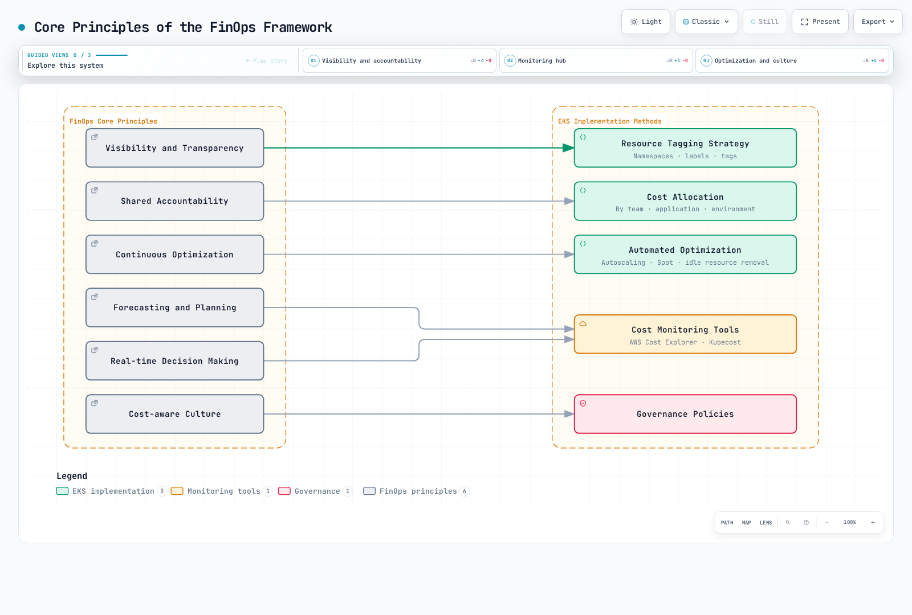
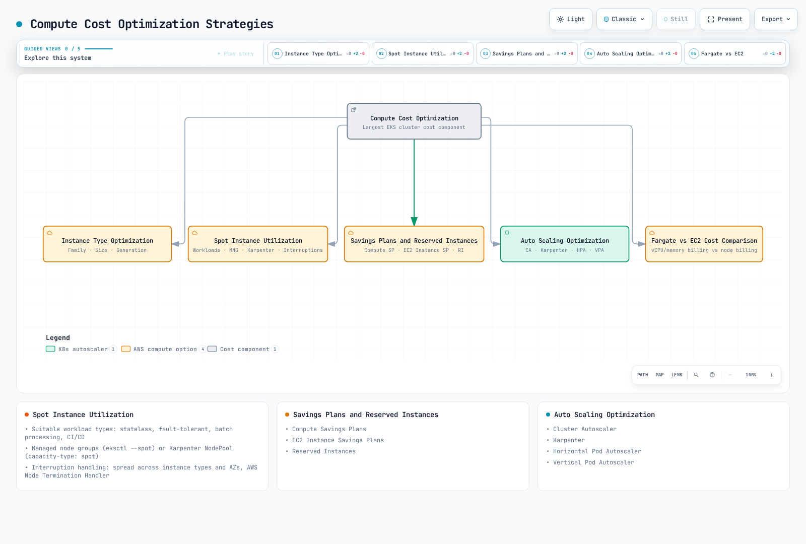
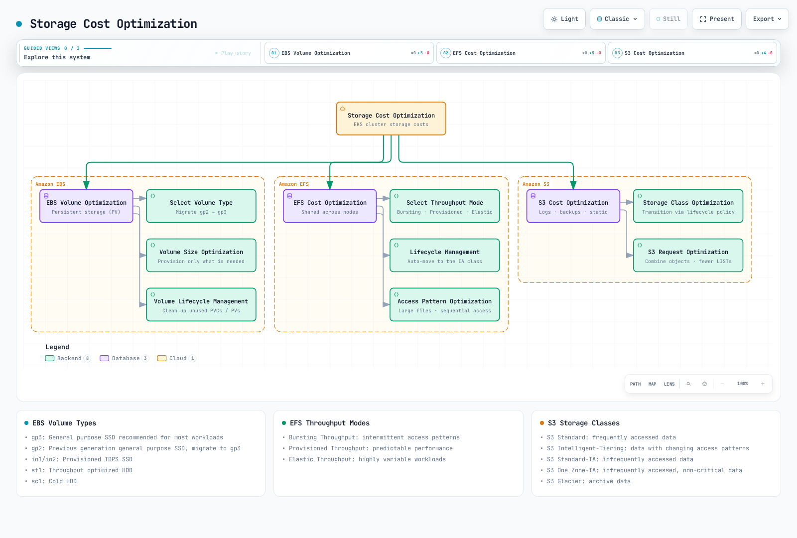

# Amazon EKS のコスト最適化

> **検証範囲**: AWS の最新の料金・サポート資料。Kubernetes マニフェストは 1.36 に照らして確認済みです。実際の EKS バージョンとアドオンは、AWS サポートカタログから選択してください。
> **最終更新日**: 2026年10月16日

Amazon EKS (Elastic Kubernetes Service) を使うと、コンテナ化されたアプリケーションを簡単にデプロイ、管理、スケールできますが、コストを効果的に管理することも重要です。このドキュメントでは、EKS クラスターのコストを最適化するためのさまざまな戦略とベストプラクティスについて説明します。

以下のコマンドは設定例であり、実際のデプロイや測定済みのコスト削減を示すものではありません。適用する前に、アカウント、リージョン、既存リソースの所有者、ワークロード要件、サポートされているツールのバージョンを確認してください。以下に記載する過去の料金前提は、現在のサービス動作とは明確に区別しています。

## 目次

1. [EKS のコスト要素](#eks-cost-components)
2. [FinOps の原則と EKS](#finops-principles-and-eks)
3. [コンピューティングコストの最適化](#compute-cost-optimization)
4. [ストレージコストの最適化](#storage-cost-optimization)
5. [ネットワークコストの最適化](#networking-cost-optimization)
6. [リソース管理とガバナンス](#resource-management-and-governance)
7. [コストの監視と分析](#cost-monitoring-and-analysis)
8. [コスト最適化のベストプラクティス](#cost-optimization-best-practices)

## EKS のコスト要素

Amazon EKS の利用にかかるコストは、次の要素で構成されます。


[🔍 インタラクティブな図を表示](https://www.atomai.click/kubernetes-docs/archmaps/en-eks-07-eks-cost-optimization-0.html)

## FinOps の原則と EKS

FinOps は、テクノロジーのビジネス価値を最大化するための運用フレームワークであり、組織文化の実践でもあります。エンジニアリング、財務、ビジネスの各チームが、タイムリーなデータに基づく意思決定と財務責任を通じて協力します。この章では、このアプローチを EKS に適用します。

### FinOps フレームワークの中核原則

FinOps Foundation は、チーム間の協力、意思決定におけるビジネス価値、利用状況に対する責任、タイムリーで正確かつアクセス可能なデータ、中央による支援、クラウドの変動費モデルの意図的な活用を重視しています。以下の EKS の実践はこれらの原則を適用するものであり、独立した公式の「6 原則」フレームワークではありません。

<!-- Pending parent diagram repair: see /tmp/eks-cost-optimization-audit/diagram-review.json


[🔍 View interactive diagram](https://www.atomai.click/kubernetes-docs/archmaps/en-eks-07-eks-cost-optimization-1.html)
-->

### FinOps を EKS に適用する

1. **コストの可視化**
   - Kubernetes の名前空間、ラベル、アノテーションを使ったコスト配分
   - AWS Cost Explorer や Kubecost などのツールを統合した詳細なコスト分析
   - チーム、アプリケーション、環境ごとのコスト分析

2. **責任共有モデルの導入**
   - チームごとのコスト配分とレポート
   - コスト最適化目標の設定と追跡
   - コスト削減へのインセンティブの提供

3. **継続的な最適化の自動化**
   - オートスケーリングポリシーの導入
   - Spot インスタンス利用の自動化
   - 無駄の候補を検出し、所有者・保持期間の確認後にのみリソースを削除

4. **コスト予測と計画**
   - ワークロードパターン分析によるコスト予測
   - Reserved Instances と Savings Plans の活用
   - コスト異常の検出とアラート

### 最新の FinOps ツールとテクノロジー

1. **Kubecost**: Kubernetes のコスト監視・最適化ツール
2. **AWS Cost Anomaly Detection**: 異常なコスト増加の検出
3. **Karpenter**: 効率的なノードプロビジョニングとコスト最適化
4. **Goldilocks**: リソース requests と limits の最適化
5. **Vertical Pod Autoscaler**: Pod のリソース requests の自動調整

### EKS クラスターのコスト

公開されているバージョンサポート料金は次のとおりです。

- **標準サポート**: クラスター 1 時間あたり $0.10。
- **延長サポート**: **クラスター 1 時間あたり合計 $0.60**（基本料金 $0.10 + 延長サポート料金 $0.50）。$0.10 の「延長クラスター」が別に存在するわけではありません。

標準サポートは EKS バージョンのリリースから 14 か月間続き、その後 12 か月間は延長サポートとなります。正確なバージョンの日付とサポートポリシーは、[EKS リリースカレンダー](https://docs.aws.amazon.com/eks/latest/userguide/kubernetes-versions.html)で確認してください。Provisioned Control Plane のティア、Auto Mode、Hybrid Nodes、EKS Capabilities には別途料金が発生する場合があります。EC2/Fargate、ストレージ、ネットワーク、オブザーバビリティの料金も別です。概要図の $0.10 という表示は、バージョンの標準サポート料金のみを示しています。[EKS の最新料金](https://aws.amazon.com/eks/pricing/)を参照してください。

### コンピューティングコスト

EKS クラスターで実行されるワーカーノードのコストです。

- **EC2 インスタンス**: ノードグループに使用する EC2 インスタンスの料金
- **Fargate**: サンプリングされた使用率ではなく、プロビジョニングされた Pod の vCPU/メモリ構成と利用時間に対する料金。該当するストレージ料金も含めてください

### ストレージコスト

EKS クラスターで使用するストレージのコストです。

- **EBS ボリューム**: 永続ボリュームに使用する EBS ボリュームの料金
- **EFS**: 共有ファイルシステムに使用する EFS の料金
- **S3**: オブジェクトストレージに使用する S3 の料金

### ネットワークコスト

EKS クラスターのネットワークに関連するコストです。

- **データ転送**: AZ 間、リージョン間、インターネットへの転送に適用される料金。正確な方向とサービス経路が重要です
- **ロードバランサー**: サービスに使用するロードバランサーの料金
- **NAT ゲートウェイ**: プライベートサブネットからのアウトバウンドトラフィックに使用する NAT ゲートウェイの料金

### その他のコスト

- **CloudWatch**: 監視とログ記録に使用する CloudWatch の料金
- **ECR**: コンテナイメージの保存に使用する ECR の料金
- **その他の AWS サービス**: EKS クラスターとともに使用するその他の AWS サービスの料金

## コンピューティングコストの最適化

通常、コンピューティングコストは EKS クラスターのコスト要素の中で最も大きな割合を占めます。次の戦略を使ってコンピューティングコストを最適化できます。



[🔍 インタラクティブな図を表示](https://www.atomai.click/kubernetes-docs/archmaps/en-eks-07-eks-cost-optimization-2.html)

### 適切なインスタンスタイプの選択

ワークロードに適したインスタンスタイプを選ぶことが重要です。

#### インスタンスファミリーの選択

ワークロードの特性に基づいて選択します。以下のファミリーは旧世代の例であり、現行世代を推奨するものではありません。リージョンでの提供状況、プロセッサアーキテクチャ、AMI、料金を確認してください。

- **汎用 (T3、M5、M6)**: コンピューティング、メモリ、ネットワークの各リソースをバランスよく必要とするワークロード
- **コンピューティング最適化 (C5、C6)**: 高性能プロセッサを必要とする、コンピューティング負荷の高いワークロード
- **メモリ最適化 (R5、R6、X1)**: 大規模なインメモリデータベースやキャッシュなど、メモリ負荷の高いワークロード
- **ストレージ最適化 (I3、D2)**: 高いディスク I/O を必要とするワークロード
- **高速コンピューティング (P3、G4、Inf1)**: GPU または機械学習アクセラレーターを必要とするワークロード

#### インスタンスサイズの最適化

ワークロードの要件に合ったインスタンスサイズを選択します。

- インスタンスが大きすぎると、リソースが無駄になる場合があります。
- インスタンスが小さすぎると、パフォーマンス上の問題が発生する場合があります。
- CloudWatch Container Insights または Kubernetes メトリクスを使って実際のリソース使用量を監視し、適切なサイズを選択してください。

#### インスタンス世代の検討

新しい世代を、自分のワークロード測定値やリージョン料金と比較してください。以下は以前の移行例です。x86 (`i`) から Graviton (`g`) に移行する場合は、arm64 イメージと依存関係の互換性も必要です。

- M5 ではなく M6i または M6g を使用する
- C5 ではなく C6i または C6g を使用する
- R5 ではなく R6i または R6g を使用する

### Spot インスタンスの利用

AWS はオンデマンド料金に対して最大 90% の Spot 割引を提示していますが、実際の価格、利用可能な容量、中断のリスクは変動します。ステートレスであることだけでは、中断に耐えられるとは限りません。

#### Spot インスタンスに適したワークロード

- **ステートレスアプリケーション**: 状態を保存しないアプリケーション
- **耐障害性のあるアプリケーション**: インスタンスの中断に対処できるアプリケーション
- **バッチ処理ジョブ**: 中断された場合に再起動できるジョブ
- **CI/CD パイプライン**: ビルドとテストのジョブ

#### Managed Node Groups で Spot インスタンスを使用する

このコマンドは既存クラスターに managed node group を作成します。Cluster Autoscaler はインストールしません。所有する設定で、プライベートサブネット、IAM ロール、AMI、インスタンスタイプの多様性を確認してください。広範なノードロールのアドオン権限ではなく、コントローラーの所有者を通じて明示的なスケーリング/IAM 設定を追加してください。

```bash
eksctl create nodegroup \
  --cluster my-cluster \
  --name my-spot-ng \
  --managed \
  --node-type m5.large \
  --nodes-min 2 \
  --nodes-max 5 \
  --spot
```

#### Karpenter による Spot インスタンスのプロビジョニング

前提条件: Karpenter/CRD がインストール済みであること、スコープを限定したコントローラー IAM、認可済みのノードロール、検出用タグが付いたサブネット/セキュリティグループ、中断キューがあること。EKS 1.36 の場合、現行の互換性マトリックスでは Karpenter >=1.13 が必要です。これらのリソースはコントローラーをインストールしません。インスタンス一覧と上限は例であり、コスト上限を保証するものではありません。解決される AMI を確認してください。`al2023@latest` は可変のセレクターであり、ドリフトや置き換えを引き起こす場合があります。本番環境で変更する場合は、検証済みのエイリアスバージョンまたは AMI ID を固定してください。

```yaml
apiVersion: karpenter.sh/v1
kind: NodePool
metadata:
  name: spot
spec:
  template:
    spec:
      requirements:
      - key: karpenter.sh/capacity-type
        operator: In
        values: ["spot"]
      - key: kubernetes.io/arch
        operator: In
        values: ["amd64"]
      - key: node.kubernetes.io/instance-type
        operator: In
        values: ["m5.large", "m5.xlarge", "m5.2xlarge"]
      nodeClassRef:
        group: karpenter.k8s.aws
        kind: EC2NodeClass
        name: spot-class
  limits:
    cpu: 1000
    memory: 1000Gi
  disruption:
    consolidationPolicy: WhenEmpty
    consolidateAfter: 30s
---
apiVersion: karpenter.k8s.aws/v1
kind: EC2NodeClass
metadata:
  name: spot-class
spec:
  role: KarpenterNodeRole-my-cluster
  amiSelectorTerms:
    - alias: al2023@latest
  subnetSelectorTerms:
    - tags:
        karpenter.sh/discovery: my-cluster
  securityGroupSelectorTerms:
    - tags:
        karpenter.sh/discovery: my-cluster
```

#### Spot インスタンスの中断への対応

Spot インスタンスの中断に対応するためのベストプラクティス:

1. **複数のインスタンスタイプを使用する**: さまざまなインスタンスタイプを利用して中断リスクを分散します
2. **複数のアベイラビリティーゾーンを使用する**: インスタンスを複数のアベイラビリティーゾーンに分散してデプロイします
3. **ノードセットごとに中断への対応を担う所有者を 1 つ選ぶ**: managed node group は Spot の中断/リバランスにすでに対応します。Karpenter のノードには Karpenter ネイティブの中断キューを設定してください。同じノードに Node Termination Handler をインストールしないでください。セルフマネージド ASG では、[AWS Node Termination Handler](https://github.com/aws/aws-node-termination-handler)を、IMDS モードまたはキューモードのいずれかと、それに対応する権限/イベント連携を明示的に選んで使用できます。
4. **アプリケーションの復旧設計を行う**: 置き換え用の容量が保証されるわけではありません。グレースフル終了、再試行/チェックポイント、障害ドメインをまたいだレプリカが、利用可能な中断猶予時間に収まる必要があります。PDB で EC2 による Spot インスタンスの回収を防ぐことはできません。

### Savings Plans と Reserved Instances

予測可能なワークロードでは、Savings Plans または Reserved Instances を使ってコストを削減できます。

#### Compute Savings Plans

Compute Savings Plans は、1 年または 3 年の利用コミットメントにより、オンデマンド料金から最大 66% の割引を提供します。

- **柔軟性**: インスタンスファミリー、サイズ、OS、テナンシー、リージョンにかかわらず適用されます
- **EC2、Fargate、Lambda が対象**: 複数のコンピューティングサービスに適用されます

#### EC2 Instance Savings Plans

EC2 Instance Savings Plans は、特定リージョンのインスタンスファミリーに対して最大 72% の割引を提供します。

- **中程度の柔軟性**: 特定リージョンのインスタンスファミリー内で、サイズと OS を問わず適用されます
- **より高い割引率**: Compute Savings Plans より高い割引率を提供します

#### Reserved Instances

AWS は現在、RI による最大 **72%** の節約を提示しています。Standard RI と Convertible RI では変更/交換のルールが異なり、Regional と Zonal でも適用範囲が異なります。Zonal RI にはその AZ のキャパシティ予約が含まれますが、Regional RI には含まれません。RI は一致する利用に適用される請求上の特典であり、Kubernetes のスケジューラーでも最大割引を保証するものでもありません。

Savings Plans は 1 年または 3 年にわたり、1 時間あたりの対象支出をコミットします。RI は対象となるインスタンス利用をコミットします。適正化後の安定したベースラインを基にコミットメントの規模を決め、未使用コミットメントのリスクを確認してください。どちらも Spot 利用に追加割引を適用するものではなく、提示されている最大値はこのクラスターで測定された節約額ではありません。

### Fargate と EC2 のコスト比較

Fargate と EC2 のどちらを選ぶかを検討する際は、コストを考慮してください。

#### Fargate の利点

- **運用オーバーヘッドの削減**: ノード管理が不要
- **正確なリソースプロビジョニング**: Pod 単位でリソースを割り当て
- **別途管理するアイドル状態のワーカーノードが不要**: ただし料金は引き続き、プロビジョニングされた Pod の容量と利用時間に基づき、丸め処理や課金の最低時間も適用されます

#### EC2 の利点

- **大規模ワークロードでコスト効率が高い**: リソース使用率が高い場合
- **インスタンスタイプの選択肢が多い**: さまざまなワークロードに合ったインスタンスタイプを選択できます
- **Spot インスタンスをサポート**: Spot インスタンスを使うことで、追加のコスト削減が可能です

#### コスト比較の例

**過去の例示的な前提（料金の出典/リージョンは未記録。現行の見積もりやベンチマークではありません）**: 2 vCPU と 4 GB メモリを要求するアプリケーション。元の単価と計算は以下にそのまま示していますが、EKS 固有の予約分とノードのオーバーヘッドは含まれていません。

**Fargate のコスト**:
- vCPU: 1 vCPU 時間あたり $0.04048 × 2 = 1 時間あたり $0.08096
- メモリ: 1 GB 時間あたり $0.004445 × 4 = 1 時間あたり $0.01778
- 合計コスト: 1 時間あたり $0.09874

**EC2 のコスト (t3.medium)**:
- オンデマンド: 1 時間あたり $0.0416
- Spot: 1 時間あたり約 $0.0125（70% 割引を想定）

**割り当てに関する補足:** EKS Fargate では Kubernetes コンポーネント用に 256 MB が追加され、サポートされている構成に切り上げられます。この前提では、2 vCPU/4 GB の要求に対し、プロビジョニング容量は **2 vCPU/5 GB** となります。同じ過去の料金を使った計算は `2 × 0.04048 + 5 × 0.004445 = 0.103185 USD/hour` です。これは計算であり、新しい料金見積もりではありません。Linux Fargate の課金はイメージのダウンロード時に開始し、最低 1 分が課金されます。EC2 `t3.medium` の公称容量は 2 vCPU/4 GiB ですが、OS/Kubernetes/DaemonSet の予約後は割り当て可能なリソースが少なくなります。この Pod を配置できると仮定することはできません。また、CPU を継続的に使用すると T3 クレジット料金が発生する場合があります。EBS、ネットワーク、クラスター料金、使用率、運用を含め、実際にワークロードをスケジュールできるキャパシティプランを比較してください。この表は、同等のサービスのどちらが優れているかを示すものではありません。

### オートスケーリングの最適化

効果的なオートスケーリング戦略を導入してコストを最適化できます。

#### Cluster Autoscaler

Cluster Autoscaler は、スケジュールできない Pod に応じて ASG をスケールし、要求リソースと再スケジュール/中断の確認に基づいて対象ノードを削除します。測定された CPU 使用率が低いという理由だけで削除するものではありません。Kubernetes のマイナーバージョンをクラスターに合わせ、実際の ASG に検出用タグを設定し、専用のワークロード IAM ロールを用意してください。EKS/ノードグループのタグが、すべての基盤リソースに自動的に伝播するわけではありません。所有するリリースを準備する際は、[アップストリームの AWS 設定](https://github.com/kubernetes/autoscaler/tree/master/cluster-autoscaler/cloudprovider/aws)と[EKS の推奨事項](https://docs.aws.amazon.com/eks/latest/best-practices/cas.html)を参照してください。

これらの chart 値は CLI 引数に変換されます。独自の `CLUSTER_AUTOSCALER_*` 環境変数を設定しても構成されません。また、未編集の `master` の例を適用しても、クラスター固有の IAM/検出設定は行われません。以下の期間は調整例であり、遅延を短くすると変更頻度が増える場合があります。

```yaml
# Values fragment for the upstream cluster-autoscaler Helm chart.
# Merge into the existing release's reviewed values, including workload IAM.
autoDiscovery:
  clusterName: my-cluster
awsRegion: us-west-2
extraArgs:
  expander: least-waste
  scale-down-delay-after-add: 10m
  scale-down-unneeded-time: 10m
  max-node-provision-time: 15m
```

#### Karpenter

Karpenter は、固定 ASG のサイズ変更ではなく、NodePool/EC2NodeClass の制約に基づいてプロビジョニングします。プロビジョニングのレイテンシーとコストは、ワークロードと利用可能な容量によって異なります。前述のコントローラー/IAM/AMI の前提条件はここでも適用されます。Karpenter が所有するノードは、Cluster Autoscaler が管理する ASG から分離してください。

```yaml
apiVersion: karpenter.sh/v1
kind: NodePool
metadata:
  name: default
spec:
  template:
    spec:
      requirements:
      - key: kubernetes.io/arch
        operator: In
        values: ["amd64"]
      - key: node.kubernetes.io/instance-type
        operator: In
        values: ["m5.large", "m5.xlarge", "m5.2xlarge"]
      nodeClassRef:
        group: karpenter.k8s.aws
        kind: EC2NodeClass
        name: default-class
  limits:
    cpu: 1000
    memory: 1000Gi
  disruption:
    consolidationPolicy: WhenEmpty
    consolidateAfter: 30s
---
apiVersion: karpenter.k8s.aws/v1
kind: EC2NodeClass
metadata:
  name: default-class
spec:
  role: KarpenterNodeRole-my-cluster
  amiSelectorTerms:
    - alias: al2023@latest
  subnetSelectorTerms:
    - tags:
        karpenter.sh/discovery: my-cluster
  securityGroupSelectorTerms:
    - tags:
        karpenter.sh/discovery: my-cluster
```

Karpenter のコスト最適化設定:

- **disruption.consolidateAfter**: ポリシーと中断の確認に従い、Pod の追加/削除後に統合を検討するまでの遅延（例: `30s`。旧来の `ttlSecondsAfterEmpty` に代わります）
- **disruption.consolidationPolicy**: ノード統合ポリシー。空のノードのみを削除する `WhenEmpty`、または使用率の低いノードも統合する `WhenEmptyOrUnderutilized` のいずれか（旧来の `consolidation.enabled: true` に相当）
- **template.spec.requirements** (`node.kubernetes.io/instance-type`): コスト効率の高いインスタンスタイプを指定

#### Horizontal Pod Autoscaler (HPA)

HPA は CPU 使用率またはカスタムメトリクスに基づいて Pod 数を自動調整します。

```yaml
apiVersion: autoscaling/v2
kind: HorizontalPodAutoscaler
metadata:
  name: app-hpa
spec:
  scaleTargetRef:
    apiVersion: apps/v1
    kind: Deployment
    name: app
  minReplicas: 2
  maxReplicas: 10
  metrics:
  - type: Resource
    resource:
      name: cpu
      target:
        type: Utilization
        averageUtilization: 70
  - type: Resource
    resource:
      name: memory
      target:
        type: Utilization
        averageUtilization: 80
```

CPU/メモリの使用率目標は requests に対する割合です。対象コンテナに requests を設定し、resource metrics API を利用できるようにする必要があります。複数のメトリクスがある場合、HPA は希望レプリカ数が最も多いものを選択します。メトリクスを取得できないと、スケールダウンが妨げられる場合があります。レプリカを追加してもメモリ使用量が低下しない場合があるため、アプリケーションの動作を検証してください。EKS が controller-manager のフラグを管理します。グローバルフラグを編集できると想定せず、HPA ごとに `spec.behavior.scaleDown.stabilizationWindowSeconds` を設定してください。HPA が使用率の分母として使う CPU/メモリ requests を、VPA で自動的に同時変更しないでください。

#### Vertical Pod Autoscaler (VPA)

VPA は Pod の CPU とメモリ requests を自動調整し、リソース使用率を最適化します。

```yaml
apiVersion: autoscaling.k8s.io/v1
kind: VerticalPodAutoscaler
metadata:
  name: app-vpa
spec:
  targetRef:
    apiVersion: apps/v1
    kind: Deployment
    name: app
  updatePolicy:
    updateMode: "Off"
  resourcePolicy:
    containerPolicies:
    - containerName: '*'
      minAllowed:
        cpu: 50m
        memory: 100Mi
      maxAllowed:
        cpu: 1
        memory: 1Gi
```

この例では、上記の HPA と競合せず推奨値のみを収集するために **Off** を使用しています。最初に VPA コンポーネント/CRD とメトリクス依存関係をインストールしてください。

- **Off**: 推奨値のみを提示します。
- **Initial**: アドミッション時に、新規作成 Pod の requests を設定します。
- **Recreate**: アップデーターが Pod を退避し、コントローラーが推奨リソースで再作成する場合があります。退避ポリシー/PDB に従います。
- **Auto**: Recreate の非推奨エイリアスです。新しい構成では明示的なモードを選んでください。
- インプレースモードには、互換性のある VPA/Kubernetes リリースと、文書化された機能ゲートが必要です。選択したモードの仕様を確認してください。`InPlaceOrRecreate` は退避にフォールバックする場合がありますが、`InPlace` にはその再作成へのフォールバックがありません。自動更新を有効にする前に、上限、ディスラプション、ピーク需要を確認してください。

## ストレージコストの最適化

ストレージは EKS クラスターの重要なコスト要素です。次の戦略でストレージコストを最適化できます。



[🔍 インタラクティブな図を表示](https://www.atomai.click/kubernetes-docs/archmaps/en-eks-07-eks-cost-optimization-3.html)

### EBS ボリュームの最適化

EBS ボリュームは主に EKS クラスターの永続ストレージとして使用されます。

#### 適切なボリュームタイプの選択

ワークロードに適した EBS ボリュームタイプを選択してください。

- **gp3**: ほとんどのワークロードに推奨される汎用 SSD
- **gp2**: 旧世代の汎用 SSD。gp3 への移行を推奨
- **io1/io2**: 高性能ワークロード向けのプロビジョンド IOPS SSD
- **st1**: スループット負荷の高いワークロード向けのスループット最適化 HDD
- **sc1**: アクセス頻度の低いデータ向けのコールド HDD

gp3 では容量、IOPS、スループットの料金が分かれています。ベースラインの 3,000 IOPS は、すべての gp2 ボリュームより高いわけではありません。以下の上限は一般的な AWS リージョンのボリュームに対する現行値ですが、容量/IOPS 比やインスタンス上限の影響を受けます。Outposts では上限が異なります。$0.08/$0.10 のストレージ料金は、リージョン/日付が記録されていない例示的な前提です。プロビジョニングする IOPS/スループットを含め、最新の見積もりを取得してください。

| ボリュームタイプ | ベースライン IOPS | 最大 IOPS | ベースラインスループット | 最大スループット | 1 GB あたりの料金 |
|------------|--------------|----------|---------------------|----------------|--------------|
| gp3 | 3,000 | 80,000 | 125 MiB/s | 2,000 MiB/s | $0.08/GB-month (例示) |
| gp2 | 3 IOPS/GiB、最低 100。対象となる小容量ボリュームではバースト可能 | 16,000 | サイズ/I/O に依存 | 250 MiB/s | $0.10/GB-month (例示) |

#### gp3 への移行

このクラスは、標準の EBS CSI ドライバー (`ebs.csi.aws.com`) を使って新しい gp3 ボリュームを作成します。既存ボリュームの移行や、クラスターのデフォルト変更は行いません。Auto Mode は別のプロビジョナー (`ebs.csi.eks.amazonaws.com`) と適切なノード/ストレージ移行経路を使用します。インストール済みドライバー、IAM/KMS 権限、既存クラスの所有者、トポロジーを確認してください。`Retain` を設定すると、解放されたストレージは所有者が確認するまで保持され、料金が引き続き発生する場合があります。

```yaml
apiVersion: storage.k8s.io/v1
kind: StorageClass
metadata:
  name: gp3
provisioner: ebs.csi.aws.com
parameters:
  type: gp3
  encrypted: "true"
volumeBindingMode: WaitForFirstConsumer
reclaimPolicy: Retain
allowVolumeExpansion: true
```

既存の PVC を gp3 に移行する手順:

1. インストール済みの CSI スナップショットコンポーネントを使い、アプリケーション整合性のあるバックアップ/スナップショットを取得して、準備状況と復元アクセスを確認します。
2. gp3 クラスを使って**新しい** PVC を復元します。バインド済みの PVC は、インプレースで StorageClass を切り替えられません。
3. 復元をテストし、確認済みの切り替え作業中にワークロードを切り替えます。復旧を検証するまで元のボリュームを保持します。

サポート対象の構成では、インプレースの EBS Elastic Volumes タイプ変更が代替手段となる場合があります。構成ドリフトを起こさないよう、CSI/IaC の所有者と調整してください。[ストレージガイド](04-eks-storage-part1.md)を参照してください。

#### ボリュームサイズの最適化

必要なサイズだけをプロビジョニングしてください。

- 過剰にプロビジョニングされたボリュームは不要なコストを発生させます。
- ファイルシステムの使用量を監視し、必要に応じてサポート対象のボリュームを拡張します。EBS ボリュームや Kubernetes PVC はインプレースで縮小できません。容量を減らすには、新しい小容量ボリュームを作成し、アプリケーションを考慮したデータ移行が必要です。
- `allowVolumeExpansion` は、サポート対象の拡張要求を許可する設定です。使用量の監視や自動サイズ変更は行いません。自動拡張には、別途コントローラー、上限、障害対応を設定する必要があります。

#### ボリュームライフサイクルの管理

不要なボリュームを特定して削除します。

- 未使用の PVC と PV を定期的に確認します
- Pod が終了しても、その PVC/PV を破棄してよいことにはなりません。claim やボリュームを削除する前に、StatefulSet の保持設定、後続の利用予定、バックアップ、所有者を確認してください
- 適切な PV の再利用ポリシー (Delete または Retain) を設定します

### EFS のコスト最適化

EFS は、複数ノードからの共有アクセスを必要とするワークロードに役立ちます。

#### 適切なスループットモードの選択

ワークロードに適した EFS スループットモードを選択してください。

- **バーストスループット**: アクセス頻度が断続的な場合に適しています
- **プロビジョンドスループット**: 予測可能なパフォーマンスを必要とするワークロードに適しています
- **Elastic Throughput**: 変動が非常に大きいワークロードに適しています

#### ライフサイクル管理

EFS ライフサイクルポリシーでは、条件を満たすアクセス頻度の低いファイルを IA/Archive に移行したり、アクセス時にプライマリストレージに戻したりできます。アクセス料金、課金対象となる最小サイズ/期間、スループットモード、アクセスパターンが節約額に影響します。この例では既存のポリシー配列をエクスポートして確認します。その配列内の IA ルールを編集し、必要な Archive/プライマリへの復帰エントリを保持したうえで、希望する構成全体を送信してください。

```bash
aws efs describe-lifecycle-configuration \
  --file-system-id fs-1234567890abcdef0 \
  --query LifecyclePolicies --output json > efs-lifecycle-policies.json
# Edit the exported array; an IA rule is {"TransitionToIA":"AFTER_30_DAYS"}.
# Preserve required Archive/return-to-primary rules and review the complete array.
aws efs put-lifecycle-configuration \
  --file-system-id fs-1234567890abcdef0 \
  --lifecycle-policies file://efs-lifecycle-policies.json
```

#### アクセスパターンの最適化

コストを削減するため、EFS のアクセスパターンを最適化します。

- 小さなファイルを多数使うより、大きなファイルを使う
- メタデータ操作を最小限にする
- シーケンシャルアクセスパターンを使用する

### S3 のコスト最適化

S3 はログ、バックアップ、静的コンテンツなどの保存に適したコスト効率の高い選択肢です。

#### ストレージクラスの最適化

ワークロードに適した S3 ストレージクラスを選択してください。

- **S3 Standard**: 頻繁にアクセスするデータ
- **S3 Intelligent-Tiering**: アクセスパターンが変化するデータ
- **S3 Standard-IA**: アクセス頻度の低いデータ
- **S3 One Zone-IA**: アクセス頻度が低く、重要度の低いデータ
- **S3 Glacier**: アーカイブデータ

#### ライフサイクルポリシー

この例示的なルールでは、現行バージョンのオブジェクトを 30/90 日後に移行し、365 日後に期限切れにします。復旧にかかる時間、保持/Object Lock の要件、移行/リクエスト料金、最低保存期間、新規/変更構成では 128 KB 未満のオブジェクトが移行対象からデフォルトで除外されることを確認してください。バージョニングが有効なバケットでは、旧バージョンの管理を別に設定する必要があります。現行バージョンの有効期限切れによって削除マーカーが作成されても、古いデータには料金が発生し続ける場合があります。put-bucket-lifecycle-configuration の呼び出しはバケットのライフサイクル構成を置き換えるため、他のルールを統合して保持してください。

```json
{
  "Rules": [
    {
      "ID": "Move to IA after 30 days, Glacier after 90 days",
      "Status": "Enabled",
      "Filter": {"Prefix": "logs/"},
      "Transitions": [
        {
          "Days": 30,
          "StorageClass": "STANDARD_IA"
        },
        {
          "Days": 90,
          "StorageClass": "GLACIER"
        }
      ],
      "Expiration": {
        "Days": 365
      }
    }
  ]
}
```

#### S3 リクエストの最適化

S3 リクエストコストを最適化します。

- 小さなオブジェクトをまとめて大きなオブジェクトにする
- 不要な LIST 操作を最小限にする
- マルチパートアップロードは転送/再試行の動作を改善できますが、リクエスト料金と未完了パートの保存料金が発生します。放棄されたアップロードを中止/クリーンアップするよう設定してください。Transfer Acceleration には追加料金が発生する場合があり、レイテンシー/スループットを改善する選択肢であって、自動的にリクエストコストを削減するものではありません

## ネットワークコストの最適化

ネットワークコストは、特に大規模なデータ転送がある場合に大きくなる可能性があります。次の戦略を使ってネットワークコストを最適化できます。

<!-- Pending parent diagram repair: see /tmp/eks-cost-optimization-audit/diagram-review.json


[🔍 View interactive diagram](https://www.atomai.click/kubernetes-docs/archmaps/en-eks-07-eks-cost-optimization-4.html)
-->

### データ転送の最適化

#### リージョン内通信の活用

可能な限り同一リージョン内で通信し、リージョン間データ転送コストを削減します。

- EKS クラスターと関連する AWS サービスを同じリージョンに配置します
- 複数リージョンにまたがる場合、リージョン間データ転送を最小限にします

#### AZ を考慮したルーティング

AZ 間のデータ転送コストを削減するため、AZ を考慮したルーティングを実装します。

- トポロジーを考慮したサービスルーティングを使用します
- マルチ AZ の可用性を維持しながら、サポートされている場合はローカルエンドポイントを優先します。`trafficDistribution: PreferSameZone` は Kubernetes 1.35 以降で安定版です。クラスター/プロキシの実装を検証してください。これは優先設定であり、ローカルエンドポイントを利用できない場合はフォールバックするため、AZ 間トラフィックがゼロになる保証はありません。配置のアフィニティだけでは Service トラフィックはルーティングされません

```yaml
apiVersion: v1
kind: Service
metadata:
  name: my-service
spec:
  trafficDistribution: PreferSameZone
  selector:
    app: my-app
  ports:
  - port: 80
    targetPort: 8080
  type: ClusterIP
```

#### 圧縮の使用

データ転送前に圧縮を使用して、転送データ量を減らします。

- API 応答の圧縮
- ログとメトリクスの圧縮
- イメージと静的アセットの最適化

### ロードバランサーの最適化

#### 適切なロードバランサータイプの選択

ワークロードに適したロードバランサータイプを選択してください。

- **Network Load Balancer (NLB)**: 低レイテンシーが必要な場合の TCP/UDP トラフィック
- **Application Load Balancer (ALB)**: パスベースのルーティングが必要な場合の HTTP/HTTPS トラフィック
- **Classic Load Balancer (CLB)**: レガシーワークロード

#### ロードバランサーの共有

複数のサービス間でロードバランサーを共有してコストを削減します。

- AWS Load Balancer Controller を使用する
- Ingress リソースを使って複数のサービスを公開する

[ネットワークガイド](03-eks-networking-part1.md)を使って、適切な chart、IAM/service account、サブネット、セキュリティグループを設定し、標準の AWS Load Balancer Controller をインストールしてください。既存のコントローラー所有者を再利用します。Auto Mode には異なる組み込み連携があるため、これらのインストール/クラス設定が適用されると想定しないでください。以下の両方のバックエンド Service は Ingress と同じ名前空間に存在し、ポート 80 を公開している必要があります。IP ターゲットモードでは、Pod IP に到達できる必要があります。これは HTTP ルーティングの例です。本番環境で公開する場合は、TLS、DNS、アクセス制御も確認してください。

```yaml
apiVersion: networking.k8s.io/v1
kind: Ingress
metadata:
  name: shared-ingress
  annotations:
    alb.ingress.kubernetes.io/scheme: internet-facing
    alb.ingress.kubernetes.io/target-type: ip
spec:
  ingressClassName: alb
  rules:
  - host: service1.example.com
    http:
      paths:
      - path: /
        pathType: Prefix
        backend:
          service:
            name: service1
            port:
              number: 80
  - host: service2.example.com
    http:
      paths:
      - path: /
        pathType: Prefix
        backend:
          service:
            name: service2
            port:
              number: 80
```

#### アイドル状態のロードバランサーの削除

未使用のロードバランサーを特定して削除します。

- トラフィックのないロードバランサーを監視します
- テスト環境または開発環境で不要なロードバランサーを削除します

### NAT ゲートウェイの最適化

NAT ゲートウェイには、時間単位の料金とデータ処理料金が発生します。

#### NAT ゲートウェイの共有

複数のサブネット間で NAT ゲートウェイを共有してコストを削減します。

- AZ 単位の NAT ゲートウェイでは、同じ AZ のプライベートサブネットがローカルゲートウェイを共有できます。AZ ごとの可用性と固定の時間料金を評価してください。
- 1 つの AZ 単位のゲートウェイを複数の AZ で共有すると、AZ 間依存関係と転送料金が発生する可能性があります。これは意図的なトレードオフであり、常に安価な高可用性設計とは限りません。現在のリージョン NAT オプションは、文書化された可用性/料金モデルに基づいて別途評価してください。

#### VPC エンドポイントの使用

実際のトラフィックについて、エンドポイント料金と NAT 経由の料金を比較してください。S3/DynamoDB ゲートウェイエンドポイントには、追加のエンドポイント時間料金/データ処理料金はありません。インターフェイスエンドポイント（ECR/Logs/STS など）には個別の料金があり、DNS/セキュリティグループの設定が必要です。以下のコマンドは、確認済みの既存ルートテーブルにゲートウェイエンドポイントを作成します。適切なエンドポイントポリシーを適用してください。ECR イメージのプルには通常、ECR API エンドポイントだけでなく、`ecr.api`/`ecr.dkr` の両方のインターフェイスエンドポイントと S3 アクセスが必要です。

```bash
# Create S3 VPC Endpoint
aws ec2 create-vpc-endpoint \
  --vpc-id vpc-1234567890abcdef0 \
  --service-name com.amazonaws.us-west-2.s3 \
  --route-table-ids rtb-1234567890abcdef0

# Create DynamoDB VPC Endpoint
aws ec2 create-vpc-endpoint \
  --vpc-id vpc-1234567890abcdef0 \
  --service-name com.amazonaws.us-west-2.dynamodb \
  --route-table-ids rtb-1234567890abcdef0
```

よく使用される VPC エンドポイント:

- S3
- DynamoDB
- ECR
- CloudWatch Logs
- STS

#### アウトバウンドトラフィックの最適化

NAT ゲートウェイを通過するアウトバウンドトラフィックを最適化します。

- 不要な外部 API 呼び出しを最小限にします
- スケジュール設定で競合を減らせる場合はありますが、通常の NAT/データ転送料金には一般的なオフピーク割引はありません。課金対象のバイト数またはプロビジョニング期間を削減してください
- データを圧縮します

## リソース管理とガバナンス

EKS クラスターのコストを管理するには、効果的なリソース管理とガバナンスが重要です。次の戦略でリソースを効果的に管理できます。


[🔍 インタラクティブな図を表示](https://www.atomai.click/kubernetes-docs/archmaps/en-eks-07-eks-cost-optimization-5.html)

### リソース requests と limits の最適化

#### 適切なリソース requests の設定

アプリケーションの実際のリソース要件に合う requests を設定してください。

- requests が高すぎると、リソースの無駄につながります。
- requests が低すぎると、パフォーマンス上の問題が発生する場合があります。
- VPA (Vertical Pod Autoscaler) を使ってリソース requests を最適化します

```yaml
apiVersion: v1
kind: Pod
metadata:
  name: app
spec:
  containers:
  - name: app
    image: app:latest
    resources:
      requests:
        cpu: 100m
        memory: 256Mi
      limits:
        cpu: 500m
        memory: 512Mi
```

#### リソース limits の設定

コンテナが過剰なリソースを使わないよう、リソース limits を設定します。

- CPU limits は通常スロットリングによって適用されます。低すぎる limit は、ノードに余剰 CPU があってもレイテンシーを悪化させる場合があります。
- メモリ limits は事後的に適用され、OOM による終了を引き起こす場合があります。使用量が一時的にも値を超えないことを保証するものではありません。普遍的な比率ではなく、測定したワークロードの動作に基づいて requests/limits のサイズを決めてください。

#### QoS クラスの理解

Kubernetes QoS (Quality of Service) クラスを理解して活用してください。

ここで示すコンテナレベルのリソース設定では、次のようになります。

- **Guaranteed**: すべてのコンテナにゼロ以外の CPU とメモリ requests があり、それぞれ対応する limits と等しい
- **Burstable**: CPU/メモリの request または limit が少なくとも 1 つ設定されているが、Guaranteed の条件を満たさない
- **BestEffort**: どのコンテナにも CPU/メモリ requests または limits が設定されていない

QoS は Pod Priority ではなく、絶対的な退避順序を定めるものでもありません。ノードに負荷がかかった場合、kubelet は使用量が requests を超えているか、Pod Priority、超過使用量の相対値を考慮します。ディスクプレッシャーによる退避も異なります。CPU/メモリの QoS では ephemeral-storage requests が分類されないためです。Pod レベルのリソースを使用する場合は、[最新の QoS ルール](https://kubernetes.io/docs/concepts/workloads/pods/pod-qos/)を確認してください。

### 名前空間とリソースクォータ

#### 名前空間による分離

名前空間を使ってリソースを論理的に分離します。

- チーム、環境、アプリケーションごとに名前空間を作成します
- 名前空間ごとのリソース使用量を監視します

#### リソースクォータの設定

ResourceQuota は、既存の名前空間内で、受け入れられるリソース requests/limits とオブジェクト数を制限します。支出上限でも、実行時 CPU メーターでもありません。最初に `team-a` 名前空間を作成してください。CPU/メモリのクォータによって、作成するコンテナに requests/limits が必要になる場合があります。LimitRange のデフォルト設定はワークロードの担当者と調整してください。

```yaml
apiVersion: v1
kind: ResourceQuota
metadata:
  name: team-quota
  namespace: team-a
spec:
  hard:
    requests.cpu: "10"
    requests.memory: 20Gi
    limits.cpu: "20"
    limits.memory: 40Gi
    pods: "20"
    services: "10"
    persistentvolumeclaims: "5"
```

#### LimitRange の設定

LimitRange を使って、名前空間内のコンテナに対するデフォルトのリソース上限を設定します。

```yaml
apiVersion: v1
kind: LimitRange
metadata:
  name: default-limits
  namespace: team-a
spec:
  limits:
  - default:
      cpu: 500m
      memory: 512Mi
    defaultRequest:
      cpu: 100m
      memory: 256Mi
    type: Container
```

### コスト配分とタグ付け

#### リソースのタグ付け

AWS リソースタグを適用し、課金担当者を通じて対象の課金キーを有効化してください。EKS クラスターのタグは、EC2 インスタンス、ASG、EBS ボリューム、ロードバランサーに自動的に伝播しません。実際のタグ適用範囲と課金処理の遅延を確認してください。以下の明示的なタグ付け例は、クラスターコストを完全に配分できることを示すものではありません。

- チーム、プロジェクト、環境、コストセンターなどでタグ付けする
- 一貫したタグ付け戦略を実施する

```bash
# Tag EKS cluster
aws eks tag-resource \
  --resource-arn arn:aws:eks:us-west-2:123456789012:cluster/my-cluster \
  --tags Team=DevOps,Environment=Production,CostCenter=123456

# Tag EC2 instance
aws ec2 create-tags \
  --resources i-1234567890abcdef0 \
  --tags Key=Team,Value=DevOps Key=Environment,Value=Production Key=CostCenter,Value=123456
```

#### Kubernetes のラベルとアノテーション

Kubernetes のラベル/アノテーションは、AWS とは別のメタデータシステムです。コストツールは選択されたワークロードラベルでグループ化できます。Pod 単位のグループ化を想定する場合は、Deployment のラベルを Pod テンプレートにも設定する必要があります。名前空間のラベルが Pod や AWS リソースに自動的に継承されることはありません。AWS の分割コスト配分と、生成される EKS Pod コスト属性には、別途課金設定が必要です。

```yaml
apiVersion: apps/v1
kind: Deployment
metadata:
  name: app
  labels:
    app: app
    team: team-a
    environment: production
    cost-center: "123456"
spec:
  replicas: 3
  selector:
    matchLabels:
      app: app
  template:
    metadata:
      labels:
        app: app
        team: team-a
        environment: production
        cost-center: "123456"
    spec:
      containers:
      - name: app
        image: app:latest
```

#### Kubecost の使用

Kubecost を使って Kubernetes リソースコストを追跡し、最適化します。

以下のインストール手順に従ってください。重複したコレクターをインストールせず、所有する Kubecost/OpenCost デプロイを 1 つ選択します。リソースベースの配分は、課金データセットおよび合意済みの共有コストポリシーと照合するまでは推定値です。

Kubecost が提供する機能:

- 名前空間、Deployment、Service、ラベル別のコスト分析
- コスト最適化の推奨事項
- コスト配分と部門振替レポート

## コストの監視と分析

コストを効果的に最適化するには、継続的な監視と分析が必要です。次のツールと戦略を使って EKS クラスターのコストを監視・分析できます。


[🔍 インタラクティブな図を表示](https://www.atomai.click/kubernetes-docs/archmaps/en-eks-07-eks-cost-optimization-6.html)

### AWS Cost Explorer

AWS Cost Explorer は、AWS のコストと使用状況を可視化、理解、管理するためのツールです。

#### コスト分析

AWS Cost Explorer を使って EKS クラスターのコストを分析します。

- サービス別のコスト分析
- タグ別のコスト分析
- 時系列のコスト傾向分析

```bash
# Get cost data using AWS CLI
aws ce get-cost-and-usage \
  --time-period Start=2025-06-01,End=2025-07-01 \
  --granularity MONTHLY \
  --metrics "UnblendedCost" "AmortizedCost" \
  --group-by Type=DIMENSION,Key=SERVICE Type=TAG,Key=Environment
```

2025 年の日付は構文の過去例であり、現行のコストレポートではありません。排他的な終了日を設定した、利用可能な UTC 課金期間を選択してください。`NextPageToken` がある場合は、最初のレスポンスだけで完了とせず、後続ページも取得してください。コストの基準はそれぞれ別に比較し、異なる基準の値を合算したり、互換性のない単位の `UsageQuantity` を集計したりしないでください。サービス/タグによるグループ化にはタグなしの値も含まれ、クラスター固有の集計になるとは限りません。

#### Cost Anomaly Detection

AWS Cost Anomaly Detection を使って異常なコスト増加を検出します。

1. AWS Management Console にサインインします
2. AWS Cost Management サービスに移動します
3. 「Cost Anomaly Detection」を選択します
4. 「Create anomaly monitor」をクリックします
5. モニターのタイプと通知設定を構成します

#### コスト予算の設定

この 1,000 USD/80% の例は、実際の月次予算通知を作成します。承認済みの値にアカウントとメールアドレスを置き換えてください。正規の Budgets タグフィルター（例: `user:Environment$Production`）が課金構成と一致することを確認してください。このフィルターはサービスを問わずタグ付きコストを選択します。Service を EKS に限定すると、EC2、ストレージ、その他のクラスターコストが除外されます。タグなし/共有コストには別途配分が必要です。Budgets は遅延する課金データを処理するものであり、厳格な支出上限ではありません。既存の予算は所有者と照合してください。ここでは過去の固定有効期限は設定していません。

```bash
# Create budget using AWS CLI
aws budgets create-budget \
  --account-id 123456789012 \
  --budget file://budget.json \
  --notifications-with-subscribers file://notifications.json
```

budget.json:
```json
{
  "BudgetName": "Tagged Production Workloads",
  "BudgetLimit": {
    "Amount": "1000",
    "Unit": "USD"
  },
  "BudgetType": "COST",
  "CostFilters": {
    "TagKeyValue": [
      "user:Environment$Production"
    ]
  },
  "TimeUnit": "MONTHLY"
}
```

notifications.json:
```json
[
  {
    "Notification": {
      "ComparisonOperator": "GREATER_THAN",
      "NotificationType": "ACTUAL",
      "Threshold": 80,
      "ThresholdType": "PERCENTAGE"
    },
    "Subscribers": [
      {
        "Address": "email@example.com",
        "SubscriptionType": "EMAIL"
      }
    ]
  }
]
```

### Kubecost

Kubecost は、Kubernetes クラスターのコストを監視・最適化するための専用ツールです。

#### Kubecost のインストール

確認済みの chart/application は、以下の現行リポジトリの **3.3.1** です。Kubecost 3.x は ClickHouse と finops-agent による直接収集を使用します。2.x の `cost-analyzer` インストールや、同梱 Prometheus/node-exporter の値を再利用しないでください。適用する前に、[chart のドキュメント](https://github.com/kubecost/cost-analyzer-helm-chart)に従って、ライセンス、Kubernetes 互換性、ストレージクラス/PVC サイズ、クラスター ID、ネットワーク収集、アクセス制御を確認してください。既存の 2.x リリースについては、文書化された移行手順に従ってください。これはインプレースアップグレードの手順ではありません。実際にインストールしたことや、本番利用の準備が整っていることを主張するものではありません。[FinOps プラットフォームガイド](../ops/13-finops-cost-platform.md)では OpenCost と課金データの照合についても説明しています。

```bash
helm repo add kubecost https://kubecost.github.io/kubecost/
helm repo update kubecost
helm show values kubecost/kubecost --version 3.3.1 > kubecost-values.yaml
# Edit this file for the reviewed cluster ID, storage, license, and collection settings.
helm template kubecost kubecost/kubecost --version 3.3.1 \
  --namespace kubecost -f kubecost-values.yaml > kubecost-rendered.yaml
# Install a NEW release only after reviewing the rendered resources and prerequisites.
helm install kubecost kubecost/kubecost --version 3.3.1 \
  --namespace kubecost --create-namespace -f kubecost-values.yaml
```

#### Kubecost ダッシュボード

Kubecost ダッシュボードでは、次の情報を確認できます。

- 名前空間、Deployment、Service、ノード別のコスト
- リソース効率と使用率
- コスト最適化の推奨事項
- コスト配分と部門振替レポート

#### Kubecost アラート

インストール済み Kubecost のエディション/バージョンで文書化されているアラート機能を使い、受信者、認証情報、予算期間、集計、配信方法を明示的に設定してください。任意に作成した `cost-analyzer-alerts` ConfigMap と `alerts.json` は、自動的に読み込まれるわけではありません。以前の例では有効なスキーマやマウントも示されていませんでした。上記の AWS Budgets の例は、これとは別の具体的な課金アラートです。[FinOps ガイド](../ops/13-finops-cost-platform.md)では、明示的なコスト配分レポートのワークフローを説明しています。アラートに依存する前に合成テストで配信を検証し、しきい値超過だけでなく、データの欠落/陳腐化も監視してください。

### CloudWatch Container Insights

CloudWatch Container Insights を使って EKS クラスターのリソース使用状況を監視します。

#### Container Insights の有効化

Container Insights は CloudWatch agent/observability add-on が収集するノード/ワークロードのテレメトリです。`containerinsights` は `eksctl utils update-cluster-logging` の EKS コントロールプレーンログタイプではありません。[監視ガイド](06-eks-monitoring-logging.md)に従い、互換性のあるアドオン、IAM 関連付け、設定、プラットフォーム固有の収集経路を選択してください。コレクターの所有者は 1 つに統一し、メトリクス/ログが実際に配信されていることを確認してください。アドオン/agent のテレメトリ自体にも料金が発生する場合があります。

#### リソース使用状況の監視

CloudWatch ダッシュボードでは、次のメトリクスを監視できます。

- CPU とメモリの使用量
- ディスクとネットワークの I/O
- コンテナの再起動回数
- ノードの状態

#### コスト最適化のインサイト

CloudWatch Container Insights のデータを分析し、コスト最適化の機会を特定します。

- 過剰にプロビジョニングされたリソースを特定する
- リソース使用率の低いノードを特定する
- リソース requests と実際の使用量との差を分析する

### カスタムコストダッシュボード

EKS クラスターのコストを総合的に監視するカスタムコストダッシュボードを作成できます。

#### Grafana ダッシュボード

Prometheus と Grafana を使ってカスタムコストダッシュボードを作成します。

1. Prometheus でリソース使用量メトリクスを収集します
2. Grafana でコストダッシュボードを作成します
3. Cost Explorer/CUR の結果には、別途実装した認証済みの課金データパイプラインまたはサポート対象のデータソースを使用します。パネルを追加しても Prometheus の使用量メトリクスが実際の課金データになるわけではありません。ブラウザーに表示されるダッシュボード JSON に課金認証情報を含めないでください

#### コスト最適化スコア

数式、対象範囲、期間を文書化したうえで、以下を個別の指標として追跡してください。普遍的なコスト最適化スコアは存在せず、これらの比率だけで無駄や金銭的な節約が証明されるわけではありません。

- リソース requests と使用量の比率
- ノード使用率
- Spot インスタンス利用率
- アイドルリソース率

## コスト最適化のベストプラクティス

EKS クラスターのコストを最適化するためのベストプラクティスを見ていきましょう。


[🔍 インタラクティブな図を表示](https://www.atomai.click/kubernetes-docs/archmaps/en-eks-07-eks-cost-optimization-7.html)

### 一般的なベストプラクティス

#### 継続的なコスト最適化

コスト最適化は一度きりの作業ではなく、継続的なプロセスです。

1. **測定**: 現在のコストとリソース使用量を測定します
2. **分析**: コスト要因と最適化の機会を分析します
3. **最適化**: コスト最適化戦略を実施します
4. **監視**: 結果を監視し、必要に応じて調整します
5. **反復**: このプロセスを繰り返します

#### コストを意識する文化の醸成

組織内でコストを意識する文化を醸成します。

- チームがコストを把握できるようにする
- コスト最適化目標を設定する
- コスト最適化の成果を認め、報奨する
- コスト最適化のベストプラクティスを共有する

#### 自動化の活用

コスト最適化に自動化を活用します。

- オートスケーリングを導入する
- 使用量に基づいてリソースをプロビジョニングする
- コスト異常の検出とアラートを自動化する
- 候補を自動的に特定し、所有者、保持期間、依存関係、復旧を確認した後にのみ削除する

### ワークロード別の最適化

#### 開発/テスト環境

開発/テスト環境のコストを最適化します。

- 使用していないときに環境を自動停止する
- Spot インスタンスを使用する
- リソース limits を設定する
- 共有環境の利用を検討する

```yaml
apiVersion: v1
kind: ServiceAccount
metadata:
  name: dev-app-scaler
  namespace: dev
---
apiVersion: rbac.authorization.k8s.io/v1
kind: Role
metadata:
  name: dev-app-scaler
  namespace: dev
rules:
- apiGroups: ["apps"]
  resources: ["deployments"]
  resourceNames: ["dev-app"]
  verbs: ["get"]
- apiGroups: ["apps"]
  resources: ["deployments/scale"]
  resourceNames: ["dev-app"]
  verbs: ["get", "patch", "update"]
---
apiVersion: rbac.authorization.k8s.io/v1
kind: RoleBinding
metadata:
  name: dev-app-scaler
  namespace: dev
subjects:
- kind: ServiceAccount
  name: dev-app-scaler
  namespace: dev
roleRef:
  apiGroup: rbac.authorization.k8s.io
  kind: Role
  name: dev-app-scaler
---
apiVersion: batch/v1
kind: CronJob
metadata:
  name: dev-app-shutdown
  namespace: dev
spec:
  suspend: true
  schedule: "0 20 * * 1-5"
  timeZone: Etc/UTC
  concurrencyPolicy: Forbid
  startingDeadlineSeconds: 1800
  successfulJobsHistoryLimit: 1
  failedJobsHistoryLimit: 2
  jobTemplate:
    spec:
      backoffLimit: 0
      activeDeadlineSeconds: 120
      template:
        spec:
          serviceAccountName: dev-app-scaler
          restartPolicy: Never
          securityContext:
            runAsNonRoot: true
            runAsUser: 65532
            seccompProfile:
              type: RuntimeDefault
          containers:
          - name: kubectl
            image: registry.k8s.io/kubectl:v1.36.2
            command: ["kubectl"]
            args: ["scale", "deployment/dev-app", "--namespace=dev", "--current-replicas=3", "--replicas=0"]
            env:
            - name: HOME
              value: /tmp
            securityContext:
              allowPrivilegeEscalation: false
              readOnlyRootFilesystem: true
              capabilities:
                drop: ["ALL"]
            resources:
              requests:
                cpu: 10m
                memory: 32Mi
              limits:
                memory: 128Mi
            volumeMounts:
            - name: tmp
              mountPath: /tmp
          volumes:
          - name: tmp
            emptyDir: {}
```

この CronJob はデフォルトで**一時停止状態**であり、既存の `dev/dev-app` Deployment のみを対象とし、レプリカ数が 3 であることを想定しています。サーバーとのバージョンスキューがサポート範囲内の kubectl バージョンを使用してください。有効にする前に UTC のスケジュールと復元手順を合意し、名前と事前条件を慎重に調整してください。HPA または GitOps がレプリカ数を管理している場合、競合させずに、その所有者とスケジュールを調整してください。Deployment を直接スケールダウンしても、PDB による退避許可チェックは適用されません。承認済みの開発環境の停止に限って使用してください。Pod を停止しても、EKS コントロールプレーン料金、保持されたストレージ、スケールダウンできないノードは停止しません。

#### バッチワークロード

バッチワークロードのコストを最適化します。

- Spot インスタンスを使用する
- ジョブの期限と利用可能な容量に合わせてスケジュールする。オンデマンドコンピューティングには一般的な時間帯別割引はありません
- リソース requests を最適化する
- ジョブ完了後にリソースを解放する

```yaml
apiVersion: batch/v1
kind: Job
metadata:
  name: batch-job
spec:
  template:
    spec:
      nodeSelector:
        eks.amazonaws.com/capacityType: SPOT
      containers:
      - name: batch-processor
        image: batch-processor:latest
        resources:
          requests:
            cpu: 2
            memory: 4Gi
          limits:
            cpu: 4
            memory: 8Gi
      restartPolicy: Never
  backoffLimit: 4
```

この Job は **managed node group の Spot ノード**を選択します。Karpenter では代わりに `karpenter.sh/capacity-type: spot` を使用します。対象ノードに実際に設定されているラベルを選択してください。アプリケーションイメージはプレースホルダーです。冪等な再試行/チェックポイント処理を実装し、ノードに taint がある場合は許容されることを確認してください。Job 完了後の TTL は Kubernetes オブジェクトをクリーンアップしますが、PVC、ボリューム、課金対象ノードが必ず削除されるわけではありません。

#### Web アプリケーション

Web アプリケーションのコストを最適化します。

- オートスケーリングを導入する
- CDN を使用してトラフィックを削減する
- キャッシュ戦略を導入する
- サーバーレスアーキテクチャを検討する

```yaml
apiVersion: autoscaling/v2
kind: HorizontalPodAutoscaler
metadata:
  name: web-app-hpa
spec:
  scaleTargetRef:
    apiVersion: apps/v1
    kind: Deployment
    name: web-app
  minReplicas: 2
  maxReplicas: 10
  metrics:
  - type: Resource
    resource:
      name: cpu
      target:
        type: Utilization
        averageUtilization: 70
  - type: Resource
    resource:
      name: memory
      target:
        type: Utilization
        averageUtilization: 80
```

#### データベースワークロード

データベースワークロードのコストを最適化します。

- 適切なインスタンスタイプを選択する
- ストレージの自動スケーリングを設定する
- リードレプリカの使用を検討する
- キャッシュレイヤーの追加を検討する

### 金融サービス向けのコスト最適化

金融サービス業界で EKS を利用する際に検討できる、追加のコスト最適化戦略:

#### 規制コンプライアンスに関するコスト管理

規制コンプライアンス要件を満たしながらコストを最適化します。

- 規制要件を満たすための最小限のリソースをプロビジョニングする
- コンプライアンスの自動化によって運用コストを削減する
- 規制対象環境と非規制環境を分離する

#### 高可用性とコストのバランス

高可用性要件とコストのバランスを保ちます。

- 重要なワークロードにはマルチ AZ デプロイを使用する
- 重要度の低いワークロードではシングル AZ デプロイを検討する
- 災害復旧環境にコスト効率の高いアプローチを導入する

#### セキュリティ要件とコストのバランス

セキュリティ要件とコストのバランスを保ちます。

- リスクベースのアプローチでセキュリティ制御を導入する
- セキュリティの自動化によって運用コストを削減する
- コスト効率の高いセキュリティツールとサービスを選択する

## まとめ

Amazon EKS クラスターのコストを効果的に最適化するには、コンピューティング、ストレージ、ネットワーク、運用コストを網羅した総合的なアプローチが必要です。それぞれの変更を、測定された課金額とワークロードの SLO に照らして評価してください。コスト削減や、パフォーマンス/安定性が変わらないことは保証されません。

要点:

1. **EKS のコスト要素**: EKS クラスターのコスト、コンピューティングコスト、ストレージコスト、ネットワークコスト、その他のコスト
2. **コンピューティングコストの最適化**: 適切なインスタンスタイプの選択、Spot インスタンスの利用、Savings Plans と Reserved Instances の利用、オートスケーリングの最適化
3. **ストレージコストの最適化**: EBS ボリュームの最適化、EFS のコスト最適化、S3 のコスト最適化
4. **ネットワークコストの最適化**: データ転送の最適化、ロードバランサーの最適化、NAT ゲートウェイの最適化
5. **リソース管理とガバナンス**: リソース requests と limits の最適化、名前空間とリソースクォータ、コスト配分とタグ付け
6. **コストの監視と分析**: AWS Cost Explorer、Kubecost、CloudWatch Container Insights、カスタムコストダッシュボード
7. **コスト最適化のベストプラクティス**: 一般的なベストプラクティス、ワークロード別の最適化、金融サービス向けのコスト最適化

コスト最適化は継続的なプロセスです。クラスターやワークロードの変化に合わせて、コスト最適化戦略を定期的に見直し、調整してください。

## 参考資料

- [Amazon EKS の料金](https://aws.amazon.com/eks/pricing/)
- [AWS のコスト最適化リソース](https://aws.amazon.com/aws-cost-management/)
- [Kubernetes リソース管理](https://kubernetes.io/docs/concepts/configuration/manage-resources-containers/)
- [AWS Well-Architected Framework - コスト最適化の柱](https://docs.aws.amazon.com/wellarchitected/latest/cost-optimization-pillar/welcome.html)
- [Kubecost ドキュメント](https://www.kubecost.com/kubernetes-cost-optimization/kubernetes-cost-optimization-best-practices/)
- [EKS ベストプラクティス - コスト最適化](https://docs.aws.amazon.com/eks/latest/best-practices/cost-opt.html)

- [FinOps の原則](https://www.finops.org/framework/principles/)
- [Karpenter の互換性](https://karpenter.sh/docs/upgrading/compatibility/)
- [EKS Fargate のリソース割り当て](https://docs.aws.amazon.com/eks/latest/userguide/fargate-pod-configuration.html)
- [EBS gp3 の上限](https://docs.aws.amazon.com/ebs/latest/userguide/general-purpose.html)
- [リージョン NAT ゲートウェイ](https://docs.aws.amazon.com/vpc/latest/userguide/nat-gateways-regional.html)

## クイズ

この章で学んだことを確認するには、[トピック別クイズ](../quizzes/eks/07-eks-cost-optimization-quiz.md)に挑戦してください。
