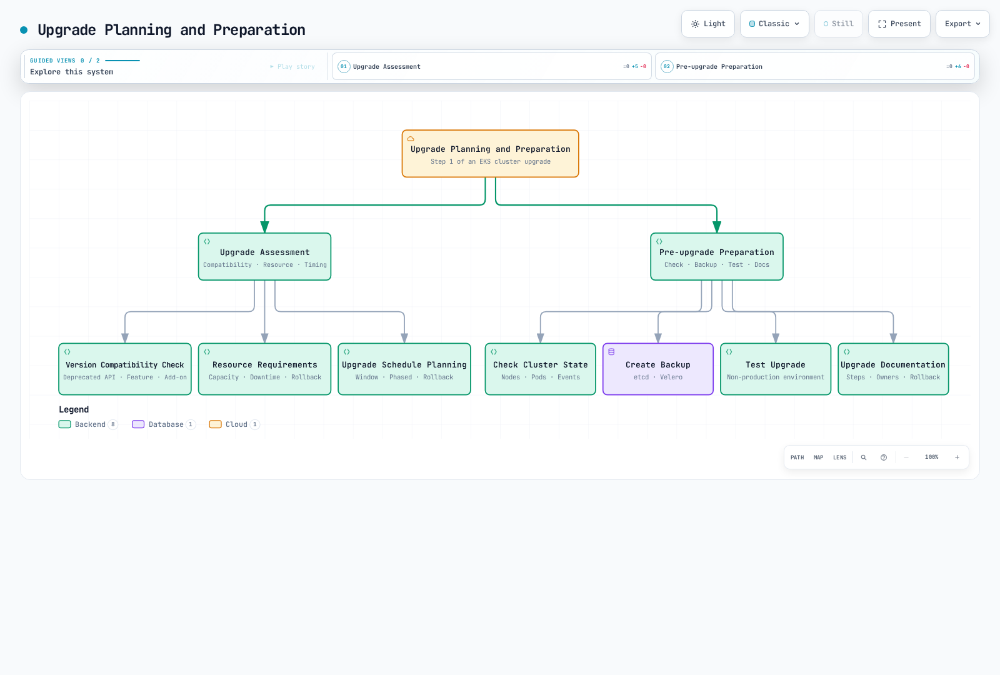
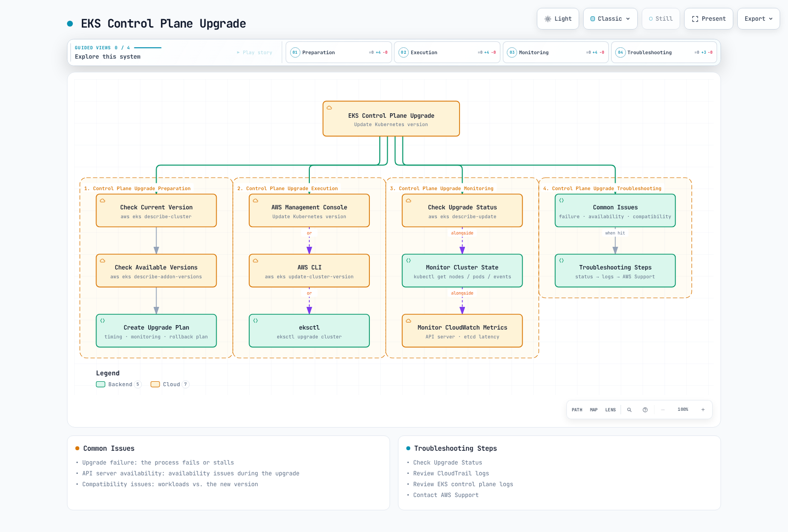
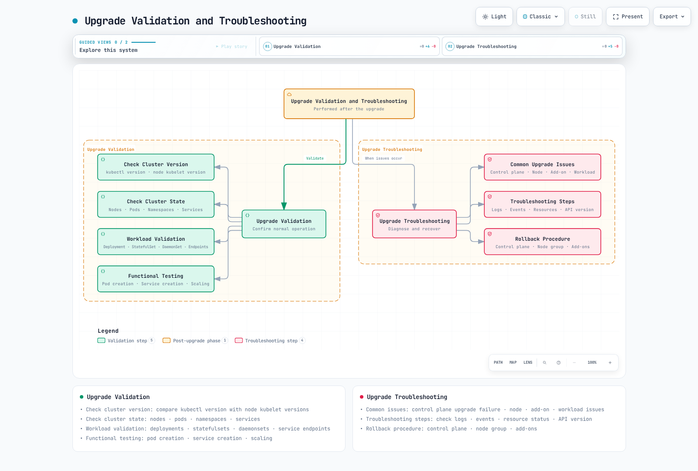
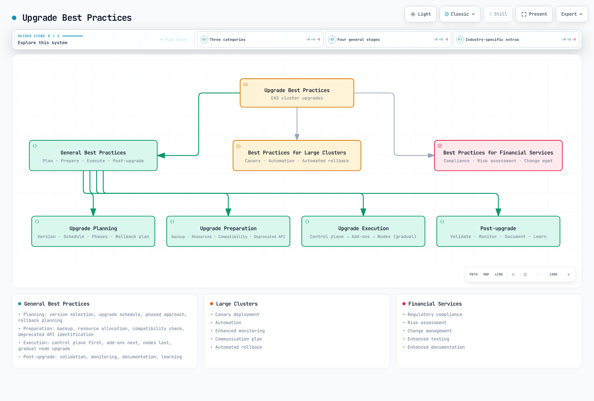

# Amazon EKS のアップグレード

> **最終更新日**: 2026年10月12日

Amazon EKS クラスターを最新の状態に保つことは、セキュリティと安定性を確保し、新機能を利用するうえで重要です。このドキュメントでは、EKS クラスターを安全にアップグレードするための戦略、ベストプラクティス、手順を説明します。

ここに記載するのは、オーナーがレビューする手順であり、この監査でアップグレードを実行した結果ではありません。アカウント、リージョン、Kubernetes コンテキストを明示し、承認済みの移行元／移行先バージョンと更新 ID を記録して、アプリケーションの動作を検証してください。同じリソースに対して、すべての代替例を続けて実行しないでください。ローカルでの解析やモックだけでは、本番環境での準備が整っていることを確認できません。

## 目次

1. [EKS アップグレードの概要](#eks-upgrade-overview)
2. [アップグレードの計画と準備](#upgrade-planning-and-preparation)
3. [EKS コントロールプレーンのアップグレード](#eks-control-plane-upgrade)
4. [ノードグループのアップグレード](#node-group-upgrade)
5. [アドオンのアップグレード](#add-on-upgrade)
6. [アップグレードの検証とトラブルシューティング](#upgrade-validation-and-troubleshooting)
7. [アップグレードの自動化](#upgrade-automation)
8. [アップグレードのベストプラクティス](#upgrade-best-practices)

## EKS アップグレードの概要 {#eks-upgrade-overview}


[🔍 インタラクティブ図を表示](https://www.atomai.click/kubernetes-docs/archmaps/en-eks-08-eks-upgrades-0.html)

### EKS のバージョン管理

EKS は Kubernetes のバージョン番号を使用し、独自のリリース／サポートカレンダーを設けています。各マイナーバージョンには**標準サポートが14か月**提供され、その後は追加料金が発生する**延長サポートが12か月**続きます。AWS は標準サポートの終了を少なくとも60日前に告知します。[現在の EKS バージョン一覧とカレンダー](https://docs.aws.amazon.com/eks/latest/userguide/kubernetes-versions.html)を確認してください。上流の Kubernetes リリースが、すぐに EKS で利用できるとは限りません。「最低4バージョン」という固定の前提を置いたり、14か月をサポート期間の全体とみなしたりしないでください。

### 2026年の EKS アップグレードに関する最近のお知らせ

- **Kubernetes 1.37 の提供開始（2026年10月1日）**: EKS 1.37 がサポート対象の移行先になりました。Auto Mode では、統合ポリシーを指定しない新規カスタム NodePool の統合ポリシーは `Balanced` が既定値です。組み込みの `general-purpose` および `system` プールも `Balanced` を使用します。SELinux ボリュームマウントは安定版となり、対応する CSI と Pod の構成で既定で有効です。アップグレード前に、意図した NodePool の動作と、異なるラベルのもとでボリュームを共有するワークロードの SELinux／CSI 要件を確認してください。[EKS 標準サポートのリリースノート](https://docs.aws.amazon.com/eks/latest/userguide/kubernetes-versions-standard.html)の Kubernetes 1.37 の項と[サポートカレンダー](https://docs.aws.amazon.com/eks/latest/userguide/kubernetes-versions.html)を参照してください。
- **Kubernetes バージョンのロールバック対応（2026年7月1日）**: アップグレードで問題が発生した場合、7日以内であればコントロールプレーンを直前のマイナーバージョンに戻せるようになりました。EKS は事前に自動の Rollback Readiness チェックを行い、API 互換性、バージョンスキュー、アドオン互換性、クラスターの健全性を確認します。ユーザーが開始するロールバックでは、コントロールプレーンを戻す前に Auto Mode が対象ノードを置き換えます。これはアプリケーション障害への自動対応ではありません。適用条件と中断制御も引き続き適用されます。EKS を提供するリージョンで追加料金はありませんが、ノード／ストレージ料金や該当するバージョンサポート料金は引き続き発生します。詳細は、以下の[ロールバック手順](#rollback-procedure)を参照してください。（出典: [Amazon EKS announces Kubernetes version rollback](https://aws.amazon.com/about-aws/whats-new/2026/07/amazon-eks-version-rollback)）
- **99.99% SLA と 8XL コントロールプレーン階層（2026年3月20日）**: Provisioned Control Plane クラスターの SLA は、1分単位で測定され、99.95% から99.99%に引き上げられました。新しい8XLスケーリング階層は、従来の4XL階層の API リクエスト処理能力を2倍にし、非常に大規模なクラスターや AI/ML/HPC ワークロードを対象としています。（出典: [Amazon EKS announces SLA and 8XL scaling tier](https://aws.amazon.com/about-aws/whats-new/2026/03/amazon-eks-announces-sla-8xl-scaling-tier/)）

### アップグレード対象のコンポーネント

EKS クラスターのアップグレードには、次のコンポーネントが含まれます。

1. **EKS コントロールプレーン**: Kubernetes API サーバー、etcd、コントローラーマネージャーなど。
2. **ノードグループ**: ワーカーノードとノード AMI。
3. **アドオン**: AWS マネージドアドオン（CoreDNS、kube-proxy、VPC CNI など）。
4. **セルフマネージドコンポーネント**: Helm チャート、カスタムリソースなど。

### アップグレード経路

EKS クラスターは、一度に1つのマイナーバージョンずつアップグレードする必要があります。

- 過去の例として、1.24 → 1.25 → 1.26 → 1.27 は1マイナーバージョンずつ進む形を示しています。これらは現在のデプロイ先を示すものではありません。
- 1.24 → 1.26 の直接移行は、途中のマイナーバージョンを飛ばすサポート対象外の例です。
- 実際に変更する際は、リージョンとサポートポリシーに応じて、EKS で提供されている次のマイナーバージョンを選んでください。

### アップグレードの順序

1. インベントリ、テスト、バックアップを行い、実行中の更新を解消します。保守的な準備手順として、ノードを**現在の**コントロールプレーンのマイナーバージョンに合わせます。
2. 必要に応じて、現行版と移行先の両方に互換性のあるアドオン／コントローラーの中間バージョンを適用し、コンポーネントごとの前提条件を確認します。
3. サポートされる次のマイナーバージョンへコントロールプレーンをアップグレードし、その更新 ID の成功を待ちます。
4. ノード、クライアント／コントローラー、残りのアドオンを、検証済みの依存関係順にアップグレードし、各手順を確認します。Auto Mode は組み込み機能を管理し、コントロールプレーンのアップグレード後にノード更新を開始します。
5. 実際のノードバージョン、ワークロードの準備状態、トラフィック、ストレージ、SLO を検証します。

kubelet 1.25以降では、上流のポリシーにより kubelet は API サーバーより最大3マイナーバージョン古い状態まで許可されますが、新しいバージョンにはできません。API サーバーが複数バージョンで動作している間は、許容範囲が狭まります。EKS のドキュメントには、アップグレード前にノードをそろえる案内と、サポートされるバージョンスキューの両方が記載されています。この手順書では、準備方針としてバージョンをそろえます。EKS API がサポート対象のスキューを常に拒否すると主張するものではありません。アドオンを常に「すべて先に」または「すべて後に」更新するわけではありません。ロールバック時はノードが先になる別の順序を使用します。詳細は以下を参照してください。

## アップグレードの計画と準備 {#upgrade-planning-and-preparation}

<!-- Pending parent diagram repair: see core-audit/eks-upgrades/diagram-review.json


[🔍 インタラクティブ図を表示](https://www.atomai.click/kubernetes-docs/archmaps/en-eks-08-eks-upgrades-1.html)
-->

### アップグレード評価

アップグレードを開始する前に、次の項目を評価します。

#### バージョン互換性の確認

移行先の Kubernetes バージョンとの互換性を確認します。

- **API の非推奨化**: 非推奨 API を使用するワークロードを特定します。
- **機能変更**: 新バージョンの機能変更を確認します。
- **アドオン互換性**: アドオンが移行先バージョンに対応していることを確認します。

イメージの一覧や `kubectl get … .apiVersion` は、クライアント／API の非推奨化を監査する方法ではありません。API サーバーが返すのは、ネゴシエーション後の現在の表現です。ベータ API が自動的に非推奨とは限りません。移行先リリースに照らして、ソース／Helm マニフェスト、クライアント、CRD、Webhook、EKS Upgrade Insights を確認してください。API サーバーメトリクスを一度収集しただけでは、観測した証拠に過ぎません。使用がないことやエラーがないことの証明にはなりません。

次の読み取り専用コレクターを `eks-upgrade-preflight.py` として保存します。`CLUSTER_NAME`、`AWS_REGION`、`EXPECTED_ACCOUNT_ID`、`KUBE_CONTEXT`、`TARGET_VERSION` をエクスポートし、生成された JSON をアクセス制限のあるローカル領域に保存してください。正常終了は情報収集が成功したことを示すだけで、アップグレードの承認やすべてのワークロードの互換性を意味しません。

```python
import json
import os
import re
import subprocess


def run_json(args):
    result = subprocess.run(args, check=True, capture_output=True, text=True, timeout=60)
    return json.loads(result.stdout)


def run_text(args):
    return subprocess.run(args, check=True, capture_output=True, text=True, timeout=30).stdout.strip()


def inspect_upgrade(cluster_name, region, expected_account, context, target, query=run_json, text=run_text):
    if not re.fullmatch(r"[0-9]{12}", expected_account):
        raise ValueError("Set the reviewed 12-digit AWS account ID")
    if not re.fullmatch(r"[0-9]+\.[0-9]+", target):
        raise ValueError("Target must be an EKS major.minor version")
    aws = [os.environ.get("AWS_CLI", "aws")]
    suffix = ["--region", region, "--output", "json", "--no-cli-pager"]
    identity = query(aws + ["sts", "get-caller-identity"] + suffix)
    if identity["Account"] != expected_account:
        raise RuntimeError("AWS account mismatch")
    cluster = query(aws + ["eks", "describe-cluster", "--name", cluster_name] + suffix)["cluster"]
    if cluster["status"] != "ACTIVE":
        raise RuntimeError("Cluster must be ACTIVE; inspect any in-progress updates")
    if cluster["arn"].split(":")[4] != expected_account:
        raise RuntimeError("Cluster/account mismatch")
    current = cluster["version"]
    current_parts = tuple(map(int, current.split(".")))
    target_parts = tuple(map(int, target.split(".")))
    if target_parts != (current_parts[0], current_parts[1] + 1):
        raise ValueError("This upgrade example requires exactly the next minor version")
    server = text(["kubectl", "--context", context, "config", "view", "--minify",
                   "--output", "jsonpath={.clusters[0].cluster.server}"])
    if server != cluster["endpoint"]:
        raise RuntimeError("Kubernetes context does not match the EKS API endpoint")
    catalog = query(aws + ["eks", "describe-cluster-versions", "--cluster-versions", target,
                         "--include-all", "--no-default-only"] + suffix)["clusterVersions"]
    if not any(item["clusterVersion"] == target and item.get("versionStatus") in
               ["STANDARD_SUPPORT", "EXTENDED_SUPPORT"] for item in catalog):
        raise ValueError("Target is not offered as a supported EKS version in this Region")
    insights = query(aws + [
        "eks", "list-insights", "--cluster-name", cluster_name,
        "--filter", json.dumps({"categories": ["UPGRADE_READINESS"], "kubernetesVersions": [target]}),
    ] + suffix)["insights"]
    nodes = query(["kubectl", "--context", context, "get", "nodes", "--output", "json"])["items"]
    update_ids = query(aws + ["eks", "list-updates", "--name", cluster_name] + suffix)["updateIds"]
    addon_names = query(aws + ["eks", "list-addons", "--cluster-name", cluster_name] + suffix)["addons"]
    addons = []
    for name in addon_names:
        addon = query(aws + ["eks", "describe-addon", "--cluster-name", cluster_name,
                             "--addon-name", name] + suffix)["addon"]
        addons.append({"name": name, "version": addon["addonVersion"], "status": addon["status"]})
    return {
        "cluster": cluster_name, "region": region, "account": expected_account,
        "currentVersion": current, "targetVersion": target, "targetCatalog": catalog,
        "insights": insights,
        "clusterUpdateIds": update_ids,
        "nodes": [{"name": node["metadata"]["name"],
                   "kubeletVersion": node["status"]["nodeInfo"]["kubeletVersion"],
                   "ready": next((condition.get("status") for condition in node["status"].get("conditions", [])
                                  if condition.get("type") == "Ready"), None),
                   "computeType": node["metadata"].get("labels", {}).get("eks.amazonaws.com/compute-type"),
                   "nodegroup": node["metadata"].get("labels", {}).get("eks.amazonaws.com/nodegroup")}
                  for node in nodes],
        "managedAddons": addons,
        "decision": "Inventory collected only; active-update review, owner approval, node alignment, API/client scans, "
                    "backups/restore tests, add-on bridge versions, capacity, and workload tests remain required.",
    }


if __name__ == "__main__":
    report = inspect_upgrade(
        os.environ["CLUSTER_NAME"], os.environ["AWS_REGION"],
        os.environ["EXPECTED_ACCOUNT_ID"], os.environ["KUBE_CONTEXT"],
        os.environ["TARGET_VERSION"],
    )
    print(json.dumps(report, indent=2))
```

#### リソース要件の評価

アップグレードに必要なリソースを評価します。

- **クラスター容量**: アップグレード中に追加ノードを収容できる十分な容量。
- **停止許容度**: ワークロードが停止を許容できるかどうか。
- **ロールバック計画**: 問題が発生した場合のロールバック計画。

#### アップグレードスケジュールの計画

アップグレードスケジュールを計画します。

- **メンテナンス時間帯**: トラフィックが少ない時間帯にアップグレードを予定します。
- **段階的な実施**: 非本番環境から始め、本番環境へ進めます。
- **ロールバック時間**: 問題発生時のロールバックに必要な時間を見込みます。

### アップグレード前の準備

#### クラスター状態の確認

アップグレード前にクラスターの状態を確認します。

```bash
# Check node status
kubectl --context "$KUBE_CONTEXT" get nodes

# Check pod status
kubectl --context "$KUBE_CONTEXT" get pods --all-namespaces

# Check component status
kubectl --context "$KUBE_CONTEXT" get --raw /readyz

# Check events
kubectl --context "$KUBE_CONTEXT" get events --all-namespaces
```

#### バックアップの作成

アップグレード前に重要なデータをバックアップします。

EKS が管理するコントロールプレーンの etcd は、ユーザーが所有する領域の `etcd-pod`／`etcdctl snapshot` コマンドではバックアップできません。また、`kubectl get all` では重要なリソースやボリュームデータが漏れるため、完全なバックアップにはなりません。

[AWS Backup for EKS](https://docs.aws.amazon.com/eks/latest/userguide/integration-backup.html) は、複合リカバリポイントを使ってクラスター状態と PVC が使用する EBS/EFS/S3 リソースを保護できます。ドキュメントに記載された IAM、API／API_AND_CONFIG_MAP アクセスモード、ストレージ、復元の前提条件が適用されます。別の方法として、所有者が管理する Velero／アプリケーションバックアップを使用し、ボリュームの対象範囲と認証情報を検証します。名前空間／クラスター範囲の対象、データベースの整合性、保持期間、復元テストを確認してください。バックアップ要求から ID が返っても、完了や復元可能性が証明されたわけではありません。

#### アップグレードのテスト

非本番環境でアップグレードをテストします。

1. 本番環境に近いテスト用クラスターを作成します。
2. テスト用クラスターでアップグレードを実施します。
3. ワークロードと機能をテストします。
4. 問題を特定して解決します。

#### アップグレードの記録作成

アップグレード手順を記録します。

- アップグレード手順
- 担当者と連絡先
- ロールバック手順
- トラブルシューティングガイド

## EKS コントロールプレーンのアップグレード {#eks-control-plane-upgrade}

<!-- Pending parent diagram repair: see core-audit/eks-upgrades/diagram-review.json


[🔍 インタラクティブ図を表示](https://www.atomai.click/kubernetes-docs/archmaps/en-eks-08-eks-upgrades-2.html)
-->

### コントロールプレーンのアップグレード準備

#### 現在のバージョンを確認する

現在の EKS クラスターバージョンを確認します。

```bash
aws eks describe-cluster --name "$CLUSTER_NAME" --region "$AWS_REGION" --query "cluster.version"
```

#### 利用可能なバージョンを確認する

利用可能な Kubernetes バージョンを確認します。

```bash
aws eks describe-cluster-versions --region "$AWS_REGION" \
  --no-default-only --output json --no-cli-pager
```

#### アップグレード計画を作成する

通常のアップグレードを申請する前に、[最新の EKS ガイダンス](https://docs.aws.amazon.com/eks/latest/userguide/update-cluster.html)を確認してください。Upgrade Insights の検出事項に対して `--force` を必須とする強制措置は、一時的に撤回されています。これは、バージョンロールバックで適用される `ROLLBACK_READINESS` のブロック条件とは異なります。検出事項を解消するか、明示的に評価してください。修正後も過去30日間の非推奨 API の証拠が残ることがあります。クラスターのサブネットが存在し、必要な空き IP アドレス（EKS は最大5個を要求する場合があります）を確保でき、コントロールプレーンとの通信が可能であることを確認してください。開始済みのコントロールプレーンアップグレードは一時停止も停止もできません。クライアントは再接続に対応する必要があります。

コントロールプレーンのアップグレード計画を作成します。

- アップグレード時間: トラフィックの少ない時間帯を選びます。
- 監視の設定: アップグレード中にクラスターの状態を監視します。
- ロールバック計画: 問題が発生した場合の手順を決めます。

### コントロールプレーンのアップグレード実行

#### AWS マネジメントコンソールを使用したアップグレード

1. AWS マネジメントコンソールにログインします。
2. Amazon EKS サービスに移動します。
3. クラスター一覧からアップグレード対象のクラスターを選択します。
4. 「Cluster configuration」タブを選択します。
5. 「Update Kubernetes version」をクリックします。
6. 移行先バージョンを選び、「Update」をクリックします。

#### AWS CLI を使用したアップグレード

記録済みの計画と前提条件が承認された場合にのみ実行してください。次のセクションのポーリング用ヘルパーを `eks-wait-update.py` として保存します。この操作が要求するのはコントロールプレーンの更新のみです。ノードやアドオンは更新せず、ワークロードの準備状態も証明しません。

```bash
set -euo pipefail
: "${CLUSTER_NAME:?Set the reviewed cluster}"
: "${AWS_REGION:?Set the reviewed Region}"
: "${TARGET_VERSION:?Set the next supported EKS minor version}"
umask 077
aws eks update-cluster-version \
  --name "$CLUSTER_NAME" --region "$AWS_REGION" \
  --kubernetes-version "$TARGET_VERSION" --output json --no-cli-pager \
  > control-plane-update.json
UPDATE_ID=$(jq -er '.update.id | select(type == "string" and length > 0)' control-plane-update.json)
export CLUSTER_NAME AWS_REGION UPDATE_ID
unset NODEGROUP_NAME ADDON_NAME
python3 eks-wait-update.py
```

#### eksctl を使用したアップグレード

```bash
eksctl upgrade cluster \
  --name "$CLUSTER_NAME" --region "$AWS_REGION" \
  --version "$TARGET_VERSION" \
  --approve
```

### コントロールプレーンのアップグレード監視

#### アップグレード状態の確認

アップグレード状態を確認します。

`DescribeUpdate` で該当する更新 ID を追跡してください。`cluster-active`／`nodegroup-active` は、この要求の成功を証明しません。また、AWS CLI 2.36.44 には `eks wait update-successful` waiter がありません。これを `eks-wait-update.py` として保存します。ノードグループ／アドオンの要求を待つ場合は、`NODEGROUP_NAME` または `ADDON_NAME` のどちらか一方だけを設定し、それ以外では両方を未設定のままにします。API エラー、失敗／キャンセル、不明な状態、クライアント側の期限超過で処理を停止します。クライアントのタイムアウトは AWS の操作をキャンセルしません。既定のクライアント待機時間は2時間です。特に Auto Mode の長時間ロールバックでは、承認された操作に合わせて調整してください。

```python
import json
import os
import subprocess
import time
from pathlib import Path


def wait_update(lookup, timeout_seconds, interval_seconds=15, clock=time.monotonic, sleep=time.sleep):
    if timeout_seconds <= 0 or interval_seconds < 0:
        raise ValueError("Use a positive timeout and nonnegative polling interval")
    deadline = clock() + timeout_seconds
    while True:
        update = lookup()["update"]
        status = update["status"]
        print(json.dumps({"id": update["id"], "status": status, "errors": update.get("errors", [])}), flush=True)
        if status == "Successful":
            return update
        if status in ["Failed", "Cancelled"]:
            raise RuntimeError(f"EKS update ended with {status}; inspect its error details")
        if status not in ["InProgress", "Cancelling"]:
            raise RuntimeError(f"Unexpected update status: {status}")
        if clock() >= deadline:
            raise TimeoutError("Client wait expired; the AWS operation may still be running. Preserve its update ID.")
        sleep(interval_seconds)


if __name__ == "__main__":
    cluster = os.environ["CLUSTER_NAME"]
    region = os.environ["AWS_REGION"]
    update_id = os.environ["UPDATE_ID"]
    nodegroup = os.environ.get("NODEGROUP_NAME")
    addon = os.environ.get("ADDON_NAME")
    if nodegroup and addon:
        raise ValueError("Set only NODEGROUP_NAME or ADDON_NAME for a scoped update")
    command = [
        os.environ.get("AWS_CLI", "aws"), "eks", "describe-update",
        "--name", cluster, "--region", region, "--update-id", update_id,
        "--output", "json", "--no-cli-pager",
    ]
    if nodegroup:
        command += ["--nodegroup-name", nodegroup]
    if addon:
        command += ["--addon-name", addon]
    status_file = Path(os.environ.get("UPDATE_STATUS_FILE", "eks-update-status.json"))

    def lookup():
        completed = subprocess.run(command, check=True, capture_output=True, text=True, timeout=60)
        response = json.loads(completed.stdout)
        status_file.write_text(json.dumps(response, indent=2) + "\n")
        return response

    wait_update(lookup, int(os.environ.get("WAIT_TIMEOUT_SECONDS", "7200")))
```

#### クラスター状態の監視

アップグレード中にクラスターの状態を監視します。

```bash
# Check node status
kubectl --context "$KUBE_CONTEXT" get nodes

# Check pod status
kubectl --context "$KUBE_CONTEXT" get pods --all-namespaces

# Check events
kubectl --context "$KUBE_CONTEXT" get events --all-namespaces --sort-by='.lastTimestamp'
```

#### CloudWatch メトリクスの監視

使用している EKS バージョン／階層と、構成済みテレメトリで実際に公開されるコントロールプレーンメトリクスを監視します。対象には API リクエスト率／レイテンシー／エラー、API の準備状態とクライアントの再接続、スケジューリング、ノード／ワークロードの健全性、アプリケーション SLO があります。etcd／コントローラーマネージャーのエンドポイントに直接アクセスできる、またはすべてのコンポーネントメトリクスが公開されるとは想定しないでください。`/readyz` が確認するのは API の準備状態であり、アプリケーション全体や過去の可用性条件ではありません。

### コントロールプレーンのアップグレードに関するトラブルシューティング

#### よくある問題

コントロールプレーンのアップグレード中には、次のような問題が発生する場合があります。

- **アップグレードの失敗**: アップグレード処理が失敗または中断する。
- **API サーバーの可用性**: アップグレード中に API サーバーの可用性に問題が起きる。
- **互換性の問題**: ワークロードと新バージョンに互換性がない。

#### トラブルシューティング手順

1. アップグレードの状態を確認します。
2. CloudTrail ログを確認します。
3. EKS コントロールプレーンログを確認します。
4. AWS サポートに問い合わせます。

## ノードグループのアップグレード {#node-group-upgrade}

コントロールプレーンをアップグレードした後、ノードグループもアップグレードする必要があります。ノードグループのアップグレードには、利点と欠点が異なる複数の方法があります。

<!-- Pending parent diagram repair: see core-audit/eks-upgrades/diagram-review.json


[🔍 インタラクティブ図を表示](https://www.atomai.click/kubernetes-docs/archmaps/en-eks-08-eks-upgrades-3.html)
-->

### ノードグループのアップグレード戦略

#### マネージドノードグループのアップグレード

マネージドノードグループは、AWS がノード更新を自動化するために提供するノードグループ管理機能です。

- **置き換え戦略**: `maxUnavailable`／割合を指定すると、複数ノードを並行して置き換えられます。API の `updateStrategy=DEFAULT` は旧容量を削除する前に新しい容量を起動します。`MINIMAL` は先に旧容量を削除するため、可用性と容量のトレードオフが異なります。
- **ドレイン**: 通常の更新では Pod eviction と PDB のチェックを行います。コントローラーは Pod をライブマイグレーションせず、再作成します。ノードグループの強制オプションは PDB に関連するドレイン失敗を回避できますが、クラスターのロールバックで使う force フラグとは別のものです。
- **バージョン／AMI の選択**: レビュー済みの Kubernetes／AMI リリースを選ぶか、カスタム AMI では元の起動テンプレートの新しいバージョンを選びます。更新失敗は、フリートが自動でロールバックした証拠にはなりません。ノード／AMI が混在している状態と更新エラーを調査してください。

#### セルフマネージドノードグループのアップグレード

セルフマネージドノードグループは、手動でノードをアップグレードする必要があります。

- **Blue/Green デプロイ**: 新しいノードグループを作成し、ワークロードを移行します。
- **ローリングアップグレード**: ノードを1台ずつ drain して終了し、新しいノードに置き換えます。
- **インプレースアップグレード**: 既存ノード上の kubelet とコンテナランタイムをアップグレードします。

#### Fargate ノードのアップグレード

Fargate ノードのインフラストラクチャは AWS が管理しますが、ワークロードの所有者は Pod の置き換えを調整する必要があります。新しく起動する Fargate Pod は、コントロールプレーンと一致する kubelet バージョンを使用します。既存 Pod は、コントロールプレーンの操作だけではアップグレードされません。Fargate ではアップグレード作業が不要だとみなさず、コントローラーのロールアウト、可用性、検証を計画してください。Auto Mode は異なり、コントロールプレーンのアップグレード後に、中断制御に従ってノードの段階的な置き換えを開始します。

### マネージドノードグループのアップグレード

#### マネージドノードグループのバージョン確認

現在のマネージドノードグループのバージョンを確認します。

```bash
aws eks describe-nodegroup \
  --cluster-name "$CLUSTER_NAME" --region "$AWS_REGION" \
  --nodegroup-name "$NODEGROUP_NAME" \
  --query "nodegroup.version"
```

#### AWS マネジメントコンソールを使用したアップグレード

1. AWS マネジメントコンソールにログインします。
2. Amazon EKS サービスに移動します。
3. クラスター一覧からアップグレード対象のクラスターを選択します。
4. 「Compute」タブを選択します。
5. アップグレードするノードグループを選択します。
6. 「Update node group」をクリックします。
7. 移行先バージョンを選び、「Update」をクリックします。

#### AWS CLI を使用したアップグレード

EKS 最適化 AMI を使用する場合、レビュー済みのリリースと移行先バージョンを指定します。この操作には個別の更新 ID があるため、ポーリング時はノードグループの範囲を指定してください。プラットフォーム／AMI ファミリーのサポートを確認します。AL2 ノードグループは、Kubernetes バージョンを変更しただけでは AL2023 に移行されません。

```bash
set -euo pipefail
: "${CLUSTER_NAME:?}"; : "${AWS_REGION:?}"; : "${NODEGROUP_NAME:?}"
: "${TARGET_VERSION:?Set the reviewed target, no newer than the control plane}"
: "${TARGET_AMI_RELEASE:?Set the reviewed EKS-optimized AMI release}"
umask 077
aws eks describe-nodegroup --cluster-name "$CLUSTER_NAME" --nodegroup-name "$NODEGROUP_NAME" \
  --region "$AWS_REGION" --output json > nodegroup-before.json
if jq -e '.nodegroup.amiType == "CUSTOM"' nodegroup-before.json >/dev/null; then
  echo "Use the custom launch-template path for this node group" >&2
  exit 1
fi
aws eks update-nodegroup-version \
  --cluster-name "$CLUSTER_NAME" --nodegroup-name "$NODEGROUP_NAME" --region "$AWS_REGION" \
  --kubernetes-version "$TARGET_VERSION" --release-version "$TARGET_AMI_RELEASE" \
  --output json > nodegroup-update.json
UPDATE_ID=$(jq -er '.update.id | select(type == "string" and length > 0)' nodegroup-update.json)
export CLUSTER_NAME AWS_REGION UPDATE_ID NODEGROUP_NAME
unset ADDON_NAME
python3 eks-wait-update.py
```

**カスタム AMI** の場合は、元の起動テンプレートをレビュー済みの新しいバージョンに更新します。このカスタム AMI の要求に Kubernetes の `version` や `releaseVersion` を渡さないでください。置き換えノード上で、実際の kubelet、ランタイム、AMI を確認します。

```bash
set -euo pipefail
: "${CLUSTER_NAME:?}"; : "${AWS_REGION:?}"; : "${NODEGROUP_NAME:?}"
: "${LAUNCH_TEMPLATE_ID:?Set the same launch template originally used by the group}"
: "${LAUNCH_TEMPLATE_VERSION:?Set the reviewed version containing the updated custom AMI}"
aws eks update-nodegroup-version \
  --cluster-name "$CLUSTER_NAME" --nodegroup-name "$NODEGROUP_NAME" --region "$AWS_REGION" \
  --launch-template "id=$LAUNCH_TEMPLATE_ID,version=$LAUNCH_TEMPLATE_VERSION" \
  --output json > nodegroup-update.json
UPDATE_ID=$(jq -er '.update.id | select(type == "string" and length > 0)' nodegroup-update.json)
export CLUSTER_NAME AWS_REGION UPDATE_ID NODEGROUP_NAME
unset ADDON_NAME
python3 eks-wait-update.py
```

#### eksctl を使用したアップグレード

```bash
eksctl upgrade nodegroup \
  --cluster "$CLUSTER_NAME" --region "$AWS_REGION" \
  --name "$NODEGROUP_NAME" \
  --kubernetes-version "$TARGET_VERSION"
```

#### マネージドノードグループのアップグレード設定

マネージドノードグループのアップグレード動作を構成できます。

- **最大同時利用不可数**: アップグレード中に利用できなくなるノードの最大数。
- **PDB**: 自発的な退避の対象を制限しますが、すべての障害やアプリケーションの結果を制御するものではありません。強制ノードグループ更新は、PDB に関する問題を無視できます。マネージドノードグループの desired／min／max スケーリング設定の変更は ASG のスケーリング操作であり、アップグレード時のドレインや PDB 保証にはなりません。サイズを0に変更する方法を安全な移行として使用しないでください。

```bash
aws eks update-nodegroup-config \
  --cluster-name "$CLUSTER_NAME" --region "$AWS_REGION" \
  --nodegroup-name "$NODEGROUP_NAME" \
  --update-config maxUnavailable=1
```

### セルフマネージドノードグループのアップグレード

#### Blue/Green デプロイ

所有者が管理する構成から、別の名前のノードグループを準備します。レビュー済みのサブネット／ゾーン、IAM、AMI アーキテクチャとブートストラップ、ラベル、taint、ストレージ、ネットワーク要件を維持してください。[クラスター作成ガイド](02-eks-cluster-creation.md)を参照してください。`eksctl create nodegroup` は既定でマネージドグループを作成します。セルフマネージド構成を指定するには、`--managed=false` または適切な `nodeGroups` 設定セクションを明示する必要があります。作成時は `--version` を使いますが、`eksctl upgrade nodegroup` では `--kubernetes-version` を使用します。

1. レビュー済みの構成で green 側の容量を作成し、ノード数、移行先 kubelet／AMI、Ready 状態、CNI／DNS、アプリケーションのスケジューリングを確認します。ノード一覧を取得するだけでは、この検証にはなりません。
2. 所有者が管理する段階ごとにワークロードを移動します。preferred affinity は green 側への配置を保証しません。Pod が実際に割り当てられたノードとストレージトポロジーを調べてください。
3. 識別済みの旧ノードを1台ずつ、有限のタイムアウトを設定して drain します。eviction またはヘルスチェックに失敗した場合は中止します。続行する前に、ワークロードと代替容量を再検証してください。
4. 移行、健全性、データ保持、復旧の受け入れが記録されてから、旧グループを廃止します。確認なしのループや固定時間の待機後に、自動で削除しないでください。

```bash
set -euo pipefail
: "${KUBE_CONTEXT:?Set the reviewed cluster context}"
: "${NODE_NAME:?Set one reviewed old node}"
kubectl --context "$KUBE_CONTEXT" get node "$NODE_NAME" -o wide
kubectl --context "$KUBE_CONTEXT" get node "$NODE_NAME" \
  -o jsonpath='{.spec.providerID}{"\n"}'
kubectl --context "$KUBE_CONTEXT" get pods --all-namespaces \
  --field-selector "spec.nodeName=$NODE_NAME" -o wide
# Stop on failure. Do not terminate the instance or delete the node group here.
kubectl --context "$KUBE_CONTEXT" drain "$NODE_NAME" --ignore-daemonsets --timeout=10m
```

この既定の drain は、個別判断が必要な未管理 Pod やローカルデータがある場合に処理を拒否します。`--delete-emptydir-data` を指定すると emptyDir データの損失を明示的に許可します。考えずに追加しないでください。`kubectl drain --force` は未管理 Pod を許可するオプションであり、eviction／PDB チェックの回避とは異なります。DaemonSet、static Pod、コントローラー、永続データは、それぞれの所有者を通じて調整してください。

#### ローリングアップグレード

セルフマネージド ASG では、まず所有する起動設定／テンプレートを検証済み AMI に更新してください。そうしないと、置き換え後のノードが古いイメージで起動する場合があります。前述の1台ずつ行う drain 手順を使い、終了前にノードの provider ID、EC2 インスタンス、ASG の所有関係を確認します。Kubernetes ノードを、最初に一致した EC2 のプライベート DNS 名に対応付けないでください。ドレイン済みインスタンスを ASG の所有者に置き換えてもらい、**新しい**適切な構成の Ready ノードとワークロード復旧を待ってから次に進みます。60秒待機しても、置き換え後の準備が整った証明にはなりません。直接の ASG スケーリング／インスタンス更新には、対応する Kubernetes ドレイン連携が必要です。PDB は自動的には適用されません。

#### インプレースアップグレード

個別にテストした OS／イメージ固有の手順を、対応するセルフマネージドホストにだけ使います。EKS 最適化マネージドフリートでは、イミュータブルで検証済みの AMI への置き換えを推奨します。Auto Mode／Fargate のインフラストラクチャはサービス側が所有します。一般的な `yum update kubelet kubectl` では、レビュー済みの Kubernetes／ランタイムバージョンを選択できず、EKS ノードのアップグレードにもなりません。SSM 要求は非同期です。実際のバージョン、必要なサービス再起動、ノード準備状態、ワークロードテストが成功するまで uncordon しないでください。失敗時の証拠を残し、自動 uncordon や自動終了を避けてください。

### ノードアップグレードの監視と検証

#### ノードバージョンの確認

ノードの Kubernetes バージョンを確認します。

```bash
kubectl --context "$KUBE_CONTEXT" get nodes -o custom-columns=NAME:.metadata.name,VERSION:.status.nodeInfo.kubeletVersion
```

#### ノード状態の確認

ノードの状態を確認します。

```bash
kubectl --context "$KUBE_CONTEXT" get nodes
kubectl --context "$KUBE_CONTEXT" describe nodes
```

#### Pod のデプロイ確認

Pod が正常にデプロイされていることを確認します。

```bash
kubectl --context "$KUBE_CONTEXT" get pods --all-namespaces -o wide
kubectl --context "$KUBE_CONTEXT" get pods --all-namespaces -o custom-columns=NAMESPACE:.metadata.namespace,NAME:.metadata.name,PHASE:.status.phase,READY:'.status.conditions[?(@.type=="Ready")].status'
```

## アドオンのアップグレード {#add-on-upgrade}

実際のコンポーネント所有者とアップグレード経路を一覧化してください。EKS マネージドアドオンは、コントロールプレーンのアップグレードだけでは自動更新されません。所有者が互換性のある更新を選択して開始します。必要な中間リリースはコントロールプレーン変更の前に適用することがあります。Auto Mode の組み込み機能は AWS が別途管理します。すべてのクラスターで同じ DaemonSet／Deployment が使われるかのように、重複するノードネットワーク／ストレージ／DNS コンポーネントをインストールまたは更新しないでください。


[🔍 インタラクティブ図を表示](https://www.atomai.click/kubernetes-docs/archmaps/en-eks-08-eks-upgrades-4.html)

### AWS マネージドアドオン

#### マネージドアドオンの一覧確認

クラスターにインストールされているマネージドアドオンを確認します。

```bash
aws eks list-addons --cluster-name "$CLUSTER_NAME" --region "$AWS_REGION"
```

#### マネージドアドオンのバージョン確認

マネージドアドオンの現在のバージョンを確認します。

```bash
aws eks describe-addon \
  --cluster-name "$CLUSTER_NAME" --region "$AWS_REGION" \
  --addon-name vpc-cni \
  --query "addon.addonVersion"
```

#### 利用可能なアドオンバージョンの確認

利用可能なアドオンバージョンを確認します。

配列の先頭要素が「最新」または適切なバージョンを示すとは限りません。`compatibilities`、既定バージョンの印、プラットフォーム／コンピュート／アーキテクチャのサポート、リリースノート、IAM の変更、中間バージョンの要件を確認してください。アドオンを変更する前に構成と ID の関連付けを記録します。構成には機密値が含まれる場合があるため、アクセスを制限してファイルを保存してください。

```bash
set -euo pipefail
: "${CLUSTER_NAME:?}"; : "${AWS_REGION:?}"; : "${ADDON_NAME:?}"
: "${TARGET_VERSION:?Set the Kubernetes version for this stage}"
umask 077
aws eks describe-addon --cluster-name "$CLUSTER_NAME" --addon-name "$ADDON_NAME" \
  --region "$AWS_REGION" --output json > addon-before.json
aws eks describe-addon-versions --addon-name "$ADDON_NAME" \
  --kubernetes-version "$TARGET_VERSION" --region "$AWS_REGION" \
  --output json > addon-candidates.json
# Select ADDON_VERSION after reviewing compatibility, architecture, compute type, and upgrade path.
: "${ADDON_VERSION:?Set the reviewed add-on version}"
aws eks describe-addon-configuration --addon-name "$ADDON_NAME" \
  --addon-version "$ADDON_VERSION" --region "$AWS_REGION" \
  --output json > addon-schema.json
jq -r '.addon.configurationValues // "{}"' addon-before.json > addon-config-candidate.json
```

#### マネージドアドオンのアップグレード

AWS マネジメントコンソール、AWS CLI、または eksctl を使ってマネージドアドオンをアップグレードできます。

候補の JSON を移行先スキーマに照らして検証し、意図した構成と ID の意味を維持してください。`PRESERVE` はマネージドフィールドの競合に対処するもので、すべてのカスタム値を検証したり、アプリケーションの動作を保証したり、明示的に指定した一部構成を古い JSON にマージしたりはしません。`{}` を渡すと構成がリセットされる場合があります。所有するアドオンを一度に1つずつ更新し、それぞれの更新 ID、健全性、バージョン、ワークロードの動作を確認してください。

```bash
set -euo pipefail
: "${CLUSTER_NAME:?}"; : "${AWS_REGION:?}"; : "${ADDON_NAME:?}"; : "${ADDON_VERSION:?}"
: "${REVIEWED_ADDON_CONFIG_FILE:?Provide the complete reviewed target configuration JSON}"
aws eks update-addon --cluster-name "$CLUSTER_NAME" --addon-name "$ADDON_NAME" \
  --addon-version "$ADDON_VERSION" --region "$AWS_REGION" \
  --configuration-values "file://$REVIEWED_ADDON_CONFIG_FILE" \
  --resolve-conflicts PRESERVE --output json > addon-update.json
UPDATE_ID=$(jq -er '.update.id | select(type == "string" and length > 0)' addon-update.json)
export CLUSTER_NAME AWS_REGION UPDATE_ID ADDON_NAME
unset NODEGROUP_NAME
python3 eks-wait-update.py
aws eks describe-addon --cluster-name "$CLUSTER_NAME" --addon-name "$ADDON_NAME" \
  --region "$AWS_REGION" --output json
```

eksctl 0.229 の `update addon` には `--wait` と `--config-file` がありますが、`--preserve` フラグはありません。意図した競合ポリシーをレビュー済みの eksctl 設定に記述するか、前述の AWS CLI 手順を使用してください。`eksctl --force` はセルフマネージドアドオンの所有権を移行するためのもので、一般的な競合保持オプションではありません。

### セルフマネージドアドオン

#### セルフマネージドアドオンのアップグレード

Helm または kubectl を使用してセルフマネージドアドオンをアップグレードします。

既存の Helm／マニフェストの所有者を通じて作業します。例はレビュー済みのチャートリポジトリ／OCI リファレンスと既存リリースを前提としています。リリースが見つからない場合に二重の管理者を作らないよう、`--install` は使いません。新しいチャートの CRD および IAM 移行要件を確認してください。`helm upgrade` だけでは、チャートの `crds/` ディレクトリにある CRD はアップグレードされません。Helm と raw manifest のデプロイは代替手段であり、連続して実行する更新手順ではありません。以前の Metrics Server 0.6.1／3.8.2 の例は、移行先互換性のあるバージョン選定ではありません。

```bash
set -euo pipefail
: "${KUBE_CONTEXT:?}"; : "${RELEASE:?}"; : "${ADDON_NAMESPACE:?}"
: "${CHART_REF:?Set the verified repository/chart or OCI reference}"
: "${CHART_VERSION:?Set a reviewed compatible chart version}"
: "${REVIEWED_VALUES_FILE:?Set the complete reviewed target values file}"
umask 077
helm get values "$RELEASE" --namespace "$ADDON_NAMESPACE" --kube-context "$KUBE_CONTEXT" \
  --all > addon-values-before.yaml
helm show values "$CHART_REF" --version "$CHART_VERSION" > addon-values-defaults.yaml
# Merge/migrate values and handle CRDs/IAM through the owner before this step.
helm upgrade "$RELEASE" "$CHART_REF" --version "$CHART_VERSION" \
  --namespace "$ADDON_NAMESPACE" --kube-context "$KUBE_CONTEXT" \
  -f "$REVIEWED_VALUES_FILE" --wait --timeout 15m
```

### 主要アドオンのアップグレードガイド

#### CoreDNS のアップグレード

標準ノードでは、CoreDNS Deployment を EKS または別のツールのどちらが管理しているかを確認し、Corefile／PDB／カスタム設定を維持して、選択したバージョンの移行ノートに従います。Auto Mode ノードでは CoreDNS がノードのシステムサービスとして稼働します。Auto Mode のみのクラスターでは Deployment アドオンは不要ですが、混在クラスターでは Auto Mode 以外のノード用に DNS を維持する必要があります。Auto Mode のみのクラスターで Deployment が見つからなくても、アップグレード失敗と判断しないでください。

#### kube-proxy のアップグレード

kube-proxy を API サーバーおよび稼働先ノードと互換性のある状態に保ちます。API サーバーより新しいバージョンにはできません。対象バージョンでサポートされるアドオンビルドと、検証済みの更新順序を使用してください。Auto Mode はサービスネットワークを管理します。そこにセルフマネージド kube-proxy DaemonSet があるとは限りません。

#### VPC CNI のアップグレード

標準 EC2 ノードでは、CNI のバージョン経路、IP／prefix モード、IAM、ネットワークポリシーの設定、ワークロード接続性を検証します。1つの `aws-node` ConfigMap にすべての設定が含まれているとは限りません。該当する場合は EKS `configurationValues`、DaemonSet／コンテナ設定、サービスアカウントの ID、所有者が管理する Helm／GitOps 設定も確認してください。Auto Mode の組み込みネットワークは独自の管理経路に従います。

EKS が管理する各アドオンでは、前述の取得／選択／更新／待機の手順を使用します。標準ノードのエージェントは、実際にインストールされている場合だけ調べます。

```bash
kubectl --context "$KUBE_CONTEXT" -n kube-system get deployment coredns -o wide
kubectl --context "$KUBE_CONTEXT" -n kube-system get daemonset kube-proxy aws-node -o wide
```

### アドオンアップグレードのトラブルシューティング

#### よくある問題

アドオンのアップグレードでは、次のような問題が発生する場合があります。

- **構成の競合**: カスタム構成と新バージョンが競合する。
- **互換性の問題**: アドオンと Kubernetes バージョンに互換性がない。
- **リソース不足**: アップグレードに必要なリソースが足りない。

#### トラブルシューティング手順

1. アドオンの状態を確認します。

```bash
aws eks describe-addon \
  --cluster-name "$CLUSTER_NAME" --region "$AWS_REGION" \
  --addon-name vpc-cni
```

2. アドオンのログを確認します。

```bash
kubectl --context "$KUBE_CONTEXT" logs -n kube-system -l k8s-app=kube-dns
kubectl --context "$KUBE_CONTEXT" logs -n kube-system -l k8s-app=kube-proxy
kubectl --context "$KUBE_CONTEXT" logs -n kube-system -l k8s-app=aws-node
```

3. アドオンのイベントを確認します。

```bash
kubectl --context "$KUBE_CONTEXT" get events -n kube-system --sort-by='.lastTimestamp'
```

## アップグレードの検証とトラブルシューティング {#upgrade-validation-and-troubleshooting}

アップグレードが終わったら、クラスターが正常に稼働していることを検証し、問題があれば解決します。



[🔍 インタラクティブ図を表示](https://www.atomai.click/kubernetes-docs/archmaps/en-eks-08-eks-upgrades-5.html)

### アップグレードの検証

#### クラスターバージョンの確認

クラスターとノードのバージョンを確認します。

```bash
# Check cluster version
kubectl --context "$KUBE_CONTEXT" version --output=yaml

# Check node version
kubectl --context "$KUBE_CONTEXT" get nodes -o custom-columns=NAME:.metadata.name,VERSION:.status.nodeInfo.kubeletVersion
```

#### クラスター状態の確認

クラスターコンポーネントの状態を確認します。

```bash
# Check node status
kubectl --context "$KUBE_CONTEXT" get nodes

# Check pod status
kubectl --context "$KUBE_CONTEXT" get pods --all-namespaces

# Check namespace status
kubectl --context "$KUBE_CONTEXT" get namespaces

# Check service status
kubectl --context "$KUBE_CONTEXT" get services --all-namespaces
```

#### ワークロードの検証

アプリケーションワークロードが正常に動作していることを確認します。

```bash
# Check deployment status
kubectl --context "$KUBE_CONTEXT" get deployments --all-namespaces

# Check statefulset status
kubectl --context "$KUBE_CONTEXT" get statefulsets --all-namespaces

# Check daemonset status
kubectl --context "$KUBE_CONTEXT" get daemonsets --all-namespaces

# Check service endpoints
kubectl --context "$KUBE_CONTEXT" get endpointslices.discovery.k8s.io --all-namespaces
```

#### 機能テスト

所有する隔離済みテストリソースと、明示した合格基準を使用します。次の**Linux EC2 ノードのスモークテスト**は、Deployment のロールアウト／スケーリング、Service／DNS リクエスト、別々の Job を使った PVC データを確認します。負荷ベンチマークでも、すべてのノード／AZ のテストでも、アプリケーション／HA／セキュリティが正しい証明でもありません。ワークロードに応じた Ingress／Egress、コントローラー／Webhook、復旧テストを追加してください。Fargate／ハイブリッドなど他のプラットフォームには、それぞれ互換性のあるテスト計画が必要です。

`eks-upgrade-smoke.py` として保存してください。このスクリプトは、この監査用にマニフェストを確認した、ピン留め済みの公式 BusyBox イメージを使用します。この監査ではイメージもクラスターもテストしていません。実行前に、イメージポリシー、Admission／ネットワークルール、利用可能な容量、選択したノードで利用できる互換性のあるファイルシステム StorageClass を確認してください。`KUBE_CONTEXT`、`TEST_STORAGE_CLASS`、`RUN_SMOKE_TEST=yes` を設定します。置き換え後の特定ノードでテストする場合は、レビュー済みの `SMOKE_NODE_SELECTOR` JSON マップも設定してください。このスクリプトは一意な名前空間を作成し、既存の名前空間を流用せず、失敗時に停止して実際の配置と PV の回収情報を記録します。`WaitForFirstConsumer` のボリュームでは、完了を待つ前に書き込み用の consumer を起動します。

確認のため、既定ではリソースを保持します。`CLEANUP_ON_SUCCESS=yes` を指定すると、チェック成功後に、その実行が作成した名前空間 UID だけを削除します。ストレージクラスが Retain を使用する場合、名前空間を削除しても課金対象の PV／ストレージが残る場合があります。記録された PV を調べ、所有するテスト用ストレージだけを削除してください。失敗は診断用に保持し、成功として報告しません。短時間の現在メトリクスや連続20回の HTTP リクエストだけでは、性能の同等性を証明できません。

```python
import json
import os
import subprocess
import uuid
from pathlib import Path

IMAGE = "docker.io/library/busybox@sha256:73aaf090f3d85aa34ee199857f03fa3a95c8ede2ffd4cc2cdb5b94e566b11662"


def manifests(namespace, storage_class, marker, node_selector):
    if node_selector.get("kubernetes.io/os", "linux") != "linux":
        raise ValueError("This BusyBox example requires Linux nodes")
    node_selector = {"kubernetes.io/os": "linux", **node_selector}
    security = {"runAsNonRoot": True, "runAsUser": 65532, "fsGroup": 65532,
                "seccompProfile": {"type": "RuntimeDefault"}}
    container_security = {"allowPrivilegeEscalation": False, "readOnlyRootFilesystem": True,
                          "capabilities": {"drop": ["ALL"]}}
    resources = {"requests": {"cpu": "50m", "memory": "32Mi"},
                 "limits": {"cpu": "200m", "memory": "128Mi"}}

    def job(name, command, with_volume=False):
        container = {"name": "check", "image": IMAGE, "command": ["sh", "-ec", command],
                     "resources": resources, "securityContext": container_security}
        pod = {"restartPolicy": "Never", "automountServiceAccountToken": False,
               "securityContext": security, "nodeSelector": node_selector, "containers": [container]}
        if with_volume:
            container["volumeMounts"] = [{"name": "data", "mountPath": "/data"}]
            pod["volumes"] = [{"name": "data", "persistentVolumeClaim": {"claimName": "smoke-data"}}]
        return {"apiVersion": "batch/v1", "kind": "Job", "metadata": {"name": name, "namespace": namespace},
                "spec": {"backoffLimit": 0, "activeDeadlineSeconds": 120,
                         "template": {"spec": pod}}}

    config = {"apiVersion": "v1", "kind": "ConfigMap",
              "metadata": {"name": "smoke-content", "namespace": namespace},
              "data": {"index.html": marker + "\n"}}
    deployment = {
        "apiVersion": "apps/v1", "kind": "Deployment",
        "metadata": {"name": "smoke-http", "namespace": namespace},
        "spec": {"replicas": 2, "selector": {"matchLabels": {"app": "smoke-http"}},
                 "template": {"metadata": {"labels": {"app": "smoke-http"}}, "spec": {
                     "automountServiceAccountToken": False, "securityContext": security,
                     "nodeSelector": node_selector,
                     "containers": [{"name": "http", "image": IMAGE,
                                     "command": ["httpd", "-f", "-p", "8080", "-h", "/www"],
                                     "securityContext": container_security, "resources": resources,
                                     "ports": [{"name": "http", "containerPort": 8080}],
                                     "readinessProbe": {"httpGet": {"path": "/", "port": "http"}},
                                     "volumeMounts": [{"name": "content", "mountPath": "/www", "readOnly": True}]}],
                     "volumes": [{"name": "content", "configMap": {"name": "smoke-content"}}],
                 }}},
    }
    service = {"apiVersion": "v1", "kind": "Service",
               "metadata": {"name": "smoke-http", "namespace": namespace},
               "spec": {"selector": {"app": "smoke-http"}, "ports": [{"port": 80, "targetPort": "http"}]}}
    pvc = {"apiVersion": "v1", "kind": "PersistentVolumeClaim",
           "metadata": {"name": "smoke-data", "namespace": namespace},
           "spec": {"storageClassName": storage_class, "accessModes": ["ReadWriteOnce"],
                    "resources": {"requests": {"storage": "1Gi"}}}}
    writer = job("smoke-write", f"printf '%s\\n' '{marker}' > /data/marker; sync", True)
    reader = job("smoke-read", f"test \"$(cat /data/marker)\" = '{marker}'", True)
    http = job("smoke-request", f"i=0; while [ \"$i\" -lt 20 ]; do "
               f"test \"$(wget -T 5 -q -O - http://smoke-http)\" = '{marker}'; "
               "i=$((i + 1)); sleep 1; done")
    return [config, deployment, service, pvc, writer], reader, http


def run_smoke(context, storage_class, node_selector, call=subprocess.run):
    if not context or not storage_class or not isinstance(node_selector, dict):
        raise ValueError("Set the reviewed context, StorageClass, and node selector map")
    namespace = "eks-upgrade-smoke-" + uuid.uuid4().hex[:12]
    marker = uuid.uuid4().hex
    evidence = Path(namespace)
    evidence.mkdir()
    prefix = ["kubectl", "--context", context]

    def kubectl(*args, payload=None):
        completed = call(prefix + list(args), input=json.dumps(payload) if payload else None,
                         check=True, capture_output=True, text=True, timeout=240)
        return completed.stdout

    # Create, never apply/adopt, the namespace. A failed creation must not lead to deletion.
    created = json.loads(kubectl("create", "namespace", namespace, "--output", "json"))
    namespace_uid = created["metadata"]["uid"]
    (evidence / "namespace.json").write_text(json.dumps(created, indent=2) + "\n")
    print(f"Owned smoke namespace: {namespace}; preserve evidence and inspect PV reclamation before cleanup.", flush=True)
    try:
        initial, reader, http = manifests(namespace, storage_class, marker, node_selector)
        kubectl("create", "-f", "-", payload={"apiVersion": "v1", "kind": "List", "items": initial})
        # The writer is a PVC consumer, so WaitForFirstConsumer provisioning can proceed.
        kubectl("-n", namespace, "wait", "--for=condition=Complete", "job/smoke-write", "--timeout=180s")
        kubectl("-n", namespace, "delete", "job", "smoke-write", "--cascade=foreground",
                "--wait=true", "--timeout=60s")
        kubectl("create", "-f", "-", payload=reader)
        kubectl("-n", namespace, "wait", "--for=condition=Complete", "job/smoke-read", "--timeout=180s")
        kubectl("-n", namespace, "rollout", "status", "deployment/smoke-http", "--timeout=180s")
        kubectl("-n", namespace, "scale", "deployment/smoke-http", "--replicas=3")
        kubectl("-n", namespace, "rollout", "status", "deployment/smoke-http", "--timeout=180s")
        kubectl("create", "-f", "-", payload=http)
        kubectl("-n", namespace, "wait", "--for=condition=Complete", "job/smoke-request", "--timeout=180s")
        pods = json.loads(kubectl("-n", namespace, "get", "pods", "--output", "json"))
        claim = json.loads(kubectl("-n", namespace, "get", "pvc", "smoke-data", "--output", "json"))
        volume = json.loads(kubectl("get", "pv", claim["spec"]["volumeName"], "--output", "json"))
        result = {"namespace": namespace, "namespaceUID": namespace_uid, "nodeSelector": node_selector,
                  "checks": ["PVC write/read across Jobs", "Deployment rollout/scale", "20 HTTP/DNS requests"],
                  "pods": pods, "pvc": claim, "pv": volume,
                  "limits": "A bounded smoke test, not a load benchmark, HA proof, or full application validation."}
        (evidence / "result.json").write_text(json.dumps(result, indent=2) + "\n")
    except Exception:
        print(f"Smoke test failed; namespace {namespace} retained for diagnosis.", flush=True)
        raise
    print(f"Smoke checks completed. Evidence: {evidence}/result.json", flush=True)
    if os.environ.get("CLEANUP_ON_SUCCESS") == "yes":
        current = json.loads(kubectl("get", "namespace", namespace, "--output", "json"))
        if current["metadata"]["uid"] != namespace_uid:
            raise RuntimeError("Namespace identity changed; refusing cleanup")
        kubectl("delete", "namespace", namespace, "--wait=true", "--timeout=180s")
        print("Namespace deleted; inspect the recorded PV reclaim policy for retained billable storage.", flush=True)
    return namespace


if __name__ == "__main__":
    if os.environ.get("RUN_SMOKE_TEST") != "yes":
        raise SystemExit("Set RUN_SMOKE_TEST=yes only for the approved test scope")
    os.umask(0o077)
    run_smoke(os.environ["KUBE_CONTEXT"], os.environ["TEST_STORAGE_CLASS"],
              json.loads(os.environ.get("SMOKE_NODE_SELECTOR", "{}")))
```

### アップグレードのトラブルシューティング

#### よくあるアップグレードの問題

アップグレード中には、次のような問題が発生する場合があります。

1. **コントロールプレーンのアップグレード失敗**:
   - API サーバーの可用性に関する問題
   - etcd データベースの問題
   - IAM 権限の問題

2. **ノードのアップグレードに関する問題**:
   - ノードの drain 失敗
   - 新しいノードの起動失敗
   - kubelet バージョンの不一致

3. **アドオンのアップグレードに関する問題**:
   - 構成の競合
   - 互換性の問題
   - リソース不足

4. **ワークロードに関する問題**:
   - API 非推奨化によるワークロード障害
   - リソース不足による Pod のスケジューリング失敗
   - ネットワークの問題

#### トラブルシューティング手順

1. **ログを確認する**:

```bash
set -euo pipefail
: "${CLUSTER_NAME:?}"; : "${AWS_REGION:?}"; : "${KUBE_CONTEXT:?}"
: "${START_TIME_MS:?Set the reviewed start timestamp in epoch milliseconds}"
: "${END_TIME_MS:?Set the reviewed analysis-window end timestamp}"
aws eks describe-cluster --name "$CLUSTER_NAME" --region "$AWS_REGION" \
  --query 'cluster.logging' --output json --no-cli-pager
# Read existing logs; enabling logging is a separate change and does not backfill history.
aws logs filter-log-events --region "$AWS_REGION" \
  --log-group-name "/aws/eks/$CLUSTER_NAME/cluster" \
  --start-time "$START_TIME_MS" --end-time "$END_TIME_MS" \
  --max-items 200 --output json --no-cli-pager
# Standard EC2-node agents only, where installed; these are Pod logs, not all host journals.
kubectl --context "$KUBE_CONTEXT" -n kube-system logs -l k8s-app=kube-proxy \
  --all-containers=true --prefix=true --since=15m --tail=100
kubectl --context "$KUBE_CONTEXT" -n kube-system logs -l k8s-app=aws-node \
  --all-containers=true --prefix=true --since=15m --tail=100
```

2. **イベントを確認する**:

```bash
kubectl --context "$KUBE_CONTEXT" get events --all-namespaces --sort-by='.lastTimestamp'
```

3. **リソース状態を確認する**:

```bash
kubectl --context "$KUBE_CONTEXT" describe nodes
kubectl --context "$KUBE_CONTEXT" -n "$WORKLOAD_NAMESPACE" get deployments,statefulsets,daemonsets,pods -o wide
```

4. **API バージョンを確認する**:

```bash
kubectl --context "$KUBE_CONTEXT" api-versions
```

#### ロールバック手順 {#rollback-procedure}

EKS のバージョンロールバックは2026年7月に導入された、ユーザーが開始する実際の操作です。「ダウングレード不可」という古い一般的な説明ではなく、[現在のロールバックガイド](https://docs.aws.amazon.com/eks/latest/userguide/rollback-cluster.html)を参照してください。Kubernetes のマイナーバージョンは戻りますが、以前の etcd／アプリケーション／PV データのスナップショットは復元されず、アドオンも自動で戻りません。プラットフォームバージョンには、移行先となる以前のマイナーバージョンで最新のものが使われます。

**適用条件と準備**

- インプレースアップグレードの完了から**7日以内**に開始してください。現在のバージョンで作成したクラスターは対象外です。対象にできるのは直前のマイナーバージョンのみで、さらに古いバージョンへロールバックを連鎖させることはできません。
- 移行先がサポート対象である必要があります。延長サポート対象へ戻す場合は、先に `EXTENDED` サポートポリシーを採用し、その料金も考慮してください。延長サポート終了時の自動アップグレードは元に戻せません。標準サポートからの自動アップグレードでは、延長ポリシーに関する所定の条件が適用されます。
- クラスターは ACTIVE で、競合する更新がない必要があります。新しいバージョンで有効になった後方互換性のない EKS 機能が、ロールバックを妨げる場合があります。`--force` でこれらの前提条件を回避することはできません。
- ロールバックインサイト、アプリケーション／クライアント／CRD／Webhook の互換性、ノードのバージョンスキュー、アドオン互換性を確認してください。チェックは実行時点の情報に基づくベストエフォートです。ロールバック中に互換性のない変更を加えないでください。

`ROLLBACK_READINESS` の ERROR／UNKNOWN 検出事項はロールバックをブロックし、WARNING は助言として扱われます。これは通常アップグレードのインサイトに関する強制措置が一時的に撤回された状況とは異なります。ロールバックの `--force` フラグはインサイトチェック（ERROR／WARNING／UNKNOWN）を迂回しますが、安全でない計画を安全にしたり、適用条件や Auto Mode の中断制御を回避したりはしません。可能な検出事項は解消し、上書きを選ぶ場合は明示的なリスク判断として扱います。通常の例ではこのフラグを省いています。

```bash
aws eks list-insights --cluster-name "$CLUSTER_NAME" --region "$AWS_REGION" \
  --filter '{"categories":["ROLLBACK_READINESS"]}' --output json --no-cli-pager
# Set INSIGHT_ID from the response to inspect one finding.
aws eks describe-insight --cluster-name "$CLUSTER_NAME" --region "$AWS_REGION" \
  --id "$INSIGHT_ID" --output json --no-cli-pager
kubectl --context "$KUBE_CONTEXT" get nodes -o wide
```

**コントロールプレーンより先にノードとアドオンを準備する**

マネージドノードグループは、現行の[マネージドノードグループガイド](https://docs.aws.amazon.com/eks/latest/userguide/update-managed-node-group.html)に記載されている `UpdateNodegroupVersion` を使ってロールバックできます。コントロールプレーンを戻す前に実行し、ノード／AMI の結果バージョンを確認してください。古い API 概要にはロールバック不可という記載が残っていますが、現行のロールバックガイドにはこのバージョンロールバック手順が明記されています。これは、過去の任意の AMI にダウングレードできるという一般的な保証ではありません。カスタム AMI のグループでは、レビュー済みの元の起動テンプレート経路が必要です。

```bash
set -euo pipefail
: "${CLUSTER_NAME:?}"; : "${AWS_REGION:?}"; : "${NODEGROUP_NAME:?}"
: "${ROLLBACK_VERSION:?Set the reviewed previous minor for the eligible rollback}"
aws eks update-nodegroup-version \
  --cluster-name "$CLUSTER_NAME" --nodegroup-name "$NODEGROUP_NAME" --region "$AWS_REGION" \
  --kubernetes-version "$ROLLBACK_VERSION" --output json --no-cli-pager > node-rollback-update.json
UPDATE_ID=$(jq -er '.update.id | select(type == "string" and length > 0)' node-rollback-update.json)
export CLUSTER_NAME AWS_REGION UPDATE_ID NODEGROUP_NAME
unset ADDON_NAME
python3 eks-wait-update.py
```

セルフマネージド／ハイブリッドノードは所有者が管理します。Auto Mode はコントロールプレーンより先に、自身のノードを自動で処理します。Fargate の kubelet はインプレースでロールバックできません。互換性のない Fargate Pod がすぐ新しいバージョンで再作成されないよう、HPA／GitOps／Job などのコントローラーと可用性を調整してください。テスト済みの移行／メンテナンス計画を使い、コントロールプレーンを戻してから Pod を再作成します。単純な Pod 削除ループでは不十分です。Fargate のスキューに関するインサイトを強制的に無視しても、新しい kubelet が古い API サーバーでサポートされるわけではありません。

EKS はアドオンバージョンを元に戻しません。互換性のある中間／以前のアドオンバージョンと、レビュー済み構成を選択し、それぞれの更新 ID と機能チェックを使ってください。セルフマネージドのコントローラー／CRD は個別に評価する必要があります。すべてを一律に OVERWRITE したり、推測した古い AL2 ノードグループをロールバック計画にしたりしないでください。

**コントロールプレーンのロールバックを要求して監視する**

承認済みの以前のマイナーバージョンを指定して `update-cluster-version` を使用します。`rollback-cluster` という別コマンドはありません。これはアップグレード要求の代替手段であり、すべての更新後に自動実行する手順ではありません。適切なクライアント待機時間を設定し、返された更新 ID を保持してください。

```bash
set -euo pipefail
: "${CLUSTER_NAME:?}"; : "${AWS_REGION:?}"; : "${ROLLBACK_VERSION:?}"
: "${WAIT_TIMEOUT_SECONDS:?Set an explicit client wait for the approved rollback}"
aws eks update-cluster-version --name "$CLUSTER_NAME" --region "$AWS_REGION" \
  --kubernetes-version "$ROLLBACK_VERSION" --output json --no-cli-pager > rollback-update.json
UPDATE_ID=$(jq -er '.update.id | select(type == "string" and length > 0)' rollback-update.json)
export CLUSTER_NAME AWS_REGION UPDATE_ID WAIT_TIMEOUT_SECONDS
unset NODEGROUP_NAME ADDON_NAME
python3 eks-wait-update.py
```

**Auto Mode のタイミングとキャンセル**

Auto Mode のノードロールバック中は、クラスターが ACTIVE のまま進み、その後コントロールプレーン段階で UPDATING になります。全体を通して更新 ID を追跡してください。NodePool の drift budget と、ノードの do-not-disrupt アノテーションにより、ノードの置き換えがブロックされる場合があります。PDB と Pod の do-not-disrupt アノテーションは `terminationGracePeriod` の範囲で処理を遅らせますが、アプリケーションの可用性を絶対に保証するものではありません。`--force` でこれらの制御を上書きすることはできません。

Auto Mode の `rollbackConfig.timeoutMinutes` の既定値は **720** で、**120～10080** を指定できます。これは最小限のタイムアウト条件であり、正確な期限を意味しません。タイムアウトすると更新は失敗し、コントロールプレーンは現在のバージョンにとどまり、ノードはそのバージョンに向けて drift します。再試行時にも、開始可能な7日間の期間が関係します。CLI 2.36.44 で次のオプションをローカルで構文確認しました。

```bash
# Alternative Auto Mode request: do not run this as a second request after the preceding one.
# Select a reviewed timeout from 120 to 10080 minutes; default is 720 when omitted.
aws eks update-cluster-version --name "$CLUSTER_NAME" --region "$AWS_REGION" \
  --kubernetes-version "$ROLLBACK_VERSION" --rollback-config timeoutMinutes=720 \
  --output json --no-cli-pager > rollback-update.json
```

Auto Mode の要求後は、返された ID と同じ waiter を使用します。このヘルパーの既定の2時間待機は、サービスの既定の12時間タイムアウトより短いため、クライアント側の期限を慎重に選んでください。CI／IaC／認証情報のタイムアウトは AWS の操作をキャンセルしません。CancelUpdate を利用できるのは、コントロールプレーンのロールバックが始まる前の Auto Mode ノード段階だけです。キャンセルはベストエフォートで、すでに中断処理中のノードはその処理を完了します。Cancelling → Cancelled の状態と、その後のノード収束を確認してください。通常のコントロールプレーンアップグレードや、開始済みのコントロールプレーンロールバックをこの方法でキャンセルすることはできません。

```bash
# Only during the cancellable Auto Mode node phase, before control-plane rollback starts.
aws eks cancel-update --name "$CLUSTER_NAME" --region "$AWS_REGION" \
  --update-id "$UPDATE_ID" --output json --no-cli-pager
```

CloudFormation スタックのロールバックや Git revert が、EKS のバージョンロールバックを自動的に開始することはありません。明示的な復旧後は、IaC の状態／計画を実際のバージョンに合わせてください。ロールバックの条件を満たせない場合は、前方修正、またはサポート対象バージョンの新しいクラスターへテスト済みの移行／復元を行う方法を検討します。いずれの方法も、データベース移行やアプリケーションデータの変更を自動で取り消しません。

## アップグレードの自動化 {#upgrade-automation}

大規模な環境では、アップグレードプロセスの自動化が重要です。次のツールや方法で EKS のアップグレードを自動化できます。

<!-- Pending parent diagram repair: see core-audit/eks-upgrades/diagram-review.json


[🔍 インタラクティブ図を表示](https://www.atomai.click/kubernetes-docs/archmaps/en-eks-08-eks-upgrades-6.html)
-->

### eksctl を使用した自動化

レビュー済みの eksctl 構成と、操作に合ったフラグを使用します。`upgrade cluster --approve` はコントロールプレーンの変更を要求します。`--approve` を付けない場合は、コマンドがプレビューします。ノードグループの作成では `--version`、`upgrade nodegroup` では `--kubernetes-version` を使用します。各操作の所有者／ツールを1つに決め、実際の EKS 更新とワークロード状態を確認してください。AWS CLI の更新と eksctl の更新を、重複した要求として続けて実行しないでください。

### AWS CLI とスクリプトを使用した自動化

前述の読み取り専用 preflight、特定の更新を待つポーラー、コンポーネント別要求例は、自動化を構成する部品です。オーケストレーターは結果を保持し、失敗、タイムアウト、検証の未完了時に停止する必要があります。配列順序ではなく承認済みのアドオン／AMI／構成バージョンを使用し、カスタム AMI と Auto Mode／Fargate の違いを処理して、クライアント失敗後は更新 ID を使って再開してください。リソースが ACTIVE になっただけで、アップグレード全体が成功したと報告してはいけません。この確認用エントリーポイントはアップグレードを開始しません。

```bash
set -euo pipefail
: "${CLUSTER_NAME:?}"; : "${AWS_REGION:?}"; : "${EXPECTED_ACCOUNT_ID:?}"
: "${KUBE_CONTEXT:?}"; : "${TARGET_VERSION:?}"
export CLUSTER_NAME AWS_REGION EXPECTED_ACCOUNT_ID KUBE_CONTEXT TARGET_VERSION
umask 077
python3 eks-upgrade-preflight.py > preflight.json
# Review this evidence and the workload/backup/capacity plan before a separate change step.
```

### GitOps を使用した自動化

Git には、目標バージョン、互換性の証拠、レビュー済みの手順書を保存できます。Argo CD／Flux は eksctl の `ClusterConfig` ファイルを EKS コントロールプレーンの変更にネイティブ変換するものではありません。適切な権限を持つ AWS 対応コントローラーまたはランナーが必要です。Git／CloudFormation のロールバックによって、EKS バージョンアップグレードが自動で元に戻ることもありません。

次のワークフローは、**読み取り専用の準備状況収集**だけを目的とします。前述の `eks-upgrade-preflight.py` を `runbooks/eks-upgrade-preflight.py` として保存し、完全な状態でコミットしてから使用してください。信頼できるプライベートネットワークのランナーと、レビュー済みの AWS CLI／kubectl／Python ツールチェーンは別途用意します。ピン留めされた Actions は Node.js 24 を使用するため、セルフホストランナーはそのランタイムに対応している必要があります。リポジトリ変数と保護された `eks-upgrade-review` 環境を構成し、OIDC 信頼をこのリポジトリ／環境と `sts.amazonaws.com` に限定してください。環境名を指定するだけでは、レビュアーによる保護は設定されません。EKS／STS の必要な読み取りと Kubernetes ノード一覧の権限のみを持つ調査用ロールを使います。この例には、クラスターのバージョンを変更する権限は不要です。

アプリケーション／API／バックアップ／容量のテスト結果とともに成果物をレビューし、その後、前述のコンポーネント別手順を使う別の承認済み変更段階に進んでください。このワークフローは、収集成功が準備完了を意味するとも、本番アップグレードをテストしたとも主張しません。インフラストラクチャ／インサイトのメタデータに合わせて成果物へのアクセスを制限してください。隔離された kubeconfig はアップロードされません。

```yaml
name: Inspect EKS upgrade readiness
'on':
  workflow_dispatch:
    inputs:
      target_version:
        description: Reviewed next EKS minor version; inspection only
        required: true
        type: string
permissions:
  contents: read
  id-token: write
concurrency:
  group: eks-readiness-${{ vars.AWS_REGION }}-${{ vars.EKS_CLUSTER_NAME }}
  cancel-in-progress: false
jobs:
  inspect:
    runs-on:
    - self-hosted
    - linux
    - eks-upgrade
    environment: eks-upgrade-review
    timeout-minutes: 20
    env:
      CLUSTER_NAME: ${{ vars.EKS_CLUSTER_NAME }}
      AWS_REGION: ${{ vars.AWS_REGION }}
      EXPECTED_ACCOUNT_ID: ${{ vars.AWS_ACCOUNT_ID }}
      KUBE_CONTEXT: eks-upgrade-review
      TARGET_VERSION: ${{ inputs.target_version }}
    steps:
    - uses: actions/checkout@3d3c42e5aac5ba805825da76410c181273ba90b1
      with:
        persist-credentials: false
    - name: Assume the scoped review role
      uses: aws-actions/configure-aws-credentials@cbe3b392738ccf3f987d68400dafcf4b0624a56c
      with:
        role-to-assume: ${{ vars.EKS_REVIEW_ROLE_ARN }}
        aws-region: ${{ env.AWS_REGION }}
        allowed-account-ids: ${{ env.EXPECTED_ACCOUNT_ID }}
        unset-current-credentials: true
    - name: Prepare isolated context
      shell: bash
      run: "set -euo pipefail\numask 077\nEVIDENCE_DIR=\"$RUNNER_TEMP/eks-readiness-$GITHUB_RUN_ID-$GITHUB_RUN_ATTEMPT\"\
        \nKUBECONFIG=\"$EVIDENCE_DIR/kubeconfig\"\nexport EVIDENCE_DIR KUBECONFIG\n\
        mkdir -m 700 -p \"$EVIDENCE_DIR\"\nprintf 'EVIDENCE_DIR=%s\\nKUBECONFIG=%s\\\
        n' \"$EVIDENCE_DIR\" \"$KUBECONFIG\" >> \"$GITHUB_ENV\"\naws eks update-kubeconfig\
        \ --name \"$CLUSTER_NAME\" --region \"$AWS_REGION\" \\\n  --kubeconfig \"\
        $KUBECONFIG\" --alias \"$KUBE_CONTEXT\"\naws --version\nkubectl version --client\
        \ --output=json\npython3 --version"
      id: prepare
    - name: Collect review evidence
      shell: bash
      run: 'set -euo pipefail

        umask 077

        python3 runbooks/eks-upgrade-preflight.py > "$EVIDENCE_DIR/preflight.json"'
    - name: Preserve the review artifact
      if: ${{ always() && steps.prepare.outcome == 'success' }}
      uses: actions/upload-artifact@043fb46d1a93c77aae656e7c1c64a875d1fc6a0a
      with:
        name: eks-readiness-${{ github.run_id }}-${{ github.run_attempt }}
        path: ${{ env.EVIDENCE_DIR }}/preflight.json
        if-no-files-found: warn
        retention-days: 14
```

### アップグレード自動化のベストプラクティス

EKS アップグレードを自動化する際は、次のベストプラクティスに従います。

1. **段階的に進める**: 非本番環境から始め、本番環境へ進めます。
2. **復旧計画**: 適用条件を確認したテスト済みの復旧手順を使います。バージョンやデータ変更を無条件に巻き戻さないでください。
3. **検証手順**: アップグレード後の自動検証手順を含めます。
4. **通知**: アップグレードの成功または失敗を通知するよう構成します。
5. **文書化**: 自動化プロセスと手順を記録します。

## アップグレードのベストプラクティス {#upgrade-best-practices}

EKS クラスターをアップグレードする際のベストプラクティスを確認します。

<!-- Pending parent diagram repair: see core-audit/eks-upgrades/diagram-review.json


[🔍 インタラクティブ図を表示](https://www.atomai.click/kubernetes-docs/archmaps/en-eks-08-eks-upgrades-7.html)
-->

### 一般的なベストプラクティス

#### アップグレードの計画

1. **バージョン選択**: 安定したバージョンを選び、リリースノートを確認します。
2. **アップグレードスケジュール**: トラフィックの少ない時間帯に予定します。
3. **段階的な実施**: 非本番環境から始め、本番環境へ進めます。
4. **ロールバック計画**: 問題に備えてロールバック計画を作成します。

#### アップグレードの準備

1. **バックアップ**: 重要なデータをバックアップします。
2. **リソース割り当て**: アップグレードに十分なリソースを確保します。
3. **互換性の確認**: ワークロードとアドオンの互換性を確認します。
4. **非推奨 API の特定**: 非推奨 API を使用するワークロードを特定して更新します。

#### アップグレードの実行

1. **準備**: 現在のノードバージョンと、必要な中間アドオン／コントローラーを、移行先変更の前にそろえます。
2. **コントロールプレーンの移行先**: サポート対象の次のマイナーバージョンを要求し、更新 ID を確認します。
3. **依存コンポーネント**: ノード、残りのアドオン／コントローラー、クライアントを、レビュー済みの互換性順にアップグレードします。
4. **ノードを段階的に更新する**: ワークロードへの影響を抑えるため、ノードを段階的にアップグレードします。

#### アップグレード後

1. **検証**: クラスターとワークロードの状態を検証します。
2. **監視**: アップグレード後もクラスターを監視します。
3. **記録**: アップグレードの手順と結果を記録します。
4. **学習**: 発生した問題と解決策を振り返ります。

### 大規模クラスター向けのベストプラクティス

大規模 EKS クラスターのアップグレードでは、次の点も考慮します。

1. **カナリアデプロイ**: 一部のノードまたはワークロードから始めて、段階的に範囲を広げます。
2. **自動化**: アップグレードプロセスを自動化します。
3. **強化した監視**: アップグレード中にクラスター状態を継続的に監視します。
4. **連絡計画**: 関係者にアップグレード状況を定期的に共有します。
5. **制御された復旧**: 証拠と適用条件のチェックを自動化し、レビュー済みの復旧経路を適用します。ロールバックには条件があります。

### 金融サービス向けのベストプラクティス

金融サービス業界で EKS クラスターをアップグレードする際は、次の点も考慮します。

1. **規制遵守**: アップグレードが規制要件を満たすことを確認します。
2. **リスク評価**: アップグレード前にリスクを評価します。
3. **変更管理**: 厳格な変更管理プロセスに従います。
4. **強化したテスト**: アップグレード前に十分なテストを実施します。
5. **詳細な記録**: アップグレードの手順と結果を詳しく記録します。

## まとめ

Amazon EKS クラスターのアップグレードを成功させるには、入念な計画、準備、検証が必要です。このドキュメントでは、EKS クラスターのコントロールプレーン、ノードグループ、アドオンを安全にアップグレードする戦略、手順、ベストプラクティスを説明しました。

要点:

1. **EKS アップグレードの概要**: EKS のバージョン管理、アップグレード対象コンポーネント、移行経路。
2. **アップグレードの計画と準備**: 評価、準備、テスト。
3. **EKS コントロールプレーンのアップグレード**: コントロールプレーンのアップグレード方法と監視。
4. **ノードグループのアップグレード**: マネージド／セルフマネージドノードグループの更新方法。
5. **アドオンのアップグレード**: AWS マネージド／セルフマネージドアドオンの更新。
6. **アップグレードの検証とトラブルシューティング**: アップグレードの検証と、よくある問題への対処。
7. **アップグレードの自動化**: eksctl、AWS CLI、GitOps を使用した自動化。
8. **アップグレードのベストプラクティス**: 一般的な方法と業界固有の方法。

EKS クラスターを最新の状態に保つことで、セキュリティパッチ、バグ修正、新機能を活用し、クラスター全体のセキュリティ、安定性、性能を向上できます。

## 参考資料

- [Amazon EKS アップグレードのドキュメント](https://docs.aws.amazon.com/eks/latest/userguide/update-cluster.html)
- [Kubernetes のバージョンとバージョンスキュー](https://kubernetes.io/docs/setup/release/version-skew-policy/)
- [EKS マネージドノードグループのアップグレード](https://docs.aws.amazon.com/eks/latest/userguide/update-managed-node-group.html)
- [EKS アドオンのアップグレード](https://docs.aws.amazon.com/eks/latest/userguide/managing-add-ons.html)
- [eksctl のドキュメント](https://eksctl.io/usage/cluster-upgrade/)
- [Kubernetes アップグレードのベストプラクティス](https://kubernetes.io/docs/tasks/administer-cluster/cluster-upgrade/)

## クイズ

この章で学んだ内容を確認するには、[トピック別クイズ](../quizzes/eks/08-eks-upgrades-quiz.md)に挑戦してください。
