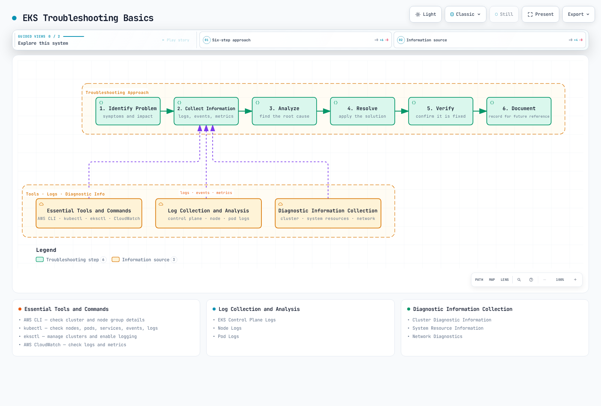
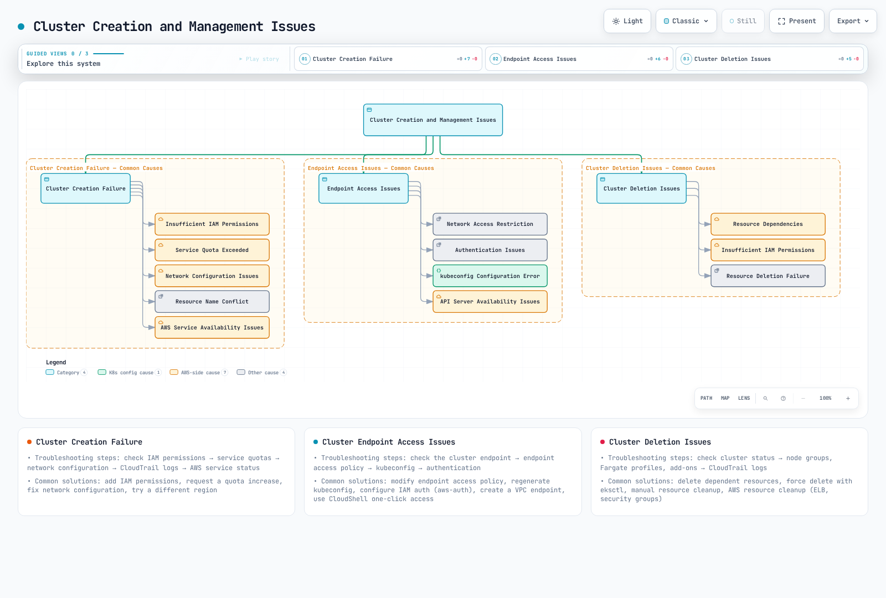
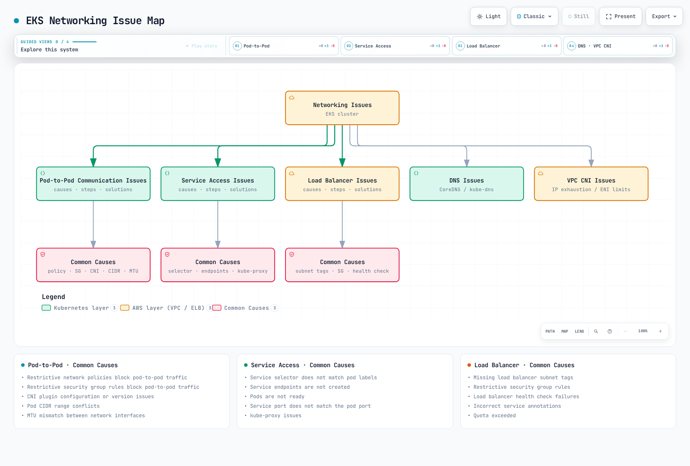
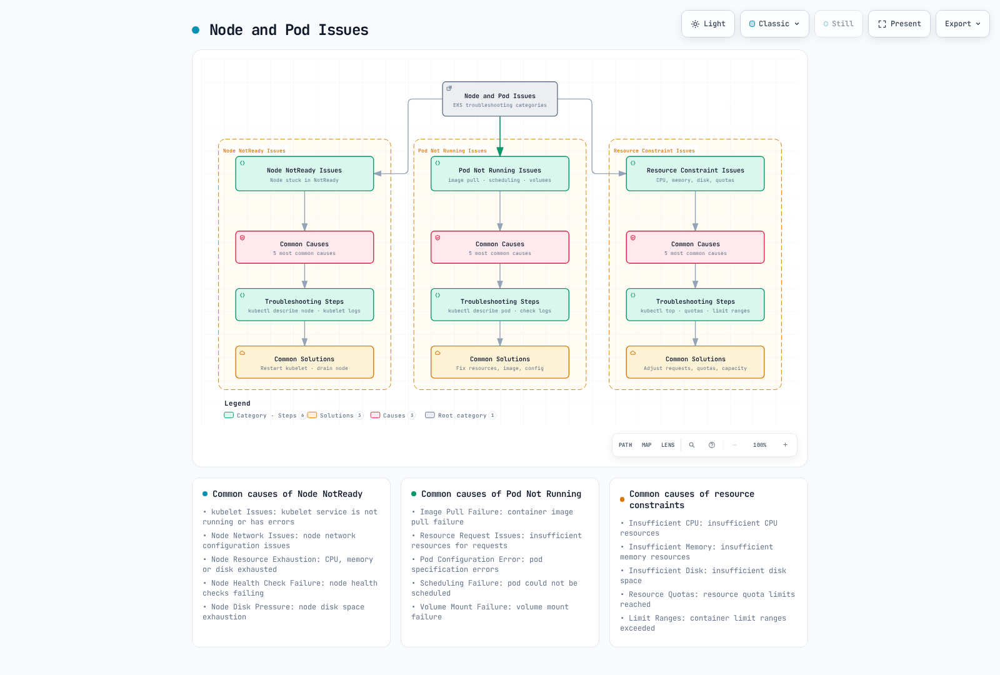
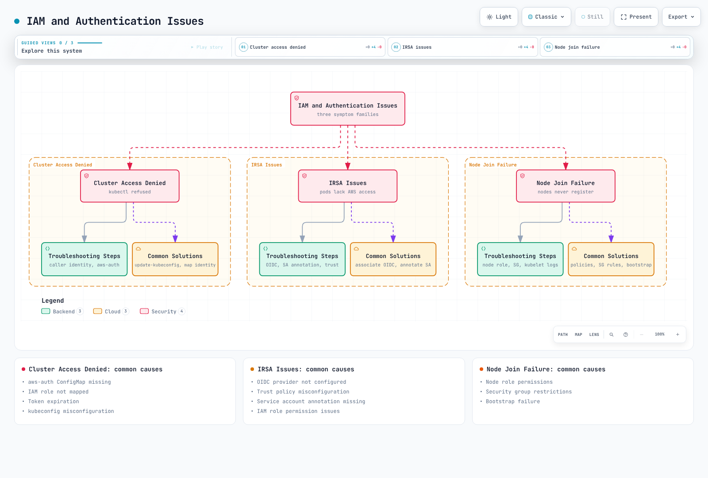

# Amazon EKS のトラブルシューティング

> **最終更新日**: 2026年9月12日

Amazon EKS クラスターの運用中には、さまざまな問題が発生することがあります。このドキュメントでは、EKS クラスターで起こり得る一般的な問題と、その解決方法について説明します。

## 目次

1. [トラブルシューティングの基本](#troubleshooting-basics)
2. [クラスターの作成と管理に関する問題](#cluster-creation-and-management-issues)
3. [ネットワークに関する問題](#networking-issues)
4. [ノードと Pod に関する問題](#node-and-pod-issues)
5. [IAM と認証に関する問題](#iam-and-authentication-issues)
6. [ストレージに関する問題](#storage-issues)
7. [ログとモニタリングに関する問題](#logging-and-monitoring-issues)
8. [パフォーマンスに関する問題](#performance-issues)
9. [アップグレードに関する問題](#upgrade-issues)
10. [一般的なエラーメッセージと解決方法](#common-error-messages-and-solutions)

## トラブルシューティングの基本



[🔍 インタラクティブ図を表示](https://www.atomai.click/kubernetes-docs/archmaps/en-eks-09-eks-troubleshooting-0.html)

### トラブルシューティングの進め方

1. 症状、影響を受けているユーザーやワークロード、インシデントの発生時間帯を特定します。
2. リソースを変更する前に、関連する状態、ログ、イベント、メトリクスを収集します。
3. 証拠を使って複数の仮説を比較します。一般的なエラーを、原因が確定した証拠として扱わないでください。
4. 影響するデータや可用性が分かっている、担当者が明確な対象限定の修正を適用します。
5. コマンドの終了ステータスだけでなく、アプリケーションの動作とメトリクスを使って復旧を確認します。
6. 原因、変更内容、結果、残っている不確実性、再発防止策を記録します。

この章のコマンドは、レビュー済みの環境で使うためのテンプレートであり、上から順に実行する単一のスクリプトではありません。リソースの照会、デバッグ用ワークロードの作成、コンポーネントの再起動、インフラストラクチャの削除では、それぞれ影響が異なります。このレビューでは、実環境の AWS/Kubernetes 操作は行っていません。

### 必須のツールとコマンド

**既存の**クラスターの場合は、対象のアカウント、リージョン、クラスター、kubectl コンテキストを設定し、それらが一致していることを確認します。任意のコンテキストエイリアスからクラスター名を推測しないでください。使用可能なクラスターが存在する前に作成が失敗した場合は、代わりに「クラスターの作成」セクションのアカウント/リージョンと、元のリクエストやスタックの証拠を使います。

```bash
set -euo pipefail
: "${AWS_REGION:?Set the intended Region}"
: "${CLUSTER_NAME:?Set the existing cluster name}"
: "${EXPECTED_ACCOUNT_ID:?Set the intended 12-digit account ID}"
: "${KUBE_CONTEXT:?Set the explicit kubectl context}"
ACTUAL_ACCOUNT_ID=$(aws sts get-caller-identity --query Account --output text)
if [ "$ACTUAL_ACCOUNT_ID" != "$EXPECTED_ACCOUNT_ID" ]; then
  echo "Account mismatch" >&2; exit 1
fi
CLUSTER_ENDPOINT=$(aws eks describe-cluster --name "$CLUSTER_NAME" --region "$AWS_REGION" \
  --query cluster.endpoint --output text)
KUBE_ENDPOINT=$(kubectl config view --context "$KUBE_CONTEXT" --minify \
  -o jsonpath='{.clusters[0].cluster.server}')
if [ "$CLUSTER_ENDPOINT" != "$KUBE_ENDPOINT" ]; then
  echo "kubectl context does not match the selected EKS cluster" >&2; exit 1
fi
export AWS_REGION CLUSTER_NAME EXPECTED_ACCOUNT_ID KUBE_CONTEXT
```

#### AWS CLI と eksctl

```bash
aws eks describe-cluster --name "$CLUSTER_NAME" --region "$AWS_REGION" \
  --query 'cluster.{arn:arn,status:status,version:version,health:health,access:accessConfig}'
aws eks list-nodegroups --cluster-name "$CLUSTER_NAME" --region "$AWS_REGION"
aws eks list-addons --cluster-name "$CLUSTER_NAME" --region "$AWS_REGION"
eksctl get nodegroup --cluster "$CLUSTER_NAME" --region "$AWS_REGION"
```

これらのコマンドで一覧表示されるのは、マネージドノードグループとインストール済み EKS アドオンであり、すべてのセルフマネージドコントローラーやコンピューティングリソースではありません。手順を選ぶ前に、実際の所有者とコンピューティングの種類を記録してください。

#### kubectl

```bash
kubectl --context "$KUBE_CONTEXT" get nodes -o wide
kubectl --context "$KUBE_CONTEXT" get pods -A -o wide
kubectl --context "$KUBE_CONTEXT" get services -A
kubectl --context "$KUBE_CONTEXT" get events -A --sort-by='.metadata.creationTimestamp'
: "${NAMESPACE:?}"; : "${POD_NAME:?}"
kubectl --context "$KUBE_CONTEXT" -n "$NAMESPACE" describe pod "$POD_NAME"
```

影響を受けている Namespace、Pod、コンテナ、ノードを明示してください。`describe` の出力やアプリケーションログには、機密性の高い運用情報が含まれる場合があります。`kubectl auth can-i` は特定の操作に対する認可を確認します。`aws sts get-caller-identity` は AWS 認証情報を識別するものであり、いずれのコマンドも、単独ではネットワークアクセスやすべての Kubernetes 権限を証明しません。

### ログの収集と分析

#### EKS コントロールプレーンログ

既存のログ設定と、範囲を限定したインシデント時間帯を確認します。

```bash
set -euo pipefail
: "${CLUSTER_NAME:?}"; : "${AWS_REGION:?}"
: "${START_TIME_MS:?Set the incident-window start in epoch milliseconds}"
: "${END_TIME_MS:?Set the incident-window end in epoch milliseconds}"
aws eks describe-cluster --name "$CLUSTER_NAME" --region "$AWS_REGION" \
  --query cluster.logging --output json
aws logs filter-log-events --region "$AWS_REGION" \
  --log-group-name "/aws/eks/$CLUSTER_NAME/cluster" \
  --start-time "$START_TIME_MS" --end-time "$END_TIME_MS" \
  --max-items 200 --output json --no-cli-pager
```

コントロールプレーンログの有効化は、独自の更新 ID、権限、CloudWatch 料金を伴う別個の `UpdateClusterConfig` 変更です。過去のログを復元するものではなく、アプリケーションやホストのログ収集も有効にしません。ロググループがない、リクエストが拒否された、または対象期間にログがない場合は、可視性に制約があることを示します。アプリケーションやホストのログには、`/aws/containerinsights/<cluster>/...` または実際のログコレクターの送信先を使います。

#### ノードログ

オペレーターがアクセスできる標準 Linux EC2 ノードでは、セッションを開始する前に、ノードの `spec.providerID`、アカウント/リージョン、SSM の前提条件を確認します。

```bash
: "${INSTANCE_ID:?Verify the node EC2 ProviderID and account/Region first}"
aws ssm start-session --target "$INSTANCE_ID" --region "$AWS_REGION"
```

以下のコマンドは、ローカル端末ではなく、**そのノードのセッション内で**実行してください。systemd/containerd の例は、ノードイメージに該当ツールが含まれていることを前提としています。Bottlerocket、Fargate、Auto Mode では、サポートされている診断手段が必要です。

```bash
sudo journalctl -u kubelet --since "15 minutes ago" --no-pager
sudo journalctl -u containerd --since "15 minutes ago" --no-pager
df -h
df -i
free -m
```

現在の EKS 最適化 Linux ノードでは containerd が使われています。これらのノードでは、Docker デーモンのログは kubelet のランタイムログではありません。イメージの削除、ジャーナルの消去、何らかの再起動を行う前に、ログとディスク/ inode の証拠を保持してください。ノードが異常なときに `kubectl top` のメトリクスが取得できなくても、それだけで CPU/メモリ枯渇が確定するわけではありません。

#### Pod のログ

```bash
set -euo pipefail
: "${KUBE_CONTEXT:?}"; : "${NAMESPACE:?}"; : "${POD_NAME:?}"; : "${CONTAINER_NAME:?}"
kubectl --context "$KUBE_CONTEXT" -n "$NAMESPACE" logs "$POD_NAME" \
  -c "$CONTAINER_NAME" --since=15m --tail=200 --timestamps=true
# Run only when a previous container instance exists in this same Pod.
kubectl --context "$KUBE_CONTEXT" -n "$NAMESPACE" logs "$POD_NAME" \
  -c "$CONTAINER_NAME" --previous --tail=200 --timestamps=true
```

`--previous` が対象とするのは、**同じ Pod 内の**指定コンテナの直前の終了済みインスタンスです。削除済みの前身 Pod のログは取得できません。保持された履歴にはログバックエンドを使ってください。通常のコンテナと init コンテナの状態、readiness、終了理由の両方を確認します。

### 診断情報の収集

```bash
set -euo pipefail
: "${EVIDENCE_PARENT:?Set an existing private directory}"
: "${KUBE_CONTEXT:?}"; : "${NAMESPACE:?}"
umask 077
EVIDENCE_DIR=$(mktemp -d "$EVIDENCE_PARENT/eks-diagnosis.XXXXXXXX")
kubectl --context "$KUBE_CONTEXT" get nodes -o wide > "$EVIDENCE_DIR/nodes.txt"
kubectl --context "$KUBE_CONTEXT" -n "$NAMESPACE" get pods -o wide > "$EVIDENCE_DIR/pods.txt"
kubectl --context "$KUBE_CONTEXT" -n "$NAMESPACE" get services -o wide > "$EVIDENCE_DIR/services.txt"
kubectl --context "$KUBE_CONTEXT" -n "$NAMESPACE" get events \
  --sort-by='.metadata.creationTimestamp' > "$EVIDENCE_DIR/events.txt"
printf 'Evidence saved to %s; assess the findings before remediation.\n' "$EVIDENCE_DIR"
```

クエリに失敗すると、この例は停止します。既に作成されたファイルは、不完全な証拠です。範囲を限定したインベントリで十分な場合は、無差別な `cluster-info dump` や全 Pod の詳細表示を避け、共有する前に証拠を確認して機密情報をマスキングしてください。

リソース圧迫については、requests/limits、ノードの allocatable リソース、Metrics Server が利用可能な場合は `kubectl top` を比較します。アクセスできるノードでは `df -h` と `df -i` の両方を確認してください。空きバイト数が十分でも inode 枯渇の可能性は残ります。ノードデバッグ Pod には独自のルートファイルシステムがあり、ホストのルートは `/host` にマウントされます。意図したパスを指定せずに `df -h` を実行すると、別のファイルシステムを調べてしまうことがあります。このような Pod の作成には、レビュー済みの Namespace、イメージ、デバッグプロファイル、権限、クリーンアップが必要です。

ネットワークを診断するには、送信元の Pod/Namespace/ノード、宛先、プロトコル、ポートを特定します。適用対象のポリシーと送信元のリゾルバーを最初に確認してください。新たに作成したデバッグ Pod は、影響を受けたワークロードとはラベル、ID、DNS、ルーティングが異なることがあります。ICMP ping が成功しても、TCP/UDP アプリケーションへの到達性は証明できません。許可された実際の経路で範囲を限定したテストを行ってください。よくある名前を使った、イメージを固定していない `dnsutils`/`netshoot` Pod を繰り返し作成するのではなく、担当者を通じてツールとクリーンアップを準備します。

出典: [EKS のトラブルシューティング](https://docs.aws.amazon.com/eks/latest/userguide/troubleshooting.html)、[Kubernetes のログ](https://kubernetes.io/docs/reference/kubectl/generated/kubectl_logs/)、[ノードのデバッグ](https://kubernetes.io/docs/tasks/debug/debug-cluster/kubectl-node-debug/)。

## クラスターの作成と管理に関する問題



[🔍 インタラクティブ図を表示](https://www.atomai.click/kubernetes-docs/archmaps/en-eks-09-eks-troubleshooting-1.html)

### クラスターの作成失敗

#### よくある原因

失敗した正確なリクエストまたは CloudFormation イベントを確認し、呼び出し元の権限、クラスターサービスロールの信頼関係/ポリシー、サービスクォータ、サポートされているサブネット/AZ の選択、IP 容量、名前の競合、サービスの可用性を調べます。これらは仮説であり、可能性の高さは実際のエラーによって異なります。

#### トラブルシューティングの手順

```bash
set -euo pipefail
: "${AWS_REGION:?}"; : "${CLUSTER_ROLE_NAME:?}"; : "${VPC_ID:?}"
aws sts get-caller-identity
aws iam get-role --role-name "$CLUSTER_ROLE_NAME" \
  --query 'Role.{Arn:Arn,Trust:AssumeRolePolicyDocument}'
aws iam list-attached-role-policies --role-name "$CLUSTER_ROLE_NAME"
aws iam list-role-policies --role-name "$CLUSTER_ROLE_NAME"
aws ec2 describe-subnets --region "$AWS_REGION" --filters "Name=vpc-id,Values=$VPC_ID" \
  --query 'Subnets[].{Id:SubnetId,AZ:AvailabilityZone,AZId:AvailabilityZoneId,AvailableIPs:AvailableIpAddressCount,CIDR:CidrBlock}'
aws service-quotas list-service-quotas --service-code eks --region "$AWS_REGION"
aws cloudtrail lookup-events --region "$AWS_REGION" \
  --lookup-attributes AttributeKey=EventName,AttributeValue=CreateCluster \
  --max-items 20 --output json
```

アタッチ済みポリシーだけでは、呼び出し元の実効権限は分かりません。インラインポリシー、アクセス許可境界、セッションポリシー、Organizations の制御も含めて確認してください。`AmazonEKSClusterPolicy` は EKS クラスターのサービスロールに適用するものであり、人間のユーザーにアタッチしても、必要な `eks:CreateCluster`/`iam:PassRole` 権限や Kubernetes アクセス権は付与されません。サービスリンクロールの作成にも、固有の権限とライフサイクルがあります。

ネットワークを確認する際は、選択したクラスターサブネットと、実際のルート/セキュリティグループ/NACL 設定を使います。クラスターサブネットの要件と、ノード/Pod/LB のアドレス容量は、別々の計画事項です。プライベートクラスターでは、NAT ゲートウェイや一般的なインターネットアクセスがなくても、必要なサービスエンドポイントを使用できます。`kubernetes.io/cluster/...` サブネットタグは、コントロールプレーン作成に対する万能の修正策ではありません。

クォータエラーが発生した場合は、エラーからサービス/クォータを特定し、引き上げを申請する前に、現在適用されている値を照会します。EKS クラスタークォータ、EC2 の vCPU/インスタンスタイプ別クォータ、VPC の制限はそれぞれ異なります。「上限は 5」などの過去のメッセージは例であり、現在のアカウントの上限ではありません。

#### 一般的な解決方法

インフラストラクチャの担当者を通じて、該当する権限、サービスロールの信頼関係、サブネットの選択、IP 割り当て、クォータの問題を修正し、再試行をレビューします。`UnsupportedAvailabilityZoneException` は、指定したクラスターサブネットの AZ が、そのアカウントで EKS をサポートしていないことを意味します。例外に示されたサポート対象 AZ を使用してください。EC2 インスタンスタイプの提供状況だけからは診断できません。

サービスイベントがないか AWS Health を確認します。別のリージョンへの変更は、別個の配置/データ/ネットワーク設計と、場合によっては別のクラスターを必要とします。デフォルトのトラブルシューティングとして再試行するものではありません。`eksctl create cluster --verbose ...` や AWS CLI のデバッグフラグも、クラスター作成を実行します。新たなプロビジョニングリクエストを行う前に、既存のスタックイベントとリクエスト ID を確認してください。

### クラスターエンドポイントへのアクセスに関する問題

#### DNS、トランスポート、TLS、認証、認可を個別に診断する

エンドポイントのモード、許可されているパブリック CIDR、クラスターのセキュリティグループを確認し、クラスター CA とタイムアウトを指定してテストします。

```bash
set -euo pipefail
: "${CLUSTER_NAME:?}"; : "${AWS_REGION:?}"; : "${EVIDENCE_PARENT:?}"
umask 077
ENDPOINT_DIR=$(mktemp -d "$EVIDENCE_PARENT/eks-endpoint.XXXXXXXX")
aws eks describe-cluster --name "$CLUSTER_NAME" --region "$AWS_REGION" \
  --output json > "$ENDPOINT_DIR/cluster.json"
jq -er '.cluster.certificateAuthority.data' "$ENDPOINT_DIR/cluster.json" \
  | base64 --decode > "$ENDPOINT_DIR/cluster-ca.crt"
ENDPOINT=$(jq -er '.cluster.endpoint' "$ENDPOINT_DIR/cluster.json")
jq '.cluster.resourcesVpcConfig | {endpointPublicAccess,endpointPrivateAccess,publicAccessCidrs,clusterSecurityGroupId,vpcId}' \
  "$ENDPOINT_DIR/cluster.json"
curl --silent --show-error --connect-timeout 5 --max-time 10 \
  --cacert "$ENDPOINT_DIR/cluster-ca.crt" --output /dev/null \
  --write-out 'HTTP status: %{http_code}\n' "$ENDPOINT"
```

このコマンドは Kubernetes のベアラートークンを送信しません。401/403 応答は、アクセスが拒否されても DNS/TCP/TLS の到達性が確立していることを示す場合があります。HTTP 応答が成功しても、アプリケーションの正常性は証明されません。`curl -k` は証明書検証の失敗を隠してしまいます。DNS ルックアップが必要な場合は、エンドポイント URL からホスト名を使います。`https://` URL を `nslookup` に渡さないでください。

パブリックエンドポイントの場合は、クライアントの実際の送信元 NAT アドレスが許可 CIDR に含まれているか確認します。プライベートエンドポイントの場合は、VPC/接続ネットワークの経路、DNS 解決、セキュリティグループのアクセスを確認します。インターフェイスエンドポイント `com.amazonaws.<region>.eks` が提供するのは **EKS 管理 API** であり、Kubernetes API サーバーではありません。それだけを有効にしても kubectl のアクセスは修復されません。クラスターの Kubernetes プライベートエンドポイントは別個のものです。

#### kubeconfig と権限

認証情報を生のまま表示せずに、コンテキスト名とサーバーを確認します。診断用の kubeconfig を別途作成するには、明示的なパスとエイリアスを指定します。`NAMESPACE` は、対象とする認可スコープに設定してください。

```bash
set -euo pipefail
: "${CLUSTER_NAME:?}"; : "${AWS_REGION:?}"
: "${NAMESPACE:?Set the namespace for the authorization check}"
: "${DIAGNOSTIC_KUBECONFIG:?Set a separate writable kubeconfig path}"
: "${KUBE_CONTEXT:?Choose an explicit alias for this cluster}"
umask 077
aws eks update-kubeconfig --name "$CLUSTER_NAME" --region "$AWS_REGION" \
  --kubeconfig "$DIAGNOSTIC_KUBECONFIG" --alias "$KUBE_CONTEXT"
export KUBECONFIG="$DIAGNOSTIC_KUBECONFIG"
kubectl --context "$KUBE_CONTEXT" auth can-i get pods --namespace "$NAMESPACE"
```

kubeconfig の作成には `eks:DescribeCluster` が必要です。Kubernetes の認証/認可は別途必要となります。ロールを引き受ける場合は、レビュー済みの `--role-arn` と、その信頼関係/STS 権限を使用します。セッショントークンを表示するのではなく、実際の認証情報プロバイダー（設定済みの SSO セッションなど）を通じて認証情報を更新します。

```bash
set -euo pipefail
: "${CLUSTER_NAME:?}"; : "${AWS_REGION:?}"
aws eks describe-cluster --name "$CLUSTER_NAME" --region "$AWS_REGION" \
  --query 'cluster.accessConfig'
# Use the next command when API or API_AND_CONFIG_MAP authentication is enabled.
aws eks list-access-entries --cluster-name "$CLUSTER_NAME" --region "$AWS_REGION"
```

Access Entry 認証が有効な場合は、該当エントリと関連するポリシーのスコープを確認します。レガシーな `CONFIG_MAP` または混在モードのクラスターでは、`aws-auth` も使用されている場合があります。既存のノードマッピングを保持し、計画的に移行してください。一般的なアクセス修正策として `system:masters` を付与したり、ConfigMap 全体を上書きしたりしないでください。IRSA の IAM OIDC プロバイダーは、ワークロードの AWS 認証情報用であり、人間の IAM プリンシパルを Kubernetes に認可するマッピングではありません。

#### アクセス経路を修正する

接続済みのプライベートな管理経路、またはエンドポイントモードに適したレビュー済みのパブリック CIDR 許可リストを使用します。診断コマンドを動作させるためだけに `0.0.0.0/0` を許可しないでください。パブリックアクセスを削除する前にプライベート経路をテストし、無関係な VPC 設定を保持して、設定更新 ID を追跡します。計画的な変更については、[セキュリティ章のエンドポイント手順](./05-eks-security.md)に従ってください。

#### CloudShell からのワンクリックアクセス

2026年4月30日に発表されたワンクリック機能はサポートされています。クラスターの詳細ページで **Connect** を選択すると、kubectl が設定された CloudShell が開きます。パブリックとプライベートの両方の API エンドポイントがサポートされています。プライベートエンドポイントの場合は、CloudShell VPC 環境が自動的に起動し、その名前を入力するよう求められます。この機能は、EKS リージョンで追加の機能料金なしで利用できます。

コンソール経由のアクセスにも、該当する IAM/CloudShell/VPC 環境の権限、Kubernetes アクセス、動作するネットワーク設定が必要です。ローカルのセットアップは不要になりますが、認可チェックは省略されません。コマンドを実行する前に、適用されるリソース/データ転送料金とセッションの ID を確認してください。

出典: [kubeconfig と CloudShell](https://docs.aws.amazon.com/eks/latest/userguide/create-kubeconfig.html)、[ワンクリック機能のお知らせ](https://aws.amazon.com/about-aws/whats-new/2026/04/amazon-eks-one-click-cluster-access/)、[EKS PrivateLink の違い](https://docs.aws.amazon.com/eks/latest/userguide/vpc-interface-endpoints.html)、[クラスターのトラブルシューティング](https://docs.aws.amazon.com/eks/latest/userguide/troubleshooting.html)。

### クラスターの削除に関する問題

#### 削除を妨げている依存関係を特定する

クラスターの削除は意図的な解体作業であり、一般的なトラブルシューティングの解決策ではありません。EKS/CloudFormation の正確なエラー、クラスター ARN/アカウント/リージョン、更新状態、削除保護の設定を確認してください。マネージドノードグループや Fargate プロファイル以外に、削除保護やインストール済みの EKS Capabilities も削除を妨げることがあります。削除が完了するまで、クラスターの IAM/サービスロールを保持してください。

対象クラスターをインベントリ化し、そのエンドポイントを明示的な kubectl コンテキストと比較します。以下のコマンドは読み取り専用であり、自動的に削除対象を選択することはありません。

```bash
set -euo pipefail
: "${CLUSTER_NAME:?Set the cluster being deliberately retired}"
: "${AWS_REGION:?}"; : "${KUBE_CONTEXT:?}"; : "${EXPECTED_ACCOUNT_ID:?}"
ACTUAL_ACCOUNT_ID=$(aws sts get-caller-identity --query Account --output text)
if [ "$ACTUAL_ACCOUNT_ID" != "$EXPECTED_ACCOUNT_ID" ]; then
  echo "Account mismatch; stop" >&2
  exit 1
fi
aws eks describe-cluster --name "$CLUSTER_NAME" --region "$AWS_REGION" \
  --query 'cluster.{arn:arn,status:status,deletionProtection:deletionProtection,endpoint:endpoint}'
kubectl config view --context "$KUBE_CONTEXT" --minify \
  -o jsonpath='{.clusters[0].cluster.server}{"\n"}'
# Compare the endpoints before inspecting Kubernetes resources.
kubectl --context "$KUBE_CONTEXT" get services -A \
  -o custom-columns='NAMESPACE:.metadata.namespace,NAME:.metadata.name,TYPE:.spec.type,CLASS:.spec.loadBalancerClass,ADDRESS:.status.loadBalancer.ingress'
kubectl --context "$KUBE_CONTEXT" get ingress -A
kubectl --context "$KUBE_CONTEXT" get pvc -A
kubectl --context "$KUBE_CONTEXT" get pv \
  -o custom-columns='NAME:.metadata.name,CLAIM_NS:.spec.claimRef.namespace,CLAIM:.spec.claimRef.name,RECLAIM:.spec.persistentVolumeReclaimPolicy,DRIVER:.spec.csi.driver,HANDLE:.spec.csi.volumeHandle'
aws eks list-nodegroups --cluster-name "$CLUSTER_NAME" --region "$AWS_REGION"
aws eks list-fargate-profiles --cluster-name "$CLUSTER_NAME" --region "$AWS_REGION"
aws eks list-capabilities --cluster-name "$CLUSTER_NAME" --region "$AWS_REGION"
aws eks list-addons --cluster-name "$CLUSTER_NAME" --region "$AWS_REGION"
```

Service の `EXTERNAL-IP` 出力だけでは、所有者を証明できません。コントローラー管理の `LoadBalancer` Service、手動設定の外部 IP、その他の Service タイプを区別してください。Namespace/name/UID、コントローラーの所有関係、AWS リソース ARN、関連タグを記録します。コントローラーがインストールされている場合は Ingress、Gateway/TargetGroupBinding リソースも含め、ターゲットやロードバランサーが共有されているか判断します。

#### 所有者の手順に従ってリソースを廃止する

1. トラフィックとワークロードを移行し、アプリケーション整合性のあるバックアップ/復元とデータ保持要件を確認します。PVC の YAML を保存してもデータバックアップにはなりません。Claim を削除すると `Delete` 回収ポリシーによってバックエンドストレージが削除される場合があります。`Retain` の場合は、データ/ストレージを別途どう扱うか決める必要があります。
2. 必要なロードバランサーコントローラーがまだ動作している間に、ロードバランサーを所有する、レビュー済みの Kubernetes リソースだけを削除します。finalizer が処理されるのを待ち、対応する AWS リソースが解放されたことを確認します。ノードを削除する前に、コントローラーの IAM または依存関係の失敗を解決してください。クリーンアップの失敗を隠すためだけに finalizer を削除しないでください。
3. 文書化された所有関係/リソース削除の動作に従って EKS Capabilities を削除します。レビュー済みの順序でマネージドノードグループと Fargate プロファイルを削除し、完了を待ちます。セルフマネージドノード/スタックは、それぞれ独自の解体手順が必要です。アドオンの削除によって Kubernetes コンポーネントも削除される場合があります。依存するクリーンアップが完了するまで、ネットワーク/ストレージコントローラーを保持してください。
4. 明確な解体判断としてのみ削除保護を無効化し、元のインフラストラクチャ所有者を通じてクラスターを削除します。Auto Mode のクラスターを削除すると、管理対象ノードとロードバランサーも削除されます。その範囲と、組み込み TargetGroupBinding によるターゲットグループのライフサイクルを考慮してください。
5. 専用スタック/VPC、ボリューム/スナップショット、ロードバランサー、IAM リソース、ログ、Prometheus スクレイパーなど、残存リソースを所有関係に基づいて確認します。共有リソースと保持データには独立したライフサイクルがあり、料金が発生し続ける場合があります。

たとえば、次の例は、上記のトラフィック/データのレビュー後に、明示的に選択した Service を**1つ**削除するものです。探索して削除するループではありません。

```bash
set -euo pipefail
: "${KUBE_CONTEXT:?}"; : "${SERVICE_NAMESPACE:?}"; : "${SERVICE_NAME:?}"
# Separate approved teardown step after traffic/data migration and owner review.
kubectl --context "$KUBE_CONTEXT" -n "$SERVICE_NAMESPACE" get service "$SERVICE_NAME" -o yaml
kubectl --context "$KUBE_CONTEXT" -n "$SERVICE_NAMESPACE" delete service "$SERVICE_NAME" \
  --wait=true --timeout=10m
```

タイムアウトしても、AWS ロードバランサーが保持または削除されたことの証明にはなりません。finalizer、コントローラーイベント、正確な AWS ARN を確認してください。Kubernetes と AWS のリソースクリーンアップは、異なるタイミングで完了することがあります。

#### 削除エラーと強制動作

EKS の更新詳細と CloudFormation スタックイベントを使って、依存関係、認可、進行中操作に関する失敗を特定します。eksctl 0.229 では、`delete cluster --force` は有効なオプションであり、エラーが発生しても削除を継続できます。これはクリーンアップが完全に終わったことを証明するものでも、孤立リソースの所有関係を安全に特定するものでもありません。`--disable-nodegroup-eviction` は削除を使って PDB チェックを別途回避します。どちらも、デフォルトのインシデント対応ではありません。

アカウント/リージョン全体を対象とする ELB/ELBv2 の一覧を削除コマンドにパイプしたり、依存関係エラーを解消するためにすべての Service、PVC、Namespace を削除したりしないでください。孤立リソースを手動で削除する必要がある場合は、まず正確なクラスター/スタックの所有者とデータ/トラフィックへの影響を確認し、その後、該当サービスのレビュー済み解体手順に従います。

出典: [EKS クラスターの削除](https://docs.aws.amazon.com/eks/latest/userguide/delete-cluster.html)、[削除のトラブルシューティング](https://repost.aws/knowledge-center/eks-delete-cluster-issues)、[PersistentVolume のライフサイクル](https://kubernetes.io/docs/concepts/storage/persistent-volumes/)。

## ネットワークに関する問題



[🔍 インタラクティブ図を表示](https://www.atomai.click/kubernetes-docs/archmaps/en-eks-09-eks-troubleshooting-2.html)

最初に、実際のコンピューティング/データプレーンを特定します。オープンソースの VPC CNI を使用する標準 EC2 ノード、Fargate、Auto Mode では、エージェントや設定が同一ではありません。Auto Mode では、`NodeClass` のネットワーク制御を使います。`aws-node` DaemonSet や `ENIConfig` を変更しても、Auto Mode ノードは設定されません。

### Pod 間通信の問題

#### 失敗している経路を追跡する

送信元/宛先 Pod、Namespace、ノード/AZ、IP ファミリー、プロトコル、宛先ポートを記録します。承認されたテストで違いを切り分けられる場合は、同一ノード内とノード間の挙動を比較します。その経路に対するポリシー、セキュリティグループ、ルート/NACL、CNI の状態、IP 割り当て、パス MTU を確認します。

```bash
set -euo pipefail
: "${KUBE_CONTEXT:?}"; : "${NAMESPACE:?}"; : "${POD_NAME:?}"
kubectl --context "$KUBE_CONTEXT" -n "$NAMESPACE" get pod "$POD_NAME" -o wide
kubectl --context "$KUBE_CONTEXT" -n "$NAMESPACE" get pod "$POD_NAME" \
  -o jsonpath='{.metadata.labels}{"\n"}{.spec.nodeName}{"\n"}{.spec.hostNetwork}{"\n"}'
kubectl --context "$KUBE_CONTEXT" get namespace "$NAMESPACE" --show-labels
kubectl --context "$KUBE_CONTEXT" -n "$NAMESPACE" get networkpolicies
kubectl --context "$KUBE_CONTEXT" -n "$NAMESPACE" get events \
  --sort-by='.metadata.creationTimestamp'
```

標準の `networking.k8s.io/v1` NetworkPolicy では、許可されるトラフィックは加算的に組み合わされます。ルールの優先順位や「最後のポリシーが優先」という動作はありません。両方のピアが分離されている場合は、送信元の egress と宛先の ingress の両方でフローを許可する必要があります。管理者用/クラスター全体のポリシー API やベンダー固有のポリシーエンジンには、別の動作があります。Namespace ラベルを確認し、`namespaceSelector` と `podSelector` が同一のピアに属するのか（AND）、別々のピアなのか（OR）を確認してください。

VPC CNI はネイティブのネットワークポリシー適用をサポートしています。サードパーティのポリシー Pod が存在しないというだけで、Calico/Cilium をインストールしないでください。サポートされている CNI/プラットフォーム/カーネルと、有効になっているポリシーエージェントの設定を確認します。標準の起動モードでは、新しい Pod はポリシーが設定されるまでトラフィックを許可します。strict モードでは拒否状態で起動するため、必要な DNS/依存関係のポリシーが必要です。host-network の挙動やその他の適用範囲の制限については、該当する実装のドキュメントを確認してください。

標準の VPC CNI インストールでは、そのコンテナが存在する場合、実際の `aws-node` Pod の `aws-network-policy-agent` ログを確認します。`kubectl get pods -l ...` が成功して空の一覧を返しても、プラグインがインストール済みであるとは限りません。Auto Mode では組み込みのポリシー制御を使います。

#### 意図したフローだけを修正する

Namespace 全体で ingress/egress をすべて許可したり、ポリシーを削除したりするのではなく、許可するフローの全体マトリクスを確認します。この例では、バックエンド API Pod を選択し、フロントエンド web Pod からの TCP 8080 のみを許可します。

```yaml
# Example ingress policy only: review both peers and the complete allowed-flow matrix.
apiVersion: networking.k8s.io/v1
kind: NetworkPolicy
metadata:
  name: api-from-web
  namespace: backend
spec:
  podSelector:
    matchLabels:
      app: api
  policyTypes:
    - Ingress
  ingress:
    - from:
        - namespaceSelector:
            matchLabels:
              kubernetes.io/metadata.name: frontend
          podSelector:
            matchLabels:
              app: web
      ports:
        - protocol: TCP
          port: 8080
```

このポリシーを適用すると、他のポリシーで許可されていない限り、選択したバックエンド Pod への他の ingress も分離される場合があります。クライアントの egress、DNS、すべての依存関係を設定するものではありません。それらは、肯定/否定の両方のテストを使って個別に確認してください。例の名前をそのまま使わず、実際のワークロードの Namespace/ラベルを使用します。

セキュリティグループについては、該当する場合は Pod 用グループ/カスタム Pod サブネットも含め、送信元と宛先の ENI に適用されているグループを確認します。担当者を通じて必要な送信元/ポートを許可します。一般的な修正策として、すべてのプロトコルや広範な CIDR を追加しないでください。1500 や 9001 などの MTU 値は経路によって異なります。CNI 設定の変更や Pod の置き換えを行う前に、障害を測定し、カプセル化を考慮します。

### Service アクセスの問題

Service のセレクター、実際の Pod の readiness、エンドポイントの状態、ポートマッピングをまとめて確認します。

```bash
set -euo pipefail
: "${KUBE_CONTEXT:?}"; : "${NAMESPACE:?}"; : "${SERVICE_NAME:?}"
SERVICE_JSON=$(kubectl --context "$KUBE_CONTEXT" -n "$NAMESPACE" get service "$SERVICE_NAME" -o json)
printf '%s\n' "$SERVICE_JSON" | jq '{metadata: {name: .metadata.name, namespace: .metadata.namespace}, spec: .spec, status: .status}'
SELECTOR=$(printf '%s\n' "$SERVICE_JSON" | jq -r '(.spec.selector // {}) | to_entries | map("\(.key)=\(.value)") | join(",")')
if [ -n "$SELECTOR" ]; then
  kubectl --context "$KUBE_CONTEXT" -n "$NAMESPACE" get pods -l "$SELECTOR" -o wide
  kubectl --context "$KUBE_CONTEXT" -n "$NAMESPACE" get pods -l "$SELECTOR" -o json \
    | jq '.items[] | {name:.metadata.name,phase:.status.phase,ready:[.status.conditions[]? | select(.type=="Ready")],containers:.status.containerStatuses}'
else
  printf 'No selector: inspect ExternalName or explicitly managed EndpointSlices as applicable.\n'
fi
kubectl --context "$KUBE_CONTEXT" -n "$NAMESPACE" get endpointslices \
  -l "kubernetes.io/service-name=$SERVICE_NAME" -o yaml
```

非推奨の Endpoints API に頼るのではなく、EndpointSlices を使用します。`ready`、`serving`、`terminating` の状態と、`publishNotReadyAddresses`、`externalTrafficPolicy`、`internalTrafficPolicy` などの Service オプションを確認します。Pod が Running でも Ready とは限りません。

`ExternalName` Service では、Pod が選択されると期待するのではなく、DNS エイリアスを診断します。headless Service で `clusterIP: None` なのは意図どおりです。セレクターのない Service では、所有者が管理する EndpointSlices を使う場合があります。Service の `port` は `targetPort` と異なる場合があります。コンテナポートを宣言しても、アプリケーションがそのポートでリッスンするとは限りません。

ラベルやポートが誤っている場合は、リリース設定を通じて、所有元の Service/Pod テンプレートを更新します。コントローラー管理下の Pod 1つのラベルを変更しても、永続的な修正にはなりません。パッチを適用する前に、ポート一覧全体と不変フィールドを確認します。原因を診断せずに Service を削除して再作成したり、ClusterIP を変更したり、すべての kube-proxy Pod を再起動したりしないでください。

ポリシーで許可されている場合に限り、同一の送信元とプロトコルを使って、Pod への直接接続と Service 経由の接続を比較します。iptables/nftables/eBPF の動作を調べる前に、データプレーンが kube-proxy、別の実装、Auto Mode のどれかを確認します。kube-proxy Pod がないことが、常に障害とは限りません。

### ロードバランサーの問題

Service/Ingress の class、アノテーション、所有関係からコントローラーを特定します。標準の AWS Load Balancer Controller と EKS Auto Mode では、class/API やライフサイクルの規則が異なります。その所有者に応じて、コントローラーイベント、サブネット選択、IAM、セキュリティグループ、ターゲット登録、ヘルスチェックを確認します。

ワークロードに関連付けられた正確なロードバランサーとターゲットグループの ARN を使用します。

```bash
set -euo pipefail
: "${AWS_REGION:?}"; : "${LOAD_BALANCER_ARN:?}"; : "${TARGET_GROUP_ARN:?}"
aws elbv2 describe-load-balancers --region "$AWS_REGION" \
  --load-balancer-arns "$LOAD_BALANCER_ARN"
aws elbv2 describe-tags --region "$AWS_REGION" \
  --resource-arns "$LOAD_BALANCER_ARN" "$TARGET_GROUP_ARN"
aws elbv2 describe-load-balancer-attributes --region "$AWS_REGION" \
  --load-balancer-arn "$LOAD_BALANCER_ARN"
aws elbv2 describe-target-groups --region "$AWS_REGION" \
  --target-group-arns "$TARGET_GROUP_ARN"
aws elbv2 describe-target-health --region "$AWS_REGION" \
  --target-group-arn "$TARGET_GROUP_ARN"
```

`describe-load-balancer-attributes` が示すのは属性であり、稼働状態ではありません。状態は `describe-load-balancers` に含まれます。ターゲットのヘルス理由コード、ヘルスチェックのプロトコル/ポート/パス、リスナー/ルーティングルール、アプリケーション応答を確認します。Instance ターゲットは通常、ノード/NodePort に到達します。IP ターゲットは Pod のターゲットポートに到達します。セキュリティグループのルールは実際の経路に合わせる必要があります。

サブネットロールタグは自動検出に影響します。パブリック/内部スキーム、ルートテーブル、空き IP、AZ の範囲を確認します。同じサブネットにパブリックとプライベート両方のロールタグを付けても解決しません。明示的なサブネット指定やコントローラーのバージョンによって、必要なタグが変わることがあります。ヘルスチェック失敗を回避するために、フロントエンド/バックエンドのセキュリティグループを `0.0.0.0/0` に開放しないでください。

所有者の現行のスキーム/タイプ設定を使用します。従来の `aws-load-balancer-internal` や `aws-load-balancer-type: nlb` の例は、現在のコントローラー class と互換ではありません。コントローラーの所有権や LB スキームを変更するには、計画的な置き換えとトラフィック移行が必要になる場合があります。アノテーションを編集しても、インプレース変換されるとは限りません。Auto Mode は、セルフマネージドコントローラーが既に管理しているロードバランサーを引き継ぎません。

Service を削除するとロードバランサーも削除される場合があります。Service をそのままエクスポートした YAML は、トラフィック/データの完全なロールバック計画ではありません。ALB を手動で作成しても、Kubernetes Service に自動的に接続されるわけではありません。変更前に、選択した所有者の[ネットワークガイド](./03-eks-networking-part2.md)を確認してください。

### DNS の問題

#### 影響を受けた Pod が使用するリゾルバーを調べる

```bash
set -euo pipefail
: "${KUBE_CONTEXT:?}"; : "${NAMESPACE:?}"; : "${POD_NAME:?}"; : "${CONTAINER_NAME:?}"
kubectl --context "$KUBE_CONTEXT" -n "$NAMESPACE" get pod "$POD_NAME" \
  -o jsonpath='{.spec.dnsPolicy}{"\n"}{.spec.dnsConfig}{"\n"}{.spec.hostNetwork}{"\n"}'
kubectl --context "$KUBE_CONTEXT" -n "$NAMESPACE" exec "$POD_NAME" \
  -c "$CONTAINER_NAME" -- cat /etc/resolv.conf
# Where this container actually includes nslookup, test the intended name.
: "${DNS_TEST_NAME:?Set the intended Service FQDN or reviewed external hostname}"
kubectl --context "$KUBE_CONTEXT" -n "$NAMESPACE" exec "$POD_NAME" \
  -c "$CONTAINER_NAME" -- nslookup "$DNS_TEST_NAME"
```

イメージにシェルや DNS ツールが含まれていない場合、それはツール上の制約であり、DNS クエリの失敗ではありません。関連するネットワーク/ID コンテキストを保てる、レビュー済みのデバッグ方法を用意します。新しいデバッグ Pod では、異なる DNS/ポリシー設定が使われる可能性があります。

Auto Mode ではない標準ノードで、インストール済みの CoreDNS Deployment/Service、設定、EndpointSlices を確認します。

```bash
kubectl --context "$KUBE_CONTEXT" -n kube-system get deployment coredns
kubectl --context "$KUBE_CONTEXT" -n kube-system get pods -l k8s-app=kube-dns -o wide
kubectl --context "$KUBE_CONTEXT" -n kube-system get service kube-dns
kubectl --context "$KUBE_CONTEXT" -n kube-system get endpointslices \
  -l kubernetes.io/service-name=kube-dns
kubectl --context "$KUBE_CONTEXT" -n kube-system get configmap coredns -o yaml
kubectl --context "$KUBE_CONTEXT" -n kube-system logs -l k8s-app=kube-dns \
  --all-containers=true --prefix=true --since=15m --tail=100
```

**Auto Mode ノード**では、CoreDNS はノードのシステムサービスとして実行されます。従来の CoreDNS Deployment がなくても、Auto Mode だけのクラスターは稼働できます。Auto/non-Auto 混在クラスターでは、non-Auto ノード用に Deployment を保持する必要があります。Auto Mode の解決策として NodeLocal DNSCache をインストールしたり、存在しない Deployment を再起動したりしないでください。

Pod の nameserver、CoreDNS/NodeLocal のアップストリーム、VPC リゾルバーを区別します。`169.254.20.10` は、よく使われる NodeLocal DNSCache のアドレスであり、VPC DNS サーバーの共通アドレスではありません。`8.8.8.8` などのパブリックリゾルバーは、Kubernetes Service のゾーンやプライベート AWS DNS の代替にはなりません。

```bash
set -euo pipefail
: "${AWS_REGION:?}"; : "${VPC_ID:?}"
aws ec2 describe-vpc-attribute --region "$AWS_REGION" --vpc-id "$VPC_ID" \
  --attribute enableDnsSupport
aws ec2 describe-vpc-attribute --region "$AWS_REGION" --vpc-id "$VPC_ID" \
  --attribute enableDnsHostnames
aws ec2 describe-vpcs --region "$AWS_REGION" --vpc-ids "$VPC_ID" \
  --query 'Vpcs[].{VpcId:VpcId,DhcpOptionsId:DhcpOptionsId}'
```

DNS 属性には `describe-vpc-attribute` を使います。これらは `describe-vpcs` が返すフィールドではありません。返された ID を使って DHCP オプションを照会してください。他のワークロードを確認せずに、共有 VPC の DHCP 設定を置き換えないでください。

#### 対象を絞った DNS の修正を適用する

必要に応じて UDP/TCP 53、実際の CoreDNS readiness/設定、アップストリーム到達性、DNS ポリシー、カスタム検索設定を確認します。クラスター DNS を使う必要がある `hostNetwork` Pod では、通常 `ClusterFirstWithHostNet` が必要です。`dnsPolicy: None` では、完全で意図的なリゾルバー設定が必要です。DNS だけを許可する egress ポリシーでも、他のポリシーで許可されていない限り、選択した Pod の他の egress は分離されます。

所有者が管理する Corefile のカスタマイズを保持し、アドオンでサポートされている設定スキーマを使います。CoreDNS をスケールまたは再起動する前に、レプリカ/リソース/PDB/スケジューリングとオートスケーリングの所有者を確認します。更新 ID と機能的な DNS チェックを記録してください。最初の手段として、すべての DNS Pod を削除したり、推測で「latest」イメージをインストールしたりしないでください。

### VPC CNI の問題

以下の調査は、**オープンソースの VPC CNI を使う標準 EC2 ノード**に適用されます。影響を受けたノード上の Pod を明示的に選択してください。`kubectl exec` はラベルセレクターを受け付けません。

```bash
set -euo pipefail
: "${KUBE_CONTEXT:?}"; : "${NODE_NAME:?}"
kubectl --context "$KUBE_CONTEXT" get node "$NODE_NAME" \
  -o jsonpath='{.spec.providerID}{"\n"}{.status.nodeInfo}{"\n"}{.status.allocatable.pods}{"\n"}'
kubectl --context "$KUBE_CONTEXT" -n kube-system get daemonset aws-node -o json \
  | jq '.spec.template.spec | {containers:[.containers[] | {name,image,args,env}],initContainers:[.initContainers[]? | {name,image,args,env}]}'
kubectl --context "$KUBE_CONTEXT" -n kube-system get pods \
  -l k8s-app=aws-node --field-selector "spec.nodeName=$NODE_NAME" -o wide
kubectl --context "$KUBE_CONTEXT" get pods -A \
  --field-selector "spec.nodeName=$NODE_NAME" -o wide
: "${AWS_NODE_POD:?Select the aws-node Pod on that exact node}"
kubectl --context "$KUBE_CONTEXT" -n kube-system logs "$AWS_NODE_POD" \
  -c aws-node --since=15m --tail=200
```

アドオンの `configurationValues`、DaemonSet の環境変数、関連するカスタムリソースを調べます。`aws-node` ConfigMap にすべての設定が含まれると想定しないでください。ノードの `.spec.podCIDR` は VPC CNI Pod アドレスの信頼できるインベントリではありません。実際の Pod IP、EC2 ENI、プレフィックス、サブネットを調べます。

```bash
set -euo pipefail
: "${AWS_REGION:?}"; : "${INSTANCE_ID:?Verify it from the selected node ProviderID}"
aws ec2 describe-instances --region "$AWS_REGION" --instance-ids "$INSTANCE_ID" \
  --query 'Reservations[].Instances[].{Id:InstanceId,Type:InstanceType,Subnet:SubnetId,SGs:SecurityGroups,ENIs:NetworkInterfaces}'
: "${SUBNET_ID:?Set the actual node or custom Pod subnet being investigated}"
aws ec2 describe-subnets --region "$AWS_REGION" --subnet-ids "$SUBNET_ID" \
  --query 'Subnets[].{Id:SubnetId,CIDR:CidrBlock,AvailableIPs:AvailableIpAddressCount}'
: "${INSTANCE_TYPE:?Set the selected instance type}"
aws ec2 describe-instance-types --region "$AWS_REGION" --instance-types "$INSTANCE_TYPE" \
  --query 'InstanceTypes[].{Type:InstanceType,Network:NetworkInfo}'
```

IPAMD の introspection が有効な場合、ノードで設定された introspection エンドポイント（通常は loopback のポート 61679）を使います。必要なツールを用意し、許可されたノード/エージェント診断手段で確認してください。CNI イメージに curl がないことは、IPAM 障害ではありません。

#### 割り当て制約を区別する

- **サブネット枯渇/断片化:** 空きアドレスとプレフィックスを比較します。プレフィックス委任には、サポートされているインスタンス/設定と、連続したプレフィックスブロックの空きが必要です。空き IP 数だけでは /28 を割り当てられる証明になりません。
- **インスタンスの ENI/IP 制限:** `NetworkInfo` と既存の ENI を確認します。ノードグループの desired/min/max を増やすとノード数が変わりますが、インスタンスタイプやインスタンス単位の制限は変わりません。インスタンス設定を変更するには、レビュー済みの新しいグループ、またはサポートされている元の起動テンプレート更新経路を使います。
- **カスタムネットワーキング:** 有効化前に、対応する `ENIConfig`、Pod サブネット/セキュリティグループ、ノード選択を準備します。セカンダリ ENI/Pod IP の割り当て元が変わりますが、容量が無制限になるわけではありません。
- **Warm ターゲット:** `WARM_IP_TARGET` は空き IP の余裕を制御し、`MINIMUM_IP_TARGET` は割り当て IP の合計に下限を設定します。ドキュメントのとおり、これらは warm-ENI の動作に優先し、IP/minimum ターゲットはプレフィックスモードで warm-prefix の動作にも影響します。warm headroom が正の値でないのに最小値を設定すると、その後の割り当てが妨げられることがあります。任意の 1/2/5 の設定をコピーするのではなく、ワークロード/IP 予算から値を導き出してください。
- **ID/所有関係:** 実際の CNI IRSA/Pod Identity、または該当するノードロールと IPv4/IPv6 ポリシーを確認します。IPv4 CNI ポリシーをすべてのノードロールにアタッチすることは、万能の修正策ではありません。

Auto Mode では、`NodeClass` のサブネット/セキュリティグループ/ポリシー制御を使います。これらの warm-IP/ENI や `ENIConfig` の設定は使用できません。Auto Mode のマネージドネットワークモデルを維持してください。

所有者を通じて、サポートされている中間バージョンと設定スキーマに従い、レビュー済みの CNI バージョン/設定を適用します。正確なアドオン更新を監視し、その後のネットワークを検証するには、[アップグレードガイド](./08-eks-upgrades.md)を使ってください。割り当て失敗を隠すために、1つのコンテナイメージだけを置き換えたり、設定を無条件で上書きしたり、すべてのワークロードを再起動したりしないでください。

出典: [VPC CNI ポリシー設定](https://docs.aws.amazon.com/eks/latest/userguide/cni-network-policy-configure.html)、[Auto Mode のネットワーキング](https://docs.aws.amazon.com/eks/latest/userguide/auto-networking.html)、[カスタムネットワーキング](https://docs.aws.amazon.com/eks/latest/best-practices/custom-networking.html)、[CNI の設定](https://github.com/aws/amazon-vpc-cni-k8s)、[Kubernetes NetworkPolicy](https://kubernetes.io/docs/concepts/services-networking/network-policies/)、[EndpointSlices](https://kubernetes.io/docs/concepts/services-networking/endpoint-slices/)。

## ノードと Pod に関する問題



[🔍 インタラクティブ図を表示](https://www.atomai.click/kubernetes-docs/archmaps/en-eks-09-eks-troubleshooting-3.html)

### ノードの NotReady に関する問題

#### Condition と実際のノードを調べる

`Ready=False` と `Ready=Unknown` では、必要な証拠が異なります。異常な kubelet/ランタイムは障害を報告する場合がありますが、heartbeat がない場合は接続の喪失やノードの停止が原因のことがあります。Memory、disk、PID pressure は別々の Condition であり、常に `NotReady` を意味するわけではありません。1つのラベルから原因を推測せず、Condition の理由/時刻、Lease、イベントを調べます。

```bash
set -euo pipefail
: "${KUBE_CONTEXT:?}"; : "${NODE_NAME:?}"
NODE_JSON=$(kubectl --context "$KUBE_CONTEXT" get node "$NODE_NAME" -o json)
printf '%s\n' "$NODE_JSON" | jq '{name:.metadata.name,uid:.metadata.uid,labels:.metadata.labels,providerID:.spec.providerID,taints:.spec.taints,unschedulable:.spec.unschedulable,nodeInfo:.status.nodeInfo,conditions:.status.conditions,capacity:.status.capacity,allocatable:.status.allocatable}'
NODE_UID=$(printf '%s\n' "$NODE_JSON" | jq -er '.metadata.uid')
kubectl --context "$KUBE_CONTEXT" get events -A --field-selector "involvedObject.uid=$NODE_UID" \
  --sort-by='.metadata.creationTimestamp'
kubectl --context "$KUBE_CONTEXT" get pods -A --field-selector "spec.nodeName=$NODE_NAME" -o wide
```

EC2 の確認には正確な ProviderID を使います。IP を `grep` して照合すると、誤ったリソースを選択する可能性があります。マネージドノードグループでは、状態、イメージ/リリース、自動修復設定を確認します。

```bash
set -euo pipefail
: "${CLUSTER_NAME:?}"; : "${AWS_REGION:?}"; : "${NODEGROUP_NAME:?}"
aws eks describe-nodegroup --cluster-name "$CLUSTER_NAME" --nodegroup-name "$NODEGROUP_NAME" \
  --region "$AWS_REGION" \
  --query 'nodegroup.{status:status,health:health,version:version,releaseVersion:releaseVersion,amiType:amiType,nodeRepairConfig:nodeRepairConfig,updateConfig:updateConfig,scalingConfig:scalingConfig}'
```

ノードアクセスがサポートされている場合は、「基本」セクションのリモートセッション手順を使って、kubelet/containerd のジャーナル、ネットワーク、ディスク容量/inode、メモリを調べます。秘密鍵を表示せずに、実際に設定されている証明書/kubeconfig のパスを確認します。`kubeadm certs renew` は EKS マネージドコントロールプレーンの修復ではありません。また、`eksctl replace nodegroup` はサポートされている eksctl コマンドではありません。AL2023 では nodeadm の設定を使います。すべてのイメージで AL2 の `/etc/eks/bootstrap.sh` 手順を再実行しないでください。

#### 復旧と自動修復

証拠を保持したうえで、所有者が明確な復旧操作を選択します。kubelet/containerd の再起動、ノードの再起動/置き換えはワークロードに影響し、IAM/ネットワーク/bootstrap の根本的な問題を解決できない場合があります。再起動 API の応答は、インスタンスや kubelet の準備完了を意味しません。ノードを uncordon する前に、同じノード/インスタンスとワークロードの状態を確認してください。

計画的な置き換えでは、容量、ステートフルデータ、PDB、置き換えの所有者を確認し、タイムアウトを指定して選択したノードを1つずつ drain します。

```bash
set -euo pipefail
: "${KUBE_CONTEXT:?Set the reviewed cluster context}"
: "${NODE_NAME:?Set one reviewed old node}"
kubectl --context "$KUBE_CONTEXT" get node "$NODE_NAME" -o wide
kubectl --context "$KUBE_CONTEXT" get node "$NODE_NAME" \
  -o jsonpath='{.spec.providerID}{"\n"}'
kubectl --context "$KUBE_CONTEXT" get pods --all-namespaces \
  --field-selector "spec.nodeName=$NODE_NAME" -o wide
# Stop on failure. Do not terminate the instance or delete the node group here.
kubectl --context "$KUBE_CONTEXT" drain "$NODE_NAME" --ignore-daemonsets --timeout=10m
```

drain に失敗した後で EC2 の終了に進んだり、デフォルトで `emptyDir` データを破棄したりしないでください。drain が部分的に完了したノードは cordoned のままになることがあります。PDB が対象とするのは eviction 経路であり、すべてのインフラストラクチャ障害、終了、コントローラーのスケールダウンではありません。パッケージをその場で変更するのではなく、マネージドな置き換えについては[ノードのアップグレード手順](./08-eks-upgrades.md)に従います。

EKS の自動ノード修復は、実在する別個の仕組みです。Auto Mode ではデフォルトで有効になっています。マネージドノードグループでは `nodeRepairConfig` を有効化できます。Karpenter には独自の機能/設定要件があります。ノードモニタリングは追加の Condition を報告しますが、検出だけで修復が有効になるわけではありません。現在のデフォルトテーブルでは、継続的な `Ready`、ランタイム、カーネル、ネットワーク、ストレージの障害に対して置き換えが含まれます。一方、`MemoryPressure` と `DiskPressure` には**デフォルトの修復アクションがありません**。修復のしきい値/並列性や、異常フリート/ARC の制御によって、新たなアクションが停止しても、進行中のアクションは継続する場合があります。独自の Lambda、ASG タグ、`maxUnavailable` で自動的に同じ動作が得られると約束しないでください。

### Pod が実行されない問題

#### 状態、イベント、所有するコントローラーを確認する

```bash
set -euo pipefail
: "${KUBE_CONTEXT:?}"; : "${NAMESPACE:?}"; : "${POD_NAME:?}"
POD_JSON=$(kubectl --context "$KUBE_CONTEXT" -n "$NAMESPACE" get pod "$POD_NAME" -o json)
printf '%s\n' "$POD_JSON" | jq '{
  name:.metadata.name,uid:.metadata.uid,owners:.metadata.ownerReferences,
  node:.spec.nodeName,serviceAccount:.spec.serviceAccountName,
  imagePullSecrets:.spec.imagePullSecrets,
  containers:[.spec.containers[] | {name,image,imagePullPolicy,resources}],
  initContainers:[.spec.initContainers[]? | {name,image,resources}],
  phase:.status.phase,reason:.status.reason,message:.status.message,
  conditions:.status.conditions,containerStatuses:.status.containerStatuses,
  initContainerStatuses:.status.initContainerStatuses
}'
POD_UID=$(printf '%s\n' "$POD_JSON" | jq -er '.metadata.uid')
kubectl --context "$KUBE_CONTEXT" -n "$NAMESPACE" get events \
  --field-selector "involvedObject.uid=$POD_UID" --sort-by='.metadata.creationTimestamp'
```

「基本」セクションのコンテナ別ログ手順を使います。`Pending`、`ContainerCreating`、イメージ取得待ち、init コンテナの失敗、readiness 失敗、`OOMKilled`、再起動バックオフは、それぞれ異なる問題を示しています。`CrashLoopBackOff` は、コンテナが繰り返し失敗した後のバックオフを表します。根本原因ではありません。

| 証拠 | 次に確認する内容 |
| --- | --- |
| イメージ取得エラー | レジストリ/名前/タグ/digest/アーキテクチャ、ノード側の DNS/TLS/ルート、レート制限、実際のイメージ取得 ID |
| FailedScheduling | requests と allocatable 容量、Pod 数、taint/affinity/topology、クォータ、PVC の consumer 制約 |
| FailedMount / attach | PVC/PV/StorageClass、CSI/ID、AZ、現在のアタッチ状態。「ストレージ」セクションを参照 |
| OOMKilled / Evicted | コンテナ終了状態、limits、ノードの圧迫、使用状況の履歴。メモリリークと決めつけない |
| Forbidden / admission failure | 正確な API 呼び出し主体、RBAC、admission ポリシー。Pod 一覧表示権限を追加しても、無関係なレジストリ/ファイルシステムアクセスは解決しない |

`imagePullPolicy` を `Always` に変更しても、イメージが存在しない、または認証情報が無効な問題は解決しません。ノート PC の Docker でイメージを取得しても、ノードの経路/ID の検証にはなりません。また、Docker に読み込んだイメージが containerd ランタイムに自動的に格納されるわけでもありません。

#### レジストリ認証情報とワークロードの変更

プライベート ECR では、実際のノード/Fargate の実行 IDとリポジトリポリシーを確認します。アプリケーションの IRSA/Pod Identity は、起動前にイメージを取得する ID ではありません。プライベート ECR へのネットワーク接続には、ECR API/DKR と S3 へのアクセスが必要になる場合があります。ECR エンドポイントがあっても、任意のレジストリへプライベート接続できるわけではありません。

イメージ取得 Secret を必要とするレジストリでは、正しいレジストリ認証情報を含む、保護された自己完結型の Docker auth JSON ファイルを使います。`.dockerconfigjson` やパスワードをログ/コマンド引数に表示しないでください。デスクトップの credential helper への参照だけでは、kubelet が使える認証情報にはなりません。

```bash
set -euo pipefail
: "${KUBE_CONTEXT:?}"; : "${NAMESPACE:?}"; : "${DEPLOYMENT_NAME:?}"
: "${PULL_SECRET_NAME:?Choose an application-specific secret name}"
: "${DOCKER_CONFIG_JSON:?Provide a protected registry auth JSON file}"
# Separate reviewed change; an existing Secret causes create to fail rather than replacing it.
kubectl --context "$KUBE_CONTEXT" -n "$NAMESPACE" create secret generic "$PULL_SECRET_NAME" \
  --type=kubernetes.io/dockerconfigjson \
  --from-file=".dockerconfigjson=$DOCKER_CONFIG_JSON"
PATCH=$(jq -n --arg name "$PULL_SECRET_NAME" \
  '{spec:{template:{spec:{imagePullSecrets:[{name:$name}]}}}}')
kubectl --context "$KUBE_CONTEXT" -n "$NAMESPACE" patch deployment "$DEPLOYMENT_NAME" \
  --type=strategic --patch "$PATCH"
kubectl --context "$KUBE_CONTEXT" -n "$NAMESPACE" rollout status \
  "deployment/$DEPLOYMENT_NAME" --timeout=5m
```

Secret は Pod と同じ Namespace に存在する必要があります。strategic Pod-template パッチは名前で image-pull Secret のエントリを統合し、制御された Deployment ロールアウトを開始します。リリースの所有関係と他の設定は保持してください。既存 Pod の `imagePullSecrets` フィールドは、通常編集できません。ServiceAccount のデフォルト設定は、新たに受け入れられる Pod に影響します。Namespace 全体のデフォルト ServiceAccount を変更すると、無関係なワークロードにも影響することがあります。共有 Secret を定期的に削除/再作成するのではなく、所有者を通じて有効期限が切れる認証情報を更新してください。

その他の設定変更では、コントローラーが宣言するテンプレートを修正し、ロールアウト/readiness を監視します。適切なコントローラーがなければ、Pod を削除しても再作成されるとは限らず、貴重な証拠が失われる場合もあります。デバッグ用の `--copy-to` Pod は、アプリケーションの副作用を複製する可能性があります。稼働中のアプリケーションにパッケージをインストールする代わりに、権限とクリーンアップを明示した、レビュー済みの診断手段とイメージを使います。

### リソース制約の問題

```bash
kubectl --context "$KUBE_CONTEXT" -n "$NAMESPACE" get resourcequotas,limitranges
kubectl --context "$KUBE_CONTEXT" -n "$NAMESPACE" get pods -o wide
kubectl --context "$KUBE_CONTEXT" -n "$NAMESPACE" top pods --containers
kubectl --context "$KUBE_CONTEXT" top nodes
```

メトリクスコマンドには Metrics Server と、動作する kubelet アクセスが必要です。スケジューリングで使われるのは、現在の `kubectl top` 使用率ではなく、リソース requests とノードの allocatable 容量です。該当する場合は、init コンテナ、Pod オーバーヘッド、ephemeral storage、拡張リソース、Pod 数の制限を含めてください。Namespace のクォータと LimitRange は別個の制約です。

測定されたワークロードの必要量によって正当化される場合のみ requests を減らします。メモリ request を下げても `Insufficient pods` は解決せず、コンテナが limit 内に収まる保証にもなりません。limit を増やすとノードに圧迫が移る場合があります。ログやキャッシュを削除する前に、ディスク/inode とイメージ/ファイルシステムの使用状況を解決し、インシデントの証拠を保持してください。

ノード数を増やしても、インスタンス単位の容量は変わりません。マネージドグループでは、そのオートスケーラーと desired/min/max を調整してください。スケーリング設定を縮小しても、PDB は尊重されません。インスタンスタイプを変更するには、適切な新しいグループ、またはサポートされている元の起動テンプレート/バージョンの経路を使います。Pod をスケジュールするためだけに、taint、affinity、topology の制約を削除しないでください。

### オートスケーリングの問題

レプリカのスケーリング（HPA）、リソースの推奨/更新（VPA）、ノードのプロビジョニング（CA、Karpenter、Auto Mode）、アプリケーションのボトルネックを分けて考えます。別のノードプロビジョナーが容量を管理している場合、CA Pod がないのは正常です。

```bash
set -euo pipefail
: "${KUBE_CONTEXT:?}"; : "${NAMESPACE:?}"
kubectl --context "$KUBE_CONTEXT" -n "$NAMESPACE" get hpa -o json \
  | jq '.items[] | {name:.metadata.name,target:.spec.scaleTargetRef,min:.spec.minReplicas,max:.spec.maxReplicas,current:.status.currentReplicas,desired:.status.desiredReplicas,metrics:.status.currentMetrics,conditions:.status.conditions}'
kubectl --context "$KUBE_CONTEXT" get apiservice v1beta1.metrics.k8s.io
kubectl --context "$KUBE_CONTEXT" get --raw "/apis/metrics.k8s.io/v1beta1/namespaces/$NAMESPACE/pods"
kubectl --context "$KUBE_CONTEXT" -n "$NAMESPACE" get events \
  --sort-by='.metadata.creationTimestamp'
```

`AbleToScale`、`ScalingActive`、`ScalingLimited` などの HPA Condition、現在のメトリクス、動作を調べます。desired レプリカ数と現在のレプリカ数の一時的な差は、必ずしも障害ではありません。CPU/メモリ使用率の目標にはリソース requests が必要です。カスタム/外部メトリクスは、それぞれの API アダプターまたは KEDA 統合を使います。メトリクスエラーによってスケールダウンが妨げられる場合があります。

CA では、インストール済みリリース、サポートされている Kubernetes マイナー、ID、検出タグ、スケジュール不可 Pod の制約、ノードグループの上限/クォータを確認します。平均ノード CPU が高いというだけで CA がノードを追加するわけではありません。Karpenter/Auto Mode では、対応する NodePool/NodeClaim/プロバイダーの制限とイベントを調べます。万能の修正策として CA をインストールしないでください。

VPA では、推奨のみの `Off`、作成時適用の `Initial`、意図的に更新する各モードを区別します。`Auto` は非推奨となり、`Recreate` が推奨されています。モードの変更はワークロードを中断させたり、同じ CPU/メモリのシグナルを使う HPA と競合したりする場合があります。API クエリの失敗だけでは VPA CRD が存在しない証明になりません。

これは**リソースメトリクス**を使う HPA の例であり、カスタムメトリクス設定ではありません。

```yaml
# Resource metrics example, not a custom/external-metrics adapter configuration.
apiVersion: autoscaling/v2
kind: HorizontalPodAutoscaler
metadata:
  name: app-hpa
  namespace: applications
spec:
  scaleTargetRef:
    apiVersion: apps/v1
    kind: Deployment
    name: app
  minReplicas: 2
  maxReplicas: 10
  metrics:
    - type: Resource
      resource:
        name: cpu
        target:
          type: Utilization
          averageUtilization: 70
    - type: Resource
      resource:
        name: memory
        target:
          type: Utilization
          averageUtilization: 80
  behavior:
    scaleDown:
      stabilizationWindowSeconds: 300
```

70%/80%、レプリカ数の上下限、安定化ウィンドウは説明用の設定であり、測定に基づく推奨値ではありません。対象の Deployment が存在し、適切な requests と容量を備えている必要があります。HPA は複数のメトリクスから最大のレプリカ数を選びます。メモリの挙動やアダプターの障害は、ワークロードに応じたテストが必要です。レプリカ数を管理する所有者を1つにし、Terraform/GitOps に `.spec.replicas` を継続的にリセットさせないでください。

[オートスケーリングの概念](../core/09-cluster-administration.md)と、インストール済みコントローラーの文書化された設定を使います。未レビューの `master` マニフェストを適用したり、ノードロールに `AutoScalingFullAccess` を付与したりせず、実際の Helm values/ID と署名済み/固定されたリリースを確認してください。

出典: [EKS ノード修復](https://docs.aws.amazon.com/eks/latest/userguide/node-repair.html)、[Pod のライフサイクル](https://kubernetes.io/docs/concepts/workloads/pods/pod-lifecycle/)、[プライベートイメージの取得](https://kubernetes.io/docs/tasks/configure-pod-container/pull-image-private-registry/)、[HPA](https://kubernetes.io/docs/tasks/run-application/horizontal-pod-autoscale/)、[VPA](https://github.com/kubernetes/autoscaler/tree/master/vertical-pod-autoscaler)。

## IAM と認証に関する問題

<!-- Audit 2026-09-11: parent diagram repair pending; see core-audit/eks-troubleshooting/diagram-review.json.


[🔍 View interactive diagram](https://www.atomai.click/kubernetes-docs/archmaps/en-eks-09-eks-troubleshooting-4.html)
-->

### クラスターアクセスの拒否

AWS の呼び出し元、EKS API の権限、kubeconfig/STS 認証、クラスターの ID マッピング、Kubernetes の認可を分けて考えます。EKS コントロールプレーンが使う IAM ロールは、人間のオペレーターが使うロールではありません。AWS の `DescribeCluster` が成功しても、Kubernetes アクセス権は付与されません。

```bash
set -euo pipefail
: "${CLUSTER_NAME:?}"; : "${AWS_REGION:?}"; : "${KUBE_CONTEXT:?}"; : "${NAMESPACE:?}"
aws sts get-caller-identity
aws eks describe-cluster --name "$CLUSTER_NAME" --region "$AWS_REGION" \
  --query 'cluster.{arn:arn,endpoint:endpoint,access:accessConfig}'
kubectl config view --context "$KUBE_CONTEXT" --minify \
  -o jsonpath='{.contexts[0].name}{"\n"}{.clusters[0].cluster.server}{"\n"}'
kubectl --context "$KUBE_CONTEXT" auth can-i get pods -n "$NAMESPACE"
```

トランスポートエラーについては、アクセスセクションのエンドポイント/CA チェックを使います。認証情報が期限切れの場合は、設定済みの SSO/フェデレーション/AssumeRole セッションを更新し、選択されたプロファイル/ロールを確認します。`sts get-session-token` は汎用の更新コマンドではありません。また、その出力を表示すると認証情報が漏れる可能性があります。

ID マッピングの方法を決める前に、クラスターの認証モードを確認します。

```bash
set -euo pipefail
: "${CLUSTER_NAME:?}"; : "${AWS_REGION:?}"; : "${PRINCIPAL_ARN:?Set the exact IAM principal}"
# These APIs apply to clusters with API or API_AND_CONFIG_MAP authentication.
aws eks list-access-entries --cluster-name "$CLUSTER_NAME" --region "$AWS_REGION"
aws eks describe-access-entry --cluster-name "$CLUSTER_NAME" --region "$AWS_REGION" \
  --principal-arn "$PRINCIPAL_ARN"
aws eks list-associated-access-policies --cluster-name "$CLUSTER_NAME" --region "$AWS_REGION" \
  --principal-arn "$PRINCIPAL_ARN"
```

API ベースのアクセスでは、正確なプリンシパル、エントリタイプ、Kubernetes グループ、関連するアクセスポリシーの Namespace/クラスターのスコープを確認します。`aws-auth` が関係するのは `CONFIG_MAP` と混在モードのレガシー側です。存在しないからといって、すべてのアクセスが壊れているとは限りません。既存のノードマッピングを保持し、認証モードを変更する前に文書化された移行方針に従います。

一般的な修正策として `aws-auth` を短い例で置き換えたり、`system:masters` を付与したりしないでください。Namespace スコープの権限を付与しても、別の Binding/Access Policy を通じて既に存在する広範な権限が取り消されるわけではありません。アクセス経路の所有者を通じて、意図したアクセスを修正してください。

### RBAC の問題

認証失敗、Kubernetes の `Forbidden` 応答、偽装リクエストの失敗は、それぞれ異なる証拠です。正確な API 動詞、リソース/サブリソース、Namespace、主体の種類を確認します。

```bash
set -euo pipefail
: "${KUBE_CONTEXT:?}"; : "${NAMESPACE:?}"
kubectl --context "$KUBE_CONTEXT" -n "$NAMESPACE" get roles,rolebindings
kubectl --context "$KUBE_CONTEXT" get clusterroles,clusterrolebindings
: "${SUBJECT_NAME:?Set the exact subject name}"
kubectl --context "$KUBE_CONTEXT" get rolebindings -A -o json \
  | jq --arg name "$SUBJECT_NAME" '.items[] | select(any(.subjects[]?; .name == $name)) | {namespace:.metadata.namespace,name:.metadata.name,roleRef,subjects}'
kubectl --context "$KUBE_CONTEXT" get clusterrolebindings -o json \
  | jq --arg name "$SUBJECT_NAME" '.items[] | select(any(.subjects[]?; .name == $name)) | {name:.metadata.name,roleRef,subjects}'
```

このクエリで見つかるのは、候補となる主体名です。同じ文字列が異なる主体を識別することがあるため、`kind`、ServiceAccount の Namespace、`roleRef` を確認してください。`kubectl auth can-i --as=...` には偽装権限が必要です。偽装を使った RBAC チェックや `--list` の出力では、EKS Access Policy によるすべての権限付与は再現されません。対象の認証済みプリンシパルを使ってもテストしてください。

たとえば、標準 IAM Access Entry を `eks-troubleshoot-readers` に意図的にマッピングした後、次の Role は Namespace 内の Pod/Service/event/EndpointSlice の読み取りと、Pod ログの取得だけを許可します。

```yaml
# Example for a deliberately mapped Kubernetes group in an existing namespace.
apiVersion: rbac.authorization.k8s.io/v1
kind: Role
metadata:
  name: troubleshooting-reader
  namespace: applications
rules:
  - apiGroups: [""]
    resources: [pods, services, events]
    verbs: [get, list, watch]
  - apiGroups: [""]
    resources: [pods/log]
    verbs: [get]
  - apiGroups: [discovery.k8s.io]
    resources: [endpointslices]
    verbs: [get, list, watch]
---
apiVersion: rbac.authorization.k8s.io/v1
kind: RoleBinding
metadata:
  name: troubleshooting-readers
  namespace: applications
subjects:
  - kind: Group
    name: eks-troubleshoot-readers
    apiGroup: rbac.authorization.k8s.io
roleRef:
  kind: Role
  name: troubleshooting-reader
  apiGroup: rbac.authorization.k8s.io
```

Namespace が既に存在し、グループマッピングが別途レビュー済みである必要があります。アプリケーションの ServiceAccount には、`kind: ServiceAccount`、正確な名前と Namespace を指定して、別個の Binding を使います。ノード/Namespace の読み取りはクラスター範囲の権限であり、明示的にレビューされた ClusterRole が必要です。すべての診断ユーザーに cluster-admin 権限を付与しないでください。この Role では Secret の読み取りを許可していませんが、ログへのアクセスによってアプリケーションデータが漏れる可能性はあります。

### IRSA と Pod Identity の問題

IRSA が提供するのは**ワークロードの AWS 認証情報**です。クラスターの IAM OIDC プロバイダーは、人間の IAM プリンシパルが Kubernetes RBAC アクセスを取得するためのものではありません。実際の Pod ServiceAccount、信頼関係と権限ポリシー、SDK の認証情報チェーン、サービスエンドポイントへの到達性を調べます。

```bash
set -euo pipefail
: "${CLUSTER_NAME:?}"; : "${AWS_REGION:?}"; : "${KUBE_CONTEXT:?}"
: "${NAMESPACE:?}"; : "${SERVICE_ACCOUNT:?}"; : "${POD_NAME:?}"; : "${ROLE_NAME:?}"
aws eks describe-cluster --name "$CLUSTER_NAME" --region "$AWS_REGION" \
  --query cluster.identity.oidc.issuer --output text
aws iam get-role --role-name "$ROLE_NAME" --query 'Role.{Arn:Arn,Trust:AssumeRolePolicyDocument}'
aws iam list-attached-role-policies --role-name "$ROLE_NAME"
aws iam list-role-policies --role-name "$ROLE_NAME"
kubectl --context "$KUBE_CONTEXT" -n "$NAMESPACE" get serviceaccount "$SERVICE_ACCOUNT" -o json \
  | jq '{name:.metadata.name,namespace:.metadata.namespace,annotations:.metadata.annotations}'
kubectl --context "$KUBE_CONTEXT" -n "$NAMESPACE" get pod "$POD_NAME" -o json \
  | jq '{serviceAccount:.spec.serviceAccountName,containers:[.spec.containers[] | {name,awsEnvironmentNames:[.env[]? | select(.name | startswith("AWS_")) | .name]}]}'
```

ここでは AWS 環境変数名だけを表示します。ID のトラブルシューティングで、すべての Pod 環境変数や投影トークンを出力しないでください。IRSA では、サポートされている SDK が、投影された web-identity トークンと設定されたロールを使用していることを確認します。以前の静的/デフォルト認証情報ソースが優先される場合があります。

以下の信頼ステートメント例は、1つの ServiceAccount 主体と STS audience を紐付けます。アカウント、パーティション、リージョン、issuer ID、subject は、確認済みの値に置き換えてください。共有ロールをこの内容で上書きするためのポリシーではありません。

```json
{
  "Version": "2012-10-17",
  "Statement": [
    {
      "Effect": "Allow",
      "Principal": {
        "Federated": "arn:aws:iam::123456789012:oidc-provider/oidc.eks.us-west-2.amazonaws.com/id/EXAMPLE"
      },
      "Action": "sts:AssumeRoleWithWebIdentity",
      "Condition": {
        "StringEquals": {
          "oidc.eks.us-west-2.amazonaws.com/id/EXAMPLE:aud": "sts.amazonaws.com",
          "oidc.eks.us-west-2.amazonaws.com/id/EXAMPLE:sub": "system:serviceaccount:applications:app"
        }
      }
    }
  ]
}
```

所有するロールを変更するときは、他の正当な信頼ステートメントを保持してください。ロールの引き受けに成功しても、IAM 権限ポリシー、リソースポリシー、KMS Grant、組織の制御によって AWS アクションが拒否される場合があります。ServiceAccount のアノテーションを更新しても、既存 Pod に環境変数/ボリューム設定が遡及的に注入されることはありません。ワークロードの所有者を通じてロールアウトを調整してください。

現在の EKS ガイドでは、OIDC の検出/JWKS 用の別個の `com.amazonaws.<region>.oidc-eks` PrivateLink エンドポイントをサポートしています。これは EKS 管理エンドポイント、Pod Identity 用の `eks-auth`、STS とは別のものです。プライベート OIDC アクセスだけでは IAM プロバイダーは作成されず、ロールの信頼関係も付与されず、STS への到達性も確保されません。

EKS Pod Identity では、正確な Namespace/ServiceAccount の関連付けを調べます。

```bash
set -euo pipefail
: "${CLUSTER_NAME:?}"; : "${AWS_REGION:?}"; : "${NAMESPACE:?}"; : "${SERVICE_ACCOUNT:?}"
aws eks list-pod-identity-associations --cluster-name "$CLUSTER_NAME" --region "$AWS_REGION" \
  --namespace "$NAMESPACE" --service-account "$SERVICE_ACCOUNT"
```

その後、返された関連付け ID、ロールの信頼関係/権限、サポートされているエージェント/SDK/コンピューティング要件を確認します。IRSA アノテーションがないことは、Pod Identity の障害を意味しません。関連付けの更新、認証情報のキャッシュ、SDK の先行認証情報プロバイダーが影響します。すべての利用者を検証する前に、ID の仕組みを切り替えたり、既存の IRSA 信頼関係を削除したりしないでください。現在のセットアップについては[EKS Pod Identity](./05-eks-security-pod-identity.md)、移行については[IRSA と Pod Identity の移行ワークブック](../security/17-eks-workload-identity-migration.md)を参照してください。

### ノードの参加失敗

```bash
set -euo pipefail
: "${CLUSTER_NAME:?}"; : "${AWS_REGION:?}"; : "${NODEGROUP_NAME:?}"
aws eks describe-nodegroup --cluster-name "$CLUSTER_NAME" --nodegroup-name "$NODEGROUP_NAME" \
  --region "$AWS_REGION" \
  --query 'nodegroup.{name:nodegroupName,status:status,health:health,nodeRole:nodeRole,subnets:subnets,amiType:amiType,release:releaseVersion,launchTemplate:launchTemplate}'
aws eks describe-cluster --name "$CLUSTER_NAME" --region "$AWS_REGION" \
  --query 'cluster.{endpoint:endpoint,access:accessConfig,vpc:resourcesVpcConfig}'
```

マネージドグループでは、`health.issues`、起動テンプレート/AMI/bootstrap の詳細、実際の EC2 インスタンス状態を確認します。セルフマネージド/ハイブリッドノードでは、独自の bootstrap と登録方式を調べます。マネージドノードの API から状況が分かると決めつけないでください。

インスタンスプロファイル ARN ではなく、IAM **ロール ARN** と、適切なノード認証マッピング/Access Entry を確認します。マネージドノードグループと Fargate では、サービス管理の ID 動作が使われます。これらのマッピングを上書きしないでください。ノード Access Entry は、標準の人間用エントリとは種類/動作が異なります。ロールパスとレガシーな `aws-auth` の制約についても、該当する認証モードのガイダンスを確認してください。

必要なノードポリシーと ECR pull 権限を調べます。サポートされている場合は、CNI/CSI/アプリケーションの権限を実際の ID に割り当てます。`AmazonEKSClusterPolicy` やすべての CNI/ストレージ権限をノードロールに追加しても、一般的な登録問題は解決しません。

ノードから API サーバーへの HTTPS、API サーバーから kubelet へのポート 10250、実際に必要な webhook/依存関係の経路を確認します。DNS、ルート/NACL、セキュリティグループの方向性も含めてください。バックエンド webhook 用のルールがあっても、すべてのノードからあらゆる送信元のインバウンド 443 を許可する必要があるわけではありません。

AMI の bootstrap モデルを使います。AL2023/nodeadm、Bottlerocket の設定、カスタム AMI では前提条件が異なります。AL2 のスクリプトを再実行したり、kubelet だけを置き換えたりしても、すべてのイメージの問題は修復できません。証拠を保持し、確認された原因に対処した後、所有者のノード置き換え手順に従います。

出典: [EKS Access Entry](https://docs.aws.amazon.com/eks/latest/userguide/access-entries.html)、[RBAC](https://kubernetes.io/docs/reference/access-authn-authz/rbac/)、[IRSA](https://docs.aws.amazon.com/eks/latest/userguide/iam-roles-for-service-accounts.html)、[OIDC PrivateLink](https://docs.aws.amazon.com/eks/latest/userguide/irsa-fetch-keys.html)、[EKS Pod Identity](https://docs.aws.amazon.com/eks/latest/userguide/pod-identities.html)。

## ストレージに関する問題

### PVC、PV、コンシューマーの診断

正確な Namespace/Claim/UID、プロビジョナー、コンシューマーから確認します。`WaitForFirstConsumer` の状態で `Pending` になるのは、適切な Pod のスケジュールを待つ間は想定どおりの場合があります。ストレージコントローラーだけでなく、その Pod のスケジューリング/AZ/容量の制約も確認します。

```bash
set -euo pipefail
: "${KUBE_CONTEXT:?}"; : "${NAMESPACE:?}"; : "${PVC_NAME:?}"
PVC_JSON=$(kubectl --context "$KUBE_CONTEXT" -n "$NAMESPACE" get pvc "$PVC_NAME" -o json)
printf '%s\n' "$PVC_JSON" | jq '{name:.metadata.name,uid:.metadata.uid,status:.status,spec:.spec,storageClassFieldPresent:(.spec | has("storageClassName"))}'
PVC_UID=$(printf '%s\n' "$PVC_JSON" | jq -er '.metadata.uid')
kubectl --context "$KUBE_CONTEXT" -n "$NAMESPACE" get events \
  --field-selector "involvedObject.uid=$PVC_UID" --sort-by='.metadata.creationTimestamp'
SC_NAME=$(printf '%s\n' "$PVC_JSON" | jq -r '.spec.storageClassName // empty')
if [ -n "$SC_NAME" ]; then
  kubectl --context "$KUBE_CONTEXT" get storageclass "$SC_NAME" -o yaml
else
  printf 'Inspect absent versus explicitly empty storageClassName and default/static binding intent.\n'
fi
PV_NAME=$(printf '%s\n' "$PVC_JSON" | jq -r '.spec.volumeName // empty')
if [ -n "$PV_NAME" ]; then
  kubectl --context "$KUBE_CONTEXT" get pv "$PV_NAME" -o yaml
  kubectl --context "$KUBE_CONTEXT" get volumeattachments -o json \
    | jq --arg pv "$PV_NAME" '.items[] | select(.spec.source.persistentVolumeName == $pv) | {name:.metadata.name,spec,status}'
fi
kubectl --context "$KUBE_CONTEXT" -n "$NAMESPACE" get pods -o json \
  | jq --arg pvc "$PVC_NAME" '.items[] | select(any(.spec.volumes[]?; .persistentVolumeClaim.claimName == $pvc)) | {name:.metadata.name,node:.spec.nodeName,phase:.status.phase,conditions:.status.conditions}'
```

`spec.volumes.persistentVolumeClaim.claimName` に対応する、サポート対象の Pod field selector はありません。上記の JSON クエリは、無効な API フィルターを使わずにコンシューマーを選択します。`storageClassName` が指定されていない場合と、空文字列が明示されている場合では、デフォルト/静的バインドの意図が異なります。`<default>` という文字列のクラスを照会しないでください。

PVC YAML はオブジェクト設定であり、内容のバックアップではありません。Claim を削除/再作成すると、`Delete` ではバックエンドストレージが削除されたり、保持された PV が残って意図的な再バインドが必要になったりします。Pending/FailedMount の一般的な修正策として使わないでください。ライフサイクルを変更する前に、回収ポリシー、スナップショット/バックアップ、ワークロード/データの所有者を確認します。Claim が Bound でも、アプリケーションがマウントまたは読み取りできるとは限りません。

### EBS ボリュームの問題

#### ドライバーと実際のボリュームを確認する

標準の `ebs.csi.aws.com`、Auto Mode の `ebs.csi.eks.amazonaws.com`、レガシー/移行済みボリュームとそれぞれの所有者を区別します。標準 EBS CSI コントローラーの権限は通常、設定された IAM ID から取得します。ノードの IAM ロールだけを調べても不十分です。実際のキーに対する KMS 権限と、コントローラー/ノードコンポーネントの健全性も確認します。

Auto Mode のノードルート/データボリュームの暗号化設定が、すべてのワークロード PVC の暗号化設定を示すわけではありません。現行の[Auto Mode StorageClass リファレンス](https://docs.aws.amazon.com/eks/latest/userguide/create-storage-class.html)では、`encrypted` のデフォルトは `false` です。どちらの EBS プロビジョナーでも `encrypted: "true"` を明示的に指定し、実際の EBS ボリューム/キーを確認してください。アカウントの暗号化デフォルトやスナップショットのプロパティも結果に影響する場合があります。

Auto Mode では、自身のボリュームのために標準 EBS CSI コントローラーを別途インストールする必要はありません。EBS ボリュームは Fargate Pod にマウントできません。また、EBS CSI ドライバー/ボリュームは EKS Hybrid Nodes ではサポートされていません。コントローラーを Fargate 上で実行しても、Fargate ワークロードで EBS マウントを利用できるようにはなりません。

```bash
set -euo pipefail
: "${AWS_REGION:?}"; : "${VOLUME_ID:?Verify it from the selected PV CSI volumeHandle}"
aws ec2 describe-volumes --region "$AWS_REGION" --volume-ids "$VOLUME_ID" \
  --query 'Volumes[].{Id:VolumeId,State:State,AZ:AvailabilityZone,Type:VolumeType,Size:Size,Encrypted:Encrypted,KmsKey:KmsKeyId,Attachments:Attachments}'
aws ec2 describe-volume-status --region "$AWS_REGION" --volume-ids "$VOLUME_ID"
```

選択した Pod/ノードと EBS ボリュームが同じ AZ を使用できることを確認し、アタッチ上限、CSI エラー、現在の VolumeAttachment/EC2 状態を調べます。PVC 名だけでは Namespace 間や古いボリュームとの一意性はありません。PV を通じて正確なボリュームを特定します。

#### アタッチとマウントの復旧

Multi-Attach の場合、古いコンシューマーがまだ動作/書き込み中か、そのノードに到達可能か/フェンシング済みか、ロールアウトによって別ノードに2つ目のコンシューマーが配置されたかを調べます。`ReadWriteOnce` は単一ノードのアクセスモードであり、Pod を1つだけにするロックではありません。ワークロードの停止と CSI のアンマウント/デタッチを調整します。Pod オブジェクトを削除しただけで、そのプロセスも停止したと考えないでください。

手動のアタッチ/デタッチは、CSI による調整の代わりにはなりません。復旧に手動操作が必要な場合は、書き込み元が停止していることを確認し、データを保護し、EBS の復旧手順に従います。マウント中のボリュームをデタッチすると、データが破損する可能性があります。ノードを繰り返し再起動したり、強制デタッチしたりして、アタッチエラーを回避しないでください。

#### StorageClass とプロビジョニング

**新規**の標準ドライバー用クラスでは、暗号化、遅延バインド、保持を明示する例は次のとおりです。

```yaml
# New, explicitly selected StorageClass for standard EBS CSI, not an in-place edit.
apiVersion: storage.k8s.io/v1
kind: StorageClass
metadata:
  name: diagnostic-ebs-gp3
provisioner: ebs.csi.aws.com
parameters:
  type: gp3
  encrypted: "true"
  csi.storage.k8s.io/fstype: ext4
volumeBindingMode: WaitForFirstConsumer
allowVolumeExpansion: true
reclaimPolicy: Retain
```

これは既存 PVC のクラスを変更しません。既存 StorageClass のプロビジョナー/パラメーター/バインドモードを自由に変更することはできません。また、デフォルトクラスを切り替えると他の Claim に影響します。`Retain` はストレージを意図的に残し、別途クリーンアップを判断する設定です。その間も料金が発生する場合があります。拡張にはドライバー/クラス/ファイルシステムのサポートが必要です。要求サイズを変更して PVC を縮小することはできません。

既存の所有者を通じて、互換性のある CSI アドオンを選択/設定します。実際の IRSA/Pod Identity と完全な設定も含めます。`eksctl create iamserviceaccount --role-only` はロールを作成しますが、それ自体でそのロールをアドオンに関連付けるわけではありません。`--force` を使って再インストールするのではなく、調査したアドオン ID と更新手順を使います。

Auto Mode への移行では、[EBS ガイド](https://docs.aws.amazon.com/eks/latest/userguide/ebs-csi.html)でスナップショット移行が説明されています。[Auto Mode 移行ガイド](https://docs.aws.amazon.com/eks/latest/userguide/migrate-auto.html)には、ワークロードを停止し、Retain/静的 PV を使う方法も記載されています。経路を選ぶ前に、該当ドライバー、タグ/IAM、Claim/finalizer のライフサイクル、復旧計画を検証してください。Bound になっている Claim のプロビジョナー文字列を変更しても、移行にはなりません。スナップショットを使うには、CSI snapshot コントローラー/CRD、適切なクラス/権限も必要です。

### EFS ボリュームの問題

#### プロビジョニングとマウントアクセスを個別に追跡する

PV からファイルシステム/アクセスポイント、コンシューマーノード/AZ、マウントターゲットの利用可能性、DNS、NFS 経路を確認します。アクセスポイント作成用のコントローラー API 権限と、ファイルのマウント/アクセスに必要なクライアント権限は異なります。ファイルシステムポリシー、TLS/IAM 要件、アクセスポイントの POSIX ID/ルートディレクトリ所有権、アプリケーションの UID/GID を確認します。

```bash
set -euo pipefail
: "${AWS_REGION:?}"; : "${FILE_SYSTEM_ID:?Verify the filesystem from the PV}"
aws efs describe-file-systems --region "$AWS_REGION" --file-system-id "$FILE_SYSTEM_ID"
aws efs describe-mount-targets --region "$AWS_REGION" --file-system-id "$FILE_SYSTEM_ID"
aws efs describe-access-points --region "$AWS_REGION" --file-system-id "$FILE_SYSTEM_ID"
: "${MOUNT_TARGET_ID:?Choose the mount target on the affected path}"
aws efs describe-mount-target-security-groups --region "$AWS_REGION" \
  --mount-target-id "$MOUNT_TARGET_ID"
```

実際のクライアントネットワーク ID とマウントターゲットの間で、ルーティング/NACL/セキュリティグループも含めて NFS TCP 2049 を確認します。ノードのサブネットをコントロールプレーンのサブネットから推測しないでください。ワークロードの AZ/topology に適したマウントターゲットを使います。別のマウントターゲットの作成は、別個のインフラストラクチャ変更です。

サポートされている EC2 環境では、インストール済みの EFS CSI コントローラー/ノードプラグインと、現在の互換バージョンを確認します。Fargate には、文書化された静的プロビジョニング経路による組み込み EFS マウント機能があります。現在の EKS ガイドでは、Fargate ノードでの動的プロビジョニングはサポートされていません。EFS CSI ドライバーは Windows コンテナや EKS Hybrid Nodes ではサポートされていません。古い `release-1.5` マニフェストを無条件にインストールしたり、マネージドアドオンを重複して導入したりしないでください。

#### 動的プロビジョニングと静的プロビジョニングは代替手段

動的プロビジョニングは、**既存の** EFS ファイルシステムにアクセスポイントを作成します。ファイルシステムやマウントターゲット自体を作成するものではありません。例示の ID を置き換え、アクセスポイントの所有関係/権限、クォータ、保持を確認します。

```yaml
# Dynamic EFS access-point provisioning example for a supported EC2-node setup.
apiVersion: storage.k8s.io/v1
kind: StorageClass
metadata:
  name: diagnostic-efs-ap
provisioner: efs.csi.aws.com
parameters:
  provisioningMode: efs-ap
  fileSystemId: fs-0123456789abcdef0
  directoryPerms: "700"
mountOptions:
  - tls
reclaimPolicy: Retain
```

別の方法として、意図的に準備した既存のアクセスポイントを静的 PV から参照できます。

```yaml
# Alternative static provisioning: replace the filesystem/access-point IDs.
apiVersion: v1
kind: PersistentVolume
metadata:
  name: diagnostic-efs-static
spec:
  capacity:
    storage: 5Gi
  volumeMode: Filesystem
  accessModes:
    - ReadWriteMany
  persistentVolumeReclaimPolicy: Retain
  storageClassName: ""
  mountOptions:
    - tls
  csi:
    driver: efs.csi.aws.com
    volumeHandle: fs-0123456789abcdef0::fsap-0123456789abcdef0
```

レビュー済みの Claim と組み合わせ、`storageClassName: ""` と意図した `volumeName` を指定します。バインド/claimRef の動作を保持してください。動的クラスと組み合わせて、新しい Claim が意図せずファイルシステムルートにバインドされないようにします。`5Gi` の容量フィールドは Kubernetes のバインド用メタデータであり、EFS のディレクトリやファイルシステムに強制されるサイズクォータではありません。

マウントを診断するには、まず既存 Pod/CSI のイベントとログを使います。診断 Pod は Claim と同じ Namespace を使い、互換性のあるノード/ID で実行する必要があります。`df` を実行するだけの目的でアプリケーション PVC を read-write でマウントすると、別の書き込み元を発生させる可能性があります。プローブが必要な場合は、明示的にレビュー済みの読み取り専用マウント、準備済みイメージ、期間を限定した実行、所有関係を考慮したクリーンアップを使います。ストレージの「テスト」として、無関係な EBS ボリュームを作成したり、デバイスを手動アタッチしたりしないでください。

出典: [EBS CSI](https://docs.aws.amazon.com/eks/latest/userguide/ebs-csi.html)、[EFS CSI](https://docs.aws.amazon.com/eks/latest/userguide/efs-csi.html)、[PersistentVolume](https://kubernetes.io/docs/concepts/storage/persistent-volumes/)、[StorageClass](https://kubernetes.io/docs/concepts/storage/storage-classes/)。

## ログとモニタリングに関する問題

### CloudWatch Logs と Container Insights

EKS コントロールプレーンのログ配信、Fluent Bit などのログコレクターによるアプリケーション/ホストログの収集、CloudWatch agent のメトリクス、アプリケーションの計装を区別します。クラスターのログ記録を有効にしても、アプリケーション用コレクターはインストールされません。コレクターが稼働していても、意図したアカウント/リージョン/ロググループにデータが届いた証拠にはなりません。

```bash
set -euo pipefail
: "${CLUSTER_NAME:?}"; : "${AWS_REGION:?}"; : "${KUBE_CONTEXT:?}"
aws eks describe-cluster --name "$CLUSTER_NAME" --region "$AWS_REGION" \
  --query cluster.logging
aws logs describe-log-groups --region "$AWS_REGION" \
  --log-group-name-prefix "/aws/eks/$CLUSTER_NAME/"
aws logs describe-log-groups --region "$AWS_REGION" \
  --log-group-name-prefix "/aws/containerinsights/$CLUSTER_NAME/"
: "${COLLECTOR_NAMESPACE:?}"; : "${COLLECTOR_POD:?}"; : "${COLLECTOR_CONTAINER:?}"
kubectl --context "$KUBE_CONTEXT" -n "$COLLECTOR_NAMESPACE" get pod "$COLLECTOR_POD" -o wide
kubectl --context "$KUBE_CONTEXT" -n "$COLLECTOR_NAMESPACE" logs "$COLLECTOR_POD" \
  -c "$COLLECTOR_CONTAINER" --since=15m --tail=200 --timestamps=true
```

一般的なラベル/名前の規則を想定せず、インストール済みコレクターの Namespace、Pod、コンテナ、設定、送信先を使います。入力パス、パーサー、フィルター、バッファリング/バックプレッシャー、ファイルシステム容量、タイムスタンプ、出力エラー、DNS/TLS/エンドポイント、クォータを確認します。ロググループが見つからない場合は、配信されていない、別の送信先を使っている、または照会権限が不足している可能性があります。ロググループを無条件に作成しても、送信元の問題は解決しません。

実際の IRSA/Pod Identity、またはその他のサポートされている ID を確認します。ノードポリシーや ServiceAccount アノテーションだけでは、コレクターが使う認証情報の証拠にはなりません。CloudWatch Observability EKS アドオンをインストールしている場合は、固有の ID/状態を確認します。

```bash
set -euo pipefail
: "${CLUSTER_NAME:?}"; : "${AWS_REGION:?}"
# Only for an installation actually owned by this EKS add-on.
aws eks describe-addon --cluster-name "$CLUSTER_NAME" --region "$AWS_REGION" \
  --addon-name amazon-cloudwatch-observability \
  --query 'addon.{status:status,version:addonVersion,health:health,role:serviceAccountRoleArn,podIdentity:podIdentityAssociations}'
```

API エラーは、アドオンが存在しない証明ではありません。エラーと実際の Helm/アドオンの所有者を確認します。更新時には、その所有者とカスタム設定を保持してください。一般的な復旧手順として、古い未レンダリングの Fluentd/Fluent Bit クイックスタートを適用したり、既存の ServiceAccount を上書きしたりしないでください。Windows、Fargate、Auto Mode、EC2 では収集経路が異なります。

Container Insights では、実際のメトリクス Namespace、ディメンション、時間範囲を使って照会します。メトリクス一覧はメタデータであり、現在のデータポイントやアラーム/通知が動作する証拠ではありません。範囲を限定したデータクエリを実行し、コレクターログと比較します。設定とログの証拠を保護してください。保持期間/KMS の変更は、ロググループの所有者を通じてのみ適用します。

### Metrics Server とリソースメトリクス

```bash
set -euo pipefail
: "${KUBE_CONTEXT:?}"; : "${NAMESPACE:?}"
kubectl --context "$KUBE_CONTEXT" get apiservice v1beta1.metrics.k8s.io -o yaml
kubectl --context "$KUBE_CONTEXT" get --raw "/apis/metrics.k8s.io/v1beta1/namespaces/$NAMESPACE/pods"
kubectl --context "$KUBE_CONTEXT" -n "$NAMESPACE" top pods --containers
kubectl --context "$KUBE_CONTEXT" top nodes
```

リソース Metrics API、kube-state-metrics のオブジェクトメトリクス、Prometheus/cAdvisor のサンプルは、それぞれ別のデータソースです。APIService の Condition、aggregator/RBAC アクセス、Metrics Server のログ、各 kubelet への接続を調べます。

`Unauthorized` の場合は、どの呼び出し元とエンドポイントが認証情報を拒否したのか特定します。`Forbidden` の場合は、正確な RBAC 動詞/リソースを調べます。スクレイプ失敗の原因は、ルーティング、kubelet のアドレス/ポート、証明書検証、認証、kubelet の異常などが考えられます。以前の認証なしポート 10255 を有効にしたり、万能の修正策として `--kubelet-insecure-tls` を使ったりしないでください。

`v1.Pod` のリソースが見つからないというエラーだけでは、EKS API サーバーの設定不良は証明できません。kubeconfig/URL、API discovery、クライアント互換性、プロキシの応答を確認します。証拠を集める前に Metrics Server を最新バージョンで再インストールしたり、Pod をすべて再起動したりすると、問題が隠れる可能性があります。

### Prometheus と Grafana

```bash
set -euo pipefail
: "${KUBE_CONTEXT:?}"; : "${MONITORING_NAMESPACE:?}"; : "${MONITORING_RELEASE:?}"
helm status "$MONITORING_RELEASE" --namespace "$MONITORING_NAMESPACE" --kube-context "$KUBE_CONTEXT"
helm history "$MONITORING_RELEASE" --namespace "$MONITORING_NAMESPACE" --kube-context "$KUBE_CONTEXT"
kubectl --context "$KUBE_CONTEXT" -n "$MONITORING_NAMESPACE" get pods,services,pvc
kubectl --context "$KUBE_CONTEXT" -n "$MONITORING_NAMESPACE" get events \
  --sort-by='.metadata.creationTimestamp'
```

実際の Chart/Operator、リリース Namespace、Service のポート、ストレージ、セレクターを特定します。`prometheus-community/prometheus` はスタンドアロン Chart です。インストールしても、ServiceMonitor リソースを調整する Prometheus Operator は提供されません。Operator ベースのスタックには、CRD、Prometheus カスタムリソース、セレクター/RBAC の要件が加わります。

既存の Prometheus エンドポイントを調べるには、1つ目の端末で loopback のみにバインドする次の port-forward を実行したままにします。

```bash
: "${KUBE_CONTEXT:?}"; : "${MONITORING_NAMESPACE:?}"
: "${PROMETHEUS_SERVICE:?Select the actual Prometheus Service}"
: "${PROMETHEUS_SERVICE_PORT:?Select its Service port}"
kubectl --context "$KUBE_CONTEXT" -n "$MONITORING_NAMESPACE" port-forward \
  --address 127.0.0.1 "service/$PROMETHEUS_SERVICE" "9090:$PROMETHEUS_SERVICE_PORT"
```

2つ目のローカル端末では、このアクセスを許可するエンドポイントに対して次を実行します。

```bash
set -euo pipefail
curl --fail --silent --show-error --max-time 10 \
  http://127.0.0.1:9090/api/v1/targets \
  | jq '.data.activeTargets[] | {scrapePool,health,lastError,lastScrape}'
```

実際のエンドポイントに合わせてスキームと認証を調整します。アクセス制御を迂回しないでください。スクレイプエラー、relabeling、ターゲット検出、クエリの時間範囲、保持期間を確認します。クエリ結果が空でも、使用率がゼロで正常という意味ではなく、ラベル/データがないだけの場合があります。

#### ServiceMonitor の選択

この例では、既存アプリケーションの名前付きメトリクスポートを Operator ServiceMonitor に接続します。

```yaml
# Requires an existing application exporting metrics on a named container port "metrics".
apiVersion: v1
kind: Service
metadata:
  name: app-metrics
  namespace: applications
  labels:
    app: metrics-demo
spec:
  selector:
    app: metrics-demo
  ports:
    - name: metrics
      port: 9090
      targetPort: metrics
---
# Requires Prometheus Operator and a Prometheus CR selecting this namespace/label.
apiVersion: monitoring.coreos.com/v1
kind: ServiceMonitor
metadata:
  name: app-metrics
  namespace: monitoring
  labels:
    release: observability
spec:
  namespaceSelector:
    matchNames:
      - applications
  selector:
    matchLabels:
      app: metrics-demo
  endpoints:
    - port: metrics
      path: /metrics
      interval: 30s
```

Namespace、ラベル、リリースセレクターは、実際のインストールに合わせて置き換えます。重要な選択は3つあります。Prometheus は ServiceMonitor の Namespace を選択し、その `serviceMonitorSelector` は Monitor のラベルを選択し、Monitor の `namespaceSelector` と `selector` は Service を選択します。`endpoints.port` が指定するのは任意のコンテナポートではなく、**Service のポート**です。アプリケーションは実際にリッスンし、想定されたメトリクスパスを公開する必要があります。Prometheus には検出権限と、ネットワーク/TLS/認証へのアクセスも必要です。

#### 設定を保持し、変更を検証する

```bash
set -euo pipefail
: "${KUBE_CONTEXT:?}"; : "${MONITORING_NAMESPACE:?}"; : "${MONITORING_RELEASE:?}"
: "${EVIDENCE_PARENT:?Set an existing private directory}"
umask 077
MONITORING_EVIDENCE=$(mktemp -d "$EVIDENCE_PARENT/monitoring-config.XXXXXXXX")
helm get values "$MONITORING_RELEASE" --namespace "$MONITORING_NAMESPACE" \
  --kube-context "$KUBE_CONTEXT" --all > "$MONITORING_EVIDENCE/values.yaml"
printf 'Protected configuration snapshot: %s\n' "$MONITORING_EVIDENCE"
```

保護されたファイルに書き込んでも、values に機密情報が含まれる場合があります。共有する前に機密情報をマスキングしてください。対象 Chart/バージョンのデフォルト、CRD の移行、カスタム values、ワークロードリソース、PVC 容量を確認します。既存の所有者を通じて更新を適用し、その後、スクレイプ/アラートの動作を検証します。スタックを重複してインストールしたり、リソース上限を無条件にパッチしたりしても、診断にはなりません。

Grafana では、datasource UID/URL/認証、ネットワークアクセス、クエリラベル/時間範囲、ダッシュボードのプロビジョニング/sidecar の選択を確認します。sidecar が想定するラベル/Namespace がない ConfigMap は、自動的にダッシュボードにはなりません。既存のログイン/SSO フローを使い、トラブルシューティングログに管理者パスワードを表示しないでください。

レビュー済みのインストール、クエリ、アラート手順については、[EKS のモニタリングとログ](./06-eks-monitoring-logging.md)を参照してください。上記は診断/設定用のテンプレートであり、実際のログ配信、モニタリング対象範囲、本番環境での検証済みの準備状況を主張するものではありません。

出典: [CloudWatch EKS アドオン](https://docs.aws.amazon.com/AmazonCloudWatch/latest/monitoring/Container-Insights-setup-EKS-addon.html)、[Metrics Server](https://github.com/kubernetes-sigs/metrics-server)、[Prometheus Operator のトラブルシューティング](https://prometheus-operator.dev/docs/platform/troubleshooting/)。

## パフォーマンスに関する問題

### 比較可能なベースラインを確立する

影響を受けているワークロード、リクエスト率、レイテンシ/エラーの分布、リソース requests/limits、ノード/AMI/ランタイム、配置、時間範囲を記録します。現在の使用量は予約済み容量や飽和状態と同じではありません。メモリ使用量が増えただけではリークの証明にはなりません。ノード、Pod、ストレージ、ネットワーク、アプリケーションのボトルネックを分けて考えます。

```bash
set -euo pipefail
: "${KUBE_CONTEXT:?}"; : "${NAMESPACE:?}"; : "${POD_NAME:?}"; : "${NODE_NAME:?}"
kubectl --context "$KUBE_CONTEXT" top nodes
kubectl --context "$KUBE_CONTEXT" -n "$NAMESPACE" top pods --containers
kubectl --context "$KUBE_CONTEXT" get node "$NODE_NAME" -o json \
  | jq '{nodeInfo:.status.nodeInfo,allocatable:.status.allocatable,conditions:.status.conditions}'
kubectl --context "$KUBE_CONTEXT" -n "$NAMESPACE" get pod "$POD_NAME" -o json \
  | jq '{containers:[.spec.containers[] | {name,resources}],status:.status}'
```

メトリクスを利用するには、その収集経路が動作している必要があります。必要に応じて、CPU throttling、working set/RSS/heap の挙動、OOM 終了状態、ディスクレイテンシ/キュー、ネットワークドロップを含めてください。アプリケーション負荷と照合します。無関係なワークロードに同じ 100m/128Mi のリソース値を推奨しないでください。

### ノードのパフォーマンスに関する問題

検証済みのリモート Linux ノードセッションで、必要なツールが使用可能な場合は、範囲を限定して次の情報を収集します。

```bash
top -b -n 1
free -m
df -h
df -i
iostat -x 1 5
ip -s link
ss -s
```

これらのコマンドを実行するためだけに、本番アプリケーションのコンテナへツールをインストールしないでください。用意済みの診断イメージまたはサポートされているノードアクセス手段を使い、ホストを変更する前に証拠を保持します。

ノードを追加するとスケジュール可能な容量は増えますが、ノード単位のネットワーク/ENI/EBS 制限は変わりません。インスタンスタイプを変更するには、ノードグループがサポートする置き換え/起動テンプレートの経路を使います。`update-nodegroup-config --launch-template` は有効なコマンドではありません。所有者の確認なくノードサイズを変更するのではなく、オートスケーリングとワークロードの配置を調整します。

#### カーネル設定

チューニングを検討する前に、対象のホストまたは Pod Namespace で関連設定を確認します。

```bash
sysctl net.ipv4.ip_local_port_range net.ipv4.tcp_fin_timeout
sysctl net.core.somaxconn net.ipv4.tcp_max_syn_backlog fs.file-max
```

多くのネットワーク sysctl は Namespace のスコープにあります。`hostPID: true` だけでは、コンテナはホストのネットワーク Namespace に入りません。そのため、特権 DaemonSet がノード全体の設定も変更しながら、別のネットワーク Namespace を変更してしまう場合があります。許可されている Namespace 単位の設定には、サポート対象の Pod `securityContext.sysctls` を使い、ノード単位の設定には所有者が管理するノード設定を使います。変更前にカーネル/Kubernetes ポリシーのサポート、分離、影響を確認します。無差別なクラスター全体の特権 sysctl チューニングは、パフォーマンスの診断にはなりません。

#### EBS パフォーマンスの変更

変更前に、実際のボリュームのタイプ/IOPS/スループットと、インスタンスの EBS 帯域幅を確認します。EC2 `modify-instance-attribute` のブロックデバイスマッピングでは、EBS のチューニング用インターフェイスとしてボリュームタイプ/IOPS/スループットを指定できません。EBS 側の操作は `ModifyVolume` です。CSI が管理するストレージでは、ドリフトを発生させず、サポート対象のストレージ所有者の手順を使って設定を調整します。

以下の任意の**変更操作**は、ボリューム所有者がサポートされる上限/比率、インスタンス性能、コスト、現在の変更状態、アプリケーション/データへの影響を確認済みであることを前提とします。

```bash
set -euo pipefail
: "${AWS_REGION:?}"; : "${VOLUME_ID:?Verify the owned EBS volume}"
: "${TARGET_IOPS:?Set a reviewed supported gp3 IOPS value}"
: "${TARGET_THROUGHPUT:?Set a reviewed supported gp3 MiB/s value}"
: "${EVIDENCE_PARENT:?Set an existing private directory}"
umask 077
EBS_CHANGE_DIR=$(mktemp -d "$EVIDENCE_PARENT/ebs-performance.XXXXXXXX")
aws ec2 describe-volumes --region "$AWS_REGION" --volume-ids "$VOLUME_ID" \
  --output json > "$EBS_CHANGE_DIR/before.json"
# Separate approved volume change; this is not a diagnostic read.
aws ec2 modify-volume --region "$AWS_REGION" --volume-id "$VOLUME_ID" \
  --volume-type gp3 --iops "$TARGET_IOPS" --throughput "$TARGET_THROUGHPUT" \
  --output json > "$EBS_CHANGE_DIR/request.json"
aws ec2 describe-volumes-modifications --region "$AWS_REGION" --volume-ids "$VOLUME_ID" \
  --output json
```

リクエストは非同期です。`modifying`、`optimizing`、`completed`、`failed` のいずれかを追跡してください。最初の応答は完了を意味しません。該当する変更頻度の制限を守り、次のリクエストを行う前に前回の変更が完了するのを待ちます。容量を増やした場合は、ファイルシステムの拡張を別途検討する必要があります。以前の 16000 IOPS/1000 MiB/s の例は設定例であり、測定に基づく普遍的な最適値ではありません。このレビューでは EBS の変更を実行していません。

### Pod のパフォーマンスとメモリの問題

コンテナごとの使用量/limits、再起動/終了理由をリクエスト負荷と照合します。`OOMKilled` はコンテナ状態に表示されますが、Event の理由にその文字列が含まれない場合があります。ノードに空きメモリがあっても、cgroup limit によって OOM が発生することがあります。キャッシュの増大、アロケーターの挙動、ワークロードの急増、参照可能なまま保持されているオブジェクトでは調査方法が異なります。定期的なガベージコレクションやノードの再起動は、一般的なメモリリーク対策ではありません。

実際のランタイム/バージョンに適したプロファイラーを選択し、レビュー済みの手順で対象プロセスに接続します。`node --inspect` を起動すると新しいプロセスが起動します。既存のアプリケーションに自動的にアタッチするわけではありません。JVM/Python/Go のプロファイラーには、ツール、シンボル、コード、エンドポイントなどの前提条件があります。ヒープダンプはワークロードを一時停止させ、ディスクを使い切り、機密情報を含む可能性があります。収集を制限し、生成物を保護してください。この章ではプロファイルやベンチマークを実行していません。

測定された要件に基づいて requests/limits を調整し、ランタイムのオーバーヘッドも含めます。リソースクォータ、ロールアウト、HPA/VPA の所有関係を確認してください。preferred anti-affinity と `ScheduleAnyway` の topology spread は優先事項であり、保証ではありません。厳しいルールがある場合、適格なノードが足りないと Pod が Pending のままになる可能性があります。レプリカを増やしても、単一スレッド、ストレージ、下流サービスのボトルネックが必ず解消されるとは限りません。

### ネットワークパフォーマンスに関する問題

実際の CNI/ポリシー/SG 経路、インスタンス帯域幅/PPS/接続上限、MTU、DNS の挙動、送信元/宛先の配置を調べます。MTU を 9001 に変更すること、ENA を有効化すること、起動テンプレートのバージョンを置き換えることは、どれも万能のオンライン修正策ではありません。プラットフォーム/状態の前提条件と、所有者のロールアウト手順に従います。Auto Mode にはノード DNS と独自のネットワーク設定が既に備わっています。

テストを計画する際は、互換性のあるクライアント/サーバーイメージ、リソース、ノード/AZ 配置、隔離されたテスト範囲で許可される TCP 5201 を準備します。イメージ/バージョン、通信方向、トポロジを記録してください。この範囲を限定した例では、元の30秒という実行時間を維持し、単一ストリームの目標ビットレートを制限しています。

```bash
set -euo pipefail
: "${KUBE_CONTEXT:?Set the approved test context}"
: "${TEST_NAMESPACE:?}"; : "${CLIENT_POD:?}"; : "${CLIENT_CONTAINER:?}"
: "${SERVER_IP:?Set the prepared test server IP}"
# Existing prepared test client/server only: one stream, 30 seconds, 10 Mbit/s target.
kubectl --context "$KUBE_CONTEXT" -n "$TEST_NAMESPACE" exec "$CLIENT_POD" \
  -c "$CLIENT_CONTAINER" -- iperf3 -c "$SERVER_IP" -P 1 -t 30 -b 10M -J
```

10 Mbit/s の目標値はテストの送信速度であり、期待される性能やネットワーク上限の証明ではありません。複数のストリームを使うと、それぞれにビットレート制限が適用されます。コマンドを実行する前にサーバー/クライアントの準備完了を待ち、実行後は準備したテストリソースだけをクリーンアップします。DNS の所要時間を測る場合は、キャッシュヒット、アップストリームの名前解決、コマンド/exec のオーバーヘッドを区別してください。実際の証拠がないのに、本番のスループット、レイテンシ、ベンチマークの成功を主張しないでください。

出典: [Kubernetes sysctl](https://kubernetes.io/docs/tasks/administer-cluster/sysctl-cluster/)、[EBS ModifyVolume](https://docs.aws.amazon.com/botocore/latest/reference/services/ec2/client/modify_volume.html)、[iperf マニュアル](https://software.es.net/iperf/invoking.html)。

## アップグレードに関する問題

### 正確な操作を特定する

クラスター/ノードグループの状態が `ACTIVE` でも、特定のリクエストの結果を確認したことにはなりません。更新 ID、操作の範囲、意図したバージョン/設定、最後に成功した段階、エラーを記録します。

```bash
set -euo pipefail
: "${CLUSTER_NAME:?}"; : "${AWS_REGION:?}"; : "${UPDATE_ID:?}"
: "${UPDATE_KIND:?Set control-plane, nodegroup, or addon}"
args=(--name "$CLUSTER_NAME" --region "$AWS_REGION" --update-id "$UPDATE_ID")
case "$UPDATE_KIND" in
  control-plane) ;;
  nodegroup) : "${NODEGROUP_NAME:?}"; args+=(--nodegroup-name "$NODEGROUP_NAME") ;;
  addon) : "${ADDON_NAME:?}"; args+=(--addon-name "$ADDON_NAME") ;;
  *) echo "Invalid UPDATE_KIND" >&2; exit 2 ;;
esac
aws eks describe-update "${args[@]}" --output json --no-cli-pager
```

進行中の操作については、[EKS のアップグレード](./08-eks-upgrades.md)にある、範囲を限定した正確な ID のポーラーを使います。成功とみなせるのは `Successful` のみです。失敗/キャンセル/不明な状態やクエリエラーは調査が必要です。ローカルのタイムアウトによって AWS の操作がキャンセルされることはありません。

### コントロールプレーンと API の互換性

```bash
set -euo pipefail
: "${CLUSTER_NAME:?}"; : "${AWS_REGION:?}"; : "${TARGET_VERSION:?}"
FILTER=$(jq -n --arg target "$TARGET_VERSION" \
  '{categories:["UPGRADE_READINESS"],kubernetesVersions:[$target]}')
aws eks list-insights --cluster-name "$CLUSTER_NAME" --region "$AWS_REGION" \
  --filter "$FILTER" --output json
aws eks describe-addon-versions --kubernetes-version "$TARGET_VERSION" --region "$AWS_REGION" \
  --output json
```

アドオンのカタログは、クラスターのバージョンカタログではありません。クラスターカタログと実際の現在バージョンから、次にサポートされる EKS マイナーを選択します。上流のリリースから EKS のサポート状況を推測しないでください。保守的な準備として、ノードを現在のコントロールプレーンのバージョンに合わせます。これは、サポートされるバージョンスキューの境界とは区別してください。一部のアドオンは、コントロールプレーン変更の前に中間バージョンが必要です。

元のマニフェスト/Helm メタデータ、ランタイム API の呼び出し元、アップグレードインサイト、admission/conversion webhook を調べます。コンテナイメージ一覧や現在取得したオブジェクトの `.apiVersion` 表現だけでは、クライアントが削除対象の API を使っていないことは証明できません。移行ガイドと、元のアップグレード章にある検証済みの Pluto コマンドを使います。`kubectl convert` は別途インストールするプラグインであり、普遍的に組み込まれている移行/テスト機能ではありません。

通常のアップグレードインサイトに対する `--force` の適用は、現行の EKS ガイドでは一時的にロールバックされています。これは、ブロック条件となる `ROLLBACK_READINESS` とは別の話です。以前のコマンドがタイムアウトしたというだけでアップグレードを再送信しないでください。また、通常のコントロールプレーンアップグレードは開始後にキャンセルできると想定しないでください。

### ノードグループとアドオンの復旧

PDB の許可される中断、レプリカ/readiness、置き換え用 EC2/IP 容量、AMI/bootstrap、実際のマネージドノード更新エラーを調べます。`kubectl drain --force` で許可されるのは、管理されていない Pod の削除です。PDB の eviction チェックは回避しません。`--disable-eviction` とマネージドノードの強制更新では、障害を伴う動作が異なります。エラーを消すだけのために `minAvailable: 0` にしたり、`emptyDir` のデータを破棄したりしないでください。

EKS 最適化 AMI では、Kubernetes バージョンと AMI リリースの両方を確認します。カスタム AMI のノードグループでは、正しい API/オプションを指定した、元の起動テンプレートのレビュー済み新バージョンを使います。更新が失敗しても、フリートが自動的にロールバックされるとは限りません。すぐにグループを作成して削除するのではなく、現行のノード/Pod セクションと段階的アップグレード手順に従います。

アドオンでは、バージョン/設定/スキーマ、IAM/Pod Identity、所有者を保持します。`PRESERVE` は、完全な設定マージや機能の保証ではありません。`OVERWRITE` はカスタマイズを破棄する可能性があります。ネットワーク/ストレージのアドオンを削除して再作成すると、依存関係のクリーンアップやワークロードアクセスが中断する場合があります。汎用的な `{"key":"value"}` ペイロードや、CoreDNS と誤記した VPC CNI マニフェストは、有効な修正ではありません。

### ロールバックは別個の判断

現在の EKS では、インプレースアップグレード完了から7日以内である場合、直前のマイナーへのロールバックが条件付きでサポートされています。適格性、サポートポリシー、機能の前提条件、コンピューティングタイプの順序、`ROLLBACK_READINESS` が引き続き適用されます。マネージドノードのロールバックはコントロールプレーンより先に行います。Auto Mode ではノードが先に調整されます。ロールバックのタイムアウト/キャンセル/中断に関する規則は、通常のアップグレードとは異なります。

`--force` が回避するのはロールバックインサイトであり、前提条件の検証や Auto Mode の中断制御ではありません。バージョンのロールバックで復元されるのはワークロード/データの状態であり、バックアップではありません。アドオンも自動的には元に戻りません。Fargate、ハイブリッド/カスタムノード、サポートポリシー、復旧条件については、[ロールバック手順の全文](./08-eks-upgrades.md)に従ってください。Git/CloudFormation のロールバックは、サービスのロールバック操作ではありません。

出典: [EKS の更新](https://docs.aws.amazon.com/eks/latest/userguide/update-cluster.html)、[マネージドノードの更新](https://docs.aws.amazon.com/eks/latest/userguide/update-managed-node-group.html)、[EKS のロールバック](https://docs.aws.amazon.com/eks/latest/userguide/rollback-cluster.html)、[Auto Mode のロールバック](https://docs.aws.amazon.com/eks/latest/userguide/rollback-automode.html)。

## 一般的なエラーメッセージと解決方法

以下は説明用のメッセージまたはパターンであり、現在のすべてのコントローラーが常に同じ文字列を出力するという意味ではありません。実際のエラーコード、リソース UID、リクエスト ID、Condition を確認します。証拠で裏付けられるまでは、原因の提案は仮説にとどまります。

| メッセージ / パターン | 証拠と適切な次の手順 |
| --- | --- |
| `UnsupportedAvailabilityZoneException` | 選択されたクラスターサブネット/AZ は、そのアカウントで EKS に対応していません。EC2 インスタンスの提供状況だけではなく、エラーに示されたサポート対象 AZ を確認します |
| `ResourceLimitExceeded` / クォータエラー | 該当サービス/クォータと現在適用されている上限を特定します。過去の「上限5」というメッセージは現在の上限ではありません |
| `InvalidParameterException: Error in role params` | ロールの存在/信頼関係、呼び出し元の `iam:PassRole`、必要な権限、正確なリクエストを確認します。共有ロールを無計画に新規作成しないでください |
| `ClusterUnreachable` | エンドポイントの DNS、ルート、SG/NACL、TLS を確認します。kubeconfig を再生成するだけではトランスポートは修復されません |
| `You must be logged in ... (Unauthorized)` / `the server has asked for the client to provide credentials` | 認証情報プロバイダー、ロール/プロファイル、exec 認証、クラスター認証モード、Access Entry、レガシーマッピングを確認します |
| `Forbidden` | 認証済みの主体、動詞/リソース/サブリソース/Namespace、適用されるすべての権限付与を確認します。偽装リクエストの失敗とは区別してください |
| `error loading ... .kube/config ... permission denied` | 選択したファイル、所有者、親ディレクトリの権限を確認します。所有者とパスが正しくなければ mode 600 だけでは役に立ちません |
| `dial tcp: lookup ... no such host` | エンドポイントのホスト名を解決し、実際のリゾルバー/プライベート経路を確認します。DNS ルックアップに HTTPS URL 全体を渡さないでください |
| `FailedScheduling ... Insufficient memory` | requests/オーバーヘッド、スケジュール可能なノードの allocatable 容量、配置、クォータを比較します。現在の空きメモリや `top` のデータだけではスケジューラーの計算を再現できません |
| `Insufficient pods` | ノードの allocatable Pod スロットと現在の割り当てを確認します。メモリ requests を下げても Pod スロットは増えません |
| `CrashLoopBackOff` | コンテナ/init コンテナの現在/直近の終了状態、前のインスタンスのログ、設定、probe を調べます |
| `ImagePullBackOff` | イメージ/digest/プラットフォーム、ノード側のレジストリ経路/TLS/レート制限、実際の取得 ID に関するエラーを確認します。診断時に認証情報を漏らさないでください |
| `Evicted` | Pod の理由/メッセージと、ノードの圧迫/発生時刻を確認し、該当するデータ/可用性の復旧経路を使います |
| `FailedCreateServiceEndpoints` / EndpointSlice update error | Service のセレクター/タイプ、Pod Ready/endpoint Condition、名前付きポート、コントローラーイベントを調べます |
| `EniLimitExceeded` / IPAM allocation error | 実際の ENI/IP/サブネット/プレフィックスの制約とクォータ/エラーの詳細を確認します。プレフィックス/カスタムネットワーキングで、すべての制限がなくなるわけではありません |
| `FailedLoadBalancerCreation` / controller provisioning error | 正確なコントローラーの所有関係、サブネット選択、IAM、ターゲットの健全性、SG 経路を調べます。すべてのサブネットに一律でタグを付けたり、全トラフィックを開放したりしないでください |
| `FailedAttachVolume: Multi-Attach ...` | 実際のコンシューマー、アタッチ/フェンシングの状態を確認します。強制デタッチではなく、CSI アンマウント/デタッチとデータの安全性を調整します |
| `FailedMount ... timeout ...` | CSI コントローラー/ノードプラグイン、ID/KMS、topology、ファイルシステム、アタッチイベントを確認します。ノード再起動が自動的な修正策ではありません |
| `PersistentVolumeClaim is not bound` | 想定される遅延バインドと、クラス/プロビジョナー/ID/コンシューマーのスケジューリングに関する問題を区別します。Claim を削除しないでください |
| `Failed to list *v1.Pod: Unauthorized` | 拒否したエンドポイント/呼び出し元とトークン/ID を特定します。Metrics Server を再起動しても、認証情報は復元されません |
| `Failed to scrape node` | 認証される kubelet スクレイプ経路、証明書、アドレス/ポート、ネットワーク、ノードの健全性を調べます |
| `Failed to list *v1.Pod: the server could not find the requested resource` | EKS コントロールプレーンの設定の問題と判断する前に、API URL/context/discovery とクライアント/プロキシの応答を確認します |

上記の該当セクションを使って範囲を限定した証拠を収集し、所有者が明確な修正を選択します。結果と未解決の前提を記録してください。これらの例示メッセージだけでは、診断が確定したり復旧が検証されたりするわけではありません。

## クイズ

[トピック別クイズ](../quizzes/eks/09-eks-troubleshooting-quiz.md)で理解度を確認してください。
