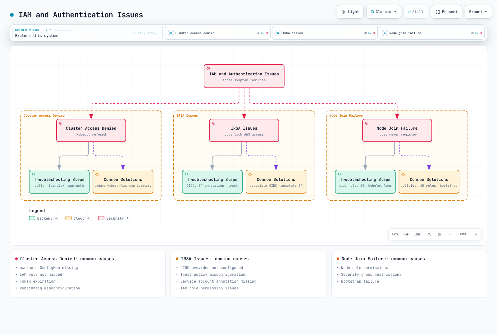

# Amazon EKS のトラブルシューティング

> **最終更新日**: 2026年9月12日

Amazon EKS クラスターの運用中には、さまざまな問題が発生する可能性があります。このドキュメントでは、EKS クラスターで起こり得る一般的な問題とその解決策について説明します。

## 目次

1. [トラブルシューティングの基本](#troubleshooting-basics)
2. [クラスターの作成と管理に関する問題](#cluster-creation-and-management-issues)
3. [ネットワークに関する問題](#networking-issues)
4. [ノードと Pod に関する問題](#node-and-pod-issues)
5. [IAM と認証に関する問題](#iam-and-authentication-issues)
6. [ストレージに関する問題](#storage-issues)
7. [ログとモニタリングに関する問題](#logging-and-monitoring-issues)
8. [パフォーマンスに関する問題](#performance-issues)
9. [アップグレードに関する問題](#upgrade-issues)
10. [一般的なエラーメッセージと解決策](#common-error-messages-and-solutions)

## トラブルシューティングの基本 {#troubleshooting-basics}


[🔍 インタラクティブ図を表示](https://www.atomai.click/kubernetes-docs/archmaps/en-eks-09-eks-troubleshooting-0.html)

### トラブルシューティングの進め方

1. 症状、影響を受けるユーザーやワークロード、およびインシデントの発生期間を特定します。
2. リソースを変更する前に、関連する状態、ログ、イベント、メトリクスを収集します。
3. 証拠と照らし合わせて複数の仮説を比較します。一般的なエラーを、原因が立証されたものとして扱わないでください。
4. データや可用性への影響が把握できている、担当者が明確な対象を絞った修正を適用します。
5. コマンドの終了ステータスだけでなく、アプリケーションの動作とメトリクスで復旧を確認します。
6. 原因、変更内容、結果、残る不確実性、および予防策を記録します。

この章のコマンドは、レビュー済み環境向けのテンプレートであり、最初から最後まで一度に実行する単一のスクリプトではありません。リソースの照会、デバッグ用ワークロードの作成、コンポーネントの再起動、インフラストラクチャの削除は、それぞれ影響が異なります。このレビューでは、稼働中の AWS/Kubernetes 操作は実施していません。

### 基本的なツールとコマンド

**既存の**クラスターでは、対象のアカウント、リージョン、クラスター、kubectl コンテキストを設定し、それらが一致することを確認します。任意のコンテキスト別名からクラスター名を推測しないでください。使用可能なクラスターが作成前の段階で作成に失敗した場合は、代わりに「作成」セクションにあるアカウント/リージョンと元のリクエスト/スタックの証拠を使用します。

```bash
set -euo pipefail
: "${AWS_REGION:?Set the intended Region}"
: "${CLUSTER_NAME:?Set the existing cluster name}"
: "${EXPECTED_ACCOUNT_ID:?Set the intended 12-digit account ID}"
: "${KUBE_CONTEXT:?Set the explicit kubectl context}"
ACTUAL_ACCOUNT_ID=$(aws sts get-caller-identity --query Account --output text)
if [ "$ACTUAL_ACCOUNT_ID" != "$EXPECTED_ACCOUNT_ID" ]; then
  echo "Account mismatch" >&2; exit 1
fi
CLUSTER_ENDPOINT=$(aws eks describe-cluster --name "$CLUSTER_NAME" --region "$AWS_REGION" \
  --query cluster.endpoint --output text)
KUBE_ENDPOINT=$(kubectl config view --context "$KUBE_CONTEXT" --minify \
  -o jsonpath='{.clusters[0].cluster.server}')
if [ "$CLUSTER_ENDPOINT" != "$KUBE_ENDPOINT" ]; then
  echo "kubectl context does not match the selected EKS cluster" >&2; exit 1
fi
export AWS_REGION CLUSTER_NAME EXPECTED_ACCOUNT_ID KUBE_CONTEXT
```

#### AWS CLI と eksctl

```bash
aws eks describe-cluster --name "$CLUSTER_NAME" --region "$AWS_REGION" \
  --query 'cluster.{arn:arn,status:status,version:version,health:health,access:accessConfig}'
aws eks list-nodegroups --cluster-name "$CLUSTER_NAME" --region "$AWS_REGION"
aws eks list-addons --cluster-name "$CLUSTER_NAME" --region "$AWS_REGION"
eksctl get nodegroup --cluster "$CLUSTER_NAME" --region "$AWS_REGION"
```

これらのコマンドで一覧表示されるのは、マネージドノードグループとインストール済みの EKS アドオンであり、すべてのセルフマネージドコントローラーやコンピューティングリソースではありません。手順を選ぶ前に、実際の所有者とコンピューティングの種類を記録してください。

#### kubectl

```bash
kubectl --context "$KUBE_CONTEXT" get nodes -o wide
kubectl --context "$KUBE_CONTEXT" get pods -A -o wide
kubectl --context "$KUBE_CONTEXT" get services -A
kubectl --context "$KUBE_CONTEXT" get events -A --sort-by='.metadata.creationTimestamp'
: "${NAMESPACE:?}"; : "${POD_NAME:?}"
kubectl --context "$KUBE_CONTEXT" -n "$NAMESPACE" describe pod "$POD_NAME"
```

影響を受ける namespace、Pod、コンテナ、ノードを明示的に指定してください。`describe` の出力やアプリケーションログには、機密性の高い運用情報が含まれる場合があります。`kubectl auth can-i` は特定の操作に対する認可を確認します。`aws sts get-caller-identity` は AWS 認証情報を特定するものであり、どちらのコマンドも単独ではネットワーク接続や Kubernetes のすべての権限を証明しません。

### ログの収集と分析

#### EKS コントロールプレーンのログ

既存のログ記録設定と、範囲を限定したインシデント期間を確認します。

```bash
set -euo pipefail
: "${CLUSTER_NAME:?}"; : "${AWS_REGION:?}"
: "${START_TIME_MS:?Set the incident-window start in epoch milliseconds}"
: "${END_TIME_MS:?Set the incident-window end in epoch milliseconds}"
aws eks describe-cluster --name "$CLUSTER_NAME" --region "$AWS_REGION" \
  --query cluster.logging --output json
aws logs filter-log-events --region "$AWS_REGION" \
  --log-group-name "/aws/eks/$CLUSTER_NAME/cluster" \
  --start-time "$START_TIME_MS" --end-time "$END_TIME_MS" \
  --max-items 200 --output json --no-cli-pager
```

コントロールプレーンのログ記録を有効にするには、固有の更新 ID、権限、CloudWatch 料金を伴う別の `UpdateClusterConfig` 変更が必要です。過去のログを復元するものではなく、アプリケーション/ホストログの収集を有効にするものでもありません。ロググループが見つからない、リクエストが拒否された、または対象期間のログが空である場合は、可視性に制限があることを示します。アプリケーション/ホストログには、`/aws/containerinsights/<cluster>/...` または実際のコレクター送信先を使用します。

#### ノードのログ

オペレーターがアクセスできる標準 Linux EC2 ノードでは、セッションを開く前にノードの `spec.providerID`、アカウント/リージョン、SSM の前提条件を確認します。

```bash
: "${INSTANCE_ID:?Verify the node EC2 ProviderID and account/Region first}"
aws ssm start-session --target "$INSTANCE_ID" --region "$AWS_REGION"
```

次のコマンドはローカル端末ではなく、**ノードのセッション内で**実行します。systemd/containerd の例は、ノードイメージにこれらのツールが含まれていることを前提としています。Bottlerocket、Fargate、Auto Mode では、サポートされている診断方法を使用してください。

```bash
sudo journalctl -u kubelet --since "15 minutes ago" --no-pager
sudo journalctl -u containerd --since "15 minutes ago" --no-pager
df -h
df -i
free -m
```

現在の EKS 最適化 Linux ノードでは containerd を使用します。これらのノードでは、Docker デーモンのログは kubelet のランタイムログではありません。イメージの削除、ジャーナルの消去、何らかの再起動を行う前に、ログとディスク/ inode の証拠を保存してください。正常でないノードで `kubectl top` のメトリクスが取得できなくても、それだけで CPU/メモリの枯渇が立証されるわけではありません。

#### Pod のログ

```bash
set -euo pipefail
: "${KUBE_CONTEXT:?}"; : "${NAMESPACE:?}"; : "${POD_NAME:?}"; : "${CONTAINER_NAME:?}"
kubectl --context "$KUBE_CONTEXT" -n "$NAMESPACE" logs "$POD_NAME" \
  -c "$CONTAINER_NAME" --since=15m --tail=200 --timestamps=true
# Run only when a previous container instance exists in this same Pod.
kubectl --context "$KUBE_CONTEXT" -n "$NAMESPACE" logs "$POD_NAME" \
  -c "$CONTAINER_NAME" --previous --tail=200 --timestamps=true
```

`--previous` が対象とするのは、**同じ Pod 内**にある、指定したコンテナの直前の終了済みインスタンスです。削除済みの前身 Pod のログは取得できません。保持された履歴はログバックエンドを使用してください。通常のコンテナと init コンテナの両方について、ステータス、readiness、終了理由を確認します。

### 診断情報の収集

```bash
set -euo pipefail
: "${EVIDENCE_PARENT:?Set an existing private directory}"
: "${KUBE_CONTEXT:?}"; : "${NAMESPACE:?}"
umask 077
EVIDENCE_DIR=$(mktemp -d "$EVIDENCE_PARENT/eks-diagnosis.XXXXXXXX")
kubectl --context "$KUBE_CONTEXT" get nodes -o wide > "$EVIDENCE_DIR/nodes.txt"
kubectl --context "$KUBE_CONTEXT" -n "$NAMESPACE" get pods -o wide > "$EVIDENCE_DIR/pods.txt"
kubectl --context "$KUBE_CONTEXT" -n "$NAMESPACE" get services -o wide > "$EVIDENCE_DIR/services.txt"
kubectl --context "$KUBE_CONTEXT" -n "$NAMESPACE" get events \
  --sort-by='.metadata.creationTimestamp' > "$EVIDENCE_DIR/events.txt"
printf 'Evidence saved to %s; assess the findings before remediation.\n' "$EVIDENCE_DIR"
```

照会に失敗すると、この例はそこで停止します。既存のファイルは部分的な証拠です。範囲を絞ったインベントリで十分な場合は、無差別な `cluster-info dump` や全 Pod の詳細表示を避け、共有前に証拠を確認して機密情報をマスキングしてください。

リソースの逼迫については、requests/limits、ノードの割り当て可能リソース、Metrics Server を利用できる場合は `kubectl top` を比較します。アクセス可能なノードでは、`df -h` と `df -i` の両方を確認します。空きバイト数があっても inode の枯渇は否定できません。ノードデバッグ Pod には独自のルートファイルシステムがあり、ホストのルートは `/host` にマウントされます。対象パスを指定しない `df -h` では、誤ったファイルシステムを調べる可能性があります。このような Pod の作成には、レビュー済みの namespace、イメージ、デバッグプロファイル、権限、クリーンアップ計画が必要です。

ネットワーク診断では、送信元の Pod/namespace/ノード、宛先、プロトコル、ポートを特定します。適用されるポリシーと送信元のリゾルバーを先に確認します。新しく作成したデバッグ Pod は、影響を受けるワークロードとはラベル、ID、DNS、ルーティングが異なる場合があります。ICMP ping では、TCP/UDP アプリケーションへの到達性は証明できません。許可された実際の経路で範囲を限定したテストを行い、所有者とともにツールとクリーンアップを準備してください。一般的な名前で、バージョン固定されていない `dnsutils`/`netshoot` Pod を繰り返し作成するのは避けます。

出典: [EKS のトラブルシューティング](https://docs.aws.amazon.com/eks/latest/userguide/troubleshooting.html)、[Kubernetes のログ](https://kubernetes.io/docs/reference/kubectl/generated/kubectl_logs/)、[ノードのデバッグ](https://kubernetes.io/docs/tasks/debug/debug-cluster/kubectl-node-debug/)。

## クラスターの作成と管理に関する問題 {#cluster-creation-and-management-issues}


[🔍 インタラクティブ図を表示](https://www.atomai.click/kubernetes-docs/archmaps/en-eks-09-eks-troubleshooting-1.html)

### クラスター作成の失敗

#### よくある原因

失敗したリクエストまたは CloudFormation イベントの詳細を確認し、呼び出し元の権限、クラスターサービスロールの信頼関係/ポリシー、サービスクォータ、サポート対象のサブネット/AZ の選択、IP 容量、名前の競合、サービスの可用性を調べます。これらは仮説であり、可能性の高さは実際のエラーによって異なります。

#### トラブルシューティングの手順

```bash
set -euo pipefail
: "${AWS_REGION:?}"; : "${CLUSTER_ROLE_NAME:?}"; : "${VPC_ID:?}"
aws sts get-caller-identity
aws iam get-role --role-name "$CLUSTER_ROLE_NAME" \
  --query 'Role.{Arn:Arn,Trust:AssumeRolePolicyDocument}'
aws iam list-attached-role-policies --role-name "$CLUSTER_ROLE_NAME"
aws iam list-role-policies --role-name "$CLUSTER_ROLE_NAME"
aws ec2 describe-subnets --region "$AWS_REGION" --filters "Name=vpc-id,Values=$VPC_ID" \
  --query 'Subnets[].{Id:SubnetId,AZ:AvailabilityZone,AZId:AvailabilityZoneId,AvailableIPs:AvailableIpAddressCount,CIDR:CidrBlock}'
aws service-quotas list-service-quotas --service-code eks --region "$AWS_REGION"
aws cloudtrail lookup-events --region "$AWS_REGION" \
  --lookup-attributes AttributeKey=EventName,AttributeValue=CreateCluster \
  --max-items 20 --output json
```

アタッチされたポリシーだけでは、呼び出し元に実効的に付与される権限は分かりません。インラインポリシー、アクセス許可境界、セッションポリシー、Organizations の制御も含めて確認してください。`AmazonEKSClusterPolicy` は EKS クラスターのサービスロールに適用するものであり、人間のユーザーにアタッチしても、必要な `eks:CreateCluster`/`iam:PassRole` 権限や Kubernetes アクセス権は付与されません。サービスリンクロールの作成にも固有の権限とライフサイクルがあります。

ネットワークを確認するときは、選択したクラスターサブネットと、正確なルート/セキュリティグループ/NACL 設定を使用します。クラスターのサブネット要件と、ノード/Pod/LB のアドレス容量は、別々に計画する必要があります。プライベートクラスターは、NAT ゲートウェイや一般的なインターネットアクセスがなくても、必要なサービスエンドポイントを利用できます。`kubernetes.io/cluster/...` サブネットタグは、コントロールプレーン作成の万能な解決策ではありません。

クォータエラーが発生した場合は、エラーからサービス/クォータを特定し、増加を申請する前に現在の適用値を照会します。EKS クラスターのクォータ、EC2 の vCPU/インスタンスタイプファミリーのクォータ、VPC の上限はそれぞれ異なります。「上限は 5」などの過去のメッセージは例であり、現在のアカウントの上限を示すものではありません。

#### 一般的な解決策

具体的な権限、サービスロールの信頼関係、サブネット選択、IP 割り当て、クォータの問題をインフラストラクチャの所有者を通じて修正し、再試行の内容を確認します。`UnsupportedAvailabilityZoneException` は、指定したクラスターサブネットの AZ がアカウントで EKS をサポートしていないことを意味します。例外で報告されたサポート対象 AZ を使用してください。EC2 のインスタンスタイプが利用可能かどうかだけでは診断できません。

サービスイベントについては AWS Health を確認します。リージョンの変更は、別個の配置/データ/ネットワーク設計と、場合によっては別のクラスターを必要とします。既定のトラブルシューティング用再試行ではありません。`eksctl create cluster --verbose ...` や AWS CLI のデバッグフラグでも、実際に作成処理が実行されます。新しいプロビジョニングリクエストを行う前に、既存のスタックイベントとリクエスト ID を確認してください。

### クラスターエンドポイントへのアクセスに関する問題

#### DNS、トランスポート、TLS、認証、認可を個別に診断する

エンドポイントモード、許可されたパブリック CIDR、クラスターのセキュリティグループを確認し、クラスター CA とタイムアウトを指定してテストします。

```bash
set -euo pipefail
: "${CLUSTER_NAME:?}"; : "${AWS_REGION:?}"; : "${EVIDENCE_PARENT:?}"
umask 077
ENDPOINT_DIR=$(mktemp -d "$EVIDENCE_PARENT/eks-endpoint.XXXXXXXX")
aws eks describe-cluster --name "$CLUSTER_NAME" --region "$AWS_REGION" \
  --output json > "$ENDPOINT_DIR/cluster.json"
jq -er '.cluster.certificateAuthority.data' "$ENDPOINT_DIR/cluster.json" \
  | base64 --decode > "$ENDPOINT_DIR/cluster-ca.crt"
ENDPOINT=$(jq -er '.cluster.endpoint' "$ENDPOINT_DIR/cluster.json")
jq '.cluster.resourcesVpcConfig | {endpointPublicAccess,endpointPrivateAccess,publicAccessCidrs,clusterSecurityGroupId,vpcId}' \
  "$ENDPOINT_DIR/cluster.json"
curl --silent --show-error --connect-timeout 5 --max-time 10 \
  --cacert "$ENDPOINT_DIR/cluster-ca.crt" --output /dev/null \
  --write-out 'HTTP status: %{http_code}\n' "$ENDPOINT"
```

このコマンドは Kubernetes のベアラートークンを送信しません。401/403 の応答は、アクセスが拒否されても DNS/TCP/TLS で到達できることを示す場合があります。HTTP リクエストへの成功応答があっても、アプリケーションが正常である証明にはなりません。`curl -k` を使うと証明書の検証失敗が隠れてしまいます。DNS を調べる場合は、エンドポイント URL に含まれるホスト名を使用し、`https://` 付きの URL を `nslookup` に渡さないでください。

パブリックエンドポイントでは、クライアントの実際の送信元/NAT アドレスが許可 CIDR に含まれているか確認します。プライベートエンドポイントでは、VPC/接続ネットワークの経路、DNS 解決、セキュリティグループのアクセスを確認します。インターフェイスエンドポイント `com.amazonaws.<region>.eks` が提供するのは **EKS 管理 API** であり、Kubernetes API サーバーではありません。これを有効にするだけでは kubectl のアクセスは解決しません。クラスターの Kubernetes プライベートエンドポイントとは別のものです。

#### kubeconfig と権限

認証情報をそのまま表示せずに、コンテキスト名/サーバーを確認します。別の診断用 kubeconfig を作成する場合は、明示的なパスと別名を使用し、`NAMESPACE` に意図した認可範囲を設定します。

```bash
set -euo pipefail
: "${CLUSTER_NAME:?}"; : "${AWS_REGION:?}"
: "${NAMESPACE:?Set the namespace for the authorization check}"
: "${DIAGNOSTIC_KUBECONFIG:?Set a separate writable kubeconfig path}"
: "${KUBE_CONTEXT:?Choose an explicit alias for this cluster}"
umask 077
aws eks update-kubeconfig --name "$CLUSTER_NAME" --region "$AWS_REGION" \
  --kubeconfig "$DIAGNOSTIC_KUBECONFIG" --alias "$KUBE_CONTEXT"
export KUBECONFIG="$DIAGNOSTIC_KUBECONFIG"
kubectl --context "$KUBE_CONTEXT" auth can-i get pods --namespace "$NAMESPACE"
```

kubeconfig の作成には `eks:DescribeCluster` が必要です。Kubernetes の認証/認可は別途必要です。ロールを引き受ける場合は、レビュー済みの `--role-arn` と、信頼/STS 権限を使用します。セッショントークンを表示するのではなく、実際の認証情報プロバイダー（設定済みの SSO セッションなど）を通じて認証情報を更新してください。

```bash
set -euo pipefail
: "${CLUSTER_NAME:?}"; : "${AWS_REGION:?}"
aws eks describe-cluster --name "$CLUSTER_NAME" --region "$AWS_REGION" \
  --query 'cluster.accessConfig'
# Use the next command when API or API_AND_CONFIG_MAP authentication is enabled.
aws eks list-access-entries --cluster-name "$CLUSTER_NAME" --region "$AWS_REGION"
```

アクセスエントリ認証が有効な場合は、該当するエントリと関連ポリシーの適用範囲を確認します。従来の `CONFIG_MAP` または混在クラスターでは、`aws-auth` も使用される場合があります。既存のノードマッピングを維持し、計画に沿って移行してください。一般的なアクセス修正として `system:masters` を付与したり、ConfigMap 全体を上書きしたりしないでください。IRSA の IAM OIDC プロバイダーはワークロードの AWS 認証情報に使うものであり、人間の IAM プリンシパルが Kubernetes で認可されるためのマッピングではありません。

#### アクセス経路を修正する

エンドポイントモードに適した、接続済みのプライベート管理経路、またはレビュー済みのパブリック CIDR 許可リストを使用します。診断コマンドを動作させるためだけに `0.0.0.0/0` を開放しないでください。パブリックアクセスを削除する前にプライベート経路をテストし、無関係な既存 VPC 設定を維持して、構成変更の更新 ID を追跡します。計画的な変更については、[セキュリティの章のエンドポイント手順](./05-eks-security.md)に従ってください。

#### ワンクリック CloudShell アクセス

2026年4月30日に発表されたワンクリック機能が利用できます。クラスター詳細ページで **Connect** を選択すると、kubectl が設定された状態で CloudShell が開きます。パブリック API エンドポイントとプライベート API エンドポイントの両方がサポートされます。プライベートエンドポイントでは CloudShell VPC 環境が自動的に起動し、環境名の入力を求められます。この機能は EKS リージョンで追加の機能料金なしで利用できます。

コンソール経由であっても、関連する IAM/CloudShell/VPC 環境の権限、Kubernetes アクセス、動作するネットワーク設定が必要です。ローカルのセットアップは不要になりますが、認可チェックは省略されません。該当するリソース料金/データ転送料金と、コマンド実行時のセッション ID を確認してください。

出典: [kubeconfig と CloudShell](https://docs.aws.amazon.com/eks/latest/userguide/create-kubeconfig.html)、[ワンクリック機能の発表](https://aws.amazon.com/about-aws/whats-new/2026/04/amazon-eks-one-click-cluster-access/)、[EKS PrivateLink との違い](https://docs.aws.amazon.com/eks/latest/userguide/vpc-interface-endpoints.html)、[クラスターのトラブルシューティング](https://docs.aws.amazon.com/eks/latest/userguide/troubleshooting.html)。

### クラスター削除の問題

#### 削除を妨げている依存関係を特定する

クラスターの削除は意図的な廃止作業であり、一般的なトラブルシューティングの解決策ではありません。EKS/CloudFormation の正確なエラー、クラスター ARN/アカウント/リージョン、更新状態、削除保護の設定を確認します。マネージドノードグループや Fargate プロファイルのほか、削除保護やインストール済み EKS Capabilities も削除を妨げる場合があります。削除が完了するまで、クラスターの IAM/サービスロールを保持してください。

対象クラスターのインベントリを取得し、明示的な kubectl コンテキストのエンドポイントと比較します。次のコマンドは読み取り専用であり、削除対象のリソースを自動で選択するものではありません。

```bash
set -euo pipefail
: "${CLUSTER_NAME:?Set the cluster being deliberately retired}"
: "${AWS_REGION:?}"; : "${KUBE_CONTEXT:?}"; : "${EXPECTED_ACCOUNT_ID:?}"
ACTUAL_ACCOUNT_ID=$(aws sts get-caller-identity --query Account --output text)
if [ "$ACTUAL_ACCOUNT_ID" != "$EXPECTED_ACCOUNT_ID" ]; then
  echo "Account mismatch; stop" >&2
  exit 1
fi
aws eks describe-cluster --name "$CLUSTER_NAME" --region "$AWS_REGION" \
  --query 'cluster.{arn:arn,status:status,deletionProtection:deletionProtection,endpoint:endpoint}'
kubectl config view --context "$KUBE_CONTEXT" --minify \
  -o jsonpath='{.clusters[0].cluster.server}{"\n"}'
# Compare the endpoints before inspecting Kubernetes resources.
kubectl --context "$KUBE_CONTEXT" get services -A \
  -o custom-columns='NAMESPACE:.metadata.namespace,NAME:.metadata.name,TYPE:.spec.type,CLASS:.spec.loadBalancerClass,ADDRESS:.status.loadBalancer.ingress'
kubectl --context "$KUBE_CONTEXT" get ingress -A
kubectl --context "$KUBE_CONTEXT" get pvc -A
kubectl --context "$KUBE_CONTEXT" get pv \
  -o custom-columns='NAME:.metadata.name,CLAIM_NS:.spec.claimRef.namespace,CLAIM:.spec.claimRef.name,RECLAIM:.spec.persistentVolumeReclaimPolicy,DRIVER:.spec.csi.driver,HANDLE:.spec.csi.volumeHandle'
aws eks list-nodegroups --cluster-name "$CLUSTER_NAME" --region "$AWS_REGION"
aws eks list-fargate-profiles --cluster-name "$CLUSTER_NAME" --region "$AWS_REGION"
aws eks list-capabilities --cluster-name "$CLUSTER_NAME" --region "$AWS_REGION"
aws eks list-addons --cluster-name "$CLUSTER_NAME" --region "$AWS_REGION"
```

Service の `EXTERNAL-IP` の出力だけでは所有者の証明になりません。コントローラー管理の `LoadBalancer` Service、手動設定の外部 IP、その他の Service タイプを区別してください。namespace/name/UID、コントローラーの所有関係、AWS リソース ARN、関連タグを記録します。コントローラーがインストールされている場合は Ingress、Gateway/TargetGroupBinding リソースも含め、ターゲットやロードバランサーが共有されているかを確認します。

#### 所有者の手順に従ってリソースを廃止する

1. トラフィックとワークロードを移行し、アプリケーション整合性のあるバックアップ/復元とデータ保持要件を確認します。PVC の YAML を保存しても、データのバックアップにはなりません。`Delete` の reclaim ポリシーでは、claim の削除時にバックエンドのストレージが削除される場合があります。`Retain` では、データ/ストレージの扱いを別途決定する必要があります。
2. 必要なロードバランサーコントローラーが稼働している間に、ロードバランサーを所有する、レビュー済みの Kubernetes リソースだけを削除します。finalizer の処理を待ち、対応する AWS リソースが解放されたことを確認します。ノードを削除する前に、コントローラーの IAM または依存関係の問題を解決してください。クリーンアップの失敗を隠すために finalizer を削除しないでください。
3. 所有権/リソース削除の仕様に従って EKS Capabilities を削除します。レビュー済みの順序でマネージドノードグループと Fargate プロファイルを削除し、完了を待ちます。セルフマネージドノード/スタックには、それぞれ独自の廃止手順が必要です。アドオンの削除によって Kubernetes コンポーネントも削除される場合があります。依存するクリーンアップが終わるまで、ネットワーク/ストレージコントローラーを維持してください。
4. 明示的な廃止の判断として削除保護を無効にし、元のインフラストラクチャ所有者を通じてクラスターを削除します。Auto Mode のクラスター削除では、管理対象ノードとロードバランサーも削除されます。その範囲と、組み込みの TargetGroupBinding のターゲットグループのライフサイクルを考慮してください。
5. 正確な所有関係に基づいて、残存リソースを確認します。専用スタック/VPC、ボリューム/スナップショット、ロードバランサー、IAM リソース、ログ、Prometheus スクレーパーなどが対象です。共有リソースと保持データには独立したライフサイクルがあり、料金が発生し続ける場合があります。

たとえば、次は、それより前に行うトラフィック/データの確認を経た後に、明示的に選択した Service **1つ**を削除する例です。リソースを検索しながら一括削除するループではありません。

```bash
set -euo pipefail
: "${KUBE_CONTEXT:?}"; : "${SERVICE_NAMESPACE:?}"; : "${SERVICE_NAME:?}"
# Separate approved teardown step after traffic/data migration and owner review.
kubectl --context "$KUBE_CONTEXT" -n "$SERVICE_NAMESPACE" get service "$SERVICE_NAME" -o yaml
kubectl --context "$KUBE_CONTEXT" -n "$SERVICE_NAMESPACE" delete service "$SERVICE_NAME" \
  --wait=true --timeout=10m
```

タイムアウトしたからといって、AWS ロードバランサーが残存した、または削除されたと断定できるわけではありません。finalizer、コントローラーイベント、該当する AWS ARN を確認してください。Kubernetes リソースと AWS リソースのクリーンアップは、異なるタイミングで完了する場合があります。

#### 削除エラーと強制処理

EKS の更新詳細と CloudFormation スタックイベントを使用して、依存関係、認可、処理中の操作によるエラーを特定します。eksctl 0.229 では、`delete cluster --force` はエラーが発生しても削除を続行できる有効なオプションです。これはクリーンアップが完全に行われたことや、孤立リソースの所有者を安全に特定できたことを証明しません。`--disable-nodegroup-eviction` は削除によって PDB チェックを別途回避するオプションです。どちらも、既定で行うインシデント対応ではありません。

アカウント/リージョン全体の ELB/ELBv2 一覧を削除コマンドにパイプしたり、依存関係エラーを解消するために全 Service、PVC、namespace を削除したりしないでください。孤立リソースを手動で削除する必要がある場合は、最初にその正確なクラスター/スタックの所有者とデータ/トラフィックへの影響を確認し、該当サービスのレビュー済み廃止手順に従います。

出典: [EKS クラスターの削除](https://docs.aws.amazon.com/eks/latest/userguide/delete-cluster.html)、[削除に関するトラブルシューティング](https://repost.aws/knowledge-center/eks-delete-cluster-issues)、[PersistentVolume のライフサイクル](https://kubernetes.io/docs/concepts/storage/persistent-volumes/)。

## ネットワークに関する問題 {#networking-issues}


[🔍 インタラクティブ図を表示](https://www.atomai.click/kubernetes-docs/archmaps/en-eks-09-eks-troubleshooting-2.html)

まず、実際のコンピューティング/データプレーンを特定します。オープンソースの VPC CNI を使う標準 EC2 ノード、Fargate、Auto Mode では、エージェントや設定が同一ではありません。Auto Mode では `NodeClass` のネットワーク制御を使用します。`aws-node` DaemonSet や `ENIConfig` を変更しても Auto Mode ノードの設定にはなりません。

### Pod 間通信の問題

#### 失敗している経路をたどる

送信元/宛先の Pod、namespace、ノード/AZ、IP ファミリー、プロトコル、宛先ポートを記録します。承認済みのテストで差異を切り分けられる場合は、同一ノード内とノード間の動作を比較します。その経路について、ポリシー、セキュリティグループ、ルート/NACL、CNI の状態、IP 割り当て、パス MTU を確認します。

```bash
set -euo pipefail
: "${KUBE_CONTEXT:?}"; : "${NAMESPACE:?}"; : "${POD_NAME:?}"
kubectl --context "$KUBE_CONTEXT" -n "$NAMESPACE" get pod "$POD_NAME" -o wide
kubectl --context "$KUBE_CONTEXT" -n "$NAMESPACE" get pod "$POD_NAME" \
  -o jsonpath='{.metadata.labels}{"\n"}{.spec.nodeName}{"\n"}{.spec.hostNetwork}{"\n"}'
kubectl --context "$KUBE_CONTEXT" get namespace "$NAMESPACE" --show-labels
kubectl --context "$KUBE_CONTEXT" -n "$NAMESPACE" get networkpolicies
kubectl --context "$KUBE_CONTEXT" -n "$NAMESPACE" get events \
  --sort-by='.metadata.creationTimestamp'
```

標準の `networking.k8s.io/v1` NetworkPolicy では、許可されるトラフィックは加算的に適用されます。ルールの優先順位や「最後のポリシーが優先」といった動作はありません。両方のピアが分離されている場合、送信元の egress と宛先の ingress の両方で、その通信が許可される必要があります。管理者/クラスター全体に適用されるポリシー API やベンダー固有のポリシーエンジンには、個別の仕様があります。namespace ラベルと、`namespaceSelector` と `podSelector` が同じ peer 内（AND）か、別々の peer（OR）かを確認します。

VPC CNI はネイティブのネットワークポリシー適用をサポートしています。サードパーティーのポリシー Pod が見つからないという理由だけで Calico/Cilium をインストールしないでください。サポート対象の CNI/プラットフォーム/カーネルと、有効化されたポリシーエージェントの設定を確認します。標準の起動モードでは、新しい Pod はポリシーが設定されるまで最初はトラフィックを許可します。strict モードでは最初から拒否され、必要な DNS/依存関係ポリシーが必要です。host-network の動作やその他の適用範囲の制限については、該当する実装のドキュメントを確認してください。

標準的な VPC CNI のインストールでは、該当コンテナがある場合、実際の `aws-node` Pod の `aws-network-policy-agent` ログを調べます。`kubectl get pods -l ...` が成功しても結果が空であれば、プラグインがインストール済みである証明にはなりません。Auto Mode では、組み込みのポリシー制御を使用します。

#### 意図した通信フローだけを修正する

namespace 全体に許可する ingress/egress を追加したり、ポリシーを削除したりするのではなく、許可する通信フローの全体を確認します。次の例では、バックエンド API Pod を選択し、フロントエンドの web Pod からの TCP 8080 だけを許可します。

```yaml
# Example ingress policy only: review both peers and the complete allowed-flow matrix.
apiVersion: networking.k8s.io/v1
kind: NetworkPolicy
metadata:
  name: api-from-web
  namespace: backend
spec:
  podSelector:
    matchLabels:
      app: api
  policyTypes:
    - Ingress
  ingress:
    - from:
        - namespaceSelector:
            matchLabels:
              kubernetes.io/metadata.name: frontend
          podSelector:
            matchLabels:
              app: web
      ports:
        - protocol: TCP
          port: 8080
```

このポリシーを適用すると、他のポリシーが許可していない限り、選択されたバックエンド Pod への他の ingress が分離される場合があります。クライアント側の egress、DNS、すべての依存関係を設定するものではありません。それらは肯定テストと否定テストで個別に確認します。この例の名前をそのまま使用せず、実際のワークロードの namespace/ラベルを使用してください。

セキュリティグループについては、該当する場合、Pod 用セキュリティグループ/カスタム Pod サブネットを含め、送信元と宛先の ENI に関連付けられたグループを確認します。所有者を通じて必要な送信元/ポートを許可し、一般的な修正としてすべてのプロトコルや広範な CIDR を追加しないでください。MTU の値（1500 や 9001 など）は経路によって異なります。失敗を測定し、カプセル化を考慮してから CNI 設定を変更したり Pod を置き換えたりしてください。

### Service アクセスの問題

Service セレクター、実際の Pod の readiness、エンドポイントの条件、ポートマッピングをまとめて確認します。

```bash
set -euo pipefail
: "${KUBE_CONTEXT:?}"; : "${NAMESPACE:?}"; : "${SERVICE_NAME:?}"
SERVICE_JSON=$(kubectl --context "$KUBE_CONTEXT" -n "$NAMESPACE" get service "$SERVICE_NAME" -o json)
printf '%s\n' "$SERVICE_JSON" | jq '{metadata: {name: .metadata.name, namespace: .metadata.namespace}, spec: .spec, status: .status}'
SELECTOR=$(printf '%s\n' "$SERVICE_JSON" | jq -r '(.spec.selector // {}) | to_entries | map("\(.key)=\(.value)") | join(",")')
if [ -n "$SELECTOR" ]; then
  kubectl --context "$KUBE_CONTEXT" -n "$NAMESPACE" get pods -l "$SELECTOR" -o wide
  kubectl --context "$KUBE_CONTEXT" -n "$NAMESPACE" get pods -l "$SELECTOR" -o json \
    | jq '.items[] | {name:.metadata.name,phase:.status.phase,ready:[.status.conditions[]? | select(.type=="Ready")],containers:.status.containerStatuses}'
else
  printf 'No selector: inspect ExternalName or explicitly managed EndpointSlices as applicable.\n'
fi
kubectl --context "$KUBE_CONTEXT" -n "$NAMESPACE" get endpointslices \
  -l "kubernetes.io/service-name=$SERVICE_NAME" -o yaml
```

非推奨の Endpoints API に頼らず、EndpointSlices を使用します。`ready`、`serving`、`terminating` の各条件と、`publishNotReadyAddresses`、`externalTrafficPolicy`、`internalTrafficPolicy` などの Service オプションを確認します。Pod が Running であっても Ready とは限りません。

`ExternalName` Service では、選択対象の Pod ではなく DNS エイリアスを診断します。headless Service の場合、`clusterIP: None` は意図された設定です。セレクターのない Service では、所有者が管理する EndpointSlices を使用する場合があります。Service の `port` と `targetPort` は異なることがあります。コンテナポートを宣言しても、アプリケーションがそのポートでリッスンするとは限りません。

ラベルやポートが誤っている場合は、リリース設定を通じて所有する Service/Pod テンプレートを更新します。コントローラーが所有する Pod 1つのラベルを変更しても、永続的な修正にはなりません。パッチを適用する前に、ポートの一覧全体とイミュータブルなフィールドを確認します。原因を診断せずに Service を削除/再作成したり、ClusterIP を変更したり、すべての kube-proxy Pod を再起動したりしないでください。

ポリシーが許す範囲で、同じ送信元とプロトコルを使い、Pod への直接接続と Service 経由の接続を比較します。iptables/nftables/eBPF の動作を調べる前に、データプレーンが kube-proxy、代替実装、Auto Mode のどれなのかを確認します。kube-proxy Pod がないことが常に異常とは限りません。

### ロードバランサーの問題

Service/Ingress クラス、アノテーション、所有関係からコントローラーを特定します。標準の AWS Load Balancer Controller と EKS Auto Mode では、クラス/API とライフサイクルのルールが異なります。その所有者に応じて、コントローラーイベント、サブネット選択、IAM、セキュリティグループ、ターゲット登録、ヘルスチェックを確認します。

ワークロードに関連付けられた正確なロードバランサーとターゲットグループの ARN を使用します。

```bash
set -euo pipefail
: "${AWS_REGION:?}"; : "${LOAD_BALANCER_ARN:?}"; : "${TARGET_GROUP_ARN:?}"
aws elbv2 describe-load-balancers --region "$AWS_REGION" \
  --load-balancer-arns "$LOAD_BALANCER_ARN"
aws elbv2 describe-tags --region "$AWS_REGION" \
  --resource-arns "$LOAD_BALANCER_ARN" "$TARGET_GROUP_ARN"
aws elbv2 describe-load-balancer-attributes --region "$AWS_REGION" \
  --load-balancer-arn "$LOAD_BALANCER_ARN"
aws elbv2 describe-target-groups --region "$AWS_REGION" \
  --target-group-arns "$TARGET_GROUP_ARN"
aws elbv2 describe-target-health --region "$AWS_REGION" \
  --target-group-arn "$TARGET_GROUP_ARN"
```

`describe-load-balancer-attributes` で分かるのは属性であり、運用状態ではありません。運用状態は `describe-load-balancers` に含まれます。ターゲットのヘルス理由コード、ヘルスチェックのプロトコル/ポート/パス、リスナー/ルーティングルール、アプリケーションの応答を確認します。通常、インスタンスターゲットはノード/NodePort に接続し、IP ターゲットは Pod のターゲットポートに接続します。セキュリティグループのルールは実際の経路に一致させる必要があります。

サブネットのロールタグは自動検出に影響するため、パブリック/内部のスキーム、ルートテーブル、空き IP、AZ のカバレッジを確認します。同じサブネットにパブリックとプライベートのロールタグを両方付けても解決しません。明示的なサブネット選択とコントローラーのバージョンによって、必要なタグは変わる場合があります。ヘルスチェックの失敗を回避するために、フロントエンド/バックエンドのセキュリティグループを `0.0.0.0/0` に開放しないでください。

所有者の現在のスキーム/タイプ設定を使用します。従来の `aws-load-balancer-internal` や `aws-load-balancer-type: nlb` の例は、現在のコントローラークラスと互換性があるとは限りません。コントローラーの所有関係や LB スキームの変更には、計画的な置き換えとトラフィック移行が必要になることがあります。アノテーションを編集したからといって、インプレース変換が保証されるわけではありません。Auto Mode は、セルフマネージドコントローラーがすでに管理しているロードバランサーを引き継ぎません。

Service を削除すると、ロードバランサーも削除される場合があります。エクスポートした Service の生 YAML は、トラフィック/データを含むロールバック計画として不十分です。ALB を手動で作成しても、Kubernetes Service と自動的に接続されるわけではありません。変更前に、選択した所有者に対応する[ネットワークガイド](./03-eks-networking-part2.md)を確認してください。

### DNS の問題

#### 影響を受ける Pod が使うリゾルバーを調べる

```bash
set -euo pipefail
: "${KUBE_CONTEXT:?}"; : "${NAMESPACE:?}"; : "${POD_NAME:?}"; : "${CONTAINER_NAME:?}"
kubectl --context "$KUBE_CONTEXT" -n "$NAMESPACE" get pod "$POD_NAME" \
  -o jsonpath='{.spec.dnsPolicy}{"\n"}{.spec.dnsConfig}{"\n"}{.spec.hostNetwork}{"\n"}'
kubectl --context "$KUBE_CONTEXT" -n "$NAMESPACE" exec "$POD_NAME" \
  -c "$CONTAINER_NAME" -- cat /etc/resolv.conf
# Where this container actually includes nslookup, test the intended name.
: "${DNS_TEST_NAME:?Set the intended Service FQDN or reviewed external hostname}"
kubectl --context "$KUBE_CONTEXT" -n "$NAMESPACE" exec "$POD_NAME" \
  -c "$CONTAINER_NAME" -- nslookup "$DNS_TEST_NAME"
```

イメージにシェルや DNS ツールが含まれていない場合、それはツール上の制限であって、DNS クエリの失敗ではありません。関連するネットワーク/ID のコンテキストを維持する、レビュー済みのデバッグ方法を準備します。新しいデバッグ Pod では、異なる DNS/ポリシー設定が使われる場合があります。

Auto Mode 以外の標準ノードでは、インストール済みの CoreDNS Deployment/Service、設定、EndpointSlices を調べます。

```bash
kubectl --context "$KUBE_CONTEXT" -n kube-system get deployment coredns
kubectl --context "$KUBE_CONTEXT" -n kube-system get pods -l k8s-app=kube-dns -o wide
kubectl --context "$KUBE_CONTEXT" -n kube-system get service kube-dns
kubectl --context "$KUBE_CONTEXT" -n kube-system get endpointslices \
  -l kubernetes.io/service-name=kube-dns
kubectl --context "$KUBE_CONTEXT" -n kube-system get configmap coredns -o yaml
kubectl --context "$KUBE_CONTEXT" -n kube-system logs -l k8s-app=kube-dns \
  --all-containers=true --prefix=true --since=15m --tail=100
```

**Auto Mode ノード**では、CoreDNS はノードのシステムサービスとして動作します。Auto Mode のみのクラスターでは、従来の CoreDNS Deployment がなくても運用できます。Auto/non-Auto 混在クラスターでは、非 Auto Mode ノード用に Deployment を維持する必要があります。Auto Mode の解決策として、NodeLocal DNSCache をインストールしたり、存在しない Deployment を再起動したりしないでください。

Pod のネームサーバー、CoreDNS/NodeLocal のアップストリーム、VPC リゾルバーを区別します。`169.254.20.10` は NodeLocal DNSCache でよく選ばれるアドレスであり、すべての環境で使う VPC DNS サーバーではありません。`8.8.8.8` などのパブリックリゾルバーは、Kubernetes Service のゾーンやプライベート AWS DNS の代わりにはなりません。

```bash
set -euo pipefail
: "${AWS_REGION:?}"; : "${VPC_ID:?}"
aws ec2 describe-vpc-attribute --region "$AWS_REGION" --vpc-id "$VPC_ID" \
  --attribute enableDnsSupport
aws ec2 describe-vpc-attribute --region "$AWS_REGION" --vpc-id "$VPC_ID" \
  --attribute enableDnsHostnames
aws ec2 describe-vpcs --region "$AWS_REGION" --vpc-ids "$VPC_ID" \
  --query 'Vpcs[].{VpcId:VpcId,DhcpOptionsId:DhcpOptionsId}'
```

DNS 属性の確認には `describe-vpc-attribute` を使用します。これらは `describe-vpcs` が返すフィールドではありません。取得した ID を使って DHCP オプションも照会します。他のワークロードの設定を確認せずに、共有 VPC の DHCP 設定を置き換えないでください。

#### 対象を絞って DNS を修正する

必要に応じて UDP/TCP 53、CoreDNS の実際の readiness/設定、アップストリームへの到達性、DNS ポリシー、カスタム検索設定を確認します。クラスター DNS を使う `hostNetwork` Pod では、通常 `ClusterFirstWithHostNet` が必要です。`dnsPolicy: None` では、完全かつ意図的なリゾルバー設定が必要です。DNS のみを許可する egress ポリシーでは、他のポリシーが許可しない限り、選択された Pod の他の egress も分離されます。

所有者が管理する Corefile のカスタマイズを維持し、アドオンがサポートする設定スキーマを使用します。CoreDNS のスケールや再起動の前に、レプリカ/リソース/PDB/スケジューリングと、オートスケーリングの所有者を確認します。更新 ID と機能的な DNS チェックを記録し、最初の手段としてすべての DNS Pod を削除したり、推測した「latest」イメージをインストールしたりしないでください。

### VPC CNI の問題

次の調査は、**オープンソースの VPC CNI を使う標準 EC2 ノード**を対象としています。影響を受けているノード上の Pod を明示的に選択します。`kubectl exec` ではラベルセレクターを指定できません。

```bash
set -euo pipefail
: "${KUBE_CONTEXT:?}"; : "${NODE_NAME:?}"
kubectl --context "$KUBE_CONTEXT" get node "$NODE_NAME" \
  -o jsonpath='{.spec.providerID}{"\n"}{.status.nodeInfo}{"\n"}{.status.allocatable.pods}{"\n"}'
kubectl --context "$KUBE_CONTEXT" -n kube-system get daemonset aws-node -o json \
  | jq '.spec.template.spec | {containers:[.containers[] | {name,image,args,env}],initContainers:[.initContainers[]? | {name,image,args,env}]}'
kubectl --context "$KUBE_CONTEXT" -n kube-system get pods \
  -l k8s-app=aws-node --field-selector "spec.nodeName=$NODE_NAME" -o wide
kubectl --context "$KUBE_CONTEXT" get pods -A \
  --field-selector "spec.nodeName=$NODE_NAME" -o wide
: "${AWS_NODE_POD:?Select the aws-node Pod on that exact node}"
kubectl --context "$KUBE_CONTEXT" -n kube-system logs "$AWS_NODE_POD" \
  -c aws-node --since=15m --tail=200
```

アドオンの `configurationValues`、DaemonSet の環境変数、関連するカスタムリソースを調べます。`aws-node` ConfigMap にすべての設定が含まれると思い込まないでください。ノードの `.spec.podCIDR` は、VPC CNI の Pod アドレスを把握するための信頼できるインベントリではありません。実際の Pod IP、EC2 ENI、プレフィックス、サブネットを調べます。

```bash
set -euo pipefail
: "${AWS_REGION:?}"; : "${INSTANCE_ID:?Verify it from the selected node ProviderID}"
aws ec2 describe-instances --region "$AWS_REGION" --instance-ids "$INSTANCE_ID" \
  --query 'Reservations[].Instances[].{Id:InstanceId,Type:InstanceType,Subnet:SubnetId,SGs:SecurityGroups,ENIs:NetworkInterfaces}'
: "${SUBNET_ID:?Set the actual node or custom Pod subnet being investigated}"
aws ec2 describe-subnets --region "$AWS_REGION" --subnet-ids "$SUBNET_ID" \
  --query 'Subnets[].{Id:SubnetId,CIDR:CidrBlock,AvailableIPs:AvailableIpAddressCount}'
: "${INSTANCE_TYPE:?Set the selected instance type}"
aws ec2 describe-instance-types --region "$AWS_REGION" --instance-types "$INSTANCE_TYPE" \
  --query 'InstanceTypes[].{Type:InstanceType,Network:NetworkInfo}'
```

IPAMD のイントロスペクションが有効な場合、ノード上の設定済みエンドポイント（通常はループバックのポート 61679）で利用できます。必要なツールを使える、許可されたノード/エージェント診断方法を使用してください。CNI イメージに curl がないことは IPAM の障害ではありません。

#### 割り当て制約を区別する

- **サブネットの枯渇/断片化:** 空きアドレス数とプレフィックスを比較します。プレフィックス委任には、サポート対象のインスタンス/設定と、割り当て可能な連続プレフィックスブロックが必要です。空き IP 数だけでは /28 を割り当てられる証拠になりません。
- **インスタンスの ENI/IP 上限:** `NetworkInfo` と既存の ENI を調べます。ノードグループの desired/min/max を変更しても、ノード数が変わるだけでインスタンスタイプやインスタンスごとの上限は変わりません。インスタンス設定を変更するには、レビュー済みの新しいグループ、またはサポートされている元の起動テンプレート更新経路を使用します。
- **カスタムネットワーク:** 有効化する前に、対応する `ENIConfig`、Pod サブネット/セキュリティグループ、ノード選択を準備します。セカンダリ ENI/Pod IP の割り当て元は変わりますが、容量が無制限になるわけではありません。
- **ウォームターゲット:** `WARM_IP_TARGET` は空き IP の余裕を制御し、`MINIMUM_IP_TARGET` は割り当て済み IP 総数の下限になります。ドキュメントに記載されているとおり、これらはウォーム ENI の動作を上書きします。プレフィックスモードでは、IP/最小ターゲットがウォームプレフィックスの動作に影響します。正のウォーム余裕がない状態で最小値を設定すると、その後の割り当てが妨げられる場合があります。任意の 1/2/5 の設定値をコピーするのではなく、ワークロード/IP の予算に基づいて値を決めてください。
- **ID/所有者:** 実際の CNI IRSA/Pod Identity または該当するノードロールと、IPv4/IPv6 ポリシーを調べます。すべてのノードロールに IPv4 CNI ポリシーをアタッチするのは、万能の修正策ではありません。

Auto Mode は `NodeClass` のサブネット/セキュリティグループ/ポリシー制御を使い、これらのウォーム IP/ENI や `ENIConfig` 設定を受け付けません。管理対象のネットワークモデルを維持してください。

所有者を通じてレビュー済みの CNI バージョン/設定を適用し、サポートされている中間バージョンと設定スキーマに従います。正確なアドオン更新を監視し、その後のネットワークを検証するには、[アップグレードガイド](./08-eks-upgrades.md)を使用してください。イメージを一方のコンテナだけで置き換えたり、設定を無条件に上書きしたり、割り当ての失敗を隠すためにすべてのワークロードを再起動したりしないでください。

出典: [VPC CNI ポリシー設定](https://docs.aws.amazon.com/eks/latest/userguide/cni-network-policy-configure.html)、[Auto Mode のネットワーク](https://docs.aws.amazon.com/eks/latest/userguide/auto-networking.html)、[カスタムネットワーク](https://docs.aws.amazon.com/eks/latest/best-practices/custom-networking.html)、[CNI の設定](https://github.com/aws/amazon-vpc-cni-k8s)、[Kubernetes NetworkPolicy](https://kubernetes.io/docs/concepts/services-networking/network-policies/)、[EndpointSlices](https://kubernetes.io/docs/concepts/services-networking/endpoint-slices/)。

## ノードと Pod に関する問題 {#node-and-pod-issues}


[🔍 インタラクティブ図を表示](https://www.atomai.click/kubernetes-docs/archmaps/en-eks-09-eks-troubleshooting-3.html)

### Node NotReady の問題

#### 条件と実際のノードを調べる

`Ready=False` と `Ready=Unknown` では、必要な証拠が異なります。kubelet/ランタイムが正常でなければ障害を報告することがあります。一方、heartbeat の欠落は接続喪失やノードの停止を示す場合があります。メモリ、ディスク、PID の圧迫はそれぞれ別の条件であり、必ずしも `NotReady` を意味しません。単一のラベルから原因を推測せず、条件の理由/時刻、lease、イベントを調べます。

```bash
set -euo pipefail
: "${KUBE_CONTEXT:?}"; : "${NODE_NAME:?}"
NODE_JSON=$(kubectl --context "$KUBE_CONTEXT" get node "$NODE_NAME" -o json)
printf '%s\n' "$NODE_JSON" | jq '{name:.metadata.name,uid:.metadata.uid,labels:.metadata.labels,providerID:.spec.providerID,taints:.spec.taints,unschedulable:.spec.unschedulable,nodeInfo:.status.nodeInfo,conditions:.status.conditions,capacity:.status.capacity,allocatable:.status.allocatable}'
NODE_UID=$(printf '%s\n' "$NODE_JSON" | jq -er '.metadata.uid')
kubectl --context "$KUBE_CONTEXT" get events -A --field-selector "involvedObject.uid=$NODE_UID" \
  --sort-by='.metadata.creationTimestamp'
kubectl --context "$KUBE_CONTEXT" get pods -A --field-selector "spec.nodeName=$NODE_NAME" -o wide
```

EC2 の確認には正確な ProviderID を使います。`grep` でノード IP を照合すると、誤ったリソースが選ばれる場合があります。マネージドノードグループでは、ヘルス、イメージ/リリース、自動修復の設定を調べます。

```bash
set -euo pipefail
: "${CLUSTER_NAME:?}"; : "${AWS_REGION:?}"; : "${NODEGROUP_NAME:?}"
aws eks describe-nodegroup --cluster-name "$CLUSTER_NAME" --nodegroup-name "$NODEGROUP_NAME" \
  --region "$AWS_REGION" \
  --query 'nodegroup.{status:status,health:health,version:version,releaseVersion:releaseVersion,amiType:amiType,nodeRepairConfig:nodeRepairConfig,updateConfig:updateConfig,scalingConfig:scalingConfig}'
```

ノードへのアクセスがサポートされている場合は、「基本」のセクションにあるリモートセッション手順を使って、kubelet/containerd のジャーナル、ネットワーク、ディスクのバイト数/inode、メモリを調べます。秘密鍵を表示せずに、実際に設定された証明書/kubeconfig のパスを確認します。`kubeadm certs renew` は EKS マネージドコントロールプレーンの修復方法ではありません。また、`eksctl replace nodegroup` はサポートされている eksctl コマンドではありません。AL2023 は nodeadm の設定を使います。すべてのイメージに AL2 の `/etc/eks/bootstrap.sh` の手順を再実行しないでください。

#### 復旧と自動修復

証拠を保存してから、所有者と合意した復旧操作を選びます。kubelet/containerd の再起動、再起動、ノードの置き換えはワークロードに影響するうえ、永続的な IAM/ネットワーク/bootstrap の問題を解決しない場合があります。再起動 API の応答が返っても、インスタンスや kubelet が Ready になったことを意味するわけではありません。cordon を解除する前に、同じノード/インスタンスとワークロードを確認します。

計画的な置き換えでは、1つのノードをタイムアウト付きで drain する前に、容量、ステートフルデータ、PDB、置き換えの所有者を確認します。

```bash
set -euo pipefail
: "${KUBE_CONTEXT:?Set the reviewed cluster context}"
: "${NODE_NAME:?Set one reviewed old node}"
kubectl --context "$KUBE_CONTEXT" get node "$NODE_NAME" -o wide
kubectl --context "$KUBE_CONTEXT" get node "$NODE_NAME" \
  -o jsonpath='{.spec.providerID}{"\n"}'
kubectl --context "$KUBE_CONTEXT" get pods --all-namespaces \
  --field-selector "spec.nodeName=$NODE_NAME" -o wide
# Stop on failure. Do not terminate the instance or delete the node group here.
kubectl --context "$KUBE_CONTEXT" drain "$NODE_NAME" --ignore-daemonsets --timeout=10m
```

drain に失敗した後で EC2 インスタンスの終了に進んだり、既定で `emptyDir` データを破棄したりしないでください。drain が途中まで進んだノードは cordon されたままになる場合があります。PDB がカバーするのは eviction 経路であり、あらゆるインフラストラクチャ障害、終了、コントローラーによるスケールダウンではありません。インプレースでパッケージを変更するのではなく、マネージドな置き換えについては[ノードアップグレード手順](./08-eks-upgrades.md)に従います。

EKS の自動ノード修復は、実際に用意されている独立した仕組みです。Auto Mode では既定で有効です。マネージドノードグループでは `nodeRepairConfig` を有効にでき、Karpenter には独自の機能/設定要件があります。ノードモニタリングで追加の条件が報告されても、検出だけでは修復は有効になりません。現在の既定の一覧では、`Ready`、ランタイム、カーネル、ネットワーク、ストレージに関する継続的な障害が置き換えの対象です。`MemoryPressure` と `DiskPressure` には、**既定の修復アクションがありません**。修復しきい値/並列度や、異常なフリート/ARC 制御によって、新しいアクションが停止しても、進行中のアクションは継続する場合があります。カスタム Lambda、ASG タグ、`maxUnavailable` が自動的にこの動作を提供すると断言しないでください。

### Pod が実行されない問題

#### 状態、イベント、所有コントローラーを確認する

```bash
set -euo pipefail
: "${KUBE_CONTEXT:?}"; : "${NAMESPACE:?}"; : "${POD_NAME:?}"
POD_JSON=$(kubectl --context "$KUBE_CONTEXT" -n "$NAMESPACE" get pod "$POD_NAME" -o json)
printf '%s\n' "$POD_JSON" | jq '{
  name:.metadata.name,uid:.metadata.uid,owners:.metadata.ownerReferences,
  node:.spec.nodeName,serviceAccount:.spec.serviceAccountName,
  imagePullSecrets:.spec.imagePullSecrets,
  containers:[.spec.containers[] | {name,image,imagePullPolicy,resources}],
  initContainers:[.spec.initContainers[]? | {name,image,resources}],
  phase:.status.phase,reason:.status.reason,message:.status.message,
  conditions:.status.conditions,containerStatuses:.status.containerStatuses,
  initContainerStatuses:.status.initContainerStatuses
}'
POD_UID=$(printf '%s\n' "$POD_JSON" | jq -er '.metadata.uid')
kubectl --context "$KUBE_CONTEXT" -n "$NAMESPACE" get events \
  --field-selector "involvedObject.uid=$POD_UID" --sort-by='.metadata.creationTimestamp'
```

「基本」のセクションにあるコンテナ別のログ取得手順を使用します。`Pending`、`ContainerCreating`、イメージ取得の待機、init コンテナの失敗、readiness の失敗、`OOMKilled`、再起動バックオフは、それぞれ別の問題を示します。`CrashLoopBackOff` は、コンテナの失敗が繰り返された後のバックオフ状態であり、根本原因ではありません。

| 証拠 | 次に確認すること |
| --- | --- |
| イメージ取得エラー | レジストリ/名前/タグ/digest/アーキテクチャ、ノード側の DNS/TLS/ルート、レート制限、実際の取得 ID |
| FailedScheduling | requests と割り当て可能容量、Pod 数、taint/affinity/topology、クォータ、PVC のコンシューマー制約 |
| FailedMount / attach | PVC/PV/StorageClass、CSI/ID、AZ、現在のアタッチ状態。「ストレージ」のセクションを参照 |
| OOMKilled / Evicted | コンテナの終了状態、limits、ノードの圧迫、使用履歴。メモリリークと決めつけない |
| Forbidden / admission failure | 正確な API 呼び出し元、RBAC、admission ポリシー。Pod の一覧表示権限を追加しても、無関係なレジストリ/ファイルシステムアクセスは解決しない |

`imagePullPolicy` を `Always` に変更しても、存在しないイメージや無効な認証情報の問題は解決しません。ラップトップで Docker を使ってイメージを取得しても、ノードの経路/ID は確認できません。また、Docker に読み込んだイメージが自動的に containerd ランタイムに登録されることもありません。

#### レジストリの認証情報とワークロードの変更

プライベート ECR では、実際のノード/Fargate の実行 ID とリポジトリポリシーを確認します。アプリケーションの IRSA/Pod Identity は、起動前にイメージを取得する ID ではありません。プライベート ECR のネットワークには ECR API/DKR と S3 へのアクセスが必要な場合があります。ECR エンドポイントを用意しても、任意のレジストリへのプライベートアクセスは提供されません。

イメージプル Secret が必要なレジストリでは、正しいレジストリ認証情報を含む、保護された自己完結型の Docker 認証 JSON ファイルを使用します。`.dockerconfigjson` やパスワードをログ/コマンド引数に表示しないでください。デスクトップの認証情報ヘルパーへの参照だけでは、kubelet が使える認証情報にはなりません。

```bash
set -euo pipefail
: "${KUBE_CONTEXT:?}"; : "${NAMESPACE:?}"; : "${DEPLOYMENT_NAME:?}"
: "${PULL_SECRET_NAME:?Choose an application-specific secret name}"
: "${DOCKER_CONFIG_JSON:?Provide a protected registry auth JSON file}"
# Separate reviewed change; an existing Secret causes create to fail rather than replacing it.
kubectl --context "$KUBE_CONTEXT" -n "$NAMESPACE" create secret generic "$PULL_SECRET_NAME" \
  --type=kubernetes.io/dockerconfigjson \
  --from-file=".dockerconfigjson=$DOCKER_CONFIG_JSON"
PATCH=$(jq -n --arg name "$PULL_SECRET_NAME" \
  '{spec:{template:{spec:{imagePullSecrets:[{name:$name}]}}}}')
kubectl --context "$KUBE_CONTEXT" -n "$NAMESPACE" patch deployment "$DEPLOYMENT_NAME" \
  --type=strategic --patch "$PATCH"
kubectl --context "$KUBE_CONTEXT" -n "$NAMESPACE" rollout status \
  "deployment/$DEPLOYMENT_NAME" --timeout=5m
```

Secret は Pod と同じ namespace に置く必要があります。戦略的 Pod テンプレートパッチは pull-secret エントリを名前でマージし、管理された Deployment のロールアウトを開始します。リリースの所有関係とその他の設定を維持してください。既存 Pod の `imagePullSecrets` は、通常、編集可能なフィールドではありません。ServiceAccount の既定値が反映されるのは、新たに受け入れられる Pod です。namespace 全体の既定 ServiceAccount を変更すると、無関係なワークロードに影響する場合があります。期限切れの認証情報は、共有 Secret を定期的に削除/再作成するのではなく、所有者を通じて更新します。

その他の設定変更では、コントローラーの宣言済みテンプレートを修正し、ロールアウト/readiness を監視します。Pod を削除しても、適切なコントローラーがなければ再作成されず、有用な証拠が失われる場合があります。デバッグ用の `--copy-to` Pod は、アプリケーションの副作用を複製する可能性があります。稼働中のアプリケーションにパッケージをインストールするのではなく、明示的な権限とクリーンアップ計画を含むレビュー済みの診断方法/イメージを使用してください。

### リソース制約の問題

```bash
kubectl --context "$KUBE_CONTEXT" -n "$NAMESPACE" get resourcequotas,limitranges
kubectl --context "$KUBE_CONTEXT" -n "$NAMESPACE" get pods -o wide
kubectl --context "$KUBE_CONTEXT" -n "$NAMESPACE" top pods --containers
kubectl --context "$KUBE_CONTEXT" top nodes
```

メトリクスコマンドの実行には Metrics Server と、kubelet への正常なアクセスが必要です。スケジューリングで使われるのはリソース requests とノードの割り当て可能容量であり、現在の `kubectl top` の使用率ではありません。該当する場合は、init コンテナ、Pod オーバーヘッド、エフェメラルストレージ、拡張リソース、Pod 数の上限も含めます。namespace のクォータと LimitRange はそれぞれ別の制約です。

測定したワークロードの必要性が裏付けられている場合にのみ requests を減らします。メモリ request を減らしても `Insufficient pods` は解決せず、コンテナが limit 内に収まる保証にもなりません。limit を高くすると、ノード側の圧迫が増す場合があります。ログやキャッシュを削除する前に、ディスク/inode とイメージ/ファイルシステムの使用状況を解決し、インシデントの証拠を保存してください。

ノード数を増やしても、インスタンスごとの容量は変わりません。マネージドグループでは、desired/min/max をそのオートスケーラーと連携させます。スケーリング設定を縮小しても PDB は順守されません。インスタンスタイプを変更するには、適切な新しいグループ、またはサポートされている元の起動テンプレート/バージョン経路を使用します。Pod をスケジュール可能にするだけのために、taint、affinity、topology の制約を削除しないでください。

### オートスケーリングの問題

レプリカのスケーリング（HPA）、リソースの推奨/更新（VPA）、ノードのプロビジョニング（CA、Karpenter、Auto Mode）、アプリケーションのボトルネックを区別します。別のノードプロビジョナーが容量を管理している場合、CA の Pod がないのは正常です。

```bash
set -euo pipefail
: "${KUBE_CONTEXT:?}"; : "${NAMESPACE:?}"
kubectl --context "$KUBE_CONTEXT" -n "$NAMESPACE" get hpa -o json \
  | jq '.items[] | {name:.metadata.name,target:.spec.scaleTargetRef,min:.spec.minReplicas,max:.spec.maxReplicas,current:.status.currentReplicas,desired:.status.desiredReplicas,metrics:.status.currentMetrics,conditions:.status.conditions}'
kubectl --context "$KUBE_CONTEXT" get apiservice v1beta1.metrics.k8s.io
kubectl --context "$KUBE_CONTEXT" get --raw "/apis/metrics.k8s.io/v1beta1/namespaces/$NAMESPACE/pods"
kubectl --context "$KUBE_CONTEXT" -n "$NAMESPACE" get events \
  --sort-by='.metadata.creationTimestamp'
```

HPA の `AbleToScale`、`ScalingActive`、`ScalingLimited` などの条件、現在のメトリクス、動作を調べます。desired レプリカ数と現在のレプリカ数の一時的な差は、自動的に障害を意味するものではありません。CPU/メモリ使用率のターゲットにはリソース requests が必要です。カスタム/外部メトリクスには、それぞれ独自の API アダプターまたは KEDA 統合が必要です。メトリクスエラーによってスケールダウンが妨げられる場合があります。

CA では、インストール済みリリース、サポートされる Kubernetes マイナーバージョン、ID、検出タグ、スケジュール不可 Pod の制約、ノードグループの最大数/クォータを調べます。ノード CPU の平均使用率が高いだけで CA がノードを追加するわけではありません。Karpenter/Auto Mode では、対応する NodePool/NodeClaim/プロバイダーの上限とイベントを調べます。一般的な対策として CA をインストールしないでください。

VPA では、推奨のみの `Off`、作成時に適用する `Initial`、意図的な更新モードを区別します。`Auto` は非推奨であり、`Recreate` が推奨されています。モード変更によってワークロードが中断されたり、同じ CPU/メモリシグナルを使用する HPA と競合したりする場合があります。API クエリに失敗しても、VPA CRD が存在しない証拠にはなりません。

これは**リソースメトリクス**を使った HPA の例であり、カスタムメトリクス設定ではありません。

```yaml
# Resource metrics example, not a custom/external-metrics adapter configuration.
apiVersion: autoscaling/v2
kind: HorizontalPodAutoscaler
metadata:
  name: app-hpa
  namespace: applications
spec:
  scaleTargetRef:
    apiVersion: apps/v1
    kind: Deployment
    name: app
  minReplicas: 2
  maxReplicas: 10
  metrics:
    - type: Resource
      resource:
        name: cpu
        target:
          type: Utilization
          averageUtilization: 70
    - type: Resource
      resource:
        name: memory
        target:
          type: Utilization
          averageUtilization: 80
  behavior:
    scaleDown:
      stabilizationWindowSeconds: 300
```

70%/80%、レプリカ数の範囲、安定化ウィンドウは例示用の設定であり、測定に基づく推奨値ではありません。対象の Deployment が存在し、適切な requests と容量が必要です。HPA は各メトリクスのレプリカ推奨数のうち最大の値を選びます。メモリの動作とアダプターの障害については、ワークロードごとにテストが必要です。レプリカのスケーリングを管理する所有者は1つにし、Terraform/GitOps が `.spec.replicas` を継続的にリセットしないようにしてください。

[オートスケーリングの概念](../core/09-cluster-administration.md)と、インストール済みコントローラーのドキュメントに記載された設定を使用してください。未レビューの `master` マニフェストを適用したり、ノードロールに `AutoScalingFullAccess` を付与したりするのではなく、実際の Helm の値/ID と、署名またはバージョン固定されたリリースを確認します。

出典: [EKS ノード修復](https://docs.aws.amazon.com/eks/latest/userguide/node-repair.html)、[Pod のライフサイクル](https://kubernetes.io/docs/concepts/workloads/pods/pod-lifecycle/)、[プライベートイメージの取得](https://kubernetes.io/docs/tasks/configure-pod-container/pull-image-private-registry/)、[HPA](https://kubernetes.io/docs/tasks/run-application/horizontal-pod-autoscale/)、[VPA](https://github.com/kubernetes/autoscaler/tree/master/vertical-pod-autoscaler)。

## IAM と認証に関する問題 {#iam-and-authentication-issues}

<!-- Audit 2026-09-11: parent diagram repair pending; see core-audit/eks-troubleshooting/diagram-review.json.


[🔍 View interactive diagram](https://www.atomai.click/kubernetes-docs/archmaps/en-eks-09-eks-troubleshooting-4.html)
-->

### クラスターへのアクセスが拒否される

AWS の呼び出し元、EKS API 権限、kubeconfig/STS 認証、クラスターの ID マッピング、Kubernetes の認可を切り分けます。EKS コントロールプレーンが使う IAM ロールは、人間のオペレーターのロールではありません。AWS の `DescribeCluster` が成功しても、Kubernetes へのアクセスは許可されません。

```bash
set -euo pipefail
: "${CLUSTER_NAME:?}"; : "${AWS_REGION:?}"; : "${KUBE_CONTEXT:?}"; : "${NAMESPACE:?}"
aws sts get-caller-identity
aws eks describe-cluster --name "$CLUSTER_NAME" --region "$AWS_REGION" \
  --query 'cluster.{arn:arn,endpoint:endpoint,access:accessConfig}'
kubectl config view --context "$KUBE_CONTEXT" --minify \
  -o jsonpath='{.contexts[0].name}{"\n"}{.clusters[0].cluster.server}{"\n"}'
kubectl --context "$KUBE_CONTEXT" auth can-i get pods -n "$NAMESPACE"
```

トランスポートエラーについては、アクセスのセクションにあるエンドポイント/CA チェックを使用します。認証情報の期限が切れている場合は、設定済みの SSO/フェデレーション/引き受けたロールのセッションを更新し、選択されているプロファイル/ロールを確認します。`sts get-session-token` はどの環境でも使える更新コマンドではありません。また、その出力を表示すると認証情報が漏れるおそれがあります。

ID マッピングの仕組みを判断する前に、クラスターの認証モードを調べます。

```bash
set -euo pipefail
: "${CLUSTER_NAME:?}"; : "${AWS_REGION:?}"; : "${PRINCIPAL_ARN:?Set the exact IAM principal}"
# These APIs apply to clusters with API or API_AND_CONFIG_MAP authentication.
aws eks list-access-entries --cluster-name "$CLUSTER_NAME" --region "$AWS_REGION"
aws eks describe-access-entry --cluster-name "$CLUSTER_NAME" --region "$AWS_REGION" \
  --principal-arn "$PRINCIPAL_ARN"
aws eks list-associated-access-policies --cluster-name "$CLUSTER_NAME" --region "$AWS_REGION" \
  --principal-arn "$PRINCIPAL_ARN"
```

API ベースのアクセスでは、正確なプリンシパル、エントリタイプ、Kubernetes グループ、関連付けられたアクセスポリシーの namespace/クラスター適用範囲を確認します。`aws-auth` が関係するのは `CONFIG_MAP` モードと混在モードのレガシー部分です。`aws-auth` が存在しないからといって、すべてのアクセスが壊れていると決めつけないでください。ノードマッピングを維持し、認証モードを変更する前に、ドキュメントに記載された移行手順に従います。

一般的な修正として `aws-auth` を短い例で置き換えたり、`system:masters` を付与したりしないでください。namespace スコープの許可を追加しても、別のバインディング/アクセスポリシーですでに付与されている、より広い権限は取り消されません。意図したアクセス経路を、その所有者を通じて修正します。

### RBAC の問題

認証の失敗、Kubernetes の `Forbidden` 応答、偽装リクエストの失敗は、それぞれ異なる証拠です。正確な API verb、リソース/subresource、namespace、主体の種類を確認します。

```bash
set -euo pipefail
: "${KUBE_CONTEXT:?}"; : "${NAMESPACE:?}"
kubectl --context "$KUBE_CONTEXT" -n "$NAMESPACE" get roles,rolebindings
kubectl --context "$KUBE_CONTEXT" get clusterroles,clusterrolebindings
: "${SUBJECT_NAME:?Set the exact subject name}"
kubectl --context "$KUBE_CONTEXT" get rolebindings -A -o json \
  | jq --arg name "$SUBJECT_NAME" '.items[] | select(any(.subjects[]?; .name == $name)) | {namespace:.metadata.namespace,name:.metadata.name,roleRef,subjects}'
kubectl --context "$KUBE_CONTEXT" get clusterrolebindings -o json \
  | jq --arg name "$SUBJECT_NAME" '.items[] | select(any(.subjects[]?; .name == $name)) | {name:.metadata.name,roleRef,subjects}'
```

これらのクエリで見つかるのは、主体名の候補です。同じ文字列でも主体が異なる場合があるため、`kind`、ServiceAccount の namespace、`roleRef` を確認します。`kubectl auth can-i --as=...` には偽装の権限が必要です。偽装した RBAC チェックや `--list` の出力では、EKS アクセスポリシーによるすべての許可が再現されるとは限りません。意図した認証済みの主体でもテストしてください。

たとえば、標準の IAM アクセスエントリを `eks-troubleshoot-readers` に意図的にマッピングした後、次の Role で許可されるのは namespace 内の Pod/Service/event/EndpointSlice の読み取りと Pod ログの取得だけです。

```yaml
# Example for a deliberately mapped Kubernetes group in an existing namespace.
apiVersion: rbac.authorization.k8s.io/v1
kind: Role
metadata:
  name: troubleshooting-reader
  namespace: applications
rules:
  - apiGroups: [""]
    resources: [pods, services, events]
    verbs: [get, list, watch]
  - apiGroups: [""]
    resources: [pods/log]
    verbs: [get]
  - apiGroups: [discovery.k8s.io]
    resources: [endpointslices]
    verbs: [get, list, watch]
---
apiVersion: rbac.authorization.k8s.io/v1
kind: RoleBinding
metadata:
  name: troubleshooting-readers
  namespace: applications
subjects:
  - kind: Group
    name: eks-troubleshoot-readers
    apiGroup: rbac.authorization.k8s.io
roleRef:
  kind: Role
  name: troubleshooting-reader
  apiGroup: rbac.authorization.k8s.io
```

namespace はすでに存在している必要があり、グループマッピングは別途確認が必要です。アプリケーションの ServiceAccount には、`kind: ServiceAccount`、正確な名前、namespace を指定した個別のバインディングを使用します。ノード/namespace の読み取りはクラスター全体の権限であり、明示的にレビューした ClusterRole が必要です。すべての診断ユーザーに cluster-admin 権限を付与しないでください。この Role は Secret の読み取りを許可しませんが、ログアクセスからアプリケーションデータが漏れる可能性があります。

### IRSA と Pod Identity の問題

IRSA は**ワークロード用の AWS 認証情報**を提供します。クラスターの IAM OIDC プロバイダーは、人間の IAM プリンシパルが Kubernetes RBAC にアクセスするための仕組みではありません。実際の Pod ServiceAccount、信頼関係とアクセス許可ポリシー、SDK の認証情報チェーン、サービスエンドポイントへの到達性を調べます。

```bash
set -euo pipefail
: "${CLUSTER_NAME:?}"; : "${AWS_REGION:?}"; : "${KUBE_CONTEXT:?}"
: "${NAMESPACE:?}"; : "${SERVICE_ACCOUNT:?}"; : "${POD_NAME:?}"; : "${ROLE_NAME:?}"
aws eks describe-cluster --name "$CLUSTER_NAME" --region "$AWS_REGION" \
  --query cluster.identity.oidc.issuer --output text
aws iam get-role --role-name "$ROLE_NAME" --query 'Role.{Arn:Arn,Trust:AssumeRolePolicyDocument}'
aws iam list-attached-role-policies --role-name "$ROLE_NAME"
aws iam list-role-policies --role-name "$ROLE_NAME"
kubectl --context "$KUBE_CONTEXT" -n "$NAMESPACE" get serviceaccount "$SERVICE_ACCOUNT" -o json \
  | jq '{name:.metadata.name,namespace:.metadata.namespace,annotations:.metadata.annotations}'
kubectl --context "$KUBE_CONTEXT" -n "$NAMESPACE" get pod "$POD_NAME" -o json \
  | jq '{serviceAccount:.spec.serviceAccountName,containers:[.spec.containers[] | {name,awsEnvironmentNames:[.env[]? | select(.name | startswith("AWS_")) | .name]}]}'
```

ここで表示するのは AWS 環境変数の名前だけです。ID のトラブルシューティングで、すべての Pod 環境変数値や投影トークンを出力しないでください。IRSA を使用する場合は、サポートされる SDK が投影された Web Identity トークンと設定済みロールを実際に使っていることを確認します。それより前に設定された静的/既定の認証情報ソースが優先されることがあります。

次は、1つの ServiceAccount の主体と STS のオーディエンスを結び付ける、説明用の信頼ポリシーステートメントです。アカウント、パーティション、リージョン、issuer ID、subject は確認済みの値に置き換えてください。共有ロールを上書きするためのポリシーではありません。

```json
{
  "Version": "2012-10-17",
  "Statement": [
    {
      "Effect": "Allow",
      "Principal": {
        "Federated": "arn:aws:iam::123456789012:oidc-provider/oidc.eks.us-west-2.amazonaws.com/id/EXAMPLE"
      },
      "Action": "sts:AssumeRoleWithWebIdentity",
      "Condition": {
        "StringEquals": {
          "oidc.eks.us-west-2.amazonaws.com/id/EXAMPLE:aud": "sts.amazonaws.com",
          "oidc.eks.us-west-2.amazonaws.com/id/EXAMPLE:sub": "system:serviceaccount:applications:app"
        }
      }
    }
  ]
}
```

所有するロールを変更する際は、他の正当な信頼関係も維持してください。ロールの引き受けに成功した後でも、IAM アクセス許可ポリシー、リソースポリシー、KMS grant、組織の制御によって AWS アクションが拒否される場合があります。ServiceAccount のアノテーションを更新しても、既存の Pod に環境変数/volume の設定が遡及的に注入されることはありません。ワークロードの所有者と連携してロールアウトします。

現在の EKS ガイドでは、OIDC discovery/JWKS 用に別個の `com.amazonaws.<region>.oidc-eks` PrivateLink エンドポイントがサポートされています。これは EKS 管理エンドポイント、Pod Identity 用の `eks-auth`、STS とは別です。プライベート OIDC アクセスだけでは、IAM プロバイダーは作成されず、ロールの信頼も付与されず、STS への到達性も確保されません。

EKS Pod Identity では、正確な namespace/ServiceAccount の関連付けを調べます。

```bash
set -euo pipefail
: "${CLUSTER_NAME:?}"; : "${AWS_REGION:?}"; : "${NAMESPACE:?}"; : "${SERVICE_ACCOUNT:?}"
aws eks list-pod-identity-associations --cluster-name "$CLUSTER_NAME" --region "$AWS_REGION" \
  --namespace "$NAMESPACE" --service-account "$SERVICE_ACCOUNT"
```

次に、返された関連付け ID、ロールの信頼/アクセス許可、サポートされるエージェント/SDK/コンピューティングの要件を調べます。IRSA アノテーションがないことは Pod Identity の障害を意味しません。関連付けの更新、認証情報のキャッシュ、先行する SDK 認証情報プロバイダーが影響します。すべての利用者を検証する前に、ID 方式を切り替えたり、既存の IRSA 信頼関係を削除したりしないでください。現在のセットアップ/移行経路については、[セキュリティの章](./05-eks-security.md)を参照してください。

### ノードの参加に失敗する

```bash
set -euo pipefail
: "${CLUSTER_NAME:?}"; : "${AWS_REGION:?}"; : "${NODEGROUP_NAME:?}"
aws eks describe-nodegroup --cluster-name "$CLUSTER_NAME" --nodegroup-name "$NODEGROUP_NAME" \
  --region "$AWS_REGION" \
  --query 'nodegroup.{name:nodegroupName,status:status,health:health,nodeRole:nodeRole,subnets:subnets,amiType:amiType,release:releaseVersion,launchTemplate:launchTemplate}'
aws eks describe-cluster --name "$CLUSTER_NAME" --region "$AWS_REGION" \
  --query 'cluster.{endpoint:endpoint,access:accessConfig,vpc:resourcesVpcConfig}'
```

マネージドグループでは、`health.issues`、起動テンプレート/AMI/bootstrap の詳細、実際の EC2 インスタンス状態を確認します。セルフマネージド/ハイブリッドノードでは、独自の bootstrap/登録方法を調べます。マネージドノード API だけで説明できると思い込まないでください。

インスタンスプロファイル ARN ではなく IAM **ロール ARN** と、適切なノード認証マッピング/アクセスエントリを確認します。マネージドノードグループと Fargate では、ID の動作がサービスによって管理されています。それらのマッピングを上書きしないでください。ノードのアクセスエントリは、標準の人間用エントリとはタイプ/動作が異なります。ロールパスと従来の `aws-auth` の制約についても、該当する認証モードのガイダンスを確認します。

ノードに必要なポリシーと ECR の取得権限を確認し、サポートされている場合は、CNI/CSI/アプリケーションの権限をそれぞれ実際の ID に割り当てます。`AmazonEKSClusterPolicy` やすべての CNI/ストレージ権限をノードロールに追加しても、一般的な登録の問題は解決しません。

ノードから API サーバーへの HTTPS、API サーバーから kubelet へのポート 10250、実際の webhook/依存関係への経路を確認します。DNS、ルート/NACL、セキュリティグループの方向も確認してください。バックエンド webhook のルールがあるからといって、すべてのノードであらゆる送信元からのインバウンド 443 が必要なわけではありません。

AMI の bootstrap モデルを使用します。AL2023/nodeadm、Bottlerocket の設定、カスタム AMI では、それぞれ前提条件が異なります。AL2 のスクリプトを再実行したり kubelet だけを入れ替えたりしても、あらゆるイメージを修復できるわけではありません。証拠を保存し、確認済みの原因に対処した後で、所有者が管理するノード置き換え手順に従ってください。

出典: [EKS アクセスエントリ](https://docs.aws.amazon.com/eks/latest/userguide/access-entries.html)、[RBAC](https://kubernetes.io/docs/reference/access-authn-authz/rbac/)、[IRSA](https://docs.aws.amazon.com/eks/latest/userguide/iam-roles-for-service-accounts.html)、[OIDC PrivateLink](https://docs.aws.amazon.com/eks/latest/userguide/irsa-fetch-keys.html)、[EKS Pod Identity](https://docs.aws.amazon.com/eks/latest/userguide/pod-identities.html)。

## ストレージに関する問題 {#storage-issues}

### PVC、PV、コンシューマーの診断

正確な namespace/claim/UID、プロビジョナー、コンシューマーから調べます。`WaitForFirstConsumer` を使う場合、適切なコンシューマー Pod がスケジュールされるまで `Pending` になるのは正常なことがあります。ストレージコントローラーだけでなく、その Pod のスケジューリング/AZ/容量の制約も確認します。

```bash
set -euo pipefail
: "${KUBE_CONTEXT:?}"; : "${NAMESPACE:?}"; : "${PVC_NAME:?}"
PVC_JSON=$(kubectl --context "$KUBE_CONTEXT" -n "$NAMESPACE" get pvc "$PVC_NAME" -o json)
printf '%s\n' "$PVC_JSON" | jq '{name:.metadata.name,uid:.metadata.uid,status:.status,spec:.spec,storageClassFieldPresent:(.spec | has("storageClassName"))}'
PVC_UID=$(printf '%s\n' "$PVC_JSON" | jq -er '.metadata.uid')
kubectl --context "$KUBE_CONTEXT" -n "$NAMESPACE" get events \
  --field-selector "involvedObject.uid=$PVC_UID" --sort-by='.metadata.creationTimestamp'
SC_NAME=$(printf '%s\n' "$PVC_JSON" | jq -r '.spec.storageClassName // empty')
if [ -n "$SC_NAME" ]; then
  kubectl --context "$KUBE_CONTEXT" get storageclass "$SC_NAME" -o yaml
else
  printf 'Inspect absent versus explicitly empty storageClassName and default/static binding intent.\n'
fi
PV_NAME=$(printf '%s\n' "$PVC_JSON" | jq -r '.spec.volumeName // empty')
if [ -n "$PV_NAME" ]; then
  kubectl --context "$KUBE_CONTEXT" get pv "$PV_NAME" -o yaml
  kubectl --context "$KUBE_CONTEXT" get volumeattachments -o json \
    | jq --arg pv "$PV_NAME" '.items[] | select(.spec.source.persistentVolumeName == $pv) | {name:.metadata.name,spec,status}'
fi
kubectl --context "$KUBE_CONTEXT" -n "$NAMESPACE" get pods -o json \
  | jq --arg pvc "$PVC_NAME" '.items[] | select(any(.spec.volumes[]?; .persistentVolumeClaim.claimName == $pvc)) | {name:.metadata.name,node:.spec.nodeName,phase:.status.phase,conditions:.status.conditions}'
```

`spec.volumes.persistentVolumeClaim.claimName` に対する、サポートされている Pod のフィールドセレクターはありません。上の JSON クエリでは、無効な API フィルターを使わずにコンシューマーを選択しています。`storageClassName` が未指定の場合と、空文字列が明示されている場合では、デフォルト/静的バインディングの意図が異なります。リテラルの `<default>` クラスを照会しないでください。

PVC の YAML はオブジェクトの設定であり、内容のバックアップではありません。claim を削除/再作成すると、`Delete` の場合はバックエンドストレージが削除され、保持された PV の場合は意図的な再バインドが必要になることがあります。Pending/FailedMount の一般的な解決策として使用しないでください。ライフサイクルを変更する前に、reclaim ポリシー、スナップショット/バックアップ、ワークロード/データの所有者を確認します。claim が Bound でも、アプリケーションがそのストレージをマウントまたは読み取りできる証拠にはなりません。

### EBS ボリュームの問題

#### ドライバーと実際のボリュームを確認する

標準の `ebs.csi.aws.com`、Auto Mode の `ebs.csi.eks.amazonaws.com`、レガシー/移行済みボリューム、それぞれの所有者を区別します。通常、標準 EBS CSI コントローラーの権限は設定済みの IAM ID から付与されます。ノード IAM ロールだけを確認しても不十分です。実際のキーに必要な KMS 権限と、コントローラー/ノードコンポーネントの健全性も確認してください。

Auto Mode のノードルート/データボリュームの暗号化設定から、ワークロード PVC のすべてが暗号化されているとは判断できません。現在の[Auto Mode StorageClass リファレンス](https://docs.aws.amazon.com/eks/latest/userguide/create-storage-class.html)では、`encrypted` の既定値は `false` です。どちらの EBS プロビジョナーを使う場合も、`encrypted: "true"` を明示的に指定し、実際の EBS ボリューム/キーを確認します。アカウントの暗号化既定値やスナップショットのプロパティも結果に影響することがあります。

Auto Mode が自身のボリュームを扱う場合、標準 EBS CSI コントローラーを別途インストールする必要はありません。EBS ボリュームは Fargate Pod にマウントできません。また、EBS CSI ドライバー/ボリュームは EKS Hybrid Nodes ではサポートされていません。コントローラーを Fargate 上で動かしても、Fargate ワークロードで EBS をマウントできるようにはなりません。

```bash
set -euo pipefail
: "${AWS_REGION:?}"; : "${VOLUME_ID:?Verify it from the selected PV CSI volumeHandle}"
aws ec2 describe-volumes --region "$AWS_REGION" --volume-ids "$VOLUME_ID" \
  --query 'Volumes[].{Id:VolumeId,State:State,AZ:AvailabilityZone,Type:VolumeType,Size:Size,Encrypted:Encrypted,KmsKey:KmsKeyId,Attachments:Attachments}'
aws ec2 describe-volume-status --region "$AWS_REGION" --volume-ids "$VOLUME_ID"
```

選択した Pod/ノードと EBS ボリュームが同じ AZ を利用できることを確認し、アタッチ上限、CSI エラー、現在の VolumeAttachment/EC2 状態を調べます。PVC 名だけでは namespace が異なる claim や古いボリュームと区別できません。PV を通じて正確なボリュームを特定します。

#### アタッチとマウントの復旧

Multi-Attach では、古いコンシューマーがまだ動作/書き込み中か、そのノードに接続できるか/フェンスされているか、ロールアウトによって2つ目のコンシューマーが別ノードに配置されたかを確認します。`ReadWriteOnce` は単一ノードのアクセスモードであり、単一 Pod のロックではありません。ワークロードの停止と CSI のアンマウント/デタッチを調整します。Pod オブジェクトを単に削除しただけで、プロセスも停止したと考えないでください。

手動でのアタッチ/デタッチは、CSI の調整処理の代わりにはなりません。手動介入による復旧が必要な場合は、書き込み元が停止していることとデータ保護を確認し、EBS の復旧手順に従います。マウント中のボリュームをデタッチすると、データが破損する可能性があります。ノードを繰り返し再起動したり、強制デタッチしたりしてアタッチエラーを回避しないでください。

#### StorageClass とプロビジョニング

**新規**の標準ドライバー用クラスでは、暗号化、遅延バインディング、保持を明示した例は次のとおりです。

```yaml
# New, explicitly selected StorageClass for standard EBS CSI, not an in-place edit.
apiVersion: storage.k8s.io/v1
kind: StorageClass
metadata:
  name: diagnostic-ebs-gp3
provisioner: ebs.csi.aws.com
parameters:
  type: gp3
  encrypted: "true"
  csi.storage.k8s.io/fstype: ext4
volumeBindingMode: WaitForFirstConsumer
allowVolumeExpansion: true
reclaimPolicy: Retain
```

既存 PVC のクラスは変更されません。既存の StorageClass では、プロビジョナー/パラメーター/バインディングモードを自由に変更できません。既定クラスを切り替えると、他の claim にも影響します。`Retain` は、ストレージを別途判断するまで残す意図的な設定であり、料金が継続して発生する場合があります。拡張にはドライバー/クラス/ファイルシステムのサポートが必要で、要求サイズを編集して PVC を縮小することはできません。

互換性のある CSI アドオンを既存の所有者を通じて選択/設定し、実際の IRSA/Pod Identity と完全な設定を含めます。`eksctl create iamserviceaccount --role-only` はロールを作成しますが、そのロールをアドオンに関連付けるわけではありません。`--force` を使ってアドオンを再インストールするのではなく、調査したアドオン ID と更新手順を使用します。

Auto Mode への移行については、[EBS ガイド](https://docs.aws.amazon.com/eks/latest/userguide/ebs-csi.html)でスナップショットを使った移行が説明されています。また、[Auto Mode 移行ガイド](https://docs.aws.amazon.com/eks/latest/userguide/migrate-auto.html)では、ワークロードを停止して Retain/静的 PV を使う方法も説明されています。経路を選ぶ前に、該当するドライバー、タグ/IAM、claim/finalizer のライフサイクル、復旧計画を検証します。バインド済み claim のプロビジョナー文字列を変更しても移行にはなりません。スナップショットには CSI snapshot controller/CRD と、適切なクラス/権限も必要です。

### EFS ボリュームの問題

#### プロビジョニングとマウントアクセスを個別に追跡する

PV からファイルシステム/アクセスポイントを特定し、コンシューマーノード/AZ、マウントターゲットの可用性、DNS、NFS 経路を確認します。アクセスポイントを作成するコントローラー API の権限と、ファイルをマウント/アクセスするクライアントの権限は異なります。ファイルシステムポリシー、TLS/IAM 要件、アクセスポイントの POSIX ID/ルートディレクトリ所有権、アプリケーションの UID/GID を確認します。

```bash
set -euo pipefail
: "${AWS_REGION:?}"; : "${FILE_SYSTEM_ID:?Verify the filesystem from the PV}"
aws efs describe-file-systems --region "$AWS_REGION" --file-system-id "$FILE_SYSTEM_ID"
aws efs describe-mount-targets --region "$AWS_REGION" --file-system-id "$FILE_SYSTEM_ID"
aws efs describe-access-points --region "$AWS_REGION" --file-system-id "$FILE_SYSTEM_ID"
: "${MOUNT_TARGET_ID:?Choose the mount target on the affected path}"
aws efs describe-mount-target-security-groups --region "$AWS_REGION" \
  --mount-target-id "$MOUNT_TARGET_ID"
```

実際のクライアントネットワーク ID とマウントターゲットの間で、ルーティング/NACL とセキュリティグループも含めて NFS TCP 2049 を確認します。ノードのサブネットをコントロールプレーンのサブネットから推測しないでください。ワークロードの AZ/topology に適したマウントターゲットを使用します。マウントターゲットの追加は別個のインフラストラクチャ変更です。

サポートされている EC2 環境では、インストール済みの EFS CSI コントローラー/ノードプラグインと、現在の互換バージョンを調べます。Fargate では組み込みの EFS マウントが使え、ドキュメントに記載された静的プロビジョニング経路が利用できます。現在の EKS ガイドでは、Fargate ノードでの動的プロビジョニングはサポートされていません。EFS CSI ドライバーは Windows コンテナまたは EKS Hybrid Nodes ではサポートされていません。古い `release-1.5` マニフェストを無条件にインストールしたり、マネージドアドオンを重複させたりしないでください。

#### 動的プロビジョニングと静的プロビジョニングは別の方法

動的プロビジョニングでは、**既存の** EFS ファイルシステム内にアクセスポイントを作成します。ファイルシステムやマウントターゲットが作成されるわけではありません。例示の ID を置き換え、アクセスポイントの所有者/権限、クォータ、保持を確認してください。

```yaml
# Dynamic EFS access-point provisioning example for a supported EC2-node setup.
apiVersion: storage.k8s.io/v1
kind: StorageClass
metadata:
  name: diagnostic-efs-ap
provisioner: efs.csi.aws.com
parameters:
  provisioningMode: efs-ap
  fileSystemId: fs-0123456789abcdef0
  directoryPerms: "700"
mountOptions:
  - tls
reclaimPolicy: Retain
```

または、意図的に準備した既存アクセスポイントを、静的 PV から参照できます。

```yaml
# Alternative static provisioning: replace the filesystem/access-point IDs.
apiVersion: v1
kind: PersistentVolume
metadata:
  name: diagnostic-efs-static
spec:
  capacity:
    storage: 5Gi
  volumeMode: Filesystem
  accessModes:
    - ReadWriteMany
  persistentVolumeReclaimPolicy: Retain
  storageClassName: ""
  mountOptions:
    - tls
  csi:
    driver: efs.csi.aws.com
    volumeHandle: fs-0123456789abcdef0::fsap-0123456789abcdef0
```

静的 PV には、`storageClassName: ""` と意図した `volumeName` を指定したレビュー済みの claim を組み合わせます。バインディング/claimRef のセマンティクスを維持します。これを動的クラスと併用し、新しい claim が誤ってファイルシステムのルートにバインドされないようにしてください。`5Gi` は Kubernetes のバインディング用メタデータであり、EFS のディレクトリ/ファイルシステムサイズを強制するクォータではありません。

マウントを診断する際は、まず既存の Pod/CSI イベントとログを確認します。診断 Pod が必要な場合は、claim と同じ namespace に置き、互換性のあるノード/ID を使用します。`df` を実行するためだけにアプリケーションの PVC を読み書き可能でマウントすると、別の書き込み元が生まれる可能性があります。プローブが必要な場合は、明示的にレビューした読み取り専用マウント、準備済みのイメージ、期限付きの実行、所有者を考慮したクリーンアップを使用してください。無関係な EBS ボリュームを作成したり、デバイスを手動でアタッチしたりするのを、ストレージの「テスト」として行わないでください。

出典: [EBS CSI](https://docs.aws.amazon.com/eks/latest/userguide/ebs-csi.html)、[EFS CSI](https://docs.aws.amazon.com/eks/latest/userguide/efs-csi.html)、[PersistentVolume](https://kubernetes.io/docs/concepts/storage/persistent-volumes/)、[StorageClass](https://kubernetes.io/docs/concepts/storage/storage-classes/)。

## ログとモニタリングに関する問題 {#logging-and-monitoring-issues}

### CloudWatch Logs と Container Insights

EKS コントロールプレーンのログ配信、Fluent Bit などのコレクターによるアプリケーション/ホストログ収集、CloudWatch エージェントのメトリクス、アプリケーションの計測を切り分けます。クラスターのログ記録を有効にしても、アプリケーションのコレクターはインストールされません。コレクターが稼働していても、意図したアカウント/リージョン/ロググループにデータが届いた証拠にはなりません。

```bash
set -euo pipefail
: "${CLUSTER_NAME:?}"; : "${AWS_REGION:?}"; : "${KUBE_CONTEXT:?}"
aws eks describe-cluster --name "$CLUSTER_NAME" --region "$AWS_REGION" \
  --query cluster.logging
aws logs describe-log-groups --region "$AWS_REGION" \
  --log-group-name-prefix "/aws/eks/$CLUSTER_NAME/"
aws logs describe-log-groups --region "$AWS_REGION" \
  --log-group-name-prefix "/aws/containerinsights/$CLUSTER_NAME/"
: "${COLLECTOR_NAMESPACE:?}"; : "${COLLECTOR_POD:?}"; : "${COLLECTOR_CONTAINER:?}"
kubectl --context "$KUBE_CONTEXT" -n "$COLLECTOR_NAMESPACE" get pod "$COLLECTOR_POD" -o wide
kubectl --context "$KUBE_CONTEXT" -n "$COLLECTOR_NAMESPACE" logs "$COLLECTOR_POD" \
  -c "$COLLECTOR_CONTAINER" --since=15m --tail=200 --timestamps=true
```

ラベル/名前の慣例を推測せず、インストール済みコレクターの namespace、Pod、コンテナ、設定、送信先を使います。入力パス、パーサー、フィルター、バッファリング/バックプレッシャー、ファイルシステム容量、タイムスタンプ、出力エラー、DNS/TLS/エンドポイント、クォータを確認します。ロググループが見つからない場合、配信されていない、別の送信先が使われている、照会権限が足りないといった可能性があります。無条件にロググループを作成しても、送信側の問題は解決しません。

実際の IRSA/Pod Identity、またはその他のサポートされている ID を調べます。ノードポリシーや ServiceAccount アノテーションだけでは、コレクターが使う認証情報は分かりません。CloudWatch Observability EKS アドオンがインストールされている場合は、その ID/ヘルス状態を確認します。

```bash
set -euo pipefail
: "${CLUSTER_NAME:?}"; : "${AWS_REGION:?}"
# Only for an installation actually owned by this EKS add-on.
aws eks describe-addon --cluster-name "$CLUSTER_NAME" --region "$AWS_REGION" \
  --addon-name amazon-cloudwatch-observability \
  --query 'addon.{status:status,version:addonVersion,health:health,role:serviceAccountRoleArn,podIdentity:podIdentityAssociations}'
```

API エラーが起きても、アドオンが存在しない証拠にはなりません。エラーと実際の Helm/アドオンの所有者を確認してください。更新時には、その所有者とカスタム設定を維持します。一般的な復旧手順として、古い未レンダリングの Fluentd/Fluent Bit クイックスタートを適用したり、既存の ServiceAccount を上書きしたりしないでください。Windows、Fargate、Auto Mode、EC2 ではログ収集経路が異なります。

Container Insights では、実際のメトリクス名前空間、ディメンション、期間を使ってクエリします。メトリクス一覧はメタデータであり、現在のデータポイントやアラーム/通知が機能する証拠ではありません。範囲を限定したデータ照会を行い、コレクターログと比較します。設定とログの証拠を保護し、保持期間/KMS を変更する場合はロググループの所有者を通じて行います。

### Metrics Server とリソースメトリクス

```bash
set -euo pipefail
: "${KUBE_CONTEXT:?}"; : "${NAMESPACE:?}"
kubectl --context "$KUBE_CONTEXT" get apiservice v1beta1.metrics.k8s.io -o yaml
kubectl --context "$KUBE_CONTEXT" get --raw "/apis/metrics.k8s.io/v1beta1/namespaces/$NAMESPACE/pods"
kubectl --context "$KUBE_CONTEXT" -n "$NAMESPACE" top pods --containers
kubectl --context "$KUBE_CONTEXT" top nodes
```

リソース Metrics API、kube-state-metrics のオブジェクトメトリクス、Prometheus/cAdvisor のサンプルデータは、それぞれ異なるデータソースです。APIService の条件、aggregator/RBAC アクセス、Metrics Server のログ、各 kubelet への接続を確認します。

`Unauthorized` の場合は、どの呼び出し元とエンドポイントが認証情報を拒否したかを特定します。`Forbidden` では、正確な RBAC verb/リソースを確認します。スクレイプの失敗は、ルーティング、kubelet のアドレス/ポート、証明書の検証、認証、kubelet の異常によって発生することがあります。古い未認証ポート 10255 を有効にしたり、一般的な対策として `--kubelet-insecure-tls` を使ったりしないでください。

`v1.Pod` の resource-not-found エラーだけで EKS API サーバーの設定不良が証明されるわけではありません。kubeconfig/URL、API discovery、クライアント互換性、プロキシの応答を確認します。証拠を収集する前に Metrics Server を最新版に再インストールしたり、その Pod をすべて再起動したりすると、問題の痕跡が隠れる可能性があります。

### Prometheus と Grafana

```bash
set -euo pipefail
: "${KUBE_CONTEXT:?}"; : "${MONITORING_NAMESPACE:?}"; : "${MONITORING_RELEASE:?}"
helm status "$MONITORING_RELEASE" --namespace "$MONITORING_NAMESPACE" --kube-context "$KUBE_CONTEXT"
helm history "$MONITORING_RELEASE" --namespace "$MONITORING_NAMESPACE" --kube-context "$KUBE_CONTEXT"
kubectl --context "$KUBE_CONTEXT" -n "$MONITORING_NAMESPACE" get pods,services,pvc
kubectl --context "$KUBE_CONTEXT" -n "$MONITORING_NAMESPACE" get events \
  --sort-by='.metadata.creationTimestamp'
```

実際のチャート/Operator、リリース namespace、Service ポート、ストレージ、セレクターを特定します。`prometheus-community/prometheus` は単独で動作するチャートです。これをインストールしても、ServiceMonitor リソースを調整する Prometheus Operator は提供されません。Operator ベースのスタックでは、追加の CRD、Prometheus カスタムリソース、セレクター/RBAC の要件があります。

既存の Prometheus エンドポイントを調べるには、1つ目の端末でループバックのみにバインドした port-forward を実行し、そのまま開いておきます。

```bash
: "${KUBE_CONTEXT:?}"; : "${MONITORING_NAMESPACE:?}"
: "${PROMETHEUS_SERVICE:?Select the actual Prometheus Service}"
: "${PROMETHEUS_SERVICE_PORT:?Select its Service port}"
kubectl --context "$KUBE_CONTEXT" -n "$MONITORING_NAMESPACE" port-forward \
  --address 127.0.0.1 "service/$PROMETHEUS_SERVICE" "9090:$PROMETHEUS_SERVICE_PORT"
```

2つ目のローカル端末では、このアクセスを許可するエンドポイントに対して次を実行します。

```bash
set -euo pipefail
curl --fail --silent --show-error --max-time 10 \
  http://127.0.0.1:9090/api/v1/targets \
  | jq '.data.activeTargets[] | {scrapePool,health,lastError,lastScrape}'
```

実際のエンドポイントに合わせてスキームと認証を調整します。アクセス制御を回避しないでください。スクレイプエラー、relabeling、ターゲット検出、クエリ期間、保持期間を確認します。クエリ結果が空でも、データがない可能性があり、使用量が健全にゼロであるとは限りません。

#### ServiceMonitor の選択

次の例では、既存アプリケーションの名前付きメトリクスポートを Operator の ServiceMonitor に関連付けます。

```yaml
# Requires an existing application exporting metrics on a named container port "metrics".
apiVersion: v1
kind: Service
metadata:
  name: app-metrics
  namespace: applications
  labels:
    app: metrics-demo
spec:
  selector:
    app: metrics-demo
  ports:
    - name: metrics
      port: 9090
      targetPort: metrics
---
# Requires Prometheus Operator and a Prometheus CR selecting this namespace/label.
apiVersion: monitoring.coreos.com/v1
kind: ServiceMonitor
metadata:
  name: app-metrics
  namespace: monitoring
  labels:
    release: observability
spec:
  namespaceSelector:
    matchNames:
      - applications
  selector:
    matchLabels:
      app: metrics-demo
  endpoints:
    - port: metrics
      path: /metrics
      interval: 30s
```

実際のインストール環境に合わせて namespace、ラベル、リリースセレクターを置き換えます。3種類の選択が関係します。Prometheus は ServiceMonitor の namespace を選択し、その `serviceMonitorSelector` はモニターのラベルを選び、モニターの `namespaceSelector` と `selector` は Service を選択します。`endpoints.port` で指定するのは**Service ポート**であり、任意のコンテナポートではありません。アプリケーションが実際にリッスンし、想定されたメトリクスパスを公開する必要があります。Prometheus には、検出権限とネットワーク/TLS/認証アクセスも必要です。

#### 設定を維持して変更を検証する

```bash
set -euo pipefail
: "${KUBE_CONTEXT:?}"; : "${MONITORING_NAMESPACE:?}"; : "${MONITORING_RELEASE:?}"
: "${EVIDENCE_PARENT:?Set an existing private directory}"
umask 077
MONITORING_EVIDENCE=$(mktemp -d "$EVIDENCE_PARENT/monitoring-config.XXXXXXXX")
helm get values "$MONITORING_RELEASE" --namespace "$MONITORING_NAMESPACE" \
  --kube-context "$KUBE_CONTEXT" --all > "$MONITORING_EVIDENCE/values.yaml"
printf 'Protected configuration snapshot: %s\n' "$MONITORING_EVIDENCE"
```

保護されたファイルに保存しても、値には機密データが含まれる場合があります。共有する前にマスキングしてください。対象チャート/バージョンの既定値、CRD の移行、カスタム値、ワークロードリソース、PVC 容量を確認します。既存の所有者を通じて更新を適用し、その後スクレイプ/アラートの動作を検証してください。2つ目のスタックをインストールしたり、診断なしにリソース上限をパッチしたりしないでください。

Grafana では、データソース UID/URL/認証、ネットワークアクセス、クエリのラベル/期間、ダッシュボードのプロビジョニング/サイドカーの選択を確認します。想定されたサイドカーのラベル/namespace がない ConfigMap は、ダッシュボードとして自動的に登録されません。既存のログイン/SSO フローを使用し、トラブルシューティングログに管理者パスワードを表示しないでください。

レビュー済みのインストール、クエリ、アラート手順については、[EKS のモニタリングとログ](./06-eks-monitoring-logging.md)を参照してください。上の例は診断/設定用のテンプレートであり、実際のログ配信、モニタリング範囲、または本番環境でテスト済みであることを保証するものではありません。

出典: [CloudWatch EKS アドオン](https://docs.aws.amazon.com/AmazonCloudWatch/latest/monitoring/Container-Insights-setup-EKS-addon.html)、[Metrics Server](https://github.com/kubernetes-sigs/metrics-server)、[Prometheus Operator のトラブルシューティング](https://prometheus-operator.dev/docs/platform/troubleshooting/)。

## パフォーマンスに関する問題 {#performance-issues}

### 比較可能なベースラインを作成する

影響を受けるワークロード、リクエストレート、レイテンシ/エラーの分布、リソース requests/limits、ノード/AMI/ランタイム、配置、時間帯を記録します。現在の使用量と、予約済み容量や飽和状態は同じではありません。また、メモリ使用量が増加しただけでリークが証明されるわけでもありません。ノード、Pod、ストレージ、ネットワーク、アプリケーションのボトルネックを切り分けます。

```bash
set -euo pipefail
: "${KUBE_CONTEXT:?}"; : "${NAMESPACE:?}"; : "${POD_NAME:?}"; : "${NODE_NAME:?}"
kubectl --context "$KUBE_CONTEXT" top nodes
kubectl --context "$KUBE_CONTEXT" -n "$NAMESPACE" top pods --containers
kubectl --context "$KUBE_CONTEXT" get node "$NODE_NAME" -o json \
  | jq '{nodeInfo:.status.nodeInfo,allocatable:.status.allocatable,conditions:.status.conditions}'
kubectl --context "$KUBE_CONTEXT" -n "$NAMESPACE" get pod "$POD_NAME" -o json \
  | jq '{containers:[.spec.containers[] | {name,resources}],status:.status}'
```

メトリクスを利用するには、その収集経路が正常に動作している必要があります。必要に応じて、CPU throttling、working set/RSS/heap の動き、OOM 終了状態、ディスクのレイテンシ/キュー、ネットワークドロップを含めます。アプリケーションの負荷と照らし合わせ、無関係なワークロードに同じ 100m/128Mi のリソース値を一律に推奨しないでください。

### ノードのパフォーマンス問題

確認済みのリモート Linux ノードセッションで、必要なツールが利用可能な場合は、範囲を限定して観察結果を収集します。

```bash
top -b -n 1
free -m
df -h
df -i
iostat -x 1 5
ip -s link
ss -s
```

これらのコマンドを実行するためだけに、本番のアプリケーションコンテナにツールをインストールしないでください。準備済みの診断イメージか、サポートされているノードアクセス方法を使用し、ホストを変更する前に証拠を保存します。

ノードを追加するとスケジュール可能な容量は増えますが、ノードごとのネットワーク/ENI/EBS 上限は変わりません。インスタンスタイプを変更するには、ノードグループがサポートする置き換え/起動テンプレート経路を使用します。`update-nodegroup-config --launch-template` は有効なコマンドではありません。所有者に知らせずにサイズを変更するのではなく、オートスケーリングとワークロード配置を調整します。

#### カーネル設定

調整を検討する前に、対象のホストまたは Pod の namespace で、関連する設定を確認します。

```bash
sysctl net.ipv4.ip_local_port_range net.ipv4.tcp_fin_timeout
sysctl net.core.somaxconn net.ipv4.tcp_max_syn_backlog fs.file-max
```

多くのネットワーク sysctl は namespace 化されています。`hostPID: true` を設定しただけでは、コンテナがホストのネットワーク namespace に入ることはありません。そのため、特権 DaemonSet がノード全体の設定も変更しながら、別のネットワーク namespace を変更してしまう可能性があります。許可される namespace 化設定には、サポートされる Pod `securityContext.sysctls` を使用します。ノードレベルの設定には、所有者が管理するノード設定を使用します。変更前に、カーネル/Kubernetes のポリシーサポート、分離、影響を確認します。クラスター全体に無差別に特権 sysctl 調整を行っても、パフォーマンスの診断にはなりません。

#### EBS パフォーマンスの変更

EBS ボリュームの種類/IOPS/スループットと、インスタンスの EBS 帯域幅を確認してから、どちらかを変更します。EC2 の `modify-instance-attribute` では、EBS の調整インターフェイスとして、ブロックデバイスマッピングにボリュームタイプ/IOPS/スループットを指定できません。EBS の操作には `ModifyVolume` を使います。CSI 管理のストレージでは、ずれた設定が生じないよう、サポートされているストレージ所有者の手順を使い、設定を調整します。

次の任意の**変更操作**を行うには、所有者がサポートされる上限/比率、インスタンス能力、コスト、現在の変更状態、アプリケーション/データへの影響を確認している必要があります。

```bash
set -euo pipefail
: "${AWS_REGION:?}"; : "${VOLUME_ID:?Verify the owned EBS volume}"
: "${TARGET_IOPS:?Set a reviewed supported gp3 IOPS value}"
: "${TARGET_THROUGHPUT:?Set a reviewed supported gp3 MiB/s value}"
: "${EVIDENCE_PARENT:?Set an existing private directory}"
umask 077
EBS_CHANGE_DIR=$(mktemp -d "$EVIDENCE_PARENT/ebs-performance.XXXXXXXX")
aws ec2 describe-volumes --region "$AWS_REGION" --volume-ids "$VOLUME_ID" \
  --output json > "$EBS_CHANGE_DIR/before.json"
# Separate approved volume change; this is not a diagnostic read.
aws ec2 modify-volume --region "$AWS_REGION" --volume-id "$VOLUME_ID" \
  --volume-type gp3 --iops "$TARGET_IOPS" --throughput "$TARGET_THROUGHPUT" \
  --output json > "$EBS_CHANGE_DIR/request.json"
aws ec2 describe-volumes-modifications --region "$AWS_REGION" --volume-ids "$VOLUME_ID" \
  --output json
```

リクエストは非同期です。`modifying`、`optimizing`、`completed`、`failed` を追跡します。最初の応答で変更が完了したわけではありません。該当する変更レートの上限を確認し、前回の変更が完了するまで次のリクエストを待ちます。容量を増やした場合は、ファイルシステムの拡張を別途検討する必要があります。以前の 16000 IOPS/1000 MiB/s の例は設定例であり、測定に基づく普遍的な最適値ではありません。このレビューでは EBS の変更を実施していません。

### Pod のパフォーマンスとメモリの問題

コンテナごとの使用量/limits、再起動/終了理由をリクエスト負荷と照らし合わせます。`OOMKilled` はコンテナステータスで確認します。Event の理由に文字どおり表示されない場合もあります。ノードに空きメモリがあっても、cgroup の上限で OOM が発生する場合があります。キャッシュの増加、アロケーターの動作、ワークロードの急増、到達可能なまま保持されたオブジェクトでは、それぞれ異なる調査が必要です。定期的なガベージコレクションやノードの再起動は、一般的なメモリリークの修正策ではありません。

実際のランタイム/バージョンに合ったプロファイラーを選び、レビュー済みの手順で対象プロセスに接続します。`node --inspect` を起動しても新しいプロセスが開始されるだけで、既存のアプリケーションに自動的に接続されるわけではありません。JVM/Python/Go のプロファイラーには、ツール、シンボル、コード、エンドポイントの前提条件があります。ヒープダンプはワークロードを停止させたり、ディスクを使い切ったり、秘密情報を含んだりする可能性があります。収集範囲を限定し、成果物を保護してください。この章ではプロファイル取得やベンチマークは実行していません。

測定結果に基づいて requests/limits を調整し、ランタイムのオーバーヘッドも含めます。リソースクォータ、ロールアウト、HPA/VPA の所有者を確認します。preferred anti-affinity と `ScheduleAnyway` の topology spread は推奨条件であり、保証ではありません。厳格なルールがある場合、適格なノードが不足すると Pod が Pending のままになることがあります。レプリカをスケールしても、単一スレッド、ストレージ、下流サービスのボトルネックは必ずしも解消されません。

### ネットワークのパフォーマンス問題

実際の CNI/ポリシー/セキュリティグループ経路、インスタンスの帯域幅/PPS/接続上限、MTU、DNS の動作、送信元/宛先の配置を調べます。MTU を 9001 に変更したり、ENA を有効化したり、起動テンプレートのバージョンを置き換えたりしても、万能の即時対策にはなりません。プラットフォーム/状態の前提条件を確認し、所有者が管理するロールアウトに従います。Auto Mode では、ノード DNS と独自のネットワーク設定がすでに提供されています。

テストを計画する際は、互換性のあるクライアント/サーバーイメージ、リソース、ノード/AZ の配置、分離されたテスト範囲で許可された TCP 5201 を準備します。イメージ/バージョン、方向、トポロジを記録します。次の範囲を限定した例では、元の30秒の実行時間を維持し、1ストリームの目標ビットレートを制限します。

```bash
set -euo pipefail
: "${KUBE_CONTEXT:?Set the approved test context}"
: "${TEST_NAMESPACE:?}"; : "${CLIENT_POD:?}"; : "${CLIENT_CONTAINER:?}"
: "${SERVER_IP:?Set the prepared test server IP}"
# Existing prepared test client/server only: one stream, 30 seconds, 10 Mbit/s target.
kubectl --context "$KUBE_CONTEXT" -n "$TEST_NAMESPACE" exec "$CLIENT_POD" \
  -c "$CLIENT_CONTAINER" -- iperf3 -c "$SERVER_IP" -P 1 -t 30 -b 10M -J
```

10 Mbit/s の目標値はテストの送信レートであり、期待される性能やネットワーク上限の証明ではありません。複数ストリームを使う場合、それぞれのストリームにビットレート制限が適用されます。コマンドを実行する前にサーバー/クライアントが Ready であることを待ち、準備したテストリソースだけを後でクリーンアップします。DNS の時間を測定する場合は、キャッシュヒット、アップストリーム照会、コマンド/exec のオーバーヘッドを区別します。実際の証拠なしに、本番のスループット、レイテンシ、ベンチマークの成功を断言しないでください。

出典: [Kubernetes sysctl](https://kubernetes.io/docs/tasks/administer-cluster/sysctl-cluster/)、[EBS ModifyVolume](https://docs.aws.amazon.com/botocore/latest/reference/services/ec2/client/modify_volume.html)、[iperf のマニュアル](https://software.es.net/iperf/invoking.html)。

## アップグレードに関する問題 {#upgrade-issues}

### 正確な操作を特定する

クラスター/ノードグループの状態が `ACTIVE` であっても、特定のリクエストの結果の代わりにはなりません。更新 ID、操作の対象範囲、意図したバージョン/設定、最後に成功した段階、エラーを記録します。

```bash
set -euo pipefail
: "${CLUSTER_NAME:?}"; : "${AWS_REGION:?}"; : "${UPDATE_ID:?}"
: "${UPDATE_KIND:?Set control-plane, nodegroup, or addon}"
args=(--name "$CLUSTER_NAME" --region "$AWS_REGION" --update-id "$UPDATE_ID")
case "$UPDATE_KIND" in
  control-plane) ;;
  nodegroup) : "${NODEGROUP_NAME:?}"; args+=(--nodegroup-name "$NODEGROUP_NAME") ;;
  addon) : "${ADDON_NAME:?}"; args+=(--addon-name "$ADDON_NAME") ;;
  *) echo "Invalid UPDATE_KIND" >&2; exit 2 ;;
esac
aws eks describe-update "${args[@]}" --output json --no-cli-pager
```

進行中の操作については、[EKS のアップグレード](./08-eks-upgrades.md)にある、対象 ID を指定した範囲限定のポーリング手順を使用します。成功といえるのは `Successful` だけです。失敗/キャンセル/不明な状態や照会エラーがあれば調査が必要です。ローカルでタイムアウトしても AWS の操作はキャンセルされません。

### コントロールプレーンと API の互換性

```bash
set -euo pipefail
: "${CLUSTER_NAME:?}"; : "${AWS_REGION:?}"; : "${TARGET_VERSION:?}"
FILTER=$(jq -n --arg target "$TARGET_VERSION" \
  '{categories:["UPGRADE_READINESS"],kubernetesVersions:[$target]}')
aws eks list-insights --cluster-name "$CLUSTER_NAME" --region "$AWS_REGION" \
  --filter "$FILTER" --output json
aws eks describe-addon-versions --kubernetes-version "$TARGET_VERSION" --region "$AWS_REGION" \
  --output json
```

アドオンのカタログはクラスターのバージョンカタログではありません。クラスターのカタログと実際の現在のバージョンを確認し、次のサポート対象 EKS マイナーバージョンを選びます。上流のリリースから EKS のサポート状況を推測しないでください。保守的な準備としてノードのバージョンを現在のコントロールプレーンに合わせます。ただし、それをサポートされるバージョンスキューの境界と区別してください。一部のアドオンでは、コントロールプレーン変更の前に中間バージョンが必要です。

元のマニフェスト/Helm メタデータ、ランタイム API の呼び出し元、アップグレードインサイト、admission/conversion webhook を調べます。コンテナイメージの一覧や、現在返されるオブジェクトの `.apiVersion` 表示だけでは、クライアントが削除対象 API を使っていないとは証明できません。移行ガイドと、ソースのアップグレード章で確認済みの Pluto コマンドを使用します。`kubectl convert` は別のプラグインであり、組み込みの汎用移行/テスト機能ではありません。

現在の EKS ガイドでは、通常のアップグレードインサイトにおける `--force` の適用は一時的にロールバックされています。これは、`ROLLBACK_READINESS` のブロック条件とは別です。以前のコマンドがタイムアウトしただけでアップグレードを再送信しないでください。また、通常のコントロールプレーンアップグレードは、一度開始するとキャンセルできると決めつけないでください。

### ノードグループとアドオンの復旧

PDB の許容 disruption、レプリカ/readiness、置き換え用の EC2/IP 容量、AMI/bootstrap、マネージドノードの実際の更新エラーを確認します。`kubectl drain --force` で許可されるのは、管理対象外 Pod の削除です。PDB の eviction チェックは回避しません。`--disable-eviction` とマネージドノードの強制更新では、混乱を引き起こす動作が異なります。エラーを解消するだけのために `minAvailable: 0` にしたり、`emptyDir` データを破棄したりしないでください。

EKS 最適化 AMI では、Kubernetes バージョンと AMI リリースの両方を確認します。カスタム AMI のグループでは、正しい API/オプションを用いて、元の起動テンプレートの新しいバージョンをレビューします。更新に失敗しても、フリートが自動的にロールバックされるとは限りません。すぐにグループを作成/削除するのではなく、このドキュメントのノード/Pod のセクションと、段階的なアップグレード手順に従います。

アドオンでは、バージョン/設定/スキーマ、IAM/Pod Identity、所有者を維持します。`PRESERVE` は完全な設定マージを保証するものでも、機能を保証するものでもありません。`OVERWRITE` はカスタマイズを破棄する場合があります。ネットワーク/ストレージアドオンを削除/再作成すると、依存するクリーンアップやワークロードアクセスが中断する場合があります。汎用の `{"key":"value"}` ペイロードや、CoreDNS と誤って表示された VPC CNI マニフェストは、有効な修正ではありません。

### ロールバックは別個の判断

現在の EKS では、インプレースアップグレードの完了後7日以内であれば、直前のマイナーバージョンに条件付きでロールバックできます。適用可否、サポートポリシー、機能の前提条件、コンピューティングタイプの順序、`ROLLBACK_READINESS` が引き続き適用されます。マネージドノードのロールバックはコントロールプレーンより先です。Auto Mode ではノードが先に調整されます。タイムアウト/キャンセル/中断のルールは通常のアップグレードとは異なります。

`--force` で回避されるのはロールバックインサイトであり、前提条件の検証や Auto Mode の中断制御ではありません。バージョンのロールバックではバックアップを復元するのではなく、ワークロード/データの状態が維持されます。また、アドオンが自動的に元に戻るわけでもありません。Fargate、ハイブリッド/カスタムノード、サポートポリシー、復旧条件については[完全なロールバック手順](./08-eks-upgrades.md)を使用します。Git/CloudFormation のロールバックは、サービスのロールバック操作ではありません。

出典: [EKS の更新](https://docs.aws.amazon.com/eks/latest/userguide/update-cluster.html)、[マネージドノードの更新](https://docs.aws.amazon.com/eks/latest/userguide/update-managed-node-group.html)、[EKS のロールバック](https://docs.aws.amazon.com/eks/latest/userguide/rollback-cluster.html)、[Auto Mode のロールバック](https://docs.aws.amazon.com/eks/latest/userguide/rollback-automode.html)。

## 一般的なエラーメッセージと解決策 {#common-error-messages-and-solutions}

ここに示すのは例示的なメッセージやパターンであり、現在のすべてのコントローラーがまったく同じ文字列を出力するという意味ではありません。実際のエラーコード、リソース UID、リクエスト ID、条件を確認してください。提案された原因は、証拠によって裏付けられるまでは仮説です。

| メッセージ / パターン | 証拠と適切な次の手順 |
| --- | --- |
| `UnsupportedAvailabilityZoneException` | 選択されたクラスターサブネット/AZ は、そのアカウントの EKS でサポートされていません。EC2 インスタンスの提供状況だけでなく、エラーに記載されたサポート対象 AZ を確認します |
| `ResourceLimitExceeded` / quota error | 該当するサービス/クォータと現在の適用上限を特定します。過去の「上限 5」というテキストは現在の上限ではありません |
| `InvalidParameterException: Error in role params` | ロールの存在/信頼関係、呼び出し元の `iam:PassRole`、必要な権限、正確なリクエストを確認します。共有ロールを無条件に新規作成しないでください |
| `ClusterUnreachable` | エンドポイントの DNS、ルート、SG/NACL、TLS を確認します。kubeconfig を再生成するだけではトランスポートの問題は修正されません |
| `You must be logged in ... (Unauthorized)` / `the server has asked for the client to provide credentials` | 認証情報プロバイダー、ロール/プロファイル、exec 認証、クラスターの認証モード、アクセスエントリまたは従来のマッピングを確認します |
| `Forbidden` | 認証された主体、verb/リソース/subresource/namespace、適用されるすべての許可を確認し、偽装の失敗と区別します |
| `error loading ... .kube/config ... permission denied` | 選択されているファイル、所有者、親ディレクトリの権限を確認します。所有者/パスが正しい場合にのみ、モード 600 が役立ちます |
| `dial tcp: lookup ... no such host` | エンドポイントのホスト名を解決し、実際のリゾルバー/プライベート経路を調べます。完全な HTTPS URL を DNS ルックアップに渡さないでください |
| `FailedScheduling ... Insufficient memory` | requests/オーバーヘッド、適格なノードの割り当て可能容量、配置、クォータを比較します。現在の空きメモリや `top` のデータだけではスケジューラーの計算は分かりません |
| `Insufficient pods` | ノードの割り当て可能な Pod スロット数と現在の割り当てを確認します。メモリ requests を下げても Pod スロットは増えません |
| `CrashLoopBackOff` | コンテナ/init コンテナの現在/直前の終了状態、直前インスタンスのログ、設定、probe を調べます |
| `ImagePullBackOff` | イメージ/digest/プラットフォーム、ノード側のレジストリ経路/TLS/レート制限、実際の取得 ID に関する取得エラーを読みます。デバッグのために認証情報を決して露出させないでください |
| `Evicted` | Pod の理由/メッセージとノードの圧迫/タイミングを確認し、該当するデータ/可用性の復旧経路を使用します |
| `FailedCreateServiceEndpoints` / EndpointSlice update error | Service のセレクター/タイプ、Pod の Ready/エンドポイント条件、名前付きポート、コントローラーイベントを調べます |
| `EniLimitExceeded` / IPAM allocation error | 実際の ENI/IP/サブネット/プレフィックスの制約とクォータ/エラーの詳細を確認します。プレフィックス/カスタムネットワークによってすべての上限がなくなるわけではありません |
| `FailedLoadBalancerCreation` / controller provisioning error | 正確なコントローラーの所有関係、サブネット選択、IAM、ターゲットのヘルス、SG 経路を調べます。サブネットに一律でタグを付けたり、すべてのトラフィックを許可したりしないでください |
| `FailedAttachVolume: Multi-Attach ...` | 実際のコンシューマーとアタッチ/フェンスの状態を特定します。強制デタッチするのではなく、CSI のアンマウント/デタッチとデータの安全を調整します |
| `FailedMount ... timeout ...` | CSI コントローラー/ノードプラグイン、ID/KMS、トポロジ、ファイルシステム、アタッチイベントを確認します。ノードの再起動が自動的な解決策ではありません |
| `PersistentVolumeClaim is not bound` | 想定どおりの遅延バインディングか、クラス/プロビジョナー/ID/コンシューマーのスケジューリング問題かを区別します。claim を削除しないでください |
| `Failed to list *v1.Pod: Unauthorized` | 拒否したエンドポイント/呼び出し元、トークン/ID を特定します。Metrics Server を再起動しても、認証情報の欠落は解消されません |
| `Failed to scrape node` | 認証された kubelet のスクレイプ経路、証明書、アドレス/ポート、ネットワーク、ノードのヘルスを調べます |
| `Failed to list *v1.Pod: the server could not find the requested resource` | EKS コントロールプレーンの設定に原因を求める前に、API URL/context/discovery とクライアント/プロキシの応答を確認します |

このドキュメントの該当セクションに従って、範囲を絞った証拠を収集し、所有者が管理する修正を選択します。結果と未解決の前提を記録してください。これらの例示メッセージのどれも、診断結果や復旧がテスト済みであることを証明するものではありません。

## クイズ

理解度を確認するには、[トピック別クイズ](../quizzes/eks/09-eks-troubleshooting-quiz.md)に挑戦してください。
