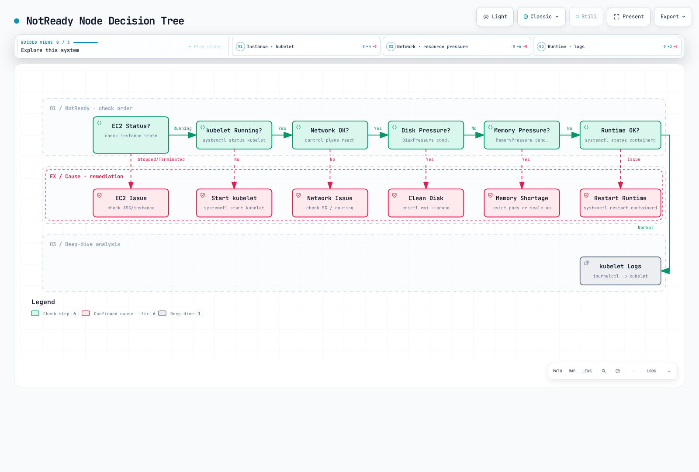
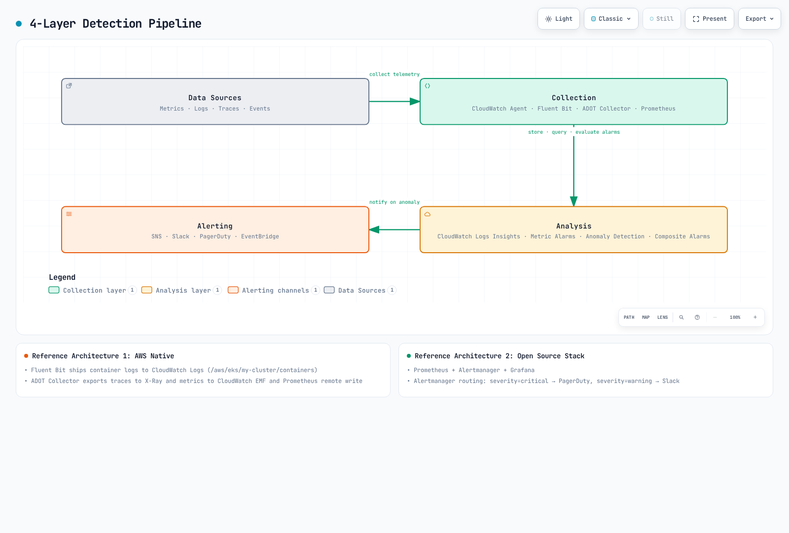

# EKS 高度なデバッグとインシデント対応

> **レビュー基準**: Kubernetes 1.36 のスキーマと kubectl 1.36.2。現在サポートされている EKS バージョンと互換性のあるコンポーネントリリースを選択してください
> **最終更新日**: 2026年9月12日

Amazon EKS クラスターを安定して運用するには、体系的なインシデント対応フレームワークと高度なデバッグスキルが不可欠です。このドキュメントでは、本番環境で発生する複雑な問題を迅速に診断し、解決するための実践的なガイドを紹介します。

## 目次

1. [インシデント対応フレームワーク](#1-incident-response-framework)
2. [コントロールプレーンのデバッグ](#2-control-plane-debugging)
3. [ノードレベルのトラブルシューティング](#3-node-level-troubleshooting)
4. [ワークロードのデバッグ](#4-workload-debugging)
5. [ネットワーク診断](#5-networking-diagnostics)
6. [ストレージのトラブルシューティング](#6-storage-troubleshooting)
7. [可観測性アーキテクチャ](#7-observability-architecture)
8. [障害検知アーキテクチャ](#8-failure-detection-architecture)
9. [クイックリファレンス](#9-quick-reference)
10. [次のステップ](#10-next-steps)

---

<span id="1-incident-response-framework"></span>

## 1. インシデント対応フレームワーク

### 最初の5分間のチェックリスト（初期トリアージ）

最初の30秒で行う手順、2分間の影響範囲の確認、合計5分という時間は、計画上の目標として扱い、実測された完了時間とはみなさないでください。まず、顧客への影響と、対象となるアカウント、クラスター／コンテキスト、namespace、直近の変更を正確に確認します。API クライアントが利用できない場合、認証情報、認可、DNS／ネットワーク、またはコントロールプレーンの問題が考えられますが、それだけで実行中のすべてのアプリケーションが停止しているとは証明できません。

ノードの状態、Pod／コンテナの状態、コントローラーのロールアウト状態、最近のイベント、リソースのサンプルをまとめて確認してください。`phase!=Running` では、Running だが NotReady／CrashLooping の Pod を見落とし、正常に完了した Job も含めてしまいます。Pod の Running フェーズは、Ready であることを証明しません。Deployment では、`1/1` のような表示文字列を grep するのではなく、desired、updated、ready／available のレプリカ数と observed generation を比較してください。

標準の VPC CNI の `aws-node` DaemonSet は、通常 `kube-system` で実行されます。`amazon-vpc-cni-system` という名前の namespace は EKS の必須要件ではありません。Auto Mode のみを使用する環境では、ネットワークとノードシステムの DNS が異なる方法で管理されるため、標準アドオンの Pod が存在しない場合は、ノード／コントローラーのモードに照らして解釈してください。Metrics Server のデータはサンプリングされたリソース情報であり、顧客に対する可用性のシグナルではありません。

### 初期診断スクリプト

このスクリプトは、対象として選択したワークロード namespace と、クラスターのノード／システム Pod 状態について、範囲を限定した API リクエストを実行し、非公開の証跡を保存します。Secret データを収集したり、すべての Pod の環境変数／設定をダンプしたりはしません。ログ、イベント、エラーメッセージには機密性の高いアプリケーションデータが含まれる場合があります。共有する前に証跡を確認し、機密情報をマスキングしてください。実行前に、アカウント／コンテキストの入力値と、既存の非公開証跡ディレクトリを確認してください。

```bash
set -euo pipefail
: "${AWS_REGION:?Set the intended Region}"
: "${CLUSTER_NAME:?Set the existing cluster name}"
: "${EXPECTED_ACCOUNT_ID:?Set the intended account ID}"
: "${KUBE_CONTEXT:?Set the explicit kubectl context}"
: "${NAMESPACE:?Set the owned workload namespace}"
: "${EVIDENCE_PARENT:?Set an existing private evidence directory}"
test -d "$EVIDENCE_PARENT"
ACTUAL_ACCOUNT_ID=$(aws sts get-caller-identity --query Account --output text)
test "$ACTUAL_ACCOUNT_ID" = "$EXPECTED_ACCOUNT_ID" || { echo "Account mismatch" >&2; exit 1; }
CLUSTER_ENDPOINT=$(aws eks describe-cluster --name "$CLUSTER_NAME" --region "$AWS_REGION" \
  --query cluster.endpoint --output text)
KUBE_ENDPOINT=$(kubectl config view --context "$KUBE_CONTEXT" --minify \
  -o jsonpath='{.clusters[0].cluster.server}')
test "$CLUSTER_ENDPOINT" = "$KUBE_ENDPOINT" || { echo "Context/cluster mismatch" >&2; exit 1; }

umask 077
TRIAGE_DIR=$(mktemp -d "$EVIDENCE_PARENT/eks-triage.XXXXXXXX")
TRIAGE_FAILED=0
k() { kubectl --context "$KUBE_CONTEXT" --request-timeout=15s "$@"; }
collect() {
  local name=$1
  shift
  if "$@" > "$TRIAGE_DIR/$name.txt" 2> "$TRIAGE_DIR/$name.stderr"; then
    printf '%s\tok\n' "$name" >> "$TRIAGE_DIR/status.tsv"
  else
    local rc=$?
    TRIAGE_FAILED=$((TRIAGE_FAILED + 1))
    printf '%s\tfailed:%s\n' "$name" "$rc" >> "$TRIAGE_DIR/status.tsv"
  fi
}
node_health() {
  k get nodes -o json | jq '[.items[] | {
    name:.metadata.name,uid:.metadata.uid,providerID:.spec.providerID,
    unschedulable:.spec.unschedulable,taints:.spec.taints,conditions:.status.conditions
  }]'
}
pod_health() {
  k -n "$NAMESPACE" get pods -o json | jq '[.items[] | {
    name:.metadata.name,uid:.metadata.uid,node:.spec.nodeName,owners:.metadata.ownerReferences,
    deleting:.metadata.deletionTimestamp,phase:.status.phase,conditions:.status.conditions,
    containers:[.status.containerStatuses[]? | {name,ready,restartCount,state,lastState}],
    initContainers:[.status.initContainerStatuses[]? | {name,ready,restartCount,state,lastState}]
  }]'
}
deployment_health() {
  k -n "$NAMESPACE" get deployments -o json | jq '[.items[] | {
    name:.metadata.name,generation:.metadata.generation,observed:.status.observedGeneration,
    desired:(.spec.replicas // 1),updated:(.status.updatedReplicas // 0),
    ready:(.status.readyReplicas // 0),available:(.status.availableReplicas // 0),
    conditions:.status.conditions
  }]'
}
load_balancers() {
  k -n "$NAMESPACE" get services -o json | jq '[.items[] | select(.spec.type=="LoadBalancer") | {
    name:.metadata.name,class:.spec.loadBalancerClass,selector:.spec.selector,
    ports:.spec.ports,status:.status.loadBalancer
  }]'
}
collect nodes node_health
collect pods pod_health
collect deployments deployment_health
collect load-balancers load_balancers
collect events k -n "$NAMESPACE" get events --sort-by='.metadata.creationTimestamp'
collect system-pods k -n kube-system get pods -o wide
collect node-resources k top nodes
collect pod-resources k -n "$NAMESPACE" top pods --sort-by=memory
printf 'Private evidence: %s; failed collections: %s\n' "$TRIAGE_DIR" "$TRIAGE_FAILED"
test "$TRIAGE_FAILED" -eq 0
```

`status.tsv` と各エラー出力を確認してください。権限不足、Metrics の利用不可、API タイムアウトは収集失敗として扱われます。いずれかの収集が失敗するとスクリプトは非ゼロで終了し、インシデントが解決したとは判断しません。Pending、完了、Running の Pod 状態を、解釈できるよう意図的に表示しています。追加でログを確認する場合は、namespace、Pod UID、コンテナを正確に指定し、時間／行数の範囲を限定してください。

LoadBalancer の一覧は Service JSON をローカルでフィルタリングします。`spec.type` は、サポート対象の組み込み Service フィールドセレクターではありません。この初期収集には、範囲を限定しない `cluster-info dump`、自動アーカイブのアップロード、リソースの再起動や削除は含まれていません。

### 重大度マトリックス

| 重大度 | 分類 | 影響範囲 | 対応時間 | 例 |
|----------|---------------|--------------|---------------|----------|
| **P1** | 重大 | サービス全体の停止 | 15分以内 | コントロールプレーン障害、すべてのノードが NotReady |
| **P2** | 高 | 主要機能の障害 | 1時間以内 | 特定ワークロードの完全な障害、ネットワーク接続の問題 |
| **P3** | 中 | 部分的な影響 | 4時間以内 | 一部 Pod の再起動、パフォーマンス低下 |
| **P4** | 低 | 軽微な問題 | 24時間以内 | ログ収集の遅延、重要度の低い監視アラート |

この重大度表の対応時間は、組織内で設定する目標の例です。実際の顧客への影響に基づいて分類してください。コントロールプレーンのみの停止でも、既存ワークロードのトラフィックが稼働し続ける場合があります。

### 問題を迅速に特定するための判断ツリー

<!-- Content audit: diagram prose needs parent repair; see eks-advanced-debugging/diagram-review.json.


[🔍 インタラクティブな図を表示](https://www.atomai.click/kubernetes-docs/archmaps/en-eks-11-eks-advanced-debugging-0.html)
-->

---

<span id="2-control-plane-debugging"></span>

## 2. コントロールプレーンのデバッグ

### EKS コントロールプレーンのログタイプ

EKS には、コントロールプレーンのログタイプが5つあります。有効にした場合にのみ、リージョンの CloudWatch ロググループに送信されます。ロギングを有効にしても、欠落している過去のログが復元されるわけではありません。ログへのアクセスと保持期間を制限し、CloudWatch の取り込み／保存／クエリ料金を考慮してください。ロググループやストリームが見つからない場合は、ロギングが無効、データが配信されていない、リージョンが誤っている、アクセスが拒否されているなどの可能性があり、必ずしもコントロールプレーンの障害を意味しません。

| タイプ | 証跡 |
| --- | --- |
| api | API サーバーの操作とエラーメッセージ |
| audit | API リクエストの ID、verb、リソース、応答ステータス |
| authenticator | IAM から Kubernetes への認証に関する証跡 |
| controllerManager | コントローラーの調整メッセージ |
| scheduler | スケジューリングの判断／エラー |

```bash
set -euo pipefail
: "${AWS_REGION:?}"; : "${CLUSTER_NAME:?}"
LOG_GROUP="/aws/eks/$CLUSTER_NAME/cluster"
aws eks describe-cluster --region "$AWS_REGION" --name "$CLUSTER_NAME" \
  --query 'cluster.{ARN:arn,Status:status,Logging:logging}'
aws logs describe-log-streams --region "$AWS_REGION" --log-group-name "$LOG_GROUP" \
  --order-by LastEventTime --descending --max-items 10 \
  --query 'logStreams[].{Name:logStreamName,LastEvent:lastEventTimestamp}'
```
```bash
# MUTATION: review cost, retention, access and available subnet IPs first.
set -euo pipefail
UPDATE_ID=$(aws eks update-cluster-config --region "$AWS_REGION" --name "$CLUSTER_NAME" \
  --logging '{"clusterLogging":[{"types":["api","audit","authenticator","controllerManager","scheduler"],"enabled":true}]}' \
  --query update.id --output text)
test -n "$UPDATE_ID" && test "$UPDATE_ID" != None
aws eks describe-update --region "$AWS_REGION" --name "$CLUSTER_NAME" \
  --update-id "$UPDATE_ID" --query update
```

変更は非同期で行われます。返された update ID の状態が Successful になるまで追跡してください。Failed／Cancelled やクライアント側のタイムアウトは成功を意味しません。その後、describe-cluster と新しいログの配信を確認してください。クラスターが ACTIVE であることだけでは、この更新の完了を判断できません。この更新では、設定済みの各クラスターサブネットに最大5個の利用可能な IP が必要になる場合があります。最新の EKS ロギング要件を確認してください。

### CloudWatch Logs Insights クエリ

各ブロックは **個別の Logs Insights QL クエリ** として実行してください。Bash や SQL として実行してはいけません。コンソールまたは StartQuery リクエストで、正確なロググループと時間範囲を選択してください。これらのクエリは、CloudWatch がフィールドを認識できる EKS JSON audit フィールドを使用します。パイプラインで形式を変更している場合は、代表的なレコードを確認し、ネストされたログの解析方法も確認してください。クエリでイベントが見つからなくても、サービスが正常だったことや、ログが配信されたことの証明にはなりません。

#### API エラーメッセージ

```text
fields @timestamp, @message
| filter @logStream like /kube-apiserver/ and @logStream not like /audit/
| filter @message like /error|Error|ERROR/
| sort @timestamp desc
| limit 100
```

#### 選択した時間範囲内のエラー数

```text
fields @timestamp, @message
| filter @logStream like /kube-apiserver/ and @logStream not like /audit/
| filter @message like /error|Error|ERROR/
| stats count(*) as error_count by bin(5m)
```

#### 確認が必要な Authenticator メッセージ

```text
fields @timestamp, @message
| filter @logStream like /authenticator/
| filter @message like /access denied|Unauthorized|unauthorized/
| sort @timestamp desc
| limit 50
```

#### 構造化された audit の認証／認可拒否

```text
fields @timestamp, user.username, verb, objectRef.resource, objectRef.namespace, responseStatus.code
| filter @logStream like /kube-apiserver-audit/
| filter responseStatus.code in [401, 403]
| sort @timestamp desc
| limit 100
```

#### 確認済みの1つの ID に関する構造化 audit アクティビティ

```text
fields @timestamp, user.username, verb, objectRef.resource, objectRef.namespace, responseStatus.code
| filter @logStream like /kube-apiserver-audit/
| filter user.username = "REPLACE_WITH_OBSERVED_KUBERNETES_USERNAME"
| sort @timestamp desc
| limit 50
```

#### ID とリソース別の audit 429 イベント

```text
fields user.username, verb, objectRef.resource, responseStatus.code
| filter @logStream like /kube-apiserver-audit/
| filter responseStatus.code = 429
| stats count(*) as request_count by user.username, verb, objectRef.resource
| sort request_count desc
| limit 50
```

#### API リクエスト量（必ずしもスロットリングではない）

```text
fields user.username, verb, objectRef.resource
| filter @logStream like /kube-apiserver-audit/
| stats count(*) as request_count by user.username, verb, objectRef.resource
| sort request_count desc
| limit 50
```

Audit の 401／403 は、authenticator メッセージの検索とは異なり、リクエスト単位の拒否を示します。API 呼び出し件数はスロットリングされた呼び出しの件数ではありません。また、時間単位に集約された結果には個々のイベントの @timestamp が残らないため、その値で並べ替えることはできません。StartQuery が返す query ID を使い、GetQueryResults が Complete になるまでポーリングしてください。Failed／Cancelled／Timeout／データ欠落の状態も保持してください。[監視の章](06-eks-monitoring-logging.md) では、範囲を限定したクエリ／ポーリング手順を説明しています。この監査では、実際の CloudWatch クエリは実行していません。

[EKS コントロールプレーンのロギング](https://docs.aws.amazon.com/eks/latest/userguide/control-plane-logs.html) · [AWS audit フィールドの例](https://docs.aws.amazon.com/eks/latest/best-practices/auditing-and-logging.html)

### IAM 認証のトラブルシューティング

まず、初期トリアージのアカウント／コンテキスト確認を実行してください。kubectl が使う人間／自動化の IAM ID、ノードのブートストラップ ID、アプリケーション Pod 内で使われる AWS ID を区別してください。トークンの生成に成功しても、Kubernetes の認証や認可に成功した証明にはなりません。

`k8s-aws-v1` で始まる EKS IAM トークンは、base64url でエンコードされた事前署名済み STS リクエストであり、**3つの部分からなる JWT ではありません**。JSON としてデコード／表示したり、ログに貼り付けたりしないでください。Kubernetes の投影 ServiceAccount トークンは、これとは別の JWT 認証情報です。

```bash
set -euo pipefail
: "${AWS_REGION:?}"; : "${CLUSTER_NAME:?}"; : "${KUBE_CONTEXT:?}"; : "${NAMESPACE:?}"
aws sts get-caller-identity
aws eks describe-cluster --region "$AWS_REGION" --name "$CLUSTER_NAME" \
  --query 'cluster.{ARN:arn,AuthenticationMode:accessConfig.authenticationMode}'
# Print only the credential expiry, not the bearer token.
aws eks get-token --region "$AWS_REGION" --cluster-name "$CLUSTER_NAME" \
  --query status.expirationTimestamp --output text
kubectl --context "$KUBE_CONTEXT" auth whoami
kubectl --context "$KUBE_CONTEXT" -n "$NAMESPACE" auth can-i get pods
```

AuthenticationMode に応じて、調査する場所が異なります。API／API_AND_CONFIG_MAP モードでは、プリンシパルの access entry、関連付けられたポリシーの適用範囲、RBAC バインディングを確認してください。CONFIG_MAP モードでは、既存のレガシーマッピングを確認してください。分類されていない 401／403 を修正するために、認証モードを切り替えたり aws-auth を置き換えたりしないでください。アクセスモードの移行には、固有の前提条件と、取り消せない移行があります。IAM ロールのパスや STS セッション ARN を、文字列置換で推測してはいけません。

```bash
# Run for API or API_AND_CONFIG_MAP authentication mode.
aws eks list-access-entries --region "$AWS_REGION" --cluster-name "$CLUSTER_NAME"
: "${PRINCIPAL_ARN:?Use a reviewed IAM role/user ARN, not an STS assumed-role session ARN}"
aws eks describe-access-entry --region "$AWS_REGION" --cluster-name "$CLUSTER_NAME" \
  --principal-arn "$PRINCIPAL_ARN"
aws eks list-associated-access-policies --region "$AWS_REGION" --cluster-name "$CLUSTER_NAME" \
  --principal-arn "$PRINCIPAL_ARN"
```
```bash
# Read-only legacy mapping inspection for CONFIG_MAP/API_AND_CONFIG_MAP clusters.
kubectl --context "$KUBE_CONTEXT" -n kube-system get configmap aws-auth -o yaml
```

既存のノードのブートストラップマッピングは維持してください。グループ名だけでは、該当するバインディングがなければ権限は付与されません。診断手順として system:masters を追加するのではなく、確認済みの最小権限アクセスを使用してください。403 は認可による拒否を示しますが、401 は認証情報の無効化／期限切れを示す場合があります。ネットワーク／TLS の障害は別の証跡です。

### IRSA のトラブルシューティング

IRSA には、正しい OIDC issuer／provider、namespace／ServiceAccount の subject と sts.amazonaws.com audience に一致するロールの信頼ポリシー、Web Identity 認証情報を使用して更新するワークロード SDK が必要です。以下の annotation は、その設定の一部にすぎません。namespace／ロールはプレースホルダーであり、この YAML によってロール、provider、バケット権限が作成されることはありません。

```yaml
apiVersion: v1
kind: ServiceAccount
metadata:
  name: s3-access-sa
  namespace: diagnostics-example
  annotations:
    eks.amazonaws.com/role-arn: arn:aws:iam::123456789012:role/owned-s3-access-role
```
```bash
set -euo pipefail
: "${SERVICE_ACCOUNT:?Set the actual ServiceAccount on the Pod}"
: "${POD_NAME:?Set an owned Pod}"; : "${CONTAINER_NAME:?Set its application container}"
: "${IRSA_ROLE_NAME:?Set the reviewed IAM role name}"
kubectl --context "$KUBE_CONTEXT" -n "$NAMESPACE" get serviceaccount "$SERVICE_ACCOUNT" \
  -o jsonpath='{.metadata.annotations.eks\.amazonaws\.com/role-arn}{"\n"}'
aws eks describe-cluster --name "$CLUSTER_NAME" --region "$AWS_REGION" \
  --query cluster.identity.oidc.issuer --output text
aws iam get-role --role-name "$IRSA_ROLE_NAME" --query Role.AssumeRolePolicyDocument
kubectl --context "$KUBE_CONTEXT" -n "$NAMESPACE" get pod "$POD_NAME" -o json | jq '{
  uid:.metadata.uid,serviceAccount:.spec.serviceAccountName,
  envNames:[.spec.containers[] | {name,envNames:[.env[]?.name]}],
  projectedVolumes:[.spec.volumes[]? | select(.projected) | {name,projected}]
}'
```

機密値やトークンのバイト列を表示せずに、環境変数の**名前**、トークンファイルのパス／マウントのメタデータ、SDK の認証情報チェーンを確認してください。静的認証情報や、SDK チェーンで先に評価される別の provider によって、意図した ID が上書きされる場合があります。実際のアプリケーションコンテナを使用してください。新しく作成したデバッグ Pod やコンテナでは、ID／設定が異なる場合があります。

```bash
# Optional read-only identity request, only if AWS CLI is already in this container.
kubectl --context "$KUBE_CONTEXT" -n "$NAMESPACE" exec "$POD_NAME" -c "$CONTAINER_NAME" \
  -- aws sts get-caller-identity
```

STS の ID 応答から、現在使用中のロールは特定できます。しかし、すべてのバケットの一覧表示や特定オブジェクトへのアクセスが許可されていることの証明にはなりません。ID のテストだけを目的に、アカウント全体で aws s3 ls を実行しないでください。

### Pod Identity のトラブルシューティング

```bash
aws eks list-pod-identity-associations --region "$AWS_REGION" \
  --cluster-name "$CLUSTER_NAME" --namespace "$NAMESPACE" --service-account "$SERVICE_ACCOUNT"
: "${ASSOCIATION_ID:?Use the exact matching association ID}"
aws eks describe-pod-identity-association --region "$AWS_REGION" \
  --cluster-name "$CLUSTER_NAME" --association-id "$ASSOCIATION_ID"
# Standard EC2-node setup only; Auto Mode provides the integration itself.
kubectl --context "$KUBE_CONTEXT" -n kube-system get pods \
  -l app.kubernetes.io/name=eks-pod-identity-agent
```

association、ロールの信頼／権限、サポート対象 SDK の認証情報 provider、agent／ノードへの到達性を確認してください。Auto Mode には組み込みサポートがあり、agent を重複してインストールする必要はありません。Fargate は EKS Pod Identity をサポートしていません。association の作成／変更は、これらの診断とは別の作業として扱ってください。IRSA と Pod Identity では、トークンの audience と認証情報の配信経路が異なります。デフォルトでは、操作者の AWS CLI ID はどちらでもありません。

### ServiceAccount トークンの有効期間とローテーション

投影トークンに共通する「最長24時間」という制限はありません。要求された有効期間と、API サーバーで設定されている上限は別のものです。トークンの TTL の80%を超えた場合、または24時間を超えた場合、kubelet はローテーションを要求します。アプリケーションはローテーション後のファイルを再読み込みする必要があります。EKS では、Kubernetes API ServiceAccount トークンの移行と古いトークンの監査 annotation との互換性を保つため、90日間の延長が文書化されています。これは、IRSA、Pod Identity、任意の relying party に対する、安全なキャッシュ期間や有効期間の保証ではありません。

以下の例では、STS audience 向けにカスタムトークンを1時間で要求します。デフォルトの API トークンの有効期間を延長したり、IRSA を自動的に設定したりするものではありません。既存の namespace／ServiceAccount、確認済みのイメージ、ロールの信頼設定、アプリケーション SDK／トークンファイルの設定は別途準備する必要があります。STS audience のトークンが Kubernetes API に対して有効だと想定してはいけません。

```yaml
apiVersion: v1
kind: Pod
metadata:
  name: audience-token-example
  namespace: diagnostics-example
spec:
  serviceAccountName: owned-app
  automountServiceAccountToken: false
  containers:
  - name: app
    image: registry.example.com/owned/app:replace-with-reviewed-digest
    volumeMounts:
    - name: token
      mountPath: /var/run/secrets/tokens
      readOnly: true
  volumes:
  - name: token
    projected:
      sources:
      - serviceAccountToken:
          path: token
          expirationSeconds: 3600
          audience: sts.amazonaws.com
```

[EKS access entries](https://docs.aws.amazon.com/eks/latest/userguide/access-entries.html) · [EKS トークンの移行／ローテーション](https://docs.aws.amazon.com/eks/latest/userguide/service-accounts.html) · [Kubernetes の投影トークン](https://kubernetes.io/docs/tasks/configure-pod-container/configure-service-account/) · [IRSA](https://docs.aws.amazon.com/eks/latest/userguide/iam-roles-for-service-accounts.html) · [Pod Identity](https://docs.aws.amazon.com/eks/latest/userguide/pod-identities.html)

### EKS アドオンのエラーパターン

アドオンを変更する前に、インストール済みのバージョン、所有者、設定／ID の設定、health.issues を確認してください。ACTIVE はアドオンのステータスであり、すべての顧客トラフィックが正常であることを証明しません。DEGRADED はヘルス上の問題を示し、単に性能が低下しているという意味ではありません。CREATE_FAILED／UPDATE_FAILED／DELETE_FAILED では、実際の問題の詳細を確認してください。Auto Mode が管理する機能では、標準アドオンが存在しないことが正常な場合があります。

```bash
set -euo pipefail
: "${AWS_REGION:?}"; : "${CLUSTER_NAME:?}"; : "${ADDON_NAME:?Set the existing owned add-on}"
aws eks describe-addon --region "$AWS_REGION" --cluster-name "$CLUSTER_NAME" \
  --addon-name "$ADDON_NAME" \
  --query 'addon.{Version:addonVersion,Status:status,Issues:health.issues,Configuration:configurationValues,Role:serviceAccountRoleArn,PodIdentity:podIdentityAssociations}'
CLUSTER_VERSION=$(aws eks describe-cluster --region "$AWS_REGION" --name "$CLUSTER_NAME" \
  --query cluster.version --output text)
aws eks describe-addon-versions --region "$AWS_REGION" --addon-name "$ADDON_NAME" \
  --kubernetes-version "$CLUSTER_VERSION" \
  --query 'addons[].addonVersions[].{Version:addonVersion,Architectures:architecture,ComputeTypes:computeTypes,Compatibility:compatibilities}'
```

応答の最初のバージョンを「最新」とみなしたり、すべてのノードタイプと自動的に互換性があると判断したりしないでください。アーキテクチャ、コンピューティングタイプ、デフォルトバージョンのマーカー、設定スキーマ、IAM／Pod Identity、コンポーネントの移行手順を確認してください。設定出力には機密情報が含まれる場合があります。非公開に保管してください。バージョン更新は意図的に行う変更であり、初期診断ではありません。

```bash
# MUTATION: use a reviewed compatible version and configuration/identity plan.
set -euo pipefail
: "${REVIEWED_ADDON_VERSION:?Choose from the compatible versions after review}"
: "${REVIEWED_ADDON_CONFIG:?Set the path to the reviewed JSON configuration file}"
test -f "$REVIEWED_ADDON_CONFIG"
aws eks describe-addon-configuration --region "$AWS_REGION" --addon-name "$ADDON_NAME" \
  --addon-version "$REVIEWED_ADDON_VERSION" --query configurationSchema --output text
# The configuration file must be checked against this version's schema before this request.
UPDATE_ID=$(aws eks update-addon --region "$AWS_REGION" --cluster-name "$CLUSTER_NAME" \
  --addon-name "$ADDON_NAME" --addon-version "$REVIEWED_ADDON_VERSION" \
  --configuration-values "file://$REVIEWED_ADDON_CONFIG" \
  --resolve-conflicts PRESERVE --query update.id --output text)
test -n "$UPDATE_ID" && test "$UPDATE_ID" != None
aws eks describe-update --region "$AWS_REGION" --name "$CLUSTER_NAME" \
  --addon-name "$ADDON_NAME" --update-id "$UPDATE_ID" --query update
```

PRESERVE は、競合を解決するときに既存のカスタム設定を保持するよう EKS に要求しますが、バックアップではなく、任意の古い設定が新しいリリースで動作するという保証でもありません。OVERWRITE は競合するカスタマイズをリセットする可能性があるため、別途レビューが必要です。この update ID の完了を追跡し、更新エラーを調べたうえで、更新後のアドオンのヘルスを確認してください。configurationValues と ID の変更は明示的に確認し、黙って省略したり上書きしたりしないでください。

[EKS アドオンの更新](https://docs.aws.amazon.com/eks/latest/userguide/updating-an-add-on.html)

---

<span id="3-node-level-troubleshooting"></span>

## 3. ノードレベルのトラブルシューティング

<a id="node-join-diagnosis"></a>

### ノード参加失敗の診断

以下は、検証すべき仮説です。インスタンス／NodeClaim、ブートストラップログ、エンドポイントへの到達性、認証モードと照合してください。必ず原因となると保証された8項目ではありません。

| 領域 | 確認事項 |
| --- | --- |
| ブートストラップと AMI | クラスター名／エンドポイント／CA、OS 固有のブートストラップ、アーキテクチャ、互換性のある kubelet／AMI。バージョンが常に完全一致するという一般ルールはありません |
| ネットワーク／セキュリティ | ノード→API TCP 443、API→kubelet TCP 10250、DNS、ワークロード固有の経路。方向、セキュリティグループの所属、ルーティングを検証 |
| VPC DNS | DNS サポート／ホスト名、DHCP リゾルバー／ドメイン設定、実際に使われるエンドポイント |
| ID | ノード IAM ロールと Kubernetes node access entry／レガシーマッピング。インスタンスプロファイル ARN ではなくロール ARN を使用 |
| 所有権／検出タグ | プロビジョナー固有のノード所有権タグ。ロードバランサー検出用のサブネットタグと混同しない |
| プライベートアクセス | EKS／ECR／S3／STS やその他のサービスへの必要な経路を、確認済みのエンドポイントまたはアウトバウンド通信で確保。すべてのプライベートクラスター設計で NAT gateway が必須とは限らない |
| 起動設定 | 実際のプロビジョナーでのロール／プロファイルの扱い、launch-template バージョン、キャパシティ、サブネットの空き IP を確認 |
| 初期化 | 選択した AMI に応じた nodeadm／cloud-init／ブートストラップの証跡を確認。AL2023、Bottlerocket、Windows、Auto Mode に共通するパスはありません |

```bash
set -euo pipefail
: "${KUBE_CONTEXT:?}"; : "${NODE_NAME:?Set the exact owned node name}"
NODE_JSON=$(kubectl --context "$KUBE_CONTEXT" get node "$NODE_NAME" -o json)
printf '%s\n' "$NODE_JSON" | jq '{
  name:.metadata.name,uid:.metadata.uid,providerID:.spec.providerID,
  os:.status.nodeInfo.osImage,kernel:.status.nodeInfo.kernelVersion,
  kubelet:.status.nodeInfo.kubeletVersion,runtime:.status.nodeInfo.containerRuntimeVersion,
  labels:.metadata.labels,taints:.spec.taints,conditions:.status.conditions
}'
NODE_UID=$(printf '%s\n' "$NODE_JSON" | jq -er '.metadata.uid')
kubectl --context "$KUBE_CONTEXT" get events -A \
  --field-selector "involvedObject.uid=$NODE_UID" --sort-by='.metadata.creationTimestamp'
```
```bash
# EC2-backed nodes only: map the Node providerID to an inspected instance ID/Region.
: "${AWS_REGION:?}"; : "${INSTANCE_ID:?Use the verified EC2 ID, not a guessed node-name conversion}"
aws ec2 describe-instances --region "$AWS_REGION" --instance-ids "$INSTANCE_ID" \
  --query 'Reservations[].Instances[].{ID:InstanceId,State:State.Name,AZ:Placement.AvailabilityZone,Subnet:SubnetId,Profile:IamInstanceProfile,Groups:SecurityGroups,Image:ImageId}'
aws ec2 describe-instance-status --region "$AWS_REGION" --instance-ids "$INSTANCE_ID" \
  --include-all-instances
```

まだ登録されていないインスタンスには Node オブジェクトがありません。所有する managed node group／NodeClaim／インスタンスの証跡を使用してください。Ready=False と、ハートビート欠落による Ready=Unknown では、必要な証跡が異なります。Ready であってもノードに pressure が発生している場合があります。1つの表示文字列だけから原因を推測しないでください。新しい Auto Mode の EC2 管理インスタンスは、既定では一般的な EC2 の一覧表示に含まれない場合があります。インスタンス ID を直接指定したクエリや、管理対象リソースを明示的に含める操作は、アカウント全体の表示設定を変更することとは異なります。

### NotReady ノードの判断ツリー

<!-- Content audit: diagram prose needs parent repair; see eks-advanced-debugging/diagram-review.json.


[🔍 インタラクティブな図を表示](https://www.atomai.click/kubernetes-docs/archmaps/en-eks-11-eks-advanced-debugging-1.html)
-->

### ホストとマネージドノードの診断

顧客がアクセスできる Linux ノードで SSM を使用するには、ノード agent、ロール／ネットワークの前提条件、対象インスタンスへの認可済みアクセスが必要です。SSM はセッションを開始します。EKS Auto Mode の管理インスタンスでは、直接 SSH アクセスはサポートされません。文書化された NodeDiagnostic／コンソール出力の経路、またはサポート対象の kubectl debug node ワークフローを使用してください。現在の Auto Mode ガイドでは、ライブログ取得のために**明示的な sysadmin デバッグプロファイル**を使用できます。これは特権 Pod の作成であり、SSH セッションでも、デフォルトでデバッグに特権が付与されるという意味でもありません。NodeDiagnostic の収集では、機密性の高いログ／キャプチャを S3 にアップロードする場合があり、別途レビュー済みの範囲とストレージ権限が必要です。

```bash
# Interactive host access: an operational session, not an automatic triage step.
: "${AWS_REGION:?}"; : "${INSTANCE_ID:?Use the reviewed self-managed or managed-node-group instance}"
aws ssm start-session --region "$AWS_REGION" --target "$INSTANCE_ID"
```
```bash
# Read-only Linux/systemd host checks after authorized access.
sudo systemctl show kubelet containerd --no-pager \
  -p Id -p LoadState -p ActiveState -p SubState -p ExecMainStatus
sudo journalctl -u kubelet --since "15 minutes ago" -n 200 --no-pager
sudo journalctl -u containerd --since "15 minutes ago" -n 100 --no-pager
sudo crictl info
sudo crictl ps
sudo crictl ps -a
sudo crictl images
df -h
df -i
sudo journalctl --disk-usage
```
```bash
# Exact container ID only; log content may be sensitive.
: "${CONTAINER_ID:?Use an inspected CRI container ID}"
sudo crictl logs --tail=100 "$CONTAINER_ID"
```

これらの systemd／CRI コマンドは、選択したホストに該当コンポーネント／ツールが存在することを前提としています。crictl の正しい CRI endpoint を設定してください。journal の読み取り範囲を限定してください。journalctl -f を tail にパイプすると、処理が終了しない場合があります。kubeconfig／クライアントキーを表示したり、ログ、終了済みコンテナ、イメージキャッシュを無差別に削除したりしないでください。これらには必要な証跡が含まれる場合や、kubelet のガベージコレクションで管理される場合があります。再起動、drain、置換、保持期間の変更には、診断済みの状態と、別途レビューされた復旧手順が必要です。

### リソース pressure

DiskPressure は空きバイト数／inode 数と設定済み eviction しきい値に関係し、df の容量だけで決まるものではありません。df -h と df -i の両方、マウントの識別情報、kubelet のイベントを確認してください。保持期間のクリーンアップが承認されている場合、古い `journalctl --vacuum-size=500M` の値はポリシー例にすぎません。必要な証跡を先に収集し、`/var/log` の glob を削除しないでください。MemoryPressure とコンテナの OOM は別のシグナルです。メモリ上限、ノードの空き、working set、ログ、pressure メトリクスを照合してください。上限の引き上げやノードの追加だけでは、根本原因が修正されたとは証明できません。

```bash
# Read-only host evidence, not remediation.
free -h
awk '/MemTotal|MemFree|MemAvailable|Buffers|Cached/ {print}' /proc/meminfo
cat /proc/sys/kernel/pid_max
cat /proc/sys/kernel/threads-max
ps -eLf --no-headers | wc -l
ps -eo pid,comm,nlwp --sort=-nlwp | head -20
if [ -r /proc/pressure/memory ]; then cat /proc/pressure/memory; fi
if [ -r /proc/pressure/cpu ]; then cat /proc/pressure/cpu; fi
```

プロセスディレクトリの件数は、すべてのスレッド／タスクの数ではありません。ps NLWP とカーネルの上限は手がかりにすぎません。kubelet の PID pressure の計算と cgroup の PID 上限は、それぞれ別に解釈する必要があります。一般的なメモリ使用率の高さを、Kubernetes の MemoryPressure 状態と呼ばないでください。メトリクスがない場合は、証跡が利用できないものとして扱ってください。

### Karpenter のプロビジョニングの問題

```bash
# Self-managed Karpenter; use the actual release namespace and selected objects.
: "${KARPENTER_NAMESPACE:?Set the existing controller namespace}"
: "${NODEPOOL_NAME:?}"; : "${NODECLAIM_NAME:?}"
kubectl --context "$KUBE_CONTEXT" -n "$KARPENTER_NAMESPACE" logs \
  -l app.kubernetes.io/name=karpenter -c controller --since=15m --tail=200 --prefix
kubectl --context "$KUBE_CONTEXT" get nodepool "$NODEPOOL_NAME" -o yaml
kubectl --context "$KUBE_CONTEXT" get nodeclaim "$NODECLAIM_NAME" -o yaml
kubectl --context "$KUBE_CONTEXT" get events -A \
  --field-selector "involvedObject.name=$NODECLAIM_NAME" --sort-by='.metadata.creationTimestamp'
```

NodePool／NodeClass の準備状態、NodeClaim の condition／event、制約、上限、サブネットの空き IP、IAM、EC2 のキャパシティを確認してください。Auto Mode では、組み込みコントローラーの NodeClaim／NodeClass／イベントと audit log の証跡を使用してください。自分で管理する karpenter Deployment／namespace があるとは想定しないでください。以下の self-managed Karpenter v1 のスキーマパターンは説明用です。互換性のあるリリースと、レビュー済みの既存 EC2NodeClass が必要です。クラスターのデフォルトの pool を置き換えるコマンドではありません。CPU／メモリの上限は最大値であり、予約済みキャパシティではありません。capacity-type のリストが Spot のみの動作や AZ の均等な分散を保証するわけでもありません。

```yaml
apiVersion: karpenter.sh/v1
kind: NodePool
metadata:
  name: reviewed-capacity-example
spec:
  template:
    spec:
      requirements:
      - key: kubernetes.io/arch
        operator: In
        values:
        - amd64
      - key: karpenter.sh/capacity-type
        operator: In
        values:
        - spot
        - on-demand
      - key: karpenter.k8s.aws/instance-category
        operator: In
        values:
        - c
        - m
        - r
      nodeClassRef:
        group: karpenter.k8s.aws
        kind: EC2NodeClass
        name: reviewed-existing-class
  limits:
    cpu: 1000
    memory: 1000Gi
  disruption:
    consolidationPolicy: WhenEmptyOrUnderutilized
    consolidateAfter: 30s
```

### Managed Node Group のエラーコード

| 問題 | 意味と証跡 |
| --- | --- |
| AccessDenied | Kubernetes API の認証／認可エラー。IAM に加えて、ノードのアクセスと EKS node-manager RBAC を確認 |
| AsgInstanceLaunchFailures | ASG の起動失敗。実際のアクティビティメッセージ、テンプレート、キャパシティ、権限を確認 |
| ClusterUnreachable | Kubernetes API への接続性またはリクエスト処理のタイムアウト。VPC endpoint の欠落とは限らない |
| InsufficientFreeAddresses | 選択したノードサブネットに利用可能な IP が不足。既存サブネットの IPv4 CIDR はインプレースで拡張できない |
| NodeCreationFailure | 起動したインスタンスが登録に失敗。ブートストラップ、アクセス、必要なネットワーク経路を確認 |

```bash
set -euo pipefail
: "${AWS_REGION:?}"; : "${CLUSTER_NAME:?}"; : "${NODEGROUP_NAME:?Set the exact managed node group}"
aws eks describe-nodegroup --region "$AWS_REGION" --cluster-name "$CLUSTER_NAME" \
  --nodegroup-name "$NODEGROUP_NAME" \
  --query 'nodegroup.{Status:status,Issues:health.issues,Version:version,Release:releaseVersion,Subnets:subnets,Role:nodeRole,LaunchTemplate:launchTemplate,Repair:nodeRepairConfig}'
# For a Kubernetes authorization issue, inspect rather than blindly replace EKS-managed RBAC.
kubectl --context "$KUBE_CONTEXT" get clusterrole eks:node-manager -o yaml
kubectl --context "$KUBE_CONTEXT" get clusterrolebinding eks:node-manager -o yaml
```

各 issue の message／resourceIds と、最新の AWS 復旧手順を使用してください。トラブルシューティングガイドでは、managed node が15分以内に参加できない場合の NodeCreationFailure が説明されていますが、すべての起動がその時間内に完了するという保証ではありません。サブネットに空きが必要な場合は、既存 CIDR を編集するのではなく、新しいアドレス範囲／サブネットと、プロビジョナー固有の移行を計画してください。EKS 管理の RBAC 構成は変化する場合があります。AccessDenied が表示されたからといって、古い代替 ClusterRole を貼り付けないでください。ノードの修復／退避は調査とは別の作業です。ワークロード、予算、データ、現在のノード管理モードを考慮してください。

[EKS のトラブルシューティング](https://docs.aws.amazon.com/eks/latest/userguide/troubleshooting.html) · [Auto Mode の診断経路](https://docs.aws.amazon.com/eks/latest/userguide/auto-troubleshoot.html) · [セキュリティグループの経路](https://docs.aws.amazon.com/eks/latest/userguide/sec-group-reqs.html) · [プライベートクラスター](https://docs.aws.amazon.com/eks/latest/userguide/private-clusters.html) · [Karpenter の互換性](https://karpenter.sh/docs/upgrading/compatibility/)

### Node Readiness Controller（段階的なブート検証）

Kubernetes SIGs Node Readiness Controller は、実際に稼働するアウトオブバンドコントローラーです。レビュー済みの v0.5.0 リリースでは、クラスター全体を対象とする `readiness.node.x-k8s.io/v1alpha1` `NodeReadinessRule` が使用されます。これは組み込みの EKS ConfigMap プロセッサでも、Node API の GA フィールドでもありません。

コントローラーは Node condition を読み取り、taint を管理します。ConfigMap 内の任意の `checks[].probe.exec` エントリは実行しません。元のファイル存在／containerd のチェックには、対応する condition を公開する、別途実装された認可済み reporter または NPD カスタムモニターが必要です。CNI 設定ファイルが存在しても、それだけでは CNI の準備完了を証明できません。プロジェクト付属の reporter は、`CHECK_ENDPOINT`、`CONDITION_TYPE`、`NODE_NAME` を使用して HTTP endpoint をポーリングします。その設定形式は、以前の exec-probe 形式とは異なります。

このルールは、テスト対象を明示する**taint のプレビュー**です。適用するとクラスターリソースが作成され、コントローラーが status を更新しますが、`dryRun: true` ではノードの taint を追加／削除しません。condition 名とノードラベルの例はカスタムの前提条件であり、EKS が自動的に提供するラベル／condition ではありません。

```yaml
apiVersion: readiness.node.x-k8s.io/v1alpha1
kind: NodeReadinessRule
metadata:
  name: reviewed-bootstrap-readiness
spec:
  dryRun: true
  enforcementMode: bootstrap-only
  nodeSelector:
    matchLabels:
      audit.example.com/readiness-demo: 'true'
  conditions:
  - type: audit.example.com/CNIReady
    requiredStatus: 'True'
  - type: audit.example.com/ContainerRuntimeReady
    requiredStatus: 'True'
  taint:
    key: readiness.k8s.io/bootstrap-not-ready
    value: pending
    effect: NoSchedule
```

enforcement を有効にする前に、`status.dryRunResults`、`status.nodeEvaluations`、失敗したノード、実際に選択された Node condition を確認してください。

```bash
# Read-only: the controller and released CRD must already be installed.
: "${KUBE_CONTEXT:?Set the verified context}"
kubectl --context "$KUBE_CONTEXT" get nodereadinessrule reviewed-bootstrap-readiness -o yaml
kubectl --context "$KUBE_CONTEXT" get nodes \
  -l audit.example.com/readiness-demo=true -o json
```

ブートストラップを制御するには、コントローラーとの競合が起きてスケジューリングが先行する前に、新しいノードを一致する startup taint 付きで登録してください。reporter と必要なシステム DaemonSet はその taint を許容し、API に到達できる必要があります。すべての要件を満たすと、bootstrap-only モードは taint を削除し、完了を記録します。後で condition が失敗しても、ゲートを再適用することはありません。Continuous モードは別のポリシー選択です。

`NoSchedule` は taint を許容しない新規 Pod のスケジューリングをブロックしますが、既存 Pod は退避しません。bootstrap-only ルールに `defaultStatus` を設定しないでください。この組み合わせはリリースで拒否されます。ネイティブの CRD 検証だけでは、reporter のヘルス、admission webhook の動作、すべての EKS ノードタイプでの稼働を証明できません。この監査では、ノードのラベル、taint、コントローラー、condition を変更していません。

[リリース v0.5.0](https://github.com/kubernetes-sigs/node-readiness-controller/releases/tag/v0.5.0) · [enforcement と dry-run の意味](https://github.com/kubernetes-sigs/node-readiness-controller/blob/v0.5.0/docs/book/src/user-guide/concepts.md) · [reporter の設定](https://github.com/kubernetes-sigs/node-readiness-controller/blob/v0.5.0/docs/book/src/reference/reporter-configuration.md)

---

<span id="4-workload-debugging"></span>

## 4. ワークロードのデバッグ

### Pod とコンテナの状態

Pod のフェーズは Pending、Running、Succeeded、Failed、Unknown です。コンテナの状態は Waiting、Running、Terminated です。ContainerCreating と CrashLoopBackOff は reason／表示情報であり、追加の Pod フェーズではありません。Running は Ready と同じ意味ではありません。再起動ポリシーによって Pod 内のコンテナが再起動することはありますが、終了状態の Failed Pod が Pending に戻るわけではありません。コントローラーが置き換える Pod は、新しい UID を持つ別の Pod です。

<!-- Content audit: diagram prose needs parent repair; see eks-advanced-debugging/diagram-review.json.


[🔍 インタラクティブな図を表示](https://www.atomai.click/kubernetes-docs/archmaps/en-eks-11-eks-advanced-debugging-2.html)
-->

```bash
set -euo pipefail
: "${KUBE_CONTEXT:?}"; : "${NAMESPACE:?}"; : "${POD_NAME:?}"; : "${CONTAINER_NAME:?}"
POD_JSON=$(kubectl --context "$KUBE_CONTEXT" -n "$NAMESPACE" get pod "$POD_NAME" -o json)
printf '%s\n' "$POD_JSON" | jq '{
  name:.metadata.name,uid:.metadata.uid,owners:.metadata.ownerReferences,node:.spec.nodeName,
  phase:.status.phase,reason:.status.reason,conditions:.status.conditions,
  containers:.status.containerStatuses,initContainers:.status.initContainerStatuses,
  ephemeralContainers:.status.ephemeralContainerStatuses
}'
POD_UID=$(printf '%s\n' "$POD_JSON" | jq -er '.metadata.uid')
kubectl --context "$KUBE_CONTEXT" -n "$NAMESPACE" get events \
  --field-selector "involvedObject.uid=$POD_UID" --sort-by='.metadata.creationTimestamp'
kubectl --context "$KUBE_CONTEXT" -n "$NAMESPACE" logs "$POD_NAME" -c "$CONTAINER_NAME" \
  --since=15m --tail=200
```
```bash
# Separate read: this can fail when no previous container log exists.
kubectl --context "$KUBE_CONTEXT" -n "$NAMESPACE" logs "$POD_NAME" -c "$CONTAINER_NAME" \
  --previous --tail=200
```

前回のログは、選択したコンテナで直近に終了したインスタンスのものであり、再起動の全履歴ではありません。ログローテーションや Pod の削除により、ログを取得できない場合があります。収集中に Pod UID／時刻を記録し、Pod が置き換わっていないか確認してください。init／sidecar／ephemeral container では、障害が異なる場合があります。ログと状態メッセージには機密情報が含まれる場合があるため、収集した証跡は非公開に保管してください。手軽な診断方法として、環境変数やアプリケーション設定ファイルをすべて表示しないでください。

### kubectl debug：3種類の異なる操作

ephemeral container は既存の Pod を変更します。`--copy-to` は別の Pod を作成し、`node/` はノード上に診断用 Pod を作成します。いずれも変更操作であり、該当する RBAC／admission の権限が必要です。確認済みの kubectl 1.36.2 では、デフォルトの profile は general です。自動的に特権が付与されるという意味ではなく、ホストの namespace／ファイルシステムへのアクセスも privileged=true とは別の設定です。

#### Ephemeral container

```bash
# MUTATION: adds a permanent-to-this-Pod-spec ephemeral-container entry.
: "${DEBUG_IMAGE:?Use a reviewed non-root diagnostic image with a compatible shell}"
: "${DEBUG_CONTAINER_NAME:?Choose an unused container name}"
kubectl --context "$KUBE_CONTEXT" -n "$NAMESPACE" debug "$POD_NAME" -it \
  --container="$DEBUG_CONTAINER_NAME" --target="$CONTAINER_NAME" \
  --image="$DEBUG_IMAGE" --profile=restricted -- sh
```

restricted profile は capability を削除し、権限昇格を防ぎ、root 以外での実行と RuntimeDefault seccomp を要求します。イメージ／ユーザー／シェルがこの要件に対応している必要があります。root 専用の任意の BusyBox イメージが起動するとは限りません。`--target` は、ランタイムがサポートする場合に限り、対象プロセスの namespace を要求します。アプリケーションのファイルシステム／環境をコピーしたり、権限を回避したりするものではありません。終了するとデバッグプロセスは終了しますが、既存の Pod spec から ephemeral-container エントリを削除することはできません。

#### Pod のコピー

```bash
# MUTATION: copy only a reviewed reproduction Pod; inspect all side effects first.
: "${DEBUG_POD_NAME:?Choose a new owned Pod name in the same namespace}"
: "${DEBUG_IMAGE:?Use a reviewed diagnostic image that provides sleep}"
kubectl --context "$KUBE_CONTEXT" -n "$NAMESPACE" debug "$POD_NAME" \
  --copy-to="$DEBUG_POD_NAME" --container="$CONTAINER_NAME" --image="$DEBUG_IMAGE" \
  --keep-init-containers=false --keep-labels=false --keep-annotations=false \
  --share-processes=true --profile=general -- sleep 3600
```

ネイティブ CLI の確認では、選択したコンテナのイメージ／コマンドが置き換えられ、init container が削除される一方、ServiceAccount は維持され、共有プロセス namespace が有効になります。他の通常のコンテナ、環境変数／Secret の参照、volume は残り、実行されたり同じデータにアクセスしたりする場合があります。コピー先は同じ namespace に作られ、別のノードにスケジュールされる場合があり、データを隔離した複製ではありません。使用する前に、admission による変更、副作用、ID、永続 volume、クリーンアップを確認してください。general profile の capability が namespace ポリシーで拒否される場合があります。ポリシーを黙って緩和しないでください。

#### ノードの診断

```bash
# MUTATION: privileged host diagnostic Pod, only where this access is authorized.
: "${NODE_NAME:?Use the exact reviewed Node}"
: "${NODE_DEBUG_IMAGE:?Use a reviewed image with nsenter}"
kubectl --context "$KUBE_CONTEXT" -n "$NAMESPACE" debug "node/$NODE_NAME" -it \
  --image="$NODE_DEBUG_IMAGE" --profile=sysadmin \
  -- nsenter -t 1 -m -- journalctl -u kubelet --since "15 minutes ago" -n 200 --no-pager
```

ノードデバッグはホストの root を `/host` にマウントし、ホスト namespace を使用します。明示的な sysadmin profile によって特権実行が追加されます。指定したコマンドがログを読むだけでも、ホストへの広範なアクセスが可能になります。イメージには必要な診断ツールがあらかじめ含まれている必要があります。Auto Mode のユーザーガイドにはこの経路が記載されていますが、通常の SSH アクセスは利用できません。その他の OS／ノードクラスでは、サポート対象のアクセス方法を使用してください。kubelet／ランタイム／ネットワークが壊れている場合、新しいデバッグ Pod が起動するとは限りません。

実際の操作で作成されたデバッグ Pod の名前／UID を記録してください。証跡を確認した後、別途作成した Pod のみを削除してください。ephemeral container を「片付ける」ためにアプリケーション Pod を削除してはいけません。

```bash
# MUTATION: remove only the separately created debug Pod after checking its identity.
: "${DEBUG_POD_NAME:?}"; : "${EXPECTED_DEBUG_UID:?Use the UID recorded at creation}"
ACTUAL_DEBUG_UID=$(kubectl --context "$KUBE_CONTEXT" -n "$NAMESPACE" get pod "$DEBUG_POD_NAME" \
  -o jsonpath='{.metadata.uid}')
test "$ACTUAL_DEBUG_UID" = "$EXPECTED_DEBUG_UID" || { echo "Debug Pod changed; stop" >&2; exit 1; }
kubectl --context "$KUBE_CONTEXT" -n "$NAMESPACE" delete pod "$DEBUG_POD_NAME" --timeout=2m
```

UID の確認は安全措置ですが、atomic な delete precondition ではありません。確認と削除の間に名前が再利用されないよう、操作を調整してください。この監査では、デバッグコンテナ、特権ワークロード、ノードコマンドは実行していません。ネイティブ CLI のテストでは、合成した loopback API 応答のみを使用しました。

### Deployment のロールアウト管理

```bash
# Read-only rollout evidence.
: "${DEPLOYMENT_NAME:?Set the owned Deployment}"
kubectl --context "$KUBE_CONTEXT" -n "$NAMESPACE" rollout status \
  "deployment/$DEPLOYMENT_NAME" --timeout=2m
kubectl --context "$KUBE_CONTEXT" -n "$NAMESPACE" rollout history "deployment/$DEPLOYMENT_NAME"
```
```bash
# MUTATION: workload revision rollback, not database/PVC/control-plane rollback.
set -euo pipefail
: "${REVIEWED_REVISION:?Set an inspected compatible revision}"
[[ "$REVIEWED_REVISION" =~ ^[1-9][0-9]*$ ]]
kubectl --context "$KUBE_CONTEXT" -n "$NAMESPACE" rollout undo \
  "deployment/$DEPLOYMENT_NAME" --to-revision="$REVIEWED_REVISION"
kubectl --context "$KUBE_CONTEXT" -n "$NAMESPACE" rollout status \
  "deployment/$DEPLOYMENT_NAME" --timeout=5m
```

タイムアウト／失敗は調査すべき証跡であり、成功ではありません。GitOps やその他の調整コントローラーと連携してください。ロールバックではデータベースは復元されず、スキーマ変更も取り消されません。Deployment の pause／resume はロールアウトの進行を制御しますが、HPA やすべての Pod 作成を制御するわけではありません。rollout restart は Pod template を意図的に変更し、同じイメージ参照でも置き換えを作成します。タグが固定されていないイメージでは、別の内容が解決される場合があります。トリアージ時に restart／undo／scale のコマンドを組み合わせるのではなく、namespace／Deployment を正確に指定し、レビュー済みの更新計画を使用してください。

### HPA／VPA のスケーリングの問題

```bash
# Read-only: use the actual scaler names and workload namespace.
: "${HPA_NAME:?}"
kubectl --context "$KUBE_CONTEXT" -n "$NAMESPACE" get hpa "$HPA_NAME" -o yaml
kubectl --context "$KUBE_CONTEXT" -n "$NAMESPACE" describe hpa "$HPA_NAME"
kubectl --context "$KUBE_CONTEXT" -n "$NAMESPACE" top pods --containers
```
```yaml
apiVersion: autoscaling/v2
kind: HorizontalPodAutoscaler
metadata:
  name: app-hpa
  namespace: diagnostics-example
spec:
  scaleTargetRef:
    apiVersion: apps/v1
    kind: Deployment
    name: app
  minReplicas: 2
  maxReplicas: 10
  metrics:
  - type: Resource
    resource:
      name: cpu
      target:
        type: Utilization
        averageUtilization: 70
  - type: Resource
    resource:
      name: memory
      target:
        type: Utilization
        averageUtilization: 80
  behavior:
    scaleDown:
      stabilizationWindowSeconds: 300
      policies:
      - type: Percent
        value: 10
        periodSeconds: 60
    scaleUp:
      stabilizationWindowSeconds: 0
      policies:
      - type: Percent
        value: 100
        periodSeconds: 15
```
```bash
# VPA is a separately installed controller/CRD, not built into EKS.
: "${VPA_NAME:?}"
kubectl --context "$KUBE_CONTEXT" -n "$NAMESPACE" get vpa "$VPA_NAME" -o json | jq '{
  target:.spec.targetRef,updatePolicy:.spec.updatePolicy,resourcePolicy:.spec.resourcePolicy,
  recommendation:.status.recommendation,conditions:.status.conditions
}'
```

HPA の例を使用するには、既存の Deployment、リソースメトリクス provider、対象コンテナの適切な CPU／メモリ requests が必要です。Utilization の目標値は limits ではなく requests を基準とします。複数のメトリクスがある場合は、推奨レプリカ数が最も大きい値が選択されます。メトリクス不足／エラーは判断に影響します。メモリ使用率は、メモリリークや OOM を普遍的に解決する方法ではありません。スケールダウンの安定化やレートポリシーは、一時停止スイッチではありません。

VPA は別途インストールします。実際の推奨値、condition、update mode、サポート対象リリースを確認してください。従来の Auto update-mode 名は、現在のガイダンスでは非推奨です。recommendations-only の Off や、レビュー済みの update mode など、文書化されたモードを選択してください。HPA が使用する request の分母を VPA に変更させる場合は、連携せずに行わないでください。

### Probe の設定

```yaml
apiVersion: v1
kind: Pod
metadata:
  name: app-probe-example
  namespace: diagnostics-example
spec:
  containers:
  - name: app
    image: registry.example.com/owned/app:replace-with-reviewed-digest
    ports:
    - name: http
      containerPort: 8080
    startupProbe:
      httpGet:
        path: /healthz
        port: http
      initialDelaySeconds: 10
      periodSeconds: 5
      failureThreshold: 30
    livenessProbe:
      httpGet:
        path: /healthz
        port: http
      periodSeconds: 10
      timeoutSeconds: 5
      failureThreshold: 3
    readinessProbe:
      httpGet:
        path: /ready
        port: http
      periodSeconds: 5
      timeoutSeconds: 3
      successThreshold: 1
      failureThreshold: 3
    resources:
      requests:
        cpu: 250m
        memory: 256Mi
      limits:
        cpu: 500m
        memory: 512Mi
```

プレースホルダーのイメージを置き換え、実際のヘルス endpoint を実装してください。この単独 Pod はスキーマの例であり、レプリカを持つ本番ワークロードではありません。startup probe が成功するまで、liveness／readiness probe は実行されません。5秒の間隔で30回試行し、初期遅延を加えた時間は、おおよその起動予算であり、厳密に150秒で終了するという意味ではありません。readiness の失敗は Service へのルーティングに使う ready 状態を解除しますが、コンテナを再起動しません。外部依存先の応答が遅いだけで正常なプロセスが再起動されるような liveness probe は避けてください。shutdown、リソース pressure、実際の応答時間を別々に検証してください。

[Pod のライフサイクル](https://kubernetes.io/docs/concepts/workloads/pods/pod-lifecycle/) · [実行中の Pod のデバッグ](https://kubernetes.io/docs/tasks/debug/debug-application/debug-running-pod/) · [HPA の動作](https://kubernetes.io/docs/tasks/run-application/horizontal-pod-autoscale/) · [VPA のモード](https://github.com/kubernetes/autoscaler/tree/master/vertical-pod-autoscaler)

---

<span id="5-networking-diagnostics"></span>

## 5. ネットワーク診断

### VPC CNI と IP 割り当て

まずノード／ネットワークの実装を特定してください。以下の aws-node 設定は、標準の Amazon VPC CNI 経路に適用されます。Auto Mode では独自の管理対象ネットワーク／NodeClass の制御があり、aws-node DaemonSet を変更しても Auto Mode ノードは設定されません。Windows、Fargate、Hybrid Nodes では、適用範囲や診断経路が異なります。初期トリアージでのアカウント／コンテキストの確認と、正確なノード／namespace の範囲を維持してください。

```bash
# Standard Amazon VPC CNI on applicable nodes, not an Auto Mode control interface.
: "${KUBE_CONTEXT:?}"; : "${AWS_REGION:?}"; : "${INSTANCE_ID:?Use the inspected EC2 node ID}"
kubectl --context "$KUBE_CONTEXT" -n kube-system get daemonset aws-node -o json | jq '{
  containers:[.spec.template.spec.containers[] | {name,image,settings:[
    .env[]? | select(.name | IN("ENABLE_PREFIX_DELEGATION","WARM_PREFIX_TARGET","WARM_IP_TARGET",
      "MINIMUM_IP_TARGET","AWS_VPC_K8S_CNI_CUSTOM_NETWORK_CFG","ENI_CONFIG_LABEL_DEF"))
  ]}]
}'
kubectl --context "$KUBE_CONTEXT" -n kube-system get pods -l k8s-app=aws-node -o wide
kubectl --context "$KUBE_CONTEXT" -n kube-system logs -l k8s-app=aws-node \
  -c aws-node --since=15m --tail=100 --prefix
aws ec2 describe-network-interfaces --region "$AWS_REGION" \
  --filters "Name=attachment.instance-id,Values=$INSTANCE_ID" \
  --query 'NetworkInterfaces[].{ID:NetworkInterfaceId,Subnet:SubnetId,Description:Description,IPv4:PrivateIpAddresses[].PrivateIpAddress,IPv4Prefixes:Ipv4Prefixes,IPv6Prefixes:Ipv6Prefixes,Groups:Groups}'
```
```bash
# Read-only: use subnets actually selected by the node/provisioner, not all account subnets.
: "${SUBNET_ID:?Set an inspected subnet ID}"
aws ec2 describe-subnets --region "$AWS_REGION" --subnet-ids "$SUBNET_ID" \
  --query 'Subnets[].{ID:SubnetId,VPC:VpcId,AZ:AvailabilityZone,CIDR:CidrBlock,AvailableIPv4:AvailableIpAddressCount}'
```

ENI の説明文字列は所有権の境界を示すものではありません。確認済みのインスタンス／サブネット ID を使用し、関連するカスタムネットワークまたは Pod ENI も含めてください。サブネットの空きアドレス数から、連続した prefix が利用可能であるとは証明できません。また、VPC CIDR を追加しただけでは Pod ネットワークは設定されません。

### Prefix Delegation

サポート対象の Linux／Nitro／CNI 構成では、prefix delegation により IP 密度と割り当ての動作が改善する場合があります。連続した prefix 用の空き領域／予約、ENI／prefix の上限、ノードの maxPods／割り当て可能な Pod 数、移行準備を検証してください。実行中のノードで無条件に有効にしたり、IPv4 の空き数だけから利用可能なキャパシティを判断したりしないでください。

以下は、**レビュー用の設定断片**です。既存設定を置き換える完成版ではなく、実際にサポートされるアドオン／chart 設定に統合してください。

```json
{
  "env": {
    "ENABLE_PREFIX_DELEGATION": "true",
    "WARM_PREFIX_TARGET": "1"
  }
}
```

`WARM_IP_TARGET`／`MINIMUM_IP_TARGET` が設定されている場合は、`WARM_PREFIX_TARGET` より優先されます。warm target は予備のアドレス／prefix を維持します。ノードのキャパシティを予約したり、サブネット枯渇／断片化を解決したりするものではありません。制御されたロールアウトの前に、保存済み設定と所有権を確認してください。ロールアウト後は新しい Pod と実際の IPAM 状態を検証してください。

### カスタムネットワーキング

CNI モードを変更する前に、重複しない VPC アドレス範囲、AZ ごとの実際の Pod サブネット、ルーティング／アウトバウンド通信、セキュリティグループ、十分な移行用キャパシティを準備してください。CIDR／サブネットを作成して環境変数を切り替えるだけの元の2行は、完全な運用手順ではありません。既存のサブネットの IPv4 CIDR はインプレースで拡張できません。以下の標準 ENIConfig 方式は、Auto Mode のネットワーク制御とは異なります。

```json
{
  "env": {
    "AWS_VPC_K8S_CNI_CUSTOM_NETWORK_CFG": "true",
    "ENI_CONFIG_LABEL_DEF": "topology.kubernetes.io/zone"
  }
}
```
```yaml
apiVersion: crd.k8s.amazonaws.com/v1alpha1
kind: ENIConfig
metadata:
  name: ap-northeast-2a
spec:
  securityGroups:
  - sg-0123456789abcdef0
  subnet: subnet-0123456789abcdef0
```

ENIConfig の例は1つの AZ のみを対象とし、ID はプレースホルダーです。ゾーンベースで選択する場合は、対象となるすべてのゾーンに正しい設定を作成し、ノードに一致するラベルが付いていることを確認してください。1つの AZ に複数の Pod subnet がある場合は、意図的にカスタム選択方式を設計する必要があります。Pod 用のセキュリティグループ設定によって、適用されるグループが変わる場合があります。インストール済み CNI の優先順位を確認してください。古いキャパシティを廃止する前に、コントローラーの設定、新しいノードのロールアウト、Pod の配置を検証してください。全体的な設定については、[ネットワーキングガイド](03-eks-networking-part1.md)を参照してください。

### CoreDNS とリゾルバーのコンテキスト

Auto Mode のみを使用する場合、ノード上で CoreDNS がシステムサービスとして動作します。Auto Mode 以外のノードが混在するクラスターでは、Deployment を維持する必要があります。Auto Mode のみのクラスターに Deployment がないことだけで、DNS 障害とは判断できません。Deployment ベースの DNS では、次の手順を使用してください。

```bash
# CoreDNS Deployment on standard/mixed clusters; Auto Mode node-system DNS differs.
kubectl --context "$KUBE_CONTEXT" -n kube-system get pods -l k8s-app=kube-dns -o wide
kubectl --context "$KUBE_CONTEXT" -n kube-system logs -l k8s-app=kube-dns \
  --since=15m --tail=100 --prefix
kubectl --context "$KUBE_CONTEXT" -n kube-system get configmap coredns -o yaml
# Inspect the actual resolver context in an owned application container with these tools.
kubectl --context "$KUBE_CONTEXT" -n "$NAMESPACE" exec "$POD_NAME" -c "$CONTAINER_NAME" \
  -- cat /etc/resolv.conf
kubectl --context "$KUBE_CONTEXT" -n "$NAMESPACE" exec "$POD_NAME" -c "$CONTAINER_NAME" \
  -- nslookup kubernetes.default.svc.cluster.local.
```

関連するロギング設定が有効になっていない限り、CoreDNS はすべての DNS クエリをログに記録するわけではありません。新しいテスト Pod では、障害が発生しているワークロードと namespace／ノード／DNS／ID／ポリシー経路が異なる場合があります。ワークロードが実際に使用するリゾルバーのコンテキストを使用し、絶対名の解決をテストするときは末尾にドットを付けた FQDN を使用してください。

次の `ndots=2` は、レイテンシに対する普遍的な解決策ではなく、実験的な設定です。search の動作が変わり、部分修飾名に影響することがあります。libc、言語ごとのリゾルバー、アプリケーションのキャッシュ動作はそれぞれ異なります。single-request-reopen などの glibc 固有のオプションを、移植可能な前提として扱わないでください。

```yaml
apiVersion: v1
kind: Pod
metadata:
  name: dns-options-example
  namespace: diagnostics-example
spec:
  dnsPolicy: ClusterFirst
  dnsConfig:
    options:
    - name: ndots
      value: '2'
    - name: timeout
      value: '2'
    - name: attempts
      value: '3'
  containers:
  - name: app
    image: registry.example.com/owned/app:replace-with-reviewed-digest
```

Corefile の例を以下に示します。インストール済みのバージョン、必要な plugin、カスタムゾーン／forwarder、管理対象アドオンの設定と比較してください。稼働中の ConfigMap 全体を上書きしないでください。cache、max_concurrent、lameduck の値は、トラフィック／ヘルスの検証が必要です。pods insecure は Kubernetes plugin の Pod レコードモードであり、Kubernetes API の TLS／認証を無効にするスイッチではありません。

```text
.:53 {
    errors
    health {
        lameduck 5s
    }
    ready
    kubernetes cluster.local in-addr.arpa ip6.arpa {
        pods insecure
        fallthrough in-addr.arpa ip6.arpa
        ttl 30
    }
    prometheus :9153
    forward . /etc/resolv.conf {
        max_concurrent 1000
    }
    cache 30
    loop
    reload
    loadbalance
}
```

### Service と EndpointSlice の検証

```bash
set -euo pipefail
: "${KUBE_CONTEXT:?}"; : "${NAMESPACE:?}"; : "${SERVICE_NAME:?}"
kubectl --context "$KUBE_CONTEXT" -n "$NAMESPACE" get service "$SERVICE_NAME" -o json | jq '{
  name:.metadata.name,type:.spec.type,clusterIP:.spec.clusterIP,ipFamilies:.spec.ipFamilies,
  externalName:.spec.externalName,selector:.spec.selector,ports:.spec.ports,
  trafficDistribution:.spec.trafficDistribution,externalTrafficPolicy:.spec.externalTrafficPolicy
}'
kubectl --context "$KUBE_CONTEXT" -n "$NAMESPACE" get endpointslices \
  -l "kubernetes.io/service-name=$SERVICE_NAME" -o json | jq '[.items[] | {
    name:.metadata.name,addressType,ports,
    endpoints:[.endpoints[]? | {addresses,conditions,nodeName,zone,targetRef}]
  }]'
```

現在の endpoint を確認するには EndpointSlices を使用してください。古い Endpoints API は非推奨です。Service の selector／port／targetPort、アドレスファミリー、endpoint の ready／serving／terminating condition を確認してください。headless、ExternalName、selectorless Service の動作はそれぞれ異なります。endpoint アドレスが存在しても、意図したトラフィックを受信できるとは限りません。また、Service の port は必ずしもアプリケーションのコンテナポートとは限りません。

### NetworkPolicy の AND／OR ロジック

1つの peer 内では、namespaceSelector と podSelector が AND で結合されます。別々の peer／rule は選択肢になります。podSelector のみを持つ peer は、そのポリシーの namespace 内の Pod を選択します。該当する NetworkPolicy の許可は加算されるため、ある制限的なポリシーが別のポリシーの広い許可を上書きすることはありません。manifest をファイアウォールとみなす前に、実際の CNI／ノードタイプで enforcement がサポートされているか、どのモードかを確認してください。

```yaml
apiVersion: networking.k8s.io/v1
kind: NetworkPolicy
metadata:
  name: reviewed-api-policy
  namespace: diagnostics-example
spec:
  podSelector:
    matchLabels:
      app: api-server
  policyTypes:
  - Ingress
  - Egress
  ingress:
  - from:
    - podSelector:
        matchLabels:
          app: frontend
    ports:
    - protocol: TCP
      port: 8080
  - from:
    - namespaceSelector:
        matchLabels:
          kubernetes.io/metadata.name: monitoring
      podSelector:
        matchLabels:
          app.kubernetes.io/name: prometheus
    ports:
    - protocol: TCP
      port: 9090
  egress:
  - to:
    - podSelector:
        matchLabels:
          app: database
    ports:
    - protocol: TCP
      port: 5432
  - to:
    - namespaceSelector:
        matchLabels:
          kubernetes.io/metadata.name: kube-system
      podSelector:
        matchLabels:
          k8s-app: kube-dns
    ports:
    - protocol: UDP
      port: 53
    - protocol: TCP
      port: 53
```
```bash
kubectl --context "$KUBE_CONTEXT" -n "$NAMESPACE" get networkpolicies -o yaml
kubectl --context "$KUBE_CONTEXT" -n "$NAMESPACE" get pods --show-labels
kubectl --context "$KUBE_CONTEXT" get namespaces --show-labels
```

この例では、一致する CoreDNS Pod への TCP／UDP DNS アクセスを追加しています。database のみの egress では、DNS が許可されません。node-local／Auto Mode の DNS は経路が異なるため、モード別の検証が必要です。実際の monitoring／database のラベルとポートを照合し、レビュー済みの外部依存先のみを追加してください。このポリシーは説明用の変更であり、本番で許可されている通信を証明したものではありません。

### 範囲を限定したネットワークテスト

```bash
# An intentional, bounded request from the actual workload context with curl installed.
: "${HEALTH_URL:?Set the owned safe health-check URL}"
kubectl --context "$KUBE_CONTEXT" -n "$NAMESPACE" exec "$POD_NAME" -c "$CONTAINER_NAME" \
  -- curl --silent --show-error --connect-timeout 5 --max-time 10 \
  --output /dev/null --write-out 'HTTP status: %{http_code}\n' "$HEALTH_URL"
```
```bash
# In an approved diagnostic context with the named tools.
: "${SERVICE_FQDN:?Set the exact owned service DNS name}"
dig +time=2 +tries=1 "$SERVICE_FQDN"
# Packet capture needs the appropriate capabilities/privileges and an owned target.
: "${TARGET_IP:?Set one reviewed peer IP}"
umask 077
timeout 30 tcpdump -i any -nn -c 100 -s 96 "host $TARGET_IP and port 443" -w owned-capture.pcap
# Separate deliberate load test: only against an agreed iperf3 server.
: "${IPERF_SERVER:?Set the owned test server}"
iperf3 -c "$IPERF_SERVER" -p 5201 -t 10 -P 1 -b 10M
```

前述の debug ワークフローを使用し、レビュー済みの診断イメージ／ツール実装を選択してください。netshoot Pod の作成は変更操作であり、受動的な観察ではありません。パケットキャプチャには capability／特権が必要で、root ユーザーであるだけでは不十分です。範囲を限定したキャプチャでも機密ヘッダー／データが含まれる場合があります。非公開に保管し、共有前に確認してください。`dig +trace` は、ワークロードで設定されているリゾルバーだけでなく、直接的な反復 DNS 経路をテストします。iperf3 は意図的にトラフィックを生成します。そのスループットはネットワークレイテンシではなく、この監査で実測した結果でもありません。

[Prefix モード](https://docs.aws.amazon.com/eks/latest/best-practices/prefix-mode-linux.html) · [カスタムネットワーキング](https://docs.aws.amazon.com/eks/latest/best-practices/custom-networking.html) · [NetworkPolicy の意味](https://kubernetes.io/docs/concepts/services-networking/network-policies/) · [EndpointSlices](https://kubernetes.io/docs/concepts/services-networking/endpoint-slices/)

---

<span id="6-storage-troubleshooting"></span>

## 6. ストレージのトラブルシューティング

### ドライバーと権限の特定

バインドされた PV の spec.csi.driver と volumeHandle、StorageClass の provisioner を確認してください。標準 EBS ドライバーは ebs.csi.aws.com です。Auto Mode では ebs.csi.eks.amazonaws.com と管理対象コントローラーを使用するため、標準コントローラーの Deployment が存在しなくても正常な場合があります。以下の標準ドライバーのログコマンドを使用するには、そのドライバーがインストールされている必要があります。Fargate Pod や EKS Hybrid Nodes には EBS をマウントできません。標準コントローラーを Fargate に配置しても、データプレーンの制限は変わりません。

```bash
# Read-only: identify the actual installed driver and workload owner first.
kubectl --context "$KUBE_CONTEXT" get csidrivers
: "${CSI_NAMESPACE:?Set the namespace of the installed standard CSI controller}"
kubectl --context "$KUBE_CONTEXT" -n "$CSI_NAMESPACE" get deployments,daemonsets,pods -o wide
: "${CSI_CONTROLLER_NAME:?Use an observed controller Deployment name}"
: "${CSI_CONTAINER_NAME:?Use the CSI plugin container name}"
kubectl --context "$KUBE_CONTEXT" -n "$CSI_NAMESPACE" logs "deployment/$CSI_CONTROLLER_NAME" \
  -c "$CSI_CONTAINER_NAME" --since=15m --tail=100
```
```bash
# Inspect only the role actually used by the standard EBS CSI controller.
: "${CSI_ROLE_NAME:?Set the reviewed role name}"
aws iam get-role --role-name "$CSI_ROLE_NAME" --query Role.AssumeRolePolicyDocument
aws iam list-attached-role-policies --role-name "$CSI_ROLE_NAME"
aws iam list-role-policies --role-name "$CSI_ROLE_NAME"
```

現在の EKS ガイドでは、標準ドライバーの権限として AmazonEBSCSIDriverPolicyV2 の確認が推奨されています。このポリシーは、ドライバーの所有権タグを使って volume／snapshot の管理範囲を制限し、CSI-migrated volume tag もサポートします。古いポリシーを置き換える前に、移行と既存のリソースタグを確認してください。すべての変更操作に無制限の Resource:* を含むポリシーを、一般的な修正策としてアタッチしないでください。AWS の読み取り／一覧表示操作にはワイルドカードのリソース指定が必要な場合がありますが、それは広範な変更権限とは異なります。

ノードの ID を仮定せず、実際の Pod Identity または IRSA ロール／信頼ポリシーを使用してください。顧客管理 KMS key には、該当する key policy／grant／encrypt／decrypt 権限が必要です。文書化されている CreateGrant の条件には kms:GrantIsForAWSResource が含まれます。volume のプロビジョニング権限だけでは、選択した KMS key を使う権限や、意図したノードに volume をアタッチする権限があるとは証明できません。これらの診断コマンドで IAM は変更されません。

### EFS Mount Target と Access Point

```bash
set -euo pipefail
: "${AWS_REGION:?}"; : "${FILE_SYSTEM_ID:?Use the owned EFS filesystem}"
aws efs describe-file-systems --region "$AWS_REGION" --file-system-id "$FILE_SYSTEM_ID"
aws efs describe-mount-targets --region "$AWS_REGION" --file-system-id "$FILE_SYSTEM_ID"
: "${MOUNT_TARGET_ID:?Use the relevant mount target}"
aws efs describe-mount-target-security-groups --region "$AWS_REGION" --mount-target-id "$MOUNT_TARGET_ID"
: "${EFS_SECURITY_GROUP_ID:?Use an observed mount-target security group}"
aws ec2 describe-security-groups --region "$AWS_REGION" --group-ids "$EFS_SECURITY_GROUP_ID"
```

ファイルシステムのタイプ／リージョン、到達可能な mount target、DNS、TCP 2049 のルール、両方向のネットワーク経路を確認してください。Regional EFS と One Zone では、障害ドメインが異なります。IAM 認可、access point の POSIX ID／ディレクトリ権限、Pod の security context は、それぞれ別の層です。以下は既存ファイルシステムの設定例であり、ファイルシステム／ロール／ネットワークの完全なプロビジョニング手順ではありません。ID はプレースホルダーです。

```yaml
apiVersion: storage.k8s.io/v1
kind: StorageClass
metadata:
  name: reviewed-efs
provisioner: efs.csi.aws.com
parameters:
  provisioningMode: efs-ap
  fileSystemId: fs-0123456789abcdef0
  directoryPerms: '700'
  gidRangeStart: '1000'
  gidRangeEnd: '2000'
  basePath: /diagnostics-example
mountOptions:
- tls
reclaimPolicy: Retain
```
```yaml
apiVersion: v1
kind: PersistentVolumeClaim
metadata:
  name: efs-claim
  namespace: diagnostics-example
spec:
  accessModes:
  - ReadWriteMany
  storageClassName: reviewed-efs
  resources:
    requests:
      storage: 5Gi
```

5Gi の PVC request は、EFS の容量クォータを強制するものではありません。access point はサーバー側の POSIX ID を強制できます。クライアント Pod の UID だけからアクセス可否を判断したり、一律の chmod で解決しようとしたりしないでください。TLS によるマウント時の暗号化と、ファイルシステムの保管時暗号化は別のものです。Retain では、access point／データを明示的にクリーンアップする計画が必要です。課金対象のリソースが残る場合があります。Fargate の EFS には別途静的プロビジョニングの経路があり、この動的プロビジョニングの例がすべてのノードタイプに適用されるとは限りません。

### PVC／PV の状態と削除保護

```bash
set -euo pipefail
: "${KUBE_CONTEXT:?}"; : "${NAMESPACE:?}"; : "${PVC_NAME:?Set the owned claim name}"
PVC_JSON=$(kubectl --context "$KUBE_CONTEXT" -n "$NAMESPACE" get pvc "$PVC_NAME" -o json)
printf '%s\n' "$PVC_JSON" | jq '{
  name:.metadata.name,namespace:.metadata.namespace,uid:.metadata.uid,
  deleting:.metadata.deletionTimestamp,finalizers:.metadata.finalizers,
  phase:.status.phase,conditions:.status.conditions,volumeName:.spec.volumeName,
  hasStorageClassName:(.spec | has("storageClassName")),
  storageClassName:.spec.storageClassName,accessModes:.spec.accessModes,resources:.spec.resources
}'
PVC_UID=$(printf '%s\n' "$PVC_JSON" | jq -er '.metadata.uid')
kubectl --context "$KUBE_CONTEXT" -n "$NAMESPACE" get events \
  --field-selector "involvedObject.uid=$PVC_UID" --sort-by='.metadata.creationTimestamp'
kubectl --context "$KUBE_CONTEXT" -n "$NAMESPACE" get pods -o json | jq --arg claim "$PVC_NAME" '[
  .items[] | select(any(.spec.volumes[]?; .persistentVolumeClaim.claimName? == $claim)) |
  {name:.metadata.name,uid:.metadata.uid,owners:.metadata.ownerReferences,
   node:.spec.nodeName,phase:.status.phase,deleting:.metadata.deletionTimestamp}
]'
PV_NAME=$(printf '%s\n' "$PVC_JSON" | jq -r '.spec.volumeName // empty')
if [ -z "$PV_NAME" ]; then
  echo "No bound PV: inspect StorageClass, consumer scheduling and provisioning events."
else
  kubectl --context "$KUBE_CONTEXT" get pv "$PV_NAME" -o json | jq '{
    name:.metadata.name,uid:.metadata.uid,claimRef:.spec.claimRef,
    deleting:.metadata.deletionTimestamp,finalizers:.metadata.finalizers,
    reclaimPolicy:.spec.persistentVolumeReclaimPolicy,csi:.spec.csi,nodeAffinity:.spec.nodeAffinity
  }'
  kubectl --context "$KUBE_CONTEXT" get volumeattachments -o json | jq --arg pv "$PV_NAME" '[
    .items[] | select(.spec.source.persistentVolumeName == $pv) |
    {name:.metadata.name,driver:.spec.attacher,node:.spec.nodeName,status:.status}
  ]'
fi
```

PVC 名は namespace 内でのみ一意です。使用中の Pod を探すときは claim の namespace を指定してください。claim／PV の UID、コントローラーの owner、VolumeAttachment、finalizer を調べます。deletion timestamp が付くと表示上は Terminating になりますが、PVC の status.phase に新しい値が追加されるわけではありません。WaitForFirstConsumer では、スケジュール可能な consumer が存在するまで Pending が正常な場合があります。storageClassName の省略は、明示的な空文字列（class を指定しない要求）とは異なります。

削除を完了させるために、すべての PVC／PV finalizer を null にしないでください。PVC の保護、CSI detach／delete の処理、reclaim policy は、それぞれ異なるライフサイクルを保護します。まず consumer（再作成する可能性のあるコントローラーを含む）、attachment の状態、コントローラーのエラー、バックアップ、データの所有権を特定してください。最後の手段として孤立リソースを修復する場合は、ドライバー固有の復旧手順と、データ／attachment の状態の検証が必要です。メタデータを削除しても、安全な detach やデータの復元は行われません。削除によって基盤ストレージが消える場合があり、Retain もバックアップではありません。

### WaitForFirstConsumer、トポロジー、暗号化

```yaml
apiVersion: storage.k8s.io/v1
kind: StorageClass
metadata:
  name: reviewed-ebs-wffc
provisioner: ebs.csi.aws.com
parameters:
  type: gp3
  encrypted: 'true'
volumeBindingMode: WaitForFirstConsumer
allowVolumeExpansion: true
reclaimPolicy: Retain
```

これは標準 EBS CSI provisioner です。WaitForFirstConsumer は、初回のプロビジョニング／バインドでスケジューラーの制約を考慮します。EBS を AZ 間で利用可能にしたり、障害のある AZ に固定された volume を修復したりするものではありません。ap-northeast-2a／2c などのゾーンにワークロードを制限する場合は、実際の CSI トポロジー／利用可能なキャパシティにスケジューリング制約を合わせてください。最初の PV affinity expression が常にゾーンを表すと想定したり、Pod の要求 affinity を実際の配置場所とみなしたりしないでください。

```bash
# Use the actual consumer node, not the Pod's requested node-affinity text.
: "${NODE_NAME:?Set an observed consumer node}"
kubectl --context "$KUBE_CONTEXT" get node "$NODE_NAME" -o json | jq '{
  name:.metadata.name,providerID:.spec.providerID,
  topologyLabels:(.metadata.labels | with_entries(select(.key | contains("topology"))))
}'
kubectl --context "$KUBE_CONTEXT" get csinode "$NODE_NAME" -o json | jq '.spec.drivers'
# For an actual EBS-backed PV, inspect the volume handle and Region before this lookup.
: "${AWS_REGION:?}"; : "${EBS_VOLUME_ID:?Set the inspected EBS volume ID}"
aws ec2 describe-volumes --region "$AWS_REGION" --volume-ids "$EBS_VOLUME_ID" \
  --query 'Volumes[].{ID:VolumeId,AZ:AvailabilityZone,State:State,Encrypted:Encrypted,KMS:KmsKeyId,Attachments:Attachments}'
```

Auto Mode では、別の provisioner とノード互換性の要件を使用してください。**`encrypted: "true"` を明示的に設定し、結果として作成された volume／KMS key を確認してください。** 現在の Auto Mode StorageClass パラメーター表では、encrypted のデフォルトは false です。Auto Mode ノードのルート／データディスクが暗号化されていても、すべてのワークロード PVC が暗号化されているとは限りません。StorageClass を変更しても、既存 volume の設定は遡及的に変わりません。

WaitForFirstConsumer を使用しても、既存の EBS volume を AZ 間でアタッチすることはできません。移行／復旧には、文書化された snapshot または管理された静的 volume の手順、適切な所有権タグ／IAM、アプリケーションと整合性のとれたデータ処理が必要です。ドライバー名を編集するだけでは移行できません。snapshot コントローラー／CRD は別途必要です。snapshot を作成しただけでは、復元が機能する証明になりません。ReadWriteOnce は1つのノードからのアクセスを許可するものであり、常に「1つの Pod」という意味ではありません。Auto Mode の SELinux による分離が、Pod 間の追加制限となる場合があります。変更前にデータを保持し、意図するアクセス／整合性モデルを確認してください。

[EBS CSI／IAM](https://docs.aws.amazon.com/eks/latest/userguide/ebs-csi.html) · [管理ポリシーの適用範囲](https://docs.aws.amazon.com/eks/latest/userguide/security-iam-awsmanpol.html) · [Auto Mode のパラメーター](https://docs.aws.amazon.com/eks/latest/userguide/create-storage-class.html) · [PV のライフサイクル](https://kubernetes.io/docs/concepts/storage/persistent-volumes/) · [EFS CSI](https://github.com/kubernetes-sigs/aws-efs-csi-driver)

---

<span id="7-observability-architecture"></span>

## 7. 可観測性アーキテクチャ

### 既存の収集設定を確認する

インシデント対応の手段として、古い v1.0.0 アドオンをインストールしないでください。[監視設定ガイド](06-eks-monitoring-logging.md)を使って、現在互換性のあるアドオン／chart と単一の所有者を選択してください。変更前に、IAM／Pod Identity、ロギング／メトリクスの設定、ノードへの適用範囲、自動計装／再起動のオプションを確認します。Operator の最近のリリースは、アプリケーションの計装やロールアウトに影響する場合があります。所有者を2つインストールすると競合する可能性があります。

```bash
# Read-only: inspect the installed owner/version rather than installing during triage.
: "${AWS_REGION:?}"; : "${CLUSTER_NAME:?}"; : "${KUBE_CONTEXT:?}"
aws eks describe-addon --region "$AWS_REGION" --cluster-name "$CLUSTER_NAME" \
  --addon-name amazon-cloudwatch-observability \
  --query 'addon.{Version:addonVersion,Status:status,Issues:health.issues,Configuration:configurationValues,Role:serviceAccountRoleArn,PodIdentity:podIdentityAssociations}'
kubectl --context "$KUBE_CONTEXT" -n amazon-cloudwatch get pods,deployments,daemonsets -o wide
# If Helm owns the installation, inspect that existing release instead.
helm list -n amazon-cloudwatch --kube-context "$KUBE_CONTEXT"
```

アドオンが存在しない場合、Helm が収集設定を管理しているか、コンポーネントがインストールされていない可能性があります。Pod が Running／アドオンが ACTIVE であっても、データ配信、網羅性、ユーザーから見たヘルスが証明されるわけではありません。scrape target、IAM／ネットワーク／TLS、取り込みエラー、保持期間、コストを検証してください。以下の例は、それらの前提条件を満たした環境を想定しており、本番プラットフォームでテスト済みではありません。

### PromQL：各メトリクスが測定する内容を定義する

クエリは、ラベルが正しく付いた**単一クラスターのデータセット**と、選択した diagnostics-example namespace を前提としています。共有バックエンドでは、実際の cluster／job selector を追加してください。cAdvisor と kube-state-metrics が収集されている必要があります。クエリを書いただけでは、これらの series は作成されません。重複する exporter-instance label を除去する集約は、ここで指定する範囲内でのみ有効です。タイムスタンプ、Pod／コンテナの ID、終了時のメトリクスを含むバージョン依存のメトリクスの有無を確認してください。

#### コンテナごとの CFS throttling period の割合

```promql
sum by (namespace,pod,container) (rate(container_cpu_cfs_throttled_periods_total{namespace="diagnostics-example",container!="",container!="POD"}[5m]))
/ on (namespace,pod,container) (sum by (namespace,pod,container) (rate(container_cpu_cfs_periods_total{namespace="diagnostics-example",container!="",container!="POD"}[5m])) > 0)
```

#### throttling period の割合が高い上位10コンテナ

```promql
topk(10, sum by (namespace,pod,container) (rate(container_cpu_cfs_throttled_periods_total{namespace="diagnostics-example",container!="",container!="POD"}[5m]))
/ on (namespace,pod,container) (sum by (namespace,pod,container) (rate(container_cpu_cfs_periods_total{namespace="diagnostics-example",container!="",container!="POD"}[5m])) > 0))
```

#### 最後に報告された終了理由が OOM（新規イベント件数ではない）

```promql
max by (namespace,pod,container) (kube_pod_container_status_last_terminated_reason{namespace="diagnostics-example",reason="OOMKilled"} == 1)
```

#### 最近の再起動増加と、最後に報告された終了理由が OOM（正確な OOM 件数ではない）

```promql
(max by (namespace,pod,container) (increase(kube_pod_container_status_restarts_total{namespace="diagnostics-example"}[15m])) > 0)
and on (namespace,pod,container) (max by (namespace,pod,container) (kube_pod_container_status_last_terminated_reason{namespace="diagnostics-example",reason="OOMKilled"} == 1))
```

#### コンテナごとの working set／正の値が設定されたメモリ上限

```promql
max by (namespace,pod,container) (container_memory_working_set_bytes{namespace="diagnostics-example",container!="",container!="POD"})
/ on (namespace,pod,container)
max by (namespace,pod,container) (kube_pod_container_resource_limits{namespace="diagnostics-example",resource="memory",unit="byte"} > 0)
```

#### 15分間の Pod ごとの通常コンテナ再起動増加の推定値

```promql
sum by (namespace,pod) (max by (namespace,pod,container) (increase(kube_pod_container_status_restarts_total{namespace="diagnostics-example"}[15m])))
```

#### 再起動増加の推定値による上位10 Pod

```promql
topk(10, sum by (namespace,pod) (max by (namespace,pod,container) (increase(kube_pod_container_status_restarts_total{namespace="diagnostics-example"}[15m]))))
```

#### 現在報告されている CrashLoopBackOff の waiting reason

```promql
max by (namespace,pod,container) (kube_pod_container_status_waiting_reason{namespace="diagnostics-example",reason="CrashLoopBackOff"} == 1)
```

#### 削除中ではなく Ready=false のアクティブな Pod（Running の Pod も含む）

```promql
((1 - max by (namespace,pod) (kube_pod_status_ready{namespace="diagnostics-example",condition="true"})) > 0)
and on (namespace,pod) (max by (namespace,pod) (kube_pod_status_phase{namespace="diagnostics-example",phase=~"Pending|Running|Unknown"} == 1))
unless on (namespace,pod) kube_pod_deletion_timestamp{namespace="diagnostics-example"}
```

throttled CFS period は、CPU 使用率や、経過した CPU 時間に対する割合ではありません。メモリ比率に含まれるのは、正の値が設定された上限を持つコンテナのみです。上限／データの欠落は、使用率ゼロを意味しません。increase() はリセットを考慮し、外挿するカウンターの推定値なので、小数になる場合があります。changes(restarts_total) は観測された値の変化を数えたもので、OOM イベントの件数ではありません。最後の終了理由と再起動増加の組み合わせは相関を示すにとどまり、正確な OOM イベント数やメモリリークの証明にはなりません。CrashLoopBackOff は waiting reason で確認し、再起動だけから推測しないでください。

readiness クエリは Running だが NotReady の Pod を含み、終了／削除中の Pod を除外します。これらの例は、scrape や target の欠落を監視する別の仕組みを置き換えるものではありません。series が返されない場合に、ワークロードが正常である証拠と解釈してはいけません。

### CloudWatch Logs Insights

各ブロックは、適切なロググループ／時間範囲に対して個別に実行してください。kubernetes.* フィールドは collector のスキーマに依存します。実際のレコードを確認してください。エラーメッセージの件数や OOM のキーワードは診断の手がかりであり、リクエストエラー率や完全な障害履歴ではありません。

#### リクエストエラー率ではなく、エラーメッセージのサンプル

```text
fields @timestamp, @message, kubernetes.pod_name, kubernetes.namespace_name
| filter kubernetes.namespace_name = "diagnostics-example"
| filter @message like /error|Error|ERROR|exception|Exception|EXCEPTION/
| sort @timestamp desc
| limit 100
```

#### 選択した namespace 内の1つの Pod

```text
fields @timestamp, @message
| filter kubernetes.namespace_name = "diagnostics-example" and kubernetes.pod_name = "REPLACE_WITH_OBSERVED_POD"
| sort @timestamp desc
| limit 100
```

#### アプリケーション応答時間フィールド（ログ形式で定義されている場合のみ）

```text
fields @timestamp, @message
| filter kubernetes.namespace_name = "diagnostics-example"
| parse @message /response_time=(?<response_time>\d+)ms/
| filter ispresent(response_time)
| stats avg(response_time) as avg_response_ms, max(response_time) as max_response_ms by bin(5m)
```

#### 相関確認が必要な OOM 関連のログメッセージ

```text
fields @timestamp, @message
| filter @message like /OOMKilled|Out of memory|oom-kill/
| sort @timestamp desc
| limit 50
```

### PrometheusRule の選択とアラート

release label は、対象とする Prometheus の ruleSelector で必要な値に置き換え、ruleNamespaceSelector も確認してください。CRD が受け付けられても、ルールが読み込まれたことや通知が動作することの証明にはなりません。しきい値と継続時間は、ワークロードの SLO に合わせて調整する例です。アラートによって自動削除／再起動が許可されるわけではありません。

```yaml
apiVersion: monitoring.coreos.com/v1
kind: PrometheusRule
metadata:
  name: reviewed-eks-diagnostics
  namespace: monitoring
  labels:
    release: REPLACE_WITH_SELECTED_PROMETHEUS_RELEASE
spec:
  groups:
  - name: reviewed-eks-diagnostics
    rules:
    - alert: NodeNotReady
      expr: kube_node_status_condition{condition="Ready",status="true"} == 0
      for: 5m
      labels:
        severity: critical
      annotations:
        summary: Node {{ $labels.node }} reports Ready=false/unknown; inspect the
          node condition and heartbeat.
    - alert: NodeMemoryPressure
      expr: kube_node_status_condition{condition="MemoryPressure",status="true"} ==
        1
      for: 5m
      labels:
        severity: warning
      annotations:
        summary: Node {{ $labels.node }} reports MemoryPressure.
    - alert: NodeDiskPressure
      expr: kube_node_status_condition{condition="DiskPressure",status="true"} ==
        1
      for: 5m
      labels:
        severity: warning
      annotations:
        summary: Node {{ $labels.node }} reports DiskPressure.
    - alert: PodCrashLooping
      expr: max by (namespace,pod,container) (kube_pod_container_status_waiting_reason{namespace="diagnostics-example",reason="CrashLoopBackOff"}
        == 1)
      for: 5m
      labels:
        severity: warning
      annotations:
        summary: '{{ $labels.namespace }}/{{ $labels.pod }}/{{ $labels.container }}
          reports CrashLoopBackOff.'
    - alert: ActivePodNotReady
      expr: '((1 - max by (namespace,pod) (kube_pod_status_ready{namespace="diagnostics-example",condition="true"}))
        > 0)

        and on (namespace,pod) (max by (namespace,pod) (kube_pod_status_phase{namespace="diagnostics-example",phase=~"Pending|Running|Unknown"}
        == 1))

        unless on (namespace,pod) kube_pod_deletion_timestamp{namespace="diagnostics-example"}'
      for: 15m
      labels:
        severity: warning
      annotations:
        summary: Active Pod {{ $labels.namespace }}/{{ $labels.pod }} is not Ready.
    - alert: ContainerRecentOOM
      expr: '(max by (namespace,pod,container) (increase(kube_pod_container_status_restarts_total{namespace="diagnostics-example"}[15m]))
        > 0)

        and on (namespace,pod,container) (max by (namespace,pod,container) (kube_pod_container_status_last_terminated_reason{namespace="diagnostics-example",reason="OOMKilled"}
        == 1))'
      for: 0m
      labels:
        severity: warning
      annotations:
        summary: Recent restart and last reported OOM for {{ $labels.namespace }}/{{
          $labels.pod }}/{{ $labels.container }}; verify events.
    - alert: HighCPUThrottling
      expr: '(sum by (namespace,pod,container) (rate(container_cpu_cfs_throttled_periods_total{namespace="diagnostics-example",container!="",container!="POD"}[5m]))

        / on (namespace,pod,container) (sum by (namespace,pod,container) (rate(container_cpu_cfs_periods_total{namespace="diagnostics-example",container!="",container!="POD"}[5m]))
        > 0)) > 0.5'
      for: 10m
      labels:
        severity: warning
      annotations:
        summary: More than 50% of CFS periods were throttled for {{ $labels.namespace
          }}/{{ $labels.pod }}/{{ $labels.container }}.
```
```bash
# Read-only: this rule must be selected by the intended Prometheus instance.
kubectl --context "$KUBE_CONTEXT" -n monitoring get prometheus -o json | jq '[
  .items[] | {name:.metadata.name,ruleSelector:.spec.ruleSelector,ruleNamespaceSelector:.spec.ruleNamespaceSelector}
]'
kubectl --context "$KUBE_CONTEXT" -n monitoring get prometheusrule reviewed-eks-diagnostics -o yaml
```

### ADOT Collector：明示的な pipeline と前提条件

この例では、レビュー済みの Operator 0.158.0 v1beta1 オブジェクト形式の config と、ADOT 0.50.0 コンポーネントを使用します。namespace、Operator／CRD、receiver TLS Secret、信頼するクライアント CA、適切に設定された ServiceAccount の AWS ID を準備してください。以下の Role が許可するのは Kubernetes Pod の検出のみです。X-Ray、CloudWatch Logs、AMP のアクセス権は付与しません。デプロイ前に、exporter の IAM 権限と実際のリージョン／ロググループ／workspace の値を確認してください。このサンプルは実行されておらず、本番稼働可能と主張するものでもありません。

```yaml
apiVersion: v1
kind: ServiceAccount
metadata:
  name: adot-diagnostics
  namespace: diagnostics-example
```
```yaml
apiVersion: rbac.authorization.k8s.io/v1
kind: Role
metadata:
  name: adot-pod-discovery
  namespace: diagnostics-example
rules:
- apiGroups:
  - ''
  resources:
  - pods
  verbs:
  - get
  - list
  - watch
```
```yaml
apiVersion: rbac.authorization.k8s.io/v1
kind: RoleBinding
metadata:
  name: adot-pod-discovery
  namespace: diagnostics-example
roleRef:
  apiGroup: rbac.authorization.k8s.io
  kind: Role
  name: adot-pod-discovery
subjects:
- kind: ServiceAccount
  name: adot-diagnostics
  namespace: diagnostics-example
```
```yaml
apiVersion: opentelemetry.io/v1beta1
kind: OpenTelemetryCollector
metadata:
  name: adot-diagnostics
  namespace: diagnostics-example
spec:
  mode: deployment
  replicas: 1
  image: public.ecr.aws/aws-observability/aws-otel-collector:v0.50.0
  serviceAccount: adot-diagnostics
  env:
  - name: AWS_REGION
    value: us-west-2
  - name: AWS_EC2_METADATA_DISABLED
    value: 'true'
  resources:
    requests:
      cpu: 100m
      memory: 128Mi
    limits:
      cpu: '1'
      memory: 512Mi
  volumes:
  - name: receiver-tls
    secret:
      secretName: otel-receiver-tls
  volumeMounts:
  - name: receiver-tls
    mountPath: /etc/otel/tls
    readOnly: true
  config:
    receivers:
      otlp:
        protocols:
          grpc:
            endpoint: 0.0.0.0:4317
            tls:
              cert_file: /etc/otel/tls/tls.crt
              key_file: /etc/otel/tls/tls.key
          http:
            endpoint: 0.0.0.0:4318
            tls:
              cert_file: /etc/otel/tls/tls.crt
              key_file: /etc/otel/tls/tls.key
      prometheus:
        config:
          scrape_configs:
          - job_name: owned-pod-metrics
            scrape_interval: 30s
            kubernetes_sd_configs:
            - role: pod
              namespaces:
                names:
                - diagnostics-example
            relabel_configs:
            - source_labels:
              - __meta_kubernetes_pod_annotation_prometheus_io_scrape
              action: keep
              regex: 'true'
            - source_labels:
              - __meta_kubernetes_pod_phase
              action: keep
              regex: Running
            - source_labels:
              - __meta_kubernetes_pod_container_port_name
              action: keep
              regex: metrics
            - source_labels:
              - __meta_kubernetes_pod_container_port_protocol
              action: keep
              regex: TCP
            - source_labels:
              - __meta_kubernetes_pod_annotation_prometheus_io_path
              action: replace
              target_label: __metrics_path__
              regex: (.+)
            - source_labels:
              - __meta_kubernetes_namespace
              target_label: namespace
            - source_labels:
              - __meta_kubernetes_pod_name
              target_label: pod
            - source_labels:
              - __meta_kubernetes_pod_container_name
              target_label: container
    processors:
      memory_limiter:
        check_interval: 1s
        limit_percentage: 75
        spike_limit_percentage: 15
      batch:
        timeout: 30s
        send_batch_size: 8192
    exporters:
      awsxray:
        region: us-west-2
        local_mode: true
        no_verify_ssl: false
        index_all_attributes: false
        telemetry:
          enabled: false
      awsemf:
        region: us-west-2
        namespace: EKS/DiagnosticsExample
        log_group_name: /aws/eks/REPLACE_WITH_CLUSTER/otel-metrics
        log_stream_name: adot-diagnostics
        dimension_rollup_option: NoDimensionRollup
        resource_to_telemetry_conversion:
          enabled: false
      prometheusremotewrite:
        endpoint: https://aps-workspaces.us-west-2.amazonaws.com/workspaces/REPLACE_WITH_WORKSPACE_ID/api/v1/remote_write
        auth:
          authenticator: sigv4auth
        resource_to_telemetry_conversion:
          enabled: false
    extensions:
      sigv4auth:
        region: us-west-2
        service: aps
      health_check:
        endpoint: 0.0.0.0:13133
    service:
      extensions:
      - sigv4auth
      - health_check
      pipelines:
        traces:
          receivers:
          - otlp
          processors:
          - memory_limiter
          - batch
          exporters:
          - awsxray
        metrics:
          receivers:
          - otlp
          - prometheus
          processors:
          - memory_limiter
          - batch
          exporters:
          - awsemf
          - prometheusremotewrite
```
```yaml
apiVersion: networking.k8s.io/v1
kind: NetworkPolicy
metadata:
  name: adot-otlp-ingress
  namespace: diagnostics-example
spec:
  podSelector:
    matchLabels:
      app.kubernetes.io/managed-by: opentelemetry-operator
      app.kubernetes.io/instance: diagnostics-example.adot-diagnostics
  policyTypes:
  - Ingress
  ingress:
  - from:
    - podSelector:
        matchLabels:
          telemetry-client: 'true'
    ports:
    - protocol: TCP
      port: 4317
    - protocol: TCP
      port: 4318
```

OTLP クライアントは証明書を信頼し、正しい生成済み Service、プロトコル、4317／4318 ポートを使用する必要があります。NetworkPolicy の enforcement が必要です。このポリシーは Collector Pod のみを選択し、同じ namespace 内のラベル付きクライアントに許可を与えます。必要に応じて、メトリクス target の TLS／認証とワークロードの ingress ポリシーを設定してください。Prometheus の検出範囲は1つの namespace に限定され、annotation が付いた Running Pod のうち、TCP ポート名が metrics の Pod のみを対象とします。未設定の annotation-port 書き換えは行わず、その endpoint のポートを使用します。

この例では、scrape の重複を避けるため replica を1つにしています。スケールには target sharding／allocator の設計が必要です。memory_limiter は batch より前にありますが、メモリ／batch 設定によってデータの損失がなくなる保証はありません。AWS X-Ray には trace を送信し、awsemf は CloudWatch Logs 経由でメトリクスを書き込み、AMP には SigV4 認証付きの remote write を送信します。カスタムの EKS/DiagnosticsExample メトリクスは、Container Insights のスキーマ／dashboard ではありません。固定のログ名を使って未解決の `{ClusterName}` が undefined になる事態を避けます。exporter の resource attribute がルーティングに影響する場合もあるため、producer のデータと IAM を制限してください。cardinality を確認せずに、すべての resource attribute をメトリクスのラベルに変換しないでください。

アプリケーションの service ID と伝搬情報は維持してください。Collector だけではすべてのリクエストは計装されず、サンプリングの欠落も解消されません。使用しない exporter と、その pipeline の参照はまとめて削除してください。この監査では、telemetry、AWS へのリクエスト、アプリケーションの再起動、Collector／Operator のインストールは行っていません。

[CloudWatch の設定](https://docs.aws.amazon.com/AmazonCloudWatch/latest/monitoring/install-CloudWatch-Observability-EKS-addon.html) · [Pod メトリクス](https://github.com/kubernetes/kube-state-metrics/blob/main/docs/metrics/workload/pod-metrics.md) · [Operator API](https://github.com/open-telemetry/opentelemetry-operator/releases/tag/v0.158.0) · [ADOT コンポーネントのバージョン](https://github.com/aws-observability/aws-otel-collector/blob/v0.50.0/go.mod) · [Prometheus receiver](https://github.com/open-telemetry/opentelemetry-collector-contrib/tree/v0.158.0/receiver/prometheusreceiver) · [EMF exporter](https://github.com/open-telemetry/opentelemetry-collector-contrib/tree/v0.158.0/exporter/awsemfexporter)

---

<span id="8-failure-detection-architecture"></span>

## 8. 障害検知アーキテクチャ

### 4層の検知パイプライン



[🔍 インタラクティブな図を表示](https://www.atomai.click/kubernetes-docs/archmaps/en-eks-11-eks-advanced-debugging-3.html)

この図は概念上の選択肢を示すもので、完全に接続されたデプロイではありません。収集、保存／クエリ、アラーム評価、通知にはそれぞれ、設定、ID、ネットワークアクセス、配信成功の証跡が必要です。trace の分析には、設定済みの trace バックエンドも必要です。Logs Insights がすべての trace を自動的にアラームに変えるわけではありません。

### AWS ネイティブのログ収集：設定上の要件

以下は、レビュー済みの Linux ノードで使う Fluent Bit 設定例であり、インストール済み DaemonSet ではありません。既存の管理者を使用するか、[監視の完全な設定](06-eks-monitoring-logging.md)を参照してください。競合する collector を重複してインストールしないでください。プロセスには、ホストログの読み取り専用マウント、Kubernetes metadata 用の RBAC、適切な AWS ID、別個の書き込み可能な checkpoint／buffer ディレクトリが必要です。デプロイ／Downward API を使用して AWS_REGION、CLUSTER_NAME、NODE_NAME を定義してください。auto_create_group は false なので、宛先のロググループをあらかじめ作成し、権限を設定してください。

```text
[SERVICE]
    Flush                   5
    Grace                   30
    Log_Level               info
    Daemon                  off
    storage.path            /var/fluent-bit/buffer
    storage.sync            normal
    storage.checksum        on
    storage.max_chunks_up   32

[INPUT]
    Name                    tail
    Tag                     kube.*
    Path                    /var/log/containers/*.log
    Exclude_Path            /var/log/containers/*_amazon-cloudwatch_*.log
    multiline.parser        cri
    DB                      /var/fluent-bit/state/containers.db
    Mem_Buf_Limit           50MB
    Skip_Long_Lines         On
    Refresh_Interval        10
    storage.type            filesystem

[FILTER]
    Name                    kubernetes
    Match                   kube.*
    Kube_URL                https://kubernetes.default.svc:443
    Kube_CA_File            /var/run/secrets/kubernetes.io/serviceaccount/ca.crt
    Kube_Token_File         /var/run/secrets/kubernetes.io/serviceaccount/token
    Kube_Tag_Prefix         kube.var.log.containers.
    Merge_Log               On
    Merge_Log_Key           log_processed
    K8S-Logging.Exclude      Off

[OUTPUT]
    Name                    cloudwatch_logs
    Match                   kube.*
    region                  ${AWS_REGION}
    log_group_name          /aws/eks/${CLUSTER_NAME}/containers
    log_stream_name         ${NODE_NAME}
    auto_create_group       false
    storage.total_limit_size 100M
```

組み込みの cri multiline parser は、containerd が使う CRI stream／部分レコード形式を処理します。Docker JSON parser は別の形式です。agent 自身のログ除外は、実際の agent namespace に合わせてください。metric-filter の例では、マージされたアプリケーション JSON を含む log_processed を使用します。filesystem buffer と DB checkpoint はそれぞれ異なる問題を解決しますが、ロスのない配信や exactly-once 配信を保証しません。出力キューがいっぱいになると古い chunk が破棄され、長い行のスキップでレコードが失われる場合があります。コンテナ／ノードのローテーションによって、未読データが削除される可能性もあります。サイズ上限、保持期間、ディスク空き、IAM／KMS エラーを監視してください。Fargate／Auto Mode／Windows には、それぞれサポート対象の収集経路があります。このホストマウントの例がどこでも使えるとは限りません。

### Alertmanager：読み込まれる設定と Secret ファイル

Prometheus Operator では、`alertmanager.yaml` というキーを含む Secret を使用し、既存の Alertmanager spec.configSecret からその Secret を参照してください。`alertmanager-config` という ConfigMap が自動的に読み込まれるわけではありません。以下は、レビュー済みの Helm／Operator 管理者に統合する**spec の断片**であり、新しい Alertmanager デプロイ全体を定義するものではありません。別途用意する Secret に url／key のエントリを格納し、`/etc/alertmanager/secrets/<secret-name>/` 以下にマウントする必要があります。

```yaml
spec:
  configSecret: alertmanager-reviewed
  secrets:
  - alertmanager-slack
  - alertmanager-pagerduty
```
```yaml
global:
  resolve_timeout: 5m
  slack_api_url_file: /etc/alertmanager/secrets/alertmanager-slack/url
route:
  receiver: default
  group_by:
  - alertname
  - cluster
  - namespace
  - pod
  - node
  - severity
  group_wait: 30s
  group_interval: 5m
  repeat_interval: 4h
  routes:
  - matchers:
    - severity="critical"
    receiver: critical
  - matchers:
    - severity="warning"
    receiver: warnings
receivers:
- name: default
  slack_configs:
  - channel: '#alerts-default'
    send_resolved: true
- name: critical
  slack_configs:
  - channel: '#incidents'
    send_resolved: true
  pagerduty_configs:
  - routing_key_file: /etc/alertmanager/secrets/alertmanager-pagerduty/key
    severity: critical
- name: warnings
  slack_configs:
  - channel: '#alerts-warnings'
    send_resolved: true
    title: '{{ .Status | toUpper }}: {{ .CommonAnnotations.summary }}'
    text: '{{ .CommonAnnotations.description }}'
inhibit_rules:
- source_matchers:
  - severity="critical"
  target_matchers:
  - severity="warning"
  equal:
  - alertname
  - cluster
  - namespace
  - pod
  - container
  - node
```

この設定では、critical アラートは1つの receiver を通じて Slack と PagerDuty の両方に送られます。warning は Slack に、それ以外のアラートは default receiver に送られます。`continue:true` を設定しても、子ルートとの一致後に親／default receiver も呼び出されるわけではありません。非推奨の mapping 構文を避けるため、現在の matchers／source_matchers／target_matchers を使用しています。抑制ルールの equal label にはリソースの ID が含まれます。欠落している label は空として比較されるため、別の Pod／ノードを誤って抑制しないよう、実際の label の要件を確認してください。設定の読み込み、ルート、通信をそれぞれ別に検証してください。設定の解析や合成ルーティングだけでは、Slack／PagerDuty が通知を受信した証明にはなりません。email／SMS には、別途明示的な配線が必要です。

### CloudWatch のしきい値、異常検知、複合アラーム

実際のメトリクスの dimension、単位、統計値を使用してください。list-metrics の filter では、filter より多くの dimension を持つ series が返される場合があります。公開済みの dimension セットを**すべて指定して**1つ選択してください。Container Insights を設定する必要があります。前のセクションのカスタム ADOT メトリクス namespace は、その代わりにはなりません。node_cpu_utilization は Pod の CPU／request／limit の比率とは異なります。以下のアラーム名、topic ARN、クラスター名は例です。既存の名前を確認してから、設定を置き換える可能性のあるコマンドを実行してください。通知 topic、アクセス／KMS ポリシー、宛先は別途準備する必要があります。

```bash
# Read-only: select an actual published metric and its complete dimension set.
: "${AWS_REGION:?}"; : "${CLUSTER_NAME:?}"
aws cloudwatch list-metrics --region "$AWS_REGION" --namespace ContainerInsights \
  --metric-name node_cpu_utilization --dimensions "Name=ClusterName,Value=$CLUSTER_NAME" \
  --query 'Metrics[].{Name:MetricName,Namespace:Namespace,Dimensions:Dimensions}'
```
```bash
# MUTATION: creates/replaces this named alarm and can trigger configured notifications.
: "${AWS_REGION:?}"; : "${SNS_TOPIC_ARN:?Use the owned topic ARN}"
: "${METRIC_DIMENSIONS_FILE:?JSON array containing one reviewed complete dimension set}"
aws cloudwatch put-metric-alarm --region "$AWS_REGION" \
  --alarm-name owned-eks-high-cpu --alarm-description "Example node CPU utilization threshold" \
  --namespace ContainerInsights --metric-name node_cpu_utilization \
  --dimensions "file://$METRIC_DIMENSIONS_FILE" --statistic Average \
  --period 300 --evaluation-periods 3 --datapoints-to-alarm 3 \
  --threshold 80 --comparison-operator GreaterThanThreshold \
  --treat-missing-data missing --alarm-actions "$SNS_TOPIC_ARN"
```

この例では300秒の期間を3回評価し、3回すべてでしきい値を超えることを条件とします。評価期間は15分であり、2分以内に検知される保証ではありません。TreatMissingData=missing は欠損データの状態を維持します。メトリクスの意味に合った別のポリシーを選択してください。初期の INSUFFICIENT_DATA と状態遷移を確認してください。作成しただけで正常に動作するアラームだと想定しないでください。

異常検知の例は、API の異常検知専用のメトリクス／band 構造に従います。m1 は測定値の系列で、ad1 は ThresholdMetricId で選択される band です。モデル、期間、統計値、dimension は一致させる必要があります。モデルの学習には適切なデータが必要であり、停止を予測できる保証はありません。使用前に、JSON の dimension の例を確認済みの dimension ファイルに合わせて置き換えてください。

```json
{
  "AlarmName": "owned-eks-anomaly-cpu",
  "AlarmDescription": "Example anomaly model for an observed Container Insights metric",
  "Metrics": [
    {
      "Id": "m1",
      "ReturnData": true,
      "MetricStat": {
        "Metric": {
          "Namespace": "ContainerInsights",
          "MetricName": "node_cpu_utilization",
          "Dimensions": [
            {
              "Name": "ClusterName",
              "Value": "REPLACE_WITH_CLUSTER"
            }
          ]
        },
        "Period": 300,
        "Stat": "Average"
      }
    },
    {
      "Id": "ad1",
      "Expression": "ANOMALY_DETECTION_BAND(m1, 2)"
    }
  ],
  "EvaluationPeriods": 3,
  "ThresholdMetricId": "ad1",
  "ComparisonOperator": "LessThanLowerOrGreaterThanUpperThreshold",
  "TreatMissingData": "missing",
  "AlarmActions": [
    "arn:aws:sns:us-west-2:123456789012:owned-eks-alerts"
  ]
}
```
```bash
# MUTATIONS: same observed metric/statistic/dimensions as the reviewed model.
aws cloudwatch put-anomaly-detector --region "$AWS_REGION" \
  --namespace ContainerInsights --metric-name node_cpu_utilization --stat Average \
  --dimensions "file://$METRIC_DIMENSIONS_FILE"
# Replace the example cluster/topic/metric dimensions in the JSON before this request.
aws cloudwatch put-metric-alarm --region "$AWS_REGION" --cli-input-json file://anomaly-alarm-reviewed.json
```
```bash
# Read-only prerequisites: both named alarms must exist and have understood state.
aws cloudwatch describe-alarms --region "$AWS_REGION" \
  --alarm-names owned-eks-high-cpu owned-eks-high-memory
# MUTATION: the AND policy requires both alarms to be ALARM.
aws cloudwatch put-composite-alarm --region "$AWS_REGION" \
  --alarm-name owned-eks-combined-resource \
  --alarm-rule 'ALARM("owned-eks-high-cpu") AND ALARM("owned-eks-high-memory")' \
  --alarm-actions "$SNS_TOPIC_ARN"
```

複合アラームの例では、参照する両方のアラームが該当するアカウント／リージョンに存在していることが前提です。意図的に両方のアラームが ALARM の場合にのみ動作します。AND と OR は異なるインシデントポリシーを表し、置き換え可能な回復性の保証ではありません。PutMetricAlarm の仕様上、異常検知モデルのアラームに Auto Scaling アクションを設定することはできません。

### ログベースのメトリクス

以下のパターンは、Fluent Bit でマージされた JSON の `log_processed.level` を想定しています。実際のレコードと metric filter をサポートするロググループのクラスに合わせて調整してください。複数の省略記号を含む space-delimited pattern をそのままコピーしないでください。filter は作成後に一致したログイベントを数えるものであり、過去のリクエストや一意のエラーを数えるものではありません。イベントが届かない場合、defaultValue=0 であっても、ログ配信の証明にはなりません。

```bash
# MUTATION: structured JSON must actually contain log_processed.level.
aws logs put-metric-filter --region "$AWS_REGION" \
  --log-group-name "/aws/eks/$CLUSTER_NAME/containers" \
  --filter-name OwnedApplicationErrors \
  --filter-pattern '{ $.log_processed.level = "ERROR" }' \
  --metric-transformations "metricName=ApplicationErrors,metricNamespace=EKS/$CLUSTER_NAME/Application,metricValue=1,defaultValue=0,unit=Count"
```

### 成熟度目標と自動化の境界

元の30／15／5／2分という MTTD の値は、未検証の計画目標としてそのまま残しています。ここにある設定は、その目標を達成した証明ではありません。インシデント全体で発生時刻／検知時刻／復旧時刻を一貫して測定してください。ML／異常検知は、それだけで予測精度を立証したり、復旧を許可したりするものではありません。

| レベル | 元の参考 MTTD 目標 | 検証する機能 |
| --- | --- | --- |
| 基本 | 30分 | 基本的なメトリクスと手動のログ調査 |
| 反応型 | 15分 | 調整済みのしきい値、ログメトリクス、dashboard |
| 予防型 | 5分 | 相関アラームとレビュー済み runbook |
| 予測設計目標 | 2分 | 検証済みの予測、範囲を限定した自動化、管理された訓練 |

### EventBridge → Lambda による診断受付

アカウント／リージョンを正確に指定したアラームルールと、明示的な target 呼び出し許可を使用してください。この例ではイベントを分類し、小規模な診断要求をログに記録します。Kubernetes／AWS の変更用クライアントは含まれていません。集約アラームから Pod 名／namespace／UID が確実に特定されるわけではありません。CrashLoopBackOff の既定の修復として、推測した Pod を削除するのは適切ではありません。

```json
{
  "source": [
    "aws.cloudwatch"
  ],
  "detail-type": [
    "CloudWatch Alarm State Change"
  ],
  "account": [
    "123456789012"
  ],
  "region": [
    "us-west-2"
  ],
  "resources": [
    "arn:aws:cloudwatch:us-west-2:123456789012:alarm:owned-eks-pod-crashlooping"
  ],
  "detail": {
    "alarmName": [
      "owned-eks-pod-crashlooping"
    ],
    "state": {
      "value": [
        "ALARM"
      ]
    }
  }
}
```
```python
"""EventBridge alarm intake example: classification/logging only, no AWS or Kubernetes client."""
import datetime
import json
import os

def classify_alarm(event, expected_alarm_arn, now):
    parts=expected_alarm_arn.split(':',5)
    if len(parts)!=6 or parts[2]!='cloudwatch' or not parts[5].startswith('alarm:'):
        raise ValueError('Configure one exact CloudWatch alarm ARN')
    if not isinstance(event,dict):
        return {'status':'ignored','reason':'invalid event'}
    detail=event.get('detail')
    state=detail.get('state') if isinstance(detail,dict) else None
    resources=event.get('resources')
    if (event.get('source')!='aws.cloudwatch'
        or event.get('detail-type')!='CloudWatch Alarm State Change'
        or event.get('account')!=parts[4] or event.get('region')!=parts[3]
        or not isinstance(resources,list) or expected_alarm_arn not in resources
        or not isinstance(state,dict) or state.get('value')!='ALARM'
        or detail.get('alarmName')!=parts[5][len('alarm:'):]):
        return {'status':'ignored','reason':'outside configured alarm/state'}
    event_id=event.get('id')
    if not isinstance(event_id,str) or not 1<=len(event_id)<=128:
        return {'status':'ignored','reason':'missing or invalid event ID'}
    try:
        changed=datetime.datetime.fromisoformat(state['timestamp'].replace('Z','+00:00'))
        if changed.tzinfo is None or now.tzinfo is None:
            raise ValueError('Timezone required')
        age=(now-changed).total_seconds()
    except (KeyError,TypeError,ValueError,AttributeError):
        return {'status':'ignored','reason':'invalid timestamp'}
    if age < -300 or age > 3600:
        return {'status':'ignored','reason':'outside example event-age window'}
    return {'status':'diagnostic_request','event_id':event_id,
            'alarm_arn':expected_alarm_arn,'state_changed_at':changed.isoformat(),
            'action':'inspect evidence and select a reviewed runbook'}

def lambda_handler(event,context):
    result=classify_alarm(event,os.environ['EXPECTED_ALARM_ARN'],
                          datetime.datetime.now(datetime.timezone.utc))
    print(json.dumps(result))
    return result
```

EXPECTED_ALARM_ARN には、所有する正確なアラーム ARN を設定してください。1時間の経過時間／5分の未来許容範囲は、ポリシー設定の例です。実際の Lambda 呼び出し元を制限してください。イベントのフィールド確認は、暗号学的な送信元検証ではありません。EventBridge の非同期呼び出しは、返された dictionary をアクションとして転送しません。実際の診断キュー／ワークフローは、明示的に接続する必要があります。この選択をログに記録しても、「自動修復を実行した」ことにはなりません。

変更を実行する runbook を有効にする前に、ID／UID の再検証、永続的な event-id 重複排除、レート制限、最小権限、同時実行制御、ワークロード／データ／PDB の確認、ロールバック、実行後の検証を実装してください。イベントの再試行や重複によって、削除が繰り返し実行されてはなりません。この classifier によって、これらの本番向け変更制御が実装されるわけではありません。

| 重大度の例 | Slack | PagerDuty | その他のチャネル | 変更ポリシー |
| --- | --- | --- | --- | --- |
| P1 Critical | インシデント | 即時対応ポリシー | 接続されている場合は、チームリーダー／オンコール担当者のメールまたは SMS | レビュー済みで範囲を限定した runbook のみ |
| P2 High | High alerts | 15分後のエスカレーション例 | 接続されている場合は、チームのメール | 条件に応じてレビュー |
| P3 Medium | Alerts | 任意 | 接続されている場合は、チームのメール | デフォルトでは自動変更なし |
| P4 Low | Low alerts | なし | 1日1回の digest の例 | 自動変更なし |

これはルーティングポリシーの例であり、各チャネルがすべてデプロイ済みであったり、時間内に配信されたりする証明ではありません。この監査では、アラーム、topic、ポリシー、Lambda 関数、クラウドリソースを作成しておらず、通知も実行していません。

[Fluent Bit の CRI 解析](https://docs.fluentbit.io/manual/administration/configuring-fluent-bit/multiline-parsing) · [buffer の上限](https://docs.fluentbit.io/manual/administration/buffering-and-storage) · [CloudWatch output](https://docs.fluentbit.io/manual/pipeline/outputs/cloudwatch) · [Alertmanager 0.34 の設定](https://github.com/prometheus/alertmanager/blob/v0.34.0/docs/configuration.md) · [PutMetricAlarm の例](https://docs.aws.amazon.com/AmazonCloudWatch/latest/APIReference/API_PutMetricAlarm.html) · [メトリクスの dimension](https://docs.aws.amazon.com/AmazonCloudWatch/latest/monitoring/Container-Insights-metrics-EKS.html)

---

<span id="9-quick-reference"></span>

## 9. クイックリファレンス

### 変更を選ぶ前に症状を解釈する

| 症状 | 証跡と解釈 |
| --- | --- |
| CrashLoopBackOff | コンテナが繰り返し終了／再起動し、backoff が発生。終了コード、最後の状態、probe、現在／前回のログを確認。restartAlways では exit 0 でもループする場合がある |
| ImagePullBackOff | pull 失敗後の再試行待ち。先行するエラー、イメージ／タグ／digest、プラットフォーム、pull ID、レジストリ／ネットワーク／CA／レート制限を確認 |
| ErrImagePull | pull の試行に失敗。ネットワーク障害のみ、またはアプリケーションの IRSA 問題を証明するものではない |
| OOMKilled | ランタイムの reason、メモリ上限／working set、ノードの証跡を照合。exit 137 だけ、または使用率の高さだけではリークを証明できない |
| CreateContainerConfigError | 参照されている ConfigMap／Secret／volume と namespace／key を確認。認証情報の値をダンプしない |
| Pending: resources | プロビジョニングの前に、requests、init／Pod の overhead、割り当て可能リソース、Pod の上限、実際のスケジューリングイベントを比較 |
| Pending: placement | selector／affinity／taint／トポロジー／ストレージの制約を確認。一部の Pending 状態は意図的なもの |
| ContainerCreating | コンテナ状態の reason／表示であり、Pod phase ではない。ランタイム、イメージ、CNI、volume 設定を確認 |
| RunContainerError | 実際のランタイム／セキュリティ／コマンドのエラーを確認。すべてに有効な再起動方法はない |
| postStart hook の失敗 | handler とアプリケーションの起動を確認。postStart は ENTRYPOINT より前に実行される保証はなく、一般的な timeoutSeconds フィールドもない |
| preStop hook の失敗 | handler のエラーと、hook の実行時間も含まれる猶予期間を確認。強制終了は正常な drain ではない |
| FailedScheduling | CPU 不足と決めつけず、PVC／affinity／リソース制約を含む完全なメッセージを確認 |
| FailedMount | CSI の管理者、claim、attachment／トポロジー、権限、バックエンド／ネットワークの状態を確認。すべての finalizer を削除しない |
| NetworkNotReady | 実際のノードネットワーク実装と準備状態の証跡を確認。標準 aws-node コマンドはモードによって異なる |
| NodeNotReady | Ready=False とハートビート欠落による Unknown を区別し、ノード／EC2／ランタイム／ネットワークの証跡を確認 |
| Evicted | ノードの pressure／ephemeral-storage の証跡と Pod reason を確認。上限の引き上げやログの削除が自動的な修復とは限らない |
| BackOff | 再試行時の動作。調査対象は、その前に発生した失敗 |
| InvalidImageName | イメージ参照の構文を検証。レジストリで解決できる段階より前に発生する |

### 範囲を限定した読み取りコマンド

```bash
# Use the account/context guard and the actual namespace/Pod/container from triage.
set -euo pipefail
: "${KUBE_CONTEXT:?}"; : "${NAMESPACE:?}"; : "${POD_NAME:?}"; : "${CONTAINER_NAME:?}"
kubectl --context "$KUBE_CONTEXT" get nodes -o wide
kubectl --context "$KUBE_CONTEXT" -n "$NAMESPACE" get pods -o wide
kubectl --context "$KUBE_CONTEXT" -n "$NAMESPACE" get events --field-selector type=Warning
kubectl --context "$KUBE_CONTEXT" -n "$NAMESPACE" top pods --containers
kubectl --context "$KUBE_CONTEXT" -n "$NAMESPACE" logs "$POD_NAME" -c "$CONTAINER_NAME" --since=15m --tail=100
# Run separately: previous-container logs may not exist.
kubectl --context "$KUBE_CONTEXT" -n "$NAMESPACE" logs "$POD_NAME" -c "$CONTAINER_NAME" --previous --tail=100
```
```bash
# Authorized reads; print names/keys only, not configuration or Secret values.
: "${CONFIGMAP_NAME:?Set one relevant ConfigMap}"
kubectl --context "$KUBE_CONTEXT" -n "$NAMESPACE" get configmap "$CONFIGMAP_NAME" -o json | jq '{
  name:.metadata.name,textKeys:(.data // {} | keys),binaryKeys:(.binaryData // {} | keys)
}'
: "${SECRET_NAME:?Set one Secret whose read permission is explicitly authorized}"
kubectl --context "$KUBE_CONTEXT" -n "$NAMESPACE" get secret "$SECRET_NAME" -o json | jq '{
  name:.metadata.name,type:.type,keyNames:(.data // {} | keys)
}'
```

Secret コマンドは表示される出力を減らしますが、API から Secret を取得するため、Secret 読み取り権限が必要です。認可の境界ではありません。イベントのタイムスタンプは複数の発生を集約している場合があり、top は最近のメトリクスサンプルであって、過去の値や瞬間的な真値ではありません。endpoint の確認には、前述の EndpointSlice ワークフローを使用してください。

Pod の作成／debug／exec、rollout undo／restart、スケーリング、drain／修復、削除は、それぞれ別途レビューされた運用手順で行ってください。Pod を強制削除すると API オブジェクトは削除されますが、古いプロセスが停止した証明にはなりません。writer が重複する原因になる場合があります。日常のトリアージにそのコマンドを加えたり、データ／eviction の保護を回避するために使用したりしないでください。

### ツールの選択

| ツール | 用途と制限 |
| --- | --- |
| netshoot | レビュー済みの診断イメージ／ツールボックス。Pod の作成とトラフィックの送信には、前述の範囲を限定したワークフローが必要 |
| eks-node-viewer | スケジュール済み Pod の requests とノードの割り当て可能なキャパシティの比較。実際の Pod CPU／メモリ使用量ではない。リリースとクラスター／AWS アクセスを確認 |
| crictl | 認可済みの互換ホストと設定済みランタイム endpoint での、CRI の状態／ログの確認 |
| kubeconform | Kubernetes スキーマのバージョンを固定し、CRD スキーマを指定する。スキーマの欠落／スキップは検証成功ではない |
| stern | 明示的な context／namespace／selector と出力制限を使った、複数 Pod のログ確認 |
| k9s | 対話型 TUI。読み取りだけが目的の場合は文書化された readonly モードと適切な RBAC を使用 |
| kubectx/kubens | ローカルのデフォルト context／namespace を変更する。共有の診断手順では、context を明示する flag のほうが安全 |

インシデント発生前に、レビュー済みのリリースを選択してください。修復のために `go install @latest` をバージョン固定せずに実行しないでください。Kubeconform はローカル／オフラインのスキーマ場所をサポートしますが、スキーマ検証では admission webhook の実行やランタイムの動作を証明できません。サーバー側 dry-run は選択中の API server に接続するものであり、オフラインのチェックとは異なります。K9s は `--readonly` をサポートしますが、デフォルトでは読み取り専用ではありません。この監査では、ツールのベンチマークや対話型セッションは実施していません。

### 所有するサポートケース向け EKS log collector

公式 EKS log-collector の経路は、このレビュー時点で到達可能でした。リポジトリの移動を推測して代替してはいません。ホスト／システム／ランタイム／ネットワークの情報を収集し、アーカイブを作成します。互換性があり、認可されたノードで、最新の公式手順のみを使用し、collector の revision を確認してください。Auto Mode では、NodeDiagnostic と文書化された debug-container 経路が推奨されており、通常の直接 SSH アクセスはサポートされません。

```bash
# Download only; do not automatically execute a newly downloaded host script.
set -euo pipefail
: "${EVIDENCE_PARENT:?Set an existing private evidence directory}"
: "${COLLECTOR_REF:?Set a reviewed full 40-character commit SHA from the official repository}"
[[ "$COLLECTOR_REF" =~ ^[0-9a-fA-F]{40}$ ]]
test -d "$EVIDENCE_PARENT"
umask 077
COLLECTOR_DIR=$(mktemp -d "$EVIDENCE_PARENT/eks-support.XXXXXXXX")
curl --fail --location --silent --show-error --connect-timeout 5 --max-time 30 \
  "https://raw.githubusercontent.com/awslabs/amazon-eks-ami/$COLLECTOR_REF/log-collector-script/linux/eks-log-collector.sh" \
  --output "$COLLECTOR_DIR/eks-log-collector.sh"
sha256sum "$COLLECTOR_DIR/eks-log-collector.sh"
```

digest を、独立してレビュー済みの artifact 記録と比較してください。sha256sum の表示だけでは認証になりません。collector の実行は、別途認可されたホスト操作です。ディスク／CPU の消費と機密データへの影響があります。アーカイブを確認し、機密情報をマスキングしてから、所有する AWS Support case に手動で添付してください。kubeconfig／鍵、アプリケーションログ、endpoint アドレス、環境情報が、一般公開して安全だと決めつけないでください。この監査では、サポートアーカイブを生成／アップロードしていません。

[Kubeconform](https://github.com/yannh/kubeconform) · [K9s](https://github.com/derailed/k9s) · [eks-node-viewer](https://github.com/awslabs/eks-node-viewer) · [EKS のトラブルシューティング](https://docs.aws.amazon.com/eks/latest/userguide/troubleshooting.html)

---

<span id="10-next-steps"></span>

## 10. 次のステップ

### クイズ

このドキュメントで取り上げた内容の理解度を確かめるには、[EKS 高度なデバッグのクイズ](../quizzes/eks/11-eks-advanced-debugging-quiz.md)に挑戦してください。

### 次のドキュメント

この章に続くバージョン計画のトピックについては、[Kubernetes バージョンロードマップ](12-kubernetes-version-roadmap.md)を確認してください。

EKS クラスターをオンプレミス環境と統合する方法については、[EKS Hybrid Nodes](../eks-hybrid-nodes/README.md)を参照してください。

### 追加の学習リソース

- [AWS EKS 公式ドキュメント - トラブルシューティング](https://docs.aws.amazon.com/eks/latest/userguide/troubleshooting.html)
- [Kubernetes 公式ドキュメント - デバッグ](https://kubernetes.io/docs/tasks/debug/)
- [Amazon EKS ベストプラクティスガイド](https://docs.aws.amazon.com/eks/latest/best-practices/introduction.html)
