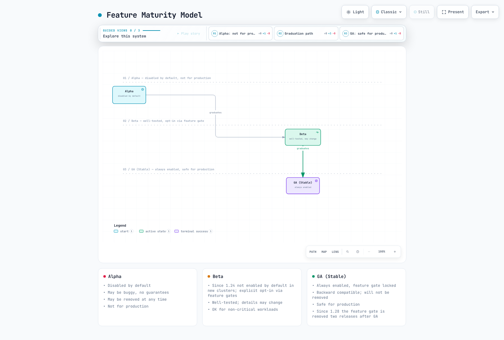
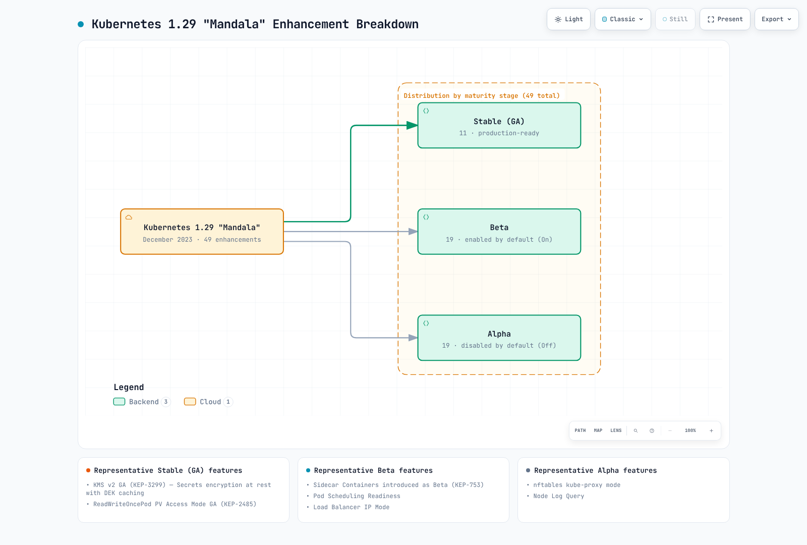
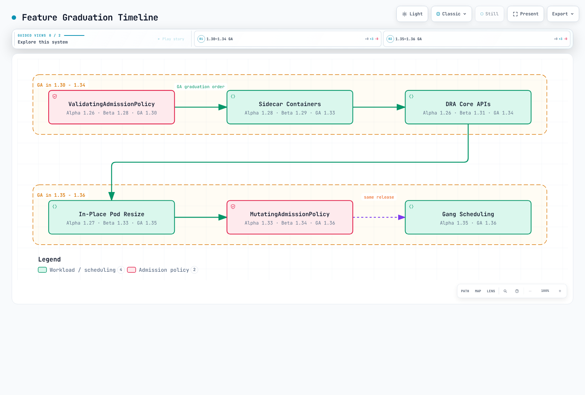
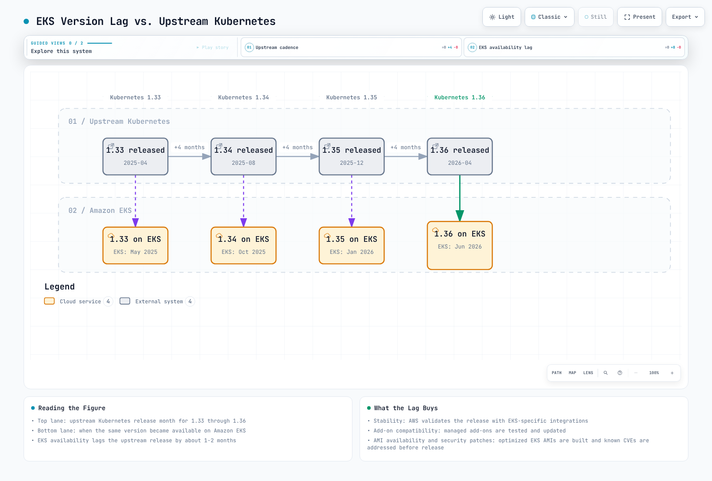
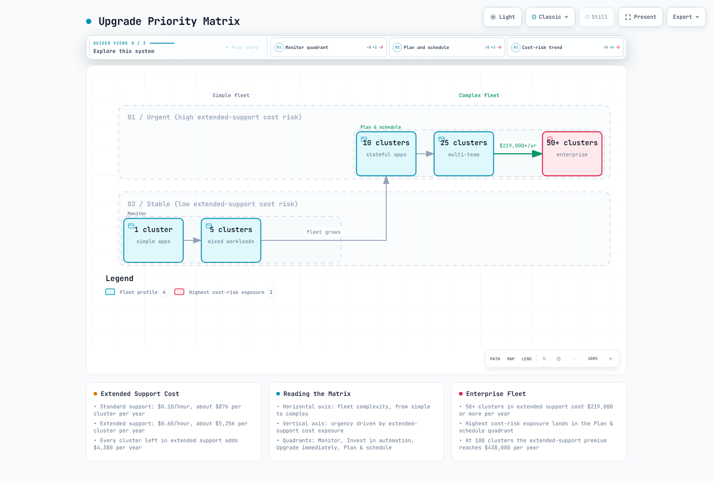
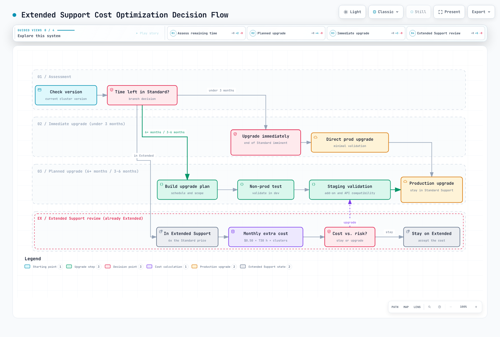

# Kubernetes のバージョン機能とロードマップ

> **歴史的な対象範囲**: Kubernetes 1.29～1.36。現在の EKS サポート状況は別途記載しています。
> **最終更新日**: 2026年10月12日

Kubernetes は急速に進化しており、年3回のリリースで新機能の追加、既存機能の昇格、古い API の非推奨化が行われます。Amazon EKS を運用するエンタープライズチームにとって、バージョンの全体像を理解することは、アップグレード計画、新機能を適切な時期に採用する判断、非推奨化による中断の回避に不可欠です。このドキュメントでは Kubernetes 1.29～1.36 の各バージョンを包括的に説明し、それぞれに EKS 固有の指針を示します。

## 目次

1. [概要と学習目標](#1-overview-and-learning-objectives)
2. [Kubernetes のリリースサイクル](#2-kubernetes-release-cycle)
3. [EKS のバージョンサポート一覧](#3-eks-version-support-matrix)
4. [バージョン別機能ガイド](#4-version-by-version-feature-guide)
5. [主な機能の成熟度移行タイムライン](#5-key-feature-graduation-timeline)
6. [非推奨化と削除](#6-deprecations-and-removals)
7. [EKS 固有の考慮事項](#7-eks-specific-considerations)
8. [バージョンアップグレード計画](#8-version-upgrade-planning)
9. [今後の展望](#9-future-outlook)
10. [参考資料](#10-references)

---

<span id="1-overview-and-learning-objectives"></span>

## 1. 概要と学習目標

### このドキュメントの目的

このドキュメントは、次の情報を集約したリファレンスです。

- Kubernetes 1.29～1.36 で導入された**バージョン固有の新機能**
- Alpha から Beta、GA へ進む過程を追跡する**機能の成熟度移行タイムライン**
- 必要な移行作業を含む**非推奨化のスケジュール**
- Standard／Extended Support の期間を含む**EKS のサポート期間**
- エンタープライズチーム向けの**アップグレード計画の指針**

### 学習目標

このドキュメントを読むと、次のことができるようになります。

1. Kubernetes のリリースサイクルと機能の成熟度モデルを説明する
2. 各 Kubernetes バージョンで利用できる機能を特定する
3. feature gate をバージョンに対応付け、そのライフサイクルを理解する
4. 機能の提供状況と非推奨化の時期に基づいてバージョンアップグレードを計画する
5. Standard／Extended Support を含む、EKS 固有のバージョンサポートポリシーを理解する
6. 古いバージョンを使い続ける場合のコストとリスクのトレードオフを評価する
7. 今後の機能を追跡する際に、リリース済みの節目と提案段階の予定を区別する

### 対象読者

| 読者 | 主に読むセクション |
|----------|-------------|
| **プラットフォームエンジニア** | バージョン別機能ガイド、アップグレード計画、非推奨化 |
| **クラスター管理者** | EKS サポート一覧、アップグレード計画、EKS 固有の考慮事項 |
| **アプリケーション開発者** | 機能ガイド（Sidecar Containers、In-Place Resize、DRA）、機能の成熟度移行タイムライン |
| **セキュリティチーム** | 非推奨化、バージョン別セキュリティ機能、StructuredAuthz、User Namespaces |
| **エンジニアリングマネージャー** | 概要、サポート一覧、Extended Support のコスト影響 |

---

<span id="2-kubernetes-release-cycle"></span>

## 2. Kubernetes のリリースサイクル

### リリースの頻度と各段階

Kubernetes では通常、約4か月ごとに年3回の**マイナー**リリースが公開されます。パッチリリースは別のサイクルで、通常は月次です。upstream のパッチブランチは約14か月サポートされ、そのうち約12か月は通常の保守、その後の2か月は CVE と重大な修正を対象に保守されます。これは EKS の Standard Support 14か月とは別の期間であり、EKS でのリリース日から始まります。

リリースチームは、enhancement の追加、code freeze、安定化、release candidate の期限を公表します。従来の「15週」図は概略のサイクルを示すもので、確約された日程でも、すべてのリリースに適用される週番号表でもありません。対象バージョンの実際のスケジュールと例外手続きを確認してください。


[🔍 インタラクティブ図を表示](https://www.atomai.click/kubernetes-docs/archmaps/en-eks-12-kubernetes-version-roadmap-1.html)

### 機能の成熟度、API の安定性、feature gate

| 段階 | 意味 |
|---|---|
| Alpha | 通常はデフォルト無効です。動作や API が変更または削除される可能性があります。対象の gate と前提条件を確認してください。 |
| Beta | より広くテストされていますが、デフォルトや互換性は機能とバージョンによって異なります。無効のままの Beta gate もあります。 |
| Stable／GA | API の安定性に関する保証が適用されます。ただし、特定の workload、driver、OS、デプロイが安全だと認定するものではありません。 |

1.24 以降、**新しい Beta API** はデフォルトで無効です。以前から有効だった Beta API や、既存 Beta API の新バージョンは別の扱いです。API の提供設定と feature gate は関連しますが、同じものではありません。すべての Beta 機能に opt-in が必要、あるいは Stable 機能は workload 設定不要だと推定しないでください。

GA の API バージョンは、同じ Kubernetes メジャーバージョンの期間中には削除できません。これは feature gate の削除とは別のルールです。Beta から GA に移行した gate には、最低6か月または2リリースのいずれか長い方の非推奨期間があります。実際に削除されるリリースを確認してください。ロック済みまたは削除済みの gate を、サポートされた無効化スイッチとして扱うことはできません。たとえば、リリース済みの1.36.2の source にもロック済みの `SidecarContainers` gate が残っています。1.33で GA になったことだけでは、1.35で削除された証拠になりません。

以下は**過去の設定例の断片**であり、完全な KubeletConfiguration でも EKS control plane の変更方法でもありません。現在の node では、対象バージョンがサポートする設定を使用してください。削除済みの gate を新しい bootstrap file にコピーしないでください。

```yaml
# Historical fragment for a self-managed Kubernetes 1.33 test node.
# Merge through the supported node bootstrap/configuration mechanism.
featureGates:
  InPlacePodVerticalScaling: true
  UserNamespacesSupport: true
```

EKS control plane の設定は AWS が管理します。利用者が EKS kube-apiserver の static Pod を編集したり、任意の server flag を渡したりすることはできません。EKS のバージョン FAQ では Alpha 機能はサポート対象外とされています。自己管理 node の gate を変更しても、利用できない control-plane API が有効になるわけではありません。AWS の機能別ガイダンスと node runtime／OS の要件を確認してください。

node の `configz` endpoint が示すのは、選択した kubelet の設定です。この出力から、省略されたデフォルト値や control plane の動作は確認できません。`/metrics` には適切な non-resource URL の認可が必要で、機能メトリクスが利用できない場合や追加ラベルが付く場合があります。出力がないことやアクセスエラーを「無効」の証拠として扱わないでください。

```bash
# Authorized, read-only diagnostics; these endpoints may be restricted.
: "${KUBE_CONTEXT:?}"; : "${NODE_NAME:?Choose the actual node}"
kubectl --context "$KUBE_CONTEXT" --request-timeout=15s \
  get --raw="/api/v1/nodes/$NODE_NAME/proxy/configz" | jq '.kubeletconfig.featureGates'
```

```bash
# Run separately; absence of a metric is not proof that a feature is disabled.
: "${KUBE_CONTEXT:?}"
kubectl --context "$KUBE_CONTEXT" --request-timeout=15s get --raw='/metrics' \
  | awk '/^kubernetes_feature_enabled/ { print }'
```

### SIG と enhancement proposal

SIG は関連領域を担当します。Node（runtime／ライフサイクル）、Auth（認証／認可）、Network（Service のルーティング）、Storage（CSI／volume）、Scheduling、Apps、API Machinery、Instrumentation、Autoscaling などがあります。大規模な enhancement では、背景、設計、成熟度移行の基準、テスト、本番運用準備のレビューを含む KEP を作成します。予定された節目はリリースの確約ではありません。リリース済み API と feature gate の履歴を確認してください。

[upstream のパッチポリシー](https://kubernetes.io/releases/patch-releases/) · [feature gate](https://kubernetes.io/docs/reference/command-line-tools-reference/feature-gates/) · [非推奨化ポリシー](https://kubernetes.io/docs/reference/deprecation-policy/) · [Kubernetes 1.36.2 の gate 実装](https://github.com/kubernetes/kubernetes/blob/v1.36.2/pkg/features/kube_features.go)

---

<span id="3-eks-version-support-matrix"></span>

## 3. EKS のバージョンサポート一覧

### サポート期間と料金の基準

| サポート区分 | EKS での提供開始からの期間 | バージョンサポート料金 |
|---|---|---|
| Standard | 最初の14か月 | クラスター時間あたり $0.10 |
| Extended | 続く12か月 | 合計でクラスター時間あたり $0.60（$0.10 + $0.50） |

ここに示すのはバージョンサポート料金であり、クラスター運用の総コストではありません。Provisioned Control Plane のtier、コンピューティング、Auto Mode／Hybrid Nodes、その他の機能、ストレージ、ネットワークには追加料金がかかる場合があります。料金が365日間一定だとすると、1クラスターあたりの料金はそれぞれ $876 と $5,256 で、差額は $4,380 です。月730時間で計算した例では $73 と $438 になります。これらは計算例であり、実際の請求額を測定したものではありません。

### 2026年10月12日（UTC）時点で確認したサポートカレンダー

| バージョン | upstream リリース | EKS リリース | Standard Support 終了 | Extended Support 終了 | 確認日現在の状態 |
|---|---|---|---|---|---|
| 1.31 | 2024-08-13 | 2024-09-26 | 2025-11-26 | 2026-11-26 | Extended |
| 1.32 | 2024-12-11 | 2025-01-23 | 2026-03-23 | 2027-03-23 | Extended |
| 1.33 | 2025-04-23 | 2025-05-29 | 2026-07-29 | 2027-07-29 | Extended |
| 1.34 | 2025-08-27 | 2025-10-02 | 2026-12-02 | 2027-12-02 | Standard |
| 1.35 | 2025-12-17 | 2026-01-27 | 2027-03-27 | 2028-03-27 | Standard |
| 1.36 | 2026-04-22 | 2026-06-02 | 2027-08-02 | 2028-08-02 | Standard |
| 1.37 | 2026-08-26 | 2026-10-01 | 2027-12-01 | 2028-12-01 | Standard |

現在の AWS カレンダーでは、EKS 1.31～1.37 が提供されています。1.29 と1.30は、過去の機能を説明するために記載しており、現在サポートされるデプロイ先ではありません。

Extended Support の請求は、表に記載された Standard Support 終了日の00:00 UTC に始まります。変更を予定する前に、最新のカレンダーまたは API を再確認してください。AWS が月だけを示している将来の日付は推定値です。

EKS 1.35 は**2026年1月27日**、1.36 は**2026年6月2日**、1.37 は**2026年10月1日**に利用可能になりました。EKS Distro の発表は別のリリースイベントです。以前の1月28日の複合的な記載を、EKS カレンダーの代わりに使わないでください。

以下のバージョン別セクションでは runtime と admission の前提条件を記載しています。EKS の rollback と control plane のスケーリング／SLA に関する話題は、[EKS Upgrades](08-eks-upgrades.md) で扱います。

```bash
# Read-only when executed with your normal authorized AWS identity.
: "${AWS_REGION:?Choose the intended Region}"
aws eks describe-cluster-versions --region "$AWS_REGION" --no-cli-pager \
  --query clusterVersions --output json
```

このコマンドはサービスのバージョン記録を出力します。配列の最初の要素を最新バージョンと決めつけたり、古い例の状態を再利用したりしないでください。この監査では AWS query を実行していません。

### アップグレードポリシーと自動アップグレード

クラスターのアップグレードポリシーは、デフォルトで `EXTENDED` です。`STANDARD` のクラスターは Standard Support の終了後に自動アップグレードされる場合があります。Extended Support の期間も同じバージョンを使い続けることは、意図的なコスト／ライフサイクルの選択です。Extended Support が終了すると、EKS は残っている control plane をサポート対象バージョンへ段階的に自動アップグレードします。AWS は正確な時刻を保証しておらず、自動更新の直前には通知しないとしています。少なくとも60日前という通知期間は、発表済みの**Standard Support 終了**を指します。Extended Support 終了後に新たな60日の猶予がある、あるいは60／30／7日前に必ず通知されるという意味ではありません。

Managed node group、自己管理 node、Fargate Pod、Hybrid Node には、それぞれ個別の更新／置き換え手順が必要です。Auto Mode node は自動更新されることがありますが、通常インストールした add-on には互換性と管理責任の確認が必要です。最大許容 version skew を目標にするのではなく、可能な範囲で node と control plane のバージョンを合わせてください。control plane のバージョン表示だけでなく、workload の準備状況と実際の更新状態を確認してください。Extended Support 終了時の自動アップグレードは、EKS のネイティブな7日間の rollback 機能では戻せません。適用条件と node を先に戻す rollback 順序はアップグレード章を参照してください。

[EKS サポートカレンダーと FAQ](https://docs.aws.amazon.com/eks/latest/userguide/kubernetes-versions.html) · [EKS 料金](https://aws.amazon.com/eks/pricing/)

<!-- Parent diagram repair pending: stage/default guarantees and support status/notification timing are stale.


[🔍 View interactive diagram](https://www.atomai.click/kubernetes-docs/archmaps/en-eks-12-kubernetes-version-roadmap-2.html)


[🔍 View interactive diagram](https://www.atomai.click/kubernetes-docs/archmaps/en-eks-12-kubernetes-version-roadmap-3.html)


[🔍 View interactive diagram](https://www.atomai.click/kubernetes-docs/archmaps/en-eks-12-kubernetes-version-roadmap-5.html)

-->

---

<span id="4-version-by-version-feature-guide"></span>

## 4. バージョン別機能ガイド

このセクションでは、Kubernetes 1.29～1.36 の各バージョンで導入、成熟度が移行、または非推奨化された機能を詳しく説明します。

### 4.1 Kubernetes 1.29「Mandala」（2023年12月）

2023年12月13日のリリース発表では、**49件の強化項目**（Stable 11件、Beta 19件、Alpha 19件）が報告されました。これは過去のリリース件数であり、1.29が現在もEKSでサポートされているという意味ではありません。図に示されたデフォルト設定や本番向けという表現は一般化された説明です。前述の、機能ごとのgate履歴とruntime要件を確認してください。



[🔍 インタラクティブ図を表示](https://www.atomai.click/kubernetes-docs/archmaps/en-eks-12-kubernetes-version-roadmap-6.html)

#### KMS v2 による保存データの暗号化: GA

KMS v2 は、secret seed から使い捨てのデータ暗号化鍵を導出し、その seed の保護／ローテーション時に KMS plugin を使うことで、すべてのオブジェクト書き込みごとにリモート暗号化処理を行う必要をなくし、envelope encryption の性能を改善します。どちらの方式でも、データ暗号鍵と鍵暗号鍵の二層を使います。KMS v1 が「単層」の方式だったわけではありません。この改善は一定のレイテンシーを保証するものではありません。

KMS v1 は1.28で非推奨になり、1.29ではデフォルトで無効になりました。現在の upstream KMS ガイドには旧実装が引き続き記載されています。1.31で削除されたという以前の説明は誤りでした。サポートされた v2 への移行手順を優先してください。

この設定例は、管理者が運用する upstream API server と、記載された socket にインストールしてレビュー済みの v2 plugin を前提とします。**EKS control plane の manifest ではありません。** KMS v2 は `cachesize` を受け付けません。末尾の `identity` provider は移行中に既存の平文を読み取れるようにするものであり、先行する provider が書き込みを暗号化できない場合の平文 fallback ではありません。暗号化の移行をレビューし、移行を検証した後にだけ平文読み取りを無効化してください。

```yaml
apiVersion: apiserver.config.k8s.io/v1
kind: EncryptionConfiguration
resources:
- resources:
  - secrets
  providers:
  - kms:
      apiVersion: v2
      name: reviewed-kms-provider
      endpoint: unix:///var/run/kmsplugin/socket.sock
      timeout: 3s
  - identity: {}
```

**EKS に関する違い:** 現在の AWS ガイダンスでは、EKS 1.28以降のすべての Kubernetes API データに対し、顧客管理キーを設定しない限り AWS 所有キーを使用した KMS v2 envelope encryption がデフォルトで提供されます。対象は Secret や ConfigMap などの API データであり、任意の node データや EBS volume データではありません。EKS 1.29から始まったと推測したり、この upstream 設定ファイルを EKS に適用したりしないでください。

#### ReadWriteOncePod: GA

`ReadWriteOncePod` は PVC の利用をクラスター全体で1つの Pod に制限します。一方、`ReadWriteOnce` では同じ node 上の複数 Pod が利用できます。RWOP には対応する CSI volume／driver が必要です。upstream で必要となる sidecar の最低バージョンは、csi-provisioner 3.0.0、csi-attacher 3.3.0、csi-resizer 1.3.0 です。これは機能の最低要件であり、現在推奨されるバージョンではありません。実際のクラスターと provisioner でサポートされるバージョンを選択してください。

この例では、既存の `version-lab` namespace と適切な `reviewed-csi-class` が必要です。access mode による協調は、特権を持つ host からのアクセスを防ぐ kernel のセキュリティ境界でも、データベースの leader-election protocol でもありません。また、アプリケーションによる fencing やバックアップの代わりにはなりません。

```yaml
apiVersion: v1
kind: PersistentVolumeClaim
metadata:
  name: database-pvc
  namespace: version-lab
spec:
  accessModes:
  - ReadWriteOncePod
  storageClassName: reviewed-csi-class
  resources:
    requests:
      storage: 100Gi
```

#### 主な Beta／Alpha 機能

| 機能 | 1.29での状態 | 意味 |
|---|---|---|
| SidecarContainers | Beta、デフォルト有効 | 再起動可能な init container。1.28でAlpha、1.33でGA。 |
| NFTablesProxyMode | Alpha、デフォルト無効 | Linux の Service proxy backend。kernel、CNI、NodePort の動作を確認する必要があります。 |
| LoadBalancerIPMode | Alpha | controller が報告する LoadBalancer ingress の状態モードであり、任意の Pod field ではありません。 |
| PodSchedulingReadiness | Beta | scheduling gate によって scheduler が Pod を考慮する時期を遅らせます。 |
| NodeLogQuery | Alpha | node log の query には該当する kubelet 設定とアクセスが必要です。 |
| KubeletTracing | Beta | 1.29ではGAになっていません。GAは1.34です。 |
| MinDomainsInPodTopologySpread | Beta | 1.30でGAになります。 |

ネイティブ sidecar は、以下の**Pod spec の断片**のように指定します。例示用の image はレビュー済みの実装に置き換え、実際の log pipeline を設定してください。これは Fluent Bit のデプロイ例ではありません。sidecar が起動すると（startup probe がある場合はその成功後に）Pod の起動が進みます。readiness と正常終了には、適切な probe、アプリケーションの動作、十分な termination 予算が引き続き必要です。

```yaml
initContainers:
- name: log-helper
  image: example.invalid/version-lab/log-helper:reviewed
  restartPolicy: Always
```

このリリースでは、CSI の `NodeExpandSecret` も昇格しました。これにより、driver の node 側での拡張要求に適切な認証情報を渡せます。非推奨となった `flowcontrol.apiserver.k8s.io/v1beta2` endpoint は1.29で提供されなくなりました。安定版の `v1` API を使い、field の変更も確認してください。`SecurityContextDeny` は1.29より前に非推奨となり、1.30で削除されました。1.29で新たに非推奨になったわけではありません。ここでは「Service 5,000個」という普遍的な性能しきい値も、測定済みの proxy benchmark も示していません。

[Kubernetes 1.29 release](https://kubernetes.io/blog/2023/12/13/kubernetes-v1-29-release/) · [KMS provider](https://kubernetes.io/docs/tasks/administer-cluster/kms-provider/) · [EKS envelope encryption](https://docs.aws.amazon.com/eks/latest/userguide/envelope-encryption.html) · [Persistent volumes and RWOP](https://kubernetes.io/docs/concepts/storage/persistent-volumes/) · [API migration guide](https://kubernetes.io/docs/reference/using-api/deprecation-guide/)

---

### 4.2 Kubernetes 1.30「Uwubernetes」（2024年4月）

4月17日のリリースには、**45件の強化項目**（Stable 17件、Beta 18件、Alpha 10件）が含まれます。成熟度のラベルだけで、機能ごとの設定や runtime の確認が不要になるわけではありません。


[🔍 インタラクティブ図を表示](https://www.atomai.click/kubernetes-docs/archmaps/en-eks-12-kubernetes-version-roadmap-7.html)

#### ValidatingAdmissionPolicy: GA

ValidatingAdmissionPolicy は API server 内で CEL を評価します。多くの検証 webhook と、それらに伴うネットワーク／証明書／サーバーの依存関係を置き換えられますが、誤った policy、評価エラー、または fail-closed 設定が要求を拒否する可能性は残ります。policy、binding、任意の parameter object はそれぞれ役割が異なります。parameter には組み込みリソースも custom resource も使えます。3つ目の CRD 型が必須というわけではありません。

以下の例は現行の Stable `v1` API を使います。binding は **Audit のみ**で、`version-lab-policy=enabled` ラベルの namespace を対象にします。違反は拒否されず、audit annotation が追加されます。観測するには audit log の収集を設定してください。namespace にこのラベルを設定できる利用者を制限してください。まず成功例と失敗例を評価し、強制適用が目的であれば、その後に明示的に `Deny` を選択します。これらの例は本番 admission の動作を証明するものではありません。

この resource policy は通常の container と init container に CPU／メモリ limit の key が宣言されていることを検査します。適切で正の値が設定されているかは検証しません。値が存在してもゼロでは、有効なハードリミットとは言えません。必要な容量の制約には適切な LimitRange／resource policy を使ってください。ephemeral container にはこのような limit を宣言できないため対象外です。現行クラスター向けに `pods/resize` を含めていますが、この subresource は元の1.30 VAP GA より後に導入されました。

```yaml
apiVersion: admissionregistration.k8s.io/v1
kind: ValidatingAdmissionPolicy
metadata:
  name: version-lab-resource-limits
spec:
  failurePolicy: Fail
  matchConstraints:
    resourceRules:
    - apiGroups:
      - ''
      apiVersions:
      - v1
      operations:
      - CREATE
      - UPDATE
      resources:
      - pods
      - pods/resize
  validations:
  - expression: "object.spec.containers.all(c,\n  has(c.resources) && has(c.resources.limits)\
      \ &&\n  has(c.resources.limits.cpu) && has(c.resources.limits.memory)\n) &&\n\
      (!has(object.spec.initContainers) || object.spec.initContainers.all(c,\n  has(c.resources)\
      \ && has(c.resources.limits) &&\n  has(c.resources.limits.cpu) && has(c.resources.limits.memory)\n\
      ))"
    message: Regular and init containers must declare CPU and memory limits.
    reason: Invalid
---
apiVersion: admissionregistration.k8s.io/v1
kind: ValidatingAdmissionPolicyBinding
metadata:
  name: version-lab-resource-limits
spec:
  policyName: version-lab-resource-limits
  validationActions:
  - Audit
  matchResources:
    namespaceSelector:
      matchLabels:
        version-lab-policy: enabled
```

image policy は `/` 境界を含む完全な registry／repository prefix を使います。以前の `123456789012.dkr.ecr.` prefix では、似た名前の別ドメインも受け入れていました。例示した account、Region、public alias は、承認済みの取得元に置き換えてください。この検査は image 参照先を検証するものであり、署名、脆弱性、digest の不変性は検証しません。任意の init／ephemeral container list は存在を確認してから扱い、ephemeral-container subresource を明示的に照合しています。

```yaml
apiVersion: admissionregistration.k8s.io/v1
kind: ValidatingAdmissionPolicy
metadata:
  name: version-lab-image-registries
spec:
  failurePolicy: Fail
  matchConstraints:
    resourceRules:
    - apiGroups:
      - ''
      apiVersions:
      - v1
      operations:
      - CREATE
      - UPDATE
      resources:
      - pods
      - pods/ephemeralcontainers
  validations:
  - expression: object.spec.containers.all(c, c.image.startsWith('123456789012.dkr.ecr.us-west-2.amazonaws.com/')
      || c.image.startsWith('public.ecr.aws/approved-alias/'))
    message: Regular container images must use an approved registry/repository prefix.
  - expression: '!has(object.spec.initContainers) || object.spec.initContainers.all(c,
      c.image.startsWith(''123456789012.dkr.ecr.us-west-2.amazonaws.com/'') || c.image.startsWith(''public.ecr.aws/approved-alias/''))'
    message: Init container images must use an approved registry/repository prefix.
  - expression: '!has(object.spec.ephemeralContainers) || object.spec.ephemeralContainers.all(c,
      c.image.startsWith(''123456789012.dkr.ecr.us-west-2.amazonaws.com/'') || c.image.startsWith(''public.ecr.aws/approved-alias/''))'
    message: Ephemeral container images must use an approved registry/repository prefix.
---
apiVersion: admissionregistration.k8s.io/v1
kind: ValidatingAdmissionPolicyBinding
metadata:
  name: version-lab-image-registries
spec:
  policyName: version-lab-image-registries
  validationActions:
  - Audit
  matchResources:
    namespaceSelector:
      matchLabels:
        version-lab-policy: enabled
```

追加の**検証リストの断片**では、通常の container における `runAsNonRoot` の実効的な継承と、空でないアプリケーション label を確認します。container レベルの設定は Pod の設定より優先されます。これらの断片には policy と binding が必要であり、すべての Pod Security Standards、init／ephemeral container、image 内の実行ユーザーを検証するものではありません。`/` を含む map key は membership test を使ってください。`has(map["key"])` は有効な CEL macro 構文ではありません。

```yaml
- expression: "object.spec.containers.all(c,\n  has(c.securityContext) && has(c.securityContext.runAsNonRoot)\n\
    \    ? c.securityContext.runAsNonRoot\n    : (has(object.spec.securityContext)\
    \ &&\n       has(object.spec.securityContext.runAsNonRoot) &&\n       object.spec.securityContext.runAsNonRoot)\n\
    )"
  message: Regular containers must effectively set runAsNonRoot.
- expression: 'has(object.metadata.labels) &&

    ''app.kubernetes.io/name'' in object.metadata.labels &&

    ''app.kubernetes.io/version'' in object.metadata.labels &&

    object.metadata.labels[''app.kubernetes.io/name''] != '''' &&

    object.metadata.labels[''app.kubernetes.io/version''] != '''' '
  message: Nonempty application name and version labels are required.
```

#### Pod Scheduling Readiness: GA

scheduling gate を設定すると、scheduler が Pod をスケジュール対象として検討しません。Pod の作成時または admission 時に設定し、その後に削除できますが、作成後に新しい gate を追加することはできません。gate 付き Pod があるだけでは、通常の unschedulable Pod による node のプロビジョニングは始まりません。条件を満たすには、外部の承認／プロビジョニング workflow が必要です。gate だけでは atomic な gang scheduling にはなりません。

この例には、管理対象として所有する namespace、例示 image をレビュー済みのものに置き換えること、適切な GPU 容量と driver が必要です。2つの gate 名は、外部で行う quota 承認と security scan を表すだけです。名前を設定したからといって Kubernetes がそれらの処理を実行するわけではありません。

```yaml
apiVersion: v1
kind: Pod
metadata:
  name: gated-training
  namespace: version-lab
spec:
  schedulingGates:
  - name: example.com/gpu-quota-approved
  - name: example.com/security-scan-passed
  containers:
  - name: trainer
    image: example.invalid/version-lab/training:reviewed
    resources:
      limits:
        nvidia.com/gpu: 4
```

名前付きの条件が満たされたことを個別に確認してから、その gate だけを削除します。JSON Patch の test で UID、resourceVersion、対象 gate 名を照合し、古い値のまま更新することを防ぎます。並行更新や Pod の置き換えがあると失敗します。前提条件の不一致で失敗した場合は、推測した index を削除するのではなく、現在の状態を再取得して判断してください。すべての gate が削除された後に初めて Pod がスケジュール可能になります。その後も通常の配置要件と容量制約は適用されます。

```bash
# MUTATION: remove only the named gate after independently verifying its condition.
set -euo pipefail
: "${KUBE_CONTEXT:?}"; : "${NAMESPACE:?}"; : "${POD_NAME:?}"; : "${GATE_NAME:?}"
gate_patch=$(kubectl --context "$KUBE_CONTEXT" --request-timeout=15s -n "$NAMESPACE" \
  get pod "$POD_NAME" -o json | jq -ce --arg gate "$GATE_NAME" '
    .metadata as $m |
    [(.spec.schedulingGates // []) | to_entries[] | select(.value.name == $gate)] as $matches |
    if ($matches | length) != 1 then error("Expected exactly one matching gate")
    else ($matches[0].key | tostring) as $i | [
      {op:"test", path:"/metadata/uid", value:$m.uid},
      {op:"test", path:"/metadata/resourceVersion", value:$m.resourceVersion},
      {op:"test", path:("/spec/schedulingGates/" + $i + "/name"), value:$gate},
      {op:"remove", path:("/spec/schedulingGates/" + $i)}
    ] end')
kubectl --context "$KUBE_CONTEXT" --request-timeout=15s -n "$NAMESPACE" \
  patch pod "$POD_NAME" --type=json --patch "$gate_patch"
```

#### HPA の ContainerResource メトリクス: GA（KEP-2702）

ContainerResource は名前を指定した container を対象とするため、logging／proxy sidecar にアプリケーションの利用率シグナルを歪められずに済みます。対象の Deployment は `version-lab` に存在し、適切な request が設定された `app` container を持つ必要があります。resource metrics provider も動作していなければなりません。利用率は limit ではなく request を基準にします。複数の metric を使う場合、HPA は最も大きい replica 数の推奨値を採用します。metric の欠落、readiness、stabilization もスケール動作に影響します。replica 数の2～50という上限は例示用の容量入力であり、測定済みの最適値ではありません。

```yaml
apiVersion: autoscaling/v2
kind: HorizontalPodAutoscaler
metadata:
  name: web-app-hpa
  namespace: version-lab
spec:
  scaleTargetRef:
    apiVersion: apps/v1
    kind: Deployment
    name: web-app
  minReplicas: 2
  maxReplicas: 50
  metrics:
  - type: ContainerResource
    containerResource:
      name: cpu
      container: app
      target:
        type: Utilization
        averageUtilization: 70
  - type: ContainerResource
    containerResource:
      name: memory
      container: app
      target:
        type: Utilization
        averageUtilization: 80
```

#### その他の主な変更

| 機能 | 1.30での状態 |
|---|---|
| MinDomainsInPodTopologySpread | GA |
| StableLoadBalancerNodeSet | GA |
| PodDisruptionConditions | Beta。1.31でGAになります。 |
| NodeLogQuery | Beta、デフォルト無効。1.36でGAになります。 |
| UserNamespacesSupport | Beta、デフォルト無効 |
| ContextualLogging | Beta。呼び出し元が context-aware logger を渡して使う必要があり、すべてのメッセージに Pod／node 情報が自動で付くわけではありません。 |
| RecursiveReadOnlyMounts | Alpha。対応する kernel／runtime が必要です。 |
| RelaxedEnvironmentVariableValidation | Alpha。変更対象は environment variable の**名前**の許容規則であり、値ではありません。 |
| ServiceAccountTokenJTI | Beta。追跡用の識別子を token に含めます。 |

`SecurityContextDeny` は1.30で削除されました。Pod Security Admission と、環境に必要な policy を評価してください。機能の成熟度だけでは移行テストの代わりになりません。

[Kubernetes 1.30 release](https://kubernetes.io/blog/2024/04/17/kubernetes-v1-30-release/) · [ValidatingAdmissionPolicy](https://kubernetes.io/docs/reference/access-authn-authz/validating-admission-policy/) · [scheduling readiness](https://kubernetes.io/docs/concepts/scheduling-eviction/pod-scheduling-readiness/) · [HPA container metrics](https://kubernetes.io/docs/tasks/run-application/horizontal-pod-autoscale/#container-resource-metrics)

---

### 4.3 Kubernetes 1.31「Elli」（2024年8月）

8月13日のリリースでは、機能強化45件（安定版11件、ベータ22件、アルファ12件）が公開されました。

<!-- Parent repair: DRA structured parameters remained alpha in 1.31, not beta as drawn.


[🔍 View interactive diagram](https://www.atomai.click/kubernetes-docs/archmaps/en-eks-12-kubernetes-version-roadmap-8.html)
-->

#### AppArmor のネイティブフィールド：GA

AppArmor プロファイルは1.30でネイティブフィールドから設定できるようになり、1.31でGAに到達しました。これは、コンテナごとに指定していた従来のベータアノテーションに代わるものです。ホストでAppArmorが有効になっており、ランタイムが対応している必要があります。また、`Localhost` プロファイルを対象ノードごとに読み込んでおく必要があります。カスタムノードラベルは、運用担当者が前提条件を確認したことを記録するだけで、プロファイルをインストールしたり強制適用したりするものではありません。

最初の例では事前にインストールされたプロファイルを使います。2つ目の例では、以前のDeployment例に欠けていたセレクターとPodラベルを指定しています。例示用イメージは実際のものに置き換え、名前空間を用意してください。`RuntimeDefault` はランタイムの既定プロファイルを意味し、`Unconfined` はAppArmorによる制限を無効にします。設定したプロファイルがEKSのすべてのOSやコンピュート種別で利用できるとは限りません。AppArmor、seccomp、SELinuxはそれぞれ異なる制御であり、同じ保護機能の別名ではありません。

```yaml
apiVersion: v1
kind: Pod
metadata:
  name: apparmor-local-profile
  namespace: version-lab
spec:
  nodeSelector:
    version-lab.example.com/apparmor-profile: reviewed
  containers:
  - name: app
    image: example.invalid/version-lab/app:reviewed
    securityContext:
      appArmorProfile:
        type: Localhost
        localhostProfile: reviewed-app-profile
```

```yaml
apiVersion: apps/v1
kind: Deployment
metadata:
  name: apparmor-runtime-default
  namespace: version-lab
spec:
  replicas: 1
  selector:
    matchLabels:
      app: apparmor-runtime-default
  template:
    metadata:
      labels:
        app: apparmor-runtime-default
    spec:
      containers:
      - name: app
        image: example.invalid/version-lab/app:reviewed
        securityContext:
          appArmorProfile:
            type: RuntimeDefault
```

#### PersistentVolume の最終フェーズ遷移時刻：GA

PVステータスの `.status.lastPhaseTransitionTime` フィールドには、直近のフェーズ遷移時刻が記録されます。ライフサイクルの診断ではイベントやバックエンドの証拠と併せて使ってください。このフィールドは遷移履歴全体を保持するものでも、失われた過去のイベントを復元するものでもありません。次のコマンドはボリュームを変更・削除しません。

```bash
# Read-only, for one owned cluster-scoped PV.
: "${KUBE_CONTEXT:?}"; : "${PV_NAME:?}"
kubectl --context "$KUBE_CONTEXT" --request-timeout=15s get pv "$PV_NAME" -o json | jq '{
  name:.metadata.name,phase:.status.phase,lastPhaseTransitionTime:.status.lastPhaseTransitionTime
}'
```

#### DRAの構造化パラメーター：1.31では引き続きアルファ

DRAの再設計により、構造化APIとResourceSliceを通じてデバイス情報と要求をKubernetesから参照できるようになり、スケジューラー側での割り当てが可能になりました。**従来型DRAは1.31でも引き続き利用可能**で、別個の、既定で無効な `DRAControlPlaneController` ゲートの背後にありました。リリース済みの1.31ソースにはこのゲートがあり、1.32ソースでは削除されています。そのため、従来のクイズにある「従来型DRAはすでに1.31で削除された」という説明は誤りです。

DRAは1.31ではアルファのままで、1.32でベータに昇格し、その後、コアAPIが1.34で安定版になりました。以前の `resource.k8s.io/v1beta1` の例は、1.31世代のAPIを正しく表していません。現行構文については1.34の節にある安定版DRAの例を参照し、インストール済みドライバーのDeviceClass、ResourceSlice、属性、機能を確認してください。Kubernetes APIを利用しても、GPUドライバーがインストールされたり、タイムスライシングやMIGが実装されたりするわけではありません。

#### Serviceのトラフィック分散：ベータ

コアの `v1` Serviceフィールド `trafficDistribution: PreferClose` は、同一ゾーンのエンドポイントを優先するよう要求します。これはルーティング上の優先設定であり、ゾーン内だけに限定する規則でも、地理的な距離の計算でも、AZ間料金の発生をなくす保証でもありません。エンドポイントの有無、実装するプロキシ、トラフィックポリシーの優先順位が影響します。セレクターは実際のワークロードPodと一致させてください。この例はエンドポイントを作成しません。

```yaml
apiVersion: v1
kind: Service
metadata:
  name: zone-preference
  namespace: version-lab
spec:
  trafficDistribution: PreferClose
  selector:
    app: web-app
  ports:
  - port: 80
    targetPort: 8080
```

#### その他の主な変更

| 機能 | 1.31での状態 |
|---|---|
| NFTablesProxyMode | ベータ、既定で有効。プロキシモードの選択とLinux／カーネル／CNIとの互換性確認は別々に行います |
| MultiCIDRServiceAllocator | ベータ、既定で無効 |
| VolumeAttributesClass | ベータ、既定で無効。ドライバー、コントローラー、APIの対応が必要 |
| ImageVolume | アルファ、既定で無効 |
| PodDisruptionConditions | GA |
| JobPodReplacementPolicy | ベータ。GAになったのは1.34 |
| SidecarContainers | 1.29からすでにベータであり、1.31で新たにベータになった機能ではありません |

nftablesバックエンドに切り替えても、ネットワークが自動的に移行するわけではありません。NodePortやファイアウォールの挙動はiptablesと異なる場合があります。本番環境でプロキシモードを変更する前に、実際の実装を評価してください。

[Kubernetes 1.31リリース](https://kubernetes.io/blog/2024/08/13/kubernetes-v1-31-release/) · [AppArmorの前提条件](https://kubernetes.io/docs/tutorials/security/apparmor/) · [1.31の機能ソース](https://github.com/kubernetes/kubernetes/blob/v1.31.0/pkg/features/kube_features.go) · [1.32の機能ソース](https://github.com/kubernetes/kubernetes/blob/v1.32.0/pkg/features/kube_features.go)

---

### 4.4 Kubernetes 1.32「Penelope」（2024年12月）

12月11日のリリースでは、機能強化44件（安定版13件、ベータ12件、アルファ19件）が公開されました。図にある「既定で有効」の表示は成熟度を簡略化した凡例です。以下に示す個々のベータ機能が無効のままの場合もあります。


[🔍 インタラクティブ図を表示](https://www.atomai.click/kubernetes-docs/archmaps/en-eks-12-kubernetes-version-roadmap-9.html)

#### 構造化認可設定：GA

`AuthorizationConfiguration` は安定版の設定に `apiserver.config.k8s.io/v1` を使用します。これは認可モードのフラグに代わる選択肢ですが、`--authorization-mode` が削除されたことを意味しません。フラグと設定ファイルの方式を併用しないでください。EKSではこのコントロールプレーン設定をAWSが管理します。次のファイルは管理者が運用するAPIサーバー用で、kubectlで適用するリソースでも、EKSのカスタマイズインターフェイスで設定するものでもありません。

認可方式は記述された順に実行され、確定的な許可または拒否が返ると後続の処理を行いません。この例では、NodeとRBACがすでに判定していない `version-lab` のリソース要求だけをWebhookが確認します。したがって、**RBACがすでに許可した要求に拒否フィルターを追加するものではありません**。CELの一致条件はWebhookを呼び出す要求を選びます。CEL自体が独立した認可方式になるわけではありません。要求はSubjectAccessReviewのspecなので、名前空間は `request.resourceAttributes` 内で指定し、非リソース要求に備えて存在確認を行います。

```yaml
apiVersion: apiserver.config.k8s.io/v1
kind: AuthorizationConfiguration
authorizers:
- type: Node
  name: node
- type: RBAC
  name: rbac
- type: Webhook
  name: reviewed-webhook
  webhook:
    authorizedTTL: 5m
    unauthorizedTTL: 30s
    timeout: 3s
    subjectAccessReviewVersion: v1
    matchConditionSubjectAccessReviewVersion: v1
    failurePolicy: Deny
    connectionInfo:
      type: KubeConfigFile
      kubeConfigFile: /etc/kubernetes/reviewed-authz-webhook.kubeconfig
    matchConditions:
    - expression: has(request.resourceAttributes) && request.resourceAttributes.namespace
        == 'version-lab'
```

実際のWebhook、TLSの信頼設定、保護されたkubeconfigを使用前に準備してください。`failurePolicy: Deny` は該当するWebhookや条件の失敗に適用され、認可結果のキャッシュにより、バックエンドのポリシー変更が反映されるまで時間がかかる場合があります。すべてのAPIサーバーで一貫した設定を使ってください。設定の再読み込みはサポートされていますが、NodeまたはRBAC認可方式の追加・削除はできません。本番以外の環境でポリシー全体と復旧手順を検証してください。

#### StatefulSetのPVC保持ポリシー：GA

1.32でGAになったのは、StatefulSetのボリュームクレームテンプレートから作成されたPVCを自動的に削除・保持する仕組みです。未使用のPVCに付いたすべての保護finalizerが直ちに消えるという新たな保証ではありません。`whenDeleted` はStatefulSet削除時、`whenScaled` はスケールダウン時の挙動を制御します。どちらも `Retain` または `Delete` を指定でき、既定ではデータが保持されます。次は既存StatefulSet内で確認する断片です。

```yaml
spec:
  persistentVolumeClaimRetentionPolicy:
    whenDeleted: Retain
    whenScaled: Retain
```

`Delete` を選ぶことは、データのライフサイクルを変更することです。PVの回収ポリシーによっては、PVCの削除に伴ってバックエンドストレージも削除されます。完了にはPodの所有関係、ガベージコレクション、CSI操作、finalizerも影響します。PVCの使用中保護は1.32よりずっと前から存在します。削除できないクレームについては、利用中のコンシューマー、UID、アタッチメント、コントローラーを調査してください。finalizerを一律に削除したり、アップグレードで直ると決めつけたりしないでください。

#### VolumeAttributesClass：1.32では引き続きベータ

VACは1.31でベータになり、1.34でGAになりました。ベータAPIは `storage.k8s.io/v1beta1` です。現行の例では、クラスターとCSIドライバーが対応している場合、1.34の節にある安定版APIを使ってください。クラスのパラメーターは変更できません。PVCのクラス参照を切り替えることで、EBSのIOPSやスループットなど、ドライバーがサポートする属性の変更を要求します。

これは非同期のストレージ変更であり、無停止を一律に保証するものではありません。ドライバー／コントローラーのバージョン、APIの利用可否、IAM／KMS権限、ボリューム種別の上限、変更のクールダウン期間、ステータスを確認してください。不完全なPVCオブジェクトを、作成用の完全なマニフェストとして適用しないでください。次の読み取りコマンドは、要求したクラスと報告された進行状況を比較します。

```bash
# Read-only: inspect one existing owned PVC and the CSI modification state.
: "${KUBE_CONTEXT:?}"; : "${NAMESPACE:?}"; : "${PVC_NAME:?}"
kubectl --context "$KUBE_CONTEXT" --request-timeout=15s -n "$NAMESPACE" \
  get pvc "$PVC_NAME" -o json | jq '{
    requestedClass:.spec.volumeAttributesClassName,
    currentClass:.status.currentVolumeAttributesClassName,
    modification:.status.modifyVolumeStatus,
    conditions:.status.conditions
  }'
```

AWSの1.34に関する注記では、安定版VAC APIと、それ以前のベータ版サイドカー対応が区別されています。EKSコントロールプレーンのバージョンだけでは、任意のEBS CSIリリースがそのVAC APIと互換であることは証明できません。

#### ユーザー名前空間：1.32では既定で無効のベータ

ユーザー名前空間は1.30でベータになり、1.33で既定有効となり、1.36でGAになりました。Podでは `hostUsers: false` を指定して利用します。コンテナ内のUID 0は実装が選ぶホスト上の非root UIDに対応付けられます。一律に `65534 + offset` で計算できるわけではありません。対応するカーネル、ファイルシステム、CRI／ランタイムが必要であり、すべてのワークロードやホストアクセス方式が互換になるわけではありません。

次の例ではUIDの対応付けを説明するため、コンテナ内のUID 0を意図的に指定しています。例示用イメージは実際のものに置き換え、サポート対象のテスト環境を使用してください。これは多層防御の一つであり、すべてのカーネル／コンテナ脱出の脆弱性を防ぐ保証でも、他のセキュリティ制御の代わりでもありません。

```yaml
apiVersion: v1
kind: Pod
metadata:
  name: userns-example
  namespace: version-lab
spec:
  hostUsers: false
  containers:
  - name: app
    image: example.invalid/version-lab/app:reviewed
    securityContext:
      runAsUser: 0
```

#### その他の主な変更

| 機能 | 1.32での状態 |
|---|---|
| CustomResourceFieldSelectors | GA。CRD作成者は選択可能なフィールドを宣言する必要があります |
| RetryGenerateName | GA。名前の衝突を再試行しますが、作成の成功を保証するものではありません |
| SizeMemoryBackedVolumes | GA。メモリバックのemptyDirの上限はPod／ノードのメモリにも関係します |
| ServiceAccountTokenJTI | GA。トークン識別子であり、新たな認可権限ではありません |
| JobManagedBy | ベータ。GAになったのは1.35 |
| DynamicResourceAllocation | ベータ、既定で無効。コアAPIは1.34で安定版になりました |
| MultiCIDRServiceAllocator | 引き続きベータ、既定で無効 |
| NFTablesProxyMode | 引き続きベータ。GAになったのは1.33 |
| MutatingAdmissionPolicy | アルファ。1.34でベータ、1.36でGA |

`StableLoadBalancerNodeSet` はすでに1.30でGAでした。これらの過去の成熟段階と、個別のEKSクラスターで現在有効な機能を混同しないでください。

[Kubernetes 1.32リリース](https://kubernetes.io/blog/2024/12/11/kubernetes-v1-32-release/) · [認可設定](https://kubernetes.io/docs/reference/access-authn-authz/authorization/) · [StatefulSetのPVC保持](https://kubernetes.io/docs/concepts/workloads/controllers/statefulset/#persistentvolumeclaim-retention) · [EKSバージョンに関する注記](https://docs.aws.amazon.com/eks/latest/userguide/kubernetes-versions-standard.html)

---

### 4.5 Kubernetes 1.33「Octarine」（2025年4月）

4月23日のリリースでは、機能強化64件（安定版18件、ベータ20件、アルファ24件、および非推奨化または撤回2件）が公開されました。図には成熟度別の3グループ（計62件）を、全64件に対する割合として示しています。残る2件は図に含まれていません。これは2025年の大規模リリースですが、すべてのワークロードで性能や準備状況が向上した証拠ではありません。


[🔍 インタラクティブ図を表示](https://www.atomai.click/kubernetes-docs/archmaps/en-eks-12-kubernetes-version-roadmap-10.html)

#### ネイティブサイドカー：GA

この機能は1.28でアルファ、1.29でベータとなり、1.33でGAに到達しました。再起動可能なinitコンテナでは `restartPolicy: Always` を指定します。サイドカーの `started` 状態がtrueになると、kubeletは次のinitコンテナへ進みます。startupProbeがない場合はプロセスが実行中になったとき、startupProbeがある場合はその成功後にtrueになります。readinessは別のシグナルです。次の例では、**両方のサイドカーが起動してから**通常のinitコンテナが実行され、その後にアプリケーションが起動します。

これは構造を示す例です。すべての `example.invalid` イメージをレビュー済みの実装に置き換えてください。プロキシは宣言したreadinessエンドポイントを提供し、ログエージェントには実際のパイプライン設定が必要です。Envoy／Istio／Fluent Bitのイメージを選んだだけでは、サービスメッシュやログ送信先は設定されません。実際のデータベース移行には調整と冪等性も必要です。レプリカごとに一度ずつ安全に実行できると仮定しないでください。

```yaml
apiVersion: apps/v1
kind: Deployment
metadata:
  name: sidecar-lifecycle
  namespace: version-lab
spec:
  replicas: 2
  selector:
    matchLabels:
      app: sidecar-lifecycle
  template:
    metadata:
      labels:
        app: sidecar-lifecycle
    spec:
      terminationGracePeriodSeconds: 60
      initContainers:
      - name: proxy-helper
        image: example.invalid/version-lab/reviewed-proxy:reviewed
        restartPolicy: Always
        startupProbe:
          httpGet:
            path: /ready
            port: 15021
          periodSeconds: 2
          failureThreshold: 30
        resources:
          requests:
            cpu: 100m
            memory: 128Mi
          limits:
            cpu: 500m
            memory: 256Mi
      - name: log-helper
        image: example.invalid/version-lab/reviewed-log-agent:reviewed
        restartPolicy: Always
        volumeMounts:
        - name: app-logs
          mountPath: /var/log/app
        resources:
          requests:
            cpu: 50m
            memory: 64Mi
          limits:
            cpu: 200m
            memory: 128Mi
      - name: initialize-app
        image: example.invalid/version-lab/reviewed-init:reviewed
        volumeMounts:
        - name: app-logs
          mountPath: /var/log/app
      containers:
      - name: app
        image: example.invalid/version-lab/reviewed-app:reviewed
        volumeMounts:
        - name: app-logs
          mountPath: /var/log/app
      volumes:
      - name: app-logs
        emptyDir: {}
```

通常の猶予付き終了では、メインコンテナがサイドカーより先に停止し、サイドカーは起動と逆の順序で停止します。Podに共通の猶予期間が適用されるため、メインコンテナの終了に時間がかかると、サイドカーに正常終了の時間がほとんど、またはまったく残らない場合があります。ネイティブサイドカーは、メインコンテナの終了後もJobを未完了のままにしません。この挙動がGAで初めて導入されたわけではありません。サイズを決める際には、init／サイドカー／アプリケーションのリソース使用が重なることと、Podのオーバーヘッドを考慮してください。ここではライフサイクル時間やアプリケーションの可用性を測定していません。


[🔍 インタラクティブ図を表示](https://www.atomai.click/kubernetes-docs/archmaps/en-eks-12-kubernetes-version-roadmap-11.html)

#### コンテナリソースのインプレース変更：1.33ではベータ

インプレース変更ではPodを作り直さずにCPU／メモリの割り当て目標を変更できますが、`resizePolicy` によってコンテナの再起動が必要になる場合があります。この機能は1.35で安定版になりました。次の現行スキーマの例はQoSクラスを `Burstable` に保ち、CPUを `NotRequired`、メモリを `RestartContainer` に設定します。そのためメモリ変更ではポリシーによりコンテナの再起動を要求します。メモリ変更がすべて必ず再起動を伴うという仕様ではありません。

互換性のあるLinuxランタイムとノードポリシー、対応するkubectlバージョンの組み合わせ、管理下にある名前空間、レビュー済みイメージを使用してください。1.36のガイドではWindowsと既定の静的CPU／Memory Managerのケースが対象外です。個別のゲートがある機能は、バージョンごとに評価してください。このAPIがDeployment／StatefulSetのテンプレートを自動更新したり、HPA／VPA／GitOpsのリソース管理者と調整したりすることはありません。

```yaml
apiVersion: v1
kind: Pod
metadata:
  name: resizable-app
  namespace: version-lab
spec:
  containers:
  - name: app
    image: example.invalid/version-lab/app:reviewed
    resources:
      requests:
        cpu: 500m
        memory: 256Mi
      limits:
        cpu: '1'
        memory: 512Mi
    resizePolicy:
    - resourceName: cpu
      restartPolicy: NotRequired
    - resourceName: memory
      restartPolicy: RestartContainer
```

容量と管理権限を確認した後に使う次の例は、CPUだけを変更し、要求を1コア、上限を2コアにします。コンテナを名前で選択し、既存のBurstableクラスを維持し、CPU変更で再起動を要するポリシーを拒否し、パッチ前にPodのUIDとresourceVersionを検査します。メモリは変更しません。競合した場合は更新を強制せず、対象を再読込して再評価してください。

```bash
# MUTATION: reviewed CPU-only resize; desired request=1 core and limit=2 cores.
set -euo pipefail
: "${KUBE_CONTEXT:?}"; : "${NAMESPACE:?}"; : "${POD_NAME:?}"; : "${CONTAINER_NAME:?}"
resize_patch=$(kubectl --context "$KUBE_CONTEXT" --request-timeout=15s -n "$NAMESPACE" \
  get pod "$POD_NAME" -o json | jq -ce --arg container "$CONTAINER_NAME" '
    . as $pod |
    [(.spec.containers | to_entries[]) | select(.value.name == $container)] as $matches |
    if .status.phase != "Running" or .metadata.deletionTimestamp != null
       or ($matches | length) != 1
    then error("Expected one target container in a non-deleting Running Pod")
    elif .status.qosClass != "Burstable"
    then error("This example preserves an existing Burstable QoS class")
    elif $matches[0].value.resources.requests.cpu == null
         or $matches[0].value.resources.limits.cpu == null
    then error("This example requires existing CPU request and limit keys")
    elif any($matches[0].value.resizePolicy[]?; .resourceName == "cpu" and .restartPolicy == "RestartContainer")
    then error("This example requires CPU resize policy NotRequired")
    elif ([.status.containerStatuses[]? | select(.name == $container and .state.running != null)] | length) != 1
    then error("Target container is not reported running")
    else ($matches[0].key | tostring) as $i | [
      {op:"test",path:"/metadata/uid",value:$pod.metadata.uid},
      {op:"test",path:"/metadata/resourceVersion",value:$pod.metadata.resourceVersion},
      {op:"test",path:("/spec/containers/" + $i + "/name"),value:$container},
      {op:"replace",path:("/spec/containers/" + $i + "/resources/requests/cpu"),value:"1"},
      {op:"replace",path:("/spec/containers/" + $i + "/resources/limits/cpu"),value:"2"}
    ] end')
kubectl --context "$KUBE_CONTEXT" --request-timeout=15s -n "$NAMESPACE" \
  patch pod "$POD_NAME" --subresource=resize --type=json --patch "$resize_patch"
```

以前の `.status.resize` 文字列ではなく、現在のステータスフィールドを確認してください。`PodResizePending=True` では `Deferred` または `Infeasible` が報告される場合があり、`PodResizeInProgress=True` は適用処理がまだ進行中であることを示します。目標spec、確認済みgeneration、対象コンテナの `status.containerStatuses[].resources` を比較してください。`allocatedResources` は高度な割り当てフィールドであり、実行時の上限が反映されたことを示す唯一の証拠ではありません。条件がないことやパッチが受理されたことだけでは、ワークロードの健全性は確認できません。

```bash
# Read-only observation; an accepted patch is not proof of completed actuation.
set -euo pipefail
: "${KUBE_CONTEXT:?}"; : "${NAMESPACE:?}"; : "${POD_NAME:?}"; : "${CONTAINER_NAME:?}"
kubectl --context "$KUBE_CONTEXT" --request-timeout=15s -n "$NAMESPACE" \
  get pod "$POD_NAME" -o json | jq --arg container "$CONTAINER_NAME" '{
    uid:.metadata.uid,generation:.metadata.generation,
    observedGeneration:.status.observedGeneration,qosClass:.status.qosClass,
    resizeConditions:[.status.conditions[]? | select(.type == "PodResizePending" or .type == "PodResizeInProgress")],
    desired:[.spec.containers[] | select(.name == $container) | .resources],
    reported:[.status.containerStatuses[]? | select(.name == $container) |
      {name,resources,allocatedResources,containerID,restartCount,ready}]
  }'
```

リサイズでPodのQoSクラスを変更することはできません。Guaranteed PodではCPUとメモリの要求値と上限値をそれぞれ一致させる必要があります。上の例は意図的にBurstableです。`NotRequired` を使ったメモリ縮小はベストエフォートで、使用量が新しい上限を超えると処理中のままになることがあります。競合状態によってOOM killが発生する可能性もあります。再起動できないinitコンテナとephemeralコンテナはリサイズできません。機能が成熟したことだけから、無停止、低レイテンシ、リサイズ成功を保証することはできません。

#### 現行VPAとの連携は別のバージョン判断

これは**2026年時点の関連コンポーネントの例**であり、Kubernetes 1.33のリリース時点でVPA 1.8が存在したという主張ではありません。リリース済みVPA **1.8.0**のAPIは `InPlace` をサポートします。この機能は1.7.0でアルファとして導入され、1.8.0でもアルファです。VPAのadmission-controllerとupdaterの両方で `InPlace` 機能ゲートを有効にし、Kubernetes 1.33以降のインプレースリサイズ対応も必要です。VPA 1.8.x自身の文書では、Kubernetes 1.36～1.38との互換性が示されています。これはVPAによるPod退避へのフォールバックを避けますが、リサイズの完了や、すべてのコンテナポリシーで再起動が不要であることを保証しません。推奨値の観察だけを行う場合は、まず `Off` を使ってください。

以下のCPU限定ポリシーでは、既存のDeployment／コンテナに対する例示的な上下限を使います。変更を有効にする前に、コントローラーの起動フラグと容量を確認してください。`InPlaceOrRecreate` は別のモードで、再作成へフォールバックする場合があります。VPA 1.6でGAとなり、以前のゲートは1.7で削除されました。削除済みのゲートを有効にしたり、KubernetesでのGAだけからVPAの挙動を推測したりしないでください。

```yaml
apiVersion: autoscaling.k8s.io/v1
kind: VerticalPodAutoscaler
metadata:
  name: current-in-place-example
  namespace: version-lab
spec:
  targetRef:
    apiVersion: apps/v1
    kind: Deployment
    name: web-app
  updatePolicy:
    updateMode: InPlace
  resourcePolicy:
    containerPolicies:
    - containerName: app
      minAllowed:
        cpu: 100m
      maxAllowed:
        cpu: '4'
      controlledResources:
      - cpu
      controlledValues: RequestsAndLimits
```

#### ServiceCIDRとIPAddress：GA

アップストリームKubernetesでは、割り当て機能とAPIが有効な場合、追加の `networking.k8s.io/v1` ServiceCIDRオブジェクトを使って利用可能なServiceアドレスを拡張できます。`kubernetes` という既定オブジェクトは、最初のAPIサーバー用アドレス範囲を表します。範囲を追加する前に、IPAM、アドレスファミリー、ルーティングとの重複を確認してください。finalizerは、割り当て済みService IPを孤立させる削除を防ぎます。ServiceCIDRはVPCサブネットでもPodアドレス用CIDRでもありません。

このIPv4マニフェストはアップストリームの例であり、EKSで範囲を拡張した実績を示すものではありません。EKSの作成パラメーター `serviceIpv4Cidr` は、クラスター作成後に変更できません。別のKubernetes ServiceCIDRを作成する操作はこれとは異なります。確認したAWS資料には、EKSで検証済みの手順は記載されていません。EKSで使う前に、プロバイダーのサポート、admissionポリシー、意図したネットワークを確認してください。APIを検出できることだけでは、その検証になりません。

```yaml
apiVersion: networking.k8s.io/v1
kind: ServiceCIDR
metadata:
  name: reviewed-extra-service-range
spec:
  cidrs:
  - 10.200.0.0/16
```

```bash
# Read-only discovery; do not interpret availability alone as an approved EKS change.
set -euo pipefail
: "${KUBE_CONTEXT:?}"
kubectl --context "$KUBE_CONTEXT" --request-timeout=15s api-resources --api-group=networking.k8s.io
kubectl --context "$KUBE_CONTEXT" --request-timeout=15s get servicecidrs
kubectl --context "$KUBE_CONTEXT" --request-timeout=15s get ipaddresses
```

#### トポロジーを考慮したルーティングとトラフィック分散：GA

トポロジー対応のエンドポイントヒントとServiceの `trafficDistribution` 設定は関連していますが、別々の仕組みです。次の例では同一ゾーンを優先するために `PreferClose` を使います。これは同一ゾーン内への厳密な限定でも、リージョン内の距離計算でも、アノテーションが一律に非推奨になったという宣言でもありません。Readyなエンドポイントの分布、プロキシの実装、`internalTrafficPolicy`／`externalTrafficPolicy` がルートに影響します。

AZ間トラフィックには料金が発生する場合がありますが、従来の一律「$0.01/GB」という説明は完全な料金モデルではありません。料金はサービス、経路、計測対象となる受信／送信側によって変わり、リージョン内通信の一部には例外があります。固定額の削減を約束せず、実際のトラフィックと請求データを比較してください。

```yaml
apiVersion: v1
kind: Service
metadata:
  name: same-zone-preference
  namespace: version-lab
spec:
  trafficDistribution: PreferClose
  selector:
    app: web-app
  ports:
  - port: 80
    targetPort: 8080
```

#### Jobの成功ポリシー：GA

成功ポリシーはIndexed Jobに適用されます。次の例ではインデックス0の成功を必須としますが、それをリーダーとみなせるのはアプリケーションが対応するプロトコルを実装している場合だけです。Kubernetesが分散処理の結果の完成や永続性を判断するわけではありません。失敗ポリシーと残りのPodの終了処理も影響します。Jobテンプレートでは、以前の例で欠けていた `restartPolicy: Never` を明示しています。

```yaml
apiVersion: batch/v1
kind: Job
metadata:
  name: indexed-success-example
  namespace: version-lab
spec:
  completionMode: Indexed
  completions: 8
  parallelism: 8
  backoffLimit: 2
  successPolicy:
    rules:
    - succeededIndexes: '0'
      succeededCount: 1
  template:
    spec:
      restartPolicy: Never
      containers:
      - name: trainer
        image: example.invalid/version-lab/training:reviewed
        env:
        - name: JOB_COMPLETION_INDEX
          valueFrom:
            fieldRef:
              fieldPath: metadata.annotations['batch.kubernetes.io/job-completion-index']
```

#### OCIイメージボリューム：1.33では既定で無効のベータ

イメージボリュームを使うと、アプリケーションイメージに埋め込まずに、モデルデータなどのOCIイメージの内容をPodから参照できます。対応するランタイム、適切な機能設定、レジストリから取得するためのIDが必要です。マウントは読み取り専用であり、書き込み可能なPVCではありません。アプリケーションイメージとデータイメージの両方をレビューして固定してください。ImageVolumeは1.35で既定有効、1.36で安定版になりました。1.34でGAになったわけではありません。

```yaml
apiVersion: v1
kind: Pod
metadata:
  name: image-volume-example
  namespace: version-lab
spec:
  containers:
  - name: inference
    image: example.invalid/version-lab/inference:reviewed
    volumeMounts:
    - name: model
      mountPath: /models
      readOnly: true
  volumes:
  - name: model
    image:
      reference: example.invalid/version-lab/model:reviewed
      pullPolicy: IfNotPresent
```

#### 1.33におけるその他の主な段階

| 機能 | 状態 |
|---|---|
| NFTablesProxyMode、RecursiveReadOnlyMounts | GA |
| CRDValidationRatcheting | GA。変更された不正なフィールドの検証を回避してよいという意味ではありません |
| MatchLabelKeysInPodAffinity、NodeInclusionPolicyInPodTopologySpread | GA |
| PersistentVolumeの回収ポリシーに対する削除保護 | GA。PVCの使用中保護とは別の機能です |
| UserNamespacesSupport | ベータ、既定で有効 |
| PodLevelResources | 引き続きアルファ。1.34でベータ |
| StructuredAuthenticationConfiguration | ベータ。1.34でGA |
| MutatingAdmissionPolicy | 引き続きアルファ。1.34でベータ |
| PodLifecycleSleepAction | ベータ。1.34でGA |
| JobManagedBy | ベータ。1.35でGA |

LoadBalancerIPModeとRetryGenerateNameは、すでに1.32でGAになりました。KYAMLが導入されたのは1.33ではなく1.34です。

[Kubernetes 1.33リリース](https://kubernetes.io/blog/2025/04/23/kubernetes-v1-33-release/) · [バージョン固定の1.36リサイズガイド](https://github.com/kubernetes/website/blob/release-1.36/content/en/docs/tasks/configure-pod-container/resize-container-resources.md) · [VPA 1.8.0の機能](https://github.com/kubernetes/autoscaler/blob/vertical-pod-autoscaler-1.8.0/vertical-pod-autoscaler/docs/features.md) · [VPA 1.8.0の互換性](https://github.com/kubernetes/autoscaler/blob/vertical-pod-autoscaler-1.8.0/vertical-pod-autoscaler/docs/installation.md#compatibility) · [Serviceアドレス範囲の拡張](https://kubernetes.io/docs/tasks/network/extend-service-ip-ranges/) · [EKSネットワーク設定API](https://docs.aws.amazon.com/eks/latest/APIReference/API_KubernetesNetworkConfigRequest.html) · [データ転送料金の解釈](https://docs.aws.amazon.com/cur/latest/userguide/cur-data-transfers-charges.html)

---

### 4.6 Kubernetes 1.34「Of Wind & Will」（2025年8月）

8月27日のリリースでは、機能強化58件（安定版23件、ベータ22件、アルファ13件）が公開されました。ベータ機能ごとに既定値は異なります。図の一般化された「既定で有効」の矢印は、有効化状況を示す一覧ではありません。


[🔍 インタラクティブ図を表示](https://www.atomai.click/kubernetes-docs/archmaps/en-eks-12-kubernetes-version-roadmap-12.html)

#### DRAコアAPI：GA

DeviceClass、ResourceClaim、ResourceClaimTemplate、ResourceSliceは組み込みの `resource.k8s.io/v1` APIです。インストールが必要なDRAコアCRDではありません。ドライバーはResourceSliceを通じてデバイスの一覧を公開し、スケジューラーが利用可能なリソースを割り当て、kubeletがドライバーと連携してデバイスを準備します。アーキテクチャ図は論理的な流れを示すもので、APIサーバー／ResourceSlice間の通信は省略しています。

DRAによって従来のデバイスプラグイン方式がなくなるわけではなく、各ベンダーのタイムスライシング、MPS、MIG、NUMA、ネットワーク機能が自動的に提供されるわけでもありません。高度なDRA機能には、それぞれ別のゲートと成熟段階があります。サポートされた調整方法なしに、同じデバイスに対して独立した割り当て機構を2つ設定しないでください。


[🔍 インタラクティブ図を表示](https://www.atomai.click/kubernetes-docs/archmaps/en-eks-12-kubernetes-version-roadmap-13.html)

次の例は、**明示的な合成ドライバー契約**を前提とします。`gpu.example.com` が文字列の `model` 属性と `numa` 属性を公開します。実際のNVIDIAドライバーの属性名や設定を示すものではありません。インストール済みドライバーのResourceSliceを確認してから、ドライバー名と属性を置き換えてください。安定版の要求では `deviceClassName`、`allocationMode`、`count` は `exactly` の下に記述します。以前のルートレベルの形式は誤りでした。`matchAttribute` は要求したデバイス間の厳密な等値条件であり、NUMAの優先指定ではありません。

```yaml
apiVersion: resource.k8s.io/v1
kind: DeviceClass
metadata:
  name: example-a100
spec:
  selectors:
  - cel:
      expression: 'device.driver == "gpu.example.com" &&

        "gpu.example.com" in device.attributes &&

        "model" in device.attributes["gpu.example.com"] &&

        device.attributes["gpu.example.com"].model == "A100"'
---
apiVersion: resource.k8s.io/v1
kind: ResourceClaim
metadata:
  name: training-gpus
  namespace: version-lab
spec:
  devices:
    requests:
    - name: gpu
      exactly:
        deviceClassName: example-a100
        allocationMode: ExactCount
        count: 4
    constraints:
    - requests:
      - gpu
      matchAttribute: gpu.example.com/numa
---
apiVersion: resource.k8s.io/v1
kind: ResourceClaimTemplate
metadata:
  name: four-gpu-template
  namespace: version-lab
spec:
  spec:
    devices:
      requests:
      - name: gpu
        exactly:
          deviceClassName: example-a100
          allocationMode: ExactCount
          count: 4
      constraints:
      - requests:
        - gpu
        matchAttribute: gpu.example.com/numa
```

意図するライフサイクルに応じて、明示的に管理するクレームか、テンプレートからPodごとに作るクレームのいずれかを選んでください。以下はその2つの方式の例です。テンプレートは4デバイスを要求するため、`--tensor-parallel-size 4` と一致します。以前の1デバイスのテンプレートでは一致しません。推論イメージはその引数を実装している必要があり、すべてのイメージはプレースホルダーです。レプリカ1つに利用可能なデバイスが4つ必要です。同じレプリカを3つ動かす場合は12個必要になります。GPU割り当てやモデルサービングのベンチマークは実施していません。

```yaml
apiVersion: v1
kind: Pod
metadata:
  name: direct-gpu-claim
  namespace: version-lab
spec:
  resourceClaims:
  - name: accelerators
    resourceClaimName: training-gpus
  containers:
  - name: trainer
    image: example.invalid/version-lab/trainer:reviewed
    resources:
      claims:
      - name: accelerators
        request: gpu
```

```yaml
apiVersion: apps/v1
kind: Deployment
metadata:
  name: four-gpu-serving
  namespace: version-lab
spec:
  replicas: 1
  selector:
    matchLabels:
      app: four-gpu-serving
  template:
    metadata:
      labels:
        app: four-gpu-serving
    spec:
      resourceClaims:
      - name: accelerators
        resourceClaimTemplateName: four-gpu-template
      containers:
      - name: inference
        image: example.invalid/version-lab/inference:reviewed
        args:
        - --tensor-parallel-size
        - '4'
        resources:
          claims:
          - name: accelerators
            request: gpu
```

#### VolumeAttributesClass：GA

VACは1.34から `storage.k8s.io/v1` を使います。以下のクラスは標準の `ebs.csi.aws.com` ドライバーと、互換性のある既存のリージョン内gp3ボリュームを対象とします。EKS Auto Mode用のストレージ設定として自動的に使えるものではありません。PVCのクラスを変更する前に、ドライバー／サイドカーの対応、APIバージョン、権限、ボリュームのサイズと種類、変更のクールダウン期間、インスタンスのEBS上限を確認してください。

現在のリージョン内gp3の上限は **80,000 IOPSおよび2,000 MiB/s** です。ベースラインの3,000 IOPSを超えるIOPSは1GiBあたり500 IOPS、プロビジョニングIOPSあたりのスループットは0.25 MiB/sです。そのため、元の64,000 IOPSは有効な値になり得ます（少なくとも128GiBが必要）が、4,000 MiB/sはgp3の有効なスループット値ではありませんでした。例ではこれを2,000に修正し、検証済みの500GiBボリュームを前提としています。Outpostsの上限はより低く、16,000 IOPS／1,000 MiB/sです。ボリュームに設定した値だけでは、アプリケーションやインスタンスがその性能を実現できるとは限りません。

```yaml
apiVersion: storage.k8s.io/v1
kind: VolumeAttributesClass
metadata:
  name: high-iops
driverName: ebs.csi.aws.com
parameters:
  iops: '16000'
  throughput: '1000'
---
apiVersion: storage.k8s.io/v1
kind: VolumeAttributesClass
metadata:
  name: standard
driverName: ebs.csi.aws.com
parameters:
  iops: '3000'
  throughput: '125'
---
apiVersion: storage.k8s.io/v1
kind: VolumeAttributesClass
metadata:
  name: io-intensive
driverName: ebs.csi.aws.com
parameters:
  iops: '64000'
  throughput: '2000'
---
apiVersion: storage.k8s.io/v1
kind: VolumeAttributesClass
metadata:
  name: throughput-optimized
driverName: ebs.csi.aws.com
parameters:
  iops: '3000'
  throughput: '750'
```

クラスのパラメーターは不変です。クラス自体を編集したり不完全なPVCを作成したりせず、既存PVCを通じて別のクラスを選択してください。`.status.currentVolumeAttributesClassName`、`.status.modifyVolumeStatus`、イベント、実際のEBS状態を確認してください。要求が受理されても性能変更が完了したとは限りません。

以前の営業時間用CronJobの例には、ID／RBACやタイムゾーン／重複実行への対処がありませんでした。次の完全な**停止状態のひな型**も、未実行の運用例です。`version-lab`、管理対象の `database-pvc`、対応クラス、kubectl／jqと信頼済みのクライアント設定を含むレビュー済みイメージを用意してください。ServiceAccountは名前空間内の指定PVCだけをget／patchできますが、RBACではpatch可能なPVCフィールドまでは制限されません。

```yaml
apiVersion: v1
kind: ServiceAccount
metadata:
  name: vac-scheduler
  namespace: version-lab
---
apiVersion: rbac.authorization.k8s.io/v1
kind: Role
metadata:
  name: vac-scheduler
  namespace: version-lab
rules:
- apiGroups:
  - ''
  resources:
  - persistentvolumeclaims
  resourceNames:
  - database-pvc
  verbs:
  - get
  - patch
---
apiVersion: rbac.authorization.k8s.io/v1
kind: RoleBinding
metadata:
  name: vac-scheduler
  namespace: version-lab
subjects:
- kind: ServiceAccount
  name: vac-scheduler
  namespace: version-lab
roleRef:
  apiGroup: rbac.authorization.k8s.io
  kind: Role
  name: vac-scheduler
```

```yaml
apiVersion: batch/v1
kind: CronJob
metadata:
  name: vac-business-hours
  namespace: version-lab
spec:
  schedule: 0 8 * * 1-5
  timeZone: Asia/Seoul
  suspend: true
  concurrencyPolicy: Forbid
  startingDeadlineSeconds: 300
  successfulJobsHistoryLimit: 1
  failedJobsHistoryLimit: 3
  jobTemplate:
    spec:
      backoffLimit: 0
      activeDeadlineSeconds: 120
      template:
        spec:
          serviceAccountName: vac-scheduler
          restartPolicy: Never
          containers:
          - name: request-class
            image: example.invalid/version-lab/kubectl-jq:reviewed
            command:
            - /bin/sh
            - -c
            - "set -eu\n: \"${POD_NAMESPACE:?}\"; : \"${TARGET_CLASS:?}\"\ncase \"\
              $TARGET_CLASS\" in high-iops|standard|io-intensive|throughput-optimized)\
              \ ;; *) exit 2 ;; esac\nstate=$(kubectl --request-timeout=15s -n \"\
              $POD_NAMESPACE\" get pvc database-pvc -o json)\npatch=$(printf '%s\\\
              n' \"$state\" | jq -ce --arg class \"$TARGET_CLASS\" '\n  if .metadata.deletionTimestamp\
              \ != null or .status.phase != \"Bound\"\n  then error(\"Expected an\
              \ existing non-deleting Bound PVC\")\n  elif .status.modifyVolumeStatus\
              \ != null\n  then error(\"Existing modification needs review before\
              \ another request\")\n  elif .spec.volumeAttributesClassName == $class\n\
              \  then []\n  else [\n    {op:\"test\",path:\"/metadata/uid\",value:.metadata.uid},\n\
              \    {op:\"test\",path:\"/metadata/resourceVersion\",value:.metadata.resourceVersion},\n\
              \    {op:\"add\",path:\"/spec/volumeAttributesClassName\",value:$class}\n\
              \  ] end')\nif [ \"$patch\" = '[]' ]; then\n  printf '%s\\n' 'Class\
              \ already requested; verify actual modification status separately.'\n\
              else\n  kubectl --request-timeout=15s -n \"$POD_NAMESPACE\" patch pvc\
              \ database-pvc --type=json --patch \"$patch\"\n  printf '%s\\n' 'Class\
              \ change requested; this is not proof of completed EBS modification.'\n\
              fi\n"
            env:
            - name: POD_NAMESPACE
              valueFrom:
                fieldRef:
                  fieldPath: metadata.namespace
            - name: TARGET_CLASS
              value: io-intensive
            resources:
              requests:
                cpu: 50m
                memory: 64Mi
              limits:
                cpu: 200m
                memory: 128Mi
---
apiVersion: batch/v1
kind: CronJob
metadata:
  name: vac-off-hours
  namespace: version-lab
spec:
  schedule: 0 22 * * 1-5
  timeZone: Asia/Seoul
  suspend: true
  concurrencyPolicy: Forbid
  startingDeadlineSeconds: 300
  successfulJobsHistoryLimit: 1
  failedJobsHistoryLimit: 3
  jobTemplate:
    spec:
      backoffLimit: 0
      activeDeadlineSeconds: 120
      template:
        spec:
          serviceAccountName: vac-scheduler
          restartPolicy: Never
          containers:
          - name: request-class
            image: example.invalid/version-lab/kubectl-jq:reviewed
            command:
            - /bin/sh
            - -c
            - "set -eu\n: \"${POD_NAMESPACE:?}\"; : \"${TARGET_CLASS:?}\"\ncase \"\
              $TARGET_CLASS\" in high-iops|standard|io-intensive|throughput-optimized)\
              \ ;; *) exit 2 ;; esac\nstate=$(kubectl --request-timeout=15s -n \"\
              $POD_NAMESPACE\" get pvc database-pvc -o json)\npatch=$(printf '%s\\\
              n' \"$state\" | jq -ce --arg class \"$TARGET_CLASS\" '\n  if .metadata.deletionTimestamp\
              \ != null or .status.phase != \"Bound\"\n  then error(\"Expected an\
              \ existing non-deleting Bound PVC\")\n  elif .status.modifyVolumeStatus\
              \ != null\n  then error(\"Existing modification needs review before\
              \ another request\")\n  elif .spec.volumeAttributesClassName == $class\n\
              \  then []\n  else [\n    {op:\"test\",path:\"/metadata/uid\",value:.metadata.uid},\n\
              \    {op:\"test\",path:\"/metadata/resourceVersion\",value:.metadata.resourceVersion},\n\
              \    {op:\"add\",path:\"/spec/volumeAttributesClassName\",value:$class}\n\
              \  ] end')\nif [ \"$patch\" = '[]' ]; then\n  printf '%s\\n' 'Class\
              \ already requested; verify actual modification status separately.'\n\
              else\n  kubectl --request-timeout=15s -n \"$POD_NAMESPACE\" patch pvc\
              \ database-pvc --type=json --patch \"$patch\"\n  printf '%s\\n' 'Class\
              \ change requested; this is not proof of completed EBS modification.'\n\
              fi\n"
            env:
            - name: POD_NAMESPACE
              valueFrom:
                fieldRef:
                  fieldPath: metadata.namespace
            - name: TARGET_CLASS
              value: throughput-optimized
            resources:
              requests:
                cpu: 50m
                memory: 64Mi
              limits:
                cpu: 200m
                memory: 128Mi
```

スケジュールでは `Asia/Seoul` を明示しています。`Forbid` は各CronJobの中で個別に適用されます。2つのスケジュールや他の運用者にまたがる共有ロックではありません。UID／resourceVersionの検査はAPIパッチを保護しますが、非同期のEBS操作全体を保護するものではありません。コマンドは既存の変更処理がある場合に拒否し、クラス変更を要求したことだけを報告します。ワークロードへの影響、バックエンドの状態確認、調整方法、復旧手順を確立するまでスケジュールを停止したままにしてください。本番環境での準備が整っているとは主張していません。

#### 名前空間の順序付き削除：GA

この変更では他の名前空間リソースより先にPodが削除されます。これにより、Podが動いている間にNetworkPolicyなどのセキュリティ制御が消えるケースを減らせます。ただし、任意の依存関係グラフを計算する機能でも、すべての名前空間削除が完了する保証でもありません。利用できないAPI、コントローラー、finalizerにより処理が止まることがあります。finalizerを強制的に削除したり、例示の出力を実測済みの修正とみなしたりせず、実際の状態条件を調べてください。

#### KYAML：クライアント出力形式、1.34ではアルファ

KYAMLは**KEP-5295**であり、KEP-4222ではありません。区切りを明示し、文字列値を引用符で囲む、曖昧さを減らしたYAML互換の出力形式です。APIサーバーのadmission validatorでも、YAML 1.2への一括移行でも、すべてのマニフェストからアンカーを取り除く理由でもありません。kubectl 1.35でベータかつ既定有効となり、1.36でもベータのまま、1.37で安定版に昇格しました。

通常のYAMLとして次を `format-example.yaml` に保存してください。ローカルの例はkubectl 1.36.2で実際に確認済みです。アンカーは受理され、出力では両方の文字列 `"no"` が保持されます。クラスターには接続しません。

```yaml
apiVersion: v1
kind: ConfigMap
metadata:
  name: kyaml-local-example
data:
  first: &string_value "no"
  norway: *string_value
```

```bash
# Local formatting example, checked with kubectl 1.36.2; no cluster request.
kubectl --kubeconfig=/dev/null --server=https://127.0.0.1:1 --request-timeout=1s \
  label --local --dry-run=client -f format-example.yaml \
  audit.example.com/checked=true -o kyaml
```

kubectl 1.36.2では `KUBECTL_KYAML=false` にすると `-o kyaml` のプリンターは無効になりますが、KYAML形式の入力は他の出力形式でもYAMLとして解析されます。EKSコントロールプレーンの設定は変更しません。スキーマ／admission検証とフォーマットは別々に確認してください。以前のKYAMLに関する警告／拒否の出力は、サーバー機能を示す有効な実証ではありません。

#### MutatingAdmissionPolicy：1.34ではベータ

MAPは1.32でアルファ、1.34でベータ（既定で無効）となり、1.36でGAになりました。次は**現行1.36以降の安定版形式**であり、1.34にそのまま適用できるマニフェストではありません。当時のベータAPIは `v1beta1` で、適切なAPI提供／ゲート設定が必要でした。EKSコントロールプレーンのゲートはAWSが管理します。

このポリシーは、明示的に指定された既存値を維持しながら、Deploymentに既定ラベルを追加します。名前空間から作るコストラベルは例示であり、検証済みの会計配賦ルールではありません。bindingはオプトインした名前空間だけを選びます。`failurePolicy: Fail` の場合、評価エラーで該当要求が拒否されることがあります。この式はKubernetes 1.36.2のネイティブmutation compiler／patcherで合成Deploymentを使ってテストしました。admissionチェーン全体や本番環境では試していません。CELが決定的でも、ポリシーを組み合わせたすべての処理が冪等になるわけではなく、再評価や適用順序の問題がなくなるわけでもありません。

```yaml
apiVersion: admissionregistration.k8s.io/v1
kind: MutatingAdmissionPolicy
metadata:
  name: version-lab-default-labels
spec:
  failurePolicy: Fail
  reinvocationPolicy: IfNeeded
  matchConstraints:
    resourceRules:
    - apiGroups:
      - apps
      apiVersions:
      - v1
      operations:
      - CREATE
      resources:
      - deployments
  mutations:
  - patchType: ApplyConfiguration
    applyConfiguration:
      expression: "Object{\n  metadata: Object.metadata{\n    labels: {\n      \"\
        app.kubernetes.io/managed-by\":\n        has(object.metadata.labels) && \"\
        app.kubernetes.io/managed-by\" in object.metadata.labels\n        ? object.metadata.labels[\"\
        app.kubernetes.io/managed-by\"] : \"platform-team\",\n      \"cost-center\"\
        :\n        has(object.metadata.labels) && \"cost-center\" in object.metadata.labels\n\
        \        ? object.metadata.labels[\"cost-center\"] : request.namespace\n \
        \   }\n  }\n}"
---
apiVersion: admissionregistration.k8s.io/v1
kind: MutatingAdmissionPolicyBinding
metadata:
  name: version-lab-default-labels
spec:
  policyName: version-lab-default-labels
  matchResources:
    namespaceSelector:
      matchLabels:
        version-lab-policy: enabled
```

#### 1.34におけるその他の主な段階

| 機能 | 状態 |
|---|---|
| PodLevelResources | ベータ、既定で有効。GAではありません |
| ImageVolume | ベータ、1.35までは既定で無効 |
| UserNamespacesSupport | ベータ、既定で有効。GAは1.36 |
| NFTablesProxyMode、MatchLabelKeysInPodAffinity、CRDValidationRatcheting | 1.33ですでにGA |
| KubeletTracing、PodLifecycleSleepAction | GA。後者はPreStopのsleep actionを対象とします |
| JobPodReplacementPolicy、RecoverVolumeExpansionFailure | GA |
| StructuredAuthenticationConfiguration、AnonymousAuthConfigurableEndpoints | GA |
| NodeLogQuery | 引き続きベータ。GAは1.36 |

これらの例に標準の `IfNotPresentOrNewer` というイメージ取得ポリシーはありません。サポートされている `Always`、`IfNotPresent`、`Never` を使い、イメージの不変性は別途確認してください。

[Kubernetes 1.34リリース](https://kubernetes.io/blog/2025/08/27/kubernetes-v1-34-release/) · [DRA](https://kubernetes.io/docs/concepts/scheduling-eviction/dynamic-resource-allocation/) · [EBS gp3の上限](https://docs.aws.amazon.com/ebs/latest/userguide/general-purpose.html) · [KYAML KEP-5295](https://github.com/kubernetes/enhancements/tree/master/keps/sig-cli/5295-kyaml) · [Kubernetes 1.37の変更履歴](https://github.com/kubernetes/kubernetes/blob/v1.37.0/CHANGELOG/CHANGELOG-1.37.md) · [MutatingAdmissionPolicy](https://kubernetes.io/docs/reference/access-authn-authz/mutating-admission-policy/)

---

### 4.7 Kubernetes 1.35「Timbernetes」（2025年12月）

12月17日の発表では、機能強化は合計**60件**で、見出しの内訳は**安定版17件、ベータ19件、アルファ22件**です。この3数値の合計は58件で、残り2件の内訳は示されていません。別のカテゴリを推測で追加したり、性能測定と解釈したりせず、公開時の合計を維持します。


[🔍 インタラクティブ図を表示](https://www.atomai.click/kubernetes-docs/archmaps/en-eks-12-kubernetes-version-roadmap-15.html)

#### コンテナリソースのインプレース変更：GA

この機能は1.27でアルファ、1.33でベータ、1.35で安定版になりました。当初のアルファ機能は「1.33までCPUのみ」ではありません。GAはAPIが安定したことを示しますが、メモリ変更、ランタイム、ノードポリシー、アプリケーションに中断がないことを保証しません。前述のresize例にあるUID／resourceVersion検査と現行ステータスフィールドを使い、バージョンごとの制約を確認してください。

Deploymentテンプレートを通常どおり更新すれば、従来のロールアウトが起きます。Pod APIのGAによって「Deploymentのローリングインプレース変更」が自動で行われるわけではありません。管理対象Podのresizeとコントローラーテンプレートの変更は別の操作です。置き換えPodはテンプレート／admission経路を通るため、HPA、VPA、GitOps、カスタムresizer間で調整し、リソース管理の競合を避けてください。

このDeploymentは、前述のVPA例が参照する `web-app`／`app` を用意します。イメージとリソース値は要レビューです。ポート8080などのService endpointを使うなら、アプリケーションが実際に対応する必要があります。EKSでロールアウト、resize、Service可用性のテストは実施していません。

```yaml
apiVersion: apps/v1
kind: Deployment
metadata:
  name: web-app
  namespace: version-lab
spec:
  replicas: 2
  selector:
    matchLabels:
      app: web-app
  template:
    metadata:
      labels:
        app: web-app
    spec:
      containers:
      - name: app
        image: example.invalid/version-lab/app:reviewed
        resources:
          requests:
            cpu: 500m
            memory: 256Mi
          limits:
            cpu: '1'
            memory: 512Mi
        resizePolicy:
        - resourceName: cpu
          restartPolicy: NotRequired
        - resourceName: memory
          restartPolicy: RestartContainer
```

VPAのバージョンは別に管理されます。`InPlaceOrRecreate` はVPA 1.6でGAになり、インプレース更新に失敗するとPodを再作成する場合があります。`InPlace` はVPA 1.7のアルファモードで、独自のゲートが必要です。退避しない挙動は、すべてのコンテナresizeで再起動を避けることや、あらゆる推奨値を適用できることを意味しません。要件は前述の現行VPA例を参照してください。Kubernetes 1.35だけではVPAモードは有効になりません。

#### PreferSameNodeによるトラフィック分散：GA

`PreferSameTrafficDistribution` は1.35で安定版になりました。`PreferSameNode` は、利用可能なら同じノードのendpointを優先し、必要に応じてフォールバックします。厳密な `internalTrafficPolicy: Local` とは異なります。実際のService実装、Readyなendpoint、トラフィックポリシーの優先順位を確認してください。ALB／NLBのルーティングを一律に制御するものでも、ゾーン間通信をゼロにする保証でもありません。

```yaml
apiVersion: v1
kind: Service
metadata:
  name: prefer-same-node
  namespace: version-lab
spec:
  trafficDistribution: PreferSameNode
  selector:
    app: web-app
  ports:
  - port: 80
    targetPort: 8080
```

#### KYAML：kubectlでベータ、既定で有効

1.35でのKYAMLのベータ化／既定有効化は `-o kyaml` 出力形式に関するものです。APIサーバーへの全入力を新しい厳格パーサーに切り替えるものでも、すべてのYAMLアンカーで警告するものでも、サーバー機能ゲートの変更にEKSサポートチケットが必要という意味でもありません。前述のローカルフォーマット例とkubectl 1.36.2でのネイティブ確認が実際の動作を示します。KYAMLが安定版になるのは1.36ではなく1.37です。

#### ネイティブGang Scheduling：アルファ、KEP-4671

Kubernetes 1.35では、ワークロードを考慮したネイティブGang Schedulingの概念が導入されました。1.36でもアルファであり、`GenericWorkload`／`GangScheduling` と適切なAPI／schedulerの有効化が必要です。EKSのバージョンFAQはアルファ機能をサポートしていません。管理対象外ノードでゲートを設定しても、EKSコントロールプレーンにないAPIは有効になりません。

以下は**アップストリームの実験環境向け1.36 `v1alpha2` スキーマ例**です。以前の1.35スキーマでもGA済みのEKS手順でもありません。`spec.schedulingPolicy.gang.minCount` とPodの `spec.schedulingGroup.podGroupName` を使用します。以前の `minMember`／`scheduleTimeoutSeconds` フィールドや、Podラベル／schedulingGateだけではこのネイティブAPIを定義しません。サードパーティPodGroup CRDはそれぞれ異なる仕様です。

```yaml
apiVersion: scheduling.k8s.io/v1alpha2
kind: PodGroup
metadata:
  name: experimental-training
  namespace: version-lab
spec:
  schedulingPolicy:
    gang:
      minCount: 8
```

```yaml
apiVersion: batch/v1
kind: Job
metadata:
  name: experimental-training
  namespace: version-lab
spec:
  completionMode: Indexed
  completions: 8
  parallelism: 8
  backoffLimit: 0
  template:
    spec:
      restartPolicy: Never
      schedulingGroup:
        podGroupName: experimental-training
      containers:
      - name: worker
        image: example.invalid/version-lab/worker:reviewed
        resources:
          requests:
            cpu: 100m
            memory: 64Mi
          limits:
            cpu: '1'
            memory: 256Mi
```

最小グループサイズ、Jobのparallelism、completionsはいずれも8です。これは単独のグループ例です。Podのスケジューリング中も関連付けを維持できるよう、所有者／controllerがグループのライフサイクルを管理する必要があります。スケジューリング決定だけでは、プロセスの同時起動、readiness、分散計算の成功、すべてのデッドロック回避を保証しません。アプリケーション側にもbarrier、timeout／復旧処理、互換容量が必要です。オブジェクトの検証はスキーマのみで、配置実験はしていません。

#### バージョンとアップグレードに関する主な点

| 項目 | 正しい解釈 |
|---|---|
| JobManagedBy | 1.35でGA |
| ImageVolume | ベータ、現在は既定で有効。GAは1.36 |
| PodLevelResources | 1.34でベータ化後もベータ |
| UserNamespacesSupport | 引き続きベータ。GAは1.36 |
| ContextualLogging | 引き続きベータで、1.35ではGAではありません |
| CRDValidationRatcheting | 1.33ですでにGA |
| NodeInclusionPolicyInPodTopologySpread | 1.33ですでにGA |
| RecoverVolumeExpansionFailure／匿名endpointの設定 | 1.34ですでにGA |

ノードアップグレードでは「GAなら本番で安全」と決めつけず、cgroup／ランタイム要件を確認してください。EKS 1.35の注記では、kubeletが既定でcgroup v1を拒否することや、Fargateなどプロバイダー固有の事情が説明されています。管理対象Fargateのホスト設定を変更しないでください。該当ガイダンスではKubernetes 1.35がcontainerd 1.xをサポートする最後のリリースで、kubeletの `--pod-infra-container-image` フラグも削除されました。最新のEKSノード／AMI手順とアップグレード章を使い、bootstrapフラグをむやみに上書きしないでください。

[Kubernetes 1.35リリース](https://kubernetes.io/blog/2025/12/17/kubernetes-v1-35-release/) · [バージョン固定の1.36機能ゲート](https://github.com/kubernetes/kubernetes/blob/v1.36.2/pkg/features/kube_features.go) · [Kubernetes 1.36.2 APIスキーマ](https://github.com/kubernetes/kubernetes/blob/v1.36.2/api/openapi-spec/swagger.json) · [EKSバージョンに関する注記](https://docs.aws.amazon.com/eks/latest/userguide/kubernetes-versions-standard.html)

---

### 4.8 Kubernetes 1.36「Haru」（2026年4月） {#_4-8-kubernetes-1-36-haru-april-2026}

4月22日の発表では**70件の強化項目**が報告され、成熟度の内訳は**Stable 18件、Beta 25件、Alpha 25件**でした。この3区分の合計は68件です。以前の章では、この小計をリリース全体の件数として誤って使用していました。EKS での提供状況はサポートカレンダーに別途記載しています。

<!-- Parent repair: release total is70, not68; verify stage/default/provider labels before restoring.


[🔍 View interactive diagram](https://www.atomai.click/kubernetes-docs/archmaps/en-eks-12-kubernetes-version-roadmap-17.html)
-->

#### MutatingAdmissionPolicy: GA

安定版の MAP リソースは、`admissionregistration.k8s.io/v1` の `MutatingAdmissionPolicy` と `MutatingAdmissionPolicyBinding` です。インプロセスの CEL を使えば、対応する変更に別個の webhook は不要ですが、ポリシー評価の失敗、コスト上限、順序、再呼び出しに関する考慮事項は残ります。決定性があるからといって、常に冪等性が保証されるわけではありません。

以下の resize-policy の例は、明示的な opt-in を必要とします。`resizePolicy` が設定済みでないコンテナにだけデフォルトを追加し、既存の明示的なポリシーは保持します。Kubernetes CEL は `indexOf()` をサポートします。元の式自体は有効でしたが、既存のポリシーを上書きしていました。Kubernetes 1.36.2 のネイティブな compiler／patcher テストで、元の挙動とこの修正の両方を検証しました。`resizePolicy` は atomic list なので、ApplyConfiguration patcher はこのフィールドの変更を拒否します。この用途には JSONPatch が適しています。この実装では、MAP 内の JSONPatch `test` が失敗しても admission を自動的に拒否せず、no-op として扱います。

```yaml
apiVersion: admissionregistration.k8s.io/v1
kind: MutatingAdmissionPolicy
metadata:
  name: inject-resizepolicy
spec:
  failurePolicy: Fail
  reinvocationPolicy: Never
  matchConstraints:
    resourceRules:
    - apiGroups:
      - ''
      apiVersions:
      - v1
      operations:
      - CREATE
      resources:
      - pods
  matchConditions:
  - name: only-resize-enabled
    expression: has(object.metadata.annotations) && ("resize.example.com/enabled"
      in object.metadata.annotations) && object.metadata.annotations["resize.example.com/enabled"]
      == "true"
  mutations:
  - patchType: JSONPatch
    jsonPatch:
      expression: "object.spec.containers.filter(c, !has(c.resizePolicy)).map(c, JSONPatch{\n\
        \  op: \"add\",\n  path: \"/spec/containers/\" + string(object.spec.containers.indexOf(c))\
        \ + \"/resizePolicy\",\n  value: [\n    {\"resourceName\": \"cpu\",    \"\
        restartPolicy\": \"NotRequired\"},\n    {\"resourceName\": \"memory\", \"\
        restartPolicy\": \"RestartContainer\"}\n  ]\n})"
---
apiVersion: admissionregistration.k8s.io/v1
kind: MutatingAdmissionPolicyBinding
metadata:
  name: inject-resizepolicy-binding
spec:
  policyName: inject-resizepolicy
  matchResources:
    namespaceSelector:
      matchLabels:
        map-demo: 'true'
```

この Binding では、管理対象として所有するテスト用 namespace だけにラベルを付けてください。評価に失敗した場合、`failurePolicy: Fail` は条件に一致する Pod の作成を引き続き拒否する可能性があります。ワークロードで有効化する前に、ポリシーの準備完了、失敗するケース、admission chain 全体を検証してください。ポリシー作成後に一定時間 sleep しても、準備完了の保証にはなりません。フィールドが注入されたことだけでは、どの admission コンポーネントが設定したのか特定できません。

#### インプレースリサイズと Pod レベルのリソース枠

コンテナ単位のリサイズは、すでに1.35で GA になっています。これとは別に `InPlacePodLevelResourcesVerticalScaling` 機能が1.36で Beta／デフォルト有効になり、まだ Beta の `PodLevelResources` 機能と併せて使われます。Pod レベルのリソース枠とコンテナ上限には、それぞれ別の計算とポリシーチェックが必要です。以下の例は、Pod レベルのリソース枠を意図的に拒否する、後述の CPU 縮小プロトタイプでは管理されません。

```yaml
apiVersion: v1
kind: Pod
metadata:
  name: pod-budget-example
  namespace: version-lab
spec:
  os:
    name: linux
  nodeSelector:
    kubernetes.io/os: linux
  resources:
    requests:
      cpu: '2'
      memory: 4Gi
    limits:
      cpu: '4'
      memory: 8Gi
  containers:
  - name: app
    image: example.invalid/version-lab/app:reviewed
    resources:
      requests:
        cpu: '1'
        memory: 2Gi
  - name: helper
    image: example.invalid/version-lab/helper:reviewed
    resources:
      requests:
        cpu: 500m
        memory: 512Mi
```

CPUManager のチェックポイント改善があっても、すべての static CPU／Memory manager workload がリサイズできることや、特定の NUMA 配置を保てることが示されたわけではありません。これらの経路には別個の機能／サポート要件があります。`NotRequired` はポリシーが再起動を必須としない設定であり、あらゆる中断を防ぐものではありません。`RestartContainer` ではリソース変更により再起動が要求されます。`NotRequired` ではメモリ縮小は best effort であり、進まなかったり OOM と競合したりする可能性があります。実際のコンテナリソースとアプリケーションの動作を監視してください。

#### User namespaces、kubelet 認可、デバイスのヘルス状態

UserNamespacesSupport は**1.36**で GA になります。リリース済みの1.36.2のソースでも gate は残っており、ロックされています。Pod は `hostUsers: false` で opt-in し、対応する kernel／filesystem／runtime が必要です。UID の remap は多層防御の一つであり、あらゆる escape が無害であることや、アプリケーションに変更が不要であることを証明するものではありません。

KubeletFineGrainedAuthz も GA になります。広範な `nodes/proxy` への fallback より前に、`/pods`、`/runningPods`、`/configz`、`/healthz` を細かく検査します。`/metrics`、`/stats`、`/logs` には、すでにそれぞれ異なる subresource の扱いがあります。これは kubelet が API server にアクセスするときの Node authorizer ルールとは別のものです。呼び出し元の実際の権限を確認し、より狭い権限で足りる場合は広範な proxy アクセスを避けてください。

ResourceHealthStatus は1.36で Beta になり、device plugin と DRA のデバイス単位のヘルス状態を報告できます。`status.containerStatuses[].allocatedResourcesStatus` を確認してください。一方、`status.resourceClaimStatuses` は Claim の参照先や生成名を対応付けます。状態がない、Unknown、または Unhealthy の場合は、driver／node／アプリケーションを関連付けて調査してください。それだけで根本原因が証明されたり、デバイスの reset が許可されたりするわけではありません。

```bash
# Read-only per-container resource health; no device reset or Pod deletion.
set -euo pipefail
: "${KUBE_CONTEXT:?}"; : "${NAMESPACE:?}"; : "${POD_NAME:?}"
kubectl --context "$KUBE_CONTEXT" --request-timeout=15s -n "$NAMESPACE" get pod "$POD_NAME" -o json |
  jq '{uid:.metadata.uid,containers:[.status.containerStatuses[]? |
       {name,allocatedResourcesStatus}]}'
```

LegacyServiceAccountTokenCleanUp は1.36で新たに GA になったのではなく、すでに**1.30**で GA です。クリーンアップでは、ServiceAccount への参照やその他の使用／mount 条件に基づいて、自動生成された古い token Secret を判別します。デフォルトでは、未使用期間が1年に達すると無効化され、その後さらに未使用期間が続くと削除されます。これは、古い token や手動作成された token がすべて削除されるという意味ではありません。期限を限定した TokenRequest token を優先し、監査のために token の値を出力しないでください。

#### SELinux、ネットワーク、その他の互換性変更

リリース済み1.36.2の gate 定義では、**SELinuxMountReadWriteOncePod** と **SELinuxChangePolicy** は GA、**SELinuxMount** は引き続き Beta／デフォルト無効として区別されています。一部の概要資料では、より広い表現が使われています。すべてのボリュームで mount label の動作が一律に変わったと見なさず、実際の node／provider の設定、CSI の対応状況、ボリューム共有の形態を確認してください。異なる SELinux label の共有ボリュームでは、明示的な検討が必要になる場合があります。

`StrictIPCIDRValidation` は1.36で Beta／デフォルト有効になります。検証対象の組み込みフィールドを新規作成または変更するときは、正規形の IP／CIDR 値を使用してください。保存済みの値には validation ratcheting の互換性が適用される場合があります。また、すべての CRD が自動的に正規化されるわけではありません。`gitRepo` volume driver は、API schema が引き続きこのフィールドを受け付けても、1.36では恒久的に無効です。kubelet はこの種の volume の実行を拒否します。アップグレード前にワークロードの構成を移行してください。

Service の `externalIPs` は1.36で非推奨になりました。公表された削除予定は将来の計画であり、このリリースで削除されたわけではありません。upstream 1.36.2 には、引き続き IPVS proxier が含まれ、初期化されます。AWS のバージョン概要にある削除の記述は upstream code と矛盾します。これを upstream 全体で削除されたという主張に広げたり、特定の EKS add-on image が引き続きサポートされると仮定したりしないでください。利用する EKS add-on と移行経路を個別に確認してください。ここでは EKS 上の IPVS runtime をテストしていません。

ImageVolume と NodeLogQuery は1.36で GA です。DRA の partitionable device、consumable capacity、device-binding condition には、それぞれ別の Beta gate があります。KYAML は1.36では kubectl の Beta 機能であり（1.37で Stable）、GenericWorkload／GangScheduling は1.36でも Alpha です。以前のリリースですでに GA になった機能を、1.36で新たに GA になったと表現しないでください。

#### フェーズに応じた CPU 縮小のプロトタイプ

起動時に大きな CPU を必要とするアプリケーションでは、定常状態の CPU 割り当てを小さくできますが、適切な下限はアプリケーションごとに測定する必要があります。Kubernetes の `Running` は warmup 完了を示す状態ではありません。以下の**実験段階でクラスター未実行の controller**は、デフォルトで実際の startupProbe の信号を使い、CPU のみに限定した狭い契約を採用しています。本番対応の controller でも可用性保証でもありません。

必須の入力は、`WATCH_NAMESPACE` ひとつと、レビュー済みの正の値 `MIN_STEADY_CPU` です。この controller は、その namespace 内で `resize.example.com/managed=true` ラベルが付いた Pod だけを監視し、opt-in annotation も必須にします。ラベルや annotation による選択は認可境界ではありません。その namespace で workload を作成・変更できる利用者は信頼できる必要があります。この例で受け付けるのは、明示的に選択された Linux 上の container-level Guaranteed Pod のみです。アプリケーション用と init 用の CPU／メモリ request は、いずれも limit と等しくなければなりません。メモリ変更、CPU 増加、無効な目標値、非対応の CPU restart policy、保留中の resize、または確認応答がない／観測値が一致しないリソース状態は拒否します。

StartupProbePassed を使うには、実際の startupProbe があり、対象すべてについて `started=true` である必要があります。Ready と Delay も明示的に選べる代替トリガーです。Ready には意味のある readiness 信号が必要です。Delay は timer にすぎず、warmup 完了を示しません。30秒ごとの resync と API／reconciliation の遅延があるため、どのトリガーも厳密な実行時刻を保証しません。

依存関係は次のバージョンを使用してください（監査では Go 1.27.1 と Kubernetes library v0.36.2 を使用）。

```text
module example.com/pod-resizer

go 1.26.0

require (
    k8s.io/api v0.36.2
    k8s.io/apimachinery v0.36.2
    k8s.io/client-go v0.36.2
)
```

```go
// Experimental CPU-downscale controller for Kubernetes 1.36.
// Not a production-readiness or zero-downtime guarantee.
package main

import (
	"context"
	"encoding/json"
	"errors"
	"fmt"
	"io"
	"log"
	"os"
	"os/signal"
	"strconv"
	"strings"
	"sync"
	"syscall"
	"time"

	corev1 "k8s.io/api/core/v1"
	apierrors "k8s.io/apimachinery/pkg/api/errors"
	"k8s.io/apimachinery/pkg/api/resource"
	metav1 "k8s.io/apimachinery/pkg/apis/meta/v1"
	"k8s.io/apimachinery/pkg/types"
	"k8s.io/apimachinery/pkg/util/validation"
	"k8s.io/client-go/informers"
	"k8s.io/client-go/kubernetes"
	"k8s.io/client-go/rest"
	"k8s.io/client-go/tools/cache"
	"k8s.io/client-go/util/workqueue"
)

const (
	managedLabel = "resize.example.com/managed"
	annEnabled   = "resize.example.com/enabled"
	annTrigger   = "resize.example.com/trigger"
	annDelay     = "resize.example.com/delay-seconds"
	annSteady    = "resize.example.com/steady-resources"
)

type config struct {
	namespace string
	minCPU    resource.Quantity
}

type resourceValues struct {
	Requests map[string]string `json:"requests"`
	Limits   map[string]string `json:"limits"`
}

type patchOperation struct {
	Op    string `json:"op"`
	Path  string `json:"path"`
	Value any    `json:"value"`
}

func main() {
	namespace := os.Getenv("WATCH_NAMESPACE")
	minCPU, err := resource.ParseQuantity(os.Getenv("MIN_STEADY_CPU"))
	if len(validation.IsDNS1123Label(namespace)) != 0 || err != nil || minCPU.Sign() <= 0 {
		log.Fatal("Set one valid WATCH_NAMESPACE and a reviewed positive MIN_STEADY_CPU")
	}
	cfg := config{namespace: namespace, minCPU: minCPU}
	ctx, stop := signal.NotifyContext(context.Background(), os.Interrupt, syscall.SIGTERM)
	defer stop()
	clientConfig, err := rest.InClusterConfig()
	if err != nil {
		log.Fatal("In-cluster client configuration unavailable")
	}
	clientConfig.QPS, clientConfig.Burst = 5, 10
	client, err := kubernetes.NewForConfig(clientConfig)
	if err != nil {
		log.Fatal("Client initialization failed")
	}
	factory := informers.NewSharedInformerFactoryWithOptions(client, 30*time.Second,
		informers.WithNamespace(namespace),
		informers.WithTweakListOptions(func(options *metav1.ListOptions) {
			options.LabelSelector = managedLabel + "=true"
		}))
	informer := factory.Core().V1().Pods().Informer()
	queue := workqueue.NewTypedRateLimitingQueue(workqueue.DefaultTypedControllerRateLimiter[string]())
	enqueue := func(obj any) {
		key, err := cache.MetaNamespaceKeyFunc(obj)
		if err == nil {
			queue.Add(key)
		}
	}
	_, err = informer.AddEventHandler(cache.ResourceEventHandlerFuncs{
		AddFunc: enqueue, UpdateFunc: func(_, current any) { enqueue(current) },
	})
	if err != nil {
		log.Fatal("Informer handler registration failed")
	}
	factory.Start(ctx.Done())
	if !cache.WaitForCacheSync(ctx.Done(), informer.HasSynced) {
		queue.ShutDown()
		return
	}
	log.Printf("Cache synchronized; watching one namespace: %s", namespace)
	var workers sync.WaitGroup
	workers.Add(1)
	go func() {
		defer workers.Done()
		for {
			key, shutdown := queue.Get()
			if shutdown {
				return
			}
			obj, exists, err := informer.GetIndexer().GetByKey(key)
			if err == nil && exists {
				pod, ok := obj.(*corev1.Pod)
				if ok {
					err = requestResize(ctx, client, pod, cfg, time.Now())
				}
			}
			if err != nil && ctx.Err() == nil && queue.NumRequeues(key) < 5 {
				queue.AddRateLimited(key)
			} else {
				queue.Forget(key)
				if err != nil {
					log.Printf("Request failed for %s (%s); later events/resync may retry", key, apierrors.ReasonForError(err))
				}
			}
			queue.Done(key)
		}
	}()
	<-ctx.Done()
	queue.ShutDown()
	workers.Wait()
}

func requestResize(ctx context.Context, client kubernetes.Interface, pod *corev1.Pod, cfg config, now time.Time) error {
	patch, err := buildResizePatch(pod, cfg, now)
	if err != nil {
		// Do not log annotation values, credentials or entire Pod objects.
		log.Printf("Configuration needs review for %s/%s: %v", pod.Namespace, pod.Name, err)
		return nil // Retry only on a later event/resync, not a tight error loop.
	}
	if len(patch) == 0 {
		return nil
	}
	requestCtx, cancel := context.WithTimeout(ctx, 10*time.Second)
	defer cancel()
	_, err = client.CoreV1().Pods(pod.Namespace).Patch(requestCtx, pod.Name,
		types.JSONPatchType, patch, metav1.PatchOptions{}, "resize")
	if err == nil {
		log.Printf("RESIZE_REQUESTED %s/%s uid=%s; verify kubelet status separately",
			pod.Namespace, pod.Name, pod.UID)
	}
	return err
}

func buildResizePatch(pod *corev1.Pod, cfg config, now time.Time) ([]byte, error) {
	if pod == nil || pod.Namespace != cfg.namespace || pod.Labels[managedLabel] != "true" ||
		pod.Annotations[annEnabled] != "true" || pod.DeletionTimestamp != nil ||
		pod.Status.Phase != corev1.PodRunning {
		return nil, nil
	}
	if pod.UID == "" || pod.ResourceVersion == "" {
		return nil, errors.New("missing Pod identity/version")
	}
	// This prototype deliberately handles only container-level Guaranteed Linux Pods.
	if pod.Spec.OS == nil || pod.Spec.OS.Name != corev1.Linux ||
		pod.Spec.NodeSelector[corev1.LabelOSStable] != "linux" ||
		pod.Spec.Resources != nil || pod.Status.QOSClass != corev1.PodQOSGuaranteed {
		return nil, errors.New("prototype requires declared Linux, container-level Guaranteed resources")
	}
	for _, c := range append(append([]corev1.Container{}, pod.Spec.Containers...), pod.Spec.InitContainers...) {
		for _, name := range []corev1.ResourceName{corev1.ResourceCPU, corev1.ResourceMemory} {
			request, hasRequest := c.Resources.Requests[name]
			limit, hasLimit := c.Resources.Limits[name]
			if !hasRequest || !hasLimit || request.Sign() <= 0 || request.Cmp(limit) != 0 {
				return nil, errors.New("all app/init resources must satisfy the Guaranteed contract")
			}
		}
	}
	if pod.Status.ObservedGeneration < pod.Generation {
		return nil, nil
	}
	for _, condition := range pod.Status.Conditions {
		if condition.Status == corev1.ConditionTrue &&
			(condition.Type == corev1.PodResizePending || condition.Type == corev1.PodResizeInProgress) {
			return nil, nil
		}
	}
	raw := pod.Annotations[annSteady]
	if len(raw) == 0 || len(raw) > 4096 {
		return nil, errors.New("missing or oversized steady-resources annotation")
	}
	var desired map[string]resourceValues
	decoder := json.NewDecoder(strings.NewReader(raw))
	decoder.DisallowUnknownFields()
	if err := decoder.Decode(&desired); err != nil {
		return nil, errors.New("invalid steady-resources JSON shape")
	}
	if err := decoder.Decode(new(any)); err != io.EOF || len(desired) == 0 {
		return nil, errors.New("expected one nonempty steady-resources object")
	}
	trigger := pod.Annotations[annTrigger]
	if trigger == "" {
		trigger = "StartupProbePassed"
	}
	delay := 0
	switch trigger {
	case "StartupProbePassed", "Ready":
	case "Delay":
		var err error
		delay, err = strconv.Atoi(pod.Annotations[annDelay])
		if err != nil || delay < 1 || delay > 3600 {
			return nil, errors.New("Delay requires an integer from1 to3600 seconds")
		}
	default:
		return nil, errors.New("unknown trigger")
	}
	podReady := false
	for _, condition := range pod.Status.Conditions {
		if condition.Type == corev1.PodReady && condition.Status == corev1.ConditionTrue {
			podReady = true
		}
	}
	statuses := make(map[string]corev1.ContainerStatus, len(pod.Status.ContainerStatuses))
	for _, status := range pod.Status.ContainerStatuses {
		statuses[status.Name] = status
	}
	ops := []patchOperation{
		{Op: "test", Path: "/metadata/uid", Value: string(pod.UID)},
		{Op: "test", Path: "/metadata/resourceVersion", Value: pod.ResourceVersion},
	}
	matched := 0
	for i, container := range pod.Spec.Containers {
		values, selected := desired[container.Name]
		if !selected {
			continue
		}
		matched++
		if len(values.Requests) != 1 || len(values.Limits) != 1 ||
			values.Requests["cpu"] == "" || values.Limits["cpu"] == "" {
			return nil, errors.New("only explicit CPU request and limit are supported")
		}
		request, errRequest := resource.ParseQuantity(values.Requests["cpu"])
		limit, errLimit := resource.ParseQuantity(values.Limits["cpu"])
		current := container.Resources.Requests[corev1.ResourceCPU]
		if errRequest != nil || errLimit != nil || request.Sign() <= 0 ||
			request.Cmp(limit) != 0 || request.Cmp(cfg.minCPU) < 0 || request.Cmp(current) > 0 {
			return nil, errors.New("CPU target must be equal, positive, above the floor and no larger than current")
		}
		for _, policy := range container.ResizePolicy {
			if policy.ResourceName == corev1.ResourceCPU && policy.RestartPolicy == corev1.RestartContainer {
				return nil, errors.New("CPU restart policy is incompatible with this prototype")
			}
		}
		status, exists := statuses[container.Name]
		if !exists || status.State.Running == nil || status.Resources == nil {
			return nil, nil
		}
		observedRequest, rqOK := status.Resources.Requests[corev1.ResourceCPU]
		observedLimit, lmOK := status.Resources.Limits[corev1.ResourceCPU]
		if !rqOK || !lmOK || observedRequest.Cmp(current) != 0 || observedLimit.Cmp(current) != 0 {
			return nil, nil
		}
		switch trigger {
		case "StartupProbePassed":
			if container.StartupProbe == nil {
				return nil, errors.New("StartupProbePassed requires a real startupProbe on every target")
			}
			if status.Started == nil || !*status.Started {
				return nil, nil
			}
		case "Ready":
			if !podReady {
				return nil, nil
			}
		case "Delay":
			if status.State.Running.StartedAt.IsZero() ||
				now.Sub(status.State.Running.StartedAt.Time) < time.Duration(delay)*time.Second {
				return nil, nil
			}
		}
		if request.Cmp(current) == 0 {
			continue
		}
		base := fmt.Sprintf("/spec/containers/%d", i)
		ops = append(ops,
			patchOperation{Op: "test", Path: base + "/name", Value: container.Name},
			patchOperation{Op: "replace", Path: base + "/resources/requests/cpu", Value: request.String()},
			patchOperation{Op: "replace", Path: base + "/resources/limits/cpu", Value: request.String()})
	}
	if matched != len(desired) {
		return nil, errors.New("steady-resources contains an unknown regular container")
	}
	if len(ops) == 2 {
		return nil, nil
	}
	return json.Marshal(ops)
}
```

PATCH の成功は `RESIZE_REQUESTED` としてログに記録されますが、処理完了とは記録されません。UID／resourceVersion のテストによって、古い名前や変更済みオブジェクトへの更新を拒否します。work queue は再試行数を制限し、キャンセルを処理し、処理済み UID の map が増え続ける旧実装を避けます。このプロトタイプは、既存 Pod 内でコンテナが再起動した際に起動時 CPU を復元しません。また、別の HPA／VPA／GitOps writer との調整、配布形態／準備完了／HA ポリシー、本番のアプリケーション SLO も扱いません。さまざまな workload controller で対象 Pod を作成できますが、rollout／置き換え／storage の挙動は統合テストが必要です。

ServiceAccount には namespace 内の Pod 読み取り権限と resize subresource への書き込み権限だけを付与し、一般の Pod patch や Secret 読み取り権限は与えません。既存の namespace と label を準備し、controller image を build してレビューしたうえで、この ServiceAccount として実行し、必須の環境変数2つを設定してください。デモ値の `50m` は説明用であり、汎用的な本番推奨値ではありません。

```yaml
apiVersion: v1
kind: Namespace
metadata:
  name: version-lab
  labels:
    map-demo: 'true'
---
apiVersion: v1
kind: ServiceAccount
metadata:
  name: pod-resizer
  namespace: version-lab
---
apiVersion: rbac.authorization.k8s.io/v1
kind: Role
metadata:
  name: pod-resizer
  namespace: version-lab
rules:
- apiGroups:
  - ''
  resources:
  - pods
  verbs:
  - get
  - list
  - watch
- apiGroups:
  - ''
  resources:
  - pods/resize
  verbs:
  - patch
---
apiVersion: rbac.authorization.k8s.io/v1
kind: RoleBinding
metadata:
  name: pod-resizer
  namespace: version-lab
subjects:
- kind: ServiceAccount
  name: pod-resizer
  namespace: version-lab
roleRef:
  apiGroup: rbac.authorization.k8s.io
  kind: Role
  name: pod-resizer
```

以下の workload は controller の契約に合わせています。実際の CPU 負荷ではなく sleep で warmup を模擬し、従来のデモ値 200m→50m／64Mi を保持しています。image を使用前に確認し、version を固定してください。起動プロセスが readiness file を作り、probe はその file を確認するだけです。これは、デフォルトの timeout が1秒なのに8秒間 sleep し、さらに main process が作成しない file に依存していた元の probe を修正したものです。

```yaml
apiVersion: apps/v1
kind: Deployment
metadata:
  name: phase-aware-demo
  namespace: version-lab
spec:
  replicas: 2
  selector:
    matchLabels:
      app: phase-aware-demo
  template:
    metadata:
      labels:
        app: phase-aware-demo
        resize.example.com/managed: 'true'
      annotations:
        resize.example.com/enabled: 'true'
        resize.example.com/trigger: StartupProbePassed
        resize.example.com/steady-resources: '{"app":{"requests":{"cpu":"50m"},"limits":{"cpu":"50m"}}}'
    spec:
      os:
        name: linux
      nodeSelector:
        kubernetes.io/os: linux
      automountServiceAccountToken: false
      containers:
      - name: app
        image: busybox:1.36
        command:
        - sh
        - -ec
        - 'echo ''starting illustrative warmup''

          sleep 10

          touch "$READY_FILE"

          echo ''readiness file created''

          exec sleep 86400'
        env:
        - name: READY_FILE
          value: /tmp/ready
        resizePolicy:
        - resourceName: cpu
          restartPolicy: NotRequired
        - resourceName: memory
          restartPolicy: RestartContainer
        resources:
          requests:
            cpu: 200m
            memory: 64Mi
          limits:
            cpu: 200m
            memory: 64Mi
        startupProbe:
          exec:
            command:
            - sh
            - -ec
            - test -f "$READY_FILE"
          initialDelaySeconds: 1
          periodSeconds: 2
          timeoutSeconds: 1
          failureThreshold: 30
```

```bash
# Read-only observation for the owned example.
set -euo pipefail
: "${KUBE_CONTEXT:?}"
kubectl --context "$KUBE_CONTEXT" --request-timeout=15s -n version-lab \
  get pods -l app=phase-aware-demo -o json | jq '.items[] | {
    name:.metadata.name,uid:.metadata.uid,generation:.metadata.generation,
    observedGeneration:.status.observedGeneration,qosClass:.status.qosClass,
    desired:[.spec.containers[] | {name,resources}],
    reported:[.status.containerStatuses[]? | {name,started,ready,resources,restartCount,containerID}],
    conditions:.status.conditions
  }'
```

ローカル監査では、Kubernetes fake／RFC6902 挙動を使った50件の leaf unit test と、schema およびホスト shell probe の fixture を実行しました。EKS に対する informer loop の実行、BusyBox の起動、warmup 時間の測定、cgroup／アプリケーション性能の検証は行っていません。VPA 1.7 にも Alpha の CPUStartupBoost 機能がありますが、トリガーは Pod Ready と任意の時間であり、ここで使う StartupProbePassed の契約とは異なります。個別の flag と運用上のトレードオフがあります。

#### 以前に報告された EKS のスナップショット: 出所未検証

以前の章では、EKS 1.36.1、containerd 2.2.3、AL2023、cgroup v2、arm64／Graviton を使ったと記載されていました。生の実行記録や source は提供されていません。以下に残す元の表とログ行は、**未検証の報告結果**であり、再実行結果、現在の controller の出力、または停止時間がゼロだったことの独立した証拠ではありません。2つの MAP 表は同じ元の主張を繰り返しており、独立した2回の測定ではありません。

| ケース | annotation | 注入された resizePolicy | 結果 |
|------|-----------|------------------------|--------|
| with-annotation | あり | `[{cpu:NotRequired},{memory:RestartContainer}]` | ✅ 注入（webhook なし） |
| without-annotation | なし | `[]`（なし） | ✅ 注入されず（matchCondition が機能） |

```text
2026/06/28 09:12:03 pod-resizer starting; watching pods annotated resize.example.com/enabled=true
2026/06/28 09:12:03 informer cache synced; ready
2026/06/28 09:12:41 RESIZED resize-demo/busybox-resize-demo-7f8b9c6d4-k2xnm [ReplicaSet] trigger=StartupProbePassed patch={"spec":{"containers":[{"name":"busybox","resources":{"limits":{"cpu":"50m"},"requests":{"cpu":"50m"}}}]}}
2026/06/28 09:12:41 RESIZED resize-demo/busybox-resize-demo-7f8b9c6d4-p9wvj [ReplicaSet] trigger=StartupProbePassed patch={"spec":{"containers":[{"name":"busybox","resources":{"limits":{"cpu":"50m"},"requests":{"cpu":"50m"}}}]}}
2026/06/28 09:13:05 RESIZED resize-demo/busybox-resize-ds-xq7zt [DaemonSet] trigger=StartupProbePassed patch={"spec":{"containers":[{"name":"busybox","resources":{"limits":{"cpu":"50m"},"requests":{"cpu":"50m"}}}]}}
2026/06/28 09:13:22 RESIZED resize-demo/busybox-resize-sts-0 [StatefulSet] trigger=StartupProbePassed patch={"spec":{"containers":[{"name":"busybox","resources":{"limits":{"cpu":"50m"},"requests":{"cpu":"50m"}}}]}}
```

| workload | QoS | CPU（request／limit） | restartCount | containerID |
|----------|-----|---------------|--------------|-------------|
| Deployment（2つ） | Guaranteed → **Guaranteed** | 200m → **50m** | 0 → **0** | **同一** |
| DaemonSet | Guaranteed → **Guaranteed** | 200m → **50m** | 0 → **0** | **同一** |
| StatefulSet | Guaranteed → **Guaranteed** | 200m → **50m** | 0 → **0** | **同一** |

| ケース | annotation の有無 | 注入された resizePolicy | 結果 |
|------|-------------------|----------------------|---------|
| with-annotation | あり | `[{cpu:NotRequired},{memory:RestartContainer}]` | 注入（webhook 不要） |
| without-annotation | なし | `[]`（なし） | 注入されず（matchCondition が機能） |

以前の `RESIZED` ログは、API PATCH が成功した後に出力されたものです。containerID／restartCount が変わらないことや desired spec の変更だけでは、cgroup に変更が適用されたこと、アプリケーションのレイテンシー、リクエスト欠落がなかったことを証明できません。検証には、Pod UID と時刻範囲を照合し、kubelet が報告する実リソース／generation と、適切な runtime／アプリケーション観測値を確認する必要があります。過去に記録された数値を新しい Kubernetes version の測定値に格上げしたり、新たな測定結果として示したりしていません。

[Kubernetes 1.36 release](https://kubernetes.io/blog/2026/04/22/kubernetes-v1-36-release/) · [1.36.2 feature definitions](https://github.com/kubernetes/kubernetes/blob/v1.36.2/pkg/features/kube_features.go) · [Kubelet authorization](https://kubernetes.io/docs/reference/access-authn-authz/kubelet-authn-authz/) · [ServiceAccount administration](https://kubernetes.io/docs/reference/access-authn-authz/service-accounts-admin/) · [SELinux security context](https://kubernetes.io/docs/tasks/configure-pod-container/security-context/) · [Released IPVS selection path](https://github.com/kubernetes/kubernetes/blob/v1.36.2/cmd/kube-proxy/app/server_linux.go) · [VPA 1.7.1 features](https://github.com/kubernetes/autoscaler/blob/vertical-pod-autoscaler-1.7.1/vertical-pod-autoscaler/docs/features.md)

---

<span id="5-key-feature-graduation-timeline"></span>

## 5. 主な機能の成熟段階

この表は、主にリリース済みの1.36.2機能ゲート定義と公式の機能ゲート削除履歴に基づき、Kubernetes 1.36までのアップストリームの履歴から選んだ項目をまとめています。「ベータ」は最初にベータとなったリリースを示し、必ずしも既定で有効になったリリースではありません。ダッシュは将来の予定を約束するものではありません。APIの有無、ランタイム／ドライバーの前提条件、EKSでのサポートは別途確認してください。

| 機能 | 最初のアルファ | 最初のベータ | 1.36までに安定版 |
|---|---|---|---|
| Sidecar containers | 1.28 | 1.29 | 1.33 |
| Container in-place resize | 1.27 | 1.33 | 1.35 |
| Pod scheduling readiness | 1.26 | 1.27 | 1.30 |
| Job success policy | 1.30 | 1.31 | 1.33 |
| Pod-level resources | 1.32 | 1.34 | - |
| ValidatingAdmissionPolicy | 1.26 | 1.28 | 1.30 |
| MutatingAdmissionPolicy | 1.32 | 1.34 | 1.36 |
| Structured authorization | 1.29 | 1.30 | 1.32 |
| AppArmor native fields | - | 1.30 | 1.31 |
| User namespaces | 1.25 | 1.30 | 1.36 |
| ServiceCIDR/IPAddress | 1.27 | 1.31 | 1.33 |
| Topology-aware hints | 1.21 | 1.23 | 1.33 |
| nftables proxy | 1.29 | 1.31 | 1.33 |
| Service traffic distribution | 1.30 | 1.31 | 1.33 |
| Same-node/zone preferences | 1.33 | 1.34 | 1.35 |
| ReadWriteOncePod | 1.22 | 1.27 | 1.29 |
| VolumeAttributesClass | 1.29 | 1.31 | 1.34 |
| PV last phase transition | 1.28 | 1.29 | 1.31 |
| Volume expansion recovery | 1.23 | 1.32 | 1.34 |
| Gang scheduling | 1.35 | - | - |
| Minimum topology domains | 1.24 | 1.25 | 1.30 |
| DRA core | 1.26 | 1.32 | 1.34 |
| HPA container metrics | 1.20 | 1.27 | 1.30 |
| Image volumes | 1.31 | 1.33 | 1.36 |
| Node log query | 1.27 | 1.30 | 1.36 |
| KMS v2 | 1.25 | 1.27 | 1.29 |
| Kubelet tracing | 1.25 | 1.27 | 1.34 |
| KYAML | 1.34 | 1.35 | - |

履歴上の重要な点：

- AppArmorアノテーションは1.4からベータでした。この行は新しいネイティブフィールド（1.30でベータ、1.31でGA）の履歴です。
- ユーザー名前空間は以前の限定的／ステートレスな対応から始まりました。リリース済みゲート履歴では1.25でアルファ、1.30でベータ、1.33で既定有効、1.36でGAです。GAの時期からゲート削除を推測しないでください。
- DRAの1.26でのアルファは初期設計に関するものです。その後の構造化パラメーターの再設計（KEP-4381）はAPI系列がそのまま続いたものではありません。従来型DRAは1.31ではゲート配下に残り、1.32で削除されました。現行の安定版要求構文では `exactly` を使います。
- ネイティブGang SchedulingはKEP-4671で、1.36までアルファです。KYAMLはKEP-5295で、アップストリーム1.37で安定版になります（この表の対象外）。どちらも1.36ではGAではありません。
- ベータの既定値は機能ごとに異なります。UserNamespacesSupportは1.33、ImageVolumeは1.35で既定有効となり、PodLevelResourcesは1.34で初めてベータになりました。

Gateway APIは独立してリリースされるAPI／CRDプロジェクトです。そのチャネル、kindのバージョン、適合性をKubernetesの「1.18でアルファ／1.26でGA」と割り当てないでください。同様に、VPAの更新モード、Karpenter、CSIドライバーにもそれぞれ独自のリリース／サポート表があります。コアAPIが成熟しても、これらのコンポーネントが認定されるわけでも、すべての例が本番対応になるわけでもありません。

<!-- Parent repair: graduation diagram has stale DRA/Gang and other milestone assertions.


[🔍 View interactive diagram](https://www.atomai.click/kubernetes-docs/archmaps/en-eks-12-kubernetes-version-roadmap-14.html)
-->

[リリース済みKubernetes 1.36.2の機能履歴](https://github.com/kubernetes/kubernetes/blob/v1.36.2/pkg/features/kube_features.go) · [機能ゲート](https://kubernetes.io/docs/reference/command-line-tools-reference/feature-gates/) · [削除済み機能ゲート](https://kubernetes.io/docs/reference/command-line-tools-reference/feature-gates-removed/) · [KYAMLの履歴](https://github.com/kubernetes/enhancements/tree/master/keps/sig-cli/5295-kyaml)

---

<span id="6-deprecations-and-removals"></span>

## 6. 非推奨化と削除

### APIバージョン、フィールド、実装、ゲートを区別する

GAの**APIバージョン**は、同じKubernetesメジャーバージョン内では削除できません。CLIフラグ、機能ゲート、個別フィールド、ボリューム実装とは別の話です。ベータAPIの廃止には、非推奨化から最低9か月または3つのマイナーリリースのうち、長い方という独自の期間があります。アルファAPIはその保証なしに変更・削除される場合があります。「GA APIは12か月／3リリース後に削除できる」という以前の規則は誤りでした。

ゲートの非推奨化／削除には別の規則があり、実際のリリースで確認する必要があります。GAになったリリース番号に2を足すだけでゲートを削除／無効化しないでください。前の各バージョン節とリリース済みコードでは、既定有効化、固定化、実際の削除を区別しています。

### 主なAPI廃止時期

| APIとkind | 提供終了 | 現行の置き換え／移行上の注意 |
|---|---|---|
| `autoscaling/v2beta1` HPA | 1.25 | `autoscaling/v2`。メトリクスのスキーマを確認 |
| `autoscaling/v2beta2` HPA | 1.26 | `autoscaling/v2` |
| `batch/v1beta1` CronJob | 1.25 | `batch/v1` |
| `policy/v1beta1` PDB | 1.25 | `policy/v1`。空セレクターの意味が異なります |
| `flowcontrol.apiserver.k8s.io/v1beta2` FlowSchema／PriorityLevelConfiguration | 1.29 | `v1`。同時実行シェアのフィールド／既定値変更を確認 |
| `flowcontrol.apiserver.k8s.io/v1beta3` FlowSchema／PriorityLevelConfiguration | 1.32 | `v1` |
| `admissionregistration.k8s.io/v1beta1` ValidatingAdmissionPolicy／Binding | 1.34 | `v1`。同じgroup／versionのMutatingAdmissionPolicyと混同しない |
| `resource.k8s.io/v1alpha3` ResourceClaim／Template、DeviceClass、ResourceSlice | 1.34 | 現行利用では安定版`v1`。保存済みの旧表現にはリリース別の移行計画が必要 |
| `storage.k8s.io/v1beta1` CSIDriver、CSINode、StorageClass、VolumeAttachment | 1.22 | `storage.k8s.io/v1` |
| `storage.k8s.io/v1beta1` CSIStorageCapacity | 1.27 | `storage.k8s.io/v1` |
| ベータ版Ingress／CRD／admission webhook設定API | 1.22 | 安定版`v1`。変換にはスキーマ／フィールド変更が含まれます |

resource API groupには他の `v1alpha3` kindも残っています。コアDRAの4 kindが廃止されたことから、group／version全体が削除されたと判断しないでください。1.34の変更履歴は、古い保存済みDRA表現についても注意を促しています。バックアップ、ワークロード／クレームの所有者、指定された移行／再作成手順を調整してください。すべてのclaimを一括削除したり、`apiVersion` の文字列だけを書き換えたりしないでください。

### 1.36の実装にも残るベータAPI

リリース済み1.36.2のライフサイクルメタデータとREST storageでは、以下のバージョンが引き続き区別されています。将来の削除値は記録された目標であり、将来のリリースで変更されない保証でも、マネージドサービスで既定提供される保証でもありません。

| APIとkind | メタデータ上の非推奨化 | 記録された削除目標 |
|---|---|---|
| DRA core `resource.k8s.io/v1beta1` | 1.35 | 1.38 |
| DRA core `resource.k8s.io/v1beta2` | 1.36 | 1.39 |
| VAC `storage.k8s.io/v1beta1` | 1.34 | 1.37 |
| MutatingAdmissionPolicy／Binding `admissionregistration.k8s.io/v1beta1` | 1.37 | 1.40 |

GAに昇格しても、これらのベータAPIがすぐ削除されたわけではありません。逆に、後のリリース済み変更履歴が実装を更新した場合、古いアルファAPIの削除予測は権威ある情報ではありません。

他の重要な訂正：KMS v1は非推奨かつ既定で無効であり、1.31で削除されたのではありません。`--authorization-mode` は構造化認可設定に代わる選択肢として残っています。iptablesプロキシモードは1.34で削除されていません。IPVSは非推奨ですが、アップストリーム1.36.2でも実装されています。ServiceAccount Secretの自動生成が変わったのは1.33ではなく1.24です。古い `kubectl --export` の削除を1.35の新しい変更として扱わないでください。インツリーstorage pluginは共通のタイムラインで判断せず、個々のplugin／リリース、CSI移行状態、ボリューム識別子、ドライバー準備状況を確認してください。

### 保存済みマニフェストと実際のクライアント使用状況を別々に監査する

GET応答は要求された／優先されるAPI表現を使うため、クライアントが元々使ったAPIバージョンが隠れる場合があります。`kubectl get flowschemas -o json`、API discovery、CRD conversion webhookの一覧は、非推奨APIの使用証拠ではありません。また、すべての `v1beta1` APIが非推奨というわけでもありません。レンダリング済みGit／Helmマニフェスト、利用可能なら過去に適用した設定、API使用メトリクス／監査ログ、EKS Insights、対象バージョンのテストを組み合わせてください。CRDのserved／storageバージョンとconversion動作も個別に確認してください。

このメトリクスは、APIサーバープロセスが観測した非推奨リクエストを示すことがあります。過去の全リクエストを数えたものでも、すべてのAPIサーバーレプリカを網羅する保証でもありません。メトリクスがない場合やアクセスエラーは、問題なしを意味しません。

```bash
# Read-only, explicitly selected cluster; metrics access may be restricted.
set -euo pipefail
: "${KUBE_CONTEXT:?}"; : "${EVIDENCE_PARENT:?Existing private directory}"
umask 077
evidence_dir=$(mktemp -d "$EVIDENCE_PARENT/api-usage.XXXXXXXX")
kubectl --context "$KUBE_CONTEXT" --request-timeout=20s get --raw='/metrics' > "$evidence_dir/metrics.prom"
awk '/^apiserver_requested_deprecated_apis/ {print}' "$evidence_dir/metrics.prom"
```

### 限定的なオフラインライフサイクルチェッカー

次の例にはPython／PyYAMLと、レンダリング済みYAML／JSONマニフェストを格納した管理下ディレクトリが必要です。対象バージョン1.29～1.36に対して、1.36.2のレビュー時点に固定した有限のカタログを使います。同じAPIバージョン内でもkindを区別し、構文解析エラーや空ディレクトリを拒否し、リソース本文を出力しません。**完全なスキーマ監査、クライアント使用状況監査、ランタイム互換性監査ではありません**。すべての非推奨API、意味変更、YAML／スキーマ問題を検出できるわけではありません。実際のCRDも使い、バージョン固定のスキーマvalidatorで確認してください。`notInCatalog` は個別にレビューする必要があります。

終了コード1はライフサイクル上の検出事項、2は入力／解析上の問題、0は解析できた入力に既知のカタログ検出事項がない場合だけを示します。失敗を抑制したり、不完全なスキャンを「互換性あり」と表示したりしないでください。

```python
"""Limited offline GVK lifecycle audit, snapshot: Kubernetes 1.36.2.
Requires PyYAML. This is not a schema, runtime or complete client-usage audit.
"""
import argparse
import json
import re
from pathlib import Path

import yaml


CATALOG = {}


def add(api, kinds, deprecated, removed, replacement):
    for kind in kinds.split(","):
        CATALOG[(api, kind)] = (deprecated, removed, replacement)


add("autoscaling/v2beta1", "HorizontalPodAutoscaler", 22, 25, "autoscaling/v2")
add("autoscaling/v2beta2", "HorizontalPodAutoscaler", 23, 26, "autoscaling/v2")
add("batch/v1beta1", "CronJob", 21, 25, "batch/v1")
add("policy/v1beta1", "PodDisruptionBudget", 21, 25, "policy/v1")
add("networking.k8s.io/v1beta1", "Ingress", 19, 22, "networking.k8s.io/v1")
add("extensions/v1beta1", "Ingress", 14, 22, "networking.k8s.io/v1")
add("apiextensions.k8s.io/v1beta1", "CustomResourceDefinition", 16, 22, "apiextensions.k8s.io/v1")
add("admissionregistration.k8s.io/v1beta1", "MutatingWebhookConfiguration,ValidatingWebhookConfiguration", 16, 22, "admissionregistration.k8s.io/v1")
add("admissionregistration.k8s.io/v1beta1", "ValidatingAdmissionPolicy,ValidatingAdmissionPolicyBinding", 31, 34, "admissionregistration.k8s.io/v1")
add("admissionregistration.k8s.io/v1beta1", "MutatingAdmissionPolicy,MutatingAdmissionPolicyBinding", 37, 40, "admissionregistration.k8s.io/v1")
add("flowcontrol.apiserver.k8s.io/v1beta1", "FlowSchema,PriorityLevelConfiguration", 23, 26, "flowcontrol.apiserver.k8s.io/v1")
add("flowcontrol.apiserver.k8s.io/v1beta2", "FlowSchema,PriorityLevelConfiguration", 26, 29, "flowcontrol.apiserver.k8s.io/v1")
add("flowcontrol.apiserver.k8s.io/v1beta3", "FlowSchema,PriorityLevelConfiguration", 29, 32, "flowcontrol.apiserver.k8s.io/v1")
add("storage.k8s.io/v1beta1", "CSIDriver", 19, 22, "storage.k8s.io/v1")
add("storage.k8s.io/v1beta1", "CSINode", 17, 22, "storage.k8s.io/v1")
add("storage.k8s.io/v1beta1", "StorageClass", 19, 22, "storage.k8s.io/v1")
add("storage.k8s.io/v1beta1", "VolumeAttachment", 19, 22, "storage.k8s.io/v1")
add("storage.k8s.io/v1beta1", "CSIStorageCapacity", 24, 27, "storage.k8s.io/v1")
add("storage.k8s.io/v1beta1", "VolumeAttributesClass", 34, 37, "storage.k8s.io/v1")
# Alpha core DRA kinds were actually removed in 1.34, overriding older plans.
add("resource.k8s.io/v1alpha3", "ResourceClaim,ResourceClaimTemplate,DeviceClass,ResourceSlice", 34, 34, "resource.k8s.io/v1")
add("resource.k8s.io/v1beta1", "ResourceClaim,ResourceClaimTemplate,DeviceClass,ResourceSlice", 35, 38, "resource.k8s.io/v1")
add("resource.k8s.io/v1beta2", "ResourceClaim,ResourceClaimTemplate,DeviceClass,ResourceSlice", 36, 39, "resource.k8s.io/v1")


def resources(obj, seen=None):
    seen = set() if seen is None else seen
    if obj is None:
        return
    if not isinstance(obj, dict):
        raise ValueError("expected a resource mapping")
    if id(obj) in seen:
        raise ValueError("recursive resource List")
    if len(seen) >= 32:
        raise ValueError("resource List nesting exceeds32")
    seen.add(id(obj))
    try:
        if obj.get("kind") == "List":
            for item in obj.get("items", []):
                yield from resources(item, seen)
        else:
            yield obj
    finally:
        seen.remove(id(obj))


def audit(directory, target_minor):
    findings, errors, skipped = [], [], 0
    files = sorted(p for p in directory.rglob("*") if p.is_file() and p.suffix.lower() in {".yaml", ".yml", ".json"})
    if len(files) > 5000:
        raise ValueError("limit exceeded: 5000 rendered files")
    if not files:
        errors.append({"path": str(directory), "errorType": "NoManifestFiles", "line": None})
    for path in files:
        try:
            if path.is_symlink() or path.stat().st_size > 16 * 1024 * 1024:
                raise ValueError("symlink or file exceeds16MiB")
            for document in yaml.safe_load_all(path.read_text(encoding="utf-8")):
                for obj in resources(document):
                    key = (obj.get("apiVersion"), obj.get("kind"))
                    entry = CATALOG.get(key)
                    if entry is None:
                        skipped += 1
                        continue
                    deprecated, removed, replacement = entry
                    if target_minor < deprecated:
                        continue
                    metadata = obj.get("metadata") or {}
                    if not isinstance(metadata, dict) or any(
                        metadata.get(k) is not None and not isinstance(metadata[k], str)
                        for k in ("name", "namespace")
                    ):
                        raise ValueError("invalid metadata identity fields")
                    findings.append({
                        "path": str(path), "apiVersion": key[0], "kind": key[1],
                        "namespace": metadata.get("namespace"), "name": metadata.get("name"),
                        "state": "removed" if target_minor >= removed else "deprecated",
                        "replacement": replacement,
                    })
        except (OSError, UnicodeError, ValueError, TypeError, yaml.YAMLError) as exc:
            # Do not print parser snippets or resource/Secret bodies.
            mark = getattr(exc, "problem_mark", None)
            errors.append({"path": str(path), "errorType": type(exc).__name__,
                           "line": mark.line + 1 if mark is not None else None})
    return {"snapshot": "Kubernetes1.36.2", "files": len(files), "findings": findings,
            "errors": errors, "notInCatalog": skipped,
            "limit": "Selected GVK lifecycle checks only; no matches do not certify compatibility."}


if __name__ == "__main__":
    parser = argparse.ArgumentParser()
    parser.add_argument("--directory", type=Path, required=True)
    parser.add_argument("--target-version", required=True)
    args = parser.parse_args()
    match = re.fullmatch(r"1\.(\d+)(?:\.\d+)?", args.target_version)
    if not match or not 29 <= int(match[1]) <= 36 or not args.directory.is_dir():
        parser.error("provide a rendered directory and a reviewed target from1.29 through1.36")
    try:
        result = audit(args.directory, int(match[1]))
    except ValueError as exc:
        parser.error(str(exc))
    print(json.dumps(result, indent=2))
    raise SystemExit(2 if result["errors"] else 1 if result["findings"] else 0)
```

```bash
# Save the Python example as api-version-audit.py; requires PyYAML.
: "${MANIFEST_DIR:?Directory containing owned rendered manifests}"
python3 api-version-audit.py --directory "$MANIFEST_DIR" --target-version 1.36.0
```

### Pluto、kubent、Helmの対象範囲

Plutoは追加の検出器として役立ちますが、ツールやルールが新しいこと自体は正確さの証拠ではありません。この監査でのネイティブな**Pluto 5.24.3** fixtureでは、削除済みのVAPベータAPIを見逃し、不正YAMLに終了コード0を返し、上記のリリース済み1.36.2ライフサイクル／storage証拠に反してDRA beta1を1.36で削除済みと判定しました。結果は一次資料と照らして確認すべき手掛かりとして扱ってください。既定の終了コード2／3／4は、非推奨／削除／置き換え先なしの検出事項を意味します。他の失敗も調査が必要です。`--components k8s` を指定すると、同梱された無関係なコンポーネントバージョンの既定値が暗黙に使われるのを避けられます。

```bash
# Advisory only: record the reviewed Pluto version and its rule coverage.
: "${MANIFEST_DIR:?Directory containing owned rendered manifests}"
pluto detect-files --directory "$MANIFEST_DIR" \
  --target-versions k8s=v1.36.0 --components k8s --output json
```

```bash
# Read-only cluster/Helm inspection can require access to release Secrets.
: "${KUBE_CONTEXT:?}"; : "${NAMESPACE:?Owned namespace}"
pluto detect-all-in-cluster --kube-context "$KUBE_CONTEXT" --namespace "$NAMESPACE" \
  --target-versions k8s=v1.36.0 --components k8s --output json
```

```bash
# Inspect names with their namespaces; a Helm release name is not globally unique.
: "${KUBE_CONTEXT:?}"; : "${NAMESPACE:?}"; : "${RELEASE_NAME:?}"
helm list --kube-context "$KUBE_CONTEXT" --namespace "$NAMESPACE" --output json
# If exporting manifests, use a private file: they can contain Secret values.
: "${PRIVATE_MANIFEST_FILE:?Choose a private destination}"
umask 077
helm get manifest --kube-context "$KUBE_CONTEXT" --namespace "$NAMESPACE" \
  "$RELEASE_NAME" > "$PRIVATE_MANIFEST_FILE"
```

kubentも元マニフェストを検出する別ツールであり、APIサーバーの絶対的な判定器ではありません。ここで確認した最新のタグ付きリリースは0.7.3（2024年8月）でした。より新しい対象APIに対するルール範囲を確認してください。文書化された `--context`、`--target-version`、`--exit-error` フラグが関係し、Helm情報の収集にはrelease Secret／ConfigMapへの権限が必要です。`kubectl convert` は対応するオブジェクト表現を変換するツールで、非推奨クライアントAPIの利用スキャナーではありません。CRDにconversion webhookが設定されていること自体は、非推奨を意味しません。

[Kubernetes非推奨化ポリシー](https://kubernetes.io/docs/reference/deprecation-policy/) · [API移行ガイド](https://kubernetes.io/docs/reference/using-api/deprecation-guide/) · [1.34変更履歴](https://github.com/kubernetes/kubernetes/blob/v1.34.0/CHANGELOG/CHANGELOG-1.34.md) · [1.36.2 DRA REST storage](https://github.com/kubernetes/kubernetes/blob/v1.36.2/pkg/registry/resource/rest/storage_resource.go) · [Pluto](https://github.com/FairwindsOps/pluto) · [Kubent](https://github.com/doitintl/kube-no-trouble)

---

<span id="7-eks-specific-considerations"></span>

## 7. EKS固有の考慮事項

### リリースと機能の利用可否

EKSには独自の認定およびサポートカレンダーがあります。3章の日付は確認済みのリリース記録であり、将来の各リリースが一定の遅延後に必ず出るという約束ではありません。アップストリームAPIの成熟度、EKSでAPIが利用できるか、ノード／ランタイムの能力はそれぞれ別の問題です。EKSコントロールプレーンのフラグはAWSが管理します。kube-apiserver Podを編集したり、kubeadm設定を適用したり、ノードのゲートを変更したりしても、EKSコントロールプレーンの設定にはなりません。

EKSのFAQでは、一般提供済みのKubernetes APIをサポートし、新しいベータAPIは既定で有効にせず、アルファ機能はサポートしないとされています。既存のベータAPIや、既存ベータAPIの新しいバージョンは扱いが異なります。各EKSリリースノートとコンピュート実装を確認し、すべてのベータフィールドが使える、またはすべてのGA機能がドライバー、設定、互換ノードなしで利用できると決めつけないでください。



[🔍 インタラクティブ図を表示](https://www.atomai.click/kubernetes-docs/archmaps/en-eks-12-kubernetes-version-roadmap-20.html)

### 推測した最小バージョン表ではなく互換性レコードを照会する

以前の `v1.x+` アドオン表は、EKSビルド、プラットフォーム、アーキテクチャ、コンピュート互換性を示すものではなく、collector／chart／add-onのバージョン体系も混在していました。まず、管理対象のアカウント、リージョン、クラスターのバージョン、インストール済みコンポーネントを記録してください。IRSA roleフィールドがnullでも、アドオンにAWSアクセスがない証拠にはなりません。Pod Identityやプロバイダー管理IDを使っている場合があります。組み込みのAuto Modeコンポーネントは、通常のインストール済みアドオンとして表示されないことがあります。

```bash
# Read-only inventory in the explicitly selected account/Region/cluster.
set -euo pipefail
: "${AWS_REGION:?}"; : "${CLUSTER_NAME:?}"; : "${EXPECTED_ACCOUNT_ID:?}"
actual_account=$(aws sts get-caller-identity --region "$AWS_REGION" --query Account --output text)
test "$actual_account" = "$EXPECTED_ACCOUNT_ID" || { printf '%s\n' 'Account mismatch' >&2; exit 1; }
aws eks describe-cluster --region "$AWS_REGION" --name "$CLUSTER_NAME" --no-cli-pager \
  --query 'cluster.{version:version,platform:platformVersion,compute:computeConfig,upgradePolicy:upgradePolicy}' --output json
aws eks list-addons --region "$AWS_REGION" --cluster-name "$CLUSTER_NAME" --no-cli-pager --output json
```

```bash
# Inspect one addon, not a guessed first element or a bare component version.
: "${AWS_REGION:?}"; : "${CLUSTER_NAME:?}"; : "${ADDON_NAME:?}"
aws eks describe-addon --region "$AWS_REGION" --cluster-name "$CLUSTER_NAME" \
  --addon-name "$ADDON_NAME" --no-cli-pager \
  --query 'addon.{name:addonName,version:addonVersion,status:status,issues:health.issues,role:serviceAccountRoleArn,podIdentityAssociations:podIdentityAssociations}' --output json
```

次の候補照会では、各互換性レコードの中から**指定したKubernetesバージョン**に合うものを抽出します。アーキテクチャ、コンピュート種別、プラットフォームバージョン、既定選択、設定／IAM要件も保持します。配列の先頭や辞書順で最大のバージョンが「最新の互換版」とは限りません。AWSの既定フラグは個々の互換性レコードに対するもので、全体順位ではありません。

```bash
# Read-only candidates; no addon is installed or changed.
set -euo pipefail
: "${AWS_REGION:?}"; : "${TARGET_K8S_VERSION:?For example1.36}"; : "${ADDON_NAME:?}"
aws eks describe-addon-versions --region "$AWS_REGION" --no-cli-pager \
  --kubernetes-version "$TARGET_K8S_VERSION" --addon-name "$ADDON_NAME" --output json |
  jq -e --arg target "$TARGET_K8S_VERSION" --arg name "$ADDON_NAME" '
    [.addons[]? | select(.addonName == $name) | . as $addon |
      .addonVersions[]? as $release | $release.compatibilities[]? |
      select(.clusterVersion == $target) |
      {addon:$addon.addonName,version:$release.addonVersion,
       architecture:$release.architecture,computeTypes:$release.computeTypes,
       requiresConfiguration:$release.requiresConfiguration,requiresIamPermissions:$release.requiresIamPermissions,
       platformVersions:.platformVersions,defaultForThisCompatibility:.defaultVersion}] |
    if length == 0 then error("No matching compatibility record; do not infer support")
    else . end'
```

これらは候補であり、デプロイの決定ではありません。対象プラットフォーム、ノードのアーキテクチャ／コンピュート構成、リリースノート、必要な設定、AWS権限を確認してください。結果が空、またはCLIが失敗した場合は選定を止めてください。個別にレビューした更新を行う前に、正確なアドオン設定スキーマを読み、既存の意図した値を保持してください。`OVERWRITE` を無条件で使ったり、任意の旧バージョンへダウングレードしたり、コントロールプレーン更新で全アドオンも更新されると仮定したりしないでください。ここでは擬似レスポンスと現行CLIモデルでコマンドを検証し、実AWSカタログには照会していません。

### Auto Modeと混在クラスター

Auto Modeは組み込みのコンピュート／ネットワーク／ストレージコンポーネントを管理しますが、常に `n−1` のノードバージョンを維持することや、すべてのサードパーティアドオンを自動保守することを意味しません。ワークロード制約やdisruption制御によってノードの置き換えが遅れる場合があります。実際の更新状態とノードバージョンを確認し、カスタムNodePoolとの互換性もレビューしてください。Managed Node Group、自己管理／Hybrid node、Fargate Podにはそれぞれ独自の更新／置き換え手順があります。

現在のAuto ModeノードはCoreDNSを**ノードのシステムサービス**として動かします。対象ワークロードがすべてAuto Modeノードへ移行した後は、Auto Modeのみのクラスターから従来のCoreDNS Deploymentを削除できます。Auto Modeとそれ以外のノードが混在するクラスターでは、非Auto Modeノード向けにDeploymentを残す必要があります。通常のCoreDNS／VPC CNI／kube-proxy Podがないことは、Auto Modeでは直ちに障害を意味しません。Podが存在するだけでも意図したモードの健全性は証明できません。

```bash
# Read-only node inventory; the label is evidence, not an availability check.
set -euo pipefail
: "${KUBE_CONTEXT:?}"
kubectl --context "$KUBE_CONTEXT" --request-timeout=15s get nodes -o json | jq '[
  .items[] | {name:.metadata.name,kubelet:.status.nodeInfo.kubeletVersion,
             computeType:.metadata.labels["eks.amazonaws.com/compute-type"]}]'
```

新しい `metadata.version` を記したeksctl ClusterConfigだけでは、アップグレードを実行したことになりません。レビュー済みの更新手順を使い、返されたupdate IDを追跡してください。PDBは可用性を保証しません。どの置き換え操作がPDBに従うか、どのスケーリング／削除経路が異なるかを把握してください。アプリケーションのreadiness、ストレージ、ロールバック準備を計画に含めてください。

### 延長サポート料金の参考

確認済みのバージョンサポート料金の差は、クラスター1時間あたり$0.50です。365日の年で単純計算すると追加料金はクラスター1つで$4,380、5つで$21,900、10で$43,800、25で$109,500、50で$219,000です。コンピュート、プロビジョニング済みコントロールプレーン階層、ネットワーク、その他の料金は含みません。月730時間は計画用の仮定であり、すべての暦月がその長さという意味ではありません。

クラスター数だけが計画上の指標ではありません。重要なクラスター1つが、単純なクラスター多数より大きな運用リスクを持つこともあります。標準サポート終了が近づいたら、計画の優先度を高めてください。ステージング検証を省いたり、最小限の確認だけで本番を直接更新したりする理由にはなりません。統制されたアップグレードと、該当する場合に延長サポート料金を受け入れる判断を比較してください。



[🔍 インタラクティブ図を表示](https://www.atomai.click/kubernetes-docs/archmaps/en-eks-12-kubernetes-version-roadmap-19.html)

<!-- Parent repair: imminent-support-end path must not recommend direct production upgrade with minimal validation.


[🔍 View interactive diagram](https://www.atomai.click/kubernetes-docs/archmaps/en-eks-12-kubernetes-version-roadmap-16.html)
-->

[EKSサポートポリシー](https://docs.aws.amazon.com/eks/latest/userguide/kubernetes-versions.html) · [DescribeAddonVersions](https://docs.aws.amazon.com/eks/latest/APIReference/API_DescribeAddonVersions.html) · [Auto ModeのネットワークとDNS](https://docs.aws.amazon.com/eks/latest/userguide/auto-networking.html) · [EKS料金](https://aws.amazon.com/eks/pricing/) · [レビュー済みEKSアップグレードガイド](08-eks-upgrades.md)

---

<span id="8-version-upgrade-planning"></span>

## 8. バージョンアップグレード計画

### マイナーバージョン1段階分の実行計画を作る

EKSのアップグレードはマイナーバージョンを一度に1つ進めます。確認済みのリリース／サポートカレンダー、対象バージョン固有の互換性レコード、最新のEKSアップグレードガイドを使ってください。アップストリームの最新タグから更新可能と推測しないでください。以前の「準備に1～2週間、実行に1～2日」という見積もりは計画例であり、実測時間や期限ではありません。

1. 管理対象のアカウント／リージョン／クラスター、コントロールプレーンとノードのバージョン、コンピュートモード、アドオンのビルド、API使用状況、operator、ワークロード管理者を記録します。次のコントロールプレーン更新前に、ノードも安全に更新できる現行バージョンへ揃えます。サポート対象のskewは互換性の境界であり、ノードを3マイナーバージョン遅らせる推奨でも、APIのすべての強制経路について一律に述べるものでもありません。
2. 対象リリースの変更点、非推奨／削除APIと保存済みバージョン移行の要件、ランタイム／OS／AMIの対応、CRD、admission policyを確認します。ツールの終了コード0、変換後のGET応答、GAという表示だけでは互換性を十分に確認できません。
3. アプリケーション状態とKubernetes設定を適切にバックアップし、復元をテストします。EKSのetcdはAWSが管理します。利用者はマネージドetcdのバックアップスケジュールを調べたり、コントロールプレーンを所有するかのようにetcdスナップショットコマンドを実行したりできません。Gitはデータベース／PVCのバックアップの代わりになりません。
4. 実際のバージョン段階とコンポーネント順序を、代表性のある非本番環境でリハーサルします。アプリケーションreadiness、ネットワーク／DNS、ストレージ、オートスケーリング、ID、オブザーバビリティを検証します。本番前にロールバック／データ復旧の判断基準を決めます。
5. 承認済みのコントロールプレーン更新を実施し、返されたupdate IDを成功の終端状態まで追跡します。文書化された順序に従いノードと該当コンポーネントを更新します。一部の互換性／移行作業はコントロールプレーン更新前に必要です。すべてのバージョン／コンピュートモードに共通する「kube-proxy → CoreDNS → VPC CNI → CSI」の順序はありません。
6. 各段階の後で、利用者から見える動作、レプリカのreadiness、API／更新状態、コンポーネントの健全性を確認します。Podが動作中というだけではreadinessを証明できません。証跡を保存し、runbookを更新します。

このレビュー時点のEKS更新ガイドでは、一部の**アップグレード**インサイトのために `--force` を要求する強制措置は一時的に取り消されたと記載されています。これはロールバック準備確認とは別です。インサイトは引き続き計画に重要です。この強制措置に関する注記は、互換性問題を無視してよいという許可ではありません。

### 機能テストとコンピュートの所有者

古いゲート名や、未サポートの `managedNodeGroups[].kubelet.featureGates` 形式をeksctlに貼り付けないでください。ノードOS／provisionerがサポートするbootstrap方式と、[クラスター作成ガイド](02-eks-cluster-creation.md)の現行スキーマを使用します。EKSマネージドコントロールプレーンのフラグはAWSが所有します。互換クライアントを使い、オフラインのスキーマ検証、サーバーサイドdry-run、実ランタイムテストを区別してください。

Auto Modeはノード置き換えを管理しますが、ワークロードreadiness／disruption制約で遅れる場合があります。混在クラスターでは非Auto Mode向けDNS／アドオン要件が残ります。Managed Node Groupのローリング更新とdesired／min／maxのスケーリングは別の操作です。PDBはスケーリング、直接削除、すべての復旧経路に対する万能の保護ではありません。FargateとHybrid Nodesにはそれぞれのライフサイクル手順が必要です。

### EKS標準のロールバックと復旧手段

バージョンのロールバックはEKSの正式な機能です。**インプレースアップグレードの完了後7日以内**に開始し、直前のマイナーバージョンだけを対象にでき、対象バージョン／クラスターが要件を満たす必要があります。現在のバージョンで作成したクラスター、次のアップグレードを実施した後、対象期間を過ぎた場合、または互換性のないEKS機能がある場合はロールバックできないことがあります。延長サポート終了時の自動アップグレードは対象外です。延長サポートの対象バージョンを選ぶ場合、アップグレードポリシーと料金への影響もあります。

運用者がロールバックを開始すると、Auto Modeはコントロールプレーンより先にノードを戻します。Managed Node Groupは先に別個のUpdateNodegroupVersionロールバックが必要です。自己管理／Hybrid nodeにも個別の準備が必要です。Fargate workerのバージョンはインプレースで戻せません。公式手順に従い、コントロールプレーンのロールバック前後に計画的な削除／再デプロイを調整してください。kubeletのskewを `force` で回避した状態をサポート構成として扱ったり、稼働中のFargateワークロードをむやみに削除したりしないでください。

`--force` はERROR／WARNING／UNKNOWNのロールバックインサイト検査を回避できますが、適格性／前提条件の検証やAuto Modeのdisruption制御は回避できません。安全な既定手段ではありません。update状態の追跡、Auto Modeの段階／timeout／cancel制約を含め、詳しい[EKSアップグレード](08-eks-upgrades.md)手順に従ってください。コントロールプレーンのロールバックはアプリケーション／データベースのロールバックではありません。EKSはetcd／利用者データを保持し、すべてのアプリケーションを過去の状態へ戻すわけではありません。

| 層 | 復旧計画 |
|---|---|
| コントロールプレーン | 対象であればネイティブロールバック。できない場合に備え、準備済みの並行クラスター復旧経路 |
| ノード | 互換バージョンと統制された置き換え／drain。taintを追加しただけでは、既存Podやトラフィックは移動しません |
| ワークロード | レビュー済みGitOps／Helmリビジョンへの復帰に加え、アプリケーション／データ互換性を確認 |
| アドオン | 互換性を確認した正確なビルド、設定／IAMレビュー、サポート対象のdowngrade動作。無条件のOVERWRITEは避ける |
| 永続データ | クラスターのバージョンとは独立して、テスト済みバックアップ／復元とアプリケーション整合性のある復旧 |

### 既存プロジェクトのTerraformアップグレード編集

以下は、state管理済みの既存リソースに入れる**属性の断片**であり、単独で使うTerraformデプロイではありません。プロジェクトのIAM、ネットワーク、アクセス、暗号化、launch template、スケーリング設定の残りを保持してください。実際の棚卸しに基づきレビュー済み変数を設定してplanを確認します。最小限の代替リソースをコピーすると、設定をリセットしたり別クラスターを作成したりする可能性があります。

既存クラスターリソースでは、1マイナーバージョン分の対象とサポートポリシーを慎重に選んでください。STANDARDでは標準サポート終了後に自動アップグレードされる場合があります。EXTENDEDでは延長サポート期間の料金が発生します。

```hcl
# Edit these arguments inside the existing aws_eks_cluster.main resource.
version = var.reviewed_target_version

upgrade_policy {
  support_type = var.reviewed_support_type
}
```

完全なManaged Node Groupリソースには `node_role_arn`、`subnet_ids`、`scaling_config` が必要です。以前の例では最初の2つが欠けていました。既存値を維持してください。以前のdesired 3／min 2／max 10と33%の更新許容量は例示値であり、既定値や可用性の保証ではありません。

```hcl
# Relevant arguments inside the existing aws_eks_node_group.main resource.
# Retain the rest of the existing resource, including its scaling_config.
node_role_arn = var.existing_node_role_arn
subnet_ids    = var.existing_node_subnet_ids
version       = aws_eks_cluster.main.version

update_config {
  max_unavailable_percentage = 33
}
```

既存アドオンごとに、レビュー済みEKSビルドと明示的な更新時競合ポリシーを使ってください。PRESERVEは更新オプションで、CreateAddonの競合オプションではありません。設定スキーマ、ID、ロールバックの確認を不要にするものではありません。

```hcl
# Edit one already-managed aws_eks_addon resource after compatibility review.
addon_version               = var.reviewed_addon_version
resolve_conflicts_on_update = "PRESERVE"
```

<!-- Parent repair: execution graphic needs operation-specific ordering and validation gates beyond API-server health.


[🔍 View interactive diagram](https://www.atomai.click/kubernetes-docs/archmaps/en-eks-12-kubernetes-version-roadmap-18.html)
-->

[EKS更新手順](https://docs.aws.amazon.com/eks/latest/userguide/update-cluster.html) · [EKSロールバックの前提条件と順序](https://docs.aws.amazon.com/eks/latest/userguide/rollback-cluster.html) · [Terraform EKS node-groupリファレンス](https://registry.terraform.io/providers/hashicorp/aws/latest/docs/resources/eks_node_group) · [Terraform EKS add-onリファレンス](https://registry.terraform.io/providers/hashicorp/aws/latest/docs/resources/eks_addon)

---

<span id="9-future-outlook"></span>

## 9. 今後の展望

### リリース済みアップストリーム変更とEKSでの利用可否を分けて考える

2026年10月12日時点で、Kubernetes **1.37はEKSで利用可能**です。AWSでは、アップストリームでの8月26日のリリース後、10月1日に提供を開始しました。

この章のバージョン別詳細は1.36までです。例は主に1.36.2で確認しており、1.37用に暗黙に更新したものではありません。

アップグレード前にEKSのリリースノートを読み、アドオン、ノードイメージ、CSIドライバー、ワークロードの互換性を確認してください。

| EKS 1.37の変更 | 現在の挙動 | アップグレード時の考慮点 |
|---|---|---|
| Auto Mode NodePoolの集約 | `spec.disruption.consolidationPolicy` を省略した新しいカスタムNodePoolでは `Balanced` が既定です。組み込みの `general-purpose`／`system` poolも `Balanced` を使い、変更できません。 | 別の挙動が必要なカスタムpoolには明示的なポリシーを設定してください。 |
| SELinuxボリュームマウント | 対応するCSI／Pod設定で安定版となり、既定で有効です。 | ノード更新前にドライバー対応と、SELinuxラベルの異なる複数用途間でボリュームを共有するワークロードを確認してください。 |

| 確認済みアップストリーム1.37項目 | 解釈 |
|---|---|
| KYAML | 安定版kubectl出力形式。新しいAPIサーバーYAML validatorではありません |
| GenericWorkload | ベータ、既定で無効。別のGangSchedulingゲートが変わるだけでネイティブなグループスケジューリングがGAになるわけではありません |
| DRADeviceTaints／DRAResourceClaimDeviceStatus | 安定版に昇格。ドライバー／レポート要件は引き続き適用されます |
| PodLevelResources／Pod-level in-place resize | リリース済みゲート履歴では引き続きベータ。以前予測されたGAではありません |
| DRAPartitionableDevices | 引き続きベータ。あらゆるGPU共有方式が利用できるとの保証はありません |

未確認の「次のリリース予定日」ではなく、リリース済みコード／変更履歴と該当KEPを参照してください。機能が安定版でも、ゲートの既定値／固定化、API／ドライバーの利用可否は異なる場合があります。

### エコシステムの方向性はKubernetesのリリース約束ではない

DRAドライバー、デバイス共有、トポロジー対応配置、バッチ調整は今後も進化します。GPU time-slicing／MIG／RDMAの挙動は、コアAPIのバージョンだけでなく実際のハードウェアとドライバーに依存します。サプライチェーンの署名／検証、confidential container、GitOps、プラットフォームエンジニアリング、OpenTelemetry、Wasmは、それぞれ独自のプロジェクトとリリースポリシーを持つエコシステム統合の話題です。すべてがKubernetesに自動で組み込まれるわけでも、特定の将来年に保証されるわけでもありません。

サポート期限、互換性、事業リスクに合う定期的なアップグレード／リハーサルの周期を保ってください。「四半期ごと」と、アップストリームのおよそ4か月のリリース周期は別の予定です。適切な標準サポート中のEKSバージョンを維持すれば追加のバージョン料金を避けられることがあります。しかし、アプリケーション検証に代わる万能の `latest−1` ルールはありません。また、すべてのGA機能を直ちに採用する義務もありません。

### 過去の計画テンプレート：現在のデプロイ推奨ではない

以前の韓国語版には、次の例示的なインベントリと計画月が含まれていました。バージョン／数／月は、過去の例示入力として残しており、実際に確認したフリート、実行済みアップグレード、検証済みコンポーネント構成ではありません。特に以前のIstio／Argo CD／chartのバージョンは、より新しいKubernetesとのサポート済み組み合わせとして扱わないでください。新しい計画では実際のインベントリと現行の互換性証拠に置き換えてください。以下のレビュー項目は、再実行したと装うことなく、nftables自動化／DRA CRD／KYAMLに関する以前の誤認を訂正します。

```yaml
historical_planning_example:
  provenance: Illustrative prior chapter inputs; no executed upgrade or verified component
    compatibility.
  starting_state:
    cluster_version: '1.33'
    node_count: 50
    workload_count: 200
    component_versions:
    - name: istio
      version: '1.22'
    - name: argocd
      version: '2.11'
    - name: prometheus-stack
      version: '60.0'
  target_version: '1.36'
  upgrade_path:
  - '1.33'
  - '1.34'
  - '1.35'
  - '1.36'
  phases:
  - target: '1.34'
    historical_planned_month: 2025-11
    review:
    - DRA API/driver and VAC compatibility
    - Proxy backend migration only if deliberately selected; not automatic
  - target: '1.35'
    historical_planned_month: 2026-03
    review:
    - In-place resize and the actual VPA release/mode
    - KYAML is a client output format, not a server parsing migration
  - target: '1.36'
    historical_planned_month: 2026-07
    review:
    - Pod-level resource policies and supported compute/runtime
    - Gang scheduling is still alpha in1.36; not a GA EKS prerequisite
```

---

<span id="10-references"></span>

## 10. 参照資料

リリース固有の一次資料とベンダーAPI文書は、古い要約表やツール内蔵の前提より優先してください。実際に変更を行う際は、対象バージョン、プロバイダー、コンポーネントのリリース、機能設定を再確認します。

- [Kubernetesリリース](https://kubernetes.io/releases/)
- [パッチサポートポリシー](https://kubernetes.io/releases/patch-releases/)
- [機能ゲート](https://kubernetes.io/docs/reference/command-line-tools-reference/feature-gates/)
- [削除済み機能ゲート](https://kubernetes.io/docs/reference/command-line-tools-reference/feature-gates-removed/)
- [API非推奨化ポリシー](https://kubernetes.io/docs/reference/deprecation-policy/)
- [API移行ガイド](https://kubernetes.io/docs/reference/using-api/deprecation-guide/)
- [Kubernetes 1.36.2ソース](https://github.com/kubernetes/kubernetes/tree/v1.36.2)
- [Kubernetes 1.37変更履歴](https://github.com/kubernetes/kubernetes/blob/v1.37.0/CHANGELOG/CHANGELOG-1.37.md)
- [EKSサポートカレンダー](https://docs.aws.amazon.com/eks/latest/userguide/kubernetes-versions.html)
- [EKSバージョンに関する注記](https://docs.aws.amazon.com/eks/latest/userguide/kubernetes-versions-standard.html)
- [EKSアップグレード](https://docs.aws.amazon.com/eks/latest/userguide/update-cluster.html)
- [EKSロールバック](https://docs.aws.amazon.com/eks/latest/userguide/rollback-cluster.html)
- [EKSアドオン互換性API](https://docs.aws.amazon.com/eks/latest/APIReference/API_DescribeAddonVersions.html)
- [EKS Auto Modeネットワーク](https://docs.aws.amazon.com/eks/latest/userguide/auto-networking.html)
- [EKSベストプラクティス](https://docs.aws.amazon.com/eks/latest/best-practices/introduction.html)
- [EKS料金](https://aws.amazon.com/eks/pricing/)
- [VPA 1.8.0機能](https://github.com/kubernetes/autoscaler/blob/vertical-pod-autoscaler-1.8.0/vertical-pod-autoscaler/docs/features.md)
- [Pluto](https://github.com/FairwindsOps/pluto)
- [Kubent](https://github.com/doitintl/kube-no-trouble)

### 公式リリース告知

- [Kubernetes 1.29](https://kubernetes.io/blog/2023/12/13/kubernetes-v1-29-release/)
- [Kubernetes 1.30](https://kubernetes.io/blog/2024/04/17/kubernetes-v1-30-release/)
- [Kubernetes 1.31](https://kubernetes.io/blog/2024/08/13/kubernetes-v1-31-release/)
- [Kubernetes 1.32](https://kubernetes.io/blog/2024/12/11/kubernetes-v1-32-release/)
- [Kubernetes 1.33](https://kubernetes.io/blog/2025/04/23/kubernetes-v1-33-release/)
- [Kubernetes 1.34](https://kubernetes.io/blog/2025/08/27/kubernetes-v1-34-release/)
- [Kubernetes 1.35](https://kubernetes.io/blog/2025/12/17/kubernetes-v1-35-release/)
- [Kubernetes 1.36](https://kubernetes.io/blog/2026/04/22/kubernetes-v1-36-release/)

## クイズと次のステップ

- [バージョン機能とロードマップのクイズ](../quizzes/eks/12-kubernetes-version-roadmap-quiz.md)
- [EKSアップグレード](08-eks-upgrades.md)
- [EKS高度なトラブルシューティング](11-eks-advanced-debugging.md)
- [EKSクラスター作成ラボ](../labs/eks/01-eks-cluster-creation-lab.md)
- [EKS Auto Mode](../eks-auto-mode/README.md)

< [前へ：EKS高度なトラブルシューティング](11-eks-advanced-debugging.md) | [目次](../README.md) >
