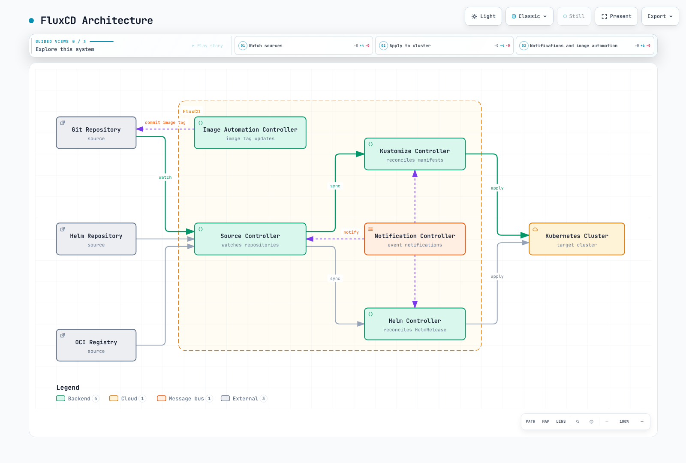

# GitOps ツールの比較

> **最終更新日**: 2026年9月11日

このガイドでは、Kubernetes エコシステムでよく使われる 2 つの GitOps ツール、ArgoCD と FluxCD を中心に、各ツールを比較します。

## 概要

GitOps は、アプリケーション開発で用いられる DevOps のベストプラクティスをインフラストラクチャの自動化に適用する運用フレームワークです。CNCF エコシステムを代表する GitOps ツールは次の 2 つです。

- **ArgoCD**: Kubernetes 向けの宣言的 GitOps 継続的デリバリーツール
- **FluxCD**: Kubernetes 向けの継続的／段階的デリバリーソリューション群

どちらも CNCF の卒業プロジェクトであり、成熟度と広い採用実績を示しています。

## ArgoCD と FluxCD の直接比較

### 設計思想

| 観点 | ArgoCD | FluxCD |
|--------|--------|--------|
| **アーキテクチャ** | API／Repo Server、Application Controller、および補助コンポーネントが分離 | controller を組み合わせるモジュール型ツールキット |
| **設定** | Application 中心の CRD | Source 中心の CRD |
| **ユーザーインターフェイス** | 高機能な Web UI を内蔵 | CLI 中心で、組み込み UI はない |
| **学習の焦点** | Application、AppProject、UI のワークフロー | Source、Kustomization、HelmRelease controller の関係 |
| **デプロイ方式** | pull 型 GitOps | pull 型 GitOps |

### 機能比較

| 機能 | ArgoCD | FluxCD |
|---------|--------|--------|
| **Web UI** | 組み込みで機能豊富 | core には含まれない。保守されているエコシステム UI を評価する |
| **CLI** | `argocd` CLI | `flux` CLI |
| **マルチテナンシー** | RBAC を備えた Project | namespace 分離 |
| **マルチクラスター** | ネイティブ対応 | ネイティブ対応 |
| **Helm 対応** | `helm template` を使い、Argo CD がライフサイクルを管理 | Helm Controller が Helm release を管理 |
| **Kustomize 対応** | 完全対応 | Kustomize Controller を介して完全対応 |
| **OCI 対応** | 一般的な OCI と OCI Helm source に対応。version／media type の要件を確認する | OCIRepository に対応。layer／検証機能のサポートを確認する |
| **通知** | 通知システムを内蔵 | Notification Controller |
| **RBAC** | 包括的な RBAC | Kubernetes ネイティブの RBAC |
| **SSO 統合** | OIDC またはサポート対象の Dex connector に直接対応 | Kubernetes 認証 |
| **health check** | 組み込み／custom resource の health | controller 固有の readiness、health check、custom condition |
| **段階的デリバリー** | Argo Rollouts を利用 | Flagger を利用 |
| **イメージ自動化** | Argo Image Updater を利用 | 任意の Image Reflector／Automation を利用 |
| **差分プレビュー** | UI 上の視覚的な差分 | CLI の差分表示 |
| **Sync Wave** | ネイティブ対応 | 依存関係を使う |
| **Hook** | Argo の sync hook | Helm hook。Kustomization の依存関係／Job は別途設計する |

### アーキテクチャ比較

#### ArgoCD アーキテクチャ


[🔍 インタラクティブな図を見る](https://www.atomai.click/kubernetes-docs/archmaps/en-gitops-03-gitops-comparison-0.html)

#### FluxCD アーキテクチャ



[🔍 インタラクティブな図を見る](https://www.atomai.click/kubernetes-docs/archmaps/en-gitops-03-gitops-comparison-1.html)

### コミュニティとエコシステム

| 指標 | ArgoCD | FluxCD |
|--------|--------|--------|
| **CNCF の status** | Graduated（2022年12月） | Graduated（2022年11月） |
| **初回リリース** | 2018年 | 2016年（v1）、2020年（v2） |
| **保守状況** | 最新のガバナンスとセキュリティサポートを確認する | 最新のガバナンスとセキュリティサポートを確認する |
| **エコシステムツール** | Argo Workflows、Rollouts、Events | Flagger、Weave GitOps |

## ArgoCD を選ぶ場合

次のような要件には ArgoCD が適しています。

### ユースケース

1. **視覚的な管理**: グラフィカルな画面でデプロイを管理したいチーム
2. **一元管理**: 複数クラスターを 1 つの画面で管理したい組織
3. **包括的な RBAC**: チーム横断の複雑なアクセス制御
4. **SSO 統合**: OIDC/SAML 認証を必要とするエンタープライズ環境
5. **Sync Wave と Hook**: 順序制御を伴う複雑なデプロイオーケストレーション

### 利点

- **高機能な Web UI**: デプロイ管理に使いやすい視覚的なインターフェイス
- **Application 中心**: 開発者がデプロイを考える方法に自然に対応
- **成熟したエコシステム**: Argo Workflows、Rollouts、Events と緊密に統合
- **エンタープライズ機能**: SSO、RBAC、監査ログを標準で備える
- **デバッグのしやすさ**: UI で差分と同期状態を視覚的に確認できる

### 利用例

```
Scenario: Enterprise with 50+ microservices
- Multiple teams need self-service deployments
- Security team requires audit logs and RBAC
- Developers want visual feedback on sync status
- Need SSO integration with corporate identity provider

Recommendation: ArgoCD
- Projects per team with role-based access
- Application Sets for template-driven deployments
- Web UI for developer self-service
- Dex integration for SSO
```

## FluxCD を選ぶ場合

次のような要件には FluxCD が適しています。

### ユースケース

1. **モジュール型アーキテクチャ**: 必要な controller だけを選びたい
2. **CLI 中心のワークフロー**: UI に依存しない GitOps ネイティブな運用
3. **イメージ自動化**: Git 内のコンテナイメージ参照を自動更新
4. **OCI artifact**: OCI registry から保存／デプロイ
5. **コンポーネント選択**: controller を選択し、実際の workload を測定する

### 利点

- **モジュール型設計**: 必要な機能だけを利用
- **ネイティブなイメージ自動化**: コンテナイメージ更新用の任意 controller
- **OCI 対応**: OCI artifact を第一級でサポート
- **Kubernetes ネイティブ**: 標準の Kubernetes RBAC を使用
- **リソース制御**: インストールしたコンポーネント、source、オブジェクト、reconcile 間隔に対する CPU／memory を測定できる

### 利用例

```
Scenario: Platform team building internal developer platform
- Need automated image updates when CI builds new versions
- Want to store deployment artifacts in container registry
- Prefer CLI-driven GitOps workflows
- Multiple clusters with different configurations

Recommendation: FluxCD
- Image automation for continuous deployment
- OCI repositories for artifact storage
- Kustomize overlays for environment differences
- Multi-cluster management with fleet repo
```

## 両方を併用できるか？

2 つの reconciler が同じ object を変更／prune しないよう、リソースの所有権を分けてください。CR とその operator を一緒に管理することと、同じ Deployment や Helm release を 2 つのツールが競合して管理することは異なります。

ArgoCD と FluxCD は、役割を分けて併用できます。

### パターン 1: インフラストラクチャは FluxCD、アプリケーションは ArgoCD

```
Git Repository
├── infrastructure/     # Managed by FluxCD
│   ├── cert-manager/
│   ├── ingress-controller/
│   └── monitoring/
└── applications/       # Managed by ArgoCD
    ├── app-a/
    ├── app-b/
    └── app-c/
```

- FluxCD がクラスターインフラストラクチャ（operator、controller）を管理します。
- ArgoCD が開発者向け UI を使い、アプリケーションのデプロイを管理します。

### パターン 2: FluxCD の Image Automation と ArgoCD のデプロイ

```
1. CI builds new image → pushes to registry
2. FluxCD Image Automation detects new tag
3. FluxCD commits updated manifest to Git
4. ArgoCD syncs the change to cluster
```

### パターン 3: クラスターごとに別のツールを使う

- 本番クラスター: UI と監査要件に応じて ArgoCD
- 開発クラスター: 迅速な反復に応じて FluxCD

## 移行時の考慮事項

ここに示すのは設計上の対応関係であり、CRD 名を自動的に置き換える手順ではありません。リソース一覧、Helm release、hook、prune／finalizer、Secret、権限を比較します。ステージング環境で旧 reconciler を停止し、削除を起こさずに所有権を移す方法をテストしてください。Argo CD の template 処理によって Flux Helm release の履歴が自動的に引き継がれるわけではありません。

### FluxCD から ArgoCD へ

1. FluxCD の Kustomization を ArgoCD Application として export する
2. FluxCD の source を ArgoCD repository に対応付ける
3. HelmRelease を ArgoCD Helm Application に変換する
4. ArgoCD で RBAC と SSO を設定する

### ArgoCD から FluxCD へ

1. ArgoCD Application を Kustomization／HelmRelease に変換する
2. Git／Helm repository を使う Source Controller を設定する
3. alert 用に Notification Controller を設定する
4. 必要に応じて Image Automation を導入する

## その他の GitOps ツール

ArgoCD と FluxCD が広く使われていますが、ほかにも GitOps ツールがあります。

### Jenkins X

- CI/CD pipeline の自動化に重点を置く
- preview 環境を内蔵
- Tekton ベースの pipeline
- 適したチーム: GitOps と統合した CI/CD を求めるチーム

### Rancher Fleet

- 数千クラスターの管理を想定
- 大規模な GitOps
- Rancher と統合
- 適した用途: 大規模な edge deployment

### Weave GitOps

- Flux ベースの OSS UI プロジェクト。商用サポートは別途確認する
- Flux に UI とエンタープライズ機能を追加
- 評価項目: 現行 release、Flux との互換性、サポートの管理主体

## 選定マトリクス

| 要件 | 適した選択肢 |
|-------------|-------------|
| Web UI が必要 | ArgoCD |
| CLI 中心のワークフロー | FluxCD |
| イメージ自動化 | Flux の任意 controller または Argo CD Image Updater |
| 複雑な RBAC | ArgoCD |
| SSO 統合 | ArgoCD |
| リソース上限 | 同一の実 workload で benchmark する |
| OCI artifact | 両方。形式、検証、認証要件を比較する |
| Sync Wave／hook | ArgoCD |
| 視覚的な差分 | ArgoCD |
| モジュール型デプロイ | FluxCD |
| エンタープライズ監査 | ArgoCD |
| 大規模なマルチクラスター | 両方 |

## まとめ

ArgoCD と FluxCD はどちらも GitOps の実装に適したツールです。選択は、多くの場合、次の点によって決まります。

- **ArgoCD を選ぶ**: 高機能な UI、エンタープライズ機能、Application 中心の管理を重視する場合
- **FluxCD を選ぶ**: モジュール性、CLI ワークフロー、組み込みのイメージ自動化を重視する場合

各ツールの強みが生きる用途に分け、多くの組織が両方を活用しています。

## クイズ

学習内容を確認するには、[GitOps ツール比較クイズ](../quizzes/gitops/03-gitops-comparison-quiz.md)に挑戦してください。

## 参考資料

- [Argo CD OCI](https://argo-cd.readthedocs.io/en/stable/user-guide/oci/)
- [Argo CD の Helm ライフサイクル](https://argo-cd.readthedocs.io/en/stable/user-guide/helm/)
- [Flux HelmRelease のライフサイクル](https://fluxcd.io/flux/components/helm/helmreleases/)
- [Flux のマルチテナンシー](https://fluxcd.io/flux/installation/configuration/multitenancy/)
- [Flux エコシステム](https://fluxcd.io/ecosystem/)
