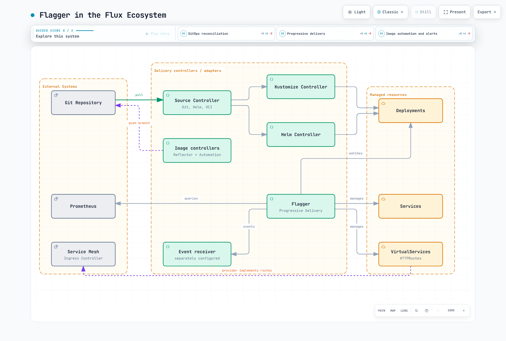

# Flagger のプログレッシブデリバリー

> **レビュー基準**: Flagger/Chart 1.45.0、Loadtester 0.39.0、Flux 2.9.5（リリースノートのレビュー後にパッチ 2.9.6 へ更新、例は再実行していません）、Podinfo 6.15.0
> **最終更新**: October 12, 2026

Flagger は Canary CRD を通じて Kubernetes ワークロードのプログレッシブデリバリーを管理します。制御対象はトラフィックとリビジョンであり、データベースや外部副作用のトランザクションロールバックではありません。これらのラボ例には、適合するネットワーク、計装、認可、および Service SLO が必要です。

コードには完全なマニフェストと spec/Helm-values のフラグメントが含まれます。示された所有者にマージしてください。同名の戦略例は代替案であり、順に適用するブロックではありません。

## 目次

- [概要と学習目標](#overview-and-learning-objectives)
- [Flagger アーキテクチャ](#flagger-architecture)
- [EKS のインストールと設定](#eks-installation-and-configuration)
- [Canary デプロイ戦略](#canary-deployment-strategy)
- [Blue-Green デプロイ戦略](#blue-green-deployment-strategy)
- [A/B テスト戦略](#ab-testing-strategy)
- [カスタムメトリクスと Webhook](#custom-metrics-and-webhooks)
- [GitOps 統合（Flux + Flagger）](#gitops-integration-flux--flagger)
- [可観測性とアラート](#observability-and-alerting)
- [本番環境のベストプラクティス](#production-best-practices)

## 概要と学習目標

Kubernetes Deployment の RollingUpdate はすでに Pod を段階的に置き換えます。Flagger は、明示的なリビジョンのトラフィック制御と、メトリクス/テストに基づく昇格を追加します。この章では、リソースの所有権、3 つの戦略、メトリクス/ゲート、GitOps、および可観測性を扱います。

| 戦略 | 制御 | 確認事項 |
|---|---|---|
| Canary | 段階的な重み | 追加レプリカ、最小トラフィック、失敗条件 |
| Blue-Green | 別リビジョンを検証してから切り替え | 両方のワークロードとサージ、データベース互換性 |
| A/B | サポートされる header/cookie のマッチング | コホート割り当て、統計、分離された認可 |

Blue-Green は、リソースが正確に 2 倍になること、即時ロールバック、またはダウンタイムゼロを保証しません。Flagger は primary を新しいリビジョンへ更新します。その後に完全な旧バージョンのスタンバイを保持することはありません。

### Flagger と Argo Rollouts

| 観点 | Flagger | Argo Rollouts |
|---|---|---|
| リソース | Canary は既存ワークロードを参照 | Deployment workloadRef を含む Rollout CRD |
| GitOps | Flux およびその他の GitOps ツール | Argo CD およびその他の GitOps ツール |
| 分析 | MetricTemplate、しきい値、webhook | AnalysisTemplate/AnalysisRun と Web/Job プロバイダー |
| プロジェクトファミリー | CNCF Graduated Flux | CNCF Graduated Argo |

エコシステム統合は排他的な結合を意味しません。2 つのプログレッシブデリバリーコントローラーに同じワークロードを管理させないでください。

## Flagger アーキテクチャ


[インタラクティブ図を表示](https://www.atomai.click/kubernetes-docs/archmaps/en-gitops-04-flagger-1.html)

Deployment の例では、podinfo が元のリソースおよび canary ワークロードです。新しい安定ワークロードは podinfo-primary です。podinfo-canary は Service 名であり、追加の Deployment や CloneSet ではありません。

| リソース | 所有権/目的 |
|---|---|
| podinfo Deployment | Git/Helm Pod テンプレート、Flagger の canary 制御 |
| podinfo-primary Deployment | Flagger が作成/昇格する安定ワークロード |
| podinfo / podinfo-primary / podinfo-canary Services | Flagger が管理する入口/宛先の選択 |
| Primary autoscaler | autoscalerRef 使用時の対応する autoscaler |
| VirtualService/DestinationRule/HTTPRoute など | 選択した provider のルーティング |


[インタラクティブ図を表示](https://www.atomai.click/kubernetes-docs/archmaps/en-gitops-04-flagger-2.html)

初期 primary のセットアップ後、Pod テンプレートまたは追跡対象の ConfigMap/Secret の変更により canary が準備されます。pre-rollout チェック、分析、ルーティングの後、昇格によって準備済み canary 経由でトラフィックを提供しながら primary は新しい spec を採用します。primary の準備完了後、トラフィックは primary に戻り、canary はスケールダウンします。

**分析の失敗**は通常、正常な primary を復元します。**primary の更新中の失敗**は異なります。Promoting/Finalising 中、1.45.0 は失敗を報告しつつ、正常な canary にトラフィックを保持/復帰させることがあります。失敗ステータスだけでは、旧 primary がトラフィックを提供していることは証明されません。

### Provider とライフサイクル

| Provider | 確認事項 |
|---|---|
| Istio | VirtualService/DestinationRule と sidecar HTTP メトリクス |
| gatewayapi:v1 | Gateway HTTPRoute 機能と MetricTemplate |
| Linkerd/Contour/Gloo/Traefik/Kuma など | インストール済みバージョンの機能とメトリクス契約 |
| kubernetes | Service 切り替えの Blue-Green。L7 の重み付き/A/B ルーティングではない |
| App Mesh / ingress-nginx / OSM | 以下のレガシーライフサイクルの制限 |

AWS App Mesh のサポートは **2026-09-30** に終了しました。AWS によると、その日以降はコンソールおよびリソースにアクセスできません。コミュニティの ingress-nginx は 2026 年 3 月に廃止され、OSM リポジトリはアーカイブされています。

アダプターが利用可能であることは、新規の本番利用に対する保守保証ではありません。実装ごとに A/B、ミラーリング、セッションアフィニティのサポートを検証してください。

## EKS のインストールと設定

この基準には、サポート対象の EKS/Kubernetes、インストール済みの Istio sidecar 環境、および必要なメトリクスをスクレイプする Prometheus が必要です。その URL は実際の Service に置き換えてください。Flagger は Istio も計装もインストールしません。Chart に同梱された Prometheus イメージは古い 2.41.0 なので、無効化しています。

リリース/管理方法は 1 つ選択してください。異なる namespace に独立した Flagger インスタンスをインストールすると、両方が同じ Canary を制御する可能性があります。例では controller に flagger-system、ワークロードに flagger-demo を使用します。インジェクションラベルは実際の Istio リビジョンに合わせてください。

```yaml
apiVersion: v1
kind: Namespace
metadata:
  name: flagger-system
  labels:
    istio-injection: enabled
---
apiVersion: v1
kind: Namespace
metadata:
  name: flagger-demo
  labels:
    istio-injection: enabled
---
apiVersion: v1
kind: ServiceAccount
metadata:
  name: flagger-loadtester
  namespace: flagger-system
automountServiceAccountToken: false
```

### Flagger Helm のインストール

```yaml
fullnameOverride: flagger
meshProvider: istio
namespace: flagger-demo
noCrossNamespaceRefs: true
metricsServer: http://prometheus.monitoring.svc.cluster.local:9090
prometheus:
  install: false
leaderElection:
  enabled: true
  replicaCount: 2
resources:
  requests:
    cpu: 100m
    memory: 128Mi
  limits:
    cpu: '1'
    memory: 512Mi
podDisruptionBudget:
  enabled: true
  minAvailable: 1
```

```bash
helm repo add flagger https://flagger.app
helm repo update flagger
helm upgrade --install flagger flagger/flagger --version 1.45.0 \
  --namespace flagger-system -f flagger-values.yaml --wait --timeout 5m
```

namespace は監視対象を制限するものであり、Chart の ClusterRole 権限を制限するものではありません。テナント RBAC は別途制限してください。leaderElection.replicaCount は実在する Chart 値です。通常の Helm アップグレードは初期インストール時のように crds/ を更新しません。レビュー済み CRD を別途適用するか、Flux の CRD ポリシーを使用してください。

```bash
kubectl apply --server-side -f https://raw.githubusercontent.com/fluxcd/flagger/v1.45.0/artifacts/flagger/crd.yaml
```

### Loadtester とアクセススコープ

```yaml
fullnameOverride: flagger-loadtester
replicaCount: 1
service:
  type: ClusterIP
  port: 80
serviceAccountName: flagger-loadtester
rbac:
  create: false
cmd:
  timeout: 2m
  namespaceRegexp: ^flagger-demo$
resources:
  requests:
    cpu: 100m
    memory: 64Mi
  limits:
    cpu: 500m
    memory: 256Mi
securityContext:
  enabled: true
  context:
    allowPrivilegeEscalation: false
    capabilities:
      drop:
      - ALL
    readOnlyRootFilesystem: true
    runAsUser: 100
    runAsGroup: 101
volumes:
- name: tmp
  emptyDir: {}
volumeMounts:
- name: tmp
  mountPath: /tmp
```

```bash
helm upgrade --install flagger-loadtester flagger/loadtester --version 0.39.0 \
  --namespace flagger-system -f loadtester-values.yaml --wait --timeout 5m
```

Loadtester は HTTP リクエストからコマンドを実行します。namespaceRegexp は本文文字列をフィルタリングするものであり、呼び出し元の認証ではありません。インターネットに公開せず、CNI ポリシーによって controller Pod からの ingress を制限してください。operator の exec/port-forward は RBAC で制御してください。メモリゲートのラボでは 1 レプリカを使用します。

```yaml
apiVersion: networking.k8s.io/v1
kind: NetworkPolicy
metadata:
  name: flagger-loadtester-ingress
  namespace: flagger-system
spec:
  podSelector:
    matchLabels:
      app.kubernetes.io/name: loadtester
  policyTypes:
  - Ingress
  ingress:
  - from:
    - namespaceSelector:
        matchLabels:
          kubernetes.io/metadata.name: flagger-system
      podSelector:
        matchLabels:
          app.kubernetes.io/name: flagger
    ports:
    - protocol: TCP
      port: 8080
```

必要な Istio mTLS とスクレイプパスを許可してください。この Loadtester は API 操作を行わないため、自動的な ServiceAccount トークンのマウントは無効化されています。Helm/kubectl テストを追加するには、明示的な権限と書き込み可能なパスが必要です。

### Gateway API の代替案

これは既存の Istio GatewayClass と互換性のある Gateway API CRD を前提とします。古いバンドルで上書きしないでください。他の実装には、対応する計装/クエリが必要です。環境に合わせて Service/LB の公開、DNS、TLS を設定してください。

```yaml
apiVersion: gateway.networking.k8s.io/v1
kind: Gateway
metadata:
  name: podinfo-gateway
  namespace: flagger-demo
spec:
  gatewayClassName: istio
  listeners:
  - name: http
    protocol: HTTP
    port: 80
    allowedRoutes:
      namespaces:
        from: Same
```

架空の Helm gatewayApi.gateway 値ではなく、**gatewayapi:v1** と Canary service.gatewayRefs を使用してください。以下の 3 つの MetricTemplate を準備し、この Canary は Istio アプローチの**代替**として使用してください。

```yaml
apiVersion: flagger.app/v1beta1
kind: Canary
metadata:
  name: podinfo
  namespace: flagger-demo
spec:
  provider: gatewayapi:v1
  targetRef:
    apiVersion: apps/v1
    kind: Deployment
    name: podinfo
  autoscalerRef:
    apiVersion: autoscaling/v2
    kind: HorizontalPodAutoscaler
    name: podinfo
  progressDeadlineSeconds: 120
  service:
    port: 9898
    targetPort: 9898
    hosts:
    - app.example.com
    gatewayRefs:
    - name: podinfo-gateway
      namespace: flagger-demo
      sectionName: http
  analysis:
    interval: 1m
    threshold: 5
    maxWeight: 50
    stepWeight: 10
    metrics:
    - name: error-rate
      templateRef:
        name: istio-error-rate
      thresholdRange:
        min: 0
        max: 1
      interval: 1m
    - name: latency-p99-ms
      templateRef:
        name: istio-latency-ms
      thresholdRange:
        min: 0
        max: 500
      interval: 1m
    - name: request-count
      templateRef:
        name: istio-request-count
      thresholdRange:
        min: 100
      interval: 1m
    webhooks:
    - name: smoke-test
      type: pre-rollout
      url: http://flagger-loadtester.flagger-system.svc.cluster.local/
      timeout: 30s
      metadata:
        type: bash
        cmd: |-
          set -euo pipefail
          curl -fsS --max-time 10 http://podinfo-canary.flagger-demo.svc.cluster.local:9898/healthz >/dev/null
          curl -fsS --max-time 10 http://podinfo-canary.flagger-demo.svc.cluster.local:9898/readyz >/dev/null
    - name: load-test
      type: rollout
      url: http://flagger-loadtester.flagger-system.svc.cluster.local/
      timeout: 5s
      metadata:
        type: cmd
        cmd: hey -z 1m -q 10 -c 2 http://podinfo-canary.flagger-demo.svc.cluster.local:9898/
```

```bash
helm upgrade --install flagger flagger/flagger --version 1.45.0 \
  --namespace flagger-system -f flagger-values.yaml --set meshProvider=gatewayapi:v1
```

## Canary デプロイ戦略

以下は基準となる Istio ワークロードと HPA です。Metrics Server が必要です。HPA/Flagger がスケーリングを所有できるよう Git から Deployment replicas を省略し、競合する Service を作成しないでください。これらのマニフェスト、または後述する HelmRelease の代替案を選択してください。

```yaml
apiVersion: apps/v1
kind: Deployment
metadata:
  name: podinfo
  namespace: flagger-demo
spec:
  selector:
    matchLabels:
      app: podinfo
  template:
    metadata:
      labels:
        app: podinfo
    spec:
      containers:
      - name: podinfo
        image: ghcr.io/stefanprodan/podinfo:6.15.0
        ports:
        - name: http
          containerPort: 9898
        readinessProbe:
          httpGet:
            path: /readyz
            port: http
        livenessProbe:
          httpGet:
            path: /healthz
            port: http
        resources:
          requests:
            cpu: 100m
            memory: 64Mi
          limits:
            cpu: 500m
            memory: 256Mi
---
apiVersion: autoscaling/v2
kind: HorizontalPodAutoscaler
metadata:
  name: podinfo
  namespace: flagger-demo
spec:
  scaleTargetRef:
    apiVersion: apps/v1
    kind: Deployment
    name: podinfo
  minReplicas: 2
  maxReplicas: 4
  metrics:
  - type: Resource
    resource:
      name: cpu
      target:
        type: Utilization
        averageUtilization: 80
```


[インタラクティブ図を表示](https://www.atomai.click/kubernetes-docs/archmaps/en-gitops-04-flagger-3.html)

```yaml
apiVersion: flagger.app/v1beta1
kind: Canary
metadata:
  name: podinfo
  namespace: flagger-demo
spec:
  provider: istio
  targetRef:
    apiVersion: apps/v1
    kind: Deployment
    name: podinfo
  autoscalerRef:
    apiVersion: autoscaling/v2
    kind: HorizontalPodAutoscaler
    name: podinfo
  progressDeadlineSeconds: 120
  service:
    port: 9898
    targetPort: 9898
    portName: http
    gateways:
    - mesh
    hosts:
    - podinfo
    trafficPolicy:
      tls:
        mode: ISTIO_MUTUAL
  analysis:
    interval: 1m
    threshold: 5
    maxWeight: 50
    stepWeight: 10
    metrics:
    - name: request-success-rate
      thresholdRange:
        min: 99
        max: 100
      interval: 1m
    - name: request-duration
      thresholdRange:
        min: 0
        max: 500
      interval: 1m
    webhooks:
    - name: smoke-test
      type: pre-rollout
      url: http://flagger-loadtester.flagger-system.svc.cluster.local/
      timeout: 30s
      metadata:
        type: bash
        cmd: |-
          set -euo pipefail
          curl -fsS --max-time 10 http://podinfo-canary.flagger-demo.svc.cluster.local:9898/healthz >/dev/null
          curl -fsS --max-time 10 http://podinfo-canary.flagger-demo.svc.cluster.local:9898/readyz >/dev/null
    - name: load-test
      type: rollout
      url: http://flagger-loadtester.flagger-system.svc.cluster.local/
      timeout: 5s
      metadata:
        type: cmd
        cmd: hey -z 1m -q 10 -c 2 http://podinfo-canary.flagger-demo.svc.cluster.local:9898/
```

iterations は Blue-Green を選択します。match が存在する場合は A/B を選択します。これらを重み付き Canary に混在させないでください。StepWeight 10 と maxWeight 50 は、昇格前に 10→20→30→40→50% で分析することを示します。合計時間は、準備完了、チェック遅延、失敗/承認、および primary ロールアウトに依存します。

Analysis.interval は分析をスケジュールします。metric interval はクエリ/集計ウィンドウを指定します。Threshold 5 は、各成功でリセットされる連続回数ではなく、リビジョンに対する累積失敗チェックに適用されます。5 回に達すると、後続の照合でロールバックが発生します。pre-rollout および rollout/metric の失敗はこの経路に入ります。ProgressDeadlineSeconds はワークロードの進行/準備完了を制限するものであり、総ロールアウト時間の 2 倍を制限するものではありません。

非線形の重みには stepWeights を使用し、既存の stepWeight/maxWeight を削除してください。接続とルーティングの収束により、設定された重みが常に正確なリクエスト比率を保証するわけではありません。

```yaml
spec:
  analysis:
    stepWeights:
    - 1
    - 2
    - 5
    - 10
    - 25
    - 50
```

```bash
kubectl get canary podinfo -n flagger-demo --watch
kubectl describe canary podinfo -n flagger-demo
kubectl logs -n flagger-system -l app.kubernetes.io/name=flagger -c flagger --prefix --tail=100
```

初期の安定セットアップ後、分析を開始するには、レビュー済みのイメージ/タグ/ダイジェストまたは Pod テンプレート変更を Git 経由で適用してください。同じタグの背後にあるリモートコンテンツを置き換えても、Git の変更の代わりにはなりません。生成された primary、Service、またはルーティングリソースを直接編集しないでください。

## Blue-Green デプロイ戦略


[インタラクティブ図を表示](https://www.atomai.click/kubernetes-docs/archmaps/en-gitops-04-flagger-4.html)

```yaml
apiVersion: flagger.app/v1beta1
kind: Canary
metadata:
  name: podinfo
  namespace: flagger-demo
spec:
  provider: istio
  targetRef:
    apiVersion: apps/v1
    kind: Deployment
    name: podinfo
  autoscalerRef:
    apiVersion: autoscaling/v2
    kind: HorizontalPodAutoscaler
    name: podinfo
  progressDeadlineSeconds: 120
  service:
    port: 9898
    targetPort: 9898
    portName: http
    gateways:
    - mesh
    hosts:
    - podinfo
    trafficPolicy:
      tls:
        mode: ISTIO_MUTUAL
  analysis:
    interval: 1m
    threshold: 5
    metrics:
    - name: request-success-rate
      thresholdRange:
        min: 99
        max: 100
      interval: 1m
    - name: request-duration
      thresholdRange:
        min: 0
        max: 500
      interval: 1m
    webhooks:
    - name: smoke-test
      type: pre-rollout
      url: http://flagger-loadtester.flagger-system.svc.cluster.local/
      timeout: 30s
      metadata:
        type: bash
        cmd: |-
          set -euo pipefail
          curl -fsS --max-time 10 http://podinfo-canary.flagger-demo.svc.cluster.local:9898/healthz >/dev/null
          curl -fsS --max-time 10 http://podinfo-canary.flagger-demo.svc.cluster.local:9898/readyz >/dev/null
    - name: load-test
      type: rollout
      url: http://flagger-loadtester.flagger-system.svc.cluster.local/
      timeout: 5s
      metadata:
        type: cmd
        cmd: hey -z 1m -q 10 -c 2 http://podinfo-canary.flagger-demo.svc.cluster.local:9898/
    iterations: 10
```

この例では、ライブトラフィックを primary に留めたまま合成トラフィックを分析します。合格後、primary の更新中にトラフィックは canary へ移動し、primary の準備完了時に戻ります。失敗しきい値は引き続き適用されます。1 回の測定失敗が常に即時ロールバックになるわけではありません。これは完全な旧バージョンのスタンバイを保持する別環境ではありません。

### 任意のトラフィックミラーリング

```yaml
spec:
  analysis:
    mirror: true
    mirrorWeight: 10
```

サポートする provider は、Canary の前段階または Blue-Green 用にミラーリングできます。Gateway API の RequestMirror サポートを確認してください。レスポンスを破棄しても、データベース書き込み、支払い、メッセージ、または負荷は防げません。検証済みの読み取り専用リクエストまたは分離を使用してください。ミラーリングはデータベースの複製やロールバックではありません。

<span id="ab-testing-strategy"></span>

## A/B テスト戦略

```yaml
apiVersion: flagger.app/v1beta1
kind: Canary
metadata:
  name: podinfo
  namespace: flagger-demo
spec:
  provider: istio
  targetRef:
    apiVersion: apps/v1
    kind: Deployment
    name: podinfo
  autoscalerRef:
    apiVersion: autoscaling/v2
    kind: HorizontalPodAutoscaler
    name: podinfo
  progressDeadlineSeconds: 120
  service:
    port: 9898
    targetPort: 9898
    portName: http
    gateways:
    - mesh
    hosts:
    - podinfo
    trafficPolicy:
      tls:
        mode: ISTIO_MUTUAL
  analysis:
    interval: 1m
    threshold: 5
    metrics:
    - name: request-success-rate
      thresholdRange:
        min: 99
        max: 100
      interval: 1m
    - name: request-duration
      thresholdRange:
        min: 0
        max: 500
      interval: 1m
    webhooks:
    - name: smoke-test
      type: pre-rollout
      url: http://flagger-loadtester.flagger-system.svc.cluster.local/
      timeout: 30s
      metadata:
        type: bash
        cmd: |-
          set -euo pipefail
          curl -fsS --max-time 10 http://podinfo-canary.flagger-demo.svc.cluster.local:9898/healthz >/dev/null
          curl -fsS --max-time 10 http://podinfo-canary.flagger-demo.svc.cluster.local:9898/readyz >/dev/null
    - name: load-test
      type: rollout
      url: http://flagger-loadtester.flagger-system.svc.cluster.local/
      timeout: 5s
      metadata:
        type: cmd
        cmd: hey -z 1m -q 10 -c 2 http://podinfo-canary.flagger-demo.svc.cluster.local:9898/
    iterations: 10
    match:
    - headers:
        x-canary:
          exact: insider
    - headers:
        cookie:
          regex: (^|.*;\s*)canary=always(;.*|$)
```

各 Match エントリは OR の代替であり、エントリ内の条件は provider ルールに従います。cookie regex はセミコロン後のスペースを処理します。Istio sourceLabels はソース IP ではなくワークロードラベルを表します。Gateway 実装/バージョンごとに matcher のサポートを検証してください。

ルーティングは認可でも完全な統計実験でもありません。クライアント制御のマーカーを従業員権限として信頼しないでください。信頼できるエッジでコホートを割り当て、サーバー側で認可してください。有意義な A/B の結論には、サンプル、割り当て設計、および統計的検定も必要です。

インジェクトされた Loadtester Pod から基準となる mesh route を検証してください。外部 Gateway パスは、実際の host/TLS/ingress 経由でテストしてください。-canary を直接呼び出してもルーティングのマッチは検証されません。

```bash
kubectl exec -n flagger-system deployment/flagger-loadtester -- \
  curl -fsS http://podinfo.flagger-demo.svc.cluster.local:9898/
kubectl exec -n flagger-system deployment/flagger-loadtester -- \
  curl -fsS -H 'x-canary: insider' http://podinfo.flagger-demo.svc.cluster.local:9898/
kubectl exec -n flagger-system deployment/flagger-loadtester -- \
  curl -fsS -b 'canary=always' http://podinfo.flagger-demo.svc.cluster.local:9898/
```

## カスタムメトリクスと Webhook

### Prometheus MetricTemplate

これらのクエリは Istio sidecar のメトリクス契約を使用します。namespace/workload ラベル、reporter、およびスクレイピングを検証してください。5xx series がない場合はゼロの分子になります。トラフィックがない場合や分母がゼロの場合は成功になりません。最小 100 リクエストおよびその他の境界は例示です。SLO とサンプル要件から値を選択してください。

```yaml
apiVersion: flagger.app/v1beta1
kind: MetricTemplate
metadata:
  name: istio-error-rate
  namespace: flagger-demo
spec:
  provider:
    type: prometheus
    address: http://prometheus.monitoring.svc.cluster.local:9090
  query: |
    (sum(rate(istio_requests_total{reporter="destination", destination_workload_namespace="{{ namespace }}", destination_workload="{{ target }}", response_code=~"5.."}[{{ interval }}])) or vector(0)) / sum(rate(istio_requests_total{reporter="destination", destination_workload_namespace="{{ namespace }}", destination_workload="{{ target }}"}[{{ interval }}])) * 100
---
apiVersion: flagger.app/v1beta1
kind: MetricTemplate
metadata:
  name: istio-latency-ms
  namespace: flagger-demo
spec:
  provider:
    type: prometheus
    address: http://prometheus.monitoring.svc.cluster.local:9090
  query: |
    histogram_quantile(0.99, sum(rate(istio_request_duration_milliseconds_bucket{reporter="destination", destination_workload_namespace="{{ namespace }}", destination_workload="{{ target }}"}[{{ interval }}])) by (le))
---
apiVersion: flagger.app/v1beta1
kind: MetricTemplate
metadata:
  name: istio-request-count
  namespace: flagger-demo
spec:
  provider:
    type: prometheus
    address: http://prometheus.monitoring.svc.cluster.local:9090
  query: |
    sum(increase(istio_requests_total{reporter="destination", destination_workload_namespace="{{ namespace }}", destination_workload="{{ target }}"}[{{ interval }}]))
---
spec:
  analysis:
    metrics:
    - name: error-rate
      templateRef:
        name: istio-error-rate
      thresholdRange:
        min: 0
        max: 1
      interval: 1m
    - name: latency-p99-ms
      templateRef:
        name: istio-latency-ms
      thresholdRange:
        min: 0
        max: 500
      interval: 1m
    - name: request-count
      templateRef:
        name: istio-request-count
      thresholdRange:
        min: 100
      interval: 1m
```

MetricTemplate は数値を 1 つ返す必要があります。Prometheus provider は空の結果/NaN を拒否します。百分率は有限の 0～100 の範囲に制限し、カスタムレイテンシー単位を整合させてください。境界は含まれます。クエリウィンドウが重複する測定は独立したサンプルではありません。

### Datadog の単位と選択されるデータポイント

```yaml
apiVersion: flagger.app/v1beta1
kind: MetricTemplate
metadata:
  name: datadog-average-latency-ms
  namespace: flagger-demo
spec:
  provider:
    type: datadog
    address: https://api.datadoghq.com
    secretRef:
      name: datadog-api
  query: |
    avg:myapp.request_duration_ms{kube_deployment:{{ target }},kube_namespace:{{ namespace }}}.rollup(avg, 60)
---
apiVersion: v1
kind: Secret
metadata:
  name: datadog-api
  namespace: flagger-demo
type: Opaque
stringData:
  datadog_api_key: REPLACE_WITH_API_KEY
  datadog_application_key: REPLACE_WITH_APPLICATION_KEY
```

myapp.request_duration_ms は、公開する必要がある ms 単位のカスタム平均レイテンシーであり、P99 ではありません。provider.address でサイトを選択します。クライアントが読み取るのは、datadog_site ではなく、示した 2 つの Secret キーです。メトリクス interval の 10 倍をクエリし、最初の series の最も古い最初のポイントを返します。現在の canary の健全性の証拠として単独で使用せず、新鮮でリビジョン固有の測定と組み合わせてください。

元のクライアントに対するローカルのモックレスポンステストでも、最初のデータポイントが null の場合はゼロにデコードされることを確認しました。そのため、ゼロミリ秒を許容するレイテンシーゲートは誤解を招く可能性があります。タイムスタンプ/欠損値を検証するブリッジ、または新鮮な Prometheus 測定を使用してください。

### CloudWatch のフィールドと制限

```yaml
apiVersion: flagger.app/v1beta1
kind: MetricTemplate
metadata:
  name: cloudwatch-error-percent
  namespace: flagger-demo
spec:
  provider:
    type: cloudwatch
    region: ap-northeast-2
  query: |
    [
      {
        "Id": "errorrate",
        "Expression": "IF(FILL(requests,0)>=100,100*FILL(errors,0)/FILL(requests,0),-1)",
        "Label": "CanaryErrorPercent",
        "ReturnData": true
      },
      {
        "Id": "errors",
        "MetricStat": {
          "Metric": {
            "Namespace": "MyApp",
            "MetricName": "5xxErrors",
            "Dimensions": [
              {
                "Name": "Service",
                "Value": "{{ target }}"
              },
              {
                "Name": "Namespace",
                "Value": "{{ namespace }}"
              }
            ]
          },
          "Period": 60,
          "Stat": "Sum"
        },
        "ReturnData": false
      },
      {
        "Id": "requests",
        "MetricStat": {
          "Metric": {
            "Namespace": "MyApp",
            "MetricName": "TotalRequests",
            "Dimensions": [
              {
                "Name": "Service",
                "Value": "{{ target }}"
              },
              {
                "Name": "Namespace",
                "Value": "{{ namespace }}"
              }
            ]
          },
          "Period": 60,
          "Stat": "Sum"
        },
        "ReturnData": false
      }
    ]
---
spec:
  analysis:
    metrics:
    - name: cw-error-percent
      templateRef:
        name: cloudwatch-error-percent
      thresholdRange:
        min: 0
        max: 1
      interval: 1m
```

Provider.region はサポートされており必須です。MyApp メトリクスと Service/Namespace ディメンションは別途公開してください。この式は欠損/低ボリューム期間に -1 を返し、0～1% の境界で失敗します。取り込み遅延によりロールアウトが拒否されることがあります。実際の公開および集計/クエリウィンドウを検証してください。

ネイティブ provider はメトリクス interval の 10 倍をクエリし、タイムスタンプ/StatusCode を別途検証せずに最初の結果の最初の値を選択します。古いポイントや集計済み ALB メトリクスを現在の canary の健全性と誤認しないよう、現在のリビジョンに対する Prometheus のリクエスト/ヘルスチェックで補完してください。必要な AWS API 権限は GetMetricData です。

```json
{
  "Version": "2012-10-17",
  "Statement": [
    {
      "Effect": "Allow",
      "Action": "cloudwatch:GetMetricData",
      "Resource": "*",
      "Condition": {
        "StringEquals": {
          "aws:RequestedRegion": "ap-northeast-2"
        }
      }
    }
  ]
}
```

CloudWatch を使用する場合は Flagger ServiceAccount の認証とロール信頼を設定し、リージョン条件を一致させてください。このレビューでは AWS API を呼び出しておらず、ロールもデプロイしていません。

### Webhook 契約

| タイプ | 意味 / 拒否時の動作 |
|---|---|
| confirm-rollout | 開始承認を待機 |
| pre-rollout | 初回トラフィックシフト前に確認。失敗を加算 |
| rollout | 分析中に呼び出される。失敗を加算 |
| confirm-traffic-increase | 重みを増やす前に待機 |
| confirm-promotion | 昇格前に待機 |
| post-rollout | Succeeded または Failed の後に通知/クリーンアップ。結果は戻さない |
| rollback | 分析/承認待機中の成功はロールバックを要求 |
| event | 状態関連イベントを転送 |

通常は HTTP 200 を返します。バージョン 1.45.0 は 202 より大きいコードをエラーとして扱うため、204 が成功すると仮定しないでください。metadata はそのままコピーされます。`{{ .Version }}` は補間されません。payload の name/namespace/phase/checksum を使用してください。成功以外の本文はログ/イベントに入る可能性があるため、機密値を返さないでください。

```yaml
name: podinfo
namespace: flagger-demo
phase: Progressing
checksum: example-revision-checksum
metadata:
  gate: promotion
```

Webhook 設定は任意の Authorization ヘッダーを提供しません。必要な認証は、レビュー済みの mTLS/internal-proxy 境界で実装してください。パブリック Git の URL/metadata にシークレットを入れたり、デフォルトで TLS 検証を無効化したりしないでください。

cmd load test は非同期で受け入れられます。HTTP の成功は load-test の品質判定ではありません。Bash は完了までブロックされ、timeout 内に収まる必要があります。イメージ 0.39.0 には curl/jq/hey/wrk/bash が含まれますが、k6 は含まれません。check() だけでは失敗終了ステータスが確立されないため、k6 には別途検証済みのイメージとしきい値が必要です。

このスクリプトは k6 をインストールした専用テストイメージ用であり、デフォルトの Loadtester イメージで動作するコマンドではありません。

```javascript
import http from 'k6/http';
import { check, sleep } from 'k6';

export const options = {
  vus: 2,
  duration: '20s',
  thresholds: {
    checks: ['rate==1'],
    http_req_failed: ['rate<0.01'],
    http_req_duration: ['p(99)<500'],
  },
};
export default function () {
  const result = http.get('http://podinfo-canary.flagger-demo.svc.cluster.local:9898/');
  check(result, { 'HTTP 200': (response) => response.status === 200 });
  sleep(0.5);
}
```

### 手動ゲーティング

```yaml
spec:
  analysis:
    webhooks:
    - name: promotion-approval
      type: confirm-promotion
      url: http://flagger-loadtester.flagger-system.svc.cluster.local/gate/check
      timeout: 5s
      metadata:
        gate: promotion
```

このエントリを既存の Canary webhook リストへマージしてください。/gate/approve は常に承認するため、手動ゲートではありません。/gate/check はインメモリの name.namespace 状態を読み取ります。開く/閉じる/確認するには同じ JSON 本文を指定します。閉じると昇格を保留しますが、ロールバックはしません。

```bash
# Close before starting a new revision.
kubectl exec -n flagger-system deployment/flagger-loadtester -- \
  curl -fsS -X POST -H 'Content-Type: application/json' \
  -d '{"name":"podinfo","namespace":"flagger-demo"}' http://localhost:8080/gate/close
# Approve the reviewed revision.
kubectl exec -n flagger-system deployment/flagger-loadtester -- \
  curl -fsS -X POST -H 'Content-Type: application/json' \
  -d '{"name":"podinfo","namespace":"flagger-demo"}' http://localhost:8080/gate/open
# A closed gate returns 403.
kubectl exec -n flagger-system deployment/flagger-loadtester -- \
  curl -sS -o /dev/null -w '%{http_code}\n' -X POST -H 'Content-Type: application/json' \
  -d '{"name":"podinfo","namespace":"flagger-demo"}' http://localhost:8080/gate/check
```

組み込みゲートは checksum 固有ではなく、Pod の再起動時にリセットされ、レプリカ間で共有されません。次のリビジョンの前に閉じてください。本番の承認には、認証、監査、有効期限、および name/namespace/checksum/gate によってキー付けされた状態が必要です。開始と昇格で共有する 1 つのメモリゲートは、2 つの独立した承認ではありません。

### 手動ロールバックとサスペンド

```yaml
spec:
  analysis:
    webhooks:
    - name: operator-rollback
      type: rollback
      url: http://flagger-loadtester.flagger-system.svc.cluster.local/rollback/check
      timeout: 5s
```

ロールバックエンドポイントは、通常、シグナルがない場合は 403、要求された場合は 200 を返します。通知受信側の成功レスポンスがここで意図しないロールバックを引き起こすことがあります。次のリクエストは、通常の照合中の分析/昇格承認待機中にロールバックを要求します。これはすべてのフェーズに対する即時復旧スイッチではありません。

```bash
kubectl get canary podinfo -n flagger-demo -o jsonpath='{.status.phase}{"\n"}'
kubectl exec -n flagger-system deployment/flagger-loadtester -- \
  curl -fsS -X POST -H 'Content-Type: application/json' \
  -d '{"name":"podinfo","namespace":"flagger-demo"}' http://localhost:8080/rollback/open
kubectl get canary podinfo -n flagger-demo --watch
# Reset the request after observing the operation.
kubectl exec -n flagger-system deployment/flagger-loadtester -- \
  curl -fsS -X POST -H 'Content-Type: application/json' \
  -d '{"name":"podinfo","namespace":"flagger-demo"}' http://localhost:8080/rollback/close
```

controller/準備完了の失敗、または閉じた confirm-rollout ゲートにより、この hook の前に照合が停止することがあります。Promoting/Finalising 中の primary 失敗には、前述の別の復旧処理が必要です。完了後も rollback を開いたままにすると、次のリビジョンに影響する可能性があります。

flagger.app/rollback、flagger.app/suspend、または flagger.app/skipAnalysis アノテーションを制御 API として扱わないでください。Suspend/skipAnalysis は spec フィールドです。Suspend は primary にトラフィックを戻さず、rollback hook を含む照合を停止します。SkipAnalysis は分析なしで昇格します。ロールバックではありません。Git の所有者も更新してください。

```yaml
spec:
  suspend: true
```

<span id="gitops-integration-flux--flagger"></span>

## GitOps 統合（Flux + Flagger）



[インタラクティブ図を表示](https://www.atomai.click/kubernetes-docs/archmaps/en-gitops-04-flagger-0.html)


[インタラクティブ図を表示](https://www.atomai.click/kubernetes-docs/archmaps/en-gitops-04-flagger-5.html)

Flux bootstrap は Flaggers を組み込み controller としてインストールしません。HelmRelease または Kustomization を通じて別途インストールしてください。同じリリースを Helm CLI でも同時に管理しないでください。前述の namespace、ServiceAccount、NetworkPolicy も Git で管理してください。

```yaml
apiVersion: source.toolkit.fluxcd.io/v1
kind: HelmRepository
metadata:
  name: flagger
  namespace: flagger-system
spec:
  interval: 1h
  url: https://flagger.app
---
apiVersion: helm.toolkit.fluxcd.io/v2
kind: HelmRelease
metadata:
  name: flagger
  namespace: flagger-system
spec:
  interval: 1h
  releaseName: flagger
  chart:
    spec:
      chart: flagger
      version: 1.45.0
      sourceRef:
        kind: HelmRepository
        name: flagger
  install:
    crds: Create
  upgrade:
    crds: CreateReplace
  values:
    fullnameOverride: flagger
    meshProvider: istio
    namespace: flagger-demo
    noCrossNamespaceRefs: true
    metricsServer: http://prometheus.monitoring.svc.cluster.local:9090
    prometheus:
      install: false
    leaderElection:
      enabled: true
      replicaCount: 2
    resources:
      requests:
        cpu: 100m
        memory: 128Mi
      limits:
        cpu: '1'
        memory: 512Mi
    podDisruptionBudget:
      enabled: true
      minAvailable: 1
---
apiVersion: helm.toolkit.fluxcd.io/v2
kind: HelmRelease
metadata:
  name: loadtester
  namespace: flagger-system
spec:
  interval: 1h
  releaseName: flagger-loadtester
  chart:
    spec:
      chart: loadtester
      version: 0.39.0
      sourceRef:
        kind: HelmRepository
        name: flagger
  values:
    fullnameOverride: flagger-loadtester
    replicaCount: 1
    service:
      type: ClusterIP
      port: 80
    serviceAccountName: flagger-loadtester
    rbac:
      create: false
    cmd:
      timeout: 2m
      namespaceRegexp: ^flagger-demo$
    resources:
      requests:
        cpu: 100m
        memory: 64Mi
      limits:
        cpu: 500m
        memory: 256Mi
    securityContext:
      enabled: true
      context:
        allowPrivilegeEscalation: false
        capabilities:
          drop:
          - ALL
        readOnlyRootFilesystem: true
        runAsUser: 100
        runAsGroup: 101
    volumes:
    - name: tmp
      emptyDir: {}
    volumeMounts:
    - name: tmp
      mountPath: /tmp
```

Flux の CreateReplace CRD 処理は、安全な移行を保証するものではありません。アップグレード前に CRD の変更と保存済みオブジェクトをレビューしてください。source と provider のインストール準備ができてから Canary オブジェクトを適用してください。

### アプリケーション HelmRelease の代替案

```yaml
apiVersion: source.toolkit.fluxcd.io/v1
kind: HelmRepository
metadata:
  name: podinfo
  namespace: flagger-demo
spec:
  interval: 1h
  url: https://stefanprodan.github.io/podinfo
---
apiVersion: helm.toolkit.fluxcd.io/v2
kind: HelmRelease
metadata:
  name: podinfo
  namespace: flagger-demo
spec:
  interval: 5m
  releaseName: podinfo
  chart:
    spec:
      chart: podinfo
      version: 6.15.0
      sourceRef:
        kind: HelmRepository
        name: podinfo
  values:
    service:
      enabled: false
    hpa:
      enabled: true
      minReplicas: 2
      maxReplicas: 4
    resources:
      requests:
        cpu: 100m
        memory: 64Mi
      limits:
        cpu: 500m
        memory: 256Mi
```

Podinfo 6.15.0 の service.enabled=false は、競合する Service の所有権を回避します。hpa.enabled=true では Chart は Deployment replicas を固定しません。この HelmRelease をネイティブワークロードマニフェストと併用しないでください。同一の値名を仮定するのではなく、他の Chart をレンダリングして同等の動作を検証してください。

先述の Canary をアプリケーションとともに管理してください。Flux/Helm の Ready はリソースの適用/準備完了に関するものであり、Flagger が現在のリビジョンを昇格したことを自動的に証明するものではありません。次の環境は、意図した変更と Canary の状態/checksum およびデプロイ済みバージョンの一致に基づいてゲートしてください。

### Kustomization の代替案

```yaml
apiVersion: kustomize.toolkit.fluxcd.io/v1
kind: Kustomization
metadata:
  name: podinfo
  namespace: flux-system
spec:
  interval: 10m
  targetNamespace: flagger-demo
  sourceRef:
    kind: GitRepository
    name: flux-system
  path: ./apps/podinfo
  prune: true
  timeout: 5m
```

```yaml
apiVersion: kustomize.config.k8s.io/v1beta1
kind: Kustomization
namespace: flagger-demo
resources:
- deployment.yaml
- hpa.yaml
- canary.yaml
```

sourceRef はデフォルトの bootstrap GitRepository 名を使用します。ネイティブマニフェストは apps/podinfo 以下に保存し、Flagger 所有の Service/primary リソースを省略してください。Kustomization の適用成功は、昇格完了ではありません。

環境オーバーレイでは、スカラー設定を明示的にパッチできます。これらは例示的な選択であり、普遍的な本番標準ではありません。CRD をパッチする際は、配列置換の動作も確認してください。

```yaml
apiVersion: kustomize.config.k8s.io/v1beta1
kind: Kustomization
resources:
- ../base
patches:
- target:
    group: flagger.app
    version: v1beta1
    kind: Canary
    name: podinfo
  patch: |
    - op: replace
      path: /spec/analysis/threshold
      value: 3
    - op: replace
      path: /spec/analysis/maxWeight
      value: 30
    - op: replace
      path: /spec/analysis/stepWeight
      value: 5
```

### イメージ自動化と昇格ブランチ


[インタラクティブ図を表示](https://www.atomai.click/kubernetes-docs/archmaps/en-gitops-04-flagger-6.html)

```yaml
apiVersion: image.toolkit.fluxcd.io/v1
kind: ImageRepository
metadata:
  name: podinfo
  namespace: flux-system
spec:
  image: ghcr.io/stefanprodan/podinfo
  interval: 5m
---
apiVersion: image.toolkit.fluxcd.io/v1
kind: ImagePolicy
metadata:
  name: podinfo
  namespace: flux-system
  labels:
    app: podinfo
spec:
  imageRepositoryRef:
    name: podinfo
  policy:
    semver:
      range: '>=6.15.0 <7.0.0'
  digestReflectionPolicy: IfNotPresent
---
apiVersion: image.toolkit.fluxcd.io/v1
kind: ImageUpdateAutomation
metadata:
  name: podinfo
  namespace: flux-system
spec:
  interval: 5m
  sourceRef:
    kind: GitRepository
    name: flux-system
  policySelector:
    matchLabels:
      app: podinfo
  git:
    checkout:
      ref:
        branch: main
    commit:
      author:
        name: Flux
        email: flux@example.com
      messageTemplate: |-
        Update podinfo image
        {{ range .Changed.Changes }}{{ .OldValue }} -> {{ .NewValue }}
        {{ end }}
    push:
      branch: flux/podinfo-updates
  update:
    path: ./apps/podinfo
    strategy: Setters
```

これは image-reflector/image-automation controller、policy marker、Git 書き込みアクセスを必要とします。専用ブランチに push するため、PR 作成/チェック/マージは別作業です。リポジトリ/パスを適応させ、そのブランチは自動化用に予約してください。存在しない .NewTag フィールドではなく、現在の .Changed commit-template モデルを使用してください。

```yaml
# Native Deployment Pod-template fragment.
spec:
  template:
    spec:
      containers:
      - name: podinfo
        image: ghcr.io/stefanprodan/podinfo:6.15.0 # {"$imagepolicy": "flux-system:podinfo"}
```

```yaml
# Alternative: merge into HelmRelease.spec.values.
image:
  repository: ghcr.io/stefanprodan/podinfo
  tag: "6.15.0" # {"$imagepolicy": "flux-system:podinfo:tag"}
```

タグのみの marker はダイジェストを固定しません。Chart のダイジェストサポートまたはレジストリのタグ不変性と検証を確認してください。Kustomize images と Deployment marker の両方を通じて 1 つのイメージを不整合に上書きしないでください。ECR には、個別の image-reflector AWS 認証と、実際の Pod イメージプル認可が必要です。

## 可観測性とアラート

Flagger メトリクスと Istio/application メトリクスは異なるスクレイプターゲットです。アノテーションだけで、すべての Prometheus インストールが自動的にスクレイプするわけではありません。Prometheus Operator では、Chart の serviceMonitor.enabled を実際の selector、namespace、および mTLS アクセスに合わせてください。

```yaml
serviceMonitor:
  enabled: true
  labels:
    release: prometheus
```

release ラベルは例示であり、Prometheus serviceMonitorSelector に一致する必要があります。インストール済みの Operator CRD が前提条件です。

| メトリクス | タイプ / 実際の意味 |
|---|---|
| flagger_info | Gauge、version/mesh_provider |
| flagger_canary_total | Gauge、namespace ごとの Canary オブジェクト数 |
| flagger_canary_status | Gauge、0=Progressing、2=Failed、その他のフェーズは 1 にマッピング |
| flagger_canary_weight | Gauge、workload/namespace ごとのトラフィック重み |
| flagger_canary_metric_analysis | Gauge、実際のメトリクス値。一般的な pass/fail boolean ではない |
| flagger_canary_duration_seconds | Histogram、分析照合の処理時間。総ロールアウト時間ではない |
| flagger_canary_successes_total / failures_total | Counter、strategy/analysis_status ラベル付きの結果 |

status 値 1 から Succeeded を推論しないでください。承認/昇格およびその他のフェーズもこの値を共有できます。Canary.status.phase と意図したリビジョンを確認してください。name ラベルは Canary オブジェクト名とは限らない targetRef.name です。重みは name ではなく workload を使用します。エクスポートされた iterations メトリクスが存在すると仮定せず、status.iterations を読み取ってください。

### Grafana ダッシュボード

現在の Grafana Stat/Time series パネルでは以下のクエリを使用してください。中央で集約する場合は外部 cluster ラベルをフィルタリングしてください。Flagger clusterName はアラートに影響しますが、Prometheus メトリクスに cluster ラベルを自動追加するものではありません。

```promql
flagger_canary_status{namespace="flagger-demo"}
flagger_canary_weight{namespace="flagger-demo",workload="podinfo"}
flagger_canary_metric_analysis{namespace="flagger-demo",name="podinfo",metric="request-success-rate"}
increase(flagger_canary_successes_total{namespace="flagger-demo",analysis_status="completed"}[7d])
increase(flagger_canary_failures_total{namespace="flagger-demo",analysis_status="completed"}[7d])
```

公式 Istio ダッシュボード JSON は参照用です。現在の Grafana で datasource 名およびパネル/schema の互換性を検証してからエクスポートしてください。ダッシュボード JSON は Kubernetes マニフェストではありません。HTTP API の {"dashboard": ...} エンベロープではなく、エクスポートしたダッシュボードモデルをプロビジョニングしてください。

```bash
curl -fsSL -o flagger-istio-reference.json \
  https://raw.githubusercontent.com/fluxcd/flagger/v1.45.0/charts/grafana/dashboards/istio.json
# After reviewing/exporting flagger-dashboard.json in Grafana:
jq -e '.title and (.panels | type == "array")' flagger-dashboard.json >/dev/null
kubectl create configmap flagger-dashboard -n monitoring \
  --from-file=flagger-dashboard.json=./flagger-dashboard.json \
  --dry-run=client -o yaml > flagger-dashboard-cm.yaml
kubectl label --local -f flagger-dashboard-cm.yaml grafana_dashboard=1 \
  -o yaml > flagger-dashboard-ready.yaml
```

生成された ConfigMap をレビューして GitOps 配下に配置してください。Grafana sidecar/provisioner がそのラベルと namespace を監視するよう設定してください。検証していないダッシュボード ID をインストールガイダンスとして頼らないでください。

### Prometheus アラート

```yaml
apiVersion: monitoring.coreos.com/v1
kind: PrometheusRule
metadata:
  name: flagger-alerts
  namespace: monitoring
spec:
  groups:
  - name: flagger
    rules:
    - alert: FlaggerAnalysisFailed
      expr: flagger_canary_status == 2
      for: 1m
      labels:
        severity: warning
      annotations:
        summary: Flagger analysis failed for {{ $labels.namespace }}/{{ $labels.name }}
        description: Inspect Canary phase, events, and actual routing before assuming the old primary is serving
          traffic.
    - alert: FlaggerAnalysisLongRunning
      expr: flagger_canary_status == 0
      for: 1h
      labels:
        severity: warning
      annotations:
        summary: Flagger analysis remains active for {{ $labels.namespace }}/{{ $labels.name }}
        description: Check approval gates, failed checks and workload readiness; this is not a measurement of rollout
          duration.
```

これらのルールはクラスター内 Prometheus を前提としています。for:1h を伴う ==0 条件は、継続的に観測された Progressing 条件を測定するものであり、すべてのアクティブフェーズやロールアウト開始タイムスタンプを測定するものではありません。意図したゲート待機は別途評価してください。Histogram bucket は短い照合処理時間を表します。time()-duration や 600 秒のロールアウト P99 アラートを使用しないでください。

### Slack、Teams、および外部通知

```yaml
apiVersion: flagger.app/v1beta1
kind: AlertProvider
metadata:
  name: slack
  namespace: flagger-demo
spec:
  type: slack
  channel: C0123456789
  username: flagger
  secretRef:
    name: slack-bot
---
apiVersion: v1
kind: Secret
metadata:
  name: slack-bot
  namespace: flagger-demo
type: Opaque
stringData:
  address: https://slack.com/api/chat.postMessage
  token: REPLACE_WITH_SLACK_BOT_TOKEN
---
spec:
  analysis:
    alerts:
    - name: deployment-alerts
      severity: info
      providerRef:
        name: slack
```

Secret 値はプレースホルダーです。実際のトークンを Git に置かないでください。このバージョンの AlertProvider secretRef には address が必要で、Slack Bot API には token も必要です。chat:write と channel membership を設定し、channel は実際の ID に置き換えてください。Incoming Webhook では、バインドされた channel と許可されたオーバーライドを検証してください。

Severity は最小レベルであり、排他的なルーティングではありません。info はすべてのレベルを受信し、warn は warn/error を受信し、error は error を受信します。重複した subscription は通知を重複させる可能性があります。

Flagger 1.45.0 のネイティブ msteams は依然として MessageCard を送信します。URL を Workflows Adaptive Card エンドポイントに交換するだけで十分だと仮定しないでください。認証および payload 変換を備えた互換コンバーターまたは event receiver を設定してください。これは Flux 2.9.6 の Teams 動作とは異なります。

ネイティブ PagerDuty Events API AlertProvider があると仮定しないでください。type: slack を PagerDuty URL に直接送ると、誤った payload になります。確立された Slack 統合または検証済み event adapter を使用してください。

### デプロイ履歴とイベント

```yaml
spec:
  analysis:
    webhooks:
    - name: deployment-events
      type: event
      url: http://deployment-events.flagger-system.svc.cluster.local/events
      timeout: 5s
      metadata:
        environment: demo
```

Deployment-events は別途用意する必要がある内部 receiver です。name/namespace/phase/checksum と eventMessage/eventType/timestamp を検証/保存してください。post-rollout は成功と失敗の両方で実行されます。常に昇格済みとして記録しないでください。Flux Notification Alert eventSources は Canary をサポートせず、任意の Kubernetes event を自動収集しません。

```bash
kubectl get events -n flagger-demo \
  --field-selector involvedObject.kind=Canary,involvedObject.name=podinfo \
  --sort-by='.lastTimestamp'
kubectl get canaries -A -o custom-columns=\
NAME:.metadata.name,NAMESPACE:.metadata.namespace,PHASE:.status.phase,WEIGHT:.status.canaryWeight,LAST:.status.lastTransitionTime
```

Kubernetes event には保持期間の制限があります。永続的な履歴は外部に保持してください。changes(status[7d]) はデプロイではなく遷移を数えます。スキップ済み/完了済みと実際のリビジョンを考慮して結果 counter を解釈してください。

## 本番環境のベストプラクティス

まず非クリティカル/ラボのワークロードから始め、成功、失敗、欠損データ、承認待機、および primary 昇格失敗をテストしてください。より高い失敗しきい値は、安全性を向上させるのではなくロールバックを遅らせる可能性があります。より大きい stepWeight はより多くのユーザーを露出させ、より長い分析 interval は検知を遅らせる可能性があります。

| 判断 | 根拠 |
|---|---|
| エラー/レイテンシー境界 | Service SLO、実際の単位、通常の分布 |
| 最小リクエスト数 / クエリウィンドウ | 低トラフィック、取り込み遅延、サンプルサイズ |
| 失敗しきい値 | 許容される露出時間と誤報 |
| 重みのステップ | ブラスト半径と余剰レプリカ/ノード |
| 進行期限 | Pod 起動、準備完了、rolling-update の進行 |
| 承認 / ロールバック | 認証、リビジョン ID、復旧手順 |

99.9%、200ms、または正確なロールアウト時間を、環境/業界ラベルだけから導かないでください。測定し、調整し、失敗/復旧の動作を定期的に検証してください。

### 設定追跡とオートスケーリング

ConfigMap/Secret の追跡はデフォルトで有効であり、参照される設定変更は分析をトリガーできます。選択した ConfigMap/Secret を除外するには、そのリソースにこのアノテーションを付けます。グローバルな configTracking.enabled=false も可能ですが、検出および primary の設定コピーに対する影響をレビューしてください。

```yaml
metadata:
  annotations:
    flagger.app/config-tracking: disabled
```

HPA/サポートされる KEDA scaler には、正しい autoscalerRef と Metrics Server/metric provider が必要です。Flux/Helm が Flagger のスケーリング/Service 制御を継続的に上書きしないことを検証してください。PDB は主に自発的な退避を制御するものであり、controller のスケールダウンや Deployment rolling update からの保護を保証するものではありません。ワークロードのロールアウト戦略と準備完了は別途設定してください。

### マルチクラスター Flagger


[インタラクティブ図を表示](https://www.atomai.click/kubernetes-docs/archmaps/en-gitops-04-flagger-8.html)

クラスターごとに異なる Git パスで Flux を bootstrap するか、リモート照合のための明示的な kubeConfig/ワークロード ID を使用して中央 Flux を設定してください。Git リポジトリを共有しても、リモートアクセスは許可されません。Flagger は各クラスターでローカルにワークロードを制御します。

```yaml
apiVersion: kustomize.toolkit.fluxcd.io/v1
kind: Kustomization
metadata:
  name: podinfo-production-a
  namespace: flux-system
spec:
  interval: 10m
  targetNamespace: flagger-demo
  sourceRef:
    kind: GitRepository
    name: flux-system
  path: ./apps/podinfo/overlays/production-a
  prune: true
```

このオブジェクトは対象クラスターの Flux で実行されます。自身に依存させたり、独立したクラスター内の同名オブジェクトを dependsOn が見つけることを期待したりしないでください。1 つの control plane 内の異なるリモート Kustomization であっても、現在のリビジョンの昇格を Ready が自動的に証明するわけではありません。次の環境の Git 変更は、実際のリリース結果に基づいてゲートしてください。

集中可観測性のため、cluster ラベルと保持期間を設定してください。namespaced の Alert/MetricTemplate だけではテナント分離は完了しません。RBAC、cross-namespace 参照、ネットワーク、および Secret アクセスも制限してください。

## 参考資料

- [Flagger 1.45.0 ソース](https://github.com/fluxcd/flagger/tree/v1.45.0)
- [デプロイ戦略](https://github.com/fluxcd/flagger/blob/v1.45.0/docs/gitbook/usage/deployment-strategies.md)
- [Webhook 契約](https://github.com/fluxcd/flagger/blob/v1.45.0/docs/gitbook/usage/webhooks.md)
- [実際のメトリクスレコーダー](https://github.com/fluxcd/flagger/blob/v1.45.0/pkg/metrics/recorder.go)
- [スケジューラー / ロールバックの動作](https://github.com/fluxcd/flagger/blob/v1.45.0/pkg/controller/scheduler.go)
- [Gateway API の例](https://github.com/fluxcd/flagger/blob/v1.45.0/docs/gitbook/tutorials/gatewayapi-progressive-delivery.md)
- [AWS App Mesh サポート終了](https://docs.aws.amazon.com/app-mesh/latest/userguide/what-is-app-mesh.html)
- [Kubernetes の中断 / PDB](https://kubernetes.io/docs/concepts/workloads/pods/disruptions/)
- [FluxCD](02-fluxcd.md)
- [Argo Rollouts のトラフィック管理](argocd/05-traffic-management.md)

[前へ: GitOps の比較](03-gitops-comparison.md) · [次へ: Feature Flags](05-feature-flags.md) · [概要](README.md)

## クイズ

[Flagger クイズ](../quizzes/gitops/04-flagger-quiz.md)で理解度を確認してください。
