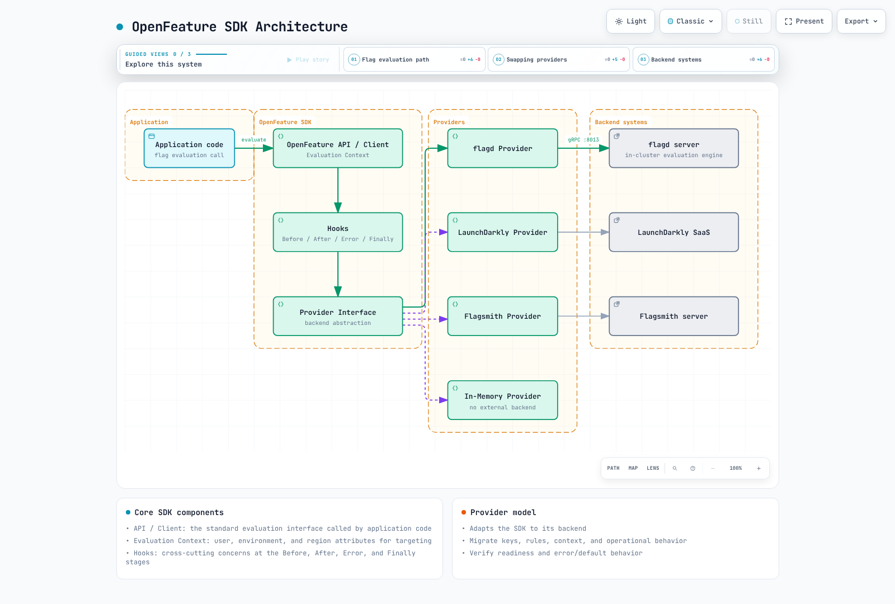
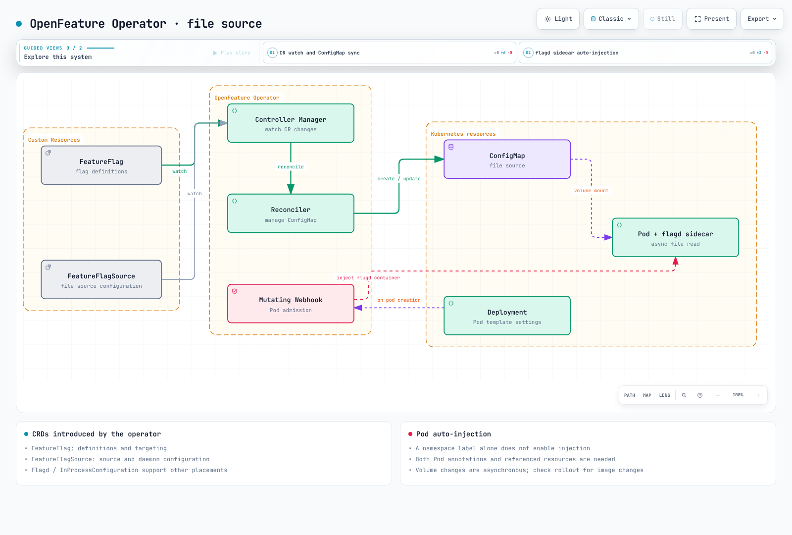
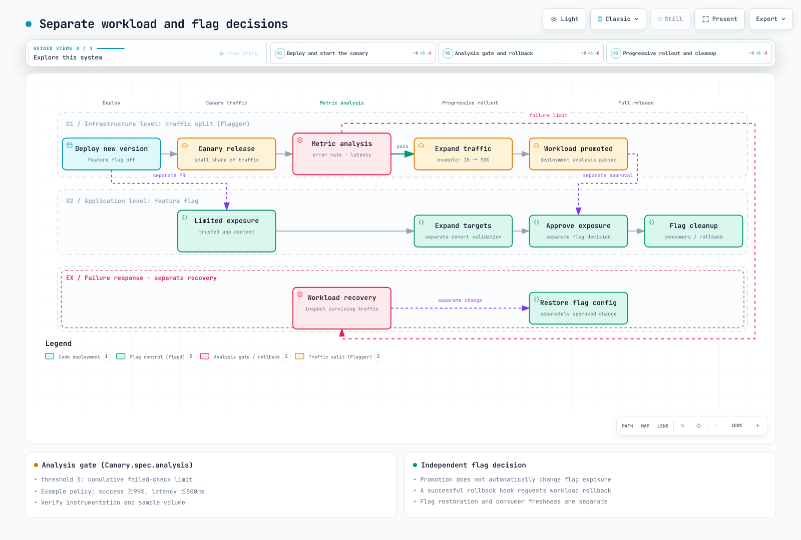
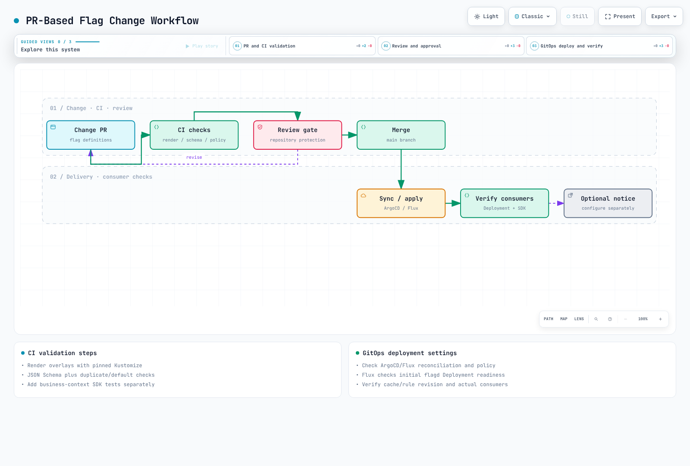
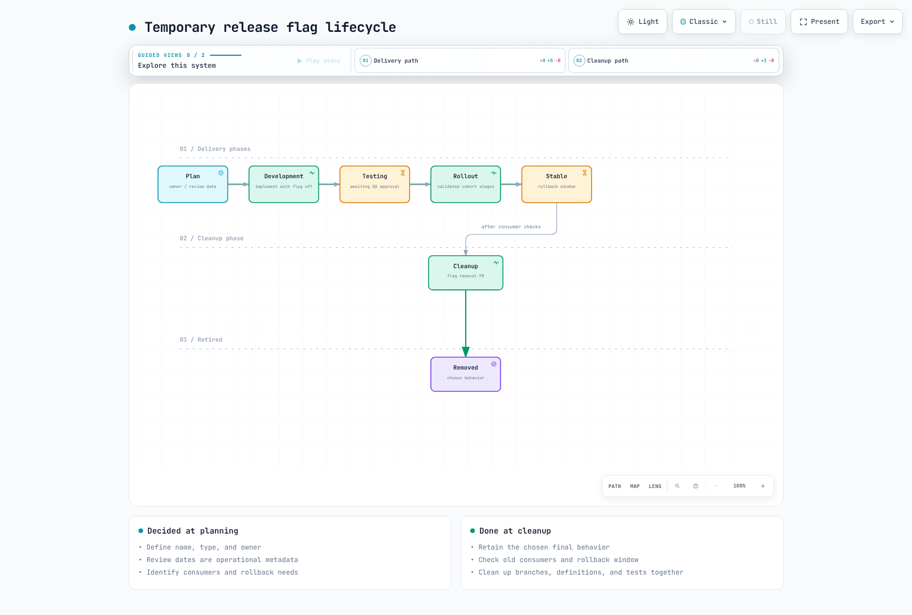

# Feature Flags と OpenFeature

> **検証基準**: flagd 0.16.3、OpenFeature Operator 0.9.3。SDK のバージョンは各例に記載
> **最終更新日**: 2026年9月11日

Feature Flag を使うと、コードのデプロイと実行時の機能公開を切り離せます。このガイドでは、OpenFeature、flagd、Kubernetes Operator の設定、SDK 統合、GitOps ワークフローを扱います。変更の反映には同期処理と利用側の状態が関係するため、即時のロールバックが保証されるわけではありません。

検証範囲: 4つのSDK例はローカルファイルモードでコンパイルして実行しました。flagdのHTTP評価とPrometheusメトリクスは、分離されたテストネットワークで確認しました。Helm、Kustomize、スキーマ、スクリプトも検証しています。実際のEKSデプロイ、アプリケーションイメージ、すべてのRPC/TLS経路、本番負荷を検証したものではありません。デプロイ先URL、イメージ、ポリシーは実環境に合わせてください。

---

## 目次

- [概要と学習目標](#overview-and-learning-objectives)
- [OpenFeature アーキテクチャ](#openfeature-architecture)
- [Kubernetes 上の flagd](#flagd-on-kubernetes)
- [OpenFeature Operator](#openfeature-operator)
- [アプリケーション統合](#application-integration)
- [Canary リリースと Feature Flag の組み合わせ](#canary-release-and-feature-flag-combination)
- [GitOps 統合](#gitops-integration)
- [オブザーバビリティ](#observability)
- [本番環境のベストプラクティス](#production-best-practices)
- [参考資料](#references)

---

## 概要と学習目標 {#overview-and-learning-objectives}

### 学習目標

このセクションを終えると、次のことができるようになります。

- プログレッシブデリバリーと継続的デプロイにおけるFeature Flagの役割を説明する
- Feature Flagプラットフォームを比較し、環境に適したツールを選ぶ
- OpenFeature Operatorを使ってKubernetesにflagdをデプロイする
- Go、Java、Python、Node.jsアプリケーションにOpenFeature SDKを統合する
- Feature FlagとCanaryリリースを組み合わせ、高度なロールアウト戦略を実施する
- GitOpsワークフローでFeature Flagの設定をコードとして管理する
- PrometheusとGrafanaでFlag評価を監視する

### Feature Flag とは

Feature Flag（Feature Toggle、Feature Switchとも呼ばれます）は、新しいコードをデプロイせずに、実行時に機能を有効または無効にする仕組みです。基本的な考え方は、Flagの値を確認する条件分岐でコードパスを囲み、その値を外部から制御することです。

```
if featureEnabled("new-checkout"):
    renderNewCheckout()
else:
    renderLegacyCheckout()
```

Feature Flagは、ソフトウェアの提供において次のような目的に使われます。

| 分類 | 目的 | 有効期間 | 例 |
|----------|---------|----------|---------|
| **リリースFlag** | デプロイとリリースを分離する | 数日から数週間 | 開発中の未完成機能をFlagの背後に隠す |
| **実験Flag** | A/Bテストとデータに基づく意思決定 | 数週間から数か月 | 料金ページのバリアントBをユーザーの10%に表示する |
| **運用Flag** | 運用制御とサーキットブレーカー | 恒久的 | 重要度の低い下流依存先を停止するキルスイッチ |
| **権限Flag** | エンタイトルメントとアクセス制御 | 恒久的 | 有料顧客だけにプレミアム機能を有効化する |

機能の公開制御は、認証や認可の代わりにはなりません。無効化したコードもイメージ内に残る可能性があります。Flagは秘密情報ストアでもアクセス制御境界でもありません。

### プログレッシブデリバリーにおける Feature Flag

プログレッシブデリバリーは、誰がいつ新機能を使えるかをきめ細かく制御することで、継続的デリバリーを拡張します。Feature Flagはこのモデルを支える重要な要素です。


[🔍 インタラクティブ図を表示](https://www.atomai.click/kubernetes-docs/archmaps/en-gitops-05-feature-flags-0.html)

コードはローリングアップデートなどのワークロードデプロイ戦略に従います。Feature Flagは、それとは別にアプリケーションのどの動作を選ぶかを制御します。リクエストがどのPodバージョンに届くかを制御するCanaryデプロイなどのトラフィック分割方式とは異なります。両方の手法は補完的に使えます。詳しくは[Canary リリースと Feature Flag の組み合わせ](#canary-release-and-feature-flag-combination)を参照してください。

### Feature Flag ツールの比較

管理機能、実行時評価、言語ごとのProvider対応を合わせて評価してください。Providerがあるからといって、各言語で同じフック、イベント、ターゲティングの意味論が利用できるとは限りません。価格や契約機能はベンダーの最新ドキュメントで確認してください。この比較は統合方式と運用責任に焦点を当てています。

| ツール | 役割 | 統合・運用上の確認事項 |
|------|------|------------------------------------|
| flagd | 自己管理型の評価エンジンとルール同期 | ソース、RPC/プロセス内モード、Operator、可用性、オブザーバビリティを設定する |
| [LaunchDarkly](https://launchdarkly.com/docs/sdk/openfeature) | マネージドFeature Flagサービス | 各言語のProvider、コンテキスト/イベントの対応付け、基盤SDKの機能を確認する |
| [Flagsmith](https://docs.flagsmith.com/integrating-with-flagsmith/openfeature) | マネージドまたはセルフホスト型のFlagプラットフォーム | サーバー/ウェブProviderの違いと言語対応範囲を確認する |
| [Harness FME](https://github.com/harness/developer-hub/tree/main/docs/feature-management-experimentation) | Feature管理と実験 | 既存のSplit構成からの移行、Provider、実験データ連携を確認する |
| [Unleash](https://github.com/Unleash/unleash-openfeature-node-provider) | Unleash SDKを基盤とするProviderエコシステム | コンテキスト変換、スティッキネス、任意機能を確認する。Node Providerはtracking APIを実装していない |

このガイドではflagdの経路を直接検証しています。商用アカウントへの接続や、すべてのProvider間の機能同等性はテストしていません。

### OpenFeature 標準

OpenFeatureは、Feature Flag評価のためのベンダー中立でコミュニティ主導のAPIを提供するCNCFのインキュベーティングプロジェクトです。どのバックエンドProviderにも対応する標準インターフェースを定義し、ベンダーロックインを軽減します。

OpenFeatureの主な利点:

- **ベンダー中立のAPI**: Providerの設定やルールを移行しながら、評価呼び出しの変更を抑える
- **一貫した評価モデル**: Boolean、string、number、objectのFlag型と統一された評価API
- **Hook**: ログ、メトリクス、検証、トレース用のライフサイクルHook
- **評価コンテキスト**: 各評価に渡す構造化コンテキスト（ユーザー属性、環境情報など）
- **マルチ言語対応**: Go、Java、Python、Node.js、.NET、PHPなどの公式SDK

---

## OpenFeature アーキテクチャ {#openfeature-architecture}

### SDK の構造

OpenFeature SDKは、評価APIとFlag管理バックエンドを分離するレイヤー構造を採用しています。



[🔍 インタラクティブ図を表示](https://www.atomai.click/kubernetes-docs/archmaps/en-gitops-05-feature-flags-1.html)

### 主な構成要素

**評価API**: アプリケーションコードが使う主要なインターフェースです。型付き評価メソッド（`getBooleanValue`、`getStringValue`、`getNumberValue`、`getObjectValue`）と、評価のスコープを設定する`Client`抽象化を提供します。

**Provider**: OpenFeature SDKを特定のFlag管理バックエンドに接続する具体的な実装です。ドメインごとに同時に有効なProviderは1つで、SDKはFlagの解決をProviderに委ねます。

**評価コンテキスト**: Flag評価に必要なキーと値の属性セットです。一般的な属性は`targetingKey`（ユーザーID）、`email`、`region`、`environment`、カスタムプロパティです。コンテキストは評価処理全体に渡されます。

**Hook**: Flag評価の次の4段階でライフサイクルに介入します。

| 段階 | タイミング | 主な用途 |
|-------|--------|-----------------|
| `before` | 評価前 | コンテキストの拡充、入力検証 |
| `after` | 評価成功後 | メトリクス記録、判断のログ出力 |
| `error` | 評価失敗時 | エラー報告、フォールバック処理 |
| `finally` | 常に実行（try/finallyと同様） | クリーンアップ、スパン完了 |

### Provider モデル

Provider抽象化はバックエンドとの結合を減らします。次は模式的なインターフェースであり、特定言語の実装契約ではありません。初期化、イベント、コンテキスト変更への対応はSDKによって異なります。

```
Provider Interface:
  - resolveBooleanValue(flagKey, defaultValue, context) -> ResolutionDetails
  - resolveStringValue(flagKey, defaultValue, context) -> ResolutionDetails
  - resolveNumberValue(flagKey, defaultValue, context) -> ResolutionDetails
  - resolveObjectValue(flagKey, defaultValue, context) -> ResolutionDetails
  - initialize(context) -> void
  - shutdown() -> void
```

Providerを切り替えると、対応する範囲で評価APIを維持できます。一方で、Flagキー、バリアント、ターゲティング、認証情報、コンテキストの意味、運用動作の移行とテストは引き続き必要です。各Providerのコンストラクターを確認し、クライアントを再利用する前に準備完了を待ってください。完全な[Go SDK](#go-sdk)の例を参照してください。図はProvider選択の一例であり、flagdの利用を開発環境に限定するものではありません。


[🔍 インタラクティブ図を表示](https://www.atomai.click/kubernetes-docs/archmaps/en-gitops-05-feature-flags-2.html)

### 評価フロー

成功時はBefore、Providerによる解決、After、Finallyの順に実行されます。Before、Provider解決、Afterのいずれかでエラーになると、Finallyの前にError経路を通ります。現在のGoインターフェースでは、Finallyに評価の詳細が渡されます。


[🔍 インタラクティブ図を表示](https://www.atomai.click/kubernetes-docs/archmaps/en-gitops-05-feature-flags-11.html)

---

## Kubernetes 上の flagd {#flagd-on-kubernetes}

### flagd とは

flagdは軽量なオープンソースのFeature Flagデーモンで、OpenFeature準拠のFlag評価エンジンの参照実装です。クラウドネイティブ環境向けに設計され、Kubernetes上で動作します。

主な特徴:

- **軽量**: Goサービス。CPUとメモリの必要量はFlag数、ソース、トラフィック、有効なテレメトリに左右される
- **Kubernetesネイティブ**: FeatureFlag CRD、ConfigMap、ファイルからFlag設定を読み込む
- **gRPCとHTTP**: 評価サービスはポート8013を使用する。別のOFREP HTTPエンドポイントは8016、管理/メトリクスは既定で8014、定義同期は8015を使う
- **リアルタイム同期**: 設定済みソースから定義を同期する。更新は非同期なので、利用側が最新状態か確認する必要がある
- **割合による評価**: 一貫性ハッシュを使った割合ベースのロールアウトを標準でサポートする
- **ターゲティングルール**: 複雑なオーディエンスの分類にJSON Logicを使う

### flagd のアーキテクチャ


[🔍 インタラクティブ図を表示](https://www.atomai.click/kubernetes-docs/archmaps/en-gitops-05-feature-flags-3.html)

### Helm によるインストール {#helm-installation}

公式リポジトリでは`open-feature-operator`チャートが公開されています。独立した`openfeature/flagd`チャートがあると想定しないでください。Operatorをインストールした後、Podへのサイドカー注入または`Flagd`リソースの設定によって評価サービスを作成します。最初に[cert-manager](../security/10-cert-manager.md)を用意し、Webhook証明書を準備してください。

`openfeature-values.yaml`として保存します。Operator `v0.9.3`の既定値はflagd `v0.16.2`ですが、この例ではサイドカーと共有デプロイの両方のイメージに`v0.16.3`を指定しています。リソース値はラボ開始時の目安であり、本番環境の実測に基づくサイジングではありません。

```yaml
sidecarConfiguration:
  image:
    repository: ghcr.io/open-feature/flagd
    tag: v0.16.3
  resources:
    requests:
      cpu: 50m
      memory: 64Mi
    limits:
      cpu: 200m
      memory: 256Mi
flagdConfiguration:
  image:
    repository: ghcr.io/open-feature/flagd
    tag: v0.16.3
```

```bash
helm repo add openfeature https://open-feature.github.io/open-feature-operator/
helm repo update
helm upgrade --install open-feature-operator openfeature/open-feature-operator \
  --version v0.9.3 \
  --namespace open-feature-operator-system --create-namespace \
  -f openfeature-values.yaml --wait --timeout 5m
```

`sidecarConfiguration`と`flagdConfiguration`は異なる配置を設定します。以前の`sidecarConfig`、`flagdProxyConfig`、`controllerManager.manager.env`の例は、このチャートの設定パスに対応していません。Webhookの既定の`failurePolicy: Ignore`では、Webhookが使えないとPodにサイドカーが付かないことがあります。対象ワークロードと障害時の影響を評価してから`Fail`を選び、アプリケーションのProvider初期化とフォールバック動作を定義してください。

### FeatureFlag CRD

OpenFeature Operatorは、Feature FlagをKubernetesリソースとして宣言できる`FeatureFlag`カスタムリソース定義を導入します。KubernetesネイティブにFlag設定を管理する主要な方法です。

主要なFlag型とターゲティングルールを示す`FeatureFlag` CRの例を次に示します。

```yaml
apiVersion: v1
kind: Namespace
metadata:
  name: flag-demo
---
apiVersion: core.openfeature.dev/v1beta1
kind: FeatureFlag
metadata:
  name: product-flags
  namespace: flag-demo
spec:
  flagSpec:
    flags:
      new-checkout:
        state: ENABLED
        variants:
          'on': true
          'off': false
        defaultVariant: 'off'
        targeting:
          if:
          - ==:
            - var: tier
            - internal
          - 'on'
          - fractional:
            - - 'on'
              - 10
            - - 'off'
              - 90
      banner-color:
        state: ENABLED
        variants:
          blue: '#0055ff'
          green: '#008855'
        defaultVariant: blue
        targeting:
          if:
          - ==:
            - var: tier
            - enterprise
          - green
          - blue
      rate-limit:
        state: ENABLED
        variants:
          standard: 100
          premium: 500
        defaultVariant: standard
        targeting:
          if:
          - in:
            - var: tier
            - - premium
              - enterprise
          - premium
          - standard
      feature-config:
        state: ENABLED
        variants:
          default:
            maxUploadBytes: 10485760
            enableOCR: false
          enhanced:
            maxUploadBytes: 52428800
            enableOCR: true
        defaultVariant: default
        targeting:
          if:
          - and:
            - ==:
              - var: environment
              - production
            - in:
              - var: tier
              - - premium
                - enterprise
          - enhanced
          - default
```

### サイドカー注入とスタンドアロンデプロイ

flagdをKubernetesで実行する方法は2つあります。レイテンシ要件、運用モデル、リソース予算に応じて選択します。

**サイドカーモード**（OpenFeature Operatorによる注入）:


[🔍 インタラクティブ図を表示](https://www.atomai.click/kubernetes-docs/archmaps/en-gitops-05-feature-flags-4.html)

**スタンドアロンモード**（集中配置）:


[🔍 インタラクティブ図を表示](https://www.atomai.click/kubernetes-docs/archmaps/en-gitops-05-feature-flags-5.html)

| 観点 | サイドカー | スタンドアロン |
|--------|---------|------------|
| **RPC経路** | localhostへの呼び出し | 共有Serviceへの呼び出し。実際のレイテンシを測定する |
| **リソース使用量** | Podごとにflagdを1つ配置 | Pod間で共有する |
| **障害範囲** | デーモンの障害はPod単位。共有設定は多数のPodに影響する可能性がある | 共有サービスの障害は複数の利用側に影響する可能性がある |
| **スケーリング** | アプリケーションPodとともに拡張 | 独立して拡張 |
| **設定** | OperatorによるPod受付とソース参照 | Operator管理のFlagd CR、または別途管理するデプロイ |
| **トレードオフ** | Podごとの実行・運用負荷 | 共有容量とサービス依存が生じる |

この共有`Flagd`を適用する前に、後述のFeatureFlagとFeatureFlagSourceを作成してください。OperatorがDeploymentとClusterIP Serviceを管理します。ファイルソースでは、flagd PodにAPIトークンをマウントする必要はありません。Service名は`flagd.flag-demo.svc.cluster.local`、RPCポートは8013です。

```yaml
apiVersion: v1
kind: ServiceAccount
metadata:
  name: flagd-demo
  namespace: flag-demo
automountServiceAccountToken: false
---
apiVersion: core.openfeature.dev/v1beta1
kind: Flagd
metadata:
  name: flagd
  namespace: flag-demo
spec:
  replicas: 2
  serviceType: ClusterIP
  serviceAccountName: flagd-demo
  featureFlagSource: product-flags-source
```

---

## OpenFeature Operator

OpenFeature Operatorはflagdインスタンスのライフサイクルを管理し、Feature Flag設定を同期するKubernetes Operatorです。本番Kubernetes環境でflagdを実行するための推奨方式です。

### インストール

[Helmによるインストール](#helm-installation)に記載したOperatorのバージョン固定とイメージ上書きを使います。Operatorをインストールしても、すべてのアプリケーション用の共有flagd Serviceが自動でデプロイされるわけではありません。

### Operator が導入する CRD

OperatorはFeature Flagを管理するため、次のCRDを導入します。

| CRD | 目的 |
|-----|---------|
| `FeatureFlag` | Flagキー、バリアント、ターゲティングルールなどの定義をインラインで宣言する |
| `FeatureFlagSource` | ワークロード用のFlag設定ソース（CRD、ファイル、HTTP）を指定する |

### FeatureFlagSource CRD

`FeatureFlagSource`は、注入または共有flagdインスタンスが使うソースと設定を指定します。この例では`file`ソースから`flag-demo/product-flags`を参照します。OperatorがConfigMapボリュームを提供するため、flagdコンテナがKubernetesを直接監視する必要はありません。先にFeatureFlagを作成してください。

```yaml
apiVersion: core.openfeature.dev/v1beta1
kind: FeatureFlagSource
metadata:
  name: product-flags-source
  namespace: flag-demo
spec:
  sources:
  - source: flag-demo/product-flags
    provider: file
  port: 8013
  managementPort: 8014
  evaluator: json
  logFormat: json
  probesEnabled: true
```

| ソース | `source`の形式 | 前提条件 |
|--------|---------------|--------------|
| `file` | `namespace/FeatureFlag-name` | Operatorが提供するConfigMapボリューム |
| `kubernetes` | `namespace/FeatureFlag-name` | flagd用のKubernetes API権限と認証情報 |
| `flagd-proxy` | Operatorが文書化しているproxyソース設定 | Proxyサービスとアクセス境界 |
| `http` | 実在するHTTPS JSONエンドポイント | 接続性、認証、サーバーの信頼性 |
| `grpc` | 実在する`host:port` | Syncサーバー、TLS、必要な認証 |

設定するソースはすべて実在する必要があります。ここで示す値はFeatureFlagSource用であり、flagd CLIの自動検出URIではありません。CLIのKubernetes自動検出には`core.openfeature.dev/flag-demo/product-flags`を指定できます。認証トークンをCRに書き込まないでください。`evaluator: json`は評価エンジンを選択する設定であり、キャッシュやすべてのFlag評価ログを有効にする設定ではありません。

別のFeatureFlag CRを追加する場合は、FeatureFlagSourceから参照するか、定義を既存の`product-flags`マップに統合します。CRを作成しただけでは、すべてのflagdインスタンスやSDKがその内容を使うようにはなりません。

### Pod の自動注入

DeploymentのPodテンプレートに両方のannotationを設定します。Namespaceラベルだけでは注入されません。次の統合テンプレートを使うには、SDKを使用してポート8080でHTTPを提供する実際のアプリケーションイメージが必要です。ファイルソースではサイドカーにKubernetes APIトークンは不要です。

```yaml
apiVersion: v1
kind: ServiceAccount
metadata:
  name: order-service
  namespace: flag-demo
automountServiceAccountToken: false
---
apiVersion: apps/v1
kind: Deployment
metadata:
  name: order-service
  namespace: flag-demo
spec:
  replicas: 3
  selector:
    matchLabels:
      app: order-service
  template:
    metadata:
      labels:
        app: order-service
      annotations:
        # This annotation triggers flagd sidecar injection
        openfeature.dev/enabled: "true"
        # Reference the FeatureFlagSource to use
        openfeature.dev/featureflagsource: "product-flags-source"
    spec:
      serviceAccountName: order-service
      automountServiceAccountToken: false
      containers:
        - name: order-service
          image: YOUR_REGISTRY/order-service:YOUR_VERSION
          ports:
            - containerPort: 8080
              name: http
          env:
            # The flagd provider connects to localhost because the sidecar
            # runs in the same pod
            - name: FLAGD_HOST
              value: "localhost"
            - name: FLAGD_PORT
              value: "8013"
```

Admission後のPodを調べ、注入が成功したこと、イメージ、引数、ボリュームが意図したFeatureFlagSourceに合っていることを確認します。Webhookのfailure policyがIgnoreの場合、Podが起動しているだけでは注入成功の証拠になりません。

### ConfigMap と CRD の同期

この例のファイルソースでは、OperatorがConfigMapボリュームを通してFeatureFlag定義を提供します。Kubernetes直接参照やProxyソースは異なる経路を使います。次の図はファイルソースの経路を示します。



[🔍 インタラクティブ図を表示](https://www.atomai.click/kubernetes-docs/archmaps/en-gitops-05-feature-flags-6.html)

ファイルソースの定義変更はPodを再起動せずに利用できますが、ConfigMapの投影とファイルの読み取りは非同期です。イメージまたはソース設定を変更するときは、デプロイ済みPodの設定と必要なロールアウトを別々に確認してください。初期のReadinessは、すべての利用側が最新の定義を取得した証明にはなりません。

---

## アプリケーション統合 {#application-integration}

### Go SDK

この例ではGo 1.25以降、OpenFeature Go SDK `v1.18.0`、flagd Provider `v0.6.0`を使います。`NewProvider`はProviderとエラーの両方を返します。`WithFileResolver`と`WithOfflineFilePath`を使ってローカルファイル解決を選択します。古い`WithResolverType`や`flagd.GRPC`を使う例は、このProvider APIに対応していません。

`spec.flagSpec`内のJSONオブジェクトだけを`flags.json`として保存してください。Kubernetesリソース全体を保存しないでください。ファイルには、下の例で読み取る4つのFlagキーが必要です。既存リソースから書き出す場合は、実際のNamespaceを選んでください。

```bash
kubectl get featureflag product-flags -n flag-demo -o json | jq '.spec.flagSpec' > flags.json
mkdir go-flag-demo
cp flags.json go-flag-demo/
cd go-flag-demo
go mod init example.com/go-flag-demo
go get github.com/open-feature/go-sdk@v1.18.0
go get github.com/open-feature/go-sdk-contrib/providers/flagd@v0.6.0
# Save the code below as main.go, then run it.
go run . flags.json
```

ファイルモードはローカルの検証経路であり、Kubernetesやflagdサーバーには接続しません。本番環境では、`tier`などの属性を認証済みのサーバー状態から取得してください。信頼できないリクエストヘッダーをエンタイトルメントや認可の判断に使ってはいけません。

```go
package main

import (
    "context"
    "encoding/json"
    "errors"
    "log"
    "os"
    "time"

    "github.com/open-feature/go-sdk/openfeature"
    flagd "github.com/open-feature/go-sdk-contrib/providers/flagd/pkg"
)

func run(flagFile string) error {
    provider, err := flagd.NewProvider(
        flagd.WithFileResolver(),
        flagd.WithOfflineFilePath(flagFile),
    )
    if err != nil {
        return err
    }
    if err := openfeature.SetProviderAndWait(provider); err != nil {
        return err
    }
    defer openfeature.Shutdown()

    client := openfeature.NewClient("docs-demo")
    ctx, cancel := context.WithTimeout(context.Background(), time.Second)
    defer cancel()
    evaluation := openfeature.NewEvaluationContext("synthetic-user", map[string]interface{}{
        "tier": "internal",
        "region": "ap-northeast-2",
        "environment": "development",
    })

    enabled, errBool := client.BooleanValue(ctx, "new-checkout", false, evaluation)
    color, errString := client.StringValue(ctx, "banner-color", "#000000", evaluation)
    limit, errInteger := client.IntValue(ctx, "rate-limit", 10, evaluation)
    config, errObject := client.ObjectValue(ctx, "feature-config", map[string]interface{}{}, evaluation)
    if err := errors.Join(errBool, errString, errInteger, errObject); err != nil {
        return err
    }
    return json.NewEncoder(os.Stdout).Encode(map[string]interface{}{
        "enabled": enabled,
        "color": color,
        "limit": limit,
        "config": config,
    })
}

func main() {
    if len(os.Args) != 2 {
        log.Fatal("usage: go run . flags.json")
    }
    if err := run(os.Args[1]); err != nil {
        log.Fatal(err)
    }
}
```

flagdサイドカーでRPCを使う場合は、次のコンストラクターだけを置き換えます。ProviderのReadiness、評価エラー処理、終了処理は維持してください。共有`Flagd`デプロイではlocalhostではなくServiceのDNS名を使い、ネットワークとTLSの設定をそのデプロイに合わせます。

```go
provider, err := flagd.NewProvider(
    flagd.WithHost("127.0.0.1"),
    flagd.WithPort(8013),
)
```

### Java SDK

この例ではJDK 21、Maven 3.9、OpenFeature Java SDK `1.22.1`、flagd Provider `0.14.1`を使用します。Resolverの選択には`FlagdOptions.ResolverType`ではなく`Config.Resolver`を使います。`MutableContext.add`にはstring、integer、booleanなど、対応する型のオーバーロードがあります。

新しいプロジェクトにこの`pom.xml`を保存します。

```xml
<project xmlns="http://maven.apache.org/POM/4.0.0" xmlns:xsi="http://www.w3.org/2001/XMLSchema-instance" xsi:schemaLocation="http://maven.apache.org/POM/4.0.0 https://maven.apache.org/xsd/maven-4.0.0.xsd">
  <modelVersion>4.0.0</modelVersion>
  <groupId>example.docs</groupId><artifactId>flag-demo</artifactId><version>1.0.0</version>
  <properties><maven.compiler.release>21</maven.compiler.release><project.build.sourceEncoding>UTF-8</project.build.sourceEncoding></properties>
  <dependencies>
    <dependency><groupId>dev.openfeature</groupId><artifactId>sdk</artifactId><version>1.22.1</version></dependency>
    <dependency><groupId>dev.openfeature.contrib.providers</groupId><artifactId>flagd</artifactId><version>0.14.1</version></dependency>
  </dependencies>
  <build><plugins><plugin><groupId>org.apache.maven.plugins</groupId><artifactId>maven-compiler-plugin</artifactId><version>3.14.1</version></plugin></plugins></build>
</project>
```

次を`src/main/java/FlagDemo.java`として保存し、同じ`flags.json`をプロジェクトルートに配置します。ファイルモードではサーバーに接続せずにFlagを評価します。

```java
import dev.openfeature.contrib.providers.flagd.Config;
import dev.openfeature.contrib.providers.flagd.FlagdOptions;
import dev.openfeature.contrib.providers.flagd.FlagdProvider;
import dev.openfeature.sdk.Client;
import dev.openfeature.sdk.FlagEvaluationDetails;
import dev.openfeature.sdk.MutableContext;
import dev.openfeature.sdk.MutableStructure;
import dev.openfeature.sdk.OpenFeatureAPI;
import dev.openfeature.sdk.Value;
import java.nio.file.Path;
import java.util.List;

public class FlagDemo {
    public static void main(String[] args) {
        if (args.length != 1) throw new IllegalArgumentException("usage: FlagDemo flags.json");
        OpenFeatureAPI api = OpenFeatureAPI.getInstance();
        FlagdOptions options = FlagdOptions.builder()
                .resolverType(Config.Resolver.FILE)
                .offlineFlagSourcePath(Path.of(args[0]).toAbsolutePath().toString())
                .build();
        try {
            api.setProviderAndWait(new FlagdProvider(options));
            Client client = api.getClient("docs-demo");
            MutableContext context = new MutableContext("synthetic-user");
            context.add("tier", "internal");
            FlagEvaluationDetails<Boolean> enabled = client.getBooleanDetails("new-checkout", false, context);
            FlagEvaluationDetails<String> color = client.getStringDetails("banner-color", "#000000", context);
            FlagEvaluationDetails<Integer> limit = client.getIntegerDetails("rate-limit", 10, context);
            Value fallback = new Value(new MutableStructure().add("maxUploadBytes", 0).add("enableOCR", false));
            FlagEvaluationDetails<Value> config = client.getObjectDetails("feature-config", fallback, context);
            for (FlagEvaluationDetails<?> result : List.of(enabled, color, limit, config)) {
                if (result.getErrorCode() != null) throw new IllegalStateException(result.getErrorCode().toString());
            }
            System.out.printf("enabled=%s color=%s limit=%d config=%s%n", enabled.getValue(), color.getValue(), limit.getValue(), config.getValue().asStructure().asObjectMap());
        } finally {
            api.shutdown();
        }
    }
}
```

```bash
mvn compile org.apache.maven.plugins:maven-dependency-plugin:3.8.1:build-classpath \
  -Dmdep.outputFile=classpath.txt
java -cp "target/classes:$(cat classpath.txt)" FlagDemo flags.json
```

RPCを使う場合は`Config.Resolver.RPC`を選び、`host`、`port`、`deadline`を設定して`offlineFlagSourcePath`を削除します。準備完了したサーバーに対して`setProviderAndWait`を使い、アプリケーション終了時に`shutdown`を呼び出してください。この単独例はロギング実装を追加していないため、SLF4JがNOPロガーの警告を出すことがあります。実サービスでは、既存のSLF4Jロギング設定を使ってください。

### Python SDK

この完全なローカルファイル例ではPython 3.10以降、`openfeature-sdk==0.10.0`、`openfeature-provider-flagd==0.5.2`を使用します。同じ`flags.json`を再利用してください。公開コンストラクタの引数名は`resolver_type`で、`ResolverType.FILE`などのenum値を使います。`ResolverType.GRPC`や文字列の`"rpc"`は、この設定APIには対応していません。

```bash
python -m venv python-flag-demo/.venv
python-flag-demo/.venv/bin/python -m pip install \
  openfeature-sdk==0.10.0 openfeature-provider-flagd==0.5.2
# Save the code below as python-flag-demo/main.py.
python-flag-demo/.venv/bin/python python-flag-demo/main.py flags.json
```

```python
import json
import sys
from pathlib import Path

from openfeature import api
from openfeature.contrib.provider.flagd import FlagdProvider
from openfeature.contrib.provider.flagd.config import ResolverType
from openfeature.evaluation_context import EvaluationContext

if len(sys.argv) != 2:
    raise SystemExit("usage: python main.py flags.json")

provider = FlagdProvider(
    resolver_type=ResolverType.FILE,
    offline_flag_source_path=str(Path(sys.argv[1]).resolve()),
)
try:
    api.set_provider_and_wait(provider)
    client = api.get_client("docs-demo")
    context = EvaluationContext(targeting_key="synthetic-user", attributes={"tier": "internal"})
    results = {
        "enabled": client.get_boolean_details("new-checkout", False, context),
        "color": client.get_string_details("banner-color", "#000000", context),
        "limit": client.get_integer_details("rate-limit", 10, context),
        "config": client.get_object_details("feature-config", {"maxUploadBytes": 0, "enableOCR": False}, context),
    }
    for name, result in results.items():
        if result.error_code is not None:
            raise RuntimeError(f"{name}: {result.error_code}")
    print(json.dumps({name: result.value for name, result in results.items()}))
finally:
    api.shutdown()
```

RPCを使う場合は、代わりに`FlagdProvider(host="127.0.0.1", port=8013,
resolver_type=ResolverType.RPC, deadline_ms=500)`を指定します。オフラインファイルの指定を削除し、準備完了したflagdサーバーを使って初期化してください。`set_provider_and_wait`と`shutdown`を維持します。フォールバックと成功した評価を区別するには、上記のように詳細結果の`error_code`を確認します。

### Node.js SDK

このTypeScript例ではNode.js 22、`@openfeature/server-sdk@1.23.0`、`@openfeature/flagd-provider@0.16.1`を使用します。`resolverType`で指定できるのは`rpc`または`in-process`で、`grpc`ではありません。このSDKでは、in-process resolverに`offlineFlagSourcePath`を追加すると、ネットワーク同期ではなくローカルファイルが使われます。

```bash
mkdir node-flag-demo
cp flags.json node-flag-demo/
cd node-flag-demo
npm init -y
npm pkg set type=module
npm install @openfeature/server-sdk@1.23.0 @openfeature/flagd-provider@0.16.1
npm install --save-dev typescript@5.9.3 @types/node@22.19.0
# Save the code below as main.ts.
npx tsc main.ts --target ES2022 --module NodeNext --moduleResolution NodeNext \
  --strict --skipLibCheck --outDir dist
node dist/main.js flags.json
```

```typescript
import { OpenFeature, type EvaluationContext } from '@openfeature/server-sdk';
import { FlagdProvider } from '@openfeature/flagd-provider';

const flagFile = process.argv[2];
if (!flagFile) throw new Error('usage: node dist/main.js flags.json');
const provider = new FlagdProvider({
  resolverType: 'in-process',
  offlineFlagSourcePath: flagFile,
});
try {
  await OpenFeature.setProviderAndWait(provider);
  const client = OpenFeature.getClient('docs-demo');
  const context: EvaluationContext = {targetingKey: 'synthetic-user', tier: 'internal'};
  const results = {
    enabled: await client.getBooleanDetails('new-checkout', false, context),
    color: await client.getStringDetails('banner-color', '#000000', context),
    limit: await client.getNumberDetails('rate-limit', 10, context),
    config: await client.getObjectDetails('feature-config', {maxUploadBytes: 0, enableOCR: false}, context),
  };
  for (const [name, result] of Object.entries(results)) {
    if (result.errorCode) throw new Error(`${name}: ${result.errorCode}`);
  }
  console.log(JSON.stringify(Object.fromEntries(Object.entries(results).map(([name, result]) => [name, result.value]))));
} finally {
  await OpenFeature.clearProviders();
}
```

RPCでは`resolverType: 'rpc'`、サーバーの`host`、`port: 8013`を設定し、`offlineFlagSourcePath`を削除します。リクエストを受け付ける前に`setProviderAndWait`を待ち、アプリケーション終了時に`clearProviders`を待ってください。リクエストごとにProviderを作成しないでください。このローカルファイルのテストでは実際のRPC接続は検証していません。

### ターゲティングルールの詳細

`targeting`は最終的に`variants`に存在する**バリアント名**を返す必要があります。`fractional`が返すのもバリアント名であり、ユーザー一覧ではありません。したがって、その結果にユーザーキーが`in`で含まれるかを検査しないでください。基準例のように、内部ユーザー条件とロールアウトを組み合わせます: `if: [internal condition, on, fractional rule]`。

追加のCRをソースで参照するか、その定義を基準の`flags`マップに統合します。信頼できる属性を使い、`app_version`はSemVerとして正規化してください。

```yaml
apiVersion: core.openfeature.dev/v1beta1
kind: FeatureFlag
metadata:
  name: targeting-examples
  namespace: flag-demo
spec:
  flagSpec:
    flags:
      premium-feature:
        state: ENABLED
        variants:
          'on': true
          'off': false
        defaultVariant: 'off'
        targeting:
          if:
          - and:
            - ==:
              - var: tier
              - enterprise
            - '>=':
              - var: account_age_days
              - 30
          - 'on'
          - 'off'
      new-search-algo:
        state: ENABLED
        variants:
          'on': true
          'off': false
        defaultVariant: 'off'
        targeting:
          fractional:
          - - 'on'
            - 20
          - - 'off'
            - 80
      api-v2:
        state: ENABLED
        variants:
          'on': true
          'off': false
        defaultVariant: 'off'
        targeting:
          if:
          - sem_ver:
            - var: app_version
            - '>='
            - 2.0.0
          - 'on'
          - 'off'
```

fractionalの整数weightは相対値です。この例ではハッシュ空間を20/80に分割しますが、実ユーザーやリクエストの正確に20%が選ばれる保証はありません。既定のbucketキーはFlagキーと`targetingKey`を組み合わせます。安定した空でないキーを使い、すべての匿名訪問者に同じキーを割り当てないでください。同じルールとキーで評価を繰り返すと割り当ては安定しますが、weight、キー、評価器を変えると割り当てが変化することがあります。

ターゲティング結果がない場合のFlagの`defaultVariant`と、SDK呼び出し元の既定値は別物です。テストしたGo flagd Providerでは`DISABLED`は呼び出し側の既定値をエラーなしで返し、reasonとして`DISABLED`を報告します。Flagを無効にしても、必ずfalseになるわけではありません。キルスイッチでは`ENABLED`のまま明示的なoffバリアントを選ぶ設計にし、値、エラー、reason、利用側への伝播を検証してください。

---

## Canary リリースと Feature Flag の組み合わせ {#canary-release-and-feature-flag-combination}

この手順は、正常に初期化されたv1のprimaryがあることを前提とします。初回のCanary初期化と、その後のワークロードリビジョンの分析を区別してください。初期状態が実際にOFFであることを、ターゲティングも含めて評価して確認します。既定値がoffというだけでは不十分です。

Feature FlagとCanaryリリースは互いを補完します。Canaryはインフラ層でトラフィック（どのPodバージョンがリクエストを処理するか）を制御し、Feature Flagはアプリケーション層で動作（どのコードパスを実行するか）を制御します。両方を組み合わせることで、リリースをより安全に制御できます。

### アーキテクチャ: Flagger + Feature Flag



[🔍 インタラクティブ図を表示](https://www.atomai.click/kubernetes-docs/archmaps/en-gitops-05-feature-flags-7.html)

これはFlagger 1.45用のIstio統合テンプレートです。[Flagger](./04-flagger.md)を参照してください。Controllerが`flag-demo`を監視し、Deployment、Istio、Prometheusのメトリクスがすでに存在している必要があります。アプリケーションイメージにはSDK統合も必要です。`threshold: 5`は分析中に許容する失敗チェックの累積上限であり、成功回数の必要数ではありません。値は例示的なポリシーなので、実際のSLOに合わせて調整します。

アプリケーションが信頼できる`release_id`を提供すると、新しい動作を使える対象を絞れます。PodがCanaryであることと、アプリケーションのrelease IDを混同しないでください。ワークロードの昇格でFeature Flagが自動的に100%公開されるわけではありません。Flagの拡大と復元には、別の承認、Git変更、または実装済みの自動化が必要です。

### Flagger + Feature Flag のワークフロー

このワークフローでは、トラフィック管理にFlaggerを使い、Canary Pod内のきめ細かい制御にFeature Flagを使います。

**フェーズ1 -- Flagをoffにしてデプロイ**: 新機能をFlag（既定値: off）の背後に置いたv2をデプロイします。Flaggerがv2へ少量のトラフィックをルーティングし始めます。

**フェーズ2 -- 限定コホートを有効化**: `tier: internal`や対象のrelease IDなど、信頼できる属性を使います。実際に利用するリビジョンと機能の公開状態を確認してから対象を拡大します。

**フェーズ3 -- コホートの拡大**: 承認されたFlagのweightを別途変更し、ワークロード分析とともにアプリケーションの結果を監視します。

**フェーズ4 -- 昇格の判断を分離**: 分析が成功すればFlaggerはワークロードを昇格できます。機能を100%に公開するには、別の設定変更が必要です。

Flagger Canaryリソースの例:

```yaml
apiVersion: flagger.app/v1beta1
kind: Canary
metadata:
  name: order-service
  namespace: flag-demo
spec:
  targetRef:
    apiVersion: apps/v1
    kind: Deployment
    name: order-service
  progressDeadlineSeconds: 600
  service:
    port: 8080
    targetPort: 8080
  analysis:
    interval: 1m
    threshold: 5
    maxWeight: 50
    stepWeight: 10
    metrics:
    - name: request-success-rate
      thresholdRange:
        min: 99
      interval: 1m
    - name: request-duration
      thresholdRange:
        max: 500
      interval: 1m
```

Webhook統合には、実在するreceiver、認証、retry処理、リビジョン確認が必要です。`rollback` hookの成功はロールバックを要求したことを示し、ロールバック後の通知ではありません。`post-rollout`は成功時にも失敗時にも実行されるため、結果を確認してください。メタデータの文字列はリテラルであり、Go template式ではありません。この例は外部のFlag Controllerサービスをインストールしません。

### Feature Flag による A/B テスト

安定したターゲティングキーと変更されないルールを使うと、バリアントの割り当てが安定します。このCRをソースに追加するか、既存のFlagマップに統合します。weightの34/33/33はユーザー数を正確に保証するquotaではありません。

```yaml
apiVersion: core.openfeature.dev/v1beta1
kind: FeatureFlag
metadata:
  name: ab-test-checkout
  namespace: flag-demo
spec:
  flagSpec:
    flags:
      checkout-variant:
        state: ENABLED
        variants:
          control: classic
          variant-a: streamlined
          variant-b: one-click
        defaultVariant: control
        targeting:
          fractional:
          - - control
            - 34
          - - variant-a
            - 33
          - - variant-b
            - 33
```

評価結果の値、バリアント、エラーを調べるには、string評価の詳細を使います。選ばれた体験を実際に提供した時点でexposureを記録してください。評価が行われたことだけでは、exposureやconversionの証明にはなりません。conversionイベント、サンプルサイズ、実験期間、成果指標は別に定義します。bucketの安定性は、旧版/新版アプリケーションや古いルールセットをまたいで同じ体験になることを保証しません。

### Dark Launch パターン

Dark Launchでは新機能を本番環境にデプロイしつつ、社内ユーザーまたはShadow Pipelineにだけ公開します。Feature Flagを使うと、この方式を実装しやすくなります。

```yaml
apiVersion: core.openfeature.dev/v1beta1
kind: FeatureFlag
metadata:
  name: dark-launch-quote-v2
  namespace: flag-demo
spec:
  flagSpec:
    flags:
      shadow-quote-v2:
        state: ENABLED
        variants:
          "on": true
          "off": false
        defaultVariant: "off"
        targeting:
          # Only enable for specific internal test accounts
          if:
            - in:
              - var: targetingKey
              - - "test-user-001"
                - "test-user-002"
                - "qa-bot-001"
            - "on"
            - "off"
```

Shadow実行で業務処理を二重に実行してはいけません。特に同一注文に対して2つの決済事業者を呼び出さないでください。読み取り専用の計算結果を比較するか、課金、業務レコードの書き込み、通知を行えない分離環境でサニタイズ済み入力を再生します。呼び出し側には既存実装の結果を返します。

次は統合例の断片です。`calculateLegacyQuote`、`calculateCandidateQuote`、`compareQuotes`はアプリケーション側の関数です。どちらの計算関数も副作用がなく、コンテキストのキャンセルに従う必要があります。この同期例では候補側のtimeout分だけリクエストが遅れることがあります。非同期にする場合は、上限付きキューと専用timeoutを用意してください。

```go
func quoteOrder(ctx context.Context, order Order,
    evalCtx openfeature.EvaluationContext) (Quote, error) {
    original, err := calculateLegacyQuote(ctx, order)
    if err != nil {
        return original, err
    }

    shadowEnabled, flagErr := client.BooleanValue(
        ctx, "shadow-quote-v2", false, evalCtx,
    )
    if flagErr == nil && shadowEnabled {
        shadowCtx, cancel := context.WithTimeout(ctx, 50*time.Millisecond)
        defer cancel()
        candidate, err := calculateCandidateQuote(shadowCtx, order)
        if err == nil {
            compareQuotes(original, candidate)
        }
    }
    return original, nil
}
```

### メトリクスに基づく自動ロールアウト

次のテンプレートを使うには、[オブザーバビリティ](#observability)に示したアプリケーション計測とPodMonitorが必要です。`app`ラベルはprimaryを除外し、対象Deploymentを識別できなければなりません。Prometheus URLは実際のServiceアドレスに置き換えてください。共有flagdサーバーのメトリクスでは、特定Canaryの評価エラーを確実に識別できません。

```yaml
apiVersion: flagger.app/v1beta1
kind: MetricTemplate
metadata:
  name: app-flag-errors
  namespace: flag-demo
spec:
  provider:
    type: prometheus
    address: http://prometheus.monitoring.svc:9090
  query: |-
    100 * (
      sum(rate(app_feature_flag_evaluations_total{namespace="{{ namespace }}",app="{{ target }}",flag_key="new-checkout",reason="ERROR"}[{{ interval }}]))
      or vector(0)
    ) / sum(rate(app_feature_flag_evaluations_total{namespace="{{ namespace }}",app="{{ target }}",flag_key="new-checkout"}[{{ interval }}]))
---
apiVersion: flagger.app/v1beta1
kind: MetricTemplate
metadata:
  name: app-flag-samples
  namespace: flag-demo
spec:
  provider:
    type: prometheus
    address: http://prometheus.monitoring.svc:9090
  query: sum(increase(app_feature_flag_evaluations_total{namespace="{{ namespace }}",app="{{
    target }}",flag_key="new-checkout"}[{{ interval }}]))
```

系列の存在を確認してから、次の項目をCanary既存の`spec.analysis.metrics`リストに追加します。例示的なポリシーは、1分間にSDK評価が少なくとも100回あり、エラー率が1%以下であることを求めます。distinct user数を数えるものでも、業務上の正しさを証明するものでもありません。DISABLEDや既定値の結果は別途監視してください。

```yaml
- name: app-flag-error-rate
  templateRef:
    name: app-flag-errors
  thresholdRange:
    max: 1
  interval: 1m
- name: app-flag-evaluation-count
  templateRef:
    name: app-flag-samples
  thresholdRange:
    min: 100
  interval: 1m
```

Flagger分析の成功で許可されるのはワークロードの昇格だけです。Feature Flagの変更は別に判断します。観測値の欠落やNaNを成功として扱ってはいけません。

---

## GitOps 統合 {#gitops-integration}

### コードとしての Feature Flag

上で検証したリソースを使います。`product-flags.yaml`にはNamespaceとFeatureFlag、`feature-source.yaml`にはファイルモードのFeatureFlagSource、`flagd.yaml`には共有ServiceのServiceAccountとFlagdを記述します。先にOperatorとcert-managerをインストールします。リポジトリURLを置き換え、必要な認証を設定してください。

```text
gitops-config/
├── base/feature-flags/
│   ├── kustomization.yaml
│   ├── product-flags.yaml
│   ├── feature-source.yaml
│   └── flagd.yaml
├── overlays/dev/feature-flags/kustomization.yaml
├── overlays/production/feature-flags/kustomization.yaml
├── validate-flags.py
└── .github/workflows/feature-flags.yml
```

`base/feature-flags/kustomization.yaml`:

```yaml
apiVersion: kustomize.config.k8s.io/v1beta1
kind: Kustomization
resources:
- product-flags.yaml
- feature-source.yaml
- flagd.yaml
```

### Kustomize による環境固有の上書き

ここで示すのはKustomization内の**patch**であり、直接適用できる不完全なFeatureFlagではありません。開発環境のすべてのユーザーを有効化するには、default variantをonにすると同時に、既存のターゲティングルールも削除します。変更後の既定値よりターゲティングが優先されることがあります。他の3つのFlagはそのまま残します。

`overlays/dev/feature-flags/kustomization.yaml`:

```yaml
apiVersion: kustomize.config.k8s.io/v1beta1
kind: Kustomization
resources:
- ../../../base/feature-flags
patches:
- target:
    group: core.openfeature.dev
    version: v1beta1
    kind: FeatureFlag
    name: product-flags
  patch: |
    - op: remove
      path: /spec/flagSpec/flags/new-checkout/targeting
    - op: replace
      path: /spec/flagSpec/flags/new-checkout/defaultVariant
      value: 'on'
```

`overlays/production/feature-flags/kustomization.yaml`:

```yaml
apiVersion: kustomize.config.k8s.io/v1beta1
kind: Kustomization
resources:
- ../../../base/feature-flags
patches:
- target:
    group: core.openfeature.dev
    version: v1beta1
    kind: FeatureFlag
    name: product-flags
  patch: |
    - op: replace
      path: /spec/flagSpec/flags/new-checkout/targeting
      value:
        if:
        - ==:
          - var: tier
          - internal
        - 'on'
        - fractional:
          - - 'on'
            - 5
          - - 'off'
            - 95
```

Kustomize 5.8.1で両方の設定をrenderし、デプロイ前に出力全体を確認します。

```bash
kustomize build overlays/dev/feature-flags
kustomize build overlays/production/feature-flags
```

### ArgoCD による FeatureFlag CR のデプロイ

既存の`platform` AppProjectでは、この経路で使う実際のリポジトリ、`flag-demo`の宛先、Namespace、ServiceAccount、OpenFeatureリソース種別を許可する必要があります。同期が成功しても、Operatorが作成したDeploymentやすべてのSDKが最新Flag定義を使っているとは限りません。

```yaml
apiVersion: argoproj.io/v1alpha1
kind: Application
metadata:
  name: feature-flags
  namespace: argocd
spec:
  project: platform
  source:
    repoURL: https://github.com/YOUR_ORG/gitops-config.git
    targetRevision: main
    path: overlays/production/feature-flags
  destination:
    server: https://kubernetes.default.svc
    namespace: flag-demo
  syncPolicy:
    automated:
      prune: true
      selfHeal: true
    retry:
      limit: 3
      backoff:
        duration: 5s
        factor: 2
        maxDuration: 1m
```

### Flux による FeatureFlag CR のデプロイ

既存のOperatorインストールが前提なので、存在しないKustomizationを`dependsOn`に指定しません。FluxでOperatorも管理している場合は、実際に存在する依存名を使います。health checkで確認するのは、Operatorが作成した`flagd` Deploymentの初期Readinessです。Flagの鮮度を継続的に確認するものではありません。

```yaml
apiVersion: source.toolkit.fluxcd.io/v1
kind: GitRepository
metadata:
  name: feature-flags
  namespace: flux-system
spec:
  interval: 1m
  url: https://github.com/YOUR_ORG/gitops-config.git
  ref:
    branch: main
---
apiVersion: kustomize.toolkit.fluxcd.io/v1
kind: Kustomization
metadata:
  name: feature-flags-production
  namespace: flux-system
spec:
  interval: 5m
  sourceRef:
    kind: GitRepository
    name: feature-flags
  path: ./overlays/production/feature-flags
  prune: true
  timeout: 3m
  healthChecks:
  - apiVersion: apps/v1
    kind: Deployment
    name: flagd
    namespace: flag-demo
```

### PR ベースの Flag 変更ワークフロー



[🔍 インタラクティブ図を表示](https://www.atomai.click/kubernetes-docs/archmaps/en-gitops-05-feature-flags-8.html)

次の`.github/workflows/feature-flags.yml`は、render済み定義を検証します。ツールとスキーマのバージョンを固定し、checksumも検証します。クラスタアクセス、Secrets、PRコメントを書き込む権限は使用しません。CODEOWNERSと必須レビューは、リポジトリ保護設定で別途構成してください。

```yaml
name: Validate Feature Flags
'on':
  pull_request:
    paths:
    - base/feature-flags/**
    - overlays/**/feature-flags/**
    - validate-flags.py
    - .github/workflows/feature-flags.yml
permissions:
  contents: read
jobs:
  validate:
    runs-on: ubuntu-24.04
    steps:
    - uses: actions/checkout@3d3c42e5aac5ba805825da76410c181273ba90b1
    - uses: actions/setup-python@ece7cb06caefa5fff74198d8649806c4678c61a1
      with:
        python-version: '3.12'
    - name: Install pinned tools and schemas
      run: |
        curl -fsSL https://github.com/kubernetes-sigs/kustomize/releases/download/kustomize%2Fv5.8.1/kustomize_v5.8.1_linux_amd64.tar.gz -o kustomize.tgz
        echo '029a7f0f4e1932c52a0476cf02a0fd855c0bb85694b82c338fc648dcb53a819d  kustomize.tgz' | sha256sum --check
        tar -xzf kustomize.tgz kustomize
        mkdir -p .flag-schemas rendered
        curl -fsSL https://raw.githubusercontent.com/open-feature/flagd-schemas/58d732724359b272001ee6a5b8b7a96c549397e4/json/flags.json -o .flag-schemas/flags.json
        curl -fsSL https://raw.githubusercontent.com/open-feature/flagd-schemas/58d732724359b272001ee6a5b8b7a96c549397e4/json/targeting.json -o .flag-schemas/targeting.json
        echo 'a9b065cc3e140d10a5e139a3f2bbd2f24d4fe8a728ce824a5f2a1231ed60680b  .flag-schemas/flags.json' | sha256sum --check
        echo 'fb94d3d24f0edab22b28d1895ee045c698eed0ff8d4c151c791a92a07738a605  .flag-schemas/targeting.json' | sha256sum --check
        python -m pip install PyYAML==6.0.3 jsonschema==4.26.0
    - name: Validate rendered definitions
      run: |
        for environment in dev production; do
          ./kustomize build "overlays/${environment}/feature-flags" > "rendered/${environment}.yaml"
        done
        python validate-flags.py rendered .flag-schemas
```

この完全な`validate-flags.py`をリポジトリのルートに保存してください。重複YAMLキー、default variantの欠落、不正な定義、検査対象リソースが空であることを検出します。kebab-caseはこの例のチームポリシーであり、OpenFeature全体の要件ではありません。Kubernetes Admission/CEL、参照整合性の確認、業務意図のテストを置き換えるものではありません。代表的なコンテキストでSDK評価を追加し、デプロイ後に利用側を確認してください。

```python
import json
import re
import sys
from pathlib import Path
from urllib.parse import urljoin

import jsonschema
import yaml
from referencing import Registry, Resource


class UniqueKeys(yaml.SafeLoader):
    pass


def unique_mapping(loader, node, deep=False):
    loader.flatten_mapping(node)
    result = {}
    for key_node, value_node in node.value:
        key = loader.construct_object(key_node, deep=deep)
        if key in result:
            raise ValueError(f"duplicate YAML key: {key}")
        result[key] = loader.construct_object(value_node, deep=deep)
    return result


UniqueKeys.add_constructor(yaml.resolver.BaseResolver.DEFAULT_MAPPING_TAG, unique_mapping)
rendered, schema_dir = map(Path, sys.argv[1:3])
registry, schemas = Registry(), {}
for name in ("flags.json", "targeting.json"):
    uri = f"https://flagd.dev/schema/v0/{name}"
    schema = json.loads((schema_dir / name).read_text())
    schema["$id"] = uri

    def normalize_refs(value):
        if isinstance(value, dict):
            for key, item in list(value.items()):
                if key == "$ref" and isinstance(item, str) and not item.startswith("#"):
                    value[key] = urljoin(uri, item)
                else:
                    normalize_refs(item)
        elif isinstance(value, list):
            for item in value:
                normalize_refs(item)

    normalize_refs(schema)
    schemas[name] = schema
    registry = registry.with_resource(uri, Resource.from_contents(schema))
validator = jsonschema.Draft7Validator(schemas["flags.json"], registry=registry)
checked = 0
for path in sorted(rendered.glob("*.yaml")):
    for resource in yaml.load_all(path.read_text(), Loader=UniqueKeys):
        if not isinstance(resource, dict) or resource.get("kind") != "FeatureFlag":
            continue
        definition = resource["spec"]["flagSpec"]
        validator.validate(definition)
        for key, flag in definition["flags"].items():
            if not re.fullmatch(r"[a-z0-9]+(?:-[a-z0-9]+)*", key):
                raise ValueError(f"example naming policy failed: {key}")
            if flag["defaultVariant"] not in flag["variants"]:
                raise ValueError(f"default variant missing: {key}")
        checked += 1
if checked == 0:
    raise ValueError("no rendered FeatureFlag resources were checked")
print(f"validated {checked} rendered FeatureFlag resources")
```

---

## オブザーバビリティ {#observability}

### Flag 評価メトリクス（Prometheus）

次の名前は、flagd 0.16.3の既定Prometheus exporter（ポート8014、`/metrics`）に合成リクエストを送って確認しました。OTLPとPrometheusではメトリクス名が異なるため、混同しないでください。

| メトリクス | 意味と制約 |
|--------|-------------------|
| `feature_flag_flagd_impression_total` | 成功したFlag/variant評価数。すべてのエラー数を求める分母ではない |
| `feature_flag_flagd_result_reason_total` | エラーを含む評価reason。エラー系列では`feature_flag_key`が省略されることがある |
| `http_server_request_duration_seconds` | HTTP処理のヒストグラム。すべてのSDK/転送方式のエンドツーエンドレイテンシではない |

この調査では、存在しないFlagに対してHTTP 404が返りましたが、HTTP時間のstatusラベルは200を記録しました。このバージョンではそのラベルをFlag評価成功の判断に使わないでください。成功時のvariant情報とエラーreasonは、異なるcounterに記録されることがあります。

共有Flagd Serviceは`app: flagd`を使い、Serviceポート名は`metrics`です。Prometheus Operatorが稼働していて、そのrelease-labelとNamespaceのselectorがこのServiceMonitorを含む必要があります。

```yaml
apiVersion: monitoring.coreos.com/v1
kind: ServiceMonitor
metadata:
  name: flagd
  namespace: flag-demo
  labels:
    release: prometheus
spec:
  selector:
    matchLabels:
      app: flagd
  namespaceSelector:
    matchNames:
    - flag-demo
  endpoints:
  - port: metrics
    path: /metrics
    interval: 15s
```

サイドカーのPodMonitorではAdmission後のPodを確認し、名前付きポート`management`を参照してください。文字列`"8014"`は数値ポートではなくポート名として解釈されることがあります。プロセス内SDKの評価は、リモートflagdサーバーの評価counterを自動では増やしません。

### アプリケーション評価メトリクス

このコードはGo SDK 1.18.0および`github.com/prometheus/client_golang@v1.24.1`で検証しました。このwrapperを通して呼び出し、アプリケーションのHTTPサーバーからregistryを公開します。SDKをインストールしたりcounterを宣言しただけで、評価が自動計測されるわけではありません。ユーザーIDやFlag値をラベルにせず、アプリケーションが使うFlagキーの種類を制限してください。

```go
package main

import (
    "context"
    "time"
    "github.com/open-feature/go-sdk/openfeature"
    "github.com/prometheus/client_golang/prometheus"
)

type FlagMetrics struct {
    evaluations *prometheus.CounterVec
    duration *prometheus.HistogramVec
}

func NewFlagMetrics(reg prometheus.Registerer) *FlagMetrics {
    m := &FlagMetrics{
        evaluations: prometheus.NewCounterVec(prometheus.CounterOpts{
            Name: "app_feature_flag_evaluations_total",
            Help: "SDK evaluations, including explicit fallback reasons.",
        }, []string{"flag_key", "variant", "reason"}),
        duration: prometheus.NewHistogramVec(prometheus.HistogramOpts{
            Name: "app_feature_flag_evaluation_duration_seconds",
            Help: "SDK evaluation duration including local or remote resolution.",
            Buckets: prometheus.DefBuckets,
        }, []string{"flag_key"}),
    }
    reg.MustRegister(m.evaluations, m.duration)
    return m
}

func (m *FlagMetrics) Boolean(ctx context.Context, client *openfeature.Client,
    key string, fallback bool, evaluation openfeature.EvaluationContext) (bool, error) {
    start := time.Now()
    result, err := client.BooleanValueDetails(ctx, key, fallback, evaluation)
    reason, variant := string(result.Reason), result.Variant
    if err != nil { reason = "ERROR" }
    if variant == "" { variant = "fallback" }
    m.evaluations.WithLabelValues(key, variant, reason).Inc()
    m.duration.WithLabelValues(key).Observe(time.Since(start).Seconds())
    return result.Value, err
}
```

この断片をアプリケーションの初期化処理と評価処理に組み込みます。`promhttp`は同じPrometheus client moduleに含まれています。HTTPサーバーのライフサイクルはアプリケーション側で管理します。

```go
registry := prometheus.NewRegistry()
flagMetrics := NewFlagMetrics(registry)
http.Handle("/metrics", promhttp.HandlerFor(registry, promhttp.HandlerOpts{}))
value, err := flagMetrics.Boolean(ctx, client, "new-checkout", false, evaluation)
```

成功、ERROR、DISABLEDを分けて記録します。DISABLEDではエラーなしでSDK呼び出し元の既定値が返ることがあります。ヒストグラムが測るのはSDK呼び出しの所要時間であり、ユーザーリクエスト全体の時間ではありません。

このPodMonitorは、アプリケーションが名前付き`http`ポートでメトリクスを公開することを前提としています。Podの`app`ラベルをコピーし、Flaggerの対象とprimaryを区別します。クエリを使う前に、Prometheus系列に`namespace`と`app`ラベルがあることを確認してください。

```yaml
apiVersion: monitoring.coreos.com/v1
kind: PodMonitor
metadata:
  name: order-service-flags
  namespace: flag-demo
  labels:
    release: prometheus
spec:
  namespaceSelector:
    matchNames:
    - flag-demo
  selector:
    matchExpressions:
    - key: app
      operator: In
      values:
      - order-service
      - order-service-primary
  podTargetLabels:
  - app
  podMetricsEndpoints:
  - port: http
    path: /metrics
    interval: 15s
```

### Grafana ダッシュボード

次のクエリを使ってパネルを構築し、時間範囲、単位、データソースを設定します。共有flagdサーバーのエラー率は、特定Canaryアプリケーションのエラー率ではありません。Grafanaで確認したダッシュボードをprovisioning用にexportします。APIリクエストの`{"dashboard": ...}`エンベロープをダッシュボードファイルそのものとして使わないでください。

サーバー全体の評価エラー率（%）:

```promql
100 * (
  sum(rate(feature_flag_flagd_result_reason_total{namespace="flag-demo",feature_flag_reason="ERROR"}[5m]))
  or vector(0)
) / sum(rate(feature_flag_flagd_result_reason_total{namespace="flag-demo"}[5m]))
```

成功した評価のvariant比率（%）。exposure/conversionとは別の指標です。

```promql
100 * sum by (feature_flag_result_variant) (
  rate(feature_flag_flagd_impression_total{namespace="flag-demo",feature_flag_key="new-checkout"}[5m])
) / scalar(sum(rate(feature_flag_flagd_impression_total{namespace="flag-demo",feature_flag_key="new-checkout"}[5m])))
```

アプリケーション対象のFlagエラー率（%）:

```promql
100 * (
  sum(rate(app_feature_flag_evaluations_total{namespace="flag-demo",app="order-service",flag_key="new-checkout",reason="ERROR"}[5m]))
  or vector(0)
) / sum(rate(app_feature_flag_evaluations_total{namespace="flag-demo",app="order-service",flag_key="new-checkout"}[5m]))
```

アプリケーションSDK評価のP99（秒）:

```promql
histogram_quantile(0.99, sum by (le) (
  rate(app_feature_flag_evaluation_duration_seconds_bucket{namespace="flag-demo",app="order-service",flag_key="new-checkout"}[5m])
))
```

観測値がない場合や評価数が0の場合は、結果が出ないかNaNになることがあります。これを健全なエラー率0%として扱わないでください。デプロイ判断には、十分なサンプル数、実際のexposure、業務上の成果も必要です。

### 変更履歴の追跡

Gitのauthor、Kubernetes APIのactor、ArgoCD/Fluxのreconcilerは異なる場合があります。Git履歴、デプロイ済みリビジョン、API監査ログを関連付けてください。文書化されていない`FlagConfigurationUpdated`イベントが常に出力されると想定しないでください。

```bash
kubectl get events -n flag-demo --sort-by='.metadata.creationTimestamp'
```

Kubernetes Eventは短期間の運用シグナルであり、永続的な監査証跡ではありません。`/readyz`もすべてのソースが一度同期した後は200のままで、以降の鮮度を証明しません。メタデータのrevision、実際のSDK応答、ソース/Providerの状態をそれぞれ確認してください。

### 監査ログ

自己管理のKubernetes監査ポリシーファイルはAPIサーバーの設定であり、通常のリソースとしてapplyするものではありません。EKSでは、サポートされているコントロールプレーン監査ログを使用します。保持期間とアクセス権はチームポリシーで決めてください。`evaluator: json`や`logFormat: json`を指定しても、すべての評価が監査記録に残るとは限りません。

[ArgoCD通知](./argocd/08-notifications.md)に記載した検証済みのService、Trigger、テンプレートを使ってください。既存の通知ConfigMapを、別の簡略例で上書きしないでください。

---

## 本番環境のベストプラクティス {#production-best-practices}

### Flag のライフサイクル管理

リリース/実験Flagには所有者とレビュー日を設定し、長期運用スイッチと区別します。分岐や定義を削除する前に、すべてのアプリケーションバージョン、ほかの利用側、ロールバック期間を確認します。コードがキーに依存している間は定義を削除しないでください。



[🔍 インタラクティブ図を表示](https://www.atomai.click/kubernetes-docs/archmaps/en-gitops-05-feature-flags-9.html)

### 技術的負債の防止

これは既存FeatureFlagに追加する**メタデータ断片**です。1つのCRに複数Flagが含まれる場合、annotationはリソース全体に適用されます。レビュー日はチームポリシーであり、その日にOperatorがFlagを自動削除または無効化するわけではありません。

```yaml
metadata:
  annotations:
    example.com/owner: checkout-team
    example.com/review-on: "2026-12-31"
```

この読み取り専用CronJobは、UTCで今日までにレビュー期限を迎えるリソースと無効な日付を報告します。自分のNamespace内のFeatureFlagだけを一覧取得し、paginationに従います。ServiceAccount tokenでAPIリクエストを認証します。Flagは変更も削除もせず、Job成功もレビュー完了の証明にはなりません。ログの確認やアラート設定は別途必要です。

```yaml
apiVersion: v1
kind: ServiceAccount
metadata:
  name: flag-review
  namespace: flag-demo
---
apiVersion: rbac.authorization.k8s.io/v1
kind: Role
metadata:
  name: flag-review
  namespace: flag-demo
rules:
- apiGroups:
  - core.openfeature.dev
  resources:
  - featureflags
  verbs:
  - list
---
apiVersion: rbac.authorization.k8s.io/v1
kind: RoleBinding
metadata:
  name: flag-review
  namespace: flag-demo
subjects:
- kind: ServiceAccount
  name: flag-review
  namespace: flag-demo
roleRef:
  apiGroup: rbac.authorization.k8s.io
  kind: Role
  name: flag-review
---
apiVersion: batch/v1
kind: CronJob
metadata:
  name: flag-review
  namespace: flag-demo
spec:
  schedule: 0 9 * * 1
  timeZone: Etc/UTC
  concurrencyPolicy: Forbid
  successfulJobsHistoryLimit: 1
  failedJobsHistoryLimit: 1
  jobTemplate:
    spec:
      backoffLimit: 1
      activeDeadlineSeconds: 60
      template:
        spec:
          serviceAccountName: flag-review
          restartPolicy: Never
          securityContext:
            runAsNonRoot: true
            runAsUser: 65532
            seccompProfile:
              type: RuntimeDefault
          containers:
          - name: review
            image: python:3.12.13-slim@sha256:229a2c5bfa27522db7815ea81f9bed70af17ccb9de9fc7ad142b1877b5830d36
            command:
            - python
            - -I
            - -B
            - -c
            - |
              import datetime
              import json
              import re
              import ssl
              import urllib.parse
              import urllib.request
              from pathlib import Path

              ANNOTATION = "example.com/review-on"


              def review_dates(items, today):
                  results = []
                  for item in items:
                      metadata = item.get("metadata", {})
                      value = metadata.get("annotations", {}).get(ANNOTATION)
                      if value is None:
                          continue
                      identity = {"namespace": metadata.get("namespace"), "name": metadata.get("name")}
                      try:
                          if not re.fullmatch(r"\d{4}-\d{2}-\d{2}", value):
                              raise ValueError("expected YYYY-MM-DD")
                          due = datetime.date.fromisoformat(value)
                      except (ValueError, TypeError):
                          results.append({**identity, "status": "invalid-review-date"})
                          continue
                      if due <= today:
                          results.append({**identity, "status": "review-due", "reviewOn": due.isoformat()})
                  return results


              def fetch_flags(namespace, token, tls_context, open_url=urllib.request.urlopen):
                  endpoint = (
                      "https://kubernetes.default.svc/apis/core.openfeature.dev/v1beta1/namespaces/"
                      + urllib.parse.quote(namespace, safe="") + "/featureflags"
                  )
                  items, cursor = [], ""
                  while True:
                      query = urllib.parse.urlencode({"limit": 500, "continue": cursor})
                      request = urllib.request.Request(endpoint + "?" + query, headers={
                          "Authorization": "Bearer " + token, "Accept": "application/json"
                      })
                      with open_url(request, context=tls_context, timeout=10) as response:
                          page = json.load(response)
                      items.extend(page.get("items", []))
                      cursor = page.get("metadata", {}).get("continue", "")
                      if not cursor:
                          return items


              if __name__ == "__main__":
                  service_account = Path("/var/run/secrets/kubernetes.io/serviceaccount")
                  namespace = (service_account / "namespace").read_text().strip()
                  token = (service_account / "token").read_text().strip()
                  tls_context = ssl.create_default_context(cafile=str(service_account / "ca.crt"))
                  today = datetime.datetime.now(datetime.timezone.utc).date()
                  for result in review_dates(fetch_flags(namespace, token, tls_context), today):
                      print(json.dumps(result))
            resources:
              requests:
                cpu: 50m
                memory: 64Mi
              limits:
                cpu: 200m
                memory: 128Mi
            securityContext:
              allowPrivilegeEscalation: false
              readOnlyRootFilesystem: true
              capabilities:
                drop:
                - ALL
        metadata:
          annotations:
            sidecar.istio.io/inject: 'false'
```

### 緊急キルスイッチ

明示的なBoolean値を選ぶスイッチを設計してください。この例はターゲティングを使わずに`ENABLED`のまま、`defaultVariant`をon/offで切り替えます。`DISABLED`ではSDK呼び出し側の既定値が返ることがあるため、falseを保証する方法ではありません。

```yaml
apiVersion: core.openfeature.dev/v1beta1
kind: FeatureFlag
metadata:
  name: kill-switches
  namespace: flag-demo
spec:
  flagSpec:
    flags:
      external-payment-enabled:
        state: ENABLED
        variants:
          'on': true
          'off': false
        defaultVariant: 'on'
      recommendation-enabled:
        state: ENABLED
        variants:
          'on': true
          'off': false
        defaultVariant: 'on'
      notification-enabled:
        state: ENABLED
        variants:
          'on': true
          'off': false
        defaultVariant: 'on'
```

追加のCRをFeatureFlagSourceから参照するか、そのFlagを既存マップに統合します。手動変更の前に、そのリソースのGitOps所有権とself-healingを調整し、対応するGit更新も準備してください。無関係なアプリケーションをグローバルにsuspendしないでください。

このBash/jqスクリプトは、不正な操作、ターゲティング付きFlag、不正なBoolean variantを拒否します。同一JSON Patch内のresourceVersion検査で、並行変更による上書きを防ぎます。競合した場合は状態を再取得し、意図した変更か確認してください。

```bash
#!/usr/bin/env bash
set -euo pipefail
FLAG_NAME="${1:?usage: emergency-kill-switch.sh FLAG on|off}"
FLAG_ACTION="${2:?usage: emergency-kill-switch.sh FLAG on|off}"
case "$FLAG_ACTION" in on|off) ;; *) echo 'action must be on or off' >&2; exit 2 ;; esac
[[ "$FLAG_NAME" =~ ^[a-z0-9]+(-[a-z0-9]+)*$ ]] || { echo 'invalid flag name' >&2; exit 2; }
FLAG_OBJECT_JSON="$(kubectl get featureflag kill-switches -n flag-demo -o json)"
jq -e --arg flag "$FLAG_NAME" '
  .spec.flagSpec.flags[$flag] as $f |
  ($f != null) and ($f.state == "ENABLED") and
  ($f.variants.on == true) and ($f.variants.off == false) and
  (($f | has("targeting")) | not)
' <<< "$FLAG_OBJECT_JSON" >/dev/null || { echo 'expected an ENABLED boolean kill switch without targeting' >&2; exit 2; }
FLAG_RESOURCE_VERSION="$(jq -er '.metadata.resourceVersion' <<< "$FLAG_OBJECT_JSON")"
FLAG_PATCH="$(jq -nc --arg version "$FLAG_RESOURCE_VERSION" --arg flag "$FLAG_NAME" --arg action "$FLAG_ACTION" '
  [ {op:"test", path:"/metadata/resourceVersion", value:$version},
    {op:"replace", path:("/spec/flagSpec/flags/" + $flag + "/defaultVariant"), value:$action} ]
')"
kubectl patch featureflag kill-switches -n flag-demo --type=json -p "$FLAG_PATCH"
echo 'Configuration updated; verify GitOps reconciliation and actual consumer behavior.'
```

Kubernetesの応答が成功すれば、設定更新が行われたことは確認できます。同期やcacheは遅れることがあり、古いルールを保持するProviderもあるため、利用側の動作とrevisionも確認してください。Flag変更とワークロードのロールバックは、自動的に単一トランザクションにはなりません。

### 段階的なロールアウト戦略

SLOとサンプルサイズに基づき、対象、観測期間、昇格基準を決めます。次の順序は例示であり、時間や割合の普遍的要件ではありません。

| 段階 | 主な確認事項 |
|-------|-------------|
| 内部対象 | 動作、互換性、SDKのReadiness/既定値ポリシー |
| 限定コホート | エラー、レイテンシ、実際のexposureとconversion |
| 拡大 | 十分なサンプル数、容量、業務上の成果 |
| 全対象 | Flag/ワークロードの伝播とロールバック計画 |
| クリーンアップ | コード/定義を削除する前に残存利用側とロールバック期間を確認 |

検証済みのKustomize/Git経路からweightを変更します。ハッシュによる割り当ては正確なトラフィック割合ではなく、評価数はユニークユーザー数ではありません。

### パフォーマンスへの影響を最小化する

- 実環境でRPC/プロセス内のレイテンシ、CPU、メモリ、同期遅延を測定してください。メモリ20MBやレイテンシ5msを普遍的に保証できるわけではありません。
- Providerの文書化されたcache/無効化の動作を使ってください。コンテキストが変わらないリクエスト内では結果を再利用します。FlagとユーザーIDだけをキーにした長期cacheでは、ほかの属性、ルール更新、Provider変更、fallback値を取りこぼす可能性があります。
- プロセス内評価ではローカルルールを使います。接続が切れた場合に古いルールを保持するか、エラー/既定値を返すかはProviderの状態と設定によります。切替状態の鮮度を検証してください。
- deadlineとアプリケーションの既定値ポリシーを設定します。エラーだけでなく、DISABLED/DEFAULTなどのreasonも監視してください。初期Readinessはルールの鮮度を示しません。
- 一括評価とネットワーク最適化は、製品/Providerごとの機能です。すべてのOpenFeature SDKに共通するAPIではありません。

---

## 参考資料 {#references}

### 公式ドキュメント

- [flagd定義とターゲティング](https://flagd.dev/reference/flag-definitions/)
- [flagdの監視と初期Readiness](https://flagd.dev/reference/monitoring/)
- [Operator 0.9.3の設定とCRD](https://github.com/open-feature/open-feature-operator/tree/v0.9.3/docs)

- [OpenFeature仕様](https://openfeature.dev/specification/)
- [OpenFeature SDKドキュメント](https://openfeature.dev/docs/reference/intro/)
- [flagdドキュメント](https://flagd.dev/)
- [OpenFeature Operator](https://github.com/open-feature/open-feature-operator)
- [CNCF OpenFeatureプロジェクト](https://www.cncf.io/projects/openfeature/)

### Provider のドキュメント

- [flagd Provider（Go）](https://github.com/open-feature/go-sdk-contrib/tree/main/providers/flagd)
- [flagd Provider（Java）](https://github.com/open-feature/java-sdk-contrib/tree/main/providers/flagd)
- [flagd Provider（Python）](https://github.com/open-feature/python-sdk-contrib/tree/main/providers/openfeature-provider-flagd)
- [flagd Provider（Node.js）](https://github.com/open-feature/js-sdk-contrib/tree/main/libs/providers/flagd)
- [LaunchDarkly OpenFeature Provider](https://launchdarkly.com/docs/sdk/openfeature)
- [Flagsmith OpenFeature Provider](https://docs.flagsmith.com/integrating-with-flagsmith/openfeature)

### 関連する内部ドキュメント

- [GitOpsの概要](./README.md) -- GitOpsの原則とツール選定
- [ArgoCD](./argocd/README.md) -- ArgoCDのインストール、Application、同期戦略
- [FluxCD](./02-fluxcd.md) -- FluxCD Controllerとイメージ自動化
- [ArgoCDトラフィック管理](./argocd/05-traffic-management.md) -- Argo Rolloutsとプログレッシブデリバリー
- [Istioトラフィック分割](../service-mesh/istio/traffic-management/04-traffic-splitting.md) -- Service Meshのトラフィック管理
- [Prometheus](../observability/metrics/01-prometheus.md) -- メトリクス収集とアラート
- [Grafana](../observability/grafana/README.md) -- ダッシュボード作成と可視化

### コミュニティリソース

- [OpenFeature GitHub Organization](https://github.com/open-feature)
- [OpenFeatureエコシステム](https://openfeature.dev/ecosystem/) -- Provider、Hook、統合の一覧
- [Feature Flagのベストプラクティス（Martin Fowler）](https://martinfowler.com/articles/feature-toggles.html)
