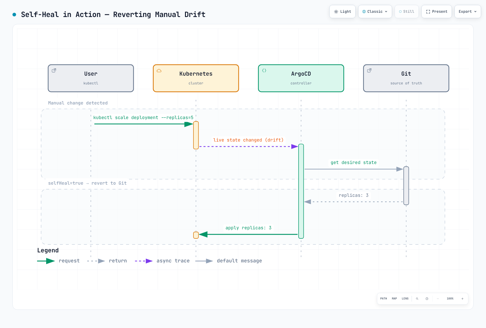
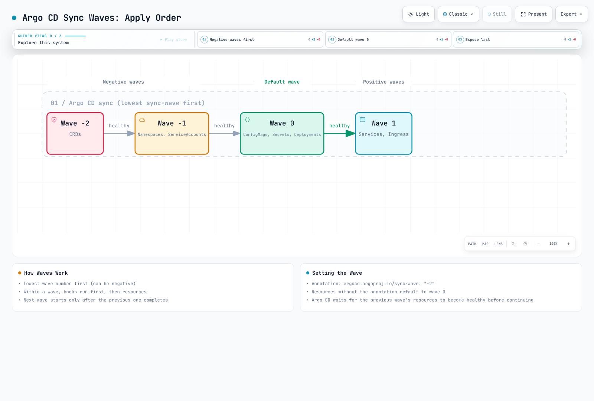
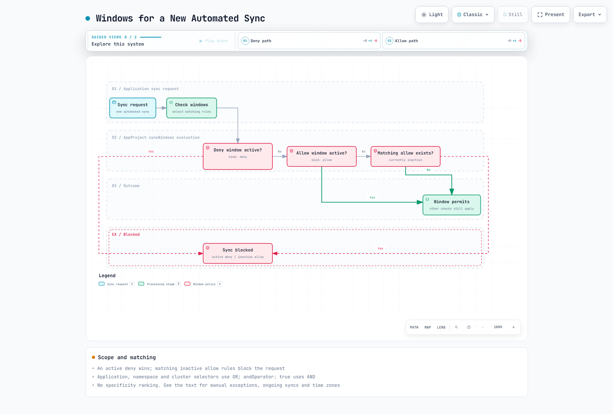

# Argo CDの同期戦略

> **レビュー基準**: Argo CD 3.5.2。リリースノート確認後、パッチ3.5.4に更新（例は再実行していません）
> **最終更新日**: 2026年10月16日

## 目次
- [手動同期と自動同期](#manual-vs-automated-sync)
- [自動同期ポリシー](#auto-sync-policies)
- [同期オプション](#sync-options)
- [同期Waveとフェーズ](#sync-waves-and-phases)
- [同期Window](#sync-windows)
- [差分のカスタマイズ](#diffing-customization)
- [再試行ポリシー](#retry-policies)
- [選択的同期](#selective-sync)

## 手動同期と自動同期 {#manual-vs-automated-sync}

以下の例はそれぞれ独立したポリシー断片です。実際のApplicationのsource／destination／projectを維持し、必要なオプションだけを選んでください。Syncは変更を適用し、Refreshはソースやキャッシュから比較結果を更新します。Syncedであることは、healthや実際のサービス可用性とは別です。

Argo CDは、手動同期と自動同期の2つのモードをサポートします。

### 手動同期

手動モードでは、ユーザーが明示的に同期を開始する必要があります。

```yaml
apiVersion: argoproj.io/v1alpha1
kind: Application
metadata:
  name: manual-sync-app
  namespace: argocd
spec:
  project: default
  source:
    repoURL: https://github.com/myorg/myrepo.git
    targetRevision: HEAD
    path: manifests
  destination:
    server: https://kubernetes.default.svc
    namespace: my-app
  # No syncPolicy.automated = manual sync
```

手動同期の開始:

```bash
# Via CLI
argocd app sync my-app

# Sync specific resources only
argocd app sync my-app --resource 'apps:Deployment:my-deployment'

# Preview changes; pruning and force are separate, potentially destructive decisions
argocd app sync my-app --dry-run
```

### 自動同期

自動モードでは、変更が検出されるとArgo CDが自動的に同期します。

```yaml
apiVersion: argoproj.io/v1alpha1
kind: Application
metadata:
  name: auto-sync-app
  namespace: argocd
spec:
  project: default
  source:
    repoURL: https://github.com/myorg/myrepo.git
    targetRevision: HEAD
    path: manifests
  destination:
    server: https://kubernetes.default.svc
    namespace: my-app
  syncPolicy:
    automated: {}  # Enable auto-sync with defaults
```


[🔍 インタラクティブな図を表示](https://www.atomai.click/kubernetes-docs/archmaps/en-gitops-argocd-03-sync-strategies-0.html)

## 自動同期ポリシー {#auto-sync-policies}

`automated: {}`、または`enabled`フラグの省略／nullは自動同期を有効にします。`enabled: false`は無効にします。クラスター上だけで発生したドリフトの修正には`selfHeal`が必要で、`prune`は別の設定です。同じコミット／パラメーターの組み合わせで失敗しても、デフォルトでは無期限に再試行されません。再試行ポリシーを設定してください。ApplicationSetが管理するApplicationは、所有元のテンプレートを変更してください。

### Prune

Gitに存在しなくなったリソースを自動的に削除します。

```yaml
syncPolicy:
  automated:
    prune: true
```

**ユースケース**: クラスターの状態をGitリポジトリと完全に一致させ、孤立したリソースを削除します。

Pruneの対象はApplicationが追跡するリソースであり、クラスター内のすべての孤立リソースではありません。`PruneLast`は削除の順序を変えるだけで、データを保護する機能でも、削除内容のレビューに代わるものでもありません。

### Self-Heal

クラスターに対して手動で行われた変更を自動的に元に戻します。

```yaml
syncPolicy:
  automated:
    selfHeal: true
```

**ユースケース**: 手動の`kubectl`操作や他のツールによる設定ドリフトを防ぎます。



[🔍 インタラクティブな図を表示](https://www.atomai.click/kubernetes-docs/archmaps/en-gitops-argocd-03-sync-strategies-1.html)

### 空の状態を許可

リソースを持たないApplicationを許可します。

```yaml
syncPolicy:
  automated:
    allowEmpty: true
```

自動pruneが有効な場合、レンダリング結果が空集合になると、`allowEmpty`によって管理対象リソースをすべて削除できることがあります。これは一般的なブートストラップ要件ではありません。

### 自動同期の完全な設定

```yaml
apiVersion: argoproj.io/v1alpha1
kind: Application
metadata:
  name: fully-automated-app
  namespace: argocd
spec:
  project: default
  source:
    repoURL: https://github.com/myorg/myrepo.git
    targetRevision: HEAD
    path: manifests
  destination:
    server: https://kubernetes.default.svc
    namespace: my-app
  syncPolicy:
    automated:
      prune: true        # Remove orphaned resources
      selfHeal: true     # Revert manual changes
      allowEmpty: false  # Prevent auto-prune from deleting everything on an empty render
```

## 同期オプション {#sync-options}

同期オプションを使うと、同期時の動作を細かく制御できます。

### 使用可能な同期オプション

| オプション | 説明 | デフォルト |
|--------|-------------|---------|
| `Validate` | スキーマに照らしてリソースを検証する | true |
| `CreateNamespace` | namespaceがない場合に作成する | false |
| `PrunePropagationPolicy` | 削除の伝播ポリシー | foreground |
| `PruneLast` | 他のすべての同期後にpruneする | false |
| `Replace` | applyの代わりにreplaceを使う | false |
| `FailOnSharedResource` | 別のArgo CD Applicationがリソースを追跡している場合に失敗する | false |
| `ApplyOutOfSyncOnly` | OutOfSyncのリソースだけを適用する | false |
| `ServerSideApply` | サーバーサイドapplyを使う | false |
| `RespectIgnoreDifferences` | 同期時にignoreDifferencesを尊重する | false |

`Validate=false`はapply時のスキーマ検証を省略する設定であり、存在しないCRDをインストールするものではありません。CRDが同じ同期でインストールされる場合、Argo CDはそのCRのdry runを自動的に省略します。別のコントローラーがCRDを作る場合など、正当な理由があるときだけ`SkipDryRunOnMissingResource=true`を使い、CRDが利用可能なことを確認してください。

`PruneLast=true`は、ほかのリソースがデプロイされHealthyになった後、最後の暗黙のwaveでpruneを実行します。`FailOnSharedResource=true`が確認するのは、別のArgo CD Applicationによる追跡です。他のKubernetesコントローラーやFluxとの所有権競合をすべて検出するわけではありません。

### Application単位のオプション

```yaml
apiVersion: argoproj.io/v1alpha1
kind: Application
metadata:
  name: my-app
  namespace: argocd
spec:
  project: default
  source:
    repoURL: https://github.com/myorg/myrepo.git
    targetRevision: main
    path: manifests
  destination:
    server: https://kubernetes.default.svc
    namespace: my-app
  syncPolicy:
    syncOptions:
      - CreateNamespace=true
      - PrunePropagationPolicy=foreground
      - PruneLast=true
      - Validate=true
      - ApplyOutOfSyncOnly=true
```

### リソース単位のオプション

アノテーションを使って、特定のリソースに同期オプションを適用します。

```yaml
# Merge into an existing complete resource manifest.
metadata:
  annotations:
    argocd.argoproj.io/sync-options: ServerSideApply=true
```

### サーバーサイドApply

Argo CD 3.5.4は`--server-side --force-conflicts`を実行します。フィールド所有権は追跡されますが、競合が拒否される保証はありません。所有権が意図せず引き継がれる可能性を確認してください。

競合をより適切に検出するには、Kubernetesのサーバーサイドapplyを使います。

```yaml
syncPolicy:
  syncOptions:
    - ServerSideApply=true
```

または、リソースごとに設定します。

```yaml
metadata:
  annotations:
    argocd.argoproj.io/sync-options: ServerSideApply=true
```

**利点**:
- フィールド所有権をより適切に追跡できる
- 所有権の競合はArgo CDが強制的に解決することがあるため、意図する管理者の境界を確認する
- CRDやwebhookと相性がよい

### ReplaceとForce

`Replace`は`kubectl replace/create`を選択します。不変フィールドを自動的に変更可能にするものではありません。`Replace=true`と`Force=true`を併用するとオブジェクトを削除して再作成することがあり、これは別個の破壊的な選択です。

```yaml
metadata:
  annotations:
    argocd.argoproj.io/sync-options: Replace=true
```

不変フィールドの変更には、リソースごとの移行／再作成計画が必要です。PVCのstorage class移行を簡単に済ませる手段として使わないでください。削除前に保持要件、データ、可用性を確認してください。`Replace`は`ServerSideApply`より優先されます。

## 同期Waveとフェーズ {#sync-waves-and-phases}

同期waveは、リソースを適用する順序を制御します。

### Waveの仕組み

リソースはwave番号ごとにまとめられ、順番に同期されます。
1. phase、wave、kind、nameの順に並べ替えます。
2. 負のSync waveもPreSyncフェーズより前に実行されるわけではありません。
3. 次のwaveへ進むかどうかは同期／health状態に従います。依存関係を同じwave内の実際の並列実行に依存させないでください。後続作業を準備完了まで待たせる場合、Custom Resourceには意味のあるhealth checkが必要です。



[🔍 インタラクティブな図を表示](https://www.atomai.click/kubernetes-docs/archmaps/en-gitops-argocd-03-sync-strategies-2.html)

### 同期Waveの設定

次の断片を、完全なリソースmanifestのmetadataにマージしてください。続けて完全な例を示します。

```yaml
metadata:
  annotations:
    argocd.argoproj.io/sync-wave: "-1"
```

### WaveとHookの組み合わせ

PreSyncは通常のすべてのSync waveより前に実行されます。以下の既存Service、namespace、DB Secret、移行用イメージは事前に用意してください。後のSync waveで作成するデータベースにPreSyncからアクセスできるとは限りません。

```yaml
apiVersion: batch/v1
kind: Job
metadata:
  name: dependency-preflight
  annotations:
    argocd.argoproj.io/hook: PreSync
    argocd.argoproj.io/sync-wave: "-5"
    argocd.argoproj.io/hook-delete-policy: BeforeHookCreation,HookSucceeded
spec:
  backoffLimit: 0
  activeDeadlineSeconds: 60
  template:
    spec:
      restartPolicy: Never
      automountServiceAccountToken: false
      containers:
      - name: check
        image: curlimages/curl:8.23.0
        command: ["curl"]
        args: ["--fail", "--show-error", "--silent", "--connect-timeout", "5", "--max-time", "20", "http://existing-data-service:8080/health"]
---
apiVersion: batch/v1
kind: Job
metadata:
  name: db-migration
  annotations:
    argocd.argoproj.io/hook: PreSync
    argocd.argoproj.io/sync-wave: "-3"
    argocd.argoproj.io/hook-delete-policy: BeforeHookCreation,HookSucceeded
spec:
  backoffLimit: 0
  activeDeadlineSeconds: 300
  template:
    spec:
      restartPolicy: Never
      containers:
      - name: migrate
        image: myapp/migrations:v1.0.0
        command: ["./migrate.sh"]
        env:
        - name: DATABASE_URL
          valueFrom:
            secretKeyRef:
              name: existing-db-credentials
              key: url
```

stdoutに`pg_dump`を出力するだけのJobは、復元可能なバックアップ手順ではありません。暗号化された永続ストレージ、完了の検証、復元テストを行ってください。移行のべき等性、ロック、復旧方法を検証してください。PostSyncの失敗で自動的にロールバックされることはありません。

### 最小限の動作する順序の例

この最小例では、同じSync phase内でNamespace → ConfigMap → Service → readinessを備えたDeploymentの順に配置します。ServiceオブジェクトがHealthyでも、readyなendpointが存在するとは限りません。Deployment probeがワークロードの準備完了を確認します。Argo Project/RBACとイメージレジストリへのアクセスを用意してください。

```yaml
apiVersion: v1
kind: Namespace
metadata:
  name: wave-demo
  annotations:
    argocd.argoproj.io/sync-wave: "-2"
---
apiVersion: v1
kind: ConfigMap
metadata:
  name: wave-demo-config
  namespace: wave-demo
  annotations:
    argocd.argoproj.io/sync-wave: "-1"
data:
  DEMO_ENVIRONMENT: demo
---
apiVersion: v1
kind: Service
metadata:
  name: wave-demo
  namespace: wave-demo
  annotations:
    argocd.argoproj.io/sync-wave: "0"
spec:
  type: ClusterIP
  selector:
    app: wave-demo
  ports:
  - name: http
    port: 80
    targetPort: http
---
apiVersion: apps/v1
kind: Deployment
metadata:
  name: wave-demo
  namespace: wave-demo
  annotations:
    argocd.argoproj.io/sync-wave: "1"
spec:
  replicas: 2
  selector:
    matchLabels:
      app: wave-demo
  template:
    metadata:
      labels:
        app: wave-demo
    spec:
      automountServiceAccountToken: false
      securityContext:
        runAsNonRoot: true
        runAsUser: 10001
        seccompProfile:
          type: RuntimeDefault
      containers:
      - name: podinfo
        image: ghcr.io/stefanprodan/podinfo:6.15.0
        ports:
        - name: http
          containerPort: 9898
        envFrom:
        - configMapRef:
            name: wave-demo-config
        readinessProbe:
          httpGet:
            path: /readyz
            port: http
        resources:
          requests: {cpu: 100m, memory: 64Mi}
          limits: {cpu: 500m, memory: 128Mi}
        securityContext:
          allowPrivilegeEscalation: false
          capabilities:
            drop: [ALL]
```

データベースでは、認証、永続化、Service、実際のreadinessを先に準備してください。HPAにはCPU requestsとmetricsの利用可能性が必要です。readinessに必要なServiceやConfigMapを後のwaveに置かないでください。

## 同期Window {#sync-windows}

この例では、本番project `prod-*`のApplicationに対し、日曜02:00～06:00 KSTの同期を許可し、03:00～04:00は凍結します。repositoryとdestinationは、実際に許可された範囲に置き換えてください。

```yaml
apiVersion: argoproj.io/v1alpha1
kind: AppProject
metadata:
  name: production
  namespace: argocd
spec:
  sourceRepos:
  - https://github.com/myorg/myapp.git
  destinations:
  - server: https://kubernetes.default.svc
    namespace: production
  syncWindows:
  - kind: allow
    description: Example Sunday maintenance window
    schedule: '0 2 * * 0'
    duration: 4h
    timeZone: Asia/Seoul
    applications: ['prod-*']
    namespaces: [production]
    andOperator: true
    manualSync: false
    syncOverrun: false
  - kind: deny
    description: Example freeze within the maintenance window
    schedule: '0 3 * * 0'
    duration: 1h
    timeZone: Asia/Seoul
    applications: ['prod-*']
    namespaces: [production]
    andOperator: true
    manualSync: false
    syncOverrun: false
```

新しい自動同期リクエストについて、次のように判定します。

1. 一致するwindowがなければ、windowによる制限はありません。
2. 一致するdenyが有効なら、リクエストをブロックします。
3. それ以外では、有効なallowがリクエストを許可します。
4. 一致するallow windowがすべて無効なら、リクエストをブロックします。
5. allow windowがなく、無効なdenyしかなければ、リクエストを許可します。

Application／namespace／cluster selectorのデフォルトはORであり、具体性による優先順位はありません。指定したselectorすべての一致を必須にするには`andOperator: true`を使ってください。デフォルトのタイムゾーンはUTCです。コメントにKSTと書いても変わりません。

手動での例外には、該当するブロッキングwindowすべてが`manualSync`を許可していることと、呼び出し元にsync権限があることが必要です。`--force`は回避策ではありません。常時有効な24時間のallowは、手動で有効化する緊急スイッチではなく、自動同期も許可する可能性があります。windowの境界を越えて実行を継続できるかは、`syncOverrun`、開始時刻、該当windowに依存します。完了やロールバックを保証するものではありません。

```bash
argocd proj windows list production -o yaml
argocd app get my-app
```



[🔍 インタラクティブな図を表示](https://www.atomai.click/kubernetes-docs/archmaps/en-gitops-argocd-03-sync-strategies-4.html)

## 差分のカスタマイズ {#diffing-customization}

別のコントローラーが所有している実際のフィールドだけを、name／namespaceで範囲指定して無視してください。たとえば、HPAが管理する特定のDeploymentのreplicasを除外できます。image、すべてのannotation／resource、またはすべてのmanagerを広く除外する設定を初期値にしないでください。

```yaml
spec:
  ignoreDifferences:
  - group: apps
    kind: Deployment
    name: my-deployment
    namespace: production
    jsonPointers:
    - /spec/replicas
  syncPolicy:
    syncOptions: [RespectIgnoreDifferences=true]
```

`ignoreDifferences`は比較を制御します。`RespectIgnoreDifferences`はこの動作を同期にも適用しますが、live objectがない初回作成では引き続き望ましいmanifestが使われます。managerを選ぶ前に、実際のmanaged fieldsを確認してください。グローバル／statusの比較除外はhealth評価を無効にするものではなく、imageの改ざんを見逃す目的で使うべきではありません。

スコープを限定したルールは、[Applicationのignore-difference例](02-applications.md#ignore-differences)を参照してください。

## 再試行ポリシー {#retry-policies}

`limit: 5`は初回試行の後に5回まで再試行し、合計で最大6回試行します。待ち時間は5秒、10秒、20秒、40秒、80秒と増えます。`maxDuration`が上限を設けるのは個々のバックオフであり、同期全体やhookの時間ではありません。ApplicationのretryとJobの`backoffLimit`／`activeDeadlineSeconds`は別の層です。

同期失敗時の自動再試行を設定します。

### 基本的な再試行設定

```yaml
apiVersion: argoproj.io/v1alpha1
kind: Application
metadata:
  name: my-app
  namespace: argocd
spec:
  project: default
  source:
    repoURL: https://github.com/myorg/myrepo.git
    targetRevision: main
    path: manifests
  destination:
    server: https://kubernetes.default.svc
    namespace: my-app
  syncPolicy:
    retry:
      limit: 5          # Maximum retry attempts
      backoff:
        duration: 5s    # Initial delay
        factor: 2       # Multiplier for each retry
        maxDuration: 3m # Maximum delay
```

### 再試行の流れ

`limit: 5`は、初回試行後に最大5回の再試行を許可します。`duration`が5秒、`factor`が2なら、待ち時間は5秒、10秒、20秒、40秒、80秒と増えます。`maxDuration`が制限するのは個々のバックオフ待ち時間であり、同期やhook全体のタイムアウトではありません。

### 期限を設けた依存関係の事前確認

事前確認hookは上限付きの期限で失敗させられますが、Argoのエラーコード別再試行フィルターを追加するものではありません。以下の依存先はすでに存在している必要があります。

```yaml
apiVersion: batch/v1
kind: Job
metadata:
  name: check-prerequisites
  annotations:
    argocd.argoproj.io/hook: PreSync
    argocd.argoproj.io/hook-delete-policy: BeforeHookCreation,HookSucceeded
spec:
  backoffLimit: 0
  activeDeadlineSeconds: 100
  template:
    spec:
      restartPolicy: Never
      automountServiceAccountToken: false
      containers:
      - name: check
        image: curlimages/curl:8.23.0
        command:
        - sh
        - -c
        - |
          for i in 1 2 3 4 5 6; do
            if curl --fail --silent --show-error --connect-timeout 3 --max-time 10 http://existing-service:8080/readyz; then
              exit 0
            fi
            sleep 5
          done
          exit 1
```

## 選択的同期 {#selective-sync}

`--resource`／`--label`で明示的に選択すると、hookと履歴は省略されます。`ApplyOutOfSyncOnly`／`--apply-out-of-sync-only`は、バージョン3.5.4ではhookと履歴を維持します。`--label`はリソースを選び、`--selector`（`-l`）はApplicationを選びます。

Application内の特定リソースだけを同期します。

### CLIから実行

```bash
# Sync specific resource by kind and name
argocd app sync my-app --resource 'apps:Deployment:my-deployment'

# Sync resources by group
argocd app sync my-app --resource 'apps:Deployment:*'

# Sync multiple resources
argocd app sync my-app \
  --resource ':ConfigMap:my-config' \
  --resource ':Secret:my-secret' \
  --resource 'apps:Deployment:my-deployment'

# Sync by label
argocd app sync my-app --label 'app.kubernetes.io/component=backend'
```

### 選択的同期のオプション

```bash
# Apply only out-of-sync resources
argocd app sync my-app --apply-out-of-sync-only

# Preview what would be synced
argocd app sync my-app --dry-run

# Sync with prune
argocd app sync my-app --prune
```

### リソースパスの形式

```
<group>:<kind>:<name>

Examples:
:ConfigMap:my-config                 # Core API group
apps:Deployment:my-deployment        # apps API group
networking.k8s.io:Ingress:my-ingress # networking.k8s.io group
*:*:*                                # All resources
```

## クイズ

内容を確認するには、[ArgoCD同期戦略クイズ](../../quizzes/gitops/argocd/03-sync-strategies-quiz.md)に挑戦してください。

## バージョン別のレビュー資料

- [3.5.4の同期オプション](https://github.com/argoproj/argo-cd/blob/v3.5.4/docs/user-guide/sync-options.md)
- [同期Window](https://github.com/argoproj/argo-cd/blob/v3.5.4/docs/user-guide/sync_windows.md)
- [Windowの一致判定とCanSync](https://github.com/argoproj/argo-cd/blob/v3.5.4/pkg/apis/application/v1alpha1/types.go)
- [フェーズとWave](https://github.com/argoproj/argo-cd/blob/v3.5.4/docs/user-guide/sync-waves.md)
- [CLIのリソース／Applicationセレクター](https://github.com/argoproj/argo-cd/blob/v3.5.4/docs/user-guide/commands/argocd_app_sync.md)
