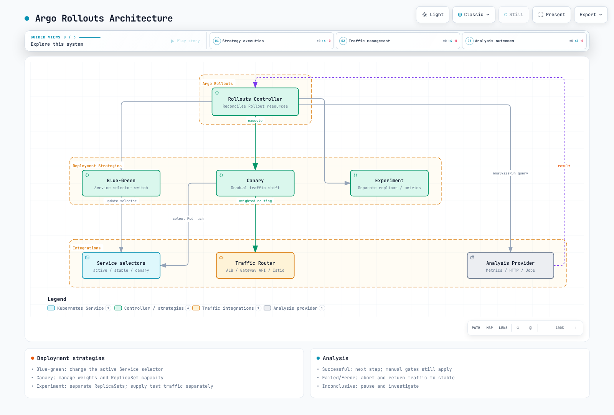
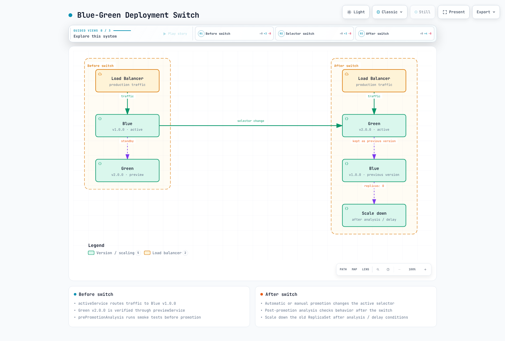
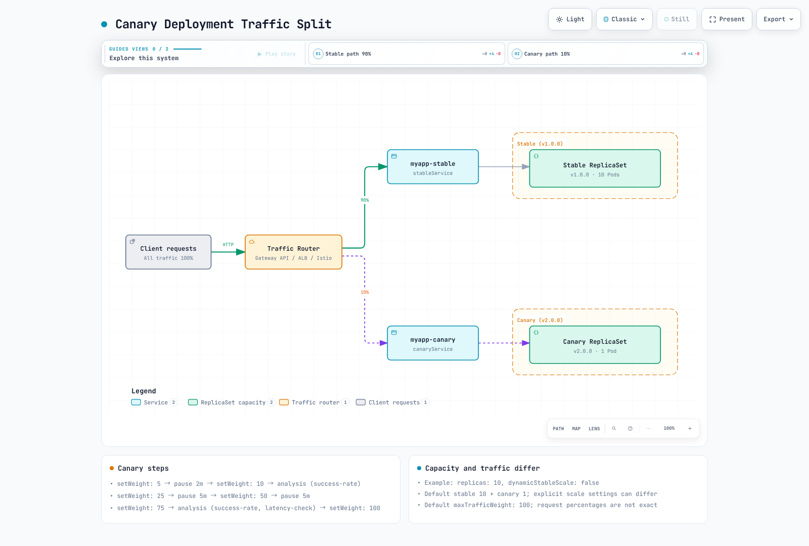

# ArgoCD トラフィック管理

> **確認対象**: Argo CD 3.5.2、Argo Rollouts 1.10.0、Helm chart 2.43.1。リリースノートの確認後、Argo CD 3.5.4 および chart 2.43.6（Rollouts は引き続き 1.10.0）に更新（例は再実行していません）
> **最終更新**: 2026年10月12日

## 目次
- [Argo Rollouts の概要](#argo-rollouts-overview)
- [インストール](#installation)
- [Blue-Green デプロイメント](#blue-green-deployments)
- [Canary デプロイメント](#canary-deployments)
- [分析と検証](#analysis-and-verification)
- [Ingress 統合](#ingress-integration)
- [ロールバック戦略](#rollback-strategies)
- [Experiment](#experiments)
- [通知](#notifications)

## Argo Rollouts の概要 {#argo-rollouts-overview}

Argo Rollouts は、blue-green デプロイメント、canary デプロイメント、プログレッシブデリバリー機能などの高度なデプロイメント機能を提供する Kubernetes コントローラーです。

### Argo Rollouts を使用する理由

Kubernetes Deployment は RollingUpdate と Recreate、および一時停止/再開をサポートします。この表はネイティブコントローラーの動作を比較しています。追加のコントローラーまたは複数の Deployment により、ほかのパターンを実装できます。

| 機能 | K8s Deployment | Argo Rollouts |
|---------|----------------|---------------|
| Rolling Update | はい | はい |
| Blue-Green | いいえ | はい |
| Canary | いいえ | はい |
| トラフィック分割 | いいえ | はい |
| 自動ロールバック | いいえ | はい |
| 分析/検証 | いいえ | はい |
| 一時停止/再開 | はい | はい |
| Experiment | いいえ | はい |

### アーキテクチャ



[🔍 インタラクティブな図を表示](https://www.atomai.click/kubernetes-docs/archmaps/en-gitops-argocd-05-traffic-management-0.html)

## インストール {#installation}

### Argo Rollouts Controller をインストール

```bash
set -euo pipefail
ROLLOUTS_VERSION=v1.10.0
kubectl create namespace argo-rollouts --dry-run=client -o yaml | kubectl apply -f -
kubectl apply --server-side -n argo-rollouts \
  -f "https://github.com/argoproj/argo-rollouts/releases/download/${ROLLOUTS_VERSION}/install.yaml"
kubectl rollout status deployment/argo-rollouts -n argo-rollouts --timeout=180s
```

### kubectl Plugin をインストール

```bash
set -euo pipefail
ROLLOUTS_VERSION=v1.10.0
case "$(uname -s)" in
  Linux) plugin_os=linux ;;
  Darwin) plugin_os=darwin ;;
  *) echo "Use the Windows release asset for Windows" >&2; exit 1 ;;
esac
case "$(uname -m)" in
  x86_64) plugin_arch=amd64 ;;
  aarch64|arm64) plugin_arch=arm64 ;;
  *) echo "Unsupported architecture" >&2; exit 1 ;;
esac
plugin_asset="kubectl-argo-rollouts-${plugin_os}-${plugin_arch}"
plugin_dir="$(mktemp -d)"
trap 'rm -rf "$plugin_dir"' EXIT
plugin_base="https://github.com/argoproj/argo-rollouts/releases/download/${ROLLOUTS_VERSION}"
curl --fail --location --retry 3 "$plugin_base/$plugin_asset" -o "$plugin_dir/$plugin_asset"
curl --fail --location --retry 3 "$plugin_base/argo-rollouts-checksums.txt" -o "$plugin_dir/checksums.txt"
awk -v artifact="$plugin_asset" '$2 == artifact { print }' "$plugin_dir/checksums.txt" > "$plugin_dir/selected.sha256"
test -s "$plugin_dir/selected.sha256"
(
  cd "$plugin_dir"
  if [ "$plugin_os" = darwin ]; then
    shasum -a 256 -c selected.sha256
  else
    sha256sum -c selected.sha256
  fi
)
install -d "$HOME/.local/bin"
install -m 0755 "$plugin_dir/$plugin_asset" "$HOME/.local/bin/kubectl-argo-rollouts"
export PATH="$HOME/.local/bin:$PATH"
kubectl argo rollouts version
```

### Helm 経由でインストール

コントローラーの所有権を管理するには、上記のマニフェストによるインストールまたは Helm のいずれかを選択してください。これらの設定を `rollouts-values.yaml` として保存します。`AWS_REGION` は CloudWatch をクエリする**Rollouts controller**用であり、このプロバイダーを使用しない場合は省略できます。

```yaml
controller:
  replicas: 2
  metrics:
    enabled: true
    serviceMonitor:
      enabled: false  # Enable after installing/configuring Prometheus Operator
  pdb:
    enabled: true
    minAvailable: 1
  extraEnv:
    - name: AWS_REGION
      value: ap-northeast-2

dashboard:
  enabled: false
```

```bash
helm repo add argo https://argoproj.github.io/argo-helm
helm repo update argo
helm upgrade --install argo-rollouts argo/argo-rollouts \
  --version 2.43.6 --namespace argo-rollouts --create-namespace \
  --values rollouts-values.yaml --wait --timeout 5m
```

ServiceMonitor は、その CRD と Prometheus selector の設定後にのみ有効化してください。共有 Dashboard には、別の認証/認可レイヤーが必要です。1.10.0 CLI の `dashboard` コマンドはすべてのインターフェイスにバインドされ、kubeconfig の権限を使用します。出力される localhost URL によってアクセスが制限されるわけではありません。

### Dashboard へのアクセス（Helm インストール）

Helm インストールでは、読み取り専用の ClusterIP Dashboard を有効にし、loopback アドレスへ port-forward します。

```bash
helm upgrade --install argo-rollouts argo/argo-rollouts \
  --version 2.43.6 --namespace argo-rollouts --create-namespace \
  --values rollouts-values.yaml \
  --set dashboard.enabled=true --set dashboard.readonly=true \
  --set dashboard.service.type=ClusterIP --set dashboard.ingress.enabled=false \
  --wait --timeout 5m
kubectl port-forward --address 127.0.0.1 -n argo-rollouts \
  service/argo-rollouts-dashboard 3100:3100
```

`http://127.0.0.1:3100/rollouts` を開きます。共有アクセスには、別の認証済みかつ認可済みの proxy が必要です。

## Blue-Green デプロイメント {#blue-green-deployments}

例の `myapp`/registry イメージ、ECR アカウント/タグ、およびメトリクス名を、アプリケーションの設定に置き換えてください。namespace、イメージアクセス、readiness 応答、メトリクス収集、AnalysisTemplate を準備し、各シナリオを個別に実行します。初回デプロイメントには以前の安定した ReplicaSet はありません。v1 を正常にデプロイした後、Git 内のイメージを v2 に変更して rollout を確認します。

Argo CD は Git の Rollout spec を適用し、別の Rollouts controller が ReplicaSet とトラフィックを管理します。中止してトラフィックを stable に戻しても、Git commit や database migration は元に戻りません。

Blue-green は Rollout の以前および新しい ReplicaSet を保持してから、active Service selector を変更します。クラスター環境全体を複製するものではありません。データプレーンの伝播と接続のドレインには時間がかかります。

### 基本的な Blue-Green Rollout

```yaml
apiVersion: argoproj.io/v1alpha1
kind: Rollout
metadata:
  name: myapp
  namespace: myapp
spec:
  replicas: 5
  revisionHistoryLimit: 3
  selector:
    matchLabels:
      app: myapp
  template:
    metadata:
      labels:
        app: myapp
    spec:
      containers:
      - name: myapp
        image: myregistry/myapp:v1.0.0
        ports:
        - containerPort: 8080
        readinessProbe:
          httpGet:
            path: /health
            port: 8080
          initialDelaySeconds: 5
          periodSeconds: 10
        resources:
          requests:
            cpu: 100m
            memory: 128Mi
          limits:
            cpu: 500m
            memory: 512Mi
  strategy:
    blueGreen:
      activeService: myapp-active
      previewService: myapp-preview
      autoPromotionEnabled: false
      previewReplicaCount: 2
      prePromotionAnalysis:
        templates:
        - templateName: smoke-tests
        args:
        - name: service-name
          value: myapp-preview
      postPromotionAnalysis:
        templates:
        - templateName: success-rate
        args:
        - name: service-name
          value: myapp-active
---
apiVersion: v1
kind: Service
metadata:
  name: myapp-active
  namespace: myapp
spec:
  selector:
    app: myapp
  ports:
  - port: 80
    targetPort: 8080
---
apiVersion: v1
kind: Service
metadata:
  name: myapp-preview
  namespace: myapp
spec:
  selector:
    app: myapp
  ports:
  - port: 80
    targetPort: 8080
```

`previewReplicaCount` は preview 容量を制限します。新しい ReplicaSet は promotion 前に `spec.replicas` までスケールします。autoPromotionEnabled が false の場合、`autoPromotionSeconds` は無視されます。必須の promotion 前分析の例でも autoPromotionSeconds を省略し、時間ベースの自動 promotion の例と分けています。この例では、固定のスケールダウン期限によって promotion 後分析がキャンセルされないよう、scaleDownDelaySeconds を省略しています。ALB の target 登録/登録解除と接続ドレインによって、なお中断が発生する可能性があります。実際のデータプレーンを検証してください。

### Blue-Green フロー



[🔍 インタラクティブな図を表示](https://www.atomai.click/kubernetes-docs/archmaps/en-gitops-argocd-05-traffic-management-1.html)

### 自動 Promotion を使用する Blue-Green

```yaml
strategy:
  blueGreen:
    activeService: myapp-active
    previewService: myapp-preview
    autoPromotionEnabled: true
    autoPromotionSeconds: 60  # Wait 60s before auto-promoting
    previewReplicaCount: 3
```

## Canary デプロイメント {#canary-deployments}

`setWeight` は、trafficRouting が設定されている場合に相対的な router weight を変更します。router がない場合は ReplicaSet 数によって比率を近似しますが、正確なリクエスト割合は保証されません。router がある場合、stable replica の容量はトラフィック weight から独立しています。

Canary デプロイメントは、新しいバージョンへトラフィックを段階的に移行します。

トラフィックルーティングされた canary はデフォルトで stable 容量を 100% 維持するため、stable と canary の容量を合わせて計画してください。maxSurge は trafficRouting なしの基本 canary における希望 replica 数の計算を制御します。トラフィックルーティングモードでは Pod 総数の上限ではありません。maxUnavailable は依然として古い ReplicaSet のスケールダウンを抑制できます。

### 基本的な Canary Rollout

この例には Gateway API plugin 0.17.0、`myapp-route` HTTPRoute、準備済みの Gateway、および後述の対応する stable/canary Service が必要です。HTTPRoute の Accepted/ResolvedRefs とデータプレーンの準備状態を確認してください。

```yaml
apiVersion: argoproj.io/v1alpha1
kind: Rollout
metadata:
  name: myapp-canary
  namespace: myapp
spec:
  replicas: 10
  selector:
    matchLabels:
      app: myapp
  template:
    metadata:
      labels:
        app: myapp
    spec:
      containers:
      - name: myapp
        image: myregistry/myapp:v1.0.0
        ports:
        - containerPort: 8080
        readinessProbe:
          httpGet:
            path: /health
            port: 8080
  strategy:
    canary:
      canaryService: myapp-canary
      stableService: myapp-stable
      trafficRouting:
        plugins:
          argoproj-labs/gatewayAPI:
            httpRoute: myapp-route
            namespace: myapp
      steps:
      - setWeight: 5
      - pause:
          duration: 2m
      - setWeight: 10
      - analysis:
          templates:
          - templateName: success-rate
          args:
          - name: service-name
            value: myapp-canary
      - setWeight: 25
      - pause:
          duration: 5m
      - setWeight: 50
      - pause:
          duration: 5m
      - setWeight: 75
      - analysis:
          templates:
          - templateName: success-rate
          - templateName: latency-check
          args:
          - name: service-name
            value: myapp-canary
      - setWeight: 100
---
apiVersion: v1
kind: Service
metadata:
  name: myapp-stable
  namespace: myapp
spec:
  selector:
    app: myapp
  ports:
  - port: 80
    targetPort: 8080
---
apiVersion: v1
kind: Service
metadata:
  name: myapp-canary
  namespace: myapp
spec:
  selector:
    app: myapp
  ports:
  - port: 80
    targetPort: 8080
```

### Canary ステップの説明

| ステップタイプ | 説明 |
|-----------|-------------|
| `setWeight` | canary にトラフィック割合を設定 |
| `pause` | 指定時間または手動承認まで待機 |
| `analysis` | AnalysisTemplate を実行 |
| `setCanaryScale` | canary replica 数を設定 |
| `setHeaderRoute` | header でルーティング（トラフィック router 用） |

### 手動ゲートを使用する Canary

```yaml
strategy:
  canary:
    steps:
      - setWeight: 10
      - pause: {}  # Indefinite pause - requires manual promotion

      - setWeight: 50
      - pause: {duration: 10m}

      - setWeight: 100
```

手動で promotion します。

```bash
# Promote to next step
kubectl argo rollouts promote myapp-canary -n myapp

# Promote fully (skip remaining steps)
# Deliberate override only: skips remaining steps and analysis gates
# kubectl argo rollouts promote myapp-canary -n myapp --full
```

### Canary トラフィックフロー



[🔍 インタラクティブな図を表示](https://www.atomai.click/kubernetes-docs/archmaps/en-gitops-argocd-05-traffic-management-2.html)

## 分析と検証 {#analysis-and-verification}

AnalysisTemplate はデプロイメントの健全性を検証する方法を定義します。

http_requests_total/http_request_duration_seconds_bucket メトリクスおよび service/version label には、アプリケーションの instrumentation と scrape 設定が必要です。prometheus.monitoring.svc.cluster.local:9090 は実際の Service に置き換えてください。threshold/window は例示です。最小トラフィックおよび SLO 要件も定義してください。

failureLimit は許容される**失敗した測定**数を数えます。値 3 は、4 回目の失敗した測定で超過します。プロバイダーエラーには consecutiveErrorLimit が使用され、不確定な結果には inconclusiveLimit が使用されます。以下の条件により、欠損値、空 vector、NaN、Infinity がゲートを通過しないようにしています。count は HTTP リクエスト数ではなく測定回数です。重複するクエリ window は独立したサンプルではありません。

### Prometheus 分析

```yaml
apiVersion: argoproj.io/v1alpha1
kind: AnalysisTemplate
metadata:
  name: success-rate
  namespace: myapp
spec:
  args:
  - name: service-name
  metrics:
  - name: success-rate
    interval: 1m
    count: 5
    successCondition: result != nil && len(result) == 1 && !isNaN(result[0]) && !isInf(result[0]) && result[0] >=
      0 && result[0] <= 1 && result[0] >= 0.95
    failureLimit: 3
    provider:
      prometheus:
        address: http://prometheus.monitoring.svc.cluster.local:9090
        query: |
          (sum(rate(
            http_requests_total{
              service="{{args.service-name}}",
              status=~"2.."
            }[5m]
          )) or vector(0)) /
          sum(rate(
            http_requests_total{
              service="{{args.service-name}}"
            }[5m]
          ))
    failureCondition: result != nil && len(result) == 1 && !isNaN(result[0]) && !isInf(result[0]) && result[0] >=
      0 && result[0] <= 1 && result[0] < 0.95
    inconclusiveLimit: 0
```

### レイテンシ分析

```yaml
apiVersion: argoproj.io/v1alpha1
kind: AnalysisTemplate
metadata:
  name: latency-check
  namespace: myapp
spec:
  args:
  - name: service-name
  metrics:
  - name: p99-latency
    interval: 2m
    count: 3
    successCondition: result != nil && len(result) == 1 && !isNaN(result[0]) && !isInf(result[0]) && result[0] <
      500
    failureLimit: 2
    provider:
      prometheus:
        address: http://prometheus.monitoring.svc.cluster.local:9090
        query: |
          histogram_quantile(0.99,
            sum(rate(
              http_request_duration_seconds_bucket{
                service="{{args.service-name}}"
              }[5m]
            )) by (le)
          ) * 1000
    failureCondition: result != nil && len(result) == 1 && !isNaN(result[0]) && !isInf(result[0]) && result[0] >=
      500
    inconclusiveLimit: 0
```

### Web 分析（HTTP Endpoint）

Service は JSON `{"status":"OK"}` を含む成功 HTTP response を返す必要があります。jsonPath は status string を抽出するため、result.status ではなく result 自体を比較します。条件を実際の response contract に合わせて調整してください。

```yaml
apiVersion: argoproj.io/v1alpha1
kind: AnalysisTemplate
metadata:
  name: smoke-tests
  namespace: myapp
spec:
  args:
  - name: service-name
  metrics:
  - name: smoke-test
    interval: 30s
    count: 3
    successCondition: result == "OK"
    failureLimit: 1
    provider:
      web:
        url: http://{{ args.service-name }}.myapp.svc.cluster.local/health
        jsonPath: '{$.status}'
        timeoutSeconds: 10
    failureCondition: result != nil && result != "OK"
```

### Datadog 分析

Datadog v2 formula は、個別の query および formula field を使用します。この AnalysisTemplate namespace に address/api-key/app-key を含む datadog Secret をプロビジョニングしてください。asFloat(default(result, -1)) は欠損データを有効なゼロ error rate と区別し、nil が型指定関数に渡されることを防ぎます。

```yaml
apiVersion: argoproj.io/v1alpha1
kind: AnalysisTemplate
metadata:
  name: datadog-success-rate
  namespace: myapp
spec:
  args:
  - name: service-name
  metrics:
  - name: error-rate
    interval: 5m
    count: 3
    successCondition: |
      let rate = asFloat(default(result, -1));
      !isNaN(rate) && !isInf(rate) && rate >= 0 && rate <= 1 && rate < 0.05
    failureLimit: 2
    provider:
      datadog:
        apiVersion: v2
        interval: 5m
        aggregator: sum
        secretRef:
          name: datadog
          namespaced: true
        queries:
          a: sum:http.requests{service:{{args.service-name}},status:5xx}.as_count()
          b: sum:http.requests{service:{{args.service-name}}}.as_count()
        formula: a / b
    failureCondition: |
      let rate = asFloat(default(result, -1));
      !isNaN(rate) && !isInf(rate) && rate >= 0 && rate <= 1 && rate >= 0.05
    inconclusiveLimit: 0
```

### Job ベースの分析

```yaml
apiVersion: argoproj.io/v1alpha1
kind: AnalysisTemplate
metadata:
  name: integration-tests
  namespace: myapp
spec:
  args:
  - name: service-url
  metrics:
  - name: integration-tests
    provider:
      job:
        spec:
          backoffLimit: 1
          template:
            spec:
              restartPolicy: Never
              containers:
              - name: test-runner
                image: myregistry/integration-tests:v1.0.0
                env:
                - name: TARGET_URL
                  value: '{{args.service-url}}'
                command:
                - /bin/sh
                - -ec
                - exec npm run test:integration
              automountServiceAccountToken: false
          activeDeadlineSeconds: 300
```

### ClusterAnalysisTemplate

namespace 間で分析 template を共有します。

```yaml
apiVersion: argoproj.io/v1alpha1
kind: ClusterAnalysisTemplate
metadata:
  name: global-success-rate
spec:
  args:
  - name: service-name
  - name: namespace
  metrics:
  - name: success-rate
    interval: 1m
    count: 5
    successCondition: result != nil && len(result) == 1 && !isNaN(result[0]) && !isInf(result[0]) && result[0] >=
      0 && result[0] <= 1 && result[0] >= 0.95
    provider:
      prometheus:
        address: http://prometheus.monitoring.svc.cluster.local:9090
        query: |
          (sum(rate(
            http_requests_total{
              namespace="{{args.namespace}}",
              service="{{args.service-name}}",
              status=~"2.."
            }[5m]
          )) or vector(0)) /
          sum(rate(
            http_requests_total{
              namespace="{{args.namespace}}",
              service="{{args.service-name}}"
            }[5m]
          ))
    failureCondition: result != nil && len(result) == 1 && !isNaN(result[0]) && !isInf(result[0]) && result[0] >=
      0 && result[0] <= 1 && result[0] < 0.95
    inconclusiveLimit: 0
```

## Ingress 統合 {#ingress-integration}

Argo Rollouts はネイティブのトラフィックプロバイダーと plugin 拡張をサポートします。Kong など、ネイティブ統合を持たないプロバイダーは、代わりに **Gateway API plugin** を通じてサポートされます。

| プロバイダー | 統合 | 注記 |
|---|---|---|
| NGINX Ingress | ネイティブ（`trafficRouting.nginx`） | `canary-weight` annotation を直接操作 |
| AWS ALB | ネイティブ（`trafficRouting.alb`） | Ingress backend port は `use-annotation` でなければなりません。 [検証結果](#verification-results-on-eks)を参照 |
| Istio | ネイティブ（`trafficRouting.istio`） | VirtualService/DestinationRule を直接操作 |
| SMI | ネイティブ（`trafficRouting.smi`） | SMI project 自体は実質的に保守されていません。新規採用には推奨しません |
| Ambassador、Apache APISIX、Traefik | ネイティブ | このドキュメントでは扱いません。[公式ドキュメント](https://argo-rollouts.readthedocs.io/en/stable/features/traffic-management/)を参照 |
| **Kong** およびその他の Gateway API 準拠実装（kgateway など） | **Gateway API plugin**（`trafficRouting.plugins`） | ネイティブの `trafficRouting.kong` field はありません |

### NGINX Ingress（既存インストール）

Community ingress-nginx は 2026 年 3 月に廃止されました。これは既存インストール向けの移行リファレンスです。新しい例では Gateway API パスを使用します。各ルーティング例には、その namespace 内の対応する stable/canary Service が必要です。

```yaml
apiVersion: argoproj.io/v1alpha1
kind: Rollout
metadata:
  name: myapp
  namespace: myapp
spec:
  strategy:
    canary:
      stableService: myapp-stable
      canaryService: myapp-canary
      trafficRouting:
        nginx:
          stableIngress: myapp-ingress
          additionalIngressAnnotations:
            canary-by-header: X-Canary
            canary-by-header-value: 'true'
      steps:
      - setWeight: 10
      - pause:
          duration: 5m
      - setWeight: 50
      - pause:
          duration: 5m
      - setWeight: 100
  replicas: 5
  selector:
    matchLabels:
      app: myapp
  template:
    metadata:
      labels:
        app: myapp
    spec:
      containers:
      - name: app
        image: myregistry/myapp:v2.0.0
        ports:
        - containerPort: 8080
        readinessProbe:
          httpGet:
            path: /health
            port: 8080
        resources:
          requests:
            cpu: 100m
            memory: 128Mi
          limits:
            cpu: 500m
            memory: 512Mi
---
apiVersion: networking.k8s.io/v1
kind: Ingress
metadata:
  name: myapp-ingress
  namespace: myapp
  annotations:
    nginx.ingress.kubernetes.io/rewrite-target: /
spec:
  ingressClassName: nginx
  rules:
  - host: myapp.example.com
    http:
      paths:
      - path: /
        pathType: Prefix
        backend:
          service:
            name: myapp-stable
            port:
              number: 80
```

### AWS ALB Ingress

```yaml
apiVersion: argoproj.io/v1alpha1
kind: Rollout
metadata:
  name: myapp
  namespace: myapp
spec:
  strategy:
    canary:
      stableService: myapp-stable
      canaryService: myapp-canary
      trafficRouting:
        alb:
          ingress: myapp-ingress
          rootService: myapp-root
          servicePort: 80
      steps:
      - setWeight: 10
      - pause:
          duration: 5m
      - setWeight: 50
      - pause:
          duration: 5m
      - setWeight: 100
  replicas: 5
  selector:
    matchLabels:
      app: myapp
  template:
    metadata:
      labels:
        app: myapp
    spec:
      containers:
      - name: app
        image: myregistry/myapp:v2.0.0
        ports:
        - containerPort: 8080
        readinessProbe:
          httpGet:
            path: /health
            port: 8080
        resources:
          requests:
            cpu: 100m
            memory: 128Mi
          limits:
            cpu: 500m
            memory: 512Mi
---
apiVersion: networking.k8s.io/v1
kind: Ingress
metadata:
  name: myapp-ingress
  namespace: myapp
  annotations:
    alb.ingress.kubernetes.io/scheme: internal
    alb.ingress.kubernetes.io/target-type: ip
    alb.ingress.kubernetes.io/actions.myapp-root: |
      {
        "type": "forward",
        "forwardConfig": {
          "targetGroups": [
            {
              "serviceName": "myapp-stable",
              "servicePort": 80,
              "weight": 100
            },
            {
              "serviceName": "myapp-canary",
              "servicePort": 80,
              "weight": 0
            }
          ]
        }
      }
spec:
  rules:
  - host: myapp.example.com
    http:
      paths:
      - path: /
        pathType: Prefix
        backend:
          service:
            name: myapp-root
            port:
              name: use-annotation
  ingressClassName: alb
```

> **ALB 設定の確認**: Rollout の rootService（省略時は stableService）、action annotation 名、Ingress backend 名は一致している必要があります。backend port の `name: use-annotation` は weighted action を選択します。数値 port は代わりに通常の Service backend を選択します。その Service に応じて、reconciliation が失敗するか異なるルーティングを生成する場合があります。controller event と `aws elbv2 describe-rules` による実際の ForwardConfig を確認してください。

### Istio トラフィック分割

```yaml
apiVersion: argoproj.io/v1alpha1
kind: Rollout
metadata:
  name: myapp
  namespace: myapp
spec:
  strategy:
    canary:
      stableService: myapp-stable
      canaryService: myapp-canary
      trafficRouting:
        istio:
          virtualService:
            name: myapp-vsvc
            routes:
            - primary
      steps:
      - setWeight: 10
      - pause:
          duration: 5m
      - setWeight: 50
      - pause:
          duration: 5m
      - setWeight: 100
  replicas: 5
  selector:
    matchLabels:
      app: myapp
  template:
    metadata:
      labels:
        app: myapp
    spec:
      containers:
      - name: app
        image: myregistry/myapp:v2.0.0
        ports:
        - containerPort: 8080
        readinessProbe:
          httpGet:
            path: /health
            port: 8080
        resources:
          requests:
            cpu: 100m
            memory: 128Mi
          limits:
            cpu: 500m
            memory: 512Mi
---
apiVersion: networking.istio.io/v1
kind: VirtualService
metadata:
  name: myapp-vsvc
  namespace: myapp
spec:
  hosts:
  - myapp.example.com
  gateways:
  - myapp-gateway
  http:
  - name: primary
    route:
    - destination:
        host: myapp-stable
        port:
          number: 80
      weight: 100
    - destination:
        host: myapp-canary
        port:
          number: 80
      weight: 0
```

### Gateway API Plugin（HTTPRoute）

Kong、kgateway、その他の互換実装用の Gateway API パスでは、argoproj-labs により保守される [Gateway API plugin](https://github.com/argoproj-labs/rollouts-plugin-trafficrouter-gatewayapi) を使用します。Traefik にもネイティブの TraefikService 統合があります。その Gateway API パスではこの plugin を使用できます。この章では、2026-09-01 リリースの plugin 0.17.0 を使用します。これは HTTPRoute backend weight を更新します。その他の Route type および header routing は、インストール済み CRD と実装機能に依存します。route status と実際のリクエスト分散を検証してください。

以下の binary は、controller Pod を実行する **Linux amd64 node** を対象としています。arm64 では gatewayapi-plugin-linux-arm64 と SHA256 `5221279f7bf2c9b2c0ff6ed7ff12718ecce1d4892f1ff5e5224bb723cfd0fd92` を使用してください。Helm では、controller.trafficRouterPlugins 配下で同じエントリを管理します。manifest インストールでは、既存の ConfigMap data にマージして controller を再起動します。表示されている Role は HTTPRoute weight の更新を 1 つの namespace にスコープします。ほかの Route type/header-route の作成には追加の権限レビューが必要です。

controller が起動時に binary をダウンロードできるよう、`argo-rollouts-config` ConfigMap に plugin を登録してインストールします。

```yaml
apiVersion: v1
kind: ConfigMap
metadata:
  name: argo-rollouts-config
  namespace: argo-rollouts
data:
  trafficRouterPlugins: |
    - name: argoproj-labs/gatewayAPI
      location: https://github.com/argoproj-labs/rollouts-plugin-trafficrouter-gatewayapi/releases/download/v0.17.0/gatewayapi-plugin-linux-amd64
      sha256: 1904ca787d33107c140521899d61fff030ee75d99908bd175fca5a4647759061
---
apiVersion: rbac.authorization.k8s.io/v1
kind: Role
metadata:
  name: argo-rollouts-gateway-api-plugin
  namespace: myapp
rules:
- apiGroups:
  - ''
  resources:
  - services
  verbs:
  - get
- apiGroups:
  - gateway.networking.k8s.io
  resources:
  - httproutes
  verbs:
  - get
  - list
  - update
  - patch
---
apiVersion: rbac.authorization.k8s.io/v1
kind: RoleBinding
metadata:
  name: argo-rollouts-gateway-api-plugin
  namespace: myapp
roleRef:
  apiGroup: rbac.authorization.k8s.io
  kind: Role
  name: argo-rollouts-gateway-api-plugin
subjects:
- kind: ServiceAccount
  name: argo-rollouts
  namespace: argo-rollouts
```

Rollout は `trafficRouting.plugins` を通じて HTTPRoute を参照します。

```yaml
apiVersion: argoproj.io/v1alpha1
kind: Rollout
metadata:
  name: myapp
  namespace: myapp
spec:
  replicas: 5
  selector:
    matchLabels:
      app: myapp
  template:
    metadata:
      labels:
        app: myapp
    spec:
      containers:
      - name: app
        image: myapp:v2.0.0
        ports:
        - containerPort: 8080
  strategy:
    canary:
      stableService: myapp-stable
      canaryService: myapp-canary
      trafficRouting:
        plugins:
          argoproj-labs/gatewayAPI:
            httpRoute: myapp-route
            namespace: myapp
      steps:
      - setWeight: 20
      - pause:
          duration: 1m
      - setWeight: 50
      - pause:
          duration: 1m
      - setWeight: 100
---
apiVersion: gateway.networking.k8s.io/v1
kind: HTTPRoute
metadata:
  name: myapp-route
  namespace: myapp
spec:
  parentRefs:
  - name: myapp-gateway
  rules:
  - backendRefs:
    - name: myapp-stable
      kind: Service
      port: 80
      weight: 100
    - name: myapp-canary
      kind: Service
      port: 80
      weight: 0
```

各 `setWeight` ステップで、plugin はこの 2 つの `backendRefs[].weight` 値を直接更新します。

### Kong（Gateway API Plugin 経由）

Kong Ingress Controller（KIC）にはネイティブの Argo Rollouts 統合がありません。上記の Gateway API plugin を使用します。以下の設定は、Kong Operator を使用せず、既存の Kong Gateway データプレーンを管理する standalone KIC 向けです。そのセットアップでは unmanaged annotation を使用します。Kong Operator 管理の Gateway には異なるライフサイクルがあります。

```yaml
apiVersion: gateway.networking.k8s.io/v1
kind: GatewayClass
metadata:
  name: kong
  annotations:
    konghq.com/gatewayclass-unmanaged: "true"   # required: without it the Gateway stays stuck on "Waiting for controller"
spec:
  controllerName: konghq.com/kic-gateway-controller   # note: different from KIC's IngressClass controller string
```

ここからは、上記と同じ [Gateway API plugin](#gateway-api-plugin-httproute) 設定を適用してください。Rollout と HTTPRoute YAML は同一です。

### EKS での検証結果 {#verification-results-on-eks}

以前のドキュメントは、EKS 1.36、Rollouts 1.9.0、AWS Load Balancer Controller 3.2.1、Istio 1.30、KIC 3.5、および plugin0.16.0 で以下の結果を報告していました。raw log、request count、measurement duration、実行済み manifest は添付されていないため、この静的レビューではレポートを再現できませんでした。これらは過去の観測であり、新しい 1.10.0/0.17.0 の結果でも、即時かつダウンタイムゼロの移行を保証するものでもありません。

| プロバイダー | 確認内容 | 結果 |
|---|---|---|
| NGINX | `canary-weight` annotation が 20→50→100% に遷移 | ✅ 確認済み — live curl のトラフィック比率は annotation 値と一致 |
| Istio | VirtualService weight が 20→50→100% に遷移し、`abort` 時に即座に 0% に戻ること | ✅ 確認済み — curl 比率は weight と一致し、中止直後にトラフィックは以前の stable version に戻りました |
| AWS ALB | Listener rule の forward weight 遷移。`aws elbv2 describe-rules` による live AWS state とのクロスチェック | ✅ 確認済み（ただし上記の [`use-annotation` 注意事項](#aws-alb-ingress)が必要） |
| Kong（Gateway API plugin） | `HTTPRoute.backendRefs[].weight` の遷移、および Kong のデータプレーンを通る実トラフィック | ✅ 確認済み — ただし `gatewayclass-unmanaged` annotation と正確な `controllerName` は間違えやすい（上記参照） |

Argo CD がルーティングリソースを管理する場合、Rollouts が所有する field（該当の ALB action annotation、Istio route weight、HTTPRoute backend weight、Service の rollouts-pod-template-hash selector）に対する狭い diff exclusion をレビューしてください。spec/manager 全体を無視しないでください。sync 中に値を維持するには、RespectIgnoreDifferences=true と既存リソースに関するその制限も必要です。

## ロールバック戦略 {#rollback-strategies}

### 分析失敗時の自動ロールバック

```yaml
strategy:
  canary:
    steps:
      - setWeight: 10
      - analysis:
          templates:
            - templateName: success-rate
          args:
            - name: service-name
              value: myapp-canary
    # Analysis failure automatically triggers rollback
```

### 手動ロールバック

```bash
# Abort current rollout and rollback
kubectl argo rollouts abort myapp -n myapp

# Undo to previous version
kubectl argo rollouts undo myapp -n myapp

# Undo to specific revision
kubectl argo rollouts undo myapp -n myapp --to-revision=2
```

Abort はトラフィックを stable に戻しますが、希望する Pod template は変更しません。undo は live Pod template を変更します。Argo CD 管理の workload では、self-heal が問題のある revision を復元しないよう、レビュー済みの Git 変更も必要です。どちらの操作も database effect をロールバックしません。Inconclusive 分析は調査のために一時停止します。Failed/Error と同じではありません。

### ロールバック設定

これは trafficRouting を持つ既存 Rollout の spec fragment です。dynamicStableScale は stable 容量を削減し、中止時にスケールを戻す必要がある場合があります。これは復旧容量とリソース使用量のトレードオフです。inline analysis はこのステップのみをブロックします。一方、background analysis は strategy.canary.analysis 配下で設定します。

```yaml
spec:
  strategy:
    canary:
      abortScaleDownDelaySeconds: 30
      dynamicStableScale: true
      steps:
      - setWeight: 10
      - analysis:
          templates:
          - templateName: success-rate
          args:
          - name: service-name
            value: myapp-canary
```

## Experiment {#experiments}

1.10.0 では、すべての `requiredForCompletion: true` 分析が成功すると、`duration` より前に Experiment を完了できます。duration を最小検証 window とみなさないでください。experiment トラフィック隔離のため、Service/router selector を明示的に検証してください。状態遷移と cleanup delay については、[詳細解説](10-rollouts-experiment.md)を参照してください。

複数のバージョンを同時に使用して A/B test を実行します。

> 詳細な動作（リソース作成チェーン、命名規則、トラフィック隔離、AnalysisRun verdict）については、[Rollouts Experiment の詳細解説](10-rollouts-experiment.md)を参照してください。

**前提条件:** Experiment はユーザートラフィックを生成しません。テストトラフィックと scraping を提供し、Pod の `rollouts-pod-template-hash` をメトリクス label `rollouts_pod_template_hash` として公開してください。以下の比較では、例示的な 1 パーセントポイントの error-rate 増加を使用します。これは有意性検定や最小サンプル検証の代替にはなりません。欠損データは Inconclusive のままです。`progressDeadlineSeconds` は ReplicaSet の可用性を制限するものであり、分析前の遅延ではありません。

参照する AnalysisTemplate を同じ namespace に作成します。

```yaml
apiVersion: argoproj.io/v1alpha1
kind: AnalysisTemplate
metadata:
  name: compare-analysis
  namespace: myapp
spec:
  args:
  - name: baseline-hash
  - name: canary-hash
  metrics:
  - name: canary-error-rate-increase
    interval: 30s
    count: 5
    failureLimit: 0
    inconclusiveLimit: 0
    successCondition: result != nil && len(result) == 1 && !isNaN(result[0]) && !isInf(result[0]) && result[0] <=
      0.01
    failureCondition: result != nil && len(result) == 1 && !isNaN(result[0]) && !isInf(result[0]) && result[0] >
      0.01
    provider:
      prometheus:
        address: http://prometheus.monitoring.svc.cluster.local:9090
        query: |
          (
            sum(rate(http_requests_total{rollouts_pod_template_hash="{{ args.canary-hash }}",status=~"5.."}[5m]))
            or vector(0)
          ) / sum(rate(http_requests_total{rollouts_pod_template_hash="{{ args.canary-hash }}"}[5m]))
          -
          (
            sum(rate(http_requests_total{rollouts_pod_template_hash="{{ args.baseline-hash }}",status=~"5.."}[5m]))
            or vector(0)
          ) / sum(rate(http_requests_total{rollouts_pod_template_hash="{{ args.baseline-hash }}"}[5m]))
  - name: canary-absolute-error-rate
    interval: 30s
    count: 5
    failureLimit: 0
    inconclusiveLimit: 0
    successCondition: result != nil && len(result) == 1 && !isNaN(result[0]) && !isInf(result[0]) && result[0] >=
      0 && result[0] < 0.05
    failureCondition: result != nil && len(result) == 1 && !isNaN(result[0]) && !isInf(result[0]) && result[0] >=
      0.05
    provider:
      prometheus:
        address: http://prometheus.monitoring.svc.cluster.local:9090
        query: |
          (
            sum(rate(http_requests_total{rollouts_pod_template_hash="{{ args.canary-hash }}",status=~"5.."}[5m]))
            or vector(0)
          ) / sum(rate(http_requests_total{rollouts_pod_template_hash="{{ args.canary-hash }}"}[5m]))
```

```yaml
apiVersion: argoproj.io/v1alpha1
kind: Experiment
metadata:
  name: myapp-experiment
  namespace: myapp
spec:
  duration: 1h
  progressDeadlineSeconds: 300
  templates:
  - name: baseline
    replicas: 2
    selector:
      matchLabels:
        app: myapp-experiment
        variant: baseline
    template:
      metadata:
        labels:
          app: myapp-experiment
          variant: baseline
      spec:
        containers:
        - name: myapp
          image: myregistry/myapp:v1.0.0
          ports:
          - containerPort: 8080
  - name: canary
    replicas: 2
    selector:
      matchLabels:
        app: myapp-experiment
        variant: canary
    template:
      metadata:
        labels:
          app: myapp-experiment
          variant: canary
      spec:
        containers:
        - name: myapp
          image: myregistry/myapp:v2.0.0
          ports:
          - containerPort: 8080
  analyses:
  - name: compare-metrics
    templateName: compare-analysis
    args:
    - name: baseline-hash
      value: '{{templates.baseline.podTemplateHash}}'
    - name: canary-hash
      value: '{{templates.canary.podTemplateHash}}'
    requiredForCompletion: true
```

## 通知 {#notifications}

rollout event を通知システムと統合します。

### 既存 Rollout で通知を設定

以下は、既存の Rollout にマージする metadata fragment であり、完全なリソース manifest ではありません。

```yaml
metadata:
  annotations:
    notifications.argoproj.io/subscribe.on-rollout-completed.slack: deployments
    notifications.argoproj.io/subscribe.on-rollout-aborted.slack: deployments
    notifications.argoproj.io/subscribe.on-analysis-run-failed.slack: alerts
```

### 通知 Trigger と Template

secret management process を通じて、controller namespace の argo-rollouts-notification-secret に slack-token を設定してください。組み込みの Rollout event はこれらの trigger 名を選択します。Degraded のみでは rollout が中止された証明にはなりません。分析失敗を含め、参照されるすべての trigger/template を設定してください。

```yaml
apiVersion: v1
kind: ConfigMap
metadata:
  name: argo-rollouts-notification-configmap
  namespace: argo-rollouts
data:
  service.slack: |
    token: $slack-token
  trigger.on-rollout-completed: |
    - send: [rollout-completed]
  trigger.on-rollout-aborted: |
    - send: [rollout-aborted]
  template.rollout-completed: |
    message: |
      Rollout {{.rollout.metadata.name}} completed successfully!
      Revision: {{.rollout.status.currentPodHash}}
      Image: {{(index .rollout.spec.template.spec.containers 0).image}}
  template.rollout-aborted: |
    message: |
      Rollout {{.rollout.metadata.name}} was aborted!
      Reason: {{.rollout.status.message}}
  trigger.on-analysis-run-failed: |
    - send: [analysis-run-failed]
  template.analysis-run-failed: |
    message: |
      Analysis failed for Rollout {{.rollout.metadata.name}}. Inspect its AnalysisRun.
```

## 参照

- [Argo Rollouts 1.10.0](https://github.com/argoproj/argo-rollouts/releases/tag/v1.10.0)
- [分析のセマンティクス](https://github.com/argoproj/argo-rollouts/blob/v1.10.0/docs/features/analysis.md)
- [Analysis controller のしきい値](https://github.com/argoproj/argo-rollouts/blob/v1.10.0/analysis/analysis.go)
- [CloudWatch provider 実装](https://github.com/argoproj/argo-rollouts/blob/v1.10.0/metricproviders/cloudwatch/cloudwatch.go)
- [Gateway API plugin 0.17.0](https://github.com/argoproj-labs/rollouts-plugin-trafficrouter-gatewayapi/releases/tag/v0.17.0)

## クイズ

学習内容を確認するには、[ArgoCD トラフィック管理クイズ](../../quizzes/gitops/argocd/05-traffic-management-quiz.md)を試してください。
