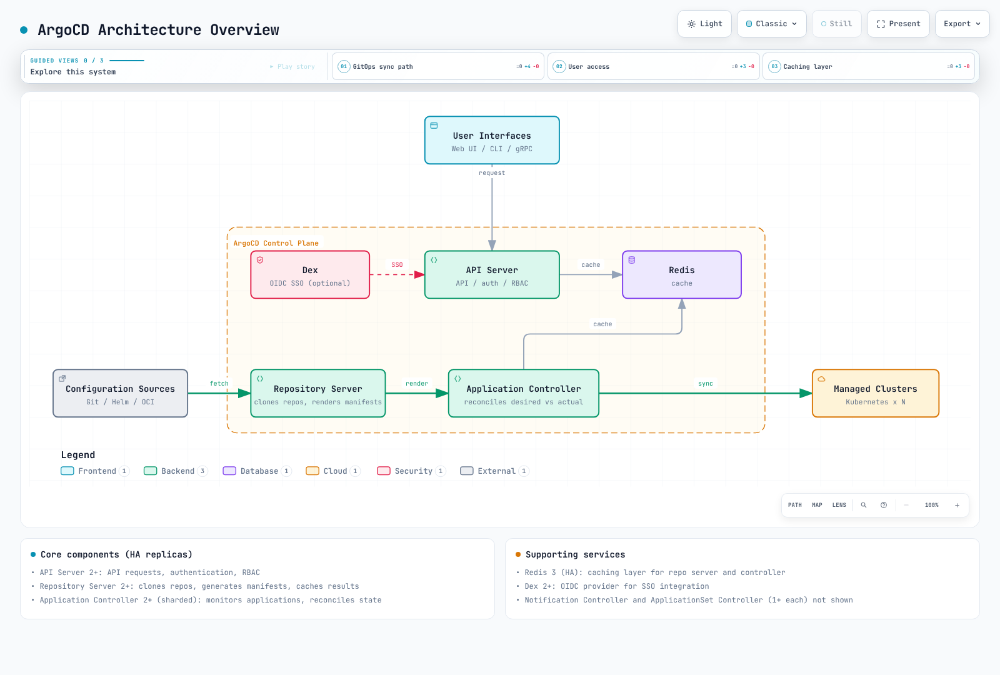
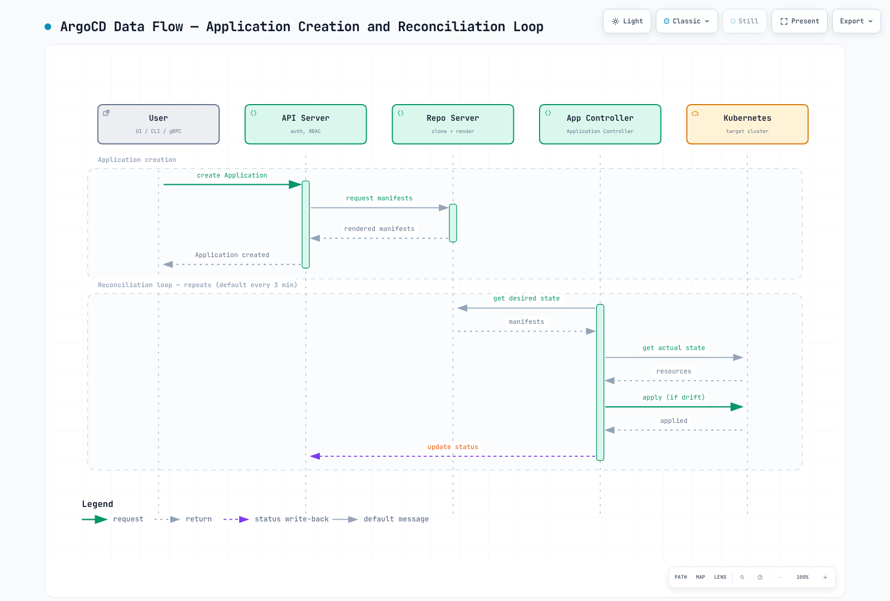

# ArgoCD

> **レビューの基準**: Argo CD 3.5.2、Argo Rollouts 1.10.0。リリースノートの確認後、Argo CD のマニフェストで指定するバージョンをパッチ版 3.5.5 に更新（例は再実行していません）
> **最終更新日**: 2026年11月19日

## 目次
- [ArgoCD とは？](#what-is-argocd)
- [主なメリット](#key-benefits)
- [アーキテクチャの概要](#architecture-overview)
- [主要な概念](#core-concepts)
- [サブガイドの案内](#sub-guide-navigation)
- [クイックスタート](#quick-start)
- [バージョン互換性](#version-compatibility)

## ArgoCD とは？ {#what-is-argocd}

ArgoCD は、Kubernetes 向けの宣言型 GitOps 継続的デリバリーツールです。Git リポジトリで定義された望ましい状態とクラスター内の実際の状態を同期することで、Kubernetes クラスターへのアプリケーションのデプロイを自動化します。

Argo CD は、CNCF の Graduated プロジェクトである Argo の一部です。採用実績があるだけでは、特定のセキュリティ要件や可用性要件への適合性は保証されません。



[🔍 インタラクティブな図を表示](https://www.atomai.click/kubernetes-docs/archmaps/en-gitops-argocd-overview-0.html)

## 主なメリット {#key-benefits}

### GitOps ネイティブ

- **Git を唯一の信頼できる情報源に**: すべてのアプリケーション設定を Git に保存
- **宣言型デプロイ**: 望ましい状態を定義すれば、残りは ArgoCD が処理
- **監査証跡**: Git のコミットを通じて、すべての変更履歴を完全に記録
- **ロールバック**: 保持されている設定リビジョンを再デプロイできます。データベースや外部状態の復旧は別途対応が必要です

### マルチクラスター管理

- **一元管理**: 1 つの ArgoCD インスタンスから数百のクラスターを管理
- **ApplicationSet**: テンプレートベースのマルチクラスター・デプロイ
- **Cluster Generator**: ラベルに基づく動的なクラスターの対象指定

### エンタープライズ対応

- **RBAC**: きめ細かなロールベースのアクセス制御
- **SSO 統合**: OIDC との直接統合、またはその他の ID プロバイダー向けにサポートされる Dex コネクター
- **マルチテナンシー**: Project ベースの分離
- **高可用性**: 本番環境に対応した HA デプロイ

### 開発者エクスペリエンス

- **Web UI**: 視覚的なアプリケーション管理とモニタリング
- **CLI**: 機能が充実したコマンドラインインターフェイス
- **通知**: Slack、Teams、メール、Webhook との連携
- **ヘルスモニタリング**: 組み込みのヘルスチェックとカスタムヘルスチェック

## アーキテクチャの概要 {#architecture-overview}

### 主要コンポーネント

| コンポーネント | 説明 | レプリカ数（HA） |
|-----------|-------------|---------------|
| **API Server** | すべての API リクエスト、認証、RBAC を処理 | 2 以上 |
| **Repository Server** | リポジトリをクローンし、マニフェストを生成して、結果をキャッシュ | 2 以上 |
| **Application Controller** | アプリケーションを監視し、状態をリコンサイル | 2 以上（シャーディング） |
| **Redis** | Repo Server と Controller 用のキャッシュ層 | 3（HA） |
| **Dex** | オプションの ID ブローカー。標準バンドルのインメモリストレージは、レプリカを追加しても安全にスケールできません | 標準バンドルでは 1 |
| **Notification Controller** | イベント発生時に通知を送信 | 1 以上 |
| **ApplicationSet Controller** | ApplicationSet リソースを管理 | 1 以上 |

### データフロー



[🔍 インタラクティブな図を表示](https://www.atomai.click/kubernetes-docs/archmaps/en-gitops-argocd-overview-1.html)

## 主要な概念 {#core-concepts}

### Application

Application CRD は ArgoCD の主要なリソースです。次の項目を定義します。
- **Source**: マニフェストの取得元（Git リポジトリ、Helm Chart、OCI）
- **Destination**: デプロイ先（クラスターと namespace）
- **Sync Policy**: 同期の処理方法

### Project

Project は論理的なグループ化とアクセス制御を提供します。
- 使用できるリポジトリを制限する
- 配置先のクラスターと namespace を制限する
- 許可または禁止するリソースを定義する

### ApplicationSet

ApplicationSet を使うと、Generator を使用して 1 つの定義から複数のアプリケーションを管理できます。
- **List Generator**: 値の静的なリスト
- **Cluster Generator**: 登録済みのクラスターを対象にする
- **Git Generator**: リポジトリ内のディレクトリやファイルをスキャンする
- **Matrix/Merge**: 複数の Generator を組み合わせる

### Sync

同期によって、クラスターの状態を望ましい状態に一致させます。
- **手動 Sync**: ユーザーが開始
- **自動 Sync**: Git の変更時に自動実行
- **Self-Heal**: 差異を自動的に修正
- **Prune**: 孤立したリソースを削除

## サブガイドの案内 {#sub-guide-navigation}

| ガイド | 説明 |
|-------|-------------|
| [インストール](01-installation.md) | インストール方法、CLI の設定、HA 設定、EKS との統合 |
| [アプリケーション](02-applications.md) | Application CRD、ソースの種類、ヘルスチェック、フック、App of Apps |
| [同期戦略](03-sync-strategies.md) | 同期ポリシー、Wave、ウィンドウ、差分検出、再試行の設定 |
| [ApplicationSet](04-applicationsets.md) | 各種 Generator、テンプレート、段階的な同期、マルチクラスターのパターン |
| [トラフィック管理](05-traffic-management.md) | Argo Rollouts、Blue-Green、Canary、分析、Ingress との統合 |
| [Project と RBAC](06-projects-rbac.md) | AppProject、RBAC ポリシー、マルチテナンシー、JWT トークン |
| [セキュリティ](07-security.md) | SSO 統合、Secret 管理、TLS、監査ログ |
| [通知](08-notifications.md) | 通知サービス、トリガー、テンプレート、サブスクリプション |
| [ベストプラクティス](09-best-practices.md) | リポジトリのパターン、パフォーマンス調整、トラブルシューティング、EKS のヒント |
| [Rollouts Experiment の詳細](10-rollouts-experiment.md) | Experiment CRD、一時的な ReplicaSet の検証、AnalysisRun の判定 |

## クイックスタート {#quick-start}

### 1. ArgoCD をインストールする

これは、HA 構成ではない自己管理型インストールの評価用例です。互換性のあるクラスター、CRD/RBAC 権限、空の専用 namespace を用意してください。本番環境での HA、認証、アップグレードに関する判断には、[インストールガイド](01-installation.md)を参照してください。

```bash
# Create namespace
kubectl create namespace argocd

# Install ArgoCD
kubectl apply --server-side -n argocd -f https://raw.githubusercontent.com/argoproj/argo-cd/v3.5.5/manifests/install.yaml

# Wait for pods to be ready
kubectl wait --for=condition=Ready pods --all -n argocd --timeout=300s
```

### 2. UI にアクセスする

```bash
# Port forward to access locally
kubectl port-forward svc/argocd-server -n argocd 8080:443
```

### 3. 初期パスワードを取得する

```bash
# Retrieve the initial admin password
kubectl -n argocd get secret argocd-initial-admin-secret \
  -o jsonpath="{.data.password}" | base64 -d && echo
```

### 4. CLI からログインする

[インストールガイド](01-installation.md)の手順に従って、OS とアーキテクチャに合った CLI をインストールし、リリースのチェックサムを確認してください。別のターミナルでポートフォワードを実行したままにしてください。

```bash
# Install CLI (macOS)
brew install argocd

# Login
argocd login localhost:8080

# Change the bootstrap password
argocd account update-password
kubectl -n argocd delete secret argocd-initial-admin-secret
```

### 5. 最初のアプリケーションをデプロイする

```bash
# Create application via CLI
argocd app create guestbook \
  --repo https://github.com/argoproj/argocd-example-apps.git \
  --path guestbook \
  --dest-server https://kubernetes.default.svc \
  --dest-namespace default

# Sync the application
argocd app sync guestbook
```

または、宣言型で作成します。

```yaml
apiVersion: argoproj.io/v1alpha1
kind: Application
metadata:
  name: guestbook
  namespace: argocd
spec:
  project: default
  source:
    repoURL: https://github.com/argoproj/argocd-example-apps.git
    targetRevision: HEAD
    path: guestbook
  destination:
    server: https://kubernetes.default.svc
    namespace: default
  syncPolicy:
    automated:
      prune: true
      selfHeal: true
    syncOptions:
      - CreateNamespace=true
```

## バージョン互換性 {#version-compatibility}

レビュー対象の基準は **Argo CD 3.5.2 / Helm Chart 10.8.4** です。リリースノートの確認後、マニフェストの例をパッチ版 3.5.5 に更新しました（再実行はしていません）。Chart 10.8.4 がデプロイする Argo CD は v3.5.2 のままです。3.5.5 が初めて含まれるのは Chart 10.10.3 です。アプリケーションとインストール用 Chart のバージョンは異なります。Argo CD は直近 3 つのマイナーバージョン系列にパッチを提供しており、それより古い系列は EOL です。

### テスト済みの Kubernetes バージョンの組み合わせ

| Argo CD | Kubernetes |
|---|---|
| 3.5 | 1.36, 1.35, 1.34, 1.33 |
| 3.4 | 1.35, 1.34, 1.33, 1.32 |
| 3.3 | 1.35, 1.34, 1.33, 1.32 |

これは、3.5.5 リポジトリに記録された upstream のテストマトリックスです。Chart の最小 kubeVersion 制約、Kubernetes/EKS のサポート期間、マネージド Argo CD のバージョンポリシーとは異なります。EKS のマイナーバージョンと Argo CD のマイナーバージョンに、1 対 1 の対応関係はありません。

### 最近のリリース

- 3.5.0: **2026年8月4日**にリリース。サーバーの Helm 4 レンダラーなどの変更を含め、移行ガイダンスを確認してください。
- 3.5.1: 2026年8月12日にリリース。
- 3.5.2: 2026年8月27日にリリース。
- 3.5.3: 2026年9月14日にリリース。バグ修正（ヘルスチェック、同期の再試行状態、UI）。
- 3.5.4: 2026年10月6日にリリース。**セキュリティ修正リリース**です。CRITICAL の問題 4 件を修正します。内容は、Kustomize のリモート参照および Kustomize の Helm config home を介した repo-server でのコマンド実行、Jsonnet の import を介した repo-server のファイル読み取り、PreDelete/PostDelete フックによる AppProject の制限回避（CVE-2026-77459）です。同じ修正は v3.4.10/v3.3.15 にもバックポートされました。動作の変更点として、Kustomize ビルドは `helmGlobals.configHome` を尊重しなくなり、4 MiB を超える OCI マニフェストは拒否されます。アップグレード前に[リリースノート](https://github.com/argoproj/argo-cd/releases/tag/v3.5.4)を確認してください。
- 3.5.5: 2026年10月12日にリリース。バグ修正のパッチリリースです（古いマニフェスト、CMP の失敗後に repo-server で発生する goroutine リーク、OCI キャッシュの動作など）。v3.4.11/v3.3.16 も同日に公開されました。[リリースノート](https://github.com/argoproj/argo-cd/releases/tag/v3.5.5)を参照してください。
- 3.5.6: 2026年10月20日にリリース。バグ修正のパッチリリースです。v3.4.12（2026年10月21日）と v3.3.17（2026年10月20日）も同じ期間に公開されました。[リリースノート](https://github.com/argoproj/argo-cd/releases/tag/v3.5.6)を参照してください。
- 3.3.18: 2026年10月22日にリリース。3.3 系列向けの**セキュリティ修正**が含まれ、侵害された eMudhra CA 証明書を信頼しないようにします（2026年10月20日に公表された中間 CA の侵害に対し、エコシステム全体で修正が適用されました）。[リリースノート](https://github.com/argoproj/argo-cd/releases/tag/v3.3.18)を参照してください。
- [3.6.0-rc1](https://github.com/argoproj/argo-cd/releases/tag/v3.6.0-rc1): 3.6 系列の最初のリリース候補で、2026年9月15日に公開されました。本番環境向けの基準ではありません。
- [3.6.0-rc3](https://github.com/argoproj/argo-cd/releases/tag/v3.6.0-rc3): 3.6 系列のリリース候補で、2026年10月15日に公開されました。同様に、本番環境向けの基準ではありません。
- [3.6.0-rc4](https://github.com/argoproj/argo-cd/releases/tag/v3.6.0-rc4): 3.6 系列の最新のリリース候補で、2026年10月22日に公開されました。同様に、本番環境向けの基準ではありません。
- 3.5.7: 2026年11月2日にリリース。バグ修正のパッチリリースです。v3.4.13 と v3.3.19 も同日に公開されました。[リリースノート](https://github.com/argoproj/argo-cd/releases/tag/v3.5.7)を参照してください。
- 3.6.0: 2026年11月3日にリリースされた、3.6 系列の GA リリースです（ApplicationSet の段階的な同期に関するメトリクスと条件、強制リフレッシュのアノテーション、設定可能な Dex ストレージと TLS 設定、CloudNativePG クラスターの休止・再開アクションなど）。バグ修正パッチ v3.6.1 は2026年11月4日にリリースされました。このドキュメントのレビュー基準は引き続き 3.5.x です。マイナーバージョンを上げる前に、[アップグレードガイダンスとリリースノート](https://github.com/argoproj/argo-cd/releases/tag/v3.6.0)を確認してください。

### 2026年10月の更新: Argo CD 4.0 のビジョン策定が開始

[9月30日の CNCF の投稿](https://www.cncf.io/blog/2026/09/30/argocon-north-america-2026-what-to-expect-as-the-argo-community-looks-toward-cd-4-0/)によると、Argo コミュニティは Argo CD 4.0 のビジョン策定プロセスを開始しました。また、KubeCon NA と同じ会場で開催される終日・2 トラック構成のイベント、ArgoCon North America 2026 は、最近の開発状況と今後のバージョンを取り上げるメンテナーの基調講演で幕を開けます。これはロードマップの初期段階における方向性の検討であり、4.0 の機能や時期はまだ確定していません。

### Argo Rollouts

Rollouts は独立した Controller であり、Argo CD なしでも使用できます。このレビューでは、Rollouts 1.10.0 のドキュメントを使用しています。関連のない製品間でバージョン番号を対応づけるのではなく、Rollouts の CRD/Controller、トラフィックプラグイン、Kubernetes、Argo CD のヘルスチェック統合を検証してください。

### EKS マネージド Argo CD 機能

EKS Capability for Argo CD は、自己管理型インストールとは異なる運用モデルです。カスタム設定が適用されるのは、**サポート対象**の argocd-cm キーに限られ、Capability の設定対象 namespace で `app.kubernetes.io/part-of: argocd` ラベルが付いている必要があります。サポート対象外のキーやフラグは無視されます。標準 Lua ライブラリや任意の実行プラグインが利用できるとは想定しないでください。[マネージド設定ガイド](https://docs.aws.amazon.com/eks/latest/userguide/argocd-configure-settings.html)を参照してください。

2026年10月のテストでは、ローカルクラスターでさえ EKS ARN を持つクラスター Secret で登録する必要があり、自動作成されたアクセスエントリは `AmazonEKSEditPolicy` と `AmazonEKSAdminViewPolicy` の両方をアタッチするまで同期できませんでした。デフォルトの Git ポーリングでは、コミットから Synced になるまで 342～697 秒かかりましたが、GitHub webhook を使用すると約 7 秒になりました。サインインには IAM Identity Center のみを使用でき、CMP と `argocd admin` は利用できず、バージョンは AWS が選択します。以前は利用できなかった Argo CD Notifications は、[2026年11月3日の発表](https://aws.amazon.com/about-aws/whats-new/2026/11/amazon-eks-argo-cd-notifications/)以降サポートされています。IAM Capability Role を介した Amazon SQS/EventBridge への配信や、AWS Secrets Manager から参照するサードパーティのトークンにも対応します。権限、マルチクラスターの構成、バージョンの準備状況、自己管理型との比較については、[EKS Capabilities](../../eks/13-eks-capabilities.md)を参照してください。

## 次のステップ

1. **[インストールガイド](01-installation.md)**: 本番環境向けに ArgoCD をセットアップする
2. **[アプリケーションガイド](02-applications.md)**: Application CRD について学ぶ
3. **[ApplicationSet ガイド](04-applicationsets.md)**: マルチクラスター・デプロイ

## リソース

- [ArgoCD 公式ドキュメント](https://argo-cd.readthedocs.io/)
- [ArgoCD GitHub リポジトリ](https://github.com/argoproj/argo-cd)
- [Argo Rollouts ドキュメント](https://argoproj.github.io/argo-rollouts/)
- [CNCF ArgoCD プロジェクトページ](https://www.cncf.io/projects/argo/)

## クイズ

学んだ内容を確認するには、[ArgoCD インストールクイズ](../../quizzes/gitops/argocd/01-installation-quiz.md)に挑戦してください。

### バージョンを明記したレビュー資料

- [Argo CD 3.5.5 でテスト済みの Kubernetes バージョン](https://github.com/argoproj/argo-cd/blob/v3.5.5/docs/operator-manual/tested-kubernetes-versions.md)
- [リリースサポートポリシー](https://github.com/argoproj/argo-cd/blob/v3.5.5/docs/developer-guide/release-process-and-cadence.md)
- [3.5.0 リリース](https://github.com/argoproj/argo-cd/releases/tag/v3.5.0)
- [3.5.2 リリース](https://github.com/argoproj/argo-cd/releases/tag/v3.5.2)
- [3.5.3 リリース](https://github.com/argoproj/argo-cd/releases/tag/v3.5.3)
- [3.5.4 リリース](https://github.com/argoproj/argo-cd/releases/tag/v3.5.4)
- [Chart 10.10.3（Argo CD 3.5.5 が初めて含まれる Chart）](https://github.com/argoproj/argo-helm/releases/tag/argo-cd-10.10.3)
- [HA コンポーネントの動作](https://github.com/argoproj/argo-cd/blob/v3.5.5/docs/operator-manual/high_availability.md)
