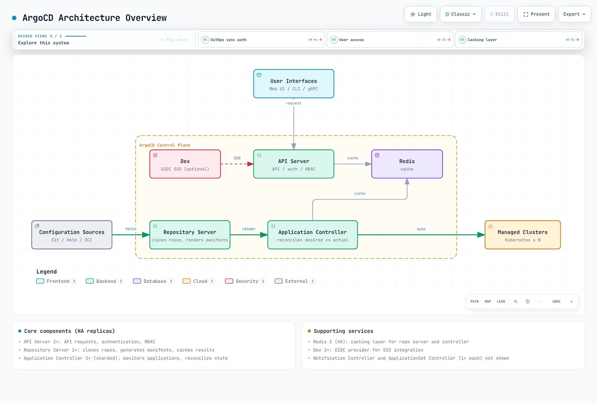
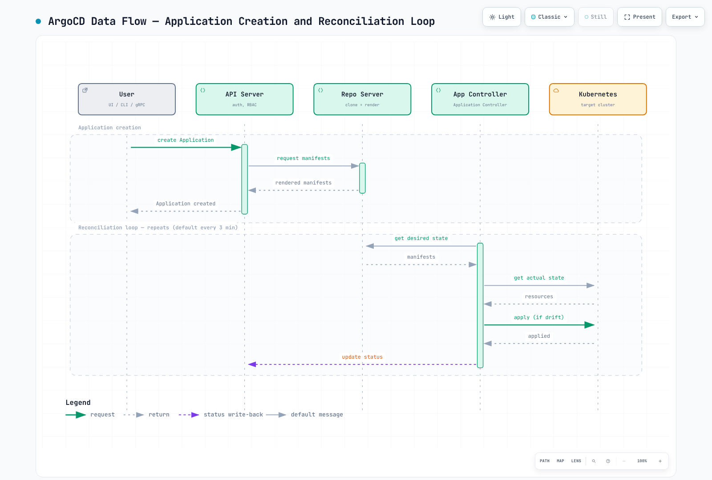

# ArgoCD

> **レビュー基準**: Argo CD 3.5.2、Argo Rollouts 1.10.0。リリースノートをレビューした後、Argo CD マニフェストの指定パッチを 3.5.5 に更新（例は再実行していません）
> **最終更新日**: 2026年10月16日

## 目次
- [ArgoCD とは？](#what-is-argocd)
- [主な利点](#key-benefits)
- [アーキテクチャの概要](#architecture-overview)
- [コアコンセプト](#core-concepts)
- [サブガイドのナビゲーション](#sub-guide-navigation)
- [クイックスタート](#quick-start)
- [バージョン互換性](#version-compatibility)

## ArgoCD とは？ {#what-is-argocd}

ArgoCD は、Kubernetes 向けの宣言的な GitOps 継続的デリバリーツールです。Git リポジトリで定義された望ましい状態をクラスター内の実際の状態と同期することで、Kubernetes クラスターへのアプリケーションのデプロイを自動化します。

Argo CD は CNCF の Graduated Argo プロジェクトの一部です。採用実績だけで、特定のセキュリティまたは可用性要件への適合性が保証されるわけではありません。



[🔍 インタラクティブ図を表示](https://www.atomai.click/kubernetes-docs/archmaps/en-gitops-argocd-overview-0.html)

## 主な利点 {#key-benefits}

### GitOps ネイティブ

- **唯一の信頼できる情報源としての Git**: すべてのアプリケーション設定を Git に保存
- **宣言的デプロイ**: 望ましい状態を定義し、残りは ArgoCD が処理
- **監査証跡**: Git コミットを通じたすべての変更の完全な履歴
- **ロールバック**: 保持された設定リビジョンを再デプロイ。データベース／外部状態の復旧は別途必要

### マルチクラスター管理

- **一元管理**: 単一の ArgoCD インスタンスから数百のクラスターを管理
- **ApplicationSet**: テンプレートベースのマルチクラスターデプロイ
- **Cluster Generator**: ラベルに基づく動的なクラスターターゲティング

### エンタープライズ対応

- **RBAC**: きめ細かなロールベースアクセス制御
- **SSO 統合**: 他のアイデンティティプロバイダー向けの直接 OIDC またはサポート対象の Dex コネクター
- **マルチテナンシー**: Project ベースの分離
- **高可用性**: 本番環境対応の HA デプロイ

### 開発者体験

- **Web UI**: 視覚的なアプリケーション管理とモニタリング
- **CLI**: フル機能のコマンドラインインターフェイス
- **通知**: Slack、Teams、メール、webhook 統合
- **ヘルスモニタリング**: 組み込みおよびカスタムのヘルスチェック

## アーキテクチャの概要 {#architecture-overview}

### コアコンポーネント

| コンポーネント | 説明 | レプリカ数 (HA) |
|-----------|-------------|---------------|
| **API Server** | すべての API リクエスト、認証、RBAC を処理 | 2+ |
| **Repository Server** | リポジトリをクローンし、マニフェストを生成して、結果をキャッシュ | 2+ |
| **Application Controller** | アプリケーションを監視し、状態を調整 | 2+ (sharded) |
| **Redis** | repo server と controller のキャッシュレイヤー | 3 (HA) |
| **Dex** | オプションのアイデンティティブローカー。バンドルされたインメモリストレージはレプリカ追加による安全なスケールに対応していない | 標準バンドルでは 1 |
| **Notification Controller** | イベントに応じて通知を送信 | 1+ |
| **ApplicationSet Controller** | ApplicationSet リソースを管理 | 1+ |

### データフロー



[🔍 インタラクティブ図を表示](https://www.atomai.click/kubernetes-docs/archmaps/en-gitops-argocd-overview-1.html)

## コアコンセプト {#core-concepts}

### Application

Application CRD は ArgoCD の主要リソースです。次を定義します:
- **ソース**: マニフェストの取得元 (Git リポジトリ、Helm chart、OCI)
- **デスティネーション**: デプロイ先 (クラスターと namespace)
- **Sync Policy**: 同期の処理方法

### Project

Project は論理的なグループ化とアクセス制御を提供します:
- 使用可能なリポジトリを制限
- デスティネーションクラスターと namespace を制限
- 許可／拒否するリソースを定義

### ApplicationSet

ApplicationSet は、generators を使用して単一の定義から複数のアプリケーションを管理できます:
- **List Generator**: 静的な値のリスト
- **Cluster Generator**: 登録済みクラスターをターゲット
- **Git Generator**: リポジトリのディレクトリ／ファイルをスキャン
- **Matrix/Merge**: 複数の generator を結合

### Sync

同期により、クラスターの状態を望ましい状態に一致させます:
- **手動 Sync**: ユーザーがトリガー
- **自動 Sync**: Git の変更時に自動実行
- **Self-Heal**: 差異を自動的に修正
- **Prune**: 孤立リソースを削除

## サブガイドのナビゲーション {#sub-guide-navigation}

| ガイド | 説明 |
|-------|-------------|
| [インストール](01-installation.md) | インストール方法、CLI セットアップ、HA 設定、EKS 統合 |
| [Applications](02-applications.md) | Application CRD、ソースタイプ、ヘルスチェック、hooks、App of Apps |
| [Sync 戦略](03-sync-strategies.md) | Sync Policy、waves、windows、diffing、retry 設定 |
| [ApplicationSets](04-applicationsets.md) | すべての generator、templating、段階的 Sync、マルチクラスターパターン |
| [トラフィック管理](05-traffic-management.md) | Argo Rollouts、blue-green、canary、分析、ingress 統合 |
| [Projects & RBAC](06-projects-rbac.md) | AppProject、RBAC ポリシー、マルチテナンシー、JWT トークン |
| [セキュリティ](07-security.md) | SSO 統合、secret 管理、TLS、監査ログ |
| [通知](08-notifications.md) | 通知サービス、トリガー、テンプレート、サブスクリプション |
| [ベストプラクティス](09-best-practices.md) | リポジトリパターン、パフォーマンスチューニング、トラブルシューティング、EKS のヒント |
| [Rollouts Experiments 詳細解説](10-rollouts-experiment.md) | Experiment CRD、一時的な ReplicaSet 検証、AnalysisRun の判定 |

## クイックスタート {#quick-start}

### 1. ArgoCD をインストール

これは自己管理の非 HA 評価例です。互換性のあるクラスター、CRD/RBAC 権限、空の専用 namespace を準備してください。本番の HA／認証／アップグレードに関する判断には[インストールガイド](01-installation.md)を使用してください。

```bash
# Create namespace
kubectl create namespace argocd

# Install ArgoCD
kubectl apply --server-side -n argocd -f https://raw.githubusercontent.com/argoproj/argo-cd/v3.5.5/manifests/install.yaml

# Wait for pods to be ready
kubectl wait --for=condition=Ready pods --all -n argocd --timeout=300s
```

### 2. UI にアクセス

```bash
# Port forward to access locally
kubectl port-forward svc/argocd-server -n argocd 8080:443
```

### 3. 初期パスワードを取得

```bash
# Retrieve the initial admin password
kubectl -n argocd get secret argocd-initial-admin-secret \
  -o jsonpath="{.data.password}" | base64 -d && echo
```

### 4. CLI 経由でログイン

[インストールガイド](01-installation.md)の説明に従って、対応する OS／アーキテクチャ用 CLI をインストールし、リリースチェックサムを検証してください。別のターミナルでポートフォワーディングを実行したままにしてください。

```bash
# Install CLI (macOS)
brew install argocd

# Login
argocd login localhost:8080

# Change the bootstrap password
argocd account update-password
kubectl -n argocd delete secret argocd-initial-admin-secret
```

### 5. 最初のアプリケーションをデプロイ

```bash
# Create application via CLI
argocd app create guestbook \
  --repo https://github.com/argoproj/argocd-example-apps.git \
  --path guestbook \
  --dest-server https://kubernetes.default.svc \
  --dest-namespace default

# Sync the application
argocd app sync guestbook
```

または、宣言的に定義します:

```yaml
apiVersion: argoproj.io/v1alpha1
kind: Application
metadata:
  name: guestbook
  namespace: argocd
spec:
  project: default
  source:
    repoURL: https://github.com/argoproj/argocd-example-apps.git
    targetRevision: HEAD
    path: guestbook
  destination:
    server: https://kubernetes.default.svc
    namespace: default
  syncPolicy:
    automated:
      prune: true
      selfHeal: true
    syncOptions:
      - CreateNamespace=true
```

## バージョン互換性 {#version-compatibility}

レビュー対象の基準は **Argo CD 3.5.2 / Helm chart 10.8.4** です。マニフェスト例はリリースノートをレビューした後、パッチ 3.5.5 に更新されています（再実行はしていません）。Chart 10.8.4 がデプロイする Argo CD は引き続き v3.5.2 です。3.5.5 が初めて含まれるのは chart 10.10.3 です。Application とインストール用 chart のバージョンは異なります。Argo CD は直近3つのマイナーラインにパッチを提供し、それより古いラインは EOL です。

### テスト済み Kubernetes の組み合わせ

| Argo CD | Kubernetes |
|---|---|
| 3.5 | 1.36, 1.35, 1.34, 1.33 |
| 3.4 | 1.35, 1.34, 1.33, 1.32 |
| 3.3 | 1.35, 1.34, 1.33, 1.32 |

これは 3.5.5 リポジトリに記録されているアップストリームのテストマトリックスです。これは chart の最小 kubeVersion 制約、Kubernetes/EKS のサポート期間、および管理対象 Argo CD のバージョンポリシーとは異なります。EKS のマイナーバージョンと Argo CD のマイナーバージョンの間に一対一の対応関係はありません。

### 最近のリリース

- 3.5.0: **2026-08-04** にリリース。server の Helm 4 renderer を含む変更について、移行ガイダンスを確認してください。
- 3.5.1: 2026-08-12 にリリース。
- 3.5.2: 2026-08-27 にリリース。
- 3.5.3: 2026-09-14 にリリース。バグ修正（ヘルスチェック、Sync retry state、UI）。
- 3.5.4: 2026-10-06 にリリースされた**セキュリティパッチ**です。CRITICAL の問題4件を修正します。Kustomize の remote ref 経由および Helm config home 経由の repo-server でのコマンド実行、Jsonnet import 経由の repo-server ファイル読み取り、PreDelete／PostDelete hook による AppProject 制限の迂回が対象です（CVE-2026-77459）。同じ修正は v3.4.10／v3.3.15 にもバックポートされました。動作変更として、Kustomize build は `helmGlobals.configHome` を考慮しなくなり、4 MiB を超える OCI マニフェストは拒否されます。アップグレード前に[リリースノート](https://github.com/argoproj/argo-cd/releases/tag/v3.5.4)を確認してください。
- [3.6.0-rc1](https://github.com/argoproj/argo-cd/releases/tag/v3.6.0-rc1): 3.6 系初のリリース候補で、2026-09-15 に公開されました。本番環境の基準バージョンではありません。

### 2026年10月の更新：Argo CD 4.0 のビジョン策定を開始

[9月30日のCNCF記事](https://www.cncf.io/blog/2026/09/30/argocon-north-america-2026-what-to-expect-as-the-argo-community-looks-toward-cd-4-0/)によると、Argoコミュニティは Argo CD 4.0 のビジョン策定を始めました。ArgoCon North America 2026（KubeCon NA と併催される終日・2トラックのイベント）は、メンテナーによる基調講演で最近の進展と今後のバージョンを取り上げて開幕する予定です。これは初期のロードマップ検討であり、4.0 の機能や時期はまだ確定していません。

### Argo Rollouts

Rollouts は別の controller であり、Argo CD なしでも使用できます。このレビューではその 1.10.0 ドキュメントを使用しています。関連のない製品バージョン番号を対応付けるのではなく、Rollouts CRDs/controller、トラフィックプラグイン、Kubernetes、および Argo CD ヘルスチェック統合を検証してください。

### EKS Managed Argo CD Capability

Argo CD 向け EKS Capability は、自己管理インストールとは異なる運用モデルです。そのカスタム設定は、**サポート対象**の argocd-cm キーにのみ適用され、capability で設定された namespace 内で、ラベル `app.kubernetes.io/part-of: argocd` を持つものが対象です。サポート対象外のキー／フラグは無視されます。標準の Lua ライブラリや任意の実行プラグインが利用可能であると想定しないでください。[管理設定ガイド](https://docs.aws.amazon.com/eks/latest/userguide/argocd-configure-settings.html)を参照してください。

## 次のステップ

1. **[インストールガイド](01-installation.md)**: 本番環境向けに ArgoCD をセットアップ
2. **[Applications ガイド](02-applications.md)**: Application CRD について学ぶ
3. **[ApplicationSets ガイド](04-applicationsets.md)**: マルチクラスターデプロイ

## リソース

- [ArgoCD 公式ドキュメント](https://argo-cd.readthedocs.io/)
- [ArgoCD GitHub リポジトリ](https://github.com/argoproj/argo-cd)
- [Argo Rollouts ドキュメント](https://argoproj.github.io/argo-rollouts/)
- [CNCF ArgoCD プロジェクトページ](https://www.cncf.io/projects/argo/)

## クイズ

学んだ内容を確認するには、[ArgoCD インストールクイズ](../../quizzes/gitops/argocd/01-installation-quiz.md)に挑戦してください。

### バージョン付きレビューソース

- [Argo CD 3.5.5 でテスト済みの Kubernetes バージョン](https://github.com/argoproj/argo-cd/blob/v3.5.5/docs/operator-manual/tested-kubernetes-versions.md)
- [リリースサポートポリシー](https://github.com/argoproj/argo-cd/blob/v3.5.5/docs/developer-guide/release-process-and-cadence.md)
- [3.5.0 リリース](https://github.com/argoproj/argo-cd/releases/tag/v3.5.0)
- [3.5.2 リリース](https://github.com/argoproj/argo-cd/releases/tag/v3.5.2)
- [3.5.3 リリース](https://github.com/argoproj/argo-cd/releases/tag/v3.5.3)
- [3.5.4 リリース](https://github.com/argoproj/argo-cd/releases/tag/v3.5.4)
- [Chart 10.10.3（Argo CD 3.5.5 を含む最初の chart）](https://github.com/argoproj/argo-helm/releases/tag/argo-cd-10.10.3)
- [HA コンポーネントの動作](https://github.com/argoproj/argo-cd/blob/v3.5.5/docs/operator-manual/high_availability.md)
