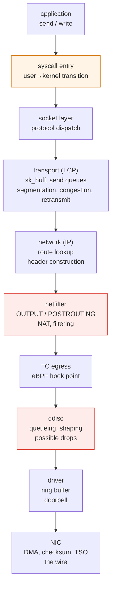
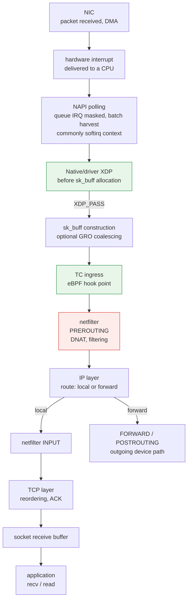

# カーネルのネットワークスタック

> **対応バージョン**: Linux 6.1 / 6.12 / 6.18 (Amazon Linux 2023)
> **最終更新日**: 2026年9月14日

## このドキュメントで扱う内容

- `send()` がカーネル内を通り、ネットワークに送出されるまでの経路と、各段階の処理
- ソケットのファイルディスクリプターと Virtual File System (VFS) の関係、および TCP バッファー、ウィンドウ、キューの観測値の違い
- フックを設定できる場所と、XDP、TC、netfilter の配置が性能差を生む理由
- 同一ノード、同一 AZ、AZ 間で Pod 間通信の経路が実際に異なる理由

## 経路を知る必要がある理由

「ネットワークが遅い」だけでは診断できません。カーネルのネットワーク経路には、**異なる理由で遅延や損失を生む複数の箇所**があり、どこが原因かによって対応はまったく異なります。

| 症状 | 調査する候補 |
|---|---|
| スループットが一定の値で頭打ちになる | アプリケーションの送信レート、ソケットバッファー、受信ウィンドウや輻輳ウィンドウ、経路の上限 |
| トラフィックのバースト時だけドロップする | qdisc、NIC/ドライバーのキュー、スタックのメモリー圧迫、下流での損失 |
| 1つの CPU だけが 100% になる | キューや割り込みの分散、単一フロー、そのコアで実行されるアプリケーション処理 |
| 小さなリクエストが異常に遅い | システムコールやコンテキストスイッチなど、固定オーバーヘッドの占める割合が大きい |
| ルールが増えるにつれて遅くなる | netfilter のルール評価 |

経路を把握しておくと、この表を逆向きにたどって調査箇所を絞り込めます。

## ソケットと VFS: FD からプロトコルまで {#socket-vfs-bridge}

`socket()` はファイルディスクリプター (FD) を返します。これはプロセスのディスクリプターテーブル内のインデックスです。ソケットの場合、そのエントリーは **`struct file`** を参照し、ソケット用のファイル操作と `private_data` を介して **`struct socket`** に結び付きます。さらに、インターネット TCP ソケットはプロトコル状態を保持する **`struct sock`** を持ちます。ファイル抽象化を共有することで、ソケットは `close()`、ディスクリプターの複製、準備完了状態のポーリングなどに参加できます。**ソケットはディスク上のファイルではなく**、通常の TCP データはディスクのページキャッシュやブロック I/O を通りません。

呼び出し経路は API によって異なります。

```text
FD → struct file → struct socket → struct sock / TCP state

read / write
  → VFS → socket_file_ops.read_iter / write_iter
  → sock_read_iter / sock_write_iter → socket receive/send operations

recv / send / recvmsg / sendmsg
  → socket-specific syscall path → look up the socket through the FD
  → socket receive/send operations
```

したがって、`read()`/`write()` は VFS のディスパッチを経由してソケット用ファイル操作を呼び出します。一方、ソケット固有の API では、必要に応じてフラグ、アドレス、補助データも指定できます。**すべての呼び出しが `vfs_read()`/`vfs_write()` を通るわけではありません**。各経路はソケット/プロトコル操作で合流します。Linux v6.12 の [`net/socket.c`](https://github.com/torvalds/linux/blob/v6.12/net/socket.c) (`sock_alloc_file`、`socket_file_ops`、`__sys_sendto`、`__sys_recvfrom`) と [`fs/read_write.c`](https://github.com/torvalds/linux/blob/v6.12/fs/read_write.c) を参照してください。これらは特定バージョンの例であり、内部関数名が変わらないことを保証するものではありません。

TCP が提供するのはバイトストリームです。1回の `write()` が1つのパケットや、相手側の1回の `read()` に対応するとは限りません。`send()` が成功した場合に示されるのはローカルで受け付けられたバイト数であり、相手側アプリケーションがそれを読み取った証明ではありません ([socket(7)](https://man7.org/linux/man-pages/man7/socket.7.html)、[tcp(7)](https://man7.org/linux/man-pages/man7/tcp.7.html))。

## 送信経路: send() からネットワークまで

ここで示すのは、**ホスト内で生成された TCP/IP パケットが物理 NIC に向かう場合の簡略化した経路**であり、すべてのパケットが必ずたどる経路ではありません。ループバックや仮想デバイス、転送、XDP/AF_XDP などのバイパス経路、netfilter flowtable オフロード、NIC オフロードによって、処理が省略、移動、統合されることがあります。フックは設定されている場合にのみ処理を行い、NAT によって経路検索が再実行される場合もあります。



各段階で実際に何が起きるかを理解することが、診断の基礎になります。

### ① システムコールの入口: 固定オーバーヘッドの発生源

通常の `send()` 呼び出しはシステムコールを通じてカーネルに入ります。呼び出しの入口と出口には、1回ごとのオーバーヘッドがあります。総コストはデータコピー、プロトコル処理、スケジューリング、呼び出しがブロックするかどうかにも左右されます。

小さなデータを何度も書き込む場合、この固定分が効いてきます。各呼び出しが要求したバイト数をすべて受け付けると仮定すると、64 バイトを1万回要求する場合と、640,000 バイトを1回要求する場合では、ペイロード量は同じでも呼び出し回数は1万倍異なります。

アプリケーション側でバッファリングするか、`sendmsg()` の scatter/gather を使えば、複数のバッファーを1回の呼び出しにまとめられます。`sendmmsg()` は複数のメッセージをまとめ、`io_uring` はサブミッションをまとめて処理できます。それぞれセマンティクスは異なり、バッチ化しても TCP のパケット境界が決まるわけではありません。

### ② ソケット層: sk_buff と各種バッファー

名前に反して、**`sk_buff` はソケットの送信または受信バッファー全体を表すものではありません**。ヘッダーのオフセットや、線形データまたはページフラグメントへの参照など、パケットデータとメタデータを記述します。skb は複製、分割、統合されることがあります。GSO/GRO により、skb 1つがネットワーク上のパケット1つに対応するとは限りません。カーネルの [`sk_buff` ドキュメント](https://docs.kernel.org/networking/skbuff.html)を参照してください。

| 概念 | 表すもの |
|---|---|
| アプリケーションのバイト数 | アプリケーションが送信または読み取りを要求した TCP ストリームのペイロード |
| ソケット送信バッファー | 送信待ちのデータと、確認応答/再送のために保持されるデータを含む、キューイング用メモリーの予算 |
| ソケット受信バッファー | 未読データや順不同で到着したデータなど、受信データ用のメモリー予算 |
| カーネルのメモリー会計 | skb メタデータ、データ領域、割り当てオーバーヘッドなどの割り当て量。ペイロード長だけではない |
| 通知される受信ウィンドウ (`rwnd`) | 利用可能な受信容量と TCP のウィンドウ規則に基づき、受信側が相手に追加送信を許可するシーケンス空間 |
| 輻輳ウィンドウ (`cwnd`) | 未処理データ量に対する送信側の輻輳制御上限。受信側のバッファー予算とは独立している |

送信可能な空き領域がないと、ブロッキング呼び出しは待機することがあります。ノンブロッキング呼び出しで1バイトも受け付けられなければ、`EAGAIN`/`EWOULDBLOCK` が返ります。どちらのモードでも、書き込みが一部のバイトだけを受け付けて成功を返すことがあります。その場合、アプリケーションは残りのバイトを処理する必要があります。バッファーを大きくするとローカルで多くのデータをキューイングできますが、相手側のウィンドウや送信側の `cwnd` が直接拡大するわけではありません。

### TCP バッファーのポリシーとソケット単位の設定 {#tcp-buffer-policy}

TCP の sysctl が表すのはポリシーであり、個々のソケットの現在の使用量ではありません。

| 設定 | 意味 |
|---|---|
| `net.ipv4.tcp_rmem` / `net.ipv4.tcp_wmem` | **バイト単位**の3つの値。メモリー圧迫時の最小値、初期デフォルト、自動受信/送信バッファーサイズの上限 |
| `net.ipv4.tcp_moderate_rcvbuf` | 上限とメモリー圧迫の範囲内で受信バッファーの自動調整を有効にする |
| `SO_RCVBUF` / `SO_SNDBUF` | 個々のソケットに対するアプリケーションからの要求。明示的に設定すると、通常の TCP 自動調整に対して該当方向のバッファーサイズが固定される |
| `net.core.rmem_max` / `net.core.wmem_max` | 通常のアプリケーションによる `SO_RCVBUF` / `SO_SNDBUF` 要求の上限。TCP の自動サイズ調整の上限とは別 |

`SO_RCVBUF` は `SOCK_RCVBUF_LOCK` を設定し、そのソケットの受信バッファー自動調整を無効にします。`SO_SNDBUF` は `SOCK_SNDBUF_LOCK` を設定し、通常の送信バッファー拡張を抑止します。これは設定フラグであり、ミューテックスではありません。TCP sysctl の値を引き上げても、アプリケーションが明示設定した値は解除されません。Linux は通常、会計処理のため受理した `SO_*BUF` 要求値を2倍にし、`getsockopt()` からも2倍の値を返します (最小値/上限の影響を受けます)。この値は、現在割り当てられているメモリー量でも、ペイロードとして必ず利用できる容量でもありません。`tcp_rmem[2]` を明示的な `SO_RCVBUF` 要求の最大値とみなしたり、すべての `tcp_*mem` 値を2倍したりしないでください。[IP sysctl](https://docs.kernel.org/networking/ip-sysctl.html)、[socket(7)](https://man7.org/linux/man-pages/man7/socket.7.html)、Linux v6.12 の [`net/core/sock.c`](https://github.com/torvalds/linux/blob/v6.12/net/core/sock.c) / [`tcp_input.c`](https://github.com/torvalds/linux/blob/v6.12/net/ipv4/tcp_input.c) を参照してください。

### BDP: 単位に基づく考え方 {#tcp-bdp-reasoning}

**1 Gbit/s** の経路で **RTT が40 ms** の場合を仮定すると、帯域幅遅延積 (BDP) は次のようになります。

```text
BDP = 1,000,000,000 bit/s × 0.040 s ÷ 8 bit/byte
    = 5,000,000 bytes = 5 MB ≈ 4.77 MiB
```

これは、理想化した定常状態モデルでそのレートを維持するために、経路上に存在するペイロード量の目安です。片道遅延ではなく往復時間を使います。十分な量のデータを未処理状態に保つには、受信ウィンドウと輻輳ウィンドウの両方が足りている必要があります。`ss -i` の `cwnd` は通常セグメント数で表されるため、バイト単位の値と比べるには `cwnd × MSS` を使います。ソケットのメモリー使用量には管理情報も含まれ、送信側がキューに入れたバイト数と実際に経路上を転送中のバイト数は一致しない場合があります。

**BDP は診断のための尺度であり、sysctl の設定手順ではありません。** アプリケーションの送信速度が低い場合、CPU 圧迫、損失、ペーシング、変動する RTT、経路の上限などが主な制約になります。キューを増やすと、遅延とメモリー使用量が増える場合があります。結論を出す前に、[TCP バッファーのラボ](../networking/07-linux-network-diagnostics.md#tcp-buffer-lab)で観測値を比較してください。

### ③ トランスポート層 (TCP): 輻輳制御が行われる場所

TCP は信頼性、フロー制御、輻輳制御を調整します。

- MSS と経路 MTU に応じてセグメントのペイロードを制限します。実際のセグメント化は GSO/TSO によって後段まで延期されることがあります。
- 相手側の**受信ウィンドウ**と送信側の**輻輳ウィンドウ (`cwnd`)の両方に基づいて未処理データを制限します**。ペーシングなどの制約も加わります。
- 再送キューを維持し、ACK が届かない場合は再送します。

輻輳制御アルゴリズムはこの層で動作します。次の2つの例では、送信を制御する方式が異なります。

| アルゴリズム | 主なモデル | 読み取る際の注意点 |
|---|---|---|
| **cubic** | 損失/ECN などの輻輳イベントに応じたウィンドウの増加と縮小 | 損失には輻輳以外の原因もあるため、経路を調査する |
| **bbr** | 配信レートと RTT の推定に基づき、ペーシングと転送中データ量を調整 | 推定値や損失/回復の挙動は実装/バージョンによって異なる |

どちらのモデルも、特定のワークロードでどちらが速いかを保証しません。また、BBR を使っても損失や回復の影響がなくなるわけではありません。`ss -ti` で有効なアルゴリズムと RTT/cwnd を確認してください。比較する場合はカーネルのバージョン、負荷、経路を明記します。バージョンを指定した実装例: [`tcp_cubic.c`](https://github.com/torvalds/linux/blob/v6.12/net/ipv4/tcp_cubic.c)、[`tcp_bbr.c`](https://github.com/torvalds/linux/blob/v6.12/net/ipv4/tcp_bbr.c)。

### ④ ネットワーク層 (IP): 経路検索

ルーティングテーブルを使って宛先までの経路を検索します。**この検索はネットワーク名前空間ごとに行われる**ため、Pod 内で見えるルーティングテーブルはノードのものとは異なります ([コンテナのカーネル機能](./01-container-primitives.md))。

### ⑤ netfilter: ルールを評価する場所

ローカルで生成されたトラフィックは `OUTPUT` と `POSTROUTING` を通ることがあります。一方、Pod の veth から入ってくるトラフィックは、ノードの名前空間内で `PREROUTING` → `FORWARD` → `POSTROUTING` を通る場合があります。Service の DNAT やエグレスの MASQUERADE の経路は、設定されているデータプレーンとフックに依存し、常に同じとは限りません。

iptables の長いルールチェーンを順に評価する場合、Service が増えるにつれて検索処理が増えることがあります。実際のコストはルール、検索構造、データプレーンのモードによって異なります。ルール数だけでは遅延を測定できません。設定された netfilter flowtable の高速経路が、後段の転送フックを迂回する場合もあります ([netfilter flowtable](https://docs.kernel.org/networking/nf_flowtable.html))。

### ⑥ qdisc: ドロップが発生する場所

qdisc (キューイング規律) は、**パケットを NIC に渡す前にキューイングし、順序と送信レートを決めます**。

運用上、重要な点は次のとおりです。

> qdisc のあふれは、バースト時のドロップ原因の1つです。原因を決める前に、qdisc、NIC/ドライバー、スタック、クラウドネットワークの各カウンターを関連付けてください。

キューが満杯になる前に、キュー上限やアクティブキュー管理によって qdisc がドロップする場合もあります。qdisc のドロップカウンターが示すのは、その qdisc によるドロップであり、経路全体の損失ではありません。`noqueue` を使うデバイスもあり、ダイレクト送信やオフロード経路では、すべてのパケットがキューに入るとは限りません。

**観測**: 影響が発生した期間について、`tc -s qdisc show dev <iface>` の `dropped`、`backlog`、`overlimits`、`requeues` の変化を比較します。`overlimits` はドロップではなくシェーピングの判断を示す場合があります。`requeues` は再度キューに入れられたパケット数を記録します。各カウンターの値が一致する、あるいは単純に合算できると決めつけず、インターフェイスとドライバーのカウンターも確認してください。

qdisc ごとに特性は異なります。

| qdisc | 特性 |
|---|---|
| `pfifo_fast` | 単純な FIFO (優先度バンドは3つ)。以前のデフォルト |
| `fq_codel` | フローキューイングと CoDel による遅延制御。輻輳を通知するためにドロップまたは ECN マークを行うことがある |
| `fq` | ペーシングをサポートするフロー公平キューイング |
| `mq` | マルチキュー NIC のハードウェアキューごとに qdisc を置くラッパー |

**Bufferbloat** は、過剰なキューイングによる遅延です。大きなキューはバーストを吸収できる反面、データを長時間保持することがあります。`fq_codel` はキュー滞留時間を監視し、該当する場合はドロップや ECN マークで輻輳を通知します。キューを大きくすれば必ず改善するわけではありません ([tc-fq_codel(8)](https://man7.org/linux/man-pages/man8/tc-fq_codel.8.html))。

### ⑦ ドライバーと NIC: オフロード

一般的な物理 NIC の経路では、ドライバーがパケットデータを DMA 用にマッピングし、送信リングにそのメモリーを参照するディスクリプターを準備してから NIC に通知します。NIC が C 言語の `sk_buff` 構造体を直接読み取るわけではありません。完了するまで、ドライバーが管理情報を保持します。

オフロードは、どこで処理するか、ホストで何が観測されるかを変えます。

| オフロード | 処理内容 |
|---|---|
| **TSO / GSO** | TSO は対応ハードウェアにセグメント化を委任します。GSO はカーネルの汎用/ソフトウェアセグメント化の枠組みとフォールバックです。どちらも NIC だけが行う処理ではありません |
| **GRO** (Generic Receive Offload) | 受信時に小さなパケットを**統合**して上位に渡し、スタックを通る回数を減らします |
| **チェックサムオフロード** | NIC がチェックサムを計算します |
| **RSS** (Receive Side Scaling) | 受信フローをハッシュしてハードウェアキューに振り分けます。IRQ アフィニティや後段のステアリングが CPU 配置を決めます |

TSO/GRO はセグメント単位の処理を減らせます。**読み取り専用での確認**には `ethtool -k <iface>` を使います。ここに表示されるのは設定済み機能であり、すべてのパケットで機能が使われたことを証明するものではありません。ホスト上のキャプチャには、大きな GSO/GRO 単位や未計算の送信チェックサムが表示される場合があります。キャプチャに大きなパケットが見えたり、チェックサム不正に見えたりしても、それだけでネットワーク上の障害とは断定できません ([セグメント化オフロード](https://docs.kernel.org/networking/segmentation-offloads.html)、[チェックサムオフロード](https://docs.kernel.org/networking/checksum-offloads.html))。

## 受信経路: 割り込みからアプリケーションまで

この図は、ドライバーの NAPI とオプションの native XDP を使い、その後ローカル TCP に配送する一般的な物理 NIC の受信経路です。`XDP_PASS` はスタック処理を続けますが、drop、redirect、transmit のアクションは別の経路を取ります。generic XDP は skb が作成された状態で動作します。ループバック、仮想デバイス、ハードウェアオフロード、ビジーポーリング、スレッド化 NAPI によって、この順序が変わることがあります。



### 割り込みストームを防ぐ NAPI

パケットごとに割り込みを発生させると、負荷が高いときに**割り込み処理だけでシステムの処理時間を使い切る**状態 (ライブロック) になる可能性があります。

一般的な割り込み駆動型 NAPI では、ドライバーが対象キューの割り込みをマスクし、ポーリングをスケジュールします。ポーリングでは、処理量に上限を設けて作業を行います。完了後、ドライバーはその割り込みを再度有効化できます。これは CPU のすべての割り込みを無効にするという意味ではありません。ビジーポーリングとスレッド化 NAPI は、別の実行モードです ([NAPI](https://docs.kernel.org/networking/napi.html))。

バッチ処理によってパケットごとのオーバーヘッドを平均化できますが、負荷が高いとポーリング予算を使い切り、遅延やドロップが増えることがあります。

### 1つのコアに集中する割り込み

受信割り込みの処理先は特定の CPU です。1つのキューや集中した処理があると、全体の CPU 使用率が低くても、1コアだけが飽和することがあります。単一フローやアプリケーション処理が原因の場合もあります。

対処に関係する機能は3つの層にあります。

| 機能 | 層 | 処理内容 |
|---|---|---|
| **RSS** | ハードウェア | NIC がフローを受信キューにハッシュで振り分けます。IRQ アフィニティを設定すると、キュー処理を複数 CPU に分散できます |
| **RPS** | ソフトウェア | RSS がない場合やキューが少ない場合に、カーネルが受信処理を別の CPU に渡します |
| **RFS** | ソフトウェア | キャッシュ局所性のため、受信処理をデータを読み取るアプリケーションの CPU に近づけます |

**診断**: `/proc/interrupts` でコア間の分散を確認し、`mpstat -P ALL` で1コアの `%soft` (softirq) が急増していないかを調べます。

RSS、RPS、RFS がすべてハードウェア割り込みを移動させるわけではありません。順序を保つため、1つのフローは同じキューに留まる場合があります ([ネットワークスタックのスケーリング](https://docs.kernel.org/networking/scaling.html))。

### ソケット受信バッファーとバックプレッシャー

アプリケーションが受信データを十分な速さで読み取らないと、未読バイトが蓄積して受信可能な容量が減ります。TCP はより小さい受信ウィンドウ、またはゼロウィンドウを通知して、フロー制御によるバックプレッシャーをかけることがあります。ウィンドウの計算、接続確立時にネゴシエートされるウィンドウスケーリング、予約メモリーが関係するため、通知されるウィンドウは単純な `SO_RCVBUF - Recv-Q` ではありません。

`Recv-Q` が継続的に増えている場合は、ネットワークの証拠とあわせて、読み取りの進み具合、CPU スケジューリング、下流のアプリケーション処理も調査します。1回の観測だけでアプリケーションが唯一の原因だとは断定できません。バッファーを大きくしても、バックプレッシャーの発生を遅らせて、より多くのデータを保持するだけの場合があります。

## フックポイントの比較: XDP、TC、netfilter

いずれも「パケットを捕捉して処理する」仕組みですが、**配置によって性能と実行可能な処理が変わります**。

| 項目 | **XDP** | **TC (eBPF)** | **netfilter** |
|---|---|---|---|
| **位置** | native/ドライバー XDP は `sk_buff` の作成前。generic XDP は skb ベース | `sk_buff` 作成後の ingress/egress | スタック上のフック |
| **方向** | 主に ingress | ingress + egress | すべての方向 |
| **省略または追加される処理** | native の早期 drop は skb の割り当てと後続スタック処理を省略できる | skb 作成後に実行。プログラムとアタッチ位置により処理が異なる | コストはフック、ルール、状態追跡、オフロードによって異なる |
| **利用可能な情報** | パケットデータ、利用可能なメタデータ/ヘルパー/マップ | 検証器が許可する `__sk_buff` コンテキスト/ヘルパー。カーネルメモリーへの無制限アクセスではない | conntrack が有効な場合は接続状態 |
| **主な用途** | **DDoS ドロップ**、ロードバランシング、パケットリダイレクト | ポリシー適用、可観測性、リダイレクト | NAT、ステートフルフィルタリング |
| **ハードウェアオフロード** | 一部のドライバー/NIC の組み合わせ | 一部 | 選択した nftables flowtable のオフロード。すべてのルール/経路ではない |

早期 drop の利点は、skb が割り当てられる前に実行する **native/ドライバー XDP** に関するものです。generic XDP では既に skb があります。実際の性能はドライバーの対応状況やプログラムの処理内容によって異なります。一方のモードに関する説明を、すべてのモードに当てはまるベンチマーク結果として扱わないでください。

XDP がすべてのソケット/スタックコンテキストを自動的に受け取るわけではありませんが、BPF マップを使って状態を保持でき、対応ヘルパーから追加情報を得られる場合もあります。**ステートフル処理が XDP で本質的に不可能というわけではありません**。実際のプログラム、カーネル、検証器、ドライバーの制約を評価してください。

データプレーンでは用途ごとに複数のフックを組み合わせることがあります。Cilium が実際に使うアタッチ位置は、構成と対応機能に依存します ([Cilium eBPF](../networking/cilium/02-ebpf.md)、[Cilium L2-L7 Networking](../networking/cilium/05-l2-l7-networking.md))。

## Pod 間通信: 経路が異なる理由

Kubernetes の Pod 間通信は、Pod の配置によって**実際に異なるカーネル経路を通ります**。[Pod ネットワークベンチマーク](../networking/06-pod-network-benchmark.md)で測定された RTT の段階的な増加 (同一ノード 0.040 ms → 同一 AZ 0.339 ms → AZ 間 0.544 ms) の要因です。

### 同じノード上の Pod

```text
Pod A [net ns A] → veth A → (node net ns) → veth B → Pod B [net ns B]
```

図に示す一般的な veth/ルーティングの同一ノード経路では、トラフィックが物理 NIC を通らない場合があります。別のデータプレーン、オーバーレイ、SR-IOV、ポリシー/サービス処理による迂回で経路が変わることがあります。仮想デバイスでもカーネルのドライバー処理は行われます。

そのため、ベンチマークでは同一ノードの単一フローが **29.97 Gbps** に達しました (ノード間は EC2 の単一フロー上限である 4.96 Gbps に達しました)。ボトルネックはネットワークではなく**CPU**で、クライアント側の1コアが 99.8% に達していました。

### 異なるノード上の Pod (VPC CNI)

```text
Pod A → veth → node net ns → ENI → VPC network → target ENI → veth → Pod B
```

Amazon VPC CNI では、Pod に**実際の VPC IP アドレス**が割り当てられるため、オーバーレイのカプセル化はありません。オーバーレイ CNI (VXLAN など) と比べてカプセル化/解除のコストと MTU の損失を避けられる点が、VPC CNI の構造上の利点です ([VPC CNI](../networking/01-vpc-cni.md))。

通常のノード間経路では物理ネットワークデバイスを使用し、**EC2 インスタンスのネットワーク上限** (単一フローの上限、インスタンス全体の帯域幅、PPS 上限) の影響を受けます。正確なキューイングやフック経路は、デバイスとデータプレーンによって異なります。

### AZ をまたぐ場合

引用した単一フローの実験では、ノード間の両方の配置で RTT が +0.21 ms、スループットが約 4.96 Gbps でした。この結果は、そのインスタンス、負荷、経路に対するものです。すべての AZ 間ワークロードでスループットが変化しないことを示すものではありません。

### MTU とフラグメンテーション

**MTU** は IP ヘッダーを含む IP パケットについて、インターフェイスが扱える上限です。**PMTU** は経路上で実効となる MTU の最小値です。**MSS** は TCP セグメントごとのペイロード上限で、IP/TCP ヘッダーは含みません。オプションを使わない IP MTU が 1500 バイトの場合、IPv4 の20バイトヘッダーと TCP の20バイトヘッダーを差し引くと1460バイト、IPv6 の40バイトヘッダーと TCP の20バイトヘッダーを差し引くと1440バイトになります。オプションやカプセル化は追加の領域を使います。相手が通知した MSS は経路全体の計測値ではありません。

DF がクリアされている場合、IPv4 ルーターは大きすぎるパケットをフラグメント化できます。DF が設定されているとパケットを破棄し、通常は ICMP の "fragmentation needed" を返します。IPv6 ルーターはフラグメント化を行わず、ICMPv6 の "Packet Too Big" を返します。その後、送信元がサイズを調整するか、送信元でフラグメント化します。PMTUD はこのフィードバックを利用します。該当する ICMP が失われるとブラックホールが生じる可能性がありますが、packetization-layer probing で回復できる場合もあります。9001 などのジャンボ MTU が役立つのは、経路全体が必要なサイズに対応している場合だけです。

「ハンドシェイクは成功するのにデータが止まる」という症状は、PMTU の問題と**整合します**が、それを証明するものではありません。インターフェイス MTU、TCP の MSS/PMTU 情報、適切な位置でのパケットキャプチャを比較してください。GSO/TSO/GRO やチェックサムオフロードによって、ホストのキャプチャはネットワーク上のパケットと異なる場合があります。ホストで大きな単位がキャプチャされたことだけから、フラグメンテーションや破損を推定しないでください。[MTU/MSS ラボ](../networking/07-linux-network-diagnostics.md#mtu-mss-lab)、[IPv4 PMTUD](https://www.rfc-editor.org/rfc/rfc1191)、[IPv6 PMTUD](https://www.rfc-editor.org/rfc/rfc8201)を参照してください。

## 観測ツール

各層で確認する対象は異なります。

| 層 | ツール | 確認できる情報 |
|---|---|---|
| ソケット | `ss -tinm`、`ss -ltn` | TCP の状態、ストリームのキューとリスナーバックログの違い、RTT/cwnd、ソケットメモリー |
| TCP 全体 | `nstat` / `netstat -s` | 再送、順不同データ、バッファーオーバーラン |
| netfilter | `iptables-save`、`nft list ruleset` | ルールの数と内容 |
| conntrack | `conntrack -S` | `insert_failed`: 数、最大値、ログと関連付ける。リソース枯渇だけに固有の値ではない |
| qdisc | `tc -s qdisc show dev <if>` | その qdisc のドロップ、バックログ、シェーピング、再キューイングのカウンター |
| インターフェイス | `ip -s link`、`ethtool -S <if>` | インターフェイスと NIC のカウンター |
| オフロード | `ethtool -k <if>` | TSO/GRO/チェックサムの状態 |
| 割り込み | `/proc/interrupts`、`mpstat -P ALL` | コアごとの偏り、softirq の割合 |
| パケットトレース/フロー状態 | `tcpdump`、`ss`、eBPF ツール | オフロードとアタッチ位置の影響を受ける、観測地点でのパケットまたはソケット/イベントの状態 |

まずドロップカウンターを確認し、発生時刻、インターフェイス/名前空間、トラフィック、リソース圧迫と関連付けます。カウンターの増加は調査する根拠になりますが、唯一の原因を証明するものではありません。該当するカウンターが増えていなくても、別の場所での損失を否定できません。必要に応じて RTT/cwnd、アプリケーションのメトリクス、パケットキャプチャも確認します。

### ソケットの状態別に TCP キューを読む {#ss-tcp-queues}

通常の Linux TCP ソケットでは、`ss` の値は状態によって異なります。

| 状態 | `Recv-Q` | `Send-Q` |
|---|---|---|
| `ESTABLISHED` | 受信済みで、まだアプリケーションにコピーされていない順序どおりのストリームの**バイト数** | 書き込み済みで、累積確認応答をまだ受け取っていないストリームの**バイト数**。未送信と送信済み/未確認の両方を含む |
| `LISTEN` | `accept()` 待ちの接続数 | 設定済みの accept バックログの最大値。キュー内のペイロードではなく**接続数** |

リスナーの値は SYN キューの使用量でもバイト単位のバッファーサイズでもありません。accept バックログは `listen()` と `somaxconn` によって制限されます。未完了のリクエストと SYN cookie には別の動作があります。Linux v6.12 の [`tcp_diag_get_info()`](https://github.com/torvalds/linux/blob/v6.12/net/ipv4/tcp_diag.c) は、状態に応じた値をエクスポートします。[listen(2)](https://man7.org/linux/man-pages/man2/listen.2.html) も参照してください。

`ss -m` は `skmem` によるメモリー会計を追加します。`r` (受信メモリー)、`rb` (受信予算)、`w` (キュー内の送信メモリー)、`tb` (送信予算) などのフィールドは、オーバーヘッドも含むカーネル内のバイト数です。`Recv-Q`/`Send-Q` と同じ値とは限りません。順不同の受信データはメモリーを使用していても、順番どおりに読み取り可能なバイト数には現れない場合があります。`Send-Q` が0以外というだけでは、損失やバッファー満杯の証拠になりません。`ss -i` は RTT、MSS、利用可能な場合は `cwnd` も表示します。その `rcv_space` は内部の自動調整用の値であり、通知されたウィンドウではありません ([ss(8)](https://man7.org/linux/man-pages/man8/ss.8.html))。

これらのコマンドは、現在のネットワーク名前空間のソケットを観測し、プロセスに見えるバッファーポリシーを読み取ります。

```bash
ss -tinm
ss -ltn
sysctl net.ipv4.tcp_rmem net.ipv4.tcp_wmem net.ipv4.tcp_moderate_rcvbuf
sysctl net.core.rmem_max net.core.wmem_max net.core.somaxconn
```

ソケットの状態、単位、アプリケーションの読み書きの進み具合、時間経過に伴う変化をあわせて記録してください。制御された例と解釈については、[TCP バッファーのラボ](../networking/07-linux-network-diagnostics.md#tcp-buffer-lab)を参照してください。

## まとめ

- ソケット FD は VFS のファイル抽象化を共有します。`read`/`write` はソケット用ファイル操作にディスパッチされ、`send`/`recv` はソケット固有の入口を使います。
- skb オブジェクト、ソケットのメモリー予算、ストリームのバイト数、`rwnd`、`cwnd` はそれぞれ異なる量を表します。`ss` のキュー列はソケットの状態に応じて読み取ります。
- TCP バッファーの sysctl は自動サイズ調整を制御します。明示的な `SO_*BUF` 設定は該当方向を固定します。BDP は考察の尺度であり、汎用的なバッファー設定値ではありません。
- 通常の TCP/IP 経路には複数の観測箇所があります。バイパス、転送、オフロードによって経路は変わります。qdisc のドロップは損失原因の1つです。
- NAPI は処理をバッチ化し、RSS/RPS/RFS はキューや処理を分散します。native XDP は skb 作成前に動作しますが、generic XDP は作成後に動作します。
- 同一ノードの veth 通信では物理 NIC を回避できる場合がありますが、実際のデータプレーンによって経路が決まります。PMTU による停止やホスト上のキャプチャの差異は、単一の症状から推測せず、証拠を確認してください。

次の[EKS ノードのカーネルチューニング](./03-eks-node-tuning.md)では、この経路のどのパラメーターをいつ変更するかを説明します。

## 参考資料

- [Linux Networking Documentation: Kernel](https://docs.kernel.org/networking/index.html)
- [NAPI: Linux kernel documentation](https://docs.kernel.org/networking/napi.html)
- [Scaling in the Linux Networking Stack (RSS/RPS/RFS)](https://docs.kernel.org/networking/scaling.html)
- [XDP (eXpress Data Path)](https://docs.kernel.org/networking/af_xdp.html)
- [Linux v6.12 socket implementation](https://github.com/torvalds/linux/blob/v6.12/net/socket.c): FD、VFS 操作、ソケット API の入口
- [Socket API and options: socket(7)](https://man7.org/linux/man-pages/man7/socket.7.html)
- [TCP: tcp(7)](https://man7.org/linux/man-pages/man7/tcp.7.html)
- [Socket observation: ss(8)](https://man7.org/linux/man-pages/man8/ss.8.html)
- [Pod Network Benchmark](../networking/06-pod-network-benchmark.md)
- [eBPF Fundamentals](../basics/05-ebpf-fundamentals.md)
- [Linux segmentation offloads](https://docs.kernel.org/networking/segmentation-offloads.html): ハードウェア TSO とソフトウェア GSO
- [Linux IP sysctls](https://docs.kernel.org/networking/ip-sysctl.html): TCP バッファーサイズとソケットによる上書き
