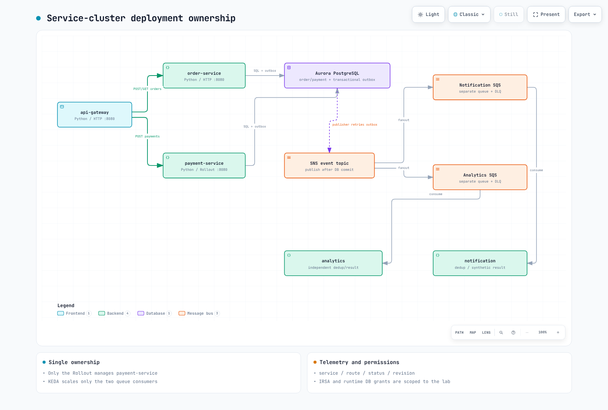

# パート3: MSAのデプロイとカナリア

<span id="application-structure"></span>
<span id="architecture-overview"></span>
<span id="canary-state-diagram"></span>
<span id="cleanup"></span>
<span id="exercise-1-msa-application-overview"></span>
<span id="exercise-2-karpenter-nodepool-configuration"></span>
<span id="exercise-3-keda-scaledobject-configuration"></span>
<span id="exercise-4-argocd-application-deployment"></span>
<span id="exercise-5-opentelemetry-auto-instrumentation"></span>
<span id="exercise-6-argo-rollouts-canary-deployment"></span>
<span id="exercise-7-intentional-failure-and-automatic-rollback"></span>
<span id="learning-objectives"></span>
<span id="next-steps"></span>
<span id="prerequisites"></span>
<span id="references"></span>
<span id="repository-structure"></span>
<span id="sample-code-snippets"></span>
<span id="service-call-flow"></span>
<span id="steps"></span>
<span id="steps-1"></span>
<span id="steps-2"></span>
<span id="steps-3"></span>
<span id="steps-4"></span>
<span id="steps-5"></span>
<span id="summary"></span>
<span id="troubleshooting"></span>
<span id="verification"></span>
<span id="verification-1"></span>
<span id="verification-2"></span>
<span id="verification-3"></span>
<span id="verification-4"></span>
<span id="verification-5"></span>

> **難易度**: 上級
> **最終更新日**: 2026年10月16日
実行可能な5つのPythonロールを、それぞれ独立したワークロードとしてデプロイします。[アプリケーションREADME](https://github.com/Atom-oh/kubernetes-docs/tree/main/examples/labs/observability/application)でコード、データベース、イメージ、チャートの入力を定義しています。決済と通知は疑似処理であり、実際の課金やメール/SMS送信は行いません。


[🔍 インタラクティブな図を表示](https://www.atomai.click/kubernetes-docs/archmaps/en-labs-observability-03-msa-deployment-lab-10.html)

## 1. 共有APIと永続化の契約 {#contracts}

| リクエスト/ロール | 契約 |
|---|---|
| `POST /orders` | 201 + `id`。注文とoutboxを同時にコミット |
| `POST /payments` | 200 + `status: completed`。注文/金額/方式が同一なら冪等。値が競合する場合は409を返す |
| `GET /orders/{id}` | 200 + 同じID、または404 |
| `notification` | 専用のSQSキュー、永続化された疑似通知 |
| `analytics` | 別のSQSキュー、独立して永続化される結果 |

W3Cコンテキストは、gateway/service間のHTTP通信とproducer/consumer間の境界を越えて伝播します。outboxへの公開後、データベースに処理済みの印を付ける前にクラッシュすると再配信されるため、コンシューマーはイベントIDをトランザクション内で重複排除します。これによって外部のメール送信や決済処理がexactly onceになるわけではありません。注文POSTに対する汎用的なIdempotency-Key処理は含まれていません。

アプリケーションメトリクスは`lab_http_requests_total`と`lab_http_request_duration_seconds`で、service/route/status/revisionをラベルに持ちます。JSONログにはservice/level/trace_id/span_idが含まれます。顧客や決済のペイロードをメトリクスのラベルに含めません。

## 2. データベースファイルとイメージ {#image-database}

パート1で用意した専用のランタイムアカウントとプライベート接続ファイルを使います。Pod内のパスは`/run/database-ca/global-bundle.pem`と`/run/database/connection.json`です。接続ファイルとパブリックなRDS CAは、それぞれSecretとConfigMapとして別個にマウントします。

```bash
cd examples/labs/observability/application
kubectl --context service create namespace msa --dry-run=client -o yaml | kubectl --context service apply -f -
kubectl --context service -n msa create secret generic lab-database --from-file=connection.json="$LAB_STATE/runtime-pod-connection.json"
kubectl --context service -n msa create configmap lab-database-ca --from-file=global-bundle.pem="$LAB_STATE/global-bundle.pem"
docker buildx build --platform linux/amd64 \
  --tag "$IMAGE_REPOSITORY:$IMAGE_TAG" --push .
docker buildx imagetools inspect "$IMAGE_REPOSITORY:$IMAGE_TAG"
```

パート1で選択したイミュータブルなバージョンを使います。既存のSecretは、値を表示したりチャートファイルに記載したりせず、組織のローテーション手順に従って更新してください。Dockerfileではベースイメージのダイジェスト、UID 10001、範囲を限定したビルドコンテキストを固定しています。

生成される`m6i.large`ノードはAMD64を使います。AMD64対応またはクロスプラットフォーム対応のBuildxビルダーを使い、デプロイ前にプッシュしたマニフェストで`linux/amd64`を確認してください。監査時のローカルARM64スモークテストでは、AMD64向けビルドを検証できません。

## 3. コントローラーとチャートのインストール {#deployment}

```bash
helm repo add kedacore https://kedacore.github.io/charts
helm repo add argo https://argoproj.github.io/argo-helm
helm upgrade --install keda kedacore/keda --version 2.20.2   --kube-context service -n keda --create-namespace -f "$LAB_STATE/helm-inputs/keda.yaml"
helm upgrade --install argo-rollouts argo/argo-rollouts --version 2.43.1   --kube-context service -n argo-rollouts --create-namespace
helm upgrade --install observability-lab ./chart --kube-context service -n msa   -f "$LAB_STATE/helm-inputs/application.yaml"
kubectl --context service -n msa get deployment,rollout,pods,svc,scaledobject
```

5つのServiceAccountとIRSAサブジェクトをすべて確認してください。GatewayにはAWSロールがありません。publisherはSNSに、consumerはそれぞれ自身のキューに、KEDAはキュー属性のみにアクセスします。1つのワークロードにPod IdentityとIRSAの経路を重複して構成しないでください。Readinessチェックが確認するのはデータベース/スキーマであり、SQS/IAMへの配信成功ではありません。

ServiceMonitorのラベルはservice用Prometheusリリースと一致し、`honorLabels`によってアプリケーションのserviceラベルが保持されます。ベースラインはマネージドノードグループ上で実行できます。Karpenterを追加するのは、[別のガイド](../../autoscaling/02-karpenter.md)でIAM/ディスカバリー/EC2NodeClass/AMI/taintを確認した後にしてください。



[🔍 インタラクティブな図を表示](https://www.atomai.click/kubernetes-docs/archmaps/en-labs-observability-03-msa-deployment-lab-0.html)

## 4. HTTPと非同期処理の検証 {#verify}

```bash
kubectl --context service -n msa port-forward svc/api-gateway 8080:8080
# Run in another terminal from the repository root:
BASE_URL=http://127.0.0.1:8080 LOAD_PROFILE=smoke   k6 run --no-usage-report examples/labs/observability/load-test/k6-scenario.js
```

作成されたIDだけを読み取り、疑似決済の状態を検証してください。キューごとに独立して配信されること、およびconsumerの`/stats`、データベースの件数、ログが増加することを確認します。notificationとanalyticsには別々のキューを使います。1つのキューにconsumerを複数登録してもfanoutにはなりません。処理に失敗したメッセージや有害なメッセージは、DLQポリシーに従い未acknowledgedのまま残ります。

CloudWatch/LokiのJSONにあるtrace_id、Tempoの実際のスパン、Prometheusのexemplar IDを照合してください。collectorをインストールしただけでは、エンドツーエンドで検証したことにはなりません。

## 5. カナリアとGitOpsの所有権 {#canary}


[🔍 インタラクティブな図を表示](https://www.atomai.click/kubernetes-docs/archmaps/en-labs-observability-03-msa-deployment-lab-1.html)
1つのRolloutがpayment-serviceを管理します。レプリカが5つの場合、20%のステップはレプリカ数に基づくため、実際のリクエストの20%を保証しません。分析の前にある手動pause中に、新しいリビジョンへトラフィックを送ります。クエリは`rollouts-pod-template-hash`で対象を選択し、直近のリクエストが5件以上、成功率が99%であることを要求し、空/NaN/Inf/複数系列の結果を拒否します。

実際のRollouts 1.10.0で条件評価とPromQLをテストしましたが、クラスター上で昇格は実行していません。abortはGitのrevertでも、意図したイメージの復元でもありません。ArgoCDを任意で使う場合は、[インストールガイド](../../gitops/argocd/01-installation.md)に従い、このリポジトリに存在するチャートパスとレビュー済みリビジョンを指定し、Helmによる直接管理と同時に使わないでください。Secretはコミットせず、既存のSecretを参照します。app-of-appsのsync waveだけでは、子リソースのReadinessは保証されません。

### 手動pauseを試す

次の手順ではHelmを望ましい状態の管理元として使います。GitOpsを使う場合は、イメージの変更と復旧をGit上でレビューし、Helmからの直接書き込みと混在させないでください。[Argo Rollouts 1.10.0のリリース](https://github.com/argoproj/argo-rollouts/releases/tag/v1.10.0)でバイナリとチェックサムを確認してから、OS/CPUに合ったプラグインをインストールします。

```bash
# ROLLOUTS_BINARY: checksum-verified binary for your OS/architecture.
: "${ROLLOUTS_BINARY:?Set the verified Argo Rollouts 1.10.0 binary path}"
mkdir -p "$HOME/.local/bin"
install -m 755 "$ROLLOUTS_BINARY" "$HOME/.local/bin/kubectl-argo-rollouts"
export PATH="$HOME/.local/bin:$PATH"
kubectl argo rollouts version --short
```

安定したRolloutであることを確認し、現在の完全なvaluesを保持してから、パート3のビルド手順に従って、実際にレビュー済みのAMD64イメージを新しいイミュータブルタグで公開します。初回インストールには以前の安定リビジョンがないため、この更新演習には該当しません。チャートでは全ロールが1つのイメージ設定を共有するため、これを変更するとほかのロールも通常のDeploymentとして更新されます。Rolloutのステップが適用されるのはpaymentのみです。

```bash
# Run from examples/labs/observability/application.
: "${CANARY_IMAGE_TAG:?Set an actually built and reviewed immutable AMD64 image tag}"
# Keep the original application.yaml as the stable revision's complete values.
CANARY_VALUES="$LAB_STATE/helm-inputs/canary-image.yaml"
python3 - "$CANARY_VALUES" "$CANARY_IMAGE_TAG" <<'PYIMAGE'
import sys, json
with open(sys.argv[1], "w") as output:
    json.dump({"image": {"tag": sys.argv[2]}}, output)
PYIMAGE
helm upgrade observability-lab ./chart --kube-context service -n msa \
  -f "$LAB_STATE/helm-inputs/application.yaml" -f "$CANARY_VALUES"
kubectl argo rollouts get rollout payment-service --context service -n msa --watch
```

--watchの表示は別のターミナルに出し、必要に応じてCtrl+Cで終了します。トラフィック生成と昇格/中止のコマンドは、別のターミナルで実行してください。

Paused中はセクション4のトラフィックを継続し、Prometheusで新しい`rollouts-pod-template-hash`リビジョンに直近のリクエストが5件以上到達したことを確認します。トラフィックが届かない、またはクエリに失敗した場合は成功と判断しません。確認後、下のコマンドで手動pauseを解除し、設定済みのAnalysisRunと後続ステップを実行します。`--full`は使用しないでください。分析とpauseをスキップします。

```bash
kubectl argo rollouts promote payment-service --context service -n msa
kubectl argo rollouts get rollout payment-service --context service -n msa --watch
kubectl --context service -n msa get analysisruns
```

問題が起きた場合は昇格せずabortし、元の完全なvaluesを使って意図したイメージに戻してください。abortだけではspec.templateもGitも復元されません。

```bash
kubectl argo rollouts abort payment-service --context service -n msa
helm upgrade observability-lab ./chart --kube-context service -n msa \
  -f "$LAB_STATE/helm-inputs/application.yaml"
kubectl argo rollouts get rollout payment-service --context service -n msa --watch
```

昇格後も、承認済みイメージのオーバーレイを以降のHelmコマンドに含めるか、管理対象のdesired valuesに取り込んでください。障害分析の証跡を保持し、最終状態を確認します。この監査ではCLIのチェックサム/ヘルプとチャート/分析ロジックを検証しましたが、クラスター更新/昇格/中止の各コマンドは実行していません。

[パート4](./04-load-testing-scaling-lab.md)に進んでください。所有権と依存関係を考慮したクリーンアップについては[パート6](./06-distributed-tracing-lab.md#cleanup)に従います。

## 検証範囲

ローカルSQLite/PostgreSQL、3つのHTTPサービス、OTelの相関付け、SNS/SQS SDKスタブ、コンテナのスモークテスト、Helm/CRD、PromQL/Argoの条件を検証しました。実際のAurora TLS、EKS/IRSA、SNSファンアウト、KEDA/Karpenter、カナリアのトラフィック分割は実行していません。
