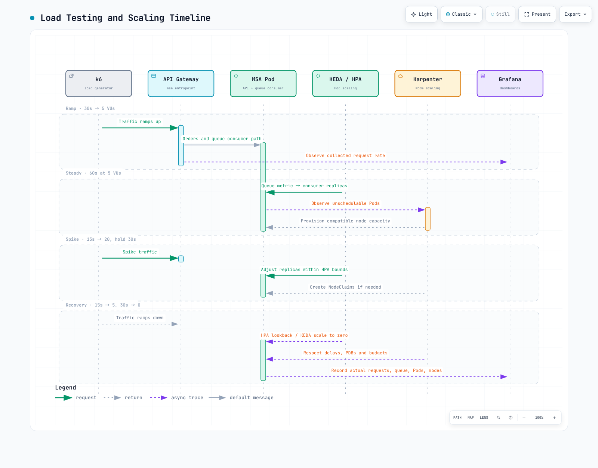

# パート4: 負荷テストとオートスケーリング

<span id="exercise-1-k6-load-test-scenario"></span>
<span id="exercise-2-locust-alternative-python-based"></span>
<span id="exercise-3-observe-autoscaling-during-load"></span>
<span id="exercise-4-cool-down-and-scale-in-observation"></span>
<span id="exercise-5-grafana-scaling-dashboard"></span>
<span id="key-observations"></span>
<span id="learning-objectives"></span>
<span id="load-testing-and-scaling-timeline"></span>
<span id="next-steps"></span>
<span id="references"></span>
<span id="steps"></span>
<span id="steps-1"></span>
<span id="steps-2"></span>
<span id="steps-3"></span>
<span id="steps-4"></span>
<span id="summary"></span>
<span id="troubleshooting"></span>
<span id="verification"></span>

> **難易度**: 中級 · **所要時間**: 45分
> **最終更新**: 2026年9月13日

k6 と Locust で注文・支払い・読み取りの同じフローを実行し、Pod とノードに見られた変化を説明します。対象は使い捨てのラボ API に限定してください。VU 数とレイテンシーのしきい値は演習用の設定値であり、実測スループットや実際のスケーリング結果を示すものではありません。

## 前提条件 {#prerequisites}

- [パート3](./03-msa-deployment-lab.md) の API が準備できている必要があります: `POST /orders` は `201` と `id` を返し、`POST /payments` は `200/201` と `status: completed` を返し、`GET /orders/{id}` はその ID を返します。別の API を使う場合は、パス、ペイロード、アサーションも併せて変更してください。
- 対象クラスターのコンテキスト名は `service` です。すべてのコマンドで明示的に指定してください。
- 例は k6 **2.2.0** と Locust **2.46.5**/Python **3.12** で確認しました。OS/CPU アーキテクチャに対応した [公式インストールガイド](https://grafana.com/docs/k6/latest/set-up/install-k6/) に従ってください。
- [パート3](./03-msa-deployment-lab.md) で KEDA ScaledObject と Karpenter NodePool/EC2NodeClass を設定してください。インフラストラクチャのクエリを使うには、kube-state-metrics/cAdvisor のメトリクスが実際に取り込まれている必要があります。



[🔍 インタラクティブな図を表示](https://www.atomai.click/kubernetes-docs/archmaps/en-labs-observability-04-load-testing-scaling-lab-0.html)

## 1. 小規模テストで API を検証する {#smoke-test}

[実行可能な例](https://github.com/Atom-oh/kubernetes-docs/tree/main/examples/labs/observability/load-test) の `k6-scenario.js` を使用します。port-forward は実行した端末で継続してください。

```bash
# Run from the repository root.
cd examples/labs/observability/load-test
kubectl --context service -n msa port-forward svc/api-gateway 8080:8080
```

```bash
# In another terminal, from the same directory.
BASE_URL=http://127.0.0.1:8080 LOAD_PROFILE=smoke \
  k6 run --no-usage-report k6-scenario.js
```

既定のスモークテストは、1 VU で 2 回のイテレーションを実行します。テストが作成した ID だけを読み取り、無効な JSON、ID の欠落、拒否された支払い、レスポンスに含まれる注文 ID の不一致を検出します。しきい値を超えた `check()` の失敗は、ゼロ以外の終了コードになります。`k6-summary.json` と終了コードの両方を確認してください。サマリーに p(99) を出力するため、`summaryTrendStats` にも含めます。

## 2. 継続的な負荷ステージを実行する {#load-stages}

```bash
BASE_URL=http://127.0.0.1:8080 LOAD_PROFILE=scale \
  k6 run --no-usage-report k6-scenario.js
```

| ステージ | 期間 | 目標 VU 数 |
|---|---|---|
| ランプアップ | 30s | 5 |
| 定常 | 60s | 5 |
| スパイク・ランプアップ | 15s | 20 |
| スパイク維持 | 30s | 20 |
| 復旧 | 15s | 5 |
| クールダウン | 30s | 0 |

各ステージの合計は 3 分で、グレースフル停止に追加の時間がかかることがあります。単一の `stages` シーケンスを使い、独立したシナリオが重複して実行されるのを避けます。VU 数は RPS ではありません。スループットはレスポンスタイム、イテレーションあたりのリクエスト数、sleep によって変わります。負荷を増やす前に、NodePool の容量と予算を確認してください。コントローラーの制限や AWS Budgets の通知は、支出を絶対に防ぐ仕組みではありません。

`k6-job.yaml` はクラスター内で実行する**スモークテスト専用**の代替手段です。まず README のコマンドで `obs-lab-k6` ConfigMap を作成してください。この Job は再試行なし、制限時間 120 秒、リソース制限付きで実行されます。Job を作成しただけではテストの成功を確認できません。ログ、Pod の終了コード、Complete/Failed 条件を確認してください。

## 3. Locust の代替手段 {#locust}

```bash
python3.12 -m venv .venv
.venv/bin/python -m pip install -r requirements.txt
.venv/bin/locust -f locustfile.py --headless \
  --host http://127.0.0.1:8080 --users 1 --spawn-rate 1 \
  --run-time 10s --stop-timeout 5 --exit-code-on-error 99 \
  --csv locust-results
```

ヘッドレスモードを使うと、管理 UI やワーカー RPC サービスを公開せずに済みます。分散実行には、認証、内部ネットワーク、ワーカーの設定が別途必要です。両ツールは同じ API フローをテストしますが、スケジューラーは異なります。VU 数とユーザー数を揃えただけでは、同等の実験にはなりません。

## 4. Pod と node を分けて観測する {#observe-scaling}

```bash
kubectl --context service -n msa get scaledobject,hpa
kubectl --context service -n msa describe scaledobject
kubectl --context service -n msa get pods -o wide
kubectl --context service get nodepools,nodeclaims
kubectl --context service get nodes -L karpenter.sh/nodepool,karpenter.sh/capacity-type
kubectl --context service -n msa get events --sort-by=.metadata.creationTimestamp
```

SQS スケーラーはキュー属性を読み取りますが、メッセージを消費するわけではありません。コンシューマー側のキューと ScaledObject の URL が一致していることを確認してください。`queueLength` は Pod あたりの目標値です。メッセージ数、処理中／遅延メッセージの設定、レプリカ数の上下限、HPA の動作が結果に影響します。API のプロデューサーだけをスケーリングしても、コンシューマーの滞留は解消されません。

Karpenter は、NodePool で要件を満たせるスケジュール不能な Pod に対して容量をプロビジョニングします。イメージの pull、PVC、taint も診断してください。ノードを増やしても解決しないことがあります。hostname の部分一致ではなく、実際の NodePool ラベルを使ってノードを選択してください。

## 5. Dashboard とクエリ {#dashboard-queries}

```promql
# Running Pods: phase series also exist with value zero.
sum(kube_pod_status_phase{namespace="msa", phase="Running"})

# Deployment total/ready replicas are different measurements.
kube_deployment_status_replicas{namespace="msa"}
kube_deployment_status_replicas_ready{namespace="msa"}

# HPA desired/current replicas.
kube_horizontalpodautoscaler_status_desired_replicas{namespace="msa"}
kube_horizontalpodautoscaler_status_current_replicas{namespace="msa"}

# Container resource usage; exclude the empty and Pod infrastructure series.
sum by (pod) (rate(container_cpu_usage_seconds_total{namespace="msa", container!="", container!="POD"}[5m]))
sum by (pod) (container_memory_working_set_bytes{namespace="msa", container!="", container!="POD"})
```

Running フェーズの 0/1 ゲージ系列を合計すると、観測できた Pod がすべて Pending の場合はゼロになり、テレメトリがない場合は値が欠損したままです。すべての系列を `== 1` で絞り込むと、この違いが失われます。

`kube_deployment_status_replicas` は Ready レプリカ数ではありません。Rollout リソースを使うワークロードでは、Deployment メトリクスがあると決めつけず、Rollouts exporter、ReplicaSet、Pod の状態を確認してください。カスタムノードラベルは、kube-state-metrics で許可した場合にのみ `kube_node_labels` に表示されます。`changes(kube_node_created[10m])` が参照する作成時刻は一定のため、新しく作成されたノードの検出には使えません。

RED パネルを追加する前に、実際のアプリケーションメトリクスの名前、単位、ラベルを確認してください。OTel の HTTP ヒストグラムとカスタム Prometheus カウンターでは形式が異なる場合があります。サービス／ルート／ステータスなど値の種類が限定されたラベルで集計し、注文 ID や顧客 ID をラベルに使わないでください。同じサービス／ルートの範囲でエラー率を計算し、トラフィックがない時間帯は測定値なしとして表示してください。

## 6. Scale-in と検証記録 {#scale-in}

| 制御項目 | 実際の意味 |
|---|---|
| KEDA `cooldownPeriod` | **ゼロへの**スケーリング時に、最後の active trigger の後で待機する |
| HPA `scaleDown.stabilizationWindowSeconds` | 1→N のスケーリングについて、lookback window 内の最も高い recommendation を考慮する |
| Karpenter `consolidateAfter` | Pod の変更後、consolidation の検討を開始するまでの遅延 |
| PDB/disruption budget/constraint | consolidation/termination を遅延または阻止する可能性がある |

空になったノードがすぐ削除されることや、特定の時点でレプリカ数が正確に一致することを約束しないでください。実際の基準時／ピーク時／回復時の RPS、エラー数、p99、キュー深度、desired／ready Pod 数、NodeClaim、Pending の理由を記録してください。ノード数だけでは AWS の総節約額を定量化できません。

## クリーンアップと次の手順 {#cleanup}

テストが停止したことを確認し、使用した場合は `obs-lab-k6-smoke` Job と ConfigMap を削除して、port-forward を停止してください。アラートの検証については[パート5](./05-alerting-aiops-lab.md)に進んでください。インフラストラクチャのクリーンアップは[パート6](./06-distributed-tracing-lab.md#cleanup)に従ってください。

## 参照資料と検証範囲

- [k6 のしきい値](https://grafana.com/docs/k6/latest/using-k6/thresholds/)
- [Locust](https://docs.locust.io/en/stable/running-without-web-ui.html)
- [KEDA ScaledObject](https://keda.sh/docs/2.20/reference/scaledobject-spec/)
- [Karpenter disruption](https://karpenter.sh/docs/concepts/disruption/)
- [Prometheus](../../observability/metrics/01-prometheus.md)

実際の k6/Locust ツールは、6 種類の成功／失敗ケースを使い、ループバック上の合成 HTTP サーバーに対してテストしました。クラスター、実際の MSA、AWS 負荷、ノードスケーリング、容量のテストは実行していません。
