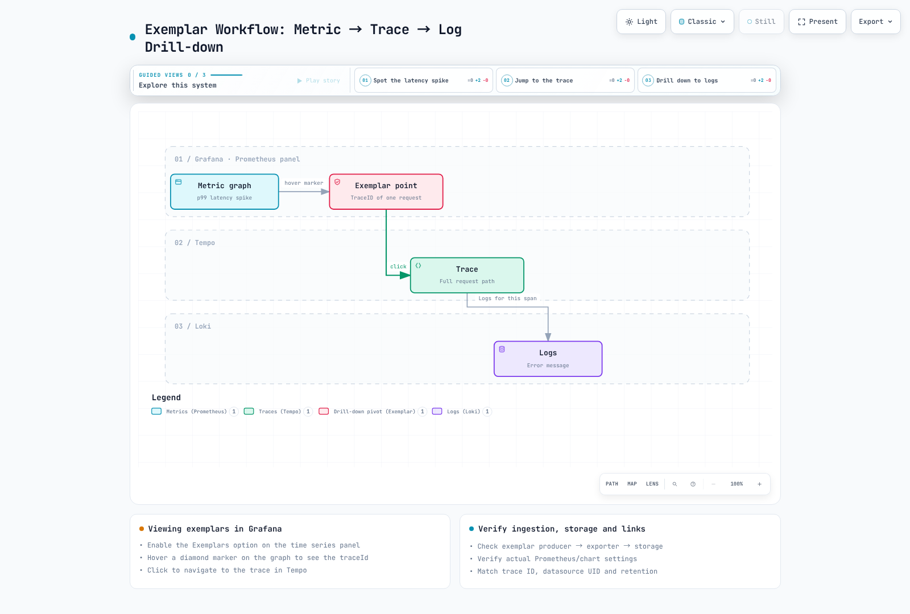

# パート6: 分散トレースの分析

<span id="cleanup-steps-table"></span>
<span id="drill-down-analysis-workflow"></span>
<span id="exercise-1-traceql-trace-search"></span>
<span id="exercise-2-service-graph-visualization"></span>
<span id="exercise-3-latency-identification-workflow"></span>
<span id="exercise-4-loki-tempo-correlation"></span>
<span id="exercise-5-exemplar-usage"></span>
<span id="exercise-6-comprehensive-dashboard-setup"></span>
<span id="final-verification-checklist"></span>
<span id="full-cleanup-script"></span>
<span id="key-takeaways"></span>
<span id="learning-objectives"></span>
<span id="next-steps"></span>
<span id="prerequisites"></span>
<span id="references"></span>
<span id="steps"></span>
<span id="steps-1"></span>
<span id="steps-2"></span>
<span id="steps-3"></span>
<span id="steps-4"></span>
<span id="steps-5"></span>
<span id="summary"></span>
<span id="traceql-query-reference"></span>
<span id="verification"></span>

> **難易度**: 上級 · **所要時間の目安**: 45分
> **最終更新日**: 2026年9月13日
メトリクスからexemplarを経由し、トレースとログまで実際のリクエストを1件追跡します。その際、観測した事実と因果関係の仮説を区別してください。この作業には、[パート2](./02-observability-stack-lab.md)の取り込み経路と[パート3](./03-msa-deployment-lab.md)のコンテキスト伝播が必要です。以下のTraceQLは実際のTempo **3.0.3**パーサーで確認しており、現在のOTel属性を使っています。


[🔍 インタラクティブな図を表示](https://www.atomai.click/kubernetes-docs/archmaps/en-labs-observability-06-distributed-tracing-lab-0.html)

## 1. TraceQLで検索する {#traceql}

```traceql
{ resource.service.name = "order-service" && span:duration > 1s }

{ trace:duration > 2s && resource.service.name = "order-service" }

{ span:kind = server && span.http.response.status_code >= 500 }

{ span.db.system.name = "postgresql" && span:duration > 100ms }

{ span.messaging.system = "aws_sqs" && span.messaging.operation.type = "send" }

{ resource.service.name = "api-gateway" } >> { resource.service.name = "order-service" }

{ resource.service.name = "order-service" } >> { span.db.system.name = "postgresql" }

{ span:status = error } | select(resource.service.name, span.http.response.status_code, span:duration)
```

`span:duration`は個々のspanの時間を、`trace:duration`はトレース全体の時間を測定します。組み込み属性を明示するには`span:`を使い、属性には`span.`/`resource.`を使います。`>>`は、左側のspanの子孫にあたる右側のspanを検索します。DB spanの子孫を探すことと、サービスの配下にあるDB処理を探すことは異なります。

`sort(duration)`、SQLの`order by`、`| limit 20`、`{ duration > p99 }`はこの検索構文では使えません。Grafanaで結果の並べ替え、検索上限、時間範囲を設定し、実測したp99を`800ms`のようなdurationリテラルに置き換えてください。`select()`は表示する属性を指定するもので、保存されなかったspanを作り出すことはできません。

古いSDKは`http.status_code`、`http.method`、`db.system`、`db.statement`、`messaging.operation`などを出力する場合があります。現在の`http.response.status_code`、`http.request.method`、`db.system.name`、`db.query.text`、`messaging.operation.type`を使う前に、実際のspanとSDKバージョンを確認してください。クエリ内の属性名を変えても、収集済みデータは変換されません。明示的なサニタイズポリシーがある場合だけクエリテキストを取得し、パスワード、SQLリテラル、顧客データを除外してください。

## 2. Service graphの前提条件 {#service-graph}

Tempoでトレースを受信しただけでは、GrafanaのService graphは完成しません。metrics-generatorのservice-graphs processorを有効にし、そのメトリクスを実際のメトリクスバックエンドへ送り、Grafana TempoデータソースのserviceMap UIDをそのバックエンドに関連付けてください。client/serverまたはproducer/consumerのspanはコンテキストを共有する必要があります。サンプリング、spanの欠落、不適切なspan kindは、生成されるエッジに影響します。

```promql
sum by (client, server) (rate(traces_service_graph_request_total[5m]))

(
  sum by (client, server) (rate(traces_service_graph_request_failed_total[5m]))
  or on (client, server)
  (0 * sum by (client, server) (rate(traces_service_graph_request_total[5m])))
)
/ on (client, server)
(sum by (client, server) (rate(traces_service_graph_request_total[5m])) > 0)

sum by (client, server) (rate(traces_service_graph_request_server_seconds_sum[5m]))
/
sum by (client, server) (rate(traces_service_graph_request_server_seconds_count[5m]))
```

障害カウンターは、最初の障害が発生するまで系列を持たないことがあります。対応するリクエスト合計系列を使って欠損している分子を0で補い、分母が正の値であることも確認してください。これにより、正常な障害率0%と、トラフィックがない場合やデータが取り込まれていない場合を区別できます。

最後のクエリはサーバー側の平均処理時間を測定します。クライアント側の処理時間には`traces_service_graph_request_client_seconds_*`を使ってください。存在しない`traces_service_graph_request_duration_seconds_*`系列をクエリしてはいけません。トラフィックがない時間帯は、根拠となる観測がないものとして扱います。色やエッジ幅はGrafana/dashboardの設定で変わるため、固定の1%/5%の色分けを想定せず、リクエスト/エラー/処理時間の値を確認してください。

## 3. ウォーターフォールからボトルネックの仮説を立てる {#waterfall}

| 観測 | 次の調査 |
|---|---|
| DB spanが遅い | クエリプラン、ロック、接続プール、DBメトリクスを確認する |
| クライアントspanが長い | DNS/TLS/ネットワーク/サーバー待ち/リトライの時間を比較する |
| 親spanと子spanの間に空白がある | 計装されていない処理、キュー、GC、スケジューリングを確認する |
| 子spanが並列に動作している | 時間を合計するのではなく、重複とクリティカルパスを分析する |
| メッセージングに遅延がある | 送信/受信/処理時間を、キュー待ちと再配信から分ける |

親spanの時間には子spanの時間が含まれます。すべてのspanを合計すると、時間を二重に数えてしまいます。DB spanが1.8秒だったという事実だけでは、インデックスがないことの証明になりません。仮説を採用する前に、同じリリース、トラフィック、時間範囲のログとメトリクスを比較してください。

## 4. ログとトレースを関連付ける {#correlation}

```logql
{service_name="order-service"} | json | level="ERROR"

{service_name="order-service"} | json | trace_id="0123456789abcdef0123456789abcdef"
```

これらのクエリは、実際の`service_name`ストリームラベルとJSONの`trace_id`フィールドを前提にしています。例の32文字のトレースIDを、実際のリクエストIDに置き換えてください。`traceID`、`traceId`、`trace_id`はそれぞれ別のフィールドです。トレースIDは一意性の高いストリームラベルではなく、ログフィールド/構造化メタデータに保持してください。時間範囲はGrafana/HTTPパラメーターで指定します。`timestamp >= 2025-...`をLogQLに追加しないでください。

Lokiのderived fieldでトレースIDを抽出し、TempoデータソースUIDにリンクします。Grafanaのprovisioning YAMLでは、内部リンク式を`$${__value.raw}`としてエスケープしてください。二重引用符で囲んだ正規表現や広範囲に適用するshell envsubstは、バックスラッシュやGrafana変数を書き換えることがあります。適切な単一引用符と対象を限定した置換を使ってください。

Tempoの`tracesToLogsV2`には、Loki UID、実際のresource-to-logラベル対応、時間の余白、トレースIDのフィルターを設定します。「Logs for this span」をクリックした後、生成されたLogQLを確認してください。リンクが存在することと、同じリクエストのログを実際に取得できることは別々に検証します。

## 5. Exemplarの意味と検証 {#exemplars}



[🔍 インタラクティブな図を表示](https://www.atomai.click/kubernetes-docs/archmaps/en-labs-observability-06-distributed-tracing-lab-1.html)

exemplarは集計値に付与された**代表的な観測値**です。p99グラフの点をクリックしても、そのリクエストが正確なパーセンタイル境界を決めた証拠にはなりません。exemplarの生成、exporter/remote-writeによる保持、Prometheusでの保存、Grafanaデータソースとのリンクがすべて機能する必要があります。サンプリングや保持期間の制約によって、対応するトレースが利用できないexemplar IDが残る場合があります。

Prometheus exemplar APIの実際の結果を確認し、返された`trace_id`でTempoをクエリしてください。Grafanaの表示オプションを有効にすることや、存在しないPrometheus ConfigMapを探すことは、データ取り込みの検証にはなりません。インストール済みのPrometheus/chartバージョンと、レンダリングされたPrometheusリソース/実行時引数に照らしてexemplar-storageの設定を確認してください。

## 6. REDとSLI/SLOのダッシュボード {#slo}

実際のメトリクス名、ラベル、ヒストグラムの単位を使ってREDパネルを作成します。同じサービス/routeの範囲で、リクエスト率、失敗率、処理時間の分布を比較してください。可用性を計算する前に、対象にするリクエストと成功の条件を定義し、4xx応答、ヘルスチェック、リトライをどう扱うか明記します。

30日間のSLOには、その期間の実データと保持設定が必要です。新しいラボで`[30d]`クエリを実行しても、30日分の根拠が作られるわけではありません。トラフィックなし、系列の欠落、カウンターのリセットを考慮し、データ量が少ない場合のパーセンタイルの制約を示してください。同じ期間について、許容失敗数と実際の失敗数からエラーバジェットを計算します。固定の「99.9%達成」と主張するのではなく、期間、分母、値を記録してください。

## 7. フローを検証してからクリーンアップする {#cleanup}

クリーンアップの前に、exemplar ID、TempoのトレースID、ログのトレースIDが一致するリクエストを1件記録します。Service graphに実際に表示される依存関係とアラートの配信を検証してください。結果を推定値で埋めず、計測値、タイムスタンプ、設定バージョンを保存します。

| 順序 | アクションと完了条件 |
|---|---|
| 1 | k6/Locust、障害注入、AI分析のトリガーを停止し、結果を保存する |
| 2 | GitOps ApplicationSet/親リソースによる再作成を止め、実際のApplicationをcascade-deleteする |
| 3 | serviceクラスターのLoadBalancer/Ingress、ワークロード、PVCを削除し、外部LB/ボリュームのクリーンアップを確認する |
| 4 | 実際のrelease/namespace名を使い、Operatorをアンインストールする前にtelemetryカスタムリソースを削除する |
| 5 | コントローラーの削除前にKarpenter NodeClaimをdrain/deleteし、依存リソースがある間はAPI/LB/ストレージのコントローラーを残す |
| 6 | 同じIaC stateを使ってdestroy planをレビューし、手作業で作成したAWSリソースには記録済みの正確なID/ARNを使う |
| 7 | 依存関係のクリーンアップ後にEKS/VPCを削除し、マネージドサービスの削除と残存リソースを確認する |

共有namespaceやクラスター全体のCRDを削除しないでください。`latest`のインストーラーURLではなく、記録されたインストールのrelease/namespace/versionを使います。バージョニングが有効なS3では、現行オブジェクトだけでなく過去のバージョンと削除マーカーも確認してください。Aurora snapshot policy、MWAA/DAG bucket、AMG、AMP、OpenSearch、SNS/SQS/DLQ、Lambda/API Gateway、IAM attachment、EBS/LB、ロググループ、アラームをインベントリと照合します。削除リクエストが受け付けられても、削除が完了したとは限りません。

リソースの所有者を確認し、証跡/stateを保持してください。承認確認のないdestroy自動実行、すべてのエラーの抑制、作業ディレクトリ全体の削除は行わないでください。

## 検証範囲と参考資料

現在のTempoパーサーで12件の有効なクエリを検証し、以前の誤ったクエリ3件が拒否されることも確認しました。一時的なローカルLoki 3.7.7に合成ログを2行送り、両方のLogQLクエリが期待したトレースIDを正確に取得しました。実際のサービスに対するTempo検索、Lokiのログ収集、Grafanaのデータリンク、クラウドリソースの削除は実行していません。

- [TraceQL](https://grafana.com/docs/tempo/latest/traceql/)
- [Service graph metrics](https://grafana.com/docs/tempo/latest/metrics-from-traces/service_graphs/)
- [OTel HTTP spans](https://opentelemetry.io/docs/specs/semconv/http/http-spans/)
- [OTel database spans](https://opentelemetry.io/docs/specs/semconv/database/database-spans/)
- [Loki derived fields](https://grafana.com/docs/grafana/latest/datasources/loki/configure/)
- [Tempoガイド](../../observability/tracing/01-tempo.md)
- [Lokiガイド](../../observability/logging/01-loki.md)
- [シリーズのインデックス](./README.md)
