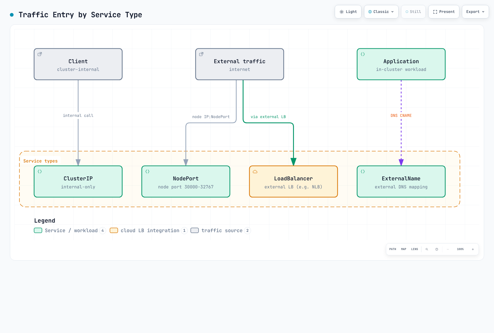
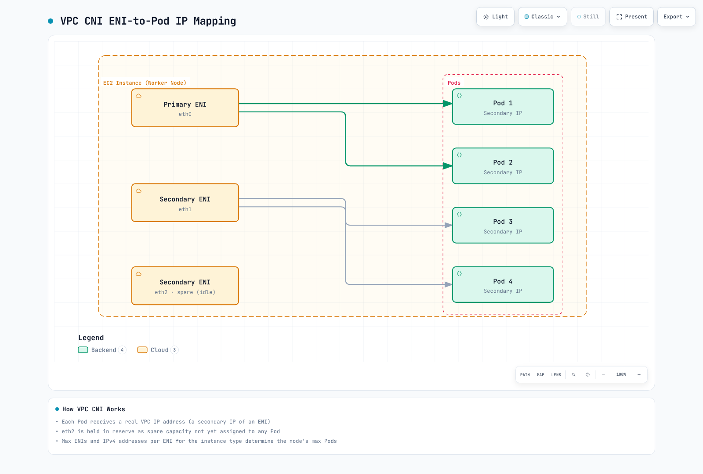

# Kubernetes ネットワーキング

> **最終更新**: October 15, 2026
>
> **固定済みの例**: Cilium 1.20.1、Calico Open Source 3.32.2、Flannel 0.28.9、およびアップストリームの AWS VPC CNI/Helm chart 1.23.0。
>
> **現在のリリース情報**: AWS は Kubernetes 1.31–1.37 向けの EKS 管理 VPC CNI アドオン `v1.23.1-eksbuild.1` を掲載しています。Calico 3.33.0 は最新の Open Source リリースであり、Kubernetes 1.35–1.37 でテストされています。固定済みの例を変更する前にリリースノートを確認してください。
>
> これらのバージョンは、共同でテストされたクラスター構成ではありません。インストール前に各製品の Kubernetes/プラットフォームマトリクスを確認してください。

## 概要

Kubernetes ネットワーキングは、コンテナ化されたアプリケーション間の通信を可能にする中核インフラストラクチャ層です。このセクションでは、基本的な Kubernetes ネットワーキングの概念から、高度な CNI (Container Network Interface) ソリューション、AWS EKS 環境におけるネットワーキングパターンまでを扱います。

## 学習パス {#learning-path}

初級コースの後は、[エキスパート ネットワーキングパス](expert/README.md)でプロトコルプロジェクト、ルーティングポリシー、EVPN、Linux パフォーマンス、クラウド設計、オートメーション評価を結び付けてください。まず各ワークブックの環境、エビデンス、復旧基準を確認してください。

Linux またはネットワーキングを初めて学ぶ場合は、[初級コース](beginner/README.md)から始めてください。その 8 つのレッスンでは、CLI、アドレッシング、DNS、SSH、ファイアウォール、モニタリング、キャップストーンを結び付けます。以下のパスでは、その基礎をプロトコル、カーネル、クラスター実装へと発展させます。

プロトコルの概念から観測へと進み、それらをコンテナ、クラスター、クラウドの責務に結び付けます。前提条件を使用して開始地点を選び、続行前に成果を使って理解度を確認してください。

| 段階 | 役割 | 前提条件 | 到達目標 | 読む / 実践する |
|---|---|---|---|---|
| プロトコル、アドレッシング、HTTP | 用語を確立する | 基本的なコマンドライン操作 | リクエストを追跡し、アドレッシング、トランスポート、アプリケーションの動作を区別する | ネットワークの基礎 [Part 1](../basics/06-network-fundamentals-part1.md)、[Part 2](../basics/06-network-fundamentals-part2.md)、[Part 3](../basics/06-network-fundamentals-part3.md)、[Part 4](../basics/06-network-fundamentals-part4.md) |
| Linux ソケット、VFS、パケットパス | API をカーネルに結び付ける | TCP/IP の基礎 | FD、ソケットバッファ、ウィンドウ、キューを区別する | [カーネル ネットワーキングスタック](../kernel/02-network-stack.md) |
| Linux ネットワーク診断 | エビデンスを用いて仮説を検証する | ソケットとパケットパスの概念 | ソケット、パケット、アプリケーションの観測を関連付ける | [診断の実践](07-linux-network-diagnostics.md) · [クイズ](../quizzes/networking/07-linux-network-diagnostics-quiz.md) |
| Docker とコンテナ ネットワーキング | 名前空間の境界を特定する | Linux パケットパスと基本的な診断 | ブリッジネットワーキング、公開ポート、コンテナ名解決を説明する | [コンテナ技術](../basics/03-container-technology.md) |
| Kubernetes Service、DNS、Ingress | クラスター抽象化を対応付ける | コンテナ ネットワーキング | 名前を Service 経由でエンドポイントまで追跡し、Ingress の役割を特定する | [Services とネットワーキング](../core/03-services-networking.md) · [ラボ](../labs/core/03-services-networking-lab.md) |
| eBPF、CNI、ポリシー | 実装の責務を比較する | Pod と Service のパス | パケット転送、ポリシー強制、可観測性を区別する | [eBPF の基礎](../basics/05-ebpf-fundamentals.md) · [Cilium](cilium/README.md) · [Calico](calico/README.md) |
| AWS ネットワーク境界とパフォーマンス | モデルをクラウドパスに適用する | CNI の概念と計測スキル | VPC、ノード、AZ の境界を特定し、計測値を文脈に沿って解釈する | [VPC CNI](01-vpc-cni.md) · [AWS Load Balancer Controller](03-aws-lb-controller.md) · [組織間 VPC 接続](05-cross-org-vpc-connectivity.md) · [Pod ネットワークベンチマーク](06-pod-network-benchmark.md) |

## Kubernetes ネットワーキングモデル

現在の Kubernetes モデルは、**意図的なネットワークセグメンテーションを前提として**、Pod がアドレス変換やプロキシなしでノードをまたいで直接通信できる Pod ネットワークを提供します。kubelet などのノードエージェントは、自身のノード上の Pod に到達できなければなりません。特定の接続が成功するかどうかは、引き続き NetworkPolicy、ルーティング、アプリケーションリスナーによって決まります。

通常の Pod は独自のネットワーク名前空間とクラスター全体で有効なアドレスを持ち、1 つの Pod 内のコンテナはその名前空間と localhost を共有します。host-network Pod はノードネットワークを共有し、dual-stack または multi-network 構成ではより正確なアドレス処理が必要です。Pod を再作成すると異なる IP が割り当てられる場合があります。同じ Pod 内でコンテナを再起動しても、必ずしもネットワークサンドボックスが再作成されるわけではありません。

| コンポーネント | 役割 |
|---|---|
| Pod ネットワーク | ワークロードのネットワーク名前空間間のアドレッシングと接続性 |
| Service/ディスカバリー | 変化するエンドポイントに対する安定したサービス名または仮想アドレス |
| Ingress/Gateway 実装 | 構成済みの外部エントリとアプリケーションルーティング |
| NetworkPolicy エンジン | 選択した実装でサポートされるポリシーを強制する |

これらの役割は、必須の直列パケットパスを構成するものではありません。Service 変換、L7 プロキシ、ワークロードポリシーにより、特定のリクエストがネットワークを通過する方法は変わる可能性があります。

### Pod ネットワーキング

Pod ネットワーキングは、Pod 通信のためのアドレッシングとルートを提供します。以下の図は通常の IPv4 Pod を示しており、その接続は、適用可能なポリシーおよびネットワーク制御が許可していることを前提とします。


[🔍 インタラクティブ図を表示](https://www.atomai.click/kubernetes-docs/archmaps/en-networking-readme-1.html)

アドレスは例示的な通常の Pod アドレスです。意図的な分離および host-network または multi-network 構成には、それぞれ独自の解釈が必要です。

#### Pod ネットワーキングの実装方式

| 方式 | 説明 | 例となる CNI |
|--------|-------------|-------------|
| **オーバーレイネットワーク** | 既存ネットワーク上でトラフィックをカプセル化する | Flannel VXLAN、Calico VXLAN/IPIP、Cilium VXLAN/Geneve |
| **ネイティブルーティング** | そのオーバーレイカプセル化を行わず、基盤ネットワーク内のルートを使用する | AWS VPC CNI、Calico routing/BGP、Cilium native routing |
| **条件付きカプセル化** | 構成済みトポロジーに応じて直接パスまたはカプセル化を使用する | 前提条件が異なる、サポート対象の Calico/Flannel/Cilium モード |

### Service ネットワーキング

Service は、通常は Pod である論理的なエンドポイント集合と、それらへの到達方法を記述します。ClusterIP はデフォルトで安定した仮想 IP を提供します。headless Service はその仮想 IP を省略し、ExternalName は DNS CNAME マッピングを使用します。Service は Pod セレクターなしで管理されたエンドポイントを持つこともできます。



[🔍 インタラクティブ図を表示](https://www.atomai.click/kubernetes-docs/archmaps/en-networking-readme-2.html)

これらは一般的な公開メカニズムであり、セキュリティ保証ではありません。NodePort の範囲とアクセス可能なノードアドレスは構成できます。LoadBalancer は内部向けにできます。ExternalName は DNS エイリアスを返し、転送プロキシを作成しません。

#### Service タイプの特性

表示された target port でリッスンする、一致する `app: my-app` Pod を `default` に作成します。NodePort のデフォルト割り当て範囲は 30000–32767 であり、構成可能です。外部からの到達可能性は、依然としてアドレス、ルート、アクセス制御に依存します。

LoadBalancer の例では、EC2 インスタンスターゲットと割り当て済み NodePort を持つ **AWS Load Balancer Controller** を明示的に選択しています。最初に、その Controller と IAM/サブネットの前提条件をインストールおよび構成してください。EKS Auto Mode は異なる Controller/class を使用します。ここでポート 443 は TCP ポートを選択するだけです。TLS はバックエンドで 8443 に提供するか、ロードバランサーに別途構成する必要があります。

これらのポートマッピングは、一般的な Kubernetes Service API を示しています。AWS は現在、追加のネイティブ EKS NetworkPolicy 要件を文書化しています。Service ポートはコンテナポートと一致させる必要があり、`metadata.ownerReferences` を持つ Controller 管理 Pod は信頼できる強制を提供します。そのポリシー実装をテストする前に、例をこれらの要件に適合させてください。

```yaml
apiVersion: v1
kind: Service
metadata:
  name: my-service
  namespace: default
spec:
  type: ClusterIP
  selector:
    app: my-app
  ports:
  - protocol: TCP
    port: 80
    targetPort: 8080
---
apiVersion: v1
kind: Service
metadata:
  name: my-nodeport-service
  namespace: default
spec:
  type: NodePort
  selector:
    app: my-app
  ports:
  - protocol: TCP
    port: 80
    targetPort: 8080
    nodePort: 30080
---
apiVersion: v1
kind: Service
metadata:
  name: my-loadbalancer-service
  annotations:
    service.beta.kubernetes.io/aws-load-balancer-scheme: internet-facing
    service.beta.kubernetes.io/aws-load-balancer-nlb-target-type: instance
  namespace: default
spec:
  type: LoadBalancer
  selector:
    app: my-app
  ports:
  - protocol: TCP
    port: 443
    targetPort: 8443
  loadBalancerClass: service.k8s.aws/nlb
  allocateLoadBalancerNodePorts: true
```

### Ingress ネットワーキング

Ingress リソースには Controller とそのデータプレーンが必要です。この HTTP の例では、`spec.ingressClassName: alb` および IP ターゲットを持つ AWS LBC を使用します。参照される `api-v1`、`api-v2`、`web-frontend` Service は `default` に存在し、ポート 80 を公開し、準備完了で VPC ルーティング可能な Pod エンドポイントを持つ必要があります。必要に応じて HTTPS/証明書を別途構成してください。インストールおよびターゲットの前提条件については、[LBC ガイド](03-aws-lb-controller.md)を参照してください。

Ingress は、HTTP/HTTPS トラフィックを内部クラスター Service にルーティングするルールを定義します。


[🔍 インタラクティブ図を表示](https://www.atomai.click/kubernetes-docs/archmaps/en-networking-readme-3.html)

ボックスは Ingress データプレーン機能を表します。AWS LBC は ALB をプログラムします。アプリケーショントラフィックは Controller の調整プロセスを通過しません。ターゲットモードに応じて、データプレーンは文字どおりの追加ホップとして Service 仮想 IP を通過するのではなく、Pod IP または NodePort に到達できます。

```yaml
apiVersion: networking.k8s.io/v1
kind: Ingress
metadata:
  name: my-ingress
  annotations:
    alb.ingress.kubernetes.io/scheme: internet-facing
    alb.ingress.kubernetes.io/target-type: ip
  namespace: default
spec:
  rules:
  - host: api.example.com
    http:
      paths:
      - path: /v1
        pathType: Prefix
        backend:
          service:
            name: api-v1
            port:
              number: 80
      - path: /v2
        pathType: Prefix
        backend:
          service:
            name: api-v2
            port:
              number: 80
  - host: web.example.com
    http:
      paths:
      - path: /
        pathType: Prefix
        backend:
          service:
            name: web-frontend
            port:
              number: 80
  ingressClassName: alb
```

## CNI (Container Network Interface)

CNI は、ランタイムがコンテナネットワークを構成するためのインターフェイスを標準化します。現在の Kubernetes では、kubelet は CRI を通じて Pod サンドボックス操作を要求し、**コンテナランタイムが CNI を管理します**。kubelet による古い直接 CNI 管理フラグは Kubernetes 1.24 で削除されました。

### ランタイムとプラグインの責務

| アクター | 責務 |
|---|---|
| kubelet | コンテナランタイムインターフェイスを通じてサンドボックスの作成/削除を要求する |
| コンテナランタイム | ネットワーク構成を選択し、CNI プラグインチェーンを呼び出す |
| CNI プラグイン | 構成を受け取り、ADD/DEL とその他のサポート対象操作を実行し、結果を返す |
| IPAM 実装 | アドレスを割り当て/解放する。委譲プラグインまたはプロバイダー固有エージェントの一部である場合がある |
| 任意のノードエージェント | プロバイダー固有のルート、ポリシー、IP プール、データパス状態を維持する |

ランタイムは CNI インターフェイスを通じてプラグインに構成を渡します。すべてのプラグインに、別個の常駐エージェントまたは IPAM バイナリが必須というわけではありません。インターフェイスの種類も異なります。veth ペアが一般的ですが、唯一の実装ではありません。

## CNI の比較

| プロジェクト / 範囲 | ネットワーキングとポリシー | 区別すべき機能と制限 |
|---|---|---|
| **Cilium 1.20.1** | eBPF ネットワーキング。該当する L7 機能には Envoy。Cilium NetworkPolicy と Hubble | AMD64/Arm64 要件を伴う Linux ワーカーデータプレーン。Windows CLI の可用性は Windows CNI サポートを意味しません。WireGuard/IPsec と Beta ztunnel mTLS には異なる範囲があります。 |
| **Calico Open Source 3.32.2 の例; 3.33.0 が最新** | ルーティング/カプセル化の選択肢。iptables、nftables、eBPF オプション。順序付きポリシー Tier と host/workload ポリシー | Calico 3.33.0 は Kubernetes 1.35–1.37 でテストされています。アップグレード前にリリースノートを確認してください。Windows には、Linux eBPF または WireGuard データプレーンがないことを含む別個の制限があります。Whisker/Goldmane フロー可観測性は Tech Preview として利用できます。有償機能についてはエディションマトリクスを参照してください。 |
| **Flannel 0.28.9** | ホストサブネット割り当てとノード間転送。VXLAN、host-gw、その他のバックエンド | `flanneld` 自体は NetworkPolicy を強制しません。chart の任意の `netpol.enabled` は SIGs ポリシー Controller をデプロイします。WireGuard は文書化されたバックエンドであり、IPsec は実験的です。Windows VXLAN には固有の設定/制限があります。 |
| **AWS VPC CNI 1.23.0 のアップストリーム/Helm の例; EKS アドオン `v1.23.1-eksbuild.1`** | VPC アドレス割り当てと EC2 ENI/プレフィックス。サポート対象 Linux EC2 ノードでの EKS 標準および Admin NetworkPolicy 機能 | AWS は Kubernetes 1.31–1.37 向けにこの管理アドオンビルドを掲載しています。リージョンでの可用性とクラスターの実際のバージョンを検証してください。EKS Auto Mode は、追加の DNS ポリシー機能を持つ管理ネットワーキング実装です。Windows、Fargate、カスタムネットワーキング、プレフィックス委譲、multi-NIC サポートには別個の条件があります。 |
| **元の Weave Net プロジェクト** | 歴史的なオーバーレイネットワーキング実装 | 元の `weaveworks/weave` リポジトリはアーカイブされています。新しいクラスターのためのアクティブでサポートされたデフォルトとして説明しないでください。 |

### ポリシー、暗号化、可観測性

- Cilium は、該当する L7 コンポーネントを通じた HTTP/DNS 対応ポリシーと、クラスター全体/host ポリシーを提供します。その deny/allow セマンティクスは Calico の順序付き Tier API ではありません。
- Calico Open Source には、階層的なポリシー Tier と host ポリシーが含まれます。現在の製品マトリクスでは、アプリケーション層ポリシー、DNS/FQDN ポリシー、Cluster Mesh は Cloud/Enterprise に割り当てられています。これらを Open Source エディションに暗黙に帰属させてはいけません。Calico が文書化している転送中暗号化では WireGuard を使用します。
- Amazon EKS は、Auto Mode およびサポート対象の EC2/VPC-CNI インストール向けに `ClusterNetworkPolicy` Admin/Baseline コントロールを提供します。AWS が説明する DNS/FQDN `ApplicationNetworkPolicy` 機能は **Auto Mode** 向けです。この名前は、現在の HTTP メソッド/本文検査を意味するものではありません。
- Flannel の任意のポリシー Controller には独自の要件があります。ネットワーキングバックエンドを選択するだけでは強制は有効になりません。
- ノード間暗号化、認証済みワークロードアイデンティティ、アプリケーション mTLS は異なるコントロールです。ネットワークフローの可視性も、アプリケーショントレーシングやプロセス/ファイル強制とは異なります。

### ルーティングとパフォーマンス

Calico と Cilium は BGP を使用してルートを広告できますが、それ自体ではマルチクラスター Service ディスカバリー、ポリシー同期、暗号化は提供しません。Flannel host-gw は直接ルートを使用し、適切なレイヤー 2 接続性を必要とします。オーバーレイではカプセル化と MTU の考慮事項が増えますが、CNI 名から普遍的なパフォーマンス順位を推論することはできません。

以前の 100/98/95/85/80/75 パーセントのスループット数値には、再現可能なワークロード、バージョン、計測ソースがありませんでした。比較可能なハードウェア、カーネル、パケット/リクエストサイズ、並行性、暗号化/ポリシー設定、スループット、損失、テールレイテンシを使用してください。別の [Pod ベンチマーク](06-pod-network-benchmark.md)には、独自の履歴環境と計測値が保持されています。

## CNI 選択ガイド

必要なルーティング、ポリシー、オペレーティングシステム、サポートモデルを最初に選び、その組み合わせをテストしてください。

| ニーズ | 評価パス |
|---|---|
| 標準 EKS VPC アドレッシングとサポート対象 NetworkPolicy | 2 つ目のポリシーエンジンを追加する前に、AWS VPC CNI/EKS 機能を評価する。 |
| 順序付きポリシー Tier、host ポリシー、またはインフラストラクチャ BGP | 関連する Calico エディション/データプレーンとルーティングの前提条件を評価する。 |
| Cilium ポリシー、Hubble、または選択した mesh 機能 | Linux/カーネル/プラットフォーム互換性と [Cilium mesh ガイド](../service-mesh/cilium-service-mesh/README.md)を確認する。Envoy は該当する L7 パスの一部であり続けます。 |
| 機能セットが限定された小規模ネットワーク | 実際の要件に照らして Flannel のバックエンドと任意のポリシー Controller を評価する。 |
| プロセス、syscall、またはファイルの強制 | NetworkPolicy とは別に Tetragon などのランタイムセキュリティコンポーネントを評価する。 |

### EKS 管理アドオンの構成

以下は**構成ペイロード**の例であり、同じワークロードに Calico と VPC CNI ポリシーエンジンの両方をインストールする指示ではありません。

```json
{
  "enableNetworkPolicy": "true"
}
```

文字列の `"true"` は、この設定で文書化されている型です。既存の Kubernetes バージョンに対応する EKS アドオンビルドを選択し、そのビルドの構成スキーマを確認してください。

```bash
EKS_REGION=ap-northeast-2
KUBERNETES_MINOR=1.35  # Replace with the existing cluster's minor version
aws eks describe-addon-versions --region "$EKS_REGION" --addon-name vpc-cni \
  --kubernetes-version "$KUBERNETES_MINOR"
: "${VPC_CNI_ADDON_VERSION:?Set the compatible eksbuild version selected from metadata}"
aws eks describe-addon-configuration --region "$EKS_REGION" --addon-name vpc-cni \
  --addon-version "$VPC_CNI_ADDON_VERSION"
```

アップストリームの 1.23.0 リリース番号と EKS の `eksbuild` バージョンは異なる識別子です。AWS の現在のアドオン表には Kubernetes 1.31–1.37 向けの `v1.23.1-eksbuild.1` が掲載されています。対象リージョンで `describe-addon-versions` を使用して、互換性のあるビルドを選択してください。変更は意図した管理アドオン構成とマージし、盲目的に `latest` を選択したり、無関係な値を置き換えたりしないでください。サードパーティのポリシー実装からの移行では、既存の強制状態の削除と、テスト済みのノード/ワークロード移行計画も必要です。

## EKS ネットワーキングの基礎

### EKS デフォルトネットワーキングアーキテクチャ

| 場所 / コンポーネント | 責務 |
|---|---|
| EKS 管理 VPC | AWS は Availability Zone をまたいで管理 Kubernetes コントロールプレーンを実行します。 |
| 顧客クラスター VPC | ワーカーネットワーキング、選択したサブネット、EKS 管理のクロスアカウント ENI が、コントロールプレーンへの構成済みパスを提供します。 |
| 選択した顧客 VPC サブネットの ALB/NLB | 選択したパブリックまたは内部アプリケーションエントリポイントを提供します。インターネットゲートウェイ/NAT ゲートウェイは、そのルーティング構成の代替ではありません。 |
| NAT ゲートウェイまたはプライベートサービスエンドポイント | ワークロード設計が必要とする特定のアウトバウンドパスを提供します。 |

以前の図ではコントロールプレーンを顧客 VPC 内、ロードバランサーをその外側に置いていましたが、これらの所有境界に置き換えられました。

### コンピュートモード別の DNS とネットワーキング

| コンピュートモード | DNS / コンポーネント配置 |
|---|---|
| 標準 EC2 ノード | 通常は構成済みの CoreDNS Deployment とインストール済みネットワーキングコンポーネントを使用します。置き換えには独自のサポート対象構成が必要です。 |
| Pure EKS Auto Mode | CoreDNS、VPC CNI、kube-proxy の機能は、管理ノードの systemd サービスとして実行されます。これらのノードには CoreDNS Deployment/アドオンは不要です。 |
| Auto Mode と非 Auto ノードの混在 | 非 Auto ノードには CoreDNS Deployment を維持してください。これらは別ノードの Auto Mode DNS サービスを使用できません。 |

Auto Mode の最初の DNS リゾルバーはノードローカルです。アップストリームへの転送とコントロールプレーン通信には依然としてネットワークアクセスが必要な場合があります。これは、すべての DNS 関連パケットがノード上に留まる保証ではありません。AWS は Auto Mode 向けに Admin と DNS の両方のポリシーを文書化しています。一方、標準 EC2 VPC-CNI Admin ポリシーには独自のバージョン/有効化要件があります。

### VPC CNI の仕組み

AWS VPC CNI は、選択した IPAM モードを使用して、通常の Pod に VPC ルーティング可能なアドレスを与えます。セカンダリ IPv4 アドレス、委譲プレフィックス、branch ENI、multi-NIC 構成は異なります。host-network Pod はノードネットワークを共有します。



[🔍 インタラクティブ図を表示](https://www.atomai.click/kubernetes-docs/archmaps/en-networking-readme-9.html)

これはセカンダリ IP モードのみを示しています。ウォーム ENI は構成可能な割り当て戦略であり、すべてのノードが常にちょうど 1 つを予約する要件ではありません。プレフィックス委譲、カスタムネットワーキング、branch ENI には異なる割り当てルールがあります。

#### ENI と IP の制限

| インスタンスタイプ | 最大 ENI 数 | ENI あたりの IPv4 スロット | 旧セカンダリ IP ブートストラップ値 |
|---------------|----------|--------------|------------------------|
| t3.medium | 3 | 6 | 17 |
| t3.large | 3 | 12 | 35 |
| m5.large | 3 | 10 | 29 |
| m5.xlarge | 4 | 15 | 58 |
| m5.2xlarge | 4 | 15 | 58 |
| c5.4xlarge | 8 | 30 | 234 |

これらの値は、VPC CNI 1.23.0 のインスタンス制限および旧 max-Pods 表に照らして検証されています。履歴上の計算式は `ENIs × (IPv4 slots per ENI − 1) + 2` です。これは現在の普遍的な推奨ではありません。プレフィックス委譲、カスタムネットワーキング、branch ENI、複数のネットワークカードによりアドレス容量は変わります。Kubernetes スケジューリングは kubelet `maxPods` とリソースによっても制限されます。EKS 管理ノードグループでは、30 vCPU 未満のインスタンスで `maxPods` は 110、それ以外では 250 に制限されます。使用可能 IP 数だけではその上限を上書きできません。

### EKS ネットワーキングの考慮事項

#### IP アドレス管理

**Linux VPC CNI** では、選択したアドオン/Helm/DaemonSet 管理メカニズムを通じて、文書化された環境変数を構成します。以下は EKS アドオン構成フラグメントです。`enable-prefix-delegation` を持つ古い `amazon-vpc-cni` ConfigMap は、このように Linux IPAMD を構成しません。変更を適用する際は、意図した他のアドオン値を保持してください。

```json
{
  "env": {
    "ENABLE_PREFIX_DELEGATION": "true",
    "WARM_PREFIX_TARGET": "1"
  }
}
```

代わりに、合計割り当て下限と空き IP ターゲットを調整できます。`MINIMUM_IP_TARGET` または `WARM_IP_TARGET` のいずれかを構成すると、`WARM_PREFIX_TARGET` より優先されます。これらは 4 つの独立して加算されるターゲットではなく、代替ポリシーです。割り当ては引き続きプレフィックスサイズ単位で発生します。Nitro サポート、IPv4 用の連続した `/28` 空間、適切な kubelet Pod 上限は別個の前提条件です。

Windows のプレフィックス割り当ては異なる構成パスです。AWS は、`amazon-vpc-cni` ConfigMap 内の `enable-windows-prefix-delegation` とそのウォームターゲットキーを文書化しています。Linux の環境変数手順を変更せずに Windows へコピーしないでください。

```json
{
  "env": {
    "ENABLE_PREFIX_DELEGATION": "true",
    "MINIMUM_IP_TARGET": "5",
    "WARM_IP_TARGET": "2"
  }
}
```

#### カスタムネットワーキング

これらの IPv4 の例では、意図した AZ と VPC 内の実際の subnet/security-group ID が必要です。カスタムネットワーキングを有効にし、各ノードの ENIConfig をその zone label によって選択します。明示的な ENIConfig ノードアノテーションは、その label より優先されます。以下の例の名前は両言語で同じリージョンを使用しています。実際のノード zone に置き換えてください。ENIConfig オブジェクトをインストールするだけではカスタムネットワーキングは有効になりません。

```json
{
  "env": {
    "AWS_VPC_K8S_CNI_CUSTOM_NETWORK_CFG": "true",
    "ENI_CONFIG_LABEL_DEF": "topology.kubernetes.io/zone"
  }
}
```

```yaml
apiVersion: crd.k8s.amazonaws.com/v1alpha1
kind: ENIConfig
metadata:
  name: ap-northeast-2a
spec:
  securityGroups:
  - sg-0123456789abcdef0
  subnet: subnet-0123456789abcdef0
---
apiVersion: crd.k8s.amazonaws.com/v1alpha1
kind: ENIConfig
metadata:
  name: ap-northeast-2b
spec:
  securityGroups:
  - sg-0123456789abcdef0
  subnet: subnet-fedcba9876543210f
```

## 高度なネットワーキングの概念

以下の項目は、この概要の他の場所で簡単に触れられています。完全なセットアップ手順と計測値はリンク先の詳細ページにあります。このセクションでは、これらの要素がレイヤーごとにどのように異なり、それぞれがどこに当てはまるかを整理します。

### L2–L7 とルーターとロードバランサーの違い

「ルーター」と「ロードバランサー」はしばしば同じ文に現れますが、答える問いは異なります。ルーターは（一般に）単一宛先への 1 つのパスを選び、ロードバランサーは分散アルゴリズムを使って複数の等価な候補から 1 つのターゲットを選びます。

| レイヤー | デバイス/機能 | 判断基準 | Kubernetes/AWS での対応 |
|---|---|---|---|
| L2 (リンク) | スイッチ、ブリッジ | 宛先 MAC アドレス | CNI により作成される veth ペアと Linux ブリッジ、ENI が公開する仮想 NIC |
| L3 (ネットワーク) | ルーターまたは透過的なアプライアンス挿入 | ルーティングには宛先 IP、アプライアンス選択にはフローアイデンティティ | VPC の暗黙的なルーター、TGW。GWLB はアプライアンス向けに IP パケットをカプセル化します |
| L4 (トランスポート) | L4 ロードバランサー | 接続/フローアイデンティティ、一般的には 5 タプル | NLB、kube-proxy (iptables、IPVS、nftables)、個別の eBPF Service 実装 |
| L7 (アプリケーション) | L7 ロードバランサー/リバースプロキシ | リクエストごとのホスト、パス、ヘッダー、プロトコル認識 | ALB、Ingress/Gateway API 実装、service-mesh サイドカー (Envoy) |

重要な違いは**分散の単位**です。L4 ロードバランサーは通常、TCP 接続または追跡対象 UDP フローに対してターゲットを選択します。L7 プロキシは、接続を共有するリクエストを含め、サポート対象のアプリケーションリクエストごとにターゲットを選択できます。GWLB はアプリケーションリクエストを解析するのではなく、カプセル化した IP フローをセキュリティアプライアンスに分散します。フロースティッキネスは構成されたタイムアウト、ヘルス、フェイルオーバー動作に依存します。フローが再割り当てまたは中断されないことを保証するものではありません。

> 📎 L2/L3 概念のプロトコルレベルの定義は[ネットワークの基礎 Part 1](../basics/06-network-fundamentals-part1.md)に、ALB/NLB ターゲットタイプと実際の構成は[AWS Load Balancer Controller](03-aws-lb-controller.md)にあります。

### クロスアカウント/VPC 接続: TGW、VPC Peering、GWLB、PrivateLink、Lattice

これら 5 つの接続オプションは、レイヤーとトラフィックモデルが異なります。TGW RAM 共有、VPC Peering、PrivateLink、TGW Peering、VPC Lattice にわたる計測レイテンシは[組織間 VPC 接続](05-cross-org-vpc-connectivity.md)にあります。このセクションでは、その比較表に含まれていない GWLB を追加し、5 つすべてをレイヤー別に再整理します。

| 接続 | レイヤー/モデル | 特性 |
|---|---|---|
| VPC Peering | L3、双方向 IP ルーティング | 非推移的。重複する CIDR 間では構成できない |
| Transit Gateway (TGW) | L3、ハブアンドスポーク IP ルーティング | 1 つ以上の TGW ルートテーブルにわたるアタッチメントの関連付けと伝播を使用する。RAM によりクロスアカウント共有可能 |
| Gateway Load Balancer (GWLB) | L3、透過的なアプライアンス挿入 | 元のパケットを GENEVE (UDP 6081) でカプセル化する。VPC エンドポイントサービスモデルにより、コンシューマートラフィックをプロバイダーのアプライアンスフリートに接続する |
| PrivateLink | プライベートエンドポイント接続 | NLB を基盤とするエンドポイントサービスは 1 つのモデルであり、リソースエンドポイントも存在する。コンシューマー/プロバイダー CIDR は重複可能 |
| VPC Lattice | アプリケーションおよびリソースネットワーキング | HTTP/HTTPS Service は L7 ルーティングと任意の IAM 認可をサポートする。TLS パススルーとリソース構成には異なる機能がある |

GWLB は、Gateway Load Balancer エンドポイントを介した IP パスに、ファイアウォールや IDS/IPS などの検査アプライアンスを挿入します。そのデフォルトのフロースティッキネスは 5 フィールドを使用します。サポート対象構成では代わりに 2 または 3 を使用できます。往路と復路のルート、アプライアンスヘルス、カプセル化 MTU、NACL、実際のワークロード/アプライアンスのセキュリティグループを検証してください。GWLB 自体には ALB 形式のセキュリティグループはなく、フロースティッキネスは障害テストに取って代わるものではありません。

セキュリティ設計については、[WAF/origin 保護](../security/14-waf-edge-api-security.md)、[Palo Alto/Fortinet NGFW](../security/15-ngfw-paloalto-fortinet.md)、[GWLB/GENEVE パスと障害](../security/16-gwlb-geneve-inspection.md)を参照してください。GWLBE も SG をサポートしていません。すべてのターゲットが異常の場合、AWS はフローごとのターゲット選択と、回復までのドロップを説明しており、直接アプライアンスをバイパスしません。タプル削減スティッキネス、クロスゾーン、NAT、TGW アプライアンスモードをまとめて確認してください。

> 📎 完全な EKS/VPC Lattice 統合（Gateway API Controller、IAM 認可、ルーティング）は [VPC Lattice](02-vpc-lattice.md) にあります。

### DNS リゾルバーとルートテーブルの実際の動作

**DNS リゾルバー:** AmazonProvidedDNS **は Route 53 Resolver です**。そのアドレスにはプライマリ VPC IPv4 ネットワークアドレスに 2 を加えたもの（`10.0.0.0/16` の場合は `10.0.0.2`）と `169.254.169.253` が含まれます。Resolver ルールに従って、関連付けられたプライベートゾーンとパブリック名を解決します。CoreDNS は通常、構成済み Kubernetes クラスタードメイン（多くの場合 `cluster.local`）を提供します。`kube-dns` はその Service 名であり、名前空間や DNS ゾーンではありません。外部転送は Corefile と DNS Pod から見えるリゾルバーファイルに従います。ノードのリゾルバーファイルが変更なしに使われると仮定するのではなく、これらの設定を確認してください。Resolver エンドポイント設計では、インバウンドエンドポイントはオンプレミスのクエリを受け入れ、アウトバウンドエンドポイントと関連ルールは選択した VPC クエリをオンプレミス DNS に転送します。Auto Mode のノードローカルリゾルバーは、アップストリーム依存関係をなくすものではありません。

**ルートテーブル:** VPC のルート評価では、一般に最長プレフィックス一致が使用されます。AWS では、アプライアンスルーティング向けに `local` ルートのターゲット置換と、サポート対象のより具体的なサブネットルートの追加が可能です。`local` は無条件に最も具体的なルートではありません。同一の宛先では、静的 VPC ルートが virtual private gateway から伝播されるルートより優先されます。TGW をターゲットとする VPC ルートは静的です。TGW 内の伝播は、別個のルートテーブルに属します。無効なターゲットはトラフィックをドロップする `blackhole` エントリを残す場合があるため、宛先だけでなくルート状態も確認してください。明示的なルートテーブル関連付けがないサブネットは、VPC のメインルートテーブルを使用します。

> 📎 TGW/Peering のルート優先順位と静的ルート構成例は、[組織間 VPC 接続の運用上の知見](05-cross-org-vpc-connectivity.md#operational-findings)にあります。

### カーネルデータプレーン: iptables、IPVS、eBPF、パケットフィルタリング

Linux の Service 転送と NetworkPolicy 強制は、異なるメカニズムを使用できます。Netfilter は、iptables と nftables が使用するパケットパスフックを提供します。eBPF 実装は XDP、tc、またはソケットフックにアタッチし、そこで Service 選択を実行できます。これは、eBPF 有効クラスターのすべてのパケットが Netfilter またはコネクショントラッキングをバイパスすることを意味しません。パスは CNI、カーネル、ルーティング、機能構成に依存します。

| 実装 | 配置場所 | 特性 |
|---|---|---|
| iptables | netfilter フック上の順次ルールチェーン | 評価時間はルール数に比例する (O(n))。kube-proxy の長年のデフォルトモード |
| IPVS | カーネルネイティブ L4 ロードバランサー、netfilter 拡張 | ハッシュベースのルックアップ（ほぼ O(1)）。Kubernetes 1.35 以降、kube-proxy モードとして非推奨 |
| nftables | iptables の後継である netfilter フレームワーク | 1.33 以降 kube-proxy の安定モード。まずカーネル/CNI 互換性を確認する |
| eBPF (例: Cilium) | 構成済みの XDP、tc、ソケットフック | kube-proxy の Service 処理を置き換えられる。パス固有の Netfilter/conntrack 動作を持つ別個の実装 |

実装を切り替えると、カーネルルールとアクティブな接続が残る場合があります。ディストリビューション/CNI の移行手順に従い、必要に応じてワークロードをドレインし、クリーンアップに必要なノード再起動を計画してください。kube-proxy を eBPF ベースの CNI に置き換えるには、実装が同じ Service トラフィックを競合して処理しないよう、サポートされた切り替え順序も必要です。

> 📎 IPVS の非推奨タイムラインと nftables の安定版への移行は[Introduction to Kubernetes](../basics/04-kubernetes-introduction.md)で、Cilium の eBPF kube-proxy 置き換えは[Cilium eBPF](cilium/02-ebpf.md)で、Calico の eBPF データプレーンと移行手順は[Calico eBPF](calico/06-ebpf-dataplane.md)で扱われています。

### コンピュート集約型ネットワーキング: ENI、EFA、NVLink、光トランシーバー

ENI、EFA、NVLink は異なるパスを提供します。**ENI** は 1 つの Availability Zone にある EC2 インスタンスにアタッチされる仮想ネットワークインターフェイスです。その通常 IP トラフィックは、ルーティングとポリシーが許可すれば他の AZ や接続済み VPC に到達できます（[VPC CNI](01-vpc-cni.md)を参照）。**EFA** は、互換性のある MPI/NCCL ソフトウェアで libfabric を通じて使用される OS バイパスデバイスを提供します。**EFA デバイストラフィックはルーティング不能で、VPC/AZ 境界を越えることはできません**。EFA-with-ENA インターフェイスの ENA デバイスを通る通常の IP トラフィックはルーティング可能なままです。EFA 専用インターフェイスには ENA デバイスも IP アドレッシングもありません。**NVLink** は、サポート対象のラックスケール NVLink ドメインを含むサポート対象システム内の GPU を接続します。EFA に対する固定の高速化を仮定するのではなく、選択したハードウェア、collective 操作、配置を計測してください。

**光トランシーバー**は、一般的なデータセンターネットワーキングの概念です。銅線 DAC (Direct Attach Copper) ケーブルは短距離に適し、光モジュールと光ファイバーはその他の到達距離と帯域幅要件をサポートします。QSFP と OSFP はモジュールフォームファクターを表すものであり、光媒体を保証するものではありません。これは一般的な背景情報として扱ってください。特定の AWS ワークロードの物理ケーブリングを示すものではありません。

> 📎 NVLink/IMEX トポロジー対応スケジューリングと GPU Pod 配置例は[AI/ML Infrastructure](../ai-ml/06-ai-infrastructure.md)にあり、EFA の VPC/AZ 境界制約と計測値は[組織間 VPC 接続](05-cross-org-vpc-connectivity.md)にあります。

### 次世代プロトコルが Kubernetes に意味すること: HTTP/3、gRPC、QUIC

HTTP/3 (RFC 9114) とその QUIC トランスポート (RFC 9000) のプロトコルメカニクスは、[Network Fundamentals Part 2](../basics/06-network-fundamentals-part2.md)および[Part 3](../basics/06-network-fundamentals-part3.md)で扱います。ここでは、Kubernetes トラフィック分散に実際に影響することだけを扱います。

- **gRPC と L4 ロードバランサー:** gRPC は HTTP/2 接続上でリクエストを多重化します。L4 バランサーは通常、確立済み TCP 接続を選択済みエンドポイントに維持します。そのエンドポイントがプロキシであれば、さらにルーティング判断を行えます。Pod を追加するだけでは既存接続は再分散されません。RPC ごとの分散には、互換性のある L7 プロキシまたはクライアント側ポリシーが必要です。ストリーミング RPC は 1 回の呼び出しのままです。その個々のメッセージは独立してバランスされません。
- **Gateway API の GRPCRoute:** Ingress には gRPC 固有のリソースはありませんが、Gateway API は `GRPCRoute` によって Service/メソッドレベルのルーティングを標準化します。サポートは実装によって異なります（ヘッダーマッチ数、リトライポリシーなど）。したがって、Controller 自身のドキュメントを確認してください。
- **HTTP/3/QUIC が実際にクラスターのどこまで到達するか:** クライアントとエッジ（CDN、ロードバランサー）の間の HTTP/3 サポートと、クラスター内または Ingress のバックエンド接続での HTTP/3 サポートは別の問題です。多くの Ingress/Gateway 実装はバックエンドへ HTTP/1.1 または HTTP/2 を使用します。エンドツーエンドの HTTP/3 がサポートされるかは実装とバージョンによって異なります。一般化せず、実際に使用している Controller のドキュメントを確認してください。

## ネットワーキングのサブページ

このセクションでは、以下のトピックを詳しく扱います。

### [はじめての Linux ネットワーキング](beginner/README.md) {#beginner-course}

Linux またはネットワーキングを初めて学ぶ場合は、[初級コース](beginner/README.md)から始めてください。その 8 つのレッスンでは、CLI、アドレッシング、DNS、SSH、ファイアウォール、モニタリング、キャップストーンを結び付けます。以下のパスでは、その基礎をプロトコル、カーネル、クラスター実装へと発展させます。

### [エキスパート ネットワーキングパス](expert/README.md) {#expert-course}

初級コースの後は、[エキスパート ネットワーキングパス](expert/README.md)でプロトコルプロジェクト、ルーティングポリシー、EVPN、Linux パフォーマンス、クラウド設計、オートメーション評価を結び付けてください。まず各ワークブックの環境、エビデンス、復旧基準を確認してください。

### [Linux ネットワーク診断の実践](07-linux-network-diagnostics.md) {#linux-network-diagnostics}

CNI 実装を学ぶ前に、[カーネルのソケットとパケットパスの概念](../kernel/02-network-stack.md)を観測に結び付けてください。解釈を確認するには[診断クイズ](../quizzes/networking/07-linux-network-diagnostics-quiz.md)を使用してください。

### [VPC CNI](01-vpc-cni.md)
通常の Pod 向け VPC アドレスと、モード固有の IPAM/ポリシー前提条件による EKS ネットワーキング。

### [Cilium 詳細解説](cilium/README.md)
高性能な eBPF ベース CNI ソリューション。L7 NetworkPolicy、Service Mesh、可観測性 (Hubble) などの高度な機能を提供します。

### [Calico 詳細解説](calico/README.md)
最も広く使用されている CNI の 1 つです。強力な NetworkPolicy、BGP サポート、エンタープライズ機能を提供します。導入、アーキテクチャ、ネットワーキングモード、BGP 詳細解説、NetworkPolicy、eBPF、高度なトピック、EKS 統合、運用ガイドを扱います。

### [VPC Lattice](02-vpc-lattice.md)
AWS 管理アプリケーションネットワーキングサービス。VPC 間、アカウント間の Service 間通信。

### [AWS Load Balancer Controller](03-aws-lb-controller.md)
Kubernetes Service と Ingress を AWS ELB (ALB/NLB) と統合します。

### [Gateway API](04-gateway-api.md)
次世代 Kubernetes ingress API。標準化されたリソースモデルとロールベースの構成。

### [Pod ネットワークベンチマーク](06-pod-network-benchmark.md)
同一ノード、同一 AZ、AZ 間で EKS 上の Pod 間 RTT、HTTP レイテンシ、スループットを計測し、DNS `ndots:5` クエリ増幅も扱います。

## ネットワークのトラブルシューティング

### よくある問題と解決策

#### Pod 間通信の失敗

```bash
NAMESPACE=default
POD_NAME=iperf-client  # An existing diagnostic Pod with nslookup/curl
SERVICE_NAME=my-service
kubectl -n "$NAMESPACE" get pods -o wide
kubectl -n "$NAMESPACE" exec "$POD_NAME" -- nslookup "$SERVICE_NAME"
kubectl -n "$NAMESPACE" exec "$POD_NAME" -- \
  curl --connect-timeout 3 --max-time 5 -v "http://$SERVICE_NAME:80/"
kubectl -n kube-system logs -l k8s-app=aws-node -c aws-node --tail=100
kubectl -n kube-system logs -l k8s-app=cilium -c cilium-agent --tail=100
```

指定されたツールを備えた既存 Pod から診断を実行してください。クラスターにインストールされている CNI だけをクエリしてください。Auto Mode のシステムサービスは、これらの DaemonSet ではありません。DNS の成功、TCP 到達可能性、アプリケーション HTTP レスポンスは異なるチェックです。ICMP はブロックされているか追加の権限が必要な場合があるため、ping の失敗だけでは TCP Service に到達できないことは証明されません。

#### Service に到達できない

```bash
NAMESPACE=default
SERVICE_NAME=my-service
kubectl -n "$NAMESPACE" get service "$SERVICE_NAME" -o yaml
kubectl -n "$NAMESPACE" get endpointslices \
  -l "kubernetes.io/service-name=$SERVICE_NAME" -o yaml
kubectl -n kube-system logs -l k8s-app=kube-proxy --tail=100
```

現在のエンドポイント診断には EndpointSlice を使用してください。Service セレクター、target port、エンドポイントの準備状態、アドレスファミリー、適用可能なポリシーを確認してください。kube-proxy ログは、そのコンポーネントが実際に Service 転送を所有している場合だけ確認してください。eBPF 置き換えまたは Auto Mode には独自の診断が必要です。

#### NetworkPolicy のデバッグ

```bash
kubectl get networkpolicies.networking.k8s.io -A
kubectl -n kube-system exec ds/cilium -c cilium-agent -- cilium-dbg policy get
kubectl -n kube-system exec ds/cilium -c cilium-agent -- cilium-dbg endpoint list
# For a Calico installation using its standard CRD datastore:
kubectl get networkpolicies.crd.projectcalico.org -A
kubectl get globalnetworkpolicies.crd.projectcalico.org
```

Cilium コマンドは、DaemonSet 参照によって選択された 1 つの Agent を検査します。インシデントを追跡する際は、影響を受けたノードの Agent を選択してください。Calico ネイティブ API インストールでは異なる API group が公開される場合があるため、インストールで提供されるリソースを確認してください。Kubernetes、Calico、AWS の拡張ポリシーは異なるリソースであり、優先順位も異なる場合があります。

### ネットワークパフォーマンステスト

この限定的な TCP 演習では、Linux AMD64 と Arm64 イメージを含み、その Dockerfile に `iperf3` を含む、発行者により固定された Netshoot v0.16 イメージインデックスを使用します。TCP 5201 が許可されるテスト環境にこれらの Pod を作成してください。これは例示的なワークロードであり、CNI の計測済み比較ではありません。

```yaml
apiVersion: v1
kind: Pod
metadata:
  name: iperf-server
  namespace: default
  labels:
    app: iperf-server
spec:
  restartPolicy: Never
  automountServiceAccountToken: false
  nodeSelector:
    kubernetes.io/os: linux
  containers:
  - name: netshoot
    image: nicolaka/netshoot:v0.16@sha256:b09d9b21381f47a79b3cbcb30da25266dc17186ea00ae65e99fdc51396f48e70
    command:
    - iperf3
    - -s
    workingDir: /tmp
    resources:
      requests:
        cpu: 100m
        memory: 64Mi
      limits:
        cpu: 500m
        memory: 256Mi
    securityContext:
      runAsNonRoot: true
      runAsUser: 1000
      allowPrivilegeEscalation: false
      capabilities:
        drop:
        - ALL
      seccompProfile:
        type: RuntimeDefault
    ports:
    - containerPort: 5201
      protocol: TCP
---
apiVersion: v1
kind: Pod
metadata:
  name: iperf-client
  namespace: default
  labels:
    app: iperf-client
spec:
  restartPolicy: Never
  automountServiceAccountToken: false
  nodeSelector:
    kubernetes.io/os: linux
  containers:
  - name: netshoot
    image: nicolaka/netshoot:v0.16@sha256:b09d9b21381f47a79b3cbcb30da25266dc17186ea00ae65e99fdc51396f48e70
    command:
    - sleep
    - '3600'
    workingDir: /tmp
    resources:
      requests:
        cpu: 100m
        memory: 64Mi
      limits:
        cpu: 500m
        memory: 256Mi
    securityContext:
      runAsNonRoot: true
      runAsUser: 1000
      allowPrivilegeEscalation: false
      capabilities:
        drop:
        - ALL
      seccompProfile:
        type: RuntimeDefault
```

```bash
kubectl -n default wait --for=condition=Ready pod/iperf-server pod/iperf-client --timeout=120s
IPERF_SERVER_IP="$(kubectl -n default get pod iperf-server -o jsonpath='{.status.podIP}')"
test -n "$IPERF_SERVER_IP"
kubectl -n default exec iperf-client -- iperf3 -c "$IPERF_SERVER_IP" -t 10 -b 10M
```

クライアントは 1 時間スリープし、コマンドは提供トラフィックを 10 秒間 10 Mbit/s に制限します。これは最大スループットではなく、選択したパスをテストします。結果を解釈する前に、実際の Pod/ノード/AZ 配置、リソース制限、ポリシーを記録してください。Windows ノードには Windows 固有のツールを選択してください。完了時には、自分で作成したテストリソースだけを削除してください。

これらのスタンドアロン診断 Pod は接続性テスト用です。ネイティブ EKS NetworkPolicy 強制テストには、Deployment/Job 管理 Pod と、文書化された Service/コンテナポート要件を使用してください。

## ベストプラクティス

### 1. IP アドレス計画

- 十分に大きな CIDR ブロックを設計する
- Pod ネットワークを Service ネットワークから分離する
- 将来の拡張を念頭にサブネットを設計する

### 2. NetworkPolicy を適用する

この例を使用する前に、分離された `networking-demo` 名前空間を作成してください。これはその中のすべての Pod を選択し、標準 Kubernetes NetworkPolicy セマンティクスのもとで ingress と egress の両方を分離します。必要な DNS とアプリケーションフローには明示的な許可ルールが必要です。強制にはサポートするポリシーエンジンが必要です。追加のクラスター/admin ポリシー API により優先順位が変わる場合があり、この 1 つのマニフェストは完全なゼロトラストアーキテクチャではありません。

- デフォルト deny ポリシー (Zero Trust) を適用する
- 必要なトラフィックのみを明示的に許可する
- 名前空間を分離する

```yaml
apiVersion: networking.k8s.io/v1
kind: NetworkPolicy
metadata:
  name: default-deny-all
  namespace: networking-demo
spec:
  podSelector: {}
  policyTypes:
  - Ingress
  - Egress
```

### 3. パフォーマンス最適化

- 適切な CNI を選択する（ワークロードに適合）
- MTU の最適化
- カーネルパラメータのチューニング

### 4. セキュリティ強化

- サポート対象の転送暗号化を選択し、どのトラフィックをカバーするか検証する。
- 必要に応じてワークロード/アプリケーションアイデンティティと mTLS を構成し、これらを DNS/IP ベースの許可リストと分けて扱う。
- ポリシー、証明書、アクセス制御の変更を定期的にレビューする。

### 5. 可観測性を確保する

- ネットワークメトリクスを収集する
- フローログを有効にする
- 分散トレーシングを実装する

## 次のステップ

[初級コース](beginner/README.md)の後は、[カーネル ネットワーキングスタック](../kernel/02-network-stack.md)、[Linux ネットワーク診断の実践](07-linux-network-diagnostics.md)、その[クイズ](../quizzes/networking/07-linux-network-diagnostics-quiz.md)へと進んでください。[学習パス](#learning-path)は、これらの基礎をコンテナと Service に結び付けた後、下記の CNI と AWS のトピックへ進みます。

1. [VPC CNI](01-vpc-cni.md) - デフォルト EKS CNI
2. [Cilium 詳細解説](cilium/README.md) - eBPF ベースのネットワーキング
3. [Calico 詳細解説](calico/README.md) - ルーティング、ポリシー、データプレーン
4. [VPC Lattice](02-vpc-lattice.md) - AWS 管理ネットワーキング
5. [AWS Load Balancer Controller](03-aws-lb-controller.md) - ELB 統合
6. [Gateway API](04-gateway-api.md) - 次世代 ingress
7. [組織間 VPC 接続](05-cross-org-vpc-connectivity.md) - AWS Organizations をまたぐ VPC 接続（フィールド検証済み）
8. [Pod ネットワークベンチマーク](06-pod-network-benchmark.md) - ノード/AZ 境界ごとの計測済みレイテンシとスループット

---

## 参考資料

- [Kubernetes ネットワークモデル](https://kubernetes.io/docs/concepts/services-networking/)
- [Kubernetes Services](https://kubernetes.io/docs/concepts/services-networking/service/)
- [コンテナランタイムと CNI](https://kubernetes.io/docs/concepts/extend-kubernetes/compute-storage-net/network-plugins/)
- [Kubernetes NetworkPolicy](https://kubernetes.io/docs/concepts/services-networking/network-policies/)
- [CNI 仕様](https://raw.githubusercontent.com/containernetworking/cni/main/SPEC.md)
- [Calico 製品エディション](https://docs.tigera.io/calico/latest/about)
- [Calico Open Source 3.33.0 リリース](https://github.com/projectcalico/calico/releases/tag/v3.33.0)
- [Calico ポリシー Tier](https://docs.tigera.io/calico/latest/network-policy/policy-tiers/tiered-policy)
- [Calico Whisker フローログ](https://docs.tigera.io/calico/latest/observability/view-flow-logs)
- [Calico Windows の制限](https://docs.tigera.io/calico/latest/getting-started/kubernetes/windows-calico/limitations)
- [Flannel 0.28.9 ネットワーキングとポリシー](https://raw.githubusercontent.com/flannel-io/flannel/v0.28.9/README.md)
- [Flannel バックエンド](https://raw.githubusercontent.com/flannel-io/flannel/v0.28.9/Documentation/backends.md)
- [元の Weave リポジトリの状態](https://api.github.com/repos/weaveworks/weave)
- [AWS VPC CNI 1.23.0](https://raw.githubusercontent.com/aws/amazon-vpc-cni-k8s/v1.23.0/README.md)
- [Amazon EKS 最新 VPC CNI アドオンバージョン](https://docs.aws.amazon.com/eks/latest/userguide/managing-vpc-cni.html)
- [EKS NetworkPolicy 構成](https://docs.aws.amazon.com/eks/latest/userguide/cni-network-policy-configure.html)
- [EKS 標準および Admin NetworkPolicy](https://docs.aws.amazon.com/eks/latest/userguide/cni-network-policy.html)
- [EKS プレフィックス委譲と maxPods](https://docs.aws.amazon.com/eks/latest/userguide/cni-increase-ip-addresses-procedure.html)
- [EKS Admin および DNS ポリシーのデプロイメントモデル](https://aws.amazon.com/blogs/containers/enhance-amazon-eks-network-security-posture-with-dns-and-admin-network-policies/)
- [EKS Auto Mode ネットワーキング](https://docs.aws.amazon.com/eks/latest/userguide/auto-networking.html)
- [EKS アドオン要件](https://docs.aws.amazon.com/eks/latest/userguide/workloads-add-ons-available-eks.html)
- [EKS コントロールプレーンアーキテクチャ](https://docs.aws.amazon.com/eks/latest/best-practices/control-plane.html)
- [Netshoot v0.16 イメージメタデータ](https://hub.docker.com/v2/repositories/nicolaka/netshoot/tags/v0.16)
- [Netshoot v0.16 Dockerfile](https://raw.githubusercontent.com/nicolaka/netshoot/v0.16/Dockerfile)
- [Tetragon ランタイムセキュリティ](https://tetragon.io/docs/overview/)
- [AWS LBC 3.5 NLB 構成](https://github.com/kubernetes-sigs/aws-load-balancer-controller/blob/v3.5.0/docs/guide/service/nlb.md)
- [AWS LBC 3.5 Ingress 構成](https://github.com/kubernetes-sigs/aws-load-balancer-controller/blob/v3.5.0/docs/guide/ingress/annotations.md)
- [Gateway Load Balancer の概念](https://docs.aws.amazon.com/vpc/latest/privatelink/gateway-load-balancers.html)
- [GENEVE カプセル化 (RFC 8926)](https://www.rfc-editor.org/rfc/rfc8926)
- [VPC DNS リゾルバー](https://docs.aws.amazon.com/vpc/latest/userguide/vpc-dns.html)
- [Route 53 Resolver エンドポイントとルール](https://docs.aws.amazon.com/Route53/latest/DeveloperGuide/resolver.html)
- [VPC ルートテーブル評価順序](https://docs.aws.amazon.com/vpc/latest/userguide/VPC_Route_Tables.html)
- [ローカルルートとより具体的なサブネットルート](https://docs.aws.amazon.com/vpc/latest/userguide/subnet-route-tables.html)
- [静的ルートと伝播ルートの優先順位](https://docs.aws.amazon.com/vpc/latest/userguide/route-tables-priority.html)
- [AmazonProvidedDNS のアドレスと動作](https://docs.aws.amazon.com/vpc/latest/userguide/AmazonDNS-concepts.html)
- [GWLB フロースティッキネスとフェイルオーバー](https://docs.aws.amazon.com/elasticloadbalancing/latest/gateway/edit-target-group-attributes.html)
- [Kubernetes Service 仮想 IP と kube-proxy モード](https://kubernetes.io/docs/reference/networking/virtual-ips/)
- [CoreDNS Service 名と転送構成](https://kubernetes.io/docs/tasks/administer-cluster/dns-custom-nameservers/)
- [PrivateLink リソースエンドポイント](https://docs.aws.amazon.com/vpc/latest/privatelink/privatelink-access-resources.html)
- [Netfilter/iptables プロジェクトドキュメント](https://www.netfilter.org/documentation/index.html)
- [EC2 Elastic Fabric Adapter](https://docs.aws.amazon.com/AWSEC2/latest/UserGuide/efa.html)
- [QUIC トランスポートプロトコル (RFC 9000)](https://www.rfc-editor.org/rfc/rfc9000)
- [HTTP/3 (RFC 9114)](https://www.rfc-editor.org/rfc/rfc9114)
- [HTTP/2 上の gRPC とロードバランシング](https://grpc.io/blog/grpc-load-balancing/)
- [Gateway API GRPCRoute](https://gateway-api.sigs.k8s.io/guides/user-guides/grpc-routing/)
