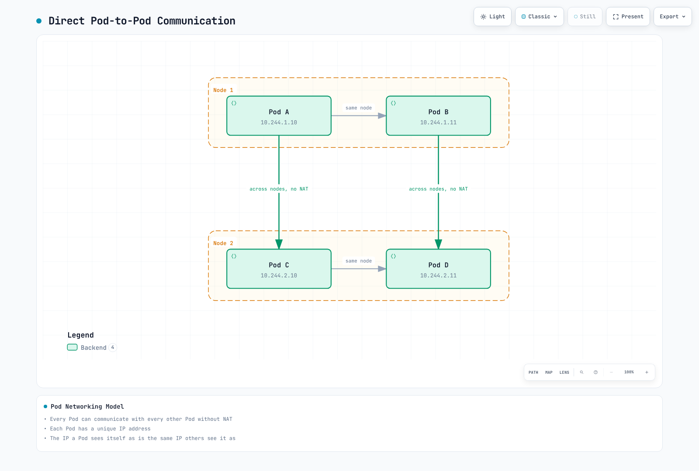
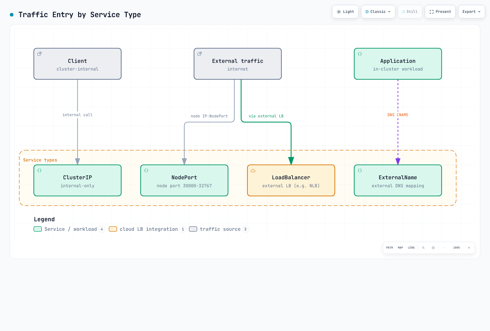
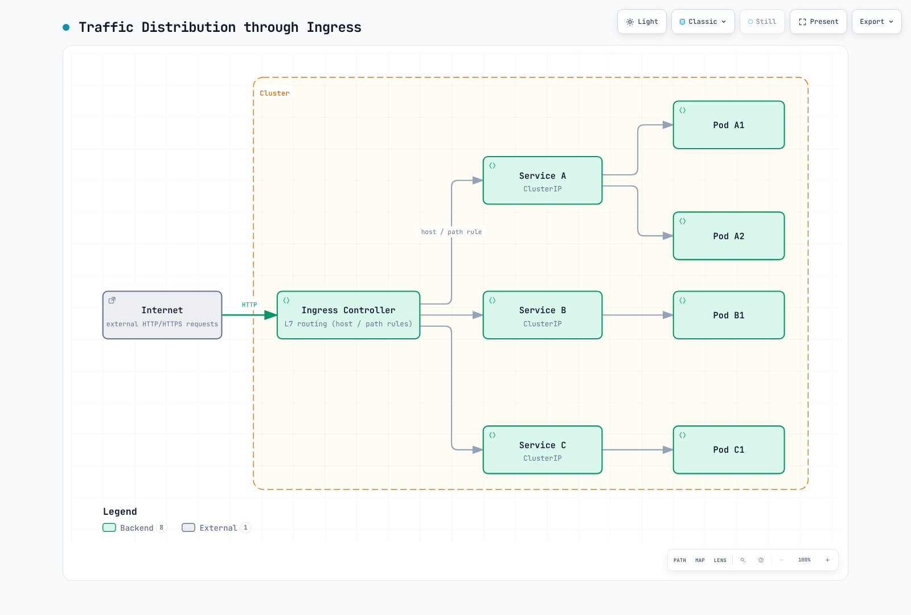
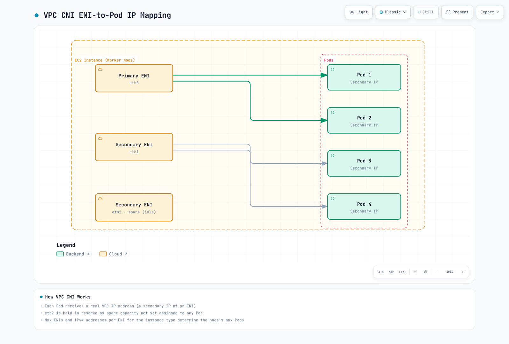

# Kubernetesネットワーキング

> **最終更新日**: 2026年10月16日
>
> **固定された例**: Cilium 1.20.3、Calico Open Source 3.32.2、Flannel 0.28.10、上流版 AWS VPC CNI/Helm chart 1.23.2。
>
> **最新リリース情報**: AWSは、Kubernetes 1.31～1.37向けにEKS管理のVPC CNIアドオン `v1.23.1-eksbuild.1` を掲載しています。Calico 3.33.0は最新のOpen Sourceリリースで、Kubernetes 1.35～1.37でテストされています。固定された例を変更する前に、リリースノートを確認してください。
>
> これらのバージョンは、組み合わせてテストされたクラスター構成ではありません。インストール前に、各製品のKubernetes/プラットフォーム対応表を確認してください。

## 概要

Kubernetesネットワーキングは、コンテナ化されたアプリケーション間の通信を可能にする中核的なインフラストラクチャ層です。このセクションでは、Kubernetesネットワーキングの基本概念から、AWS EKS環境における高度なCNI（Container Network Interface）ソリューションやネットワークパターンまでを扱います。

## 学習パス {#learning-path}

初級コースの後は、[上級ネットワーキングパス](expert/README.md)を利用して、プロトコルに関するプロジェクト、ルーティングポリシー、EVPN、Linuxのパフォーマンス、クラウド設計、自動化の評価を結び付けてください。まず、各ワークブックの環境、証拠、復旧基準を確認してください。

Linuxやネットワーキングを始めたばかりの場合は、[初級コース](beginner/README.md)から始めてください。全8レッスンで、CLI、アドレス指定、DNS、SSH、ファイアウォール、監視、総合演習を結び付けます。以下のパスでは、その基礎をプロトコル、カーネル、クラスターの実装へと発展させます。

プロトコルの概念から観察へ進み、それらをコンテナ、クラスター、クラウドにおける役割と結び付けてください。前提条件を参考に開始地点を選び、次に進む前に到達目標で理解度を確認してください。

| 段階 | 役割 | 前提条件 | 到達目標 | 読む／実践する |
|---|---|---|---|---|
| プロトコル、アドレス指定、HTTP | 用語の基礎を固める | 基本的なコマンドライン操作 | リクエストをたどり、アドレス指定、トランスポート、アプリケーションの動作を区別する | ネットワークの基礎 [Part 1](../basics/06-network-fundamentals-part1.md)、[Part 2](../basics/06-network-fundamentals-part2.md)、[Part 3](../basics/06-network-fundamentals-part3.md)、[Part 4](../basics/06-network-fundamentals-part4.md) |
| ネットワーク機器、LAN、WAN | 機器の役割と境界を区別する | プロトコルとアドレス指定の基礎 | スイッチ、ルーター、ファイアウォール、ロードバランサー、VLAN、NAT、WANの種類を説明する | [ネットワークの基礎 Part 5](../basics/06-network-fundamentals-part5.md) · [クイズ](../quizzes/basics/06-network-fundamentals-part5-quiz.md) |
| Linuxソケット、VFS、パケット経路 | APIとカーネルを結び付ける | TCP/IPの基礎 | FD、ソケットバッファー、ウィンドウ、キューを区別する | [カーネルネットワーキングスタック](../kernel/02-network-stack.md) |
| Linuxネットワーク診断 | 証拠に基づいて仮説を検証する | ソケットとパケット経路の概念 | ソケット、パケット、アプリケーションの観察結果を関連付ける | [診断の実践](07-linux-network-diagnostics.md) · [クイズ](../quizzes/networking/07-linux-network-diagnostics-quiz.md) |
| Dockerとコンテナネットワーキング | 名前空間の境界を特定する | Linuxのパケット経路と基本的な診断 | ブリッジネットワーキング、公開ポート、コンテナ名の解決を説明する | [コンテナ技術](../basics/03-container-technology.md) |
| Kubernetes Service、DNS、Ingress | クラスターの抽象化を把握する | コンテナネットワーキング | Serviceを経由して名前がエンドポイントに到達する経路をたどり、Ingressの役割を特定する | [Serviceとネットワーキング](../core/03-services-networking.md) · [ラボ](../labs/core/03-services-networking-lab.md) |
| eBPF、CNI、ポリシー | 実装ごとの役割を比較する | PodとServiceの経路 | パケット転送、ポリシー適用、可観測性を区別する | [eBPFの基礎](../basics/05-ebpf-fundamentals.md) · [Cilium](cilium/README.md) · [Calico](calico/README.md) |
| AWSネットワーク境界とパフォーマンス | モデルをクラウドの経路に適用する | CNIの概念と測定スキル | VPC、ノード、AZの境界を特定し、測定値を文脈に沿って解釈する | [VPC CNI](01-vpc-cni.md) · [AWS Load Balancer Controller](03-aws-lb-controller.md) · [組織間VPC接続](05-cross-org-vpc-connectivity.md) · [Podネットワークベンチマーク](06-pod-network-benchmark.md) |
| WAN、ハイブリッド、エッジ | オンプレミス、クラウド、ユーザー間の経路を設計する | ルーティングポリシー、AWSネットワーク境界 | CDNが応答する場所、WAFとDDoS対策が機能する場所を把握し、ハイブリッド経路とフェイルオーバーを証拠に基づいて説明する | [WANとハイブリッド接続](expert/07-wan-hybrid-connectivity.md) · [CDNとエッジ](expert/08-cdn-edge-delivery.md) · [エッジセキュリティ](expert/09-edge-security-waf-ddos.md) |

## Kubernetesのネットワーキングモデル

現在のKubernetesモデルでは、**意図的なネットワーク分離を前提として**、Podがアドレス変換やプロキシなしでノード間を直接通信できるPodネットワークを提供します。kubeletなどのノードエージェントは、自身のノード上のPodに到達できなければなりません。特定の接続が成功するかどうかは、ネットワークポリシー、ルーティング、アプリケーションのリスナーによっても決まります。

通常のPodは独自のネットワーク名前空間とクラスター全体で一意のアドレスを持ちます。同じPod内のコンテナは、その名前空間とlocalhostを共有します。host-network Podはノードのネットワークを共有します。また、デュアルスタック構成やマルチネットワーク構成では、より正確なアドレス処理が必要です。Podを再作成すると別のIPが割り当てられる場合がありますが、同じPod内のコンテナを再起動しても、必ずしもそのネットワークサンドボックスが再作成されるわけではありません。

| コンポーネント | 役割 |
|---|---|
| Podネットワーク | ワークロードのネットワーク名前空間間におけるアドレス指定と接続 |
| Service／ディスカバリー | 変化するエンドポイントに対して、安定したService名または仮想アドレスを提供 |
| Ingress／Gateway実装 | 設定済みの外部エントリーポイントとアプリケーションルーティング |
| ネットワークポリシーエンジン | 選択した実装がサポートするポリシーを適用 |

これらの役割が、必須の直列パケット経路を構成するわけではありません。Serviceによる変換、L7プロキシ、ワークロードポリシーによって、特定のリクエストがネットワークを通過する経路は変わることがあります。

### Podネットワーキング

Podネットワーキングは、Pod間通信のためのアドレス指定とルートを提供します。以下の図は通常のIPv4 Podを示しており、接続が成立するのは、適用対象となるポリシーとネットワーク制御で通信が許可されている場合です。



[🔍 インタラクティブな図を表示](https://www.atomai.click/kubernetes-docs/archmaps/en-networking-readme-1.html)

図中のアドレスは、通常のPodアドレスの例です。意図的な分離やhost-network／マルチネットワーク構成では、それぞれの構成に即した解釈が必要です。

#### Podネットワーキングの実装方式

| 方式 | 説明 | CNIの例 |
|--------|-------------|-------------|
| **オーバーレイネットワーク** | 既存のネットワーク上でトラフィックをカプセル化する | Flannel VXLAN、Calico VXLAN/IPIP、Cilium VXLAN/Geneve |
| **ネイティブルーティング** | オーバーレイによるカプセル化を使わず、基盤ネットワークのルートを使用する | AWS VPC CNI、Calico routing/BGP、Cilium native routing |
| **条件付きカプセル化** | 設定されたトポロジーに応じて直接経路またはカプセル化を使用する | 前提条件がそれぞれ異なる、対応するCalico／Flannel／Ciliumのモード |

### Serviceネットワーキング

Serviceは、通常はPodからなる論理的なエンドポイント集合と、その到達方法を定義します。デフォルトではClusterIPが安定した仮想IPを提供します。headless Serviceはその仮想IPを持たず、ExternalNameはDNS CNAMEマッピングを使用します。また、Podセレクターを使わずに管理されるエンドポイントを持つServiceもあります。



[🔍 インタラクティブな図を表示](https://www.atomai.click/kubernetes-docs/archmaps/en-networking-readme-2.html)

これらは一般的な公開方式であり、セキュリティを保証するものではありません。NodePortの範囲とアクセス可能なノードアドレスは設定できます。LoadBalancerを内部向けにすることもできます。ExternalNameはDNSエイリアスを返すもので、転送プロキシを作成しません。

#### Serviceタイプの特性

`default` 名前空間に、`app: my-app` に一致するPodを作成し、表示されているtargetPortでリッスンさせてください。NodePortのデフォルト割り当て範囲は30000～32767で、変更できます。外部から到達できるかどうかは、引き続きアドレス、ルート、アクセス制御によって決まります。

LoadBalancerの例では、EC2インスタンスターゲットと割り当て済みNodePortを使う **AWS Load Balancer Controller** を明示的に選択しています。まず、そのControllerとIAM／サブネットの前提条件を満たすようにインストール／設定してください。EKS Auto Modeでは、別のController／クラスを使用します。ここでのポート443はTCPポートを選んでいるだけです。TLSはバックエンドで8443を使って提供するか、ロードバランサー側で別途設定する必要があります。

これらのポートマッピングは、一般的なKubernetes Service APIの例です。AWSが現在文書化しているEKSネイティブネットワークポリシーには、追加の要件があります。Serviceのポートはコンテナポートと一致している必要があり、`metadata.ownerReferences` を持つController管理のPodを使うと、確実に適用できます。そのポリシー実装をテストする前に、要件に合わせて例を調整してください。

```yaml
apiVersion: v1
kind: Service
metadata:
  name: my-service
  namespace: default
spec:
  type: ClusterIP
  selector:
    app: my-app
  ports:
  - protocol: TCP
    port: 80
    targetPort: 8080
---
apiVersion: v1
kind: Service
metadata:
  name: my-nodeport-service
  namespace: default
spec:
  type: NodePort
  selector:
    app: my-app
  ports:
  - protocol: TCP
    port: 80
    targetPort: 8080
    nodePort: 30080
---
apiVersion: v1
kind: Service
metadata:
  name: my-loadbalancer-service
  annotations:
    service.beta.kubernetes.io/aws-load-balancer-scheme: internet-facing
    service.beta.kubernetes.io/aws-load-balancer-nlb-target-type: instance
  namespace: default
spec:
  type: LoadBalancer
  selector:
    app: my-app
  ports:
  - protocol: TCP
    port: 443
    targetPort: 8443
  loadBalancerClass: service.k8s.aws/nlb
  allocateLoadBalancerNodePorts: true
```

### Ingressネットワーキング

IngressリソースにはControllerとそのデータプレーンが必要です。このHTTPの例では、`spec.ingressClassName: alb` とIPターゲットを使うAWS LBCを使用します。参照されている `api-v1`、`api-v2`、`web-frontend` の各Serviceは、`default` に存在し、ポート80を公開し、準備完了状態でVPCからルーティング可能なPodエンドポイントを持つ必要があります。必要に応じてHTTPS／証明書を別途設定してください。インストールとターゲットの前提条件については、[LBCガイド](03-aws-lb-controller.md)を参照してください。

Ingressは、HTTP/HTTPSトラフィックをクラスター内部のServiceへルーティングするルールを定義します。



[🔍 インタラクティブな図を表示](https://www.atomai.click/kubernetes-docs/archmaps/en-networking-readme-3.html)

図の枠はIngressのデータプレーン機能を表しています。AWS LBCはALBを設定します。アプリケーショントラフィックはControllerの調整プロセスを通過しません。ターゲットモードによっては、Service仮想IPを文字どおり追加のホップとして経由するのではなく、データプレーンがPod IPまたはNodePortに到達します。

```yaml
apiVersion: networking.k8s.io/v1
kind: Ingress
metadata:
  name: my-ingress
  annotations:
    alb.ingress.kubernetes.io/scheme: internet-facing
    alb.ingress.kubernetes.io/target-type: ip
  namespace: default
spec:
  rules:
  - host: api.example.com
    http:
      paths:
      - path: /v1
        pathType: Prefix
        backend:
          service:
            name: api-v1
            port:
              number: 80
      - path: /v2
        pathType: Prefix
        backend:
          service:
            name: api-v2
            port:
              number: 80
  - host: web.example.com
    http:
      paths:
      - path: /
        pathType: Prefix
        backend:
          service:
            name: web-frontend
            port:
              number: 80
  ingressClassName: alb
```

## CNI（Container Network Interface）

CNIは、ランタイムがコンテナネットワークを設定するためのインターフェースを標準化します。現在のKubernetesでは、kubeletがCRI経由でPodサンドボックス操作を要求し、**コンテナランタイムがCNIを管理します**。kubeletによる旧式の直接的なCNI管理フラグは、Kubernetes 1.24で削除されました。

### ランタイムとプラグインの役割

| 担当者 | 役割 |
|---|---|
| kubelet | コンテナランタイムインターフェース経由でサンドボックスの作成／削除を要求する |
| コンテナランタイム | ネットワーク構成を選択し、CNIプラグインチェーンを呼び出す |
| CNIプラグイン | 構成を受け取り、ADD/DELなどの対応操作を実行して、結果を返す |
| IPAM実装 | アドレスを割り当て／解放する。委譲されたプラグインの場合も、プロバイダー固有のエージェントの一部の場合もある |
| 任意のノードエージェント | プロバイダー固有のルート、ポリシー、IPプール、データプレーン状態を維持する |

ランタイムはCNIインターフェースを通じて構成をプラグインに渡しますが、すべてのプラグインで、別途稼働し続けるエージェントやIPAMバイナリが必須というわけではありません。インターフェースの種類もさまざまです。vethペアは一般的ですが、唯一の実装方式ではありません。

## CNIの比較

| プロジェクト／対象範囲 | ネットワーキングとポリシー | 区別すべき機能と制限 |
|---|---|---|
| **Cilium 1.20.3** | eBPFネットワーキング、該当するL7機能向けのEnvoy、Ciliumネットワークポリシー、Hubble | Linuxワーカーデータプレーンで、AMD64／Arm64の要件あり。WindowsでCLIが利用可能なことは、Windows CNIのサポートを意味しない。WireGuard／IPsecとBetaのztunnel mTLSでは対象範囲が異なる。 |
| **Calico Open Source 3.32.2の例、現行版は3.33.0** | ルーティング／カプセル化の選択肢、iptables、nftables、eBPFの各オプション、順序付きポリシー階層、ホスト／ワークロードポリシー | Calico 3.33.0はKubernetes 1.35～1.37でテストされています。アップグレード前にリリースノートを確認してください。Linux eBPFやWireGuardデータプレーンを含め、Windowsには別途制限があります。フロー可観測性にはWhisker／GoldmaneをTech Previewとして利用できます。有償機能についてはエディション別の対応表を参照してください。 |
| **Flannel 0.28.10** | ホストサブネットの割り当てとノード間トランスポート。VXLAN、host-gwなどのバックエンド | `flanneld` 自体はNetworkPolicyを適用しません。Chartの任意設定 `netpol.enabled` では、SIGsのポリシーControllerがデプロイされます。WireGuardは文書化されたバックエンドですが、IPsecは実験的です。WindowsのVXLANには固有の設定／制限があります。 |
| **AWS VPC CNI 1.23.2の上流版／Helmの例、EKSアドオン `v1.23.1-eksbuild.1`** | VPCアドレスの割り当てとEC2 ENI／プレフィックス。対応するLinux EC2ノード上でのEKS標準ネットワークポリシーとAdminネットワークポリシー機能 | AWSはKubernetes 1.31～1.37向けにこの管理アドオンビルドを掲載しています。リージョンでの利用可否とクラスターの実際のバージョンを確認してください。EKS Auto ModeはDNSポリシー機能を追加したマネージドネットワーキング実装です。Windows、Fargate、カスタムネットワーキング、プレフィックス委譲、複数NICのサポートにはそれぞれ異なる条件があります。 |
| **元のWeave Netプロジェクト** | 歴史的なオーバーレイネットワーキングの実装 | 元の `weaveworks/weave` リポジトリはアーカイブされています。新規クラスター向けのアクティブでサポート対象のデフォルトとして説明しないでください。 |

### ポリシー、暗号化、可観測性

- Ciliumは、該当するL7コンポーネントを通じてHTTP／DNSを認識するポリシーと、クラスター全体／ホストのポリシーを提供します。そのdeny／allowのセマンティクスは、Calicoの順序付きTier APIとは異なります。
- Calico Open Sourceには、階層型ポリシーTierとホストポリシーが含まれています。現行の製品対応表では、アプリケーション層ポリシー、DNS／FQDNポリシー、Cluster MeshはCloud／Enterpriseに割り当てられています。これらをオープンソース版の機能として暗黙に扱ってはいけません。Calicoが文書化している転送中の暗号化方式はWireGuardです。
- Amazon EKSは、Auto Modeおよび対応するEC2／VPC CNIのインストールに対して、`ClusterNetworkPolicy` のAdmin／Baseline制御を提供します。AWSが説明するDNS／FQDN `ApplicationNetworkPolicy` 機能は **Auto Mode** 向けです。その名称から、現行のHTTPメソッド／本文検査機能を意味すると解釈してはいけません。
- Flannelの任意のポリシーControllerには、独自の要件があります。ネットワーキングバックエンドを選択しただけでは、ポリシー適用は有効になりません。
- ノード間暗号化、認証済みワークロードID、アプリケーションmTLSは、それぞれ異なる制御です。ネットワークフローの可視化も、アプリケーショントレースやプロセス／ファイル制御とは異なります。

### ルーティングとパフォーマンス

CalicoとCiliumは、BGPでルートを広報できます。ただし、それだけでマルチクラスターのServiceディスカバリー、ポリシー同期、暗号化が提供されるわけではありません。Flannelのhost-gwは直接ルートを使用するため、適切なレイヤー2接続が必要です。オーバーレイを使用するとカプセル化とMTUへの考慮が加わりますが、CNI名だけから普遍的な性能順位を導くことはできません。

以前掲載されていたスループットの数値100/98/95/85/80/75%には、再現可能なワークロード、バージョン、測定元がありませんでした。比較する際は、ハードウェア、カーネル、パケット／リクエストサイズ、同時実行数、暗号化／ポリシー設定、スループット、損失、テールレイテンシーをそろえてください。別ページの[Podベンチマーク](06-pod-network-benchmark.md)には、独自の過去の環境と測定値が記載されています。

## CNI選定ガイド

まず必要なルーティング、ポリシー、オペレーティングシステム、サポートモデルを選択し、その組み合わせをテストしてください。

| 要件 | 評価の進め方 |
|---|---|
| 標準的なEKS VPCアドレス指定と、サポート対象のネットワークポリシー | 2つ目のポリシーエンジンを追加する前に、AWS VPC CNI／EKSの機能を評価する。 |
| 順序付きポリシーTier、ホストポリシー、インフラストラクチャのBGP | 該当するCalicoエディション／データプレーンと、ルーティングの前提条件を評価する。 |
| Ciliumポリシー、Hubble、選択したメッシュ機能 | Linux／カーネル／プラットフォームとの互換性と、[Ciliumメッシュガイド](../service-mesh/cilium-service-mesh/README.md)を確認する。該当するL7経路ではEnvoyが引き続き使われる。 |
| 機能を限定した小規模なネットワーク | 実際の要件に照らしてFlannelのバックエンドと任意のポリシーControllerを評価する。 |
| プロセス、システムコール、ファイルの制御 | Tetragonなどのランタイムセキュリティコンポーネントを、ネットワークポリシーとは別に評価する。 |

### EKS管理アドオンの構成

以下は**構成ペイロード**の例であり、CalicoとVPC CNIのポリシーエンジンを同じワークロードに両方インストールする手順ではありません。

```json
{
  "enableNetworkPolicy": "true"
}
```

文字列 `"true"` が、この設定に対して文書化されている型です。既存のKubernetesバージョンと互換性のあるEKSアドオンビルドを選び、そのビルドの構成Schemaを確認してください。

```bash
EKS_REGION=ap-northeast-2
KUBERNETES_MINOR=1.35  # Replace with the existing cluster's minor version
aws eks describe-addon-versions --region "$EKS_REGION" --addon-name vpc-cni \
  --kubernetes-version "$KUBERNETES_MINOR"
: "${VPC_CNI_ADDON_VERSION:?Set the compatible eksbuild version selected from metadata}"
aws eks describe-addon-configuration --region "$EKS_REGION" --addon-name vpc-cni \
  --addon-version "$VPC_CNI_ADDON_VERSION"
```

上流版の1.23.2というリリース番号と、EKSの `eksbuild` バージョンは別の識別子です。AWSの現行アドオン一覧には、Kubernetes 1.31～1.37向けとして `v1.23.1-eksbuild.1` が記載されています。対象リージョンで `describe-addon-versions` を実行し、互換性のあるビルドを選んでください。意図した管理アドオン構成に変更をマージしてください。無条件に `latest` を選択したり、無関係な値を置き換えたりしないでください。サードパーティ製ポリシー実装から移行する場合は、既存の適用状態の削除と、テスト済みのノード／ワークロード移行計画も必要です。

## EKSネットワーキングの基礎

### EKSのデフォルトネットワーキングアーキテクチャ

| 場所／コンポーネント | 役割 |
|---|---|
| EKS管理VPC | AWSが、Availability ZoneをまたいでマネージドKubernetesコントロールプレーンを実行する。 |
| 顧客クラスターVPC | ワーカーネットワーキング、選択したサブネット、EKS管理のクロスアカウントENIが、コントロールプレーンへの設定済み経路を提供する。 |
| 顧客VPCで選択したサブネット内のALB／NLB | 選択したパブリックまたは内部向けのアプリケーションエントリーポイントを提供する。インターネットゲートウェイ／NATゲートウェイは、そのルーティング構成の代わりにはならない。 |
| NATゲートウェイまたはプライベートサービスエンドポイント | ワークロード設計で必要となる特定のアウトバウンド経路を提供する。 |

以前の図では、コントロールプレーンは顧客VPC内、ロードバランサーはその外部に描かれていました。この図は、上記の所有境界を示す内容に置き換えられています。

### コンピューティングモード別のDNSとネットワーキング

| コンピューティングモード | DNS／コンポーネントの配置 |
|---|---|
| 標準EC2ノード | 通常は、設定済みのCoreDNS Deploymentとインストール済みのネットワーキングコンポーネントを使用する。置き換える場合は、サポート対象の構成を個別に用意する必要がある。 |
| Auto Modeのみの構成 | CoreDNS、VPC CNI、kube-proxyの各機能は、管理対象のノードsystemdサービスとして実行される。これらのノードにはCoreDNS Deployment／アドオンは不要。 |
| Auto Modeと非Auto Modeノードの混在 | 非Auto Modeノード向けにCoreDNS Deploymentを維持する。これらのノードは、別のノードのAuto Mode DNSサービスを使用できない。 |

Auto Modeで最初に使われるDNSリゾルバーはノードローカルです。上流への転送とコントロールプレーンとの通信には、引き続きネットワークアクセスが必要な場合があります。DNS関連のすべてのパケットがノード内にとどまる保証ではありません。AWSはAuto Mode向けにAdminポリシーとDNSポリシーの両方を文書化しています。一方、標準的なEC2 VPC CNIのAdminポリシーには、独自のバージョン／有効化要件があります。

### VPC CNIの仕組み

AWS VPC CNIは、選択したIPAMモードを使って通常のPodにVPCルーティング可能なアドレスを割り当てます。セカンダリIPv4アドレス、委譲されたプレフィックス、ブランチENI、複数NIC構成では、それぞれ動作が異なります。host-network Podはノードのネットワークを共有します。



[🔍 インタラクティブな図を表示](https://www.atomai.click/kubernetes-docs/archmaps/en-networking-readme-9.html)

この図はセカンダリIPモードのみを示しています。ウォームENIは設定可能な割り当て方式であり、すべてのノードが常にちょうど1つを予約する必要があるという意味ではありません。プレフィックス委譲、カスタムネットワーキング、ブランチENIでは、割り当てルールが異なります。

#### ENIとIPの上限

| インスタンスタイプ | ENIの最大数 | ENIあたりのIPv4スロット数 | 従来のセカンダリIPによるブートストラップ値 |
|---------------|----------|--------------|------------------------|
| t3.medium | 3 | 6 | 17 |
| t3.large | 3 | 12 | 35 |
| m5.large | 3 | 10 | 29 |
| m5.xlarge | 4 | 15 | 58 |
| m5.2xlarge | 4 | 15 | 58 |
| c5.4xlarge | 8 | 30 | 234 |

これらの値は、VPC CNI 1.23.2のインスタンス上限と従来のmax-Pods表を照合したものです。過去の計算式は `ENIs × (IPv4 slots per ENI − 1) + 2` ですが、現在の一般的な推奨値ではありません。プレフィックス委譲、カスタムネットワーキング、ブランチENI、複数のネットワークカードによって、アドレス容量は変わります。Kubernetesのスケジューリングは、kubeletの `maxPods` とリソースによっても制限されます。EKS管理ノードグループでは、vCPUが30未満のインスタンスの `maxPods` は110、それ以外は250が上限です。利用可能なIP数だけでは、この上限を超えられません。

### EKSネットワーキングで考慮すべき点

#### IPアドレス管理

**Linux VPC CNI**では、選択したアドオン／Helm／DaemonSet管理方式を使って、文書化されている環境変数を設定してください。次は、EKSアドオン構成の一部です。以前の `amazon-vpc-cni` ConfigMapにあった `enable-prefix-delegation` では、この方法でLinux IPAMDを構成できません。変更を適用する際は、他の意図したアドオン値を維持してください。

```json
{
  "env": {
    "ENABLE_PREFIX_DELEGATION": "true",
    "WARM_PREFIX_TARGET": "1"
  }
}
```

または、割り当ての最低数と空きIP数のターゲットを調整してください。`MINIMUM_IP_TARGET` または `WARM_IP_TARGET` のいずれかを設定すると、`WARM_PREFIX_TARGET` より優先されます。これらは4つの独立した加算対象ではなく、互いに代替となるポリシーです。割り当ては引き続きプレフィックス単位で行われます。Nitroのサポート、IPv4用の連続した `/28` 空間、適切なkubelet Pod上限は、それぞれ別の前提条件です。

Windowsでのプレフィックス割り当ては、別の構成経路を使います。AWSは、`amazon-vpc-cni` ConfigMapで `enable-windows-prefix-delegation` とウォームターゲット用キーを設定する方法を文書化しています。Linuxの環境変数の手順を、そのままWindowsに適用しないでください。

```json
{
  "env": {
    "ENABLE_PREFIX_DELEGATION": "true",
    "MINIMUM_IP_TARGET": "5",
    "WARM_IP_TARGET": "2"
  }
}
```

#### カスタムネットワーキング

以下のIPv4例では、対象のAZとVPCに実在するサブネットIDとセキュリティグループIDが必要です。カスタムネットワーキングを有効にし、各ノードのENIConfigをゾーンラベルで選択してください。明示的なENIConfigノードアノテーションがある場合は、そのラベルより優先されます。以下の例では、両言語で同じリージョン名を使用しています。実際のノードゾーンに置き換えてください。ENIConfigオブジェクトをインストールするだけでは、カスタムネットワーキングは有効になりません。

```json
{
  "env": {
    "AWS_VPC_K8S_CNI_CUSTOM_NETWORK_CFG": "true",
    "ENI_CONFIG_LABEL_DEF": "topology.kubernetes.io/zone"
  }
}
```

```yaml
apiVersion: crd.k8s.amazonaws.com/v1alpha1
kind: ENIConfig
metadata:
  name: ap-northeast-2a
spec:
  securityGroups:
  - sg-0123456789abcdef0
  subnet: subnet-0123456789abcdef0
---
apiVersion: crd.k8s.amazonaws.com/v1alpha1
kind: ENIConfig
metadata:
  name: ap-northeast-2b
spec:
  securityGroups:
  - sg-0123456789abcdef0
  subnet: subnet-fedcba9876543210f
```

## 高度なネットワーキングの概念

以下の項目は、この概要の他の箇所で簡単に触れています。詳細なセットアップ手順と測定値はリンク先の詳細ページに記載されています。このセクションでは、各要素がレイヤーによってどう異なるか、どこで使うかを整理します。

### L2～L7とルーター／ロードバランサーの違い

「ルーター」と「ロードバランサー」は同じ文で登場することがよくありますが、それぞれ異なる問いに答えます。ルーターは（一般に）単一の宛先への経路を選択し、ロードバランサーは複数の同等な候補の中から分配アルゴリズムを使って1つのターゲットを選択します。

| レイヤー | 機器／機能 | 判断基準 | Kubernetes／AWSでの対応例 |
|---|---|---|---|
| L2（リンク） | スイッチ、ブリッジ | 宛先MACアドレス | CNIが作成するvethペアとLinuxブリッジ、ENIが公開する仮想NIC |
| L3（ネットワーク） | ルーター、透過型アプライアンスの挿入 | ルーティングでは宛先IP、アプライアンス選択ではフローID | VPCの暗黙のルーター、TGW。GWLBはアプライアンス向けにIPパケットをカプセル化する |
| L4（トランスポート） | L4ロードバランサー | 接続／フローID。一般に5タプル | NLB、kube-proxy（iptables、IPVS、nftables）、独立したeBPF Service実装 |
| L7（アプリケーション） | L7ロードバランサー／リバースプロキシ | リクエストごとのホスト、パス、ヘッダー、プロトコル | ALB、Ingress／Gateway API実装、サービスメッシュのサイドカー（Envoy） |

重要な違いは、**分配の単位**です。L4ロードバランサーは通常、TCP接続または追跡対象のUDPフローに対してターゲットを選択します。L7プロキシは、同じ接続を共有するリクエストも含め、サポート対象のアプリケーションリクエストごとにターゲットを選択できます。GWLBは、アプリケーションリクエストを解析するのではなく、カプセル化されたIPフローをセキュリティアプライアンスに分配します。フローのスティッキネスは、設定されたタイムアウト、ヘルスチェック、フェイルオーバーの動作に依存します。フローが再割り当てまたは中断されることがないという保証ではありません。

> 📎 L2／L3のプロトコルレベルの定義は[ネットワークの基礎 Part 1](../basics/06-network-fundamentals-part1.md)に、ALB／NLBのターゲットタイプと実際の設定は[AWS Load Balancer Controller](03-aws-lb-controller.md)に記載されています。

### アカウント間／VPC間接続：TGW、VPC Peering、GWLB、PrivateLink、Lattice

これら5つの接続方式は、レイヤーとトラフィックモデルが異なります。TGW RAM共有、VPC Peering、PrivateLink、TGW Peering、VPC Latticeの測定レイテンシーは、[組織間VPC接続](05-cross-org-vpc-connectivity.md)を参照してください。このセクションでは、比較表に含まれていないGWLBを追加し、5つすべてをレイヤー別に整理しています。

| 接続方式 | レイヤー／モデル | 特徴 |
|---|---|---|
| VPC Peering | L3、双方向IPルーティング | 推移的ではない。CIDRが重複する場合は設定できない |
| Transit Gateway（TGW） | L3、ハブアンドスポーク型IPルーティング | 1つ以上のTGWルートテーブルで、アタッチメントの関連付けと伝播を使用する。RAMを使ってアカウント間で共有できる |
| Gateway Load Balancer（GWLB） | L3、透過型アプライアンスの挿入 | 元のパケットをGENEVE（UDP 6081）でカプセル化する。VPCエンドポイントサービスモデルにより、コンシューマーのトラフィックをプロバイダーのアプライアンス群に接続する |
| PrivateLink | プライベートエンドポイント接続 | NLBをバックエンドとするエンドポイントサービスは1つの方式であり、リソースエンドポイントも存在する。コンシューマーとプロバイダーのCIDRは重複していてもよい |
| VPC Lattice | アプリケーションとリソースのネットワーキング | HTTP/HTTPS ServiceはL7ルーティングと任意のIAM認可に対応する。TLSパススルーやリソース構成では機能が異なる |

GWLBはGateway Load Balancerエンドポイントを通じて、ファイアウォールやIDS/IPSなどの検査アプライアンスをIP経路に挿入します。デフォルトのフロースティッキネスでは5つのフィールドを使用しますが、対応する構成では2つまたは3つのフィールドを使うこともできます。順方向／戻り方向のルート、アプライアンスのヘルス、カプセル化時のMTU、NACL、実際のワークロード／アプライアンスのセキュリティグループを検証してください。GWLB自体にはALBのようなセキュリティグループはなく、フロースティッキネスは障害テストの代わりにはなりません。

セキュリティ設計については、[WAF／オリジン保護](../security/14-waf-edge-api-security.md)、[Palo Alto／Fortinet NGFW](../security/15-ngfw-paloalto-fortinet.md)、[GWLB／GENEVEの経路と障害](../security/16-gwlb-geneve-inspection.md)を参照してください。GWLBEもセキュリティグループをサポートしません。ターゲットがすべて異常な場合、AWSの説明では、フローごとにターゲットが選択され、回復するまでパケットがドロップされます。アプライアンスを迂回する直接経路はありません。タプル数を減らしたスティッキネス、クロスゾーン、NAT、TGWのアプライアンスモードを併せて確認してください。

> 📎 Gateway API Controller、IAM認可、ルーティングを含むEKS／VPC Latticeの完全な統合については、[VPC Lattice](02-vpc-lattice.md)を参照してください。

### DNSリゾルバーとルートテーブルの実際の動作

**DNSリゾルバー：** AmazonProvidedDNSは**Route 53 Resolver**です。そのアドレスには、VPCのプライマリIPv4ネットワークアドレスに2を加えたもの（`10.0.0.0/16` の場合は `10.0.0.2`）と、`169.254.169.253` が含まれます。Resolverルールに従って、関連付けられたプライベートゾーンやパブリック名を解決します。CoreDNSは通常、設定されたKubernetesクラスターのドメイン（多くの場合 `cluster.local`）を提供します。`kube-dns` はそのService名であり、名前空間でもDNSゾーンでもありません。外部への転送は、CorefileとDNS Podから参照できるresolverファイルに従います。ノードのresolverファイルが変更なしに使われると決めつけず、これらの設定を確認してください。Resolverエンドポイントを使う構成では、インバウンドエンドポイントがオンプレミスからのクエリを受け付け、アウトバウンドエンドポイントと関連付けられたルールが、選択されたVPCのクエリをオンプレミスDNSへ転送します。Auto Modeのノードローカルリゾルバーを使っても、上流への依存はなくなりません。

**ルートテーブル：** VPCのルート評価では、一般に最長プレフィックス一致が使われます。AWSでは、`local` ルートのターゲットを置き換え、アプライアンス向けルーティングのためにサポート対象の、より具体的なサブネットルートを追加できます。`local` が常に最も具体的なルートになるわけではありません。同一の宛先では、静的VPCルートが仮想プライベートゲートウェイから伝播されたルートより優先されます。TGWをターゲットとするVPCルートは静的ルートです。TGW内部の伝播は、別個のルートテーブルで行われます。無効なターゲットはトラフィックをドロップする `blackhole` エントリーを残すことがあるため、宛先だけでなくルートの状態も確認してください。明示的なルートテーブル関連付けがないサブネットでは、VPCのメインルートテーブルが使用されます。

> 📎 TGW／Peeringのルート優先順位と静的ルート設定の例は、[組織間VPC接続の運用上の所見](05-cross-org-vpc-connectivity.md#operational-findings)を参照してください。

### カーネルのデータプレーン：iptables、IPVS、eBPF、パケットフィルタリング

LinuxのService転送とネットワークポリシーの適用では、異なる仕組みを使うことがあります。Netfilterは、iptablesとnftablesが使用するパケット経路のフックを提供します。eBPF実装はXDP、tc、ソケットフックに接続し、そこでService選択を実行できます。eBPFが有効なクラスターのすべてのパケットがNetfilterやコネクショントラッキングを迂回する、という意味ではありません。経路はCNI、カーネル、ルーティング、機能の設定によって変わります。

| 実装 | 位置 | 特徴 |
|---|---|---|
| iptables | Netfilterフック上の逐次的なルールチェーン | 評価時間はルール数に応じて増加する（O(n)）。kube-proxyの長年のデフォルトモード |
| IPVS | カーネルネイティブのL4ロードバランサー。Netfilterの拡張 | ハッシュベースの検索（ほぼO(1)）。Kubernetes 1.35からkube-proxyのモードとして非推奨 |
| nftables | iptablesを引き継ぐNetfilterの後継フレームワーク | 1.33以降、kube-proxyの安定版モード。まずカーネル／CNIとの互換性を確認する |
| eBPF（例：Cilium） | 設定されたXDP、tc、ソケットフック | kube-proxyのService処理を置き換えられる独立した実装。Netfilter／conntrackの動作は経路によって異なる |

実装を切り替えると、カーネルルールやアクティブな接続が残ることがあります。ディストリビューション／CNIの移行手順に従い、必要に応じてワークロードをドレインし、クリーンアップにノード再起動が必要な場合に備えて計画してください。kube-proxyをeBPFベースのCNIに置き換える場合も、両方の実装が同じServiceトラフィックを奪い合わないよう、サポートされた切り替え順序が必要です。

> 📎 IPVSの非推奨化の時期とnftablesの安定版への移行については[はじめてのKubernetes](../basics/04-kubernetes-introduction.md)で、CiliumによるeBPFのkube-proxy置き換えについては[Cilium eBPF](cilium/02-ebpf.md)で、CalicoのeBPFデータプレーンと移行手順については[Calico eBPF](calico/06-ebpf-dataplane.md)で説明しています。

### 計算集約型ネットワーキング：ENI、EFA、NVLink、光トランシーバー

ENI、EFA、NVLinkは、それぞれ異なる経路で使われます。**ENI**は、1つのAvailability Zone内のEC2インスタンスに接続される仮想ネットワークインターフェースです。ルーティングとポリシーで許可されていれば、通常のIPトラフィックで他のAZや接続されたVPCに到達できます（[VPC CNI](01-vpc-cni.md)を参照）。**EFA**は、互換性のあるMPI／NCCLソフトウェアがlibfabric経由で使用するOSバイパスデバイスです。**EFAデバイスのトラフィックはルーティングできず、VPC／AZの境界を越えられません**。一方、EFAとENAを備えたインターフェースのENAデバイスを通る通常のIPトラフィックはルーティング可能です。EFAのみのインターフェースにはENAデバイスもIPアドレス指定もありません。**NVLink**は、サポート対象のラックスケールNVLinkドメインを含む、対応システム内のGPUを接続します。EFAに対する固定の高速化を想定せず、選択したハードウェア、集合通信処理、配置を測定してください。

**光トランシーバー**は、データセンターネットワーキング全般に関する概念です。銅線DAC（Direct Attach Copper）ケーブルは短距離に適しており、光モジュールとファイバーは異なる到達距離や帯域幅の要件に対応します。QSFPとOSFPはモジュールのフォームファクターを表すもので、光媒体であることを保証するものではありません。これは一般的な背景知識として扱ってください。特定のAWSワークロードの物理配線を示すものではありません。

> 📎 NVLink／IMEXのトポロジーを考慮したスケジューリングとGPU Pod配置の例は[AI/MLインフラストラクチャ](../ai-ml/06-ai-infrastructure.md)に、EFAのVPC／AZ境界の制約と測定値は[組織間VPC接続](05-cross-org-vpc-connectivity.md)に記載されています。

### 次世代プロトコルがKubernetesに及ぼす意味：HTTP/3、gRPC、QUIC

HTTP/3（RFC 9114）とそのトランスポートであるQUIC（RFC 9000）のプロトコル動作については、[ネットワークの基礎 Part 2](../basics/06-network-fundamentals-part2.md)と[Part 3](../basics/06-network-fundamentals-part3.md)で説明しています。ここでは、Kubernetesのトラフィック分配に実際に影響する点だけを扱います。

- **gRPCとL4ロードバランサー：** gRPCはHTTP/2接続上でリクエストを多重化します。L4ロードバランサーは通常、確立済みのTCP接続を選択したエンドポイントに維持します。そのエンドポイントがプロキシであれば、さらにルーティングを判断できます。Podを追加しただけでは、既存の接続は再分配されません。RPCごとに分配するには、互換性のあるL7プロキシまたはクライアント側ポリシーが必要です。ストリーミングRPCは1つの呼び出しとして扱われ、その個々のメッセージが別々に負荷分散されるわけではありません。
- **Gateway APIのGRPCRoute：** IngressにはgRPC専用リソースはありませんが、Gateway APIは `GRPCRoute` によってService／メソッドレベルのルーティングを標準化しています。対応状況は実装によって異なるため（ヘッダー照合数、リトライポリシーなど）、Controllerのドキュメントを確認してください。
- **HTTP/3／QUICがクラスター内にどこまで到達するか：** クライアントとエッジ（CDN、ロードバランサー）間でHTTP/3をサポートするかどうかは、クラスター内やIngressのバックエンド接続でHTTP/3をサポートするかとは別の問題です。多くのIngress／Gateway実装は、バックエンドとは依然としてHTTP/1.1またはHTTP/2で通信します。また、エンドツーエンドのHTTP/3がサポートされるかどうかは、実装やバージョンによって異なるため、一般化せず、実際に使用しているControllerのドキュメントを確認してください。

## ネットワーキングのサブページ

このセクションでは、以下のトピックを詳しく説明します。

### [Linuxネットワーキングの基礎から学ぶ](beginner/README.md) {#beginner-course}

Linuxやネットワーキングを始めたばかりの場合は、[初級コース](beginner/README.md)から始めてください。全8レッスンで、CLI、アドレス指定、DNS、SSH、ファイアウォール、監視、総合演習を結び付けます。以下のパスでは、その基礎をプロトコル、カーネル、クラスターの実装へと発展させます。

### [上級ネットワーキングパス](expert/README.md) {#expert-course}

初級コースの後は、[上級ネットワーキングパス](expert/README.md)を利用して、プロトコルに関するプロジェクト、ルーティングポリシー、EVPN、Linuxのパフォーマンス、クラウド設計、自動化の評価を結び付けてください。まず、各ワークブックの環境、証拠、復旧基準を確認してください。

### [Linuxネットワーク診断の実践](07-linux-network-diagnostics.md) {#linux-network-diagnostics}

CNI実装を学ぶ前に、[カーネルのソケットとパケット経路の概念](../kernel/02-network-stack.md)を観察結果と結び付けてください。[診断クイズ](../quizzes/networking/07-linux-network-diagnostics-quiz.md)で解釈を確認してください。

### [VPC CNI](01-vpc-cni.md)
通常のPodにVPCアドレスを使用するEKSネットワーキングと、モード固有のIPAM／ポリシーの前提条件。

### [Ciliumの詳細](cilium/README.md)
高性能なeBPFベースのCNIソリューション。L7 Network Policy、Service Mesh、可観測性（Hubble）などの高度な機能を提供します。

### [Calicoの詳細](calico/README.md)
最も広く利用されているCNIの1つ。強力なNetwork Policy、BGPサポート、エンタープライズ機能を備えています。概要、アーキテクチャ、ネットワーキングモード、BGPの詳細、Network Policy、eBPF、高度なトピック、EKS統合、運用ガイドを扱います。

### [VPC Lattice](02-vpc-lattice.md)
AWSのマネージドアプリケーションネットワーキングサービス。VPC間、アカウント間のサービス間通信を提供します。

### [AWS Load Balancer Controller](03-aws-lb-controller.md)
Kubernetes ServiceおよびIngressをAWS ELB（ALB／NLB）と統合します。

### [Gateway API](04-gateway-api.md)
次世代のKubernetes Ingress API。標準化されたリソースモデルとロールベースの構成を提供します。

### [Podネットワークベンチマーク](06-pod-network-benchmark.md)
同一ノード、同一AZ、AZ間で測定したPod間RTT、HTTPレイテンシー、スループットと、DNS `ndots:5` によるクエリ増幅を扱います。

## ネットワークのトラブルシューティング

### よくある問題と解決方法

#### Pod間通信の失敗

```bash
NAMESPACE=default
POD_NAME=iperf-client  # An existing diagnostic Pod with nslookup/curl
SERVICE_NAME=my-service
kubectl -n "$NAMESPACE" get pods -o wide
kubectl -n "$NAMESPACE" exec "$POD_NAME" -- nslookup "$SERVICE_NAME"
kubectl -n "$NAMESPACE" exec "$POD_NAME" -- \
  curl --connect-timeout 3 --max-time 5 -v "http://$SERVICE_NAME:80/"
kubectl -n kube-system logs -l k8s-app=aws-node -c aws-node --tail=100
kubectl -n kube-system logs -l k8s-app=cilium -c cilium-agent --tail=100
```

名前に示されたツールが使える既存のPodから診断を実行してください。クラスターにインストールされているCNIだけを対象にしてください。Auto Modeのシステムサービスは、これらのDaemonSetではありません。DNSの成功、TCP到達性、アプリケーションのHTTP応答は、それぞれ異なる確認項目です。ICMPがブロックされていたり、追加の権限が必要だったりする場合があるため、pingの失敗だけではTCP Serviceに到達できないとは証明できません。

#### Serviceに到達できない

```bash
NAMESPACE=default
SERVICE_NAME=my-service
kubectl -n "$NAMESPACE" get service "$SERVICE_NAME" -o yaml
kubectl -n "$NAMESPACE" get endpointslices \
  -l "kubernetes.io/service-name=$SERVICE_NAME" -o yaml
kubectl -n kube-system logs -l k8s-app=kube-proxy --tail=100
```

現在のエンドポイント診断にはEndpointSliceを使用してください。Serviceセレクター、targetPort、エンドポイントの準備状態、アドレスファミリー、適用されるポリシーを確認してください。Service転送を実際に担当するコンポーネントがkube-proxyの場合にのみ、そのログを調べてください。eBPFによる置き換えやAuto Modeでは、それぞれ専用の診断方法が必要です。

#### Network Policyのデバッグ

```bash
kubectl get networkpolicies.networking.k8s.io -A
kubectl -n kube-system exec ds/cilium -c cilium-agent -- cilium-dbg policy get
kubectl -n kube-system exec ds/cilium -c cilium-agent -- cilium-dbg endpoint list
# For a Calico installation using its standard CRD datastore:
kubectl get networkpolicies.crd.projectcalico.org -A
kubectl get globalnetworkpolicies.crd.projectcalico.org
```

Ciliumのコマンドは、DaemonSet参照で選択された1つのAgentを調べます。インシデントを追跡する場合は、影響を受けたノードのAgentを選択してください。Calico native APIのインストールでは異なるAPIグループが公開されることがあります。インストールで提供されているリソースを確認してください。Kubernetes、Calico、AWS拡張の各ポリシーは別々のリソースであり、優先順位も異なる場合があります。

### ネットワーク性能のテスト

この範囲を限定したTCPテストでは、公開元が固定したNetshoot v0.16のイメージインデックスを使用します。このインデックスにはLinux AMD64とArm64のイメージが含まれ、Dockerfileには `iperf3` が含まれています。TCP 5201を許可するテスト環境で、以下のPodを作成してください。これは例示用のワークロードであり、CNIの比較測定ではありません。

```yaml
apiVersion: v1
kind: Pod
metadata:
  name: iperf-server
  namespace: default
  labels:
    app: iperf-server
spec:
  restartPolicy: Never
  automountServiceAccountToken: false
  nodeSelector:
    kubernetes.io/os: linux
  containers:
  - name: netshoot
    image: nicolaka/netshoot:v0.16@sha256:b09d9b21381f47a79b3cbcb30da25266dc17186ea00ae65e99fdc51396f48e70
    command:
    - iperf3
    - -s
    workingDir: /tmp
    resources:
      requests:
        cpu: 100m
        memory: 64Mi
      limits:
        cpu: 500m
        memory: 256Mi
    securityContext:
      runAsNonRoot: true
      runAsUser: 1000
      allowPrivilegeEscalation: false
      capabilities:
        drop:
        - ALL
      seccompProfile:
        type: RuntimeDefault
    ports:
    - containerPort: 5201
      protocol: TCP
---
apiVersion: v1
kind: Pod
metadata:
  name: iperf-client
  namespace: default
  labels:
    app: iperf-client
spec:
  restartPolicy: Never
  automountServiceAccountToken: false
  nodeSelector:
    kubernetes.io/os: linux
  containers:
  - name: netshoot
    image: nicolaka/netshoot:v0.16@sha256:b09d9b21381f47a79b3cbcb30da25266dc17186ea00ae65e99fdc51396f48e70
    command:
    - sleep
    - '3600'
    workingDir: /tmp
    resources:
      requests:
        cpu: 100m
        memory: 64Mi
      limits:
        cpu: 500m
        memory: 256Mi
    securityContext:
      runAsNonRoot: true
      runAsUser: 1000
      allowPrivilegeEscalation: false
      capabilities:
        drop:
        - ALL
      seccompProfile:
        type: RuntimeDefault
```

```bash
kubectl -n default wait --for=condition=Ready pod/iperf-server pod/iperf-client --timeout=120s
IPERF_SERVER_IP="$(kubectl -n default get pod iperf-server -o jsonpath='{.status.podIP}')"
test -n "$IPERF_SERVER_IP"
kubectl -n default exec iperf-client -- iperf3 -c "$IPERF_SERVER_IP" -t 10 -b 10M
```

クライアントは1時間スリープし、このコマンドは提示トラフィックを10秒間、10 Mbit/s以下に制限します。これは選択した経路をテストするもので、最大スループットを測定するものではありません。結果を解釈する前に、実際のPod／ノード／AZの配置、リソース制限、ポリシーを記録してください。WindowsノードではWindows固有のツールを選択してください。終了後は、自分が作成したテストリソースだけを削除してください。

これらの単独の診断Podは接続テスト用です。EKSネイティブのネットワークポリシー適用をテストする場合は、Deployment／Job管理のPodと、文書化されているService／コンテナポートの要件を使用してください。

## ベストプラクティス

### 1. IPアドレス計画

- 十分な大きさのCIDRブロックを設計する
- PodネットワークとServiceネットワークを分離する
- 将来の拡張を見込んでサブネットを設計する

### 2. ネットワークポリシーの適用

この例を使う前に、分離対象の `networking-demo` 名前空間を作成してください。この例は、その名前空間内のすべてのPodを選択し、標準的なKubernetes NetworkPolicyのセマンティクスに従ってIngressとEgressの両方を分離します。必要なDNS通信とアプリケーション通信には、明示的な許可ルールが必要です。適用には対応するポリシーエンジンが必要です。クラスター／管理者向けの追加ポリシーAPIによって優先順位が変わることがあり、この1つのマニフェストだけでは完全なゼロトラストアーキテクチャになりません。

- デフォルト拒否ポリシー（ゼロトラスト）を適用する
- 必要なトラフィックだけを明示的に許可する
- 名前空間を分離する

```yaml
apiVersion: networking.k8s.io/v1
kind: NetworkPolicy
metadata:
  name: default-deny-all
  namespace: networking-demo
spec:
  podSelector: {}
  policyTypes:
  - Ingress
  - Egress
```

### 3. パフォーマンスの最適化

- 適切なCNIを選択する（ワークロードに合わせる）
- MTUを最適化する
- カーネルパラメーターを調整する

### 4. セキュリティの強化

- サポート対象のトランスポート暗号化を選び、どのトラフィックが対象になるか確認する。
- 必要に応じてワークロード／アプリケーションのIDとmTLSを設定し、DNS／IPベースの許可リストとは別に管理する。
- ポリシー、証明書、アクセス制御の変更を定期的に見直す。

### 5. 可観測性の確保

- ネットワークメトリクスを収集する
- フローログを有効にする
- 分散トレーシングを導入する

## 次のステップ

[初級コース](beginner/README.md)の後は、[カーネルネットワーキングスタック](../kernel/02-network-stack.md)、続いて[Linuxネットワーク診断の実践](07-linux-network-diagnostics.md)とその[クイズ](../quizzes/networking/07-linux-network-diagnostics-quiz.md)へ進んでください。[学習パス](#learning-path)では、以下のCNIおよびAWS関連のトピックに進む前に、これらの基礎をコンテナやServiceと結び付けています。

1. [VPC CNI](01-vpc-cni.md) - EKSのデフォルトCNI
2. [Ciliumの詳細](cilium/README.md) - eBPFベースのネットワーキング
3. [Calicoの詳細](calico/README.md) - ルーティング、ポリシー、データプレーン
4. [VPC Lattice](02-vpc-lattice.md) - AWSのマネージドネットワーキング
5. [AWS Load Balancer Controller](03-aws-lb-controller.md) - ELBとの統合
6. [Gateway API](04-gateway-api.md) - 次世代のIngress
7. [組織間VPC接続](05-cross-org-vpc-connectivity.md) - AWS OrganizationsをまたぐVPC接続（実環境で検証済み）
8. [Podネットワークベンチマーク](06-pod-network-benchmark.md) - ノード／AZ境界ごとに測定したレイテンシーとスループット

---

## 参考資料

- [Kubernetesネットワークモデル](https://kubernetes.io/docs/concepts/services-networking/)
- [Kubernetes Services](https://kubernetes.io/docs/concepts/services-networking/service/)
- [コンテナランタイムとCNI](https://kubernetes.io/docs/concepts/extend-kubernetes/compute-storage-net/network-plugins/)
- [Kubernetes NetworkPolicy](https://kubernetes.io/docs/concepts/services-networking/network-policies/)
- [CNI仕様](https://raw.githubusercontent.com/containernetworking/cni/main/SPEC.md)
- [Calico製品エディション](https://docs.tigera.io/calico/latest/about)
- [Calico Open Source 3.33.0リリース](https://github.com/projectcalico/calico/releases/tag/v3.33.0)
- [CalicoポリシーTier](https://docs.tigera.io/calico/latest/network-policy/policy-tiers/tiered-policy)
- [Calico Whiskerフローログ](https://docs.tigera.io/calico/latest/observability/view-flow-logs)
- [CalicoのWindowsに関する制限](https://docs.tigera.io/calico/latest/getting-started/kubernetes/windows-calico/limitations)
- [Flannel 0.28.10のネットワーキングとポリシー](https://raw.githubusercontent.com/flannel-io/flannel/v0.28.10/README.md)
- [Flannelバックエンド](https://raw.githubusercontent.com/flannel-io/flannel/v0.28.10/Documentation/backends.md)
- [元のWeaveリポジトリの状況](https://api.github.com/repos/weaveworks/weave)
- [AWS VPC CNI 1.23.2](https://raw.githubusercontent.com/aws/amazon-vpc-cni-k8s/v1.23.2/README.md)
- [Amazon EKSの最新VPC CNIアドオンバージョン](https://docs.aws.amazon.com/eks/latest/userguide/managing-vpc-cni.html)
- [EKSネットワークポリシーの設定](https://docs.aws.amazon.com/eks/latest/userguide/cni-network-policy-configure.html)
- [EKS標準ネットワークポリシーとAdminネットワークポリシー](https://docs.aws.amazon.com/eks/latest/userguide/cni-network-policy.html)
- [EKSのプレフィックス委譲とmaxPods](https://docs.aws.amazon.com/eks/latest/userguide/cni-increase-ip-addresses-procedure.html)
- [EKS AdminポリシーとDNSポリシーのデプロイモデル](https://aws.amazon.com/blogs/containers/enhance-amazon-eks-network-security-posture-with-dns-and-admin-network-policies/)
- [EKS Auto Modeのネットワーキング](https://docs.aws.amazon.com/eks/latest/userguide/auto-networking.html)
- [EKSアドオンの要件](https://docs.aws.amazon.com/eks/latest/userguide/workloads-add-ons-available-eks.html)
- [EKSコントロールプレーンのアーキテクチャ](https://docs.aws.amazon.com/eks/latest/best-practices/control-plane.html)
- [Netshoot v0.16イメージのメタデータ](https://hub.docker.com/v2/repositories/nicolaka/netshoot/tags/v0.16)
- [Netshoot v0.16のDockerfile](https://raw.githubusercontent.com/nicolaka/netshoot/v0.16/Dockerfile)
- [Tetragonのランタイムセキュリティ](https://tetragon.io/docs/overview/)
- [AWS LBC 3.6のNLB設定](https://github.com/kubernetes-sigs/aws-load-balancer-controller/blob/v3.6.0/docs/guide/service/nlb.md)
- [AWS LBC 3.6のIngress設定](https://github.com/kubernetes-sigs/aws-load-balancer-controller/blob/v3.6.0/docs/guide/ingress/annotations.md)
- [Gateway Load Balancerの概念](https://docs.aws.amazon.com/vpc/latest/privatelink/gateway-load-balancers.html)
- [GENEVEカプセル化（RFC 8926）](https://www.rfc-editor.org/rfc/rfc8926)
- [VPC DNSリゾルバー](https://docs.aws.amazon.com/vpc/latest/userguide/vpc-dns.html)
- [Route 53 Resolverのエンドポイントとルール](https://docs.aws.amazon.com/Route53/latest/DeveloperGuide/resolver.html)
- [VPCルートテーブルの評価順序](https://docs.aws.amazon.com/vpc/latest/userguide/VPC_Route_Tables.html)
- [ローカルルートと、より具体的なサブネットルート](https://docs.aws.amazon.com/vpc/latest/userguide/subnet-route-tables.html)
- [静的ルートと伝播ルートの優先順位](https://docs.aws.amazon.com/vpc/latest/userguide/route-tables-priority.html)
- [AmazonProvidedDNSのアドレスと動作](https://docs.aws.amazon.com/vpc/latest/userguide/AmazonDNS-concepts.html)
- [GWLBのフロースティッキネスとフェイルオーバー](https://docs.aws.amazon.com/elasticloadbalancing/latest/gateway/edit-target-group-attributes.html)
- [Kubernetes Serviceの仮想IPとkube-proxyのモード](https://kubernetes.io/docs/reference/networking/virtual-ips/)
- [CoreDNSのService名と転送設定](https://kubernetes.io/docs/tasks/administer-cluster/dns-custom-nameservers/)
- [PrivateLinkのリソースエンドポイント](https://docs.aws.amazon.com/vpc/latest/privatelink/privatelink-access-resources.html)
- [Netfilter／iptablesプロジェクトのドキュメント](https://www.netfilter.org/documentation/index.html)
- [EC2 Elastic Fabric Adapter](https://docs.aws.amazon.com/AWSEC2/latest/UserGuide/efa.html)
- [QUICトランスポートプロトコル（RFC 9000）](https://www.rfc-editor.org/rfc/rfc9000)
- [HTTP/3（RFC 9114）](https://www.rfc-editor.org/rfc/rfc9114)
- [HTTP/2上のgRPCとロードバランシング](https://grpc.io/blog/grpc-load-balancing/)
- [Gateway API GRPCRoute](https://gateway-api.sigs.k8s.io/guides/user-guides/grpc-routing/)
