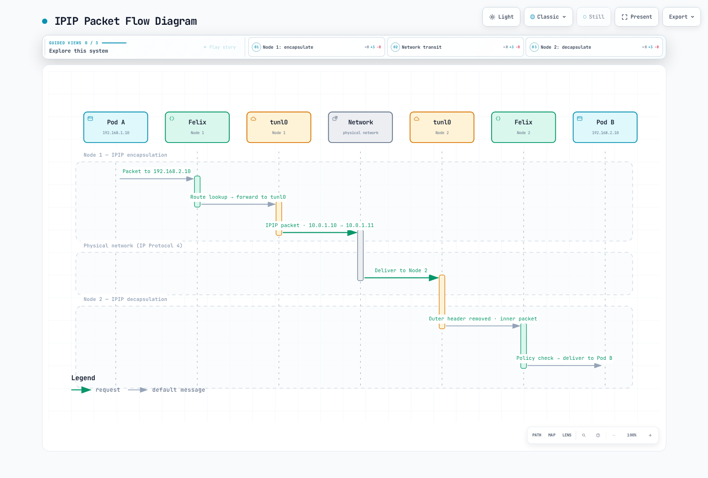
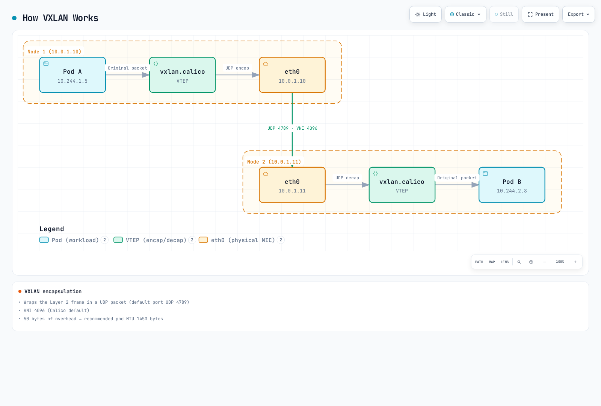
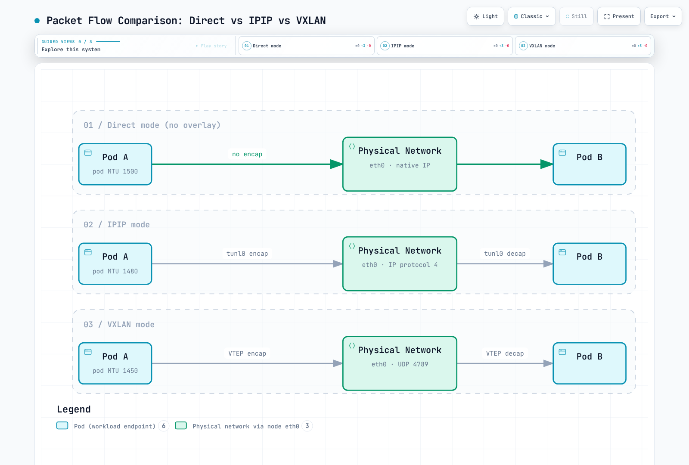

# Part 3: ネットワーキングモード

> **レビュー基準**: Calico Open Source 3.32.2／operator 1.42.6。Kubernetes 1.34～1.36 は Calico 3.32 のテスト対象範囲です。
> **最終更新日**: 2026 年 9 月 12 日。以下の過去のベンチマーク値は、検証されていない報告として保持しており、新たに測定した値ではありません。

## 適用範囲とモードの選択

この章では、Calico が所有する Linux Pod ネットワーキングと IPAM を扱います。EKS のポリシー専用モードでは、Pod ネットワーキングの所有者は引き続き Amazon VPC CNI です。Calico IPPool を作成しても、そのインストールがオーバーレイに切り替わるわけではありません。以下の例は互いに代替となる設計であり、すべてを同時に適用したり、導入ラボですでに作成したプールの上に適用したりするマニフェストではありません。このレビューではクラスター移行やネットワークベンチマークを実施していません。

| 選択肢 | 意味 | 重要な境界 |
|---|---|---|
| IPIP | IPv4-in-IPv4。IP プロトコル番号 4 を使用 | Calico の IPIP は IPv4 専用です。アンダーレイで許可されている必要があります。 |
| VXLAN | 内側の Ethernet フレームを UDP で運ぶ方式。Calico の既定ポートは 4789 | 外側が IPv4 か IPv6 かでオーバーヘッドが異なります。ポートと VNI は変更できます。 |
| Direct／カプセル化なし | Pod ネットワークのオーバーレイを使わず Pod IP パケットをルーティング | アンダーレイと返信経路で Pod アドレスをルーティングできる必要があります。 |
| CrossSubnet | IPIP または VXLAN の設定値 | 対象ノードアドレスが設定済みの異なるサブネットにある場合にのみ、ノード間通信をカプセル化します。 |

`Always` は設定済みプール内の対象アドレスに対するノード間通信に関するものです。同一ノード内の通信に物理トンネルは不要です。`Never` はそのカプセル化を無効にするもので、ネットワーキング全体を無効にする意味ではありません。CrossSubnet は AZ、リージョン、WAN リンクを検出する仕組みではありません。同じ AZ 内でもサブネットが異なればカプセル化が必要になる場合があります。Calico が使用するノードアドレスとサブネットマスクを確認してください。

既定値はインストール方法／プロバイダーとデータプレーンによって異なります。「どのクラウドでも IPIP が既定」や「Direct が常に最速」という共通ルールや保証はありません。[オーバーレイガイド](https://docs.tigera.io/calico/latest/networking/configuring/vxlan-ipip)で、対応するルーティング経路を確認してください。

### ルーティングとカプセル化は別の選択肢

既定では Felix が VXLAN プールのルートを設定し、confd/BIRD が IPIP およびカプセル化なしのプールに対するクラスター経路を設定します。Calico 3.32 は、これらの VXLAN 以外の経路に対して `Installation.spec.calicoNetwork.clusterRoutingMode: Felix` もサポートします。対応する低レベル設定は Felix の `programClusterRoutes: Enabled` と BGP の `programClusterRoutes: Disabled` です。operator がインストールを管理している場合は operator 設定を使用してください。外部 BGP 広告には引き続き BGP が必要です。静的ルートや適切にルーティングされたファブリックでもアンダーレイ到達性を提供できます。したがって、カプセル化なしのすべての設計で BGP や同一 L2 隣接性が必須というわけではありません。

## パケット構造とオーバーヘッド

以下の計算では**アンダーレイ IP MTU**を使います。外側 Ethernet ヘッダーはその IP MTU に含まれません。IPv4 オプションや追加の内側 VLAN タグはないものとします。TCP オプションなどの追加カプセル化があると、ペイロードはさらに小さくなる場合があります。

```text
Direct: outer Ethernet | Pod IP | TCP or UDP | payload
IPIP:   outer Ethernet | outer IPv4 | Pod IPv4 | TCP or UDP | payload
VXLAN:  outer Ethernet | outer IP | UDP | VXLAN | inner Ethernet | Pod IP | TCP or UDP | payload
```

| 転送方式 | Pod IP パケットに加わるオーバーヘッド | アンダーレイ IP MTU が 1500 の場合の Pod IP MTU |
|---|---:|---:|
| Direct、他のトンネルなし | 0 | 1500 |
| IPIP、外側 IPv4 | 20 | 1480 |
| VXLAN、外側 IPv4 | 20 + 8 + 8 + 14 = 50 | 1450 |
| VXLAN、外側 IPv6 | 40 + 8 + 8 + 14 = 70 | 1430 |
| WireGuard、外側 IPv4 | 60 | 1440 |
| WireGuard、外側 IPv6 | 80 | 1420 |

VXLAN のオーバーヘッド 14 バイトは**内側 Ethernet ヘッダー**であり、外側 Ethernet ヘッダーではありません。TCP の最小ヘッダーは 20 バイト、UDP は 8 バイトです。したがって、この前提では 1500 バイトの IPv4 IP パケットに含められる TCP ペイロードは最大 1460 バイト、UDP ペイロードは最大 1472 バイトです。以前の共有資料で「TCP/UDP = 20 バイト」としたラベルは誤りでした。

IPIP のプロトコル番号は 4 であり、TCP/UDP のポート番号 4 ではありません。Calico の通常の VXLAN VNI は 4096、既定 UDP ポートは 4789 ですが、どちらも変更できます。他の現在の VXLAN 実装が 8472 を使う場合もあり、古いソフトウェアに限った値ではありません。[IP-in-IP](https://www.rfc-editor.org/rfc/rfc2003) と [VXLAN](https://www.rfc-editor.org/rfc/rfc7348) を参照してください。

### パケット経路の図



[🔍 インタラクティブ図を表示](https://www.atomai.click/kubernetes-docs/archmaps/en-networking-calico-03-networking-modes-2.html)

図中の「Felix」列は、Felix がカーネルに設定したルーティング／ポリシーを示します。パケットが Felix デーモンを通過するわけではありません。これは IPv4 のノード間経路であり、同一ノード内の通信や暗号化を示すものではありません。



[🔍 インタラクティブ図を表示](https://www.atomai.click/kubernetes-docs/archmaps/en-networking-calico-03-networking-modes-3.html)

4789 と VNI 4096 は図示した既定値です。50 バイトのオーバーヘッドと MTU 1450 は、指定したヘッダー前提の外側 IPv4、1500 バイト経路にのみ当てはまり、すべてのネットワークやアドレスファミリーに適用されるわけではありません。

### CrossSubnet の例

ノードアドレスが 10.0.1.10/24 と 10.0.1.11/24 の場合、同じサブネット内の経路はカプセル化なしにできます。10.0.2.20/24 のピアとの通信は、CrossSubnet 設計ではカプセル化が必要です。そのため、クラウド上のサブネット名が正しく見えていても、ノードのマスクを誤ると結果が変わります。CrossSubnet は VPC／リージョン間の接続を確立せず、暗号化も提供しません。


[🔍 インタラクティブ図を表示](https://www.atomai.click/kubernetes-docs/archmaps/en-networking-calico-03-networking-modes-1.html)

この選択はサブネットのアドレス／マスクで決まります。図の 1500／1480 は IPv4 の 1500 バイトアンダーレイを前提としていますが、ワークロードでは利用可能な経路全体で最小の MTU を使ってください。同一サブネットのフローになっても、インターフェイス MTU が動的に増えるわけではありません。

### ノードの診断

以下の読み取り専用コマンドは、通常のアプリケーション Pod ではなく、認可された**Linux ノードのネットワーク名前空間**で実行してください。インターフェイスは有効にしたモードに応じて存在します。コマンド出力の値は実際のインストールによって異なります。

```bash
ip link show tunl0
ip link show vxlan.calico
bridge fdb show dev vxlan.calico
ip route show
```

ローカル Pod のルートは、通常 `10.244.1.5/32 dev cali…` のようなホストルートです。1 つの Pod の veth に /24 や /26 全体をルーティングしないでください。集約ブロックには、ブラックホールルートと、より具体的な Pod ルートが設定される場合があります。リモートブロックではトンネルまたは次ホップのノード／ルーターを使うことがあり、ルートのプロトコル表示は BIRD と Felix のどちらが経路を設定したかで異なります。



[🔍 インタラクティブ図を表示](https://www.atomai.click/kubernetes-docs/archmaps/en-networking-calico-03-networking-modes-5.html)

これは IPv4、アンダーレイ MTU 1500 の例です。図はパケットのラッパーを比較するもので、測定済みの速度や同一のコントロールプレーン動作を示すものではありません。ワークロードの MTU を選ぶ際は、他のカプセル化や Service 経路も含めてください。

## 所有者に応じてプールを構成する

`kubectl …projectcalico.org` の例は、導入章で使用した集約 Calico API（または適切な native-v3 構成）を前提としています。この API がない場合、論理 Calico リソースには対応する calicoctl を使用してください。operator のコマンドは operator 管理のインストールにのみ適用されます。プールの範囲は Service やノード／アンダーレイの既存範囲とも競合しないようにしてください。

構成の管理者を一つにしてください。`Installation.spec.calicoNetwork.ipPools` に記載したプールは operator が調整します。競合する IPPool オブジェクトを apply せず、管理者を通じて意図したリストを編集してください。スタンドアロンのプールは Calico IPPool API で管理します。どちらの場合も、実際のクラスター Pod CIDR、範囲の重複がないこと、IPAM の種類、既存の割り当てを先に確認してください。

```bash
kubectl get installation.operator.tigera.io default -o yaml
kubectl get ippools.projectcalico.org -o yaml
calicoctl ipam show --show-blocks
```

operator が所有するプールの場合、これは既存の `ipPools` リストに入れる**設定断片**です。他のエントリや Installation のフィールドを保持してください。導入ラボですでに割り当て済みの /16 プールを上書きして作らないでください。

```yaml
- name: mode-demo-pool
  cidr: 10.244.0.0/16
  blockSize: 26
  encapsulation: VXLAN
  natOutgoing: Enabled
  nodeSelector: all()
```

スタンドアロンで新たに計画するプールには、以下の IPv4 リソースを使用できます。これは operator エントリに代わる選択肢であり、範囲が重なる別プールを追加するものではありません。CIDR は例示値です。実際のクラスターに適合し、既存プールと重ならない値に置き換えてください。

```yaml
apiVersion: projectcalico.org/v3
kind: IPPool
metadata:
  name: mode-demo-pool
spec:
  cidr: 10.244.0.0/16
  blockSize: 26
  ipipMode: Never
  vxlanMode: Always
  natOutgoing: true
  nodeSelector: all()
```

CIDR が同じリソースを複数作るのではなく、表のいずれか一行を選択してください。

| IPv4 設計 | IPPool `ipipMode` | IPPool `vxlanMode` | operator の `encapsulation` |
|---|---|---|---|
| IPIP Always | Always | Never | IPIP |
| IPIP CrossSubnet | CrossSubnet | Never | IPIPCrossSubnet |
| VXLAN Always | Never | Always | VXLAN |
| VXLAN CrossSubnet | Never | CrossSubnet | VXLANCrossSubnet |
| Direct | Never | Never | None |

一つのプール内で IPIP と VXLAN を両方有効にすることはできません。`encapsulation` は operator プールのフィールドであり、スタンドアロン IPPool のフィールド名ではありません。通常の集約 API を使うインストールでは、重複するプールの作成は拒否されます。native v3 CRD（テクニカルプレビュー）では重複検証が非同期で行われ、作成されたプールに Disabled 条件が付く場合があります。作成処理の成功は、割り当てに使用できる証明にはなりません。

Calico 3.32 の Installation スキーマでは、controller の検証とプラットフォーム制約に従って、最大 25 エントリまでのプールリストが許可されます。「IPv4 プールは必ず一つだけ」とする古い例を、現在も共通の上限として扱わないでください。

### 外部 BGP を使う Direct ルーティング

外部 BGP を使う設計では、オーバーレイを削除する前に実際のピアと返信ルートを構成してください。ピア宣言だけでは物理ルーターは設定されず、経路が受理された証明にもなりません。以下は独立したトポロジー例であり、BGP を無効にした VXLAN ラボへの追加設定ではありません。

```yaml
apiVersion: projectcalico.org/v3
kind: BGPPeer
metadata:
  name: example-rack-tor
spec:
  peerIP: 192.0.2.1
  asNumber: 65001
  nodeSelector: rack == 'rack1'
```

ドキュメント用アドレスと AS 番号を置き換え、対象ノードにラベルを付け、各ラックでルートフィルター／AS ループ処理を検証してください。`natOutgoing: false` が適切なのは、返信ルーティングと必要な外部 NAT を設計している場合のみです。BGP を構成しても、プライベート Pod アドレスが自動的にインターネットから到達可能になるわけではありません。メッシュ／RR の変更は[BGP 移行ガイダンス](02-architecture.md)と[BGP 詳細ガイド](04-bgp-deep-dive.md)を参照してください。


[🔍 インタラクティブ図を表示](https://www.atomai.click/kubernetes-docs/archmaps/en-networking-calico-03-networking-modes-4.html)

これは BGP ベースの設計例であり、すべての Direct 設計で BGP が必要という意味ではありません。1500 は、使用可能な経路 MTU が 1500 で他のトンネルがない前提です。eBPF Service の引き渡しや暗号化により、ワークロード MTU がさらに小さくなる場合があります。

## NAT とプールの選択

`natOutgoing: true` の場合、Calico では通常、そのプール内の送信元アドレスが**すべての Calico IPPool の外部**を宛先とするとき SNAT します。単に「クラスター外へ出るか」という判定ではありません。無効化されたプールであっても、NAT しない宛先範囲の特定に使われる場合があります。そのプールを削除すると NAT の動作が変わる可能性があります。Felix の追加設定でホスト IP を除外することもできます。NAT は NetworkPolicy による許可を与えるものではありません。[送信方向の NAT](https://docs.tigera.io/calico/latest/networking/configuring/workloads-outside-cluster)を参照してください。

### トポロジーに基づく自動割り当て

これは /16 のクラスター範囲内に互いに重ならない 2 つの /18 プールを設ける、別個の計画例です。割り当て済みの親 /16 プールと同時に使用してはいけません。この例を成立させるために、使用中の親プールを削除しないでください。

```yaml
apiVersion: projectcalico.org/v3
kind: IPPool
metadata:
  name: zone-a-pool
spec:
  cidr: 10.244.0.0/18
  ipipMode: Never
  vxlanMode: CrossSubnet
  natOutgoing: true
  nodeSelector: topology.kubernetes.io/zone == 'ap-northeast-2a'
---
apiVersion: projectcalico.org/v3
kind: IPPool
metadata:
  name: zone-b-pool
spec:
  cidr: 10.244.64.0/18
  ipipMode: Never
  vxlanMode: CrossSubnet
  natOutgoing: true
  nodeSelector: topology.kubernetes.io/zone == 'ap-northeast-2b'
```

自動割り当てでは、対象にする各ノードが少なくとも一つの割り当て可能なプールに一致することを確認してください。selector は Pod のスケジューリングを行いません。上記のゾーンラベルは割り当て先プールを選びますが、CrossSubnet は引き続きノードのアドレス／マスクを使ってカプセル化の要否を決めます。

### Namespace または Pod から明示的にプールを要求する

適切なプールを先に作成し、使用可能であることを確認してから要求してください。次の断片は Namespace の既存の管理者を通じてアノテーションを追加する例であり、Namespace 全体を置き換えるマニフェストではありません。Pod のアノテーションは Namespace のアノテーションに優先し、Namespace のアノテーションは CNI プール設定に優先します。

```yaml
metadata:
  annotations:
    cni.projectcalico.org/ipv4pools: '["production-pool"]'
```

`production-pool` は、アドレスに十分な余裕がある有効な既存プールでなければなりません。`assignmentMode: Manual` で自動選択対象から除外しつつ、明示的な要求には利用させることができます。**プール selector もこのアノテーションもセキュリティ境界ではありません。** リリース版の [IPAM 実装](https://github.com/projectcalico/calico/blob/v3.32.2/libcalico-go/lib/ipam/ipam.go)は、有効なプールを明示的に要求された場合、ノード／Namespace のプール selector を意図的に無視します。アドレス範囲が信頼性に関わる場合は、プールを要求できる主体を制御してください。既存 Pod はアドレスを維持します。アノテーションを変更しても既存 Pod のアドレスは再割り当てされません。

## クラウドとプラットフォームの境界

| 環境 | ガイダンス |
|---|---|
| 自己管理 AWS EC2 | 選択したモードに応じて、IP プロトコル 4 または VXLAN UDP の到達性、ルート、送信元／宛先チェック、返信経路を確認します。 |
| Amazon VPC CNI を使う EKS | 既定の Pod ネットワーキングは VPC CNI であり、Calico VXLAN ではありません。ポリシー専用 Calico はこれらのプールを所有しません。 |
| フル Calico ネットワーキングを使う EKS | Calico CNI/IPAM を使う独立した計画済みインストールです。[公式 EKS 手順](https://docs.tigera.io/calico/latest/getting-started/kubernetes/managed-public-cloud/eks)に従ってください。 |
| Calico 管理ネットワークを使う Azure | Calico のオーバーレイガイドでは IPIP がサポートされない環境で VXLAN をサポートしています。UDR の構成は、サポート外の IPIP カプセル化を修正する方法ではありません。 |
| AKS | 汎用 Calico オーバーレイを想定せず、対応する Azure CNI／ポリシー統合を使ってください。 |
| GCE／GKE | 自己管理 GCE のルーティングとマネージド GKE は異なります。[GKE Dataplane V2 は Cilium を使用します](https://cloud.google.com/kubernetes-engine/docs/concepts/dataplane-v2)。 |
| オンプレミス | Direct、静的／BGP ルーティング、オーバーレイのどれを使うかはアンダーレイの到達性で決まります。一律の最速構成はありません。 |
| OpenStack Neutron 統合 | 参照した Calico オーバーレイガイドはこの統合を対象外としています。プラットフォーム固有の手順なしに Kubernetes 用オーバーレイの説明を流用しないでください。 |

この章は EKS Auto Mode や Fargate 用のカスタム CNI 手順を提供しません。VXLAN の例で BGP を無効にするのは、その構成で BGP が不要という意味であり、AWS に BGP 対応サービスがないという意味ではありません。Windows にも個別の制約があり、Calico IPIP と VXLAN CrossSubnet はサポートされません。

## MTU の構成と検証

ワークロードが通る可能性のある経路全体について、暗号化や Service 経路も含め、使用可能な最小 MTU を使ってください。[Calico の MTU ガイド](https://docs.tigera.io/calico/latest/networking/configuring/mtu)では、自動検出と operator／マニフェストの管理方法を説明しています。`mtuIfacePattern` は検出対象とするインターフェイスを選ぶものであり、オン／オフのスイッチではありません。エンドツーエンドの経路 MTU を証明するものでもありません。

**IPIP と WireGuard のオーバーヘッドを安易に足し合わせないでください。** Calico の通常の混在構成では、有効化したピア間で WireGuard を使い、それ以外の経路では IPIP／VXLAN を使用します。該当する経路のうち最小の MTU を選んでください。実際に 1500 バイトの経路がある場合、IPv4 WireGuard と IPIP の組み合わせは `min(1440, 1480) = 1440` であり、`1500 − 60 − 20 = 1420` ではありません。外側 IPv6 の WireGuard は別途 80 バイトのオーバーヘッドがあります。

AKS には WireGuard の既知の例外があります。インターフェイス表示が 1500 でも基盤経路が 1400 の場合があり、そのとき IPv4 WireGuard は 1340、IPv6 は 1320 になります。eBPF NodePort 経路でも VXLAN を使うため、Pod プールがカプセル化なしだからといってワークロード MTU が 1500 とは限りません。

operator 管理のインストールで、**この IPv4 VXLAN 経路に 1450 が適切だと確認できた場合**は、既存の意図した状態へ次をマージします。


```bash
kubectl patch installation.operator.tigera.io default --type merge   -p '{"spec":{"calicoNetwork":{"mtu":1450}}}'
```

マニフェスト管理のインストールでは、文書化された設定は `calico-config.data.veth_mtu` です。ConfigMap を更新し、その手順に従って Calico node DaemonSet をロールアウトしてください。operator 管理の Deployment にマニフェスト手順を適用しないでください。**更新したワークロード MTU は新しいワークロードに適用されます。** calico-node を再起動しても、アプリケーション Pod は自動的に再作成されず、MTU が変更された証明にもなりません。

| アンダーレイ IP MTU の例 | IPIP IPv4 | VXLAN IPv4 | VXLAN IPv6 | WireGuard IPv4 | WireGuard IPv6 |
|---:|---:|---:|---:|---:|---:|
| 9000 | 8980 | 8950 | 8930 | 8940 | 8920 |
| 9001（AWS 経路全体が実際に対応する場合） | 8981 | 8951 | 8931 | 8941 | 8921 |

ジャンボフレームのサポートは経路全体で成立する必要があり、インターフェイス設定だけでは不十分です。ワークロードの経路を検証するときはノードだけでなく、診断用ワークロードからも確認してください。

以下の制限付きチェックは、iputils と必要な権限を備えた認可済み Linux 診断 Pod を前提にしています。実際の Pod 名／アドレスに置き換えてください。以下のペイロードサイズは**IPv4 ICMP**の例であり、IPv4 ヘッダー 20 バイトと ICMP ヘッダー 8 バイトを加えます。IPv6 は別の計算が必要です。プローブが成功しても、すべての ECMP 経路が安全だとは証明できません。

```bash
CHECK_NS=calico-demo
CHECK_POD=diagnostic-client
CHECK_TARGET=diagnostic-server
DEST_IPV4=$(kubectl -n "$CHECK_NS" get pod "$CHECK_TARGET" -o jsonpath='{.status.podIP}')
case "$DEST_IPV4" in
  ""|*:*) echo "Select a ready target Pod with an IPv4 address" >&2; exit 1 ;;
esac
kubectl -n "$CHECK_NS" exec "$CHECK_POD" -- ip link show eth0
kubectl -n "$CHECK_NS" exec "$CHECK_POD" -- ping -4 -c 3 -W 2 -M do -s 1472 "$DEST_IPV4"
kubectl -n "$CHECK_NS" exec "$CHECK_POD" -- ping -4 -c 3 -W 2 -M do -s 1452 "$DEST_IPV4"
kubectl -n "$CHECK_NS" exec "$CHECK_POD" -- ping -4 -c 3 -W 2 -M do -s 1422 "$DEST_IPV4"
```

3 つのペイロードで、IP パケットサイズ 1500、1480、1450 をテストします。失敗は MTU だけでなく、ポリシーや ICMP のフィルタリングが原因の場合もあります。パケットキャプチャでは、適切なキャプチャ権限を使い、IPv4 の fragmentation-needed と IPv6 の Packet Too Big メッセージを調べてください。以前の IPv4 専用フィルターは IPv6 を対象にしていませんでした。

## モード変更やアドレス移行は計画的に行う

カプセル化の変更と Pod CIDR／ブロックサイズの変更は別の作業です。Calico はカプセル化構成の変更に対応しますが、進行中の接続が中断される可能性があります。メンテナンス作業の前に、アンダーレイの許可、ルート、実際の MTU、データプレーンの対応状況、復旧手順を検証してください。汎用の移行手順として、すべてのノードや Namespace 内のすべての Deployment を再起動しないでください。

operator 管理のプールでは、他のプールと設定を保ったまま、既存の Installation リスト内の `encapsulation` を変更してください。**スタンドアロンの IPv4 IPPool 専用**の以下のモード変更例では CIDR と割り当て設定を維持し、2 つのカプセル化フィールドを一緒に変更します。

```bash
POOL_NAME=mode-demo-pool
kubectl get ippool.projectcalico.org "$POOL_NAME" -o yaml > pool-before.yaml
kubectl patch ippool.projectcalico.org "$POOL_NAME" --type merge   -p '{"spec":{"ipipMode":"Never","vxlanMode":"Always"}}'
```

これで無停止が保証されるわけではありません。Direct から IPIP-CrossSubnet への移行が適切に計画されている場合、対応するフィールドの組み合わせは `ipipMode: CrossSubnet`／`vxlanMode: Never` です。変更のためにプール CIDR を置き換える必要はありません。検証済みの MTU／アドレス計画で必要な場合に限って対象アプリケーションのワークロードを再作成し、それぞれのロールアウトと Readiness 戦略を使ってください。[PodDisruptionBudget](https://kubernetes.io/docs/concepts/workloads/pods/disruptions/) は Deployment コントローラーのローリングアップデートを制限しません。

### IPPool／CIDR を別途移行する

Calico が IPAM を所有し、オーケストレーター／ネットワーク設計が対応する場合に限り、[プール移行手順](https://docs.tigera.io/calico/latest/networking/ipam/migrate-pools)を使ってください。

1. 既存プール、Kubernetes／kube-proxy のクラスター CIDR、明示的なプール要求、すべての割り当てを棚卸しします。クラスター CIDR の外に新しいプールを置くと NAT が変わったり、通信が壊れたりする可能性があります。以前の例の 10.245/16 は、導入時の 10.244/16 クラスターと自動的に互換になるわけではありません。
2. 所有者を通じて重複のないことを検証したプールを追加し、古いプールを無効にする前に新しい割り当てをテストします。既存ワークロードのために古いプールも保持します。
3. 適切な所有者を通じて、古いプールへの新規割り当てを停止します。スタンドアロンでは `spec.disabled: true` で IPAM からプールを除外します。operator の `nodeSelector: "!all()"` は**自動選択**を無効にしますが、古いプールへの明示要求は selector を迂回します。そうした要求も削除してください。
4. 対象ワークロードを管理されたバッチで移行し、アドレス、MTU、ルート、ポリシー、アプリケーションの Readiness を確認します。Pod を再作成するとアプリケーションが中断したり IP アドレスが変わったりする可能性があります。新プールを追加してもシームレスなロールバックは保証されません。
5. 残りの割り当てや、トンネル／LoadBalancer の利用を含む依存関係を確認してから古いプールを廃止します。Pod 一覧だけでは不十分です。owner からプールを取り除いたときの NAT／ルーティングへの影響も考慮してください。

読み取り専用の確認には次のコマンドを使えます。


```bash
kubectl get ippools.projectcalico.org -o yaml
calicoctl ipam show --show-blocks
calicoctl ipam show --show-borrowed
kubectl get pods --all-namespaces -o wide
```

プールのブロックサイズ変更は別の移行作業です。チュートリアルのマニフェストを置き換えて、既存プールの不変な割り当て構造を変更しないでください。「モードをすぐ反映する」ために calico-node を再起動するという古い例も、ワークロードの MTU やアプリケーションの復旧を証明していません。

## 過去のベンチマーク報告（出典未検証）

以前の英語版と韓国語版には異なる数値が記載されており、生データ、ソフトウェアの完全なバージョン、配置、再現可能なテスト手順は示されていません。両方の記録を以下に保持しますが、同一の実験として扱ったり、検証済みの性能保証と見なしたりできません。このレビューでは再測定していません。

### 記録 A: 以前の英語版

報告された環境は AWS の **c5.xlarge 3 台**、公称ネットワーク 10 Gbps、iperf3 TCP、**60 秒間の単一ストリーム**です。プレイスメントグループ、Calico／カーネルのバージョン、レイテンシー計測方法は示されていません。

| 報告指標 | Direct | IPIP | VXLAN |
|---|---:|---:|---:|
| スループット、Gbps | 9.41 | 9.12 | 8.89 |
| p99 レイテンシー、µs | 45 | 52 | 61 |
| Gbps あたり CPU、% | 2.1 | 2.8 | 3.4 |

AWS は、クラスターのプレイスメントグループ外では、指定された例外を除き単一フローを通常 5 Gbps に制限すると説明しています。そのため、この報告の 9 Gbps 超の値を新規デプロイの予測に使うには、不足しているプレイスメント／経路条件を確認する必要があります。「最大 10 Gbps」という表示も、持続的な基準帯域を証明するものではありません。[EC2 の帯域幅](https://docs.aws.amazon.com/AWSEC2/latest/UserGuide/ec2-instance-network-bandwidth.html)を参照してください。

### 記録 B: 以前の韓国語版

| 報告指標 | Direct | IPIP | VXLAN | 記載された方法 |
|---|---:|---:|---:|---|
| スループット、Gbps | 9.8 | 9.2 | 8.5 | iperf3、MTU 1500 |
| レイテンシー、µs（統計量は不明） | 35 | 42 | 55 | netperf TCP_RR |
| CPU 使用率 | 低 | 中 | 中～高 | 10 Gbps 時 |
| PPS、百万 packet／秒 | 1.8 | 1.5 | 1.2 | 64 バイトのパケット |

ハードウェア、サンプル数、「64 bytes」の正確な意味は示されていません。netperf の TCP_RR テストは通常、**1 秒あたりのトランザクション数**を報告します。根拠を明示してその逆数を計算すれば、リクエスト／応答サイクルの平均時間を推定できますが、p99 や片方向だけのネットワークレイテンシーではありません。記載されたマイクロ秒値の生出力や換算根拠もありません。

ヘッダーサイズだけでどのモードが速いかは決まりません。NIC オフロード、カーネル／データプレーン、パケットサイズ、CPU、ルート、接続再利用、負荷によって結果は変わります。これらの記録は未検証の過去情報として保持し、出典のないグラフからモードの順位を決めず、対象環境を測定してください。

### 新しい実験用の限定的なクライアントプローブ

バージョンをそろえた iperf3/netperf、待ち受け中のサーバー、必要なポリシー権限を持つテスト専用 Pod を用意してください。以下のコマンドはクライアントプローブの例であり、過去のどちらの記録も完全再現するものではありません。バージョン、ノード／AZ 配置、MTU、要求／応答サイズ、生出力、反復結果を記録してください。この例では選択するサーバーに IPv4 アドレスがあることを確認します。

```bash
set -euo pipefail
BENCH_NS=calico-demo
CLIENT_POD=benchmark-client
SERVER_POD=benchmark-server
SERVER_IP=$(kubectl -n "$BENCH_NS" get pod "$SERVER_POD" -o jsonpath='{.status.podIP}')
: "${SERVER_IP:?Server Pod has no address}"
case "$SERVER_IP" in
  *:*) echo "This example requires an IPv4 server Pod" >&2; exit 1 ;;
esac
kubectl -n "$BENCH_NS" get pods "$CLIENT_POD" "$SERVER_POD" -o wide
kubectl -n "$BENCH_NS" exec "$CLIENT_POD" --   iperf3 -c "$SERVER_IP" -t 30 -P 4 -J > iperf3-result.json
kubectl -n "$BENCH_NS" exec "$CLIENT_POD" --   netperf -H "$SERVER_IP" -t TCP_RR -l 60 > netperf-result.txt
```

iperf3 の例は 4 ストリームを使うため、記録 A の単一ストリーム方式とは異なります。[netperf マニュアル](https://github.com/HewlettPackard/netperf/blob/master/doc/netperf.txt)で報告単位と任意のレイテンシー出力を確認してください。負荷を分離して実施し、終了後は自分が所有するテスト用サーバー／リソースだけを停止してください。引用根拠のないグラフを再現する目的で本番ネットワークモードを変更しないでください。

[Calico の概要](README.md) · [アーキテクチャ](02-architecture.md) · [次へ: BGP 詳細](04-bgp-deep-dive.md) · [ネットワーキングモードのクイズ](../../quizzes/networking/calico/03-networking-modes-quiz.md)
