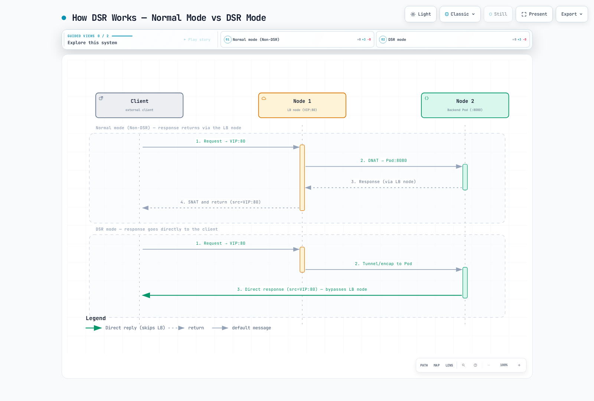

# パート6：eBPFデータプレーン

> **レビュー基準**：Calico 3.32.2。Calico 3.32ではKubernetes 1.34～1.36をテストしています。**最終更新日**：2026年9月12日。
>
> 例は、互換性のあるLinux上のCalicoクラスターと標準のCalico APIサーバーがすでにあることを前提としています。インストールの管理者が採用している手順を選んでください。以下は互いに代替となる設定例であり、すべてのクラスターに順番に適用する手順ではありません。このレビューではBPFプログラムのロード、クラスターの移行、報告されているベンチマークの再現は行っていません。

## はじめに

CalicoのeBPFデータプレーンは、BPFプログラムとマップを使ってワークロードのネットワーク、ポリシー、Kubernetes Serviceを処理します。適した通信経路ではオーバーヘッドを減らせますが、性能はワークロードと設定によって異なります。Calicoには従来型のLinuxデータプレーンとWindows HNSもあります。eBPFがすべてのプラットフォームにとって常に優れた選択肢とは限りません。

この詳細ガイドでは、ネットワークの観点からeBPFの基礎、CalicoのeBPFアーキテクチャ、移行方法、性能の最適化について説明します。

***

## eBPFの基礎

### eBPFとは

eBPF（extended Berkeley Packet Filter）は、カーネルのソースコードを変更したりカーネルモジュールをロードしたりせずに、サンドボックス化されたプログラムをLinuxカーネル内で実行できる技術です。


[🔍 インタラクティブな図を表示](https://www.atomai.click/kubernetes-docs/archmaps/en-networking-calico-06-ebpf-dataplane-1.html)

> VMは抽象的な命令モデルです。JITを使うと、ロードされたプログラムはフック位置でネイティブコードとして実行されます。JIT後もゲストVM内で動くわけではありません。この図はCalicoのフックをすべて網羅したものではありません。

### ネットワークにおけるeBPFの主な概念

| 概念 | 説明 | Calicoでの用途 |
| --- | --- | --- |
| **プログラム** | カーネルのフックで実行されるバイトコード | パケットのフィルタリング、ルーティング |
| **マップ** | プログラム間で共有するキーと値のストア | ルートテーブル、ポリシールール |
| **フック** | カーネル内の接続ポイント | XDP、TC、ソケット |
| **ヘルパー** | eBPFから呼び出せるカーネル関数 | パケット操作、マップ操作 |
| **BTF** | マップやプログラムの型情報 | デバッグ情報、CO-RE |

### eBPFとiptablesの違い

iptablesによるパケット処理もeBPFプログラムもカーネル内で実行されます。iptablesのルールをたどっても、通常はユーザー空間との間を行き来しません。iptablesモードでは、kube-proxyはServiceのルールを設定するコントロールプレーンプロセスです。パケット自体がkube-proxyを通過するわけではありません。

ハッシュマップの検索、最長一致プレフィックス検索、コンパイル済みポリシー、テールコール、コネクショントラッキングでは、それぞれ処理コストが異なります。「すべてのeBPFポリシーはO(1)で評価される」「ルールやフローが増えてもメモリ使用量は一定」といった結論は妥当ではありません。iptablesでもインデックス付きIPセットを使えます。また、NATルールの選択は通常コネクションの最初のパケットで行われ、それ以降はconntrackが既存の変換を適用します。

## CalicoのeBPFアーキテクチャ

| 機構 | 役割と範囲 |
| --- | --- |
| TCパケットフック | ポリシー、ルーティング、接続状態、パケット単位のService処理を担います。インターフェースのingress/egressとワークロードのingress/egressは、常に同じ意味になるわけではありません。 |
| cgroupのsocket-addressフック | 接続時にService宛先を変換します。リリース済みのローダーはconnectフックに加え、UDPで有効にした場合はsendmsg/recvmsgフックを接続します。 |
| XDP | 対応し設定された場合の早期パケット処理に使います。従来型データプレーンでのCalicoのXDP高速化と、完全なeBPFデータプレーン独自のアタッチ処理を区別してください。 |
| プログラム、IPセット、カウンターの各マップ | コンパイル済みプログラムや状態を支えます。ポリシー全体が単一の「タプルからアクションへのマップ」で表されるわけではありません。 |

これらは異なる実行コンテキストであり、XDP → TC → sockops → sk_msg → TCという必須の処理パイプラインではありません。Calicoの接続時ロードバランシングは、sk_msgを使ってHTTPメソッドを調べるものでもありません。アプリケーション層のポリシーには、別の[Istio/Dikastes連携](05-network-policy.md)を使用します。

## BPFマップの構造

以下は**Calico 3.32.2におけるバージョン固有のIPv4レイアウト**です。安定した公開ABIでも、カーネルマップに書き込むための手順でもありません。

| マップの種類 | 型 | キー／値のバイト数 | 用途 |
| --- | --- | --- | --- |
| ルート | LPM trie | 8 / 8 | 宛先プレフィックス、フラグ、ネクストホップまたはインターフェースの共用領域 |
| NATフロントエンド | LPM trie | 16 / 20 | Service／送信元プレフィックスの照合、バックエンドグループ／件数、アフィニティ、フラグ |
| NATバックエンド | Hash | 8 / 8 | バックエンドグループ／序数からアドレスとポートへの対応付け |
| Conntrack v4形式 | LRU hash | 16 / 88 | プロトコル、アドレスの組、ポート、状態、NATメタデータ |
| アフィニティ | LRU hash | バージョン固有 | クライアントとバックエンドの選択結果をキャッシュ |

IPv4ルートキーでは、先頭の4バイトにプレフィックス長をリトルエンディアンで格納し、その後にIPv4アドレスのバイト列を格納します。値にはフラグと、ネクストホップまたはインターフェースインデックスを表す4バイトの共用領域が含まれます。MACアドレスではありません。Conntrackでは32ビットのプロトコルフィールドの後にアドレスとポートが続きます。以前示されていた単純な5タプル構造は実際のレイアウトではありません。IPv6ではレイアウトが異なります。

ポリシーはBPF命令にコンパイルされ、マップが補助します。ルールカウンターのマップ自体がポリシーなのではありません。生のバイト列を解釈する前に、対応するCalicoデバッグツールで現在のマップをデコードし、実際の型、容量、バージョンを確認してください。

## Direct Server Return（DSR）



[🔍 インタラクティブな図を表示](https://www.atomai.click/kubernetes-docs/archmaps/en-networking-calico-06-ebpf-dataplane-6.html)

> フロントエンドにはNodePortや別のServiceアドレスを使用できます。Calicoは戻りパケットの送信元を変換します。図には外部クラウドロードバランサーを示していないため、その戻り経路に関する制約は別途考慮してください。

ここでいう「ロードバランサーノード」とは、Serviceの転送を行うKubernetesノードです。DSRでは戻り経路でこのノードを迂回できますが、外部クラウドロードバランサーまで自動的に迂回するわけではありません。アプリケーションPodにVIPをバインドさせるのではなく、Calicoが戻りパケットの送信元を変換します。

| `bpfExternalServiceMode` | リモートバックエンドへの経路 |
| --- | --- |
| `Tunnel`（デフォルト） | リクエストと応答がIngressノード／トンネル経路を使用します。 |
| `DSR` | リクエストはリモートノードへトンネルされ、応答はクライアントへ直接返ります。 |

このフィールドに`Disabled`や`IPIP`という値はありません。CalicoはこのService転送にVXLANを使用するため、どちらのモードでもMTUとアンダーレイの要件を満たす必要があります。DSRではさらに、元のフロントエンド／Ingressノードの送信元アドレスを使ってノードが送信できることをネットワーク側で許可する必要があります。CalicoのAWSガイダンスでは、ノードを同じサブネットに配置し、送信元／送信先チェックを無効にすることを求めています。これを任意のクロスサブネット構成にも適用できると一般化しないでください。

現在のCalicoトラブルシューティングガイドでは、外部ロードバランサーが元のターゲットを通る戻り経路を必要とするAWS／GCPの構成は対象外とされています。同じサブネットや送信元チェックの条件を満たしていても、そのようなトラフィックにDSRを有効にしないでください。

すでに正常稼働している互換性のあるeBPF経路では、次の設定を使います。

```yaml
apiVersion: projectcalico.org/v3
kind: FelixConfiguration
metadata:
  name: default
spec:
  bpfExternalServiceMode: DSR
```

設定の管理者と調整したうえで変更を反映し、戻りルーティング、送信元検証、既存接続をテストしてください。モードの変更により接続が切れることがあります。DSRと接続時ロードバランシングは別々の最適化です。

## 接続時ロードバランシング


[🔍 インタラクティブな図を表示](https://www.atomai.click/kubernetes-docs/archmaps/en-networking-calico-06-ebpf-dataplane-7.html)

> kube-proxyはカーネルのルールを設定しますが、パケットを転送するプロセスではありません。iptablesを使う既存の接続では、最初のルール選択後にconntrackが処理します。CTLBが迂回するのはServiceのDNAT経路であり、すべてのパケット処理ではありません。

この図は概念を示しています。kube-proxyはカーネルの状態を設定し、その後のパケットはServiceルール全体からバックエンドを再選択するのではなく、conntrackを使います。接続時ロードバランシングは、対応するソケットのパケット処理前にService宛先を変換します。ルーティング、ポリシー、コネクショントラッキング、その他すべてのNATをなくす機能ではありません。

現在のフィールドは`bpfConnectTimeLoadBalancing`で、値は`TCP`（デフォルト）、`Enabled`、`Disabled`です。以前のブール値`bpfConnectTimeLoadBalancingEnabled`は非推奨ですが、引き続き受け付けられます。両方の形式をむやみに同時設定せず、古い上書き設定を管理者と確認して削除してください。

```yaml
apiVersion: projectcalico.org/v3
kind: FelixConfiguration
metadata:
  name: default
spec:
  bpfConnectTimeLoadBalancing: TCP
  bpfHostNetworkedNATWithoutCTLB: Enabled
```

`Enabled`ではUDPソケットの処理も含められます。`TCP`ではCTLBをTCPに限定します。`bpfHostNetworkedNATWithoutCTLB`は、ホストネットワークのNAT経路を補完的に制御するもので、ClusterIP全般のサポートを切り替える設定ではありません。Serviceアドレスを維持する必要があるサービスメッシュではCTLBを無効にする必要がある場合があります。ソケット書き換えが常に互換性を持つと仮定せず、テスト済みの連携手順に従ってください。

## XDPによる高速化


[🔍 インタラクティブな図を表示](https://www.atomai.click/kubernetes-docs/archmaps/en-networking-calico-06-ebpf-dataplane-3.html)

> これはフレームワーク上のアクションです。ネイティブ、汎用、オフロードの各実行方式には異なる前提条件があります。この図は、Calicoがすべてのアクションやハードウェア機能を提供することを保証するものではありません。

これらは汎用XDPのアクションであり、図示したオフロードやレート制限機能をすべてCalicoが提供するという意味ではありません。ネイティブのドライバーXDPはskbの割り当て前に動作できます。Generic XDPはskbを使って後段で実行されます。ハードウェアオフロードの可否はNIC、ドライバー、プログラムに依存します。モード名だけから一律の速度順位を導くことはできません。

Felixの`xdpEnabled`フィールドは、従来型のiptablesデータプレーンで、対象となる未追跡のIngress拒否を高速化するための**ブール値**です。`genericXDPEnabled`のデフォルトはfalseであり、汎用モードへのフォールバックが常に保証されるわけではありません。これらの設定は、完全なeBPFデータプレーン内部のXDPプログラムとは別のものです。

```yaml
# Separate classic iptables-dataplane acceleration example.
apiVersion: projectcalico.org/v3
kind: FelixConfiguration
metadata:
  name: default
spec:
  xdpEnabled: true
  genericXDPEnabled: false
```

対象のインターフェースでドライバーが対応するか、実際にプログラムがアタッチされているかを確認してください。`xdpEnabled: Enabled`、`Offload`、`BestEffort`は有効な列挙値ではありません。

***

## eBPFモードの要件

過去の最低要件ではなく、選択したリリースの現在の要件を確認してください。

| 要件 | Calico 3.32のeBPFでの範囲 |
| --- | --- |
| 基本となるLinuxカーネル | 5.10以降。文書化されたRHELの例外は、カーネル4.18.0-305以降を使用するRHEL 8.4です。 |
| アーキテクチャ | x86-64またはリトルエンディアンのarm64 |
| データストア | Kubernetes。今回のモードではetcdデータストアは非対応です。 |
| 追加機能 | eBPFログルールにはカーネル5.16、文書化されたQoS帯域制御には6.6／TCXが必要です。 |
| アンダーレイ | Podプールがカプセル化されていない場合も含め、NodePort転送に必要なノード間VXLAN通信を許可します。 |
| ランタイム | 必要なBPF／cgroup機能、権限、書き込み可能なマウントが必要です。不変OSでは適切な`CgroupV2Path`が必要です。 |

BTFはCO-REやツール向けの型情報を提供するものであり、検証器そのものでも、すべてのカーネルとの互換性を保証するものでもありません。Calicoのリリース済みローダーは、対応状況に応じてCO-RE／非CO-REのオブジェクトを選択するため、`/sys/kernel/btf/vmlinux`の存在だけでは準備状況を判断できません。リリース要件、ノード設定、実際のロード診断を確認してください。bpffsにピン留めされたオブジェクトは、作成元プロセスの終了後も残りますが、ホストの再起動後まで永続するディスクデータではありません。

### プラットフォームの対象範囲

現在のCalicoガイドでは、セルフマネージド／kubeadm、kOps、OpenShift、EKS、MKE、および要件を満たしたAKS／RKEの構成が列挙されています。GKE、通常運用中のeBPFと標準データプレーンまたはWindowsの混在、SCTPのポリシー／Serviceは明示的に対象外です。IPv6とIPv6のみの運用は文書化されています。「IPv6サポートが不十分ならdual-stackにする」という方法が一般に解決策になるわけではありません。

Azure CNIを使うAKSでは、管理対象のkube-proxyを無効にできません。Calicoガイドでは、Calicoネットワークを使うAKSは別の経路として扱われ、引き続きテスト中です。OS名、Ubuntuイメージ、カーネルバージョンだけではプラットフォームのサポートを確認できません。EKSのノードモード、CNIの組み合わせ、OSの種類は、Calico／EKS固有の手順に従う必要があります。管理対象のネットワークモードや必要な特権付きノードコンポーネントを実行できない環境までサポートされると推測しないでください。

WindowsではLinuxのiptablesではなくWindows HNSデータプレーンを使います。Windowsや標準データプレーンのノードを含めたまま、ノードごとにeBPFを継続的に段階導入する計画は立てないでください。代表的な別クラスターで検証してから、文書化された一括移行手順に従ってください。

### 読み取り専用の事前確認

```bash
kubectl get nodes -o wide
kubectl -n kube-system get daemonset kube-proxy -o yaml
kubectl get installation.operator.tigera.io default -o yaml
kubectl get felixconfiguration.projectcalico.org default -o yaml
```

インストール先の名前空間を使い、Calico／Operatorの実際のイメージバージョンを調べてください。各ノードでは、ホストのマウント名前空間で`uname -r`、利用可能なBTF、bpffs、cgroupのマウントを確認します。デバッグコンテナから見えるファイルシステムがホストと同じとは限りません。データプレーンを切り替えるためだけに、既存Helmリリースの名前を推測してアップグレードしたり、値を破棄したりしないでください。

## iptablesからeBPFへの移行

### Operatorによる自動ブートストラップ：限定された前提条件

この方法は、Tigera Operatorを使ってインストールしたセルフマネージドのkubeadmベースクラスターが対象です。kube-proxyが`kube-system`にあり、**Helm、Argo CDなどのリコンサイラーが管理していないこと**、さらにOperatorがKubernetes Serviceとエンドポイントを参照できることが条件です。

```bash
kubectl get installation.operator.tigera.io default -o yaml
# Only when every automatic-bootstrap prerequisite above is met:
kubectl patch installation.operator.tigera.io default --type=merge \
  -p '{"spec":{"calicoNetwork":{"linuxDataplane":"BPF","bpfNetworkBootstrap":"Enabled","kubeProxyManagement":"Enabled"}}}'
```

移行中、OperatorはAPIへの直接アクセスを設定し、kube-proxyを管理します。ローリング更新の間はノードごとにモードが異なり、公式ガイドでもNodePortが一時的に中断する可能性が明記されています。中断のない移行が保証されるかのように説明しないでください。

### 手動での事前準備と管理者

それ以外のサポート対象インストールでは、置き換え対象のService実装に依存しない、安定した**APIサーバーへの直接アクセス**を先に確保します。実際のAPIロードバランサーのホスト名またはアドレスとポートを使ってください。EKSではクラスターのAPIエンドポイントホスト名を使い、通常はポート443を使用します。以下はセルフマネージドAPIエンドポイントのプレースホルダー例です。

```yaml
apiVersion: v1
kind: ConfigMap
metadata:
  name: kubernetes-services-endpoint
  namespace: tigera-operator
data:
  KUBERNETES_SERVICE_HOST: api.internal.example.com
  KUBERNETES_SERVICE_PORT: "6443"
```

Operatorを使う場合は`tigera-operator`、スタンドアロンマニフェストを使う場合は`kube-system`を指定します。**名前は`kubernetes-services-endpoint`（複数形）です**。Serviceデータプレーンを切り替える前に、Calicoがこのエンドポイントを認識し、名前解決して到達できることを確認してください。DNSのブートストラップ、セキュリティルール、到達性はプラットフォームごとに異なる前提条件です。

kube-proxyがIPVSを使っている場合、公式の移行手順では、まずiptablesモードへ切り替えてから計画的にノードを再起動する必要があります。これは別の管理された変更として対応してください。

kube-proxyの実際の管理者と調整してください。文書化されているAzure CNIのAKS構成のようにkube-proxyを稼働させ続ける場合は、以下の値を既存のFelix設定に統合します。

```yaml
apiVersion: projectcalico.org/v3
kind: FelixConfiguration
metadata:
  name: default
spec:
  bpfKubeProxyIptablesCleanupEnabled: false
  bpfKubeProxyHealthzPort: 0
```

このクリーンアップフラグだけではService処理は有効になりません。クリーンアップを有効にしたままkube-proxyを稼働させると、コンポーネント間でiptablesを取り合います。両方のヘルスサーバーを10256で稼働させた場合も競合します。既存のFelix設定で無関係な項目を維持してください。

データプレーンの有効化には、次の**いずれか1つ**の管理経路を使います。

```bash
# Operator installation:
kubectl patch installation.operator.tigera.io default --type=merge \
  -p '{"spec":{"calicoNetwork":{"linuxDataplane":"BPF"}}}'
```

```bash
# Alternative: standalone manifest installation, without operator ownership:
kubectl patch felixconfiguration.projectcalico.org default --type=merge \
  -p '{"spec":{"bpfEnabled":true}}'
```

管理者が手動でkube-proxyを無効化するインストールでは、計画された移行時間帯に、プラットフォームで文書化された手順に従ってください。まず現在の望ましい設定を保存します。一時的なnodeSelectorを使う場合は、未使用のキーを選び、どのノードにも一致しないことを確認してから、追加したキーだけを後で削除してください。既存のセレクターマップ全体をnullで置き換えてはいけません。DaemonSetを削除したり、存在しないkube-proxy Deploymentのスケールを変更したりする方法は、一般的な移行手順ではありません。

### プログラムのロードだけでなく通信を検証する

ロールアウトの状態と、対象ノードに実際にあるBPFプログラム／マップを調べてください。ノード間の新しいPod間通信、DNS、ClusterIP、NodePort／外部通信、ポリシーによる拒否、必要なホストネットワーク接続をテストします。プログラム一覧やiptables行数が少ないことだけでは、それらの経路が機能する証明になりません。

Kubernetes APIは通常HTTPではなくHTTPSを使います。正しいTLS信頼設定と適切な認証情報でAPI通信をテストしてください。認証エラーとネットワーク障害は別の問題です。接続性を確認する場合は、認証なしのAPIリクエストを成功基準とせず、テスト用のアプリケーションServiceを使ってください。

### ロールバック

モード変更を戻すときも、同じ管理者を通してください。

```bash
# Operator installation: use its owner/GitOps source for the same change.
kubectl patch installation.operator.tigera.io default --type=merge \
  -p '{"spec":{"calicoNetwork":{"linuxDataplane":"Iptables"}}}'
```

```bash
# Alternative for standalone manifest installations:
kubectl patch felixconfiguration.projectcalico.org default --type=merge \
  -p '{"spec":{"bpfEnabled":false}}'
```

自動ブートストラップを使った場合、Operatorからkube-proxyを復元できます。手動で無効化した場合は、元のセレクターやその他の設定を維持しながら、管理者を通じて一時的な変更だけを元に戻してください。Serviceルールと通信を再確認します。eBPFを無効にしたり外部Serviceモードを変更したりすると、既存の接続が中断される可能性があります。ノードを再起動すれば、すべてのアプリケーション状態が正常に戻ると約束してはいけません。

***

## 報告された性能記録

以前の英語ガイドと韓国語ガイドには、**互いに異なる未検証の記録**がありました。元の数値を以下に残しますが、この監査で測定した値でもCalico 3.32.2の性能保証でもありません。どちらにも生データ、テスト日、Calico／Kubernetes／カーネルの正確なバージョン、トポロジー、NIC／CPUの詳細、接続状態の設定、完全なテスト方法は記載されていません。

### 記録A：以前の英語ガイド

| 報告されたレイテンシー | iptables | eBPF | 元資料にある丸めた削減率 |
| --- | --- | --- | --- |
| 同一ノードのPod | 45 μs | 25 μs | 44% |
| ノード間のPod | 120 μs | 80 μs | 33% |
| ClusterIP | 150 μs | 60 μs | 60% |
| NodePort | 180 μs | 70 μs | 61% |

| 報告されたスループット | iptables | eBPF | 元資料にある丸めた増加率 |
| --- | --- | --- | --- |
| TCP単一ストリーム | 15 Gbps | 23 Gbps | 53% |
| TCP複数ストリーム | 35 Gbps | 48 Gbps | 37% |
| UDP単一ストリーム | 8 Gbps | 18 Gbps | 125% |
| 64バイトパケット | 2M pps | 5M pps | 150% |

| 報告されたルール数 | iptables：コネクション／秒 | eBPF：コネクション／秒 |
| --- | --- | --- |
| 1,000 | 50,000 | 120,000 |
| 5,000 | 35,000 | 115,000 |
| 10,000 | 20,000 | 110,000 |

レイテンシーのパーセンタイルは明記されていません。1秒あたりのコネクション数はCPU使用率を直接示す値ではなく、この3点だけで任意の規模におけるポリシー処理コストが一定とは証明できません。

### 記録B：以前の韓国語ガイド

| 報告された指標 | iptables | eBPF | 元資料にある丸めた変化 |
| --- | --- | --- | --- |
| スループット | 1.2M pps | 2.0M pps | +67% |
| レイテンシー | 120 μs | 75 μs | −38% |
| Service 1,000個時のCPU | 70% | 30% | −57% |
| 接続確立 | 絶対値の記載なし | 絶対値の記載なし | −50%との主張 |

記録Bは記録Aと同じ実験ではありません。メモリや複雑さに関する記述は測定データではなく、接続確立の割合にも根拠となる所要時間がありません。2つの記録を1つのベンチマークとしてまとめたり、「20～40%の改善」を期待値として使ったりしないでください。

### 再現可能な比較

クライアント／サーバーのテストイメージ、ノード、トラフィック経路、CPU／NIC割り当て、MTU、負荷を揃えてください。データプレーン、カーネル、ソフトウェアのバージョン、テスト時間、サンプル数、ウォームアップ、並行数、conntrackの状態、ログ設定を記録します。PodのIPへの直接通信とは別に、アプリケーションServiceをテストしてください。

```bash
# Requires ready test Pods with netperf/netserver and an appropriate test policy.
CLIENT_POD=netperf-client
SERVER_POD=netperf-server
SERVER_IP="$(kubectl -n calico-demo get pod "$SERVER_POD" -o jsonpath='{.status.podIP}')"
test -n "$SERVER_IP"
kubectl -n calico-demo exec "$CLIENT_POD" -- \
  netperf -H "$SERVER_IP" -t TCP_RR -l 30
kubectl -n calico-demo exec "$CLIENT_POD" -- \
  netperf -H "$SERVER_IP" -t TCP_STREAM -l 30
```

`TCP_RR`が通常報告するのは**トランザクション毎秒**であり、レイテンシーのパーセンタイルではありません。適切なテスト条件のもとなら逆数から平均トランザクション時間を表せる場合がありますが、ネットワークのp99レイテンシーではありません。netperfは制御接続とデータ接続を使うため、隔離されたテスト環境でそれらを許可する必要があります。運用者のワークステーションにnetperfをインストールしても、クライアントPodにはインストールされません。この手順は今回の監査でCalicoクラスター上では実施していません。

***

## eBPFのデバッグ

Calicoノードイメージには、**`calico-node -bpf`としてデバッグツールが組み込まれています**。ソースツリーにはスタンドアロンの`calico-bpf`エントリーポイントもありますが、ノードイメージに独立したバイナリがインストール済みとは限りません。組み込みツールでは`help`を使います。ラッパーが`--help`を先に処理し、BPFサブコマンドまで渡さないことがあります。

```bash
CALICO_NAMESPACE=calico-system
CALICO_NODE=demo-worker
CALICO_POD="$(kubectl -n "$CALICO_NAMESPACE" get pods -l k8s-app=calico-node \
  --field-selector "spec.nodeName=$CALICO_NODE" -o jsonpath='{.items[0].metadata.name}')"
test -n "$CALICO_POD"
kubectl -n "$CALICO_NAMESPACE" exec "$CALICO_POD" -c calico-node -- \
  calico-node -bpf help
kubectl -n "$CALICO_NAMESPACE" exec "$CALICO_POD" -c calico-node -- \
  calico-node -bpf routes dump
kubectl -n "$CALICO_NAMESPACE" exec "$CALICO_POD" -c calico-node -- \
  calico-node -bpf conntrack dump
kubectl -n "$CALICO_NAMESPACE" exec "$CALICO_POD" -c calico-node -- \
  calico-node -bpf nat dump
kubectl -n "$CALICO_NAMESPACE" exec "$CALICO_POD" -c calico-node -- \
  calico-node -bpf counters dump
```

```bash
# Choose an interface actually attached on this node.
BPF_INTERFACE=eth0
kubectl -n "$CALICO_NAMESPACE" exec "$CALICO_POD" -c calico-node -- \
  calico-node -bpf policy dump "$BPF_INTERFACE" all
# IPv6, when enabled: put the debug-tool flag after its subcommand.
kubectl -n "$CALICO_NAMESPACE" exec "$CALICO_POD" -c calico-node -- \
  calico-node -bpf routes dump --ipv6
```

```bash
kubectl -n "$CALICO_NAMESPACE" exec "$CALICO_POD" -c calico-node -- bpftool prog show
kubectl -n "$CALICO_NAMESPACE" exec "$CALICO_POD" -c calico-node -- bpftool map show
kubectl -n "$CALICO_NAMESPACE" exec "$CALICO_POD" -c calico-node -- bpftool net show
kubectl -n "$CALICO_NAMESPACE" exec "$CALICO_POD" -c calico-node -- \
  tc filter show dev "$BPF_INTERFACE" ingress
kubectl -n "$CALICO_NAMESPACE" exec "$CALICO_POD" -c calico-node -- \
  tc filter show dev "$BPF_INTERFACE" egress
```

`policy dump`では、インターフェースとフック（`ingress`、`egress`、`xdp`、`all`）の両方を指定する必要があります。ポリシーのデバッグ情報が利用可能でなければなりません。`bpfPolicyDebugEnabled`のデフォルトはtrueです。ワークロードのingressは、ホスト側vethのTC／TCX **egress**フックにアタッチされます。ホストのingressではホストインターフェースのingressフックを使います。インターフェース名にある方向だけから、ワークロードの通信方向を推測しないでください。

`nat dump`は引数なし、またはIP／ポート／プロトコルの組を受け付けます。確認したCLIに`nat frontend list`コマンドはありません。bpftoolのID指定コマンドを使う前に、実際のプログラムID／マップIDを確認してください。生のマップ検索キーは、バージョンごとのマップ全体のレイアウトに依存します。IPv4アドレスの4バイトだけではルートマップのキーになりません。

bpftoolが報告するマップの実際の`max_entries`とサイズを確認してください。`/proc/sys/kernel/bpf_map_max_entries`はLinux共通のマップ容量設定ではありません。`run_cnt`や`run_time_ns`など、実行時のプログラムカウンターを利用するには統計を有効にする必要があります。また、これらはリクエスト全体のレイテンシーではありません。TCXのアタッチ状態は、従来の`tc filter show`に加えてbpftool link／attachmentでも調べる必要がある場合があります。

### ログとパケットキャプチャ

`bpfLogLevel`が受け付ける値は**Off、Info、Debug**であり、Warn／Warningではありません。BPFプログラムのログはBPF trace pipeに出力されます。一方、Felixコンポーネントのログはコンテナの標準出力に出力されます。プログラム／ポリシーログを調べる際は、適切なトレースツールとノードを使ってください。Podのロールアウトに成功しただけでは、パケットが許可される経路が機能する証明になりません。

Calicoはワークロードのピアに直接リダイレクトできるため、ホスト側vethのパケットキャプチャではそのフックを通らないトラフィックを取得できない場合があります。実際の通信経路でキャプチャし、ポリシー状態、ルート、conntrack、Serviceバックエンドと照合してください。

## Kubernetes Serviceの置き換えと制限

Calico eBPFはServiceを転送しますが、外部クラウドロードバランサーをプロビジョニングするものではありません。AWSなどのクラウドコントローラーの役割とは分けて考えてください。現在の実装にはIPv4／IPv6のNATマップ、ローカルトラフィックのフラグ、アフィニティ処理があります。古い「IPv6／Localは非対応」という表を現在の機能一覧として扱わないでください。また、検証せずにkube-proxyのすべてのオプションが同じように動作すると仮定しないでください。

リリース済みWireGuardの機能テストにはBPFモードとIPv4／IPv6構成が含まれているため、WireGuardがeBPFと一律に非互換というわけではありません。実際のCNI、トラフィック種別、カーネル、MTU、暗号化経路を確認してください。暗号化の一般ガイドにある古い制限やインストール例を、現在のOSにそのまま適用しないでください。

ホストネットワークを使うワークロードでは、CTLB／ホストNATの設定とHostEndpointポリシーを個別に確認してください。現在のeBPFガイドではSCTPと、eBPF／標準／Windowsを通常運用中に混在させる構成は対象外です。Windowsではサポート対象のHNSアーキテクチャを使用します。

AWS／GCPのロードバランサー経路について、現在のCalicoトラブルシューティングガイドでは、外部ロードバランサーが元のターゲットを通る戻り経路を必要とする場合、DSRが正しく動作しないと明記されています。文書化されたサポート対象モードを使って経路全体を検証してください。同じサブネットや送信元チェックの前提条件を満たすだけでは、クラウドLBとの互換性は確認できません。

## 設定と可観測性

測定に基づいて変更するまでは、リリースのデフォルト値を優先してください。次のフィールドは、すでに有効化されたeBPFインストールで使われる現在の名前と値の例です。設定の管理者を通じて統合してください。

```yaml
apiVersion: projectcalico.org/v3
kind: FelixConfiguration
metadata:
  name: default
spec:
  bpfLogLevel: "Off"
  bpfExternalServiceMode: Tunnel
  bpfConnectTimeLoadBalancing: TCP
  bpfHostNetworkedNATWithoutCTLB: Enabled
```

`bpfDataIfacePattern`を任意の`eth*`や範囲の狭い正規表現で上書きしないでください。これは正規表現であり、ワークロード用やCalico専用のデバイスを除きつつ、実際のアンダーレイ／Service用インターフェースを対象にする必要があります。インターフェース名だけではXDPオフロード対応を証明できません。

`bpfKubeProxyEndpointSlicesEnabled`は現在のFelixフィールドではありません。旧CTLBブール値は削除済みではなく、非推奨です。conntrackタイムアウトを調整する場合、現在のキーには`tcpEstablished`、`tcpFinsSeen`、`tcpResetSeen`、`udpTimeout`、`genericTimeout`、`icmpTimeout`があります。`tcpClosing`、`udp`、`icmp`はこれらのキーではありません。すべてのデプロイでマップ容量を100万エントリーに設定するのではなく、マップの占有率とメモリ使用量を測定してください。

リリース済みのエンドポイントマネージャーは、次の実在するゲージを登録します。

| メトリクス | 意味 |
| --- | --- |
| `felix_bpf_dataplane_endpoints` | 管理対象のBPFエンドポイント |
| `felix_bpf_dirty_dataplane_endpoints` | 障害後もdirty状態にあるエンドポイント |
| `felix_bpf_happy_dataplane_endpoints` | BPFへの設定に成功したエンドポイント |

管理者を通じて文書化されたFelixメトリクスエンドポイントを有効にし、実際のスクレイプ結果とメトリクスのHELP／TYPEを確認してください。以前の`calico_bpf_*`一覧がエクスポート対象であることは確認できていません。エンドポイントのゲージは、マップ使用量、パケット拒否カウンター、アプリケーションレイテンシーを直接代替するものではありません。

現在のプラットフォーム互換性、必要なService／ポリシー／暗号化機能、実測したワークロードの動作に基づいてデータプレーンを選択してください。移行とロールバックの両方をリハーサルしてください。eBPFとiptablesのどちらかが、すべてのクラスターにとって本質的に適切というわけではありません。

***

## 参考資料

* [Calico 3.32 eBPFのインストール要件](https://docs.tigera.io/calico/latest/operations/ebpf/install)
* [Calico eBPFの移行とロールバック](https://docs.tigera.io/calico/latest/operations/ebpf/enabling-ebpf)
* [Calico eBPFのトラブルシューティングとCLI](https://docs.tigera.io/calico/latest/operations/ebpf/troubleshoot-ebpf)
* [Felixの設定](https://docs.tigera.io/calico/latest/reference/resources/felixconfig)
* [OperatorのインストールAPI](https://docs.tigera.io/calico/latest/reference/installation/api)
* [カーネルBTF](https://docs.kernel.org/bpf/btf.html)
* [libbpfとCO-RE](https://docs.kernel.org/bpf/libbpf/libbpf_overview.html)
* [Calico 3.32.2のルートマップレイアウト](https://raw.githubusercontent.com/projectcalico/calico/v3.32.2/felix/bpf/routes/map.go)
* [Calico 3.32.2のNATマップ](https://raw.githubusercontent.com/projectcalico/calico/v3.32.2/felix/bpf/nat/maps.go)
* [Calico 3.32.2のconntrack v4レイアウト](https://raw.githubusercontent.com/projectcalico/calico/v3.32.2/felix/bpf/conntrack/v4/map.go)
* [Calico 3.32.2の接続時ローダー](https://raw.githubusercontent.com/projectcalico/calico/v3.32.2/felix/bpf/nat/connecttime.go)
* [Calico 3.32.2のWireGuard機能テスト](https://raw.githubusercontent.com/projectcalico/calico/v3.32.2/felix/fv/wireguard_test.go)
* [bpftoolのプログラムリファレンス](https://raw.githubusercontent.com/libbpf/bpftool/main/docs/bpftool-prog.rst)
* [bpftoolのマップリファレンス](https://raw.githubusercontent.com/libbpf/bpftool/main/docs/bpftool-map.rst)
