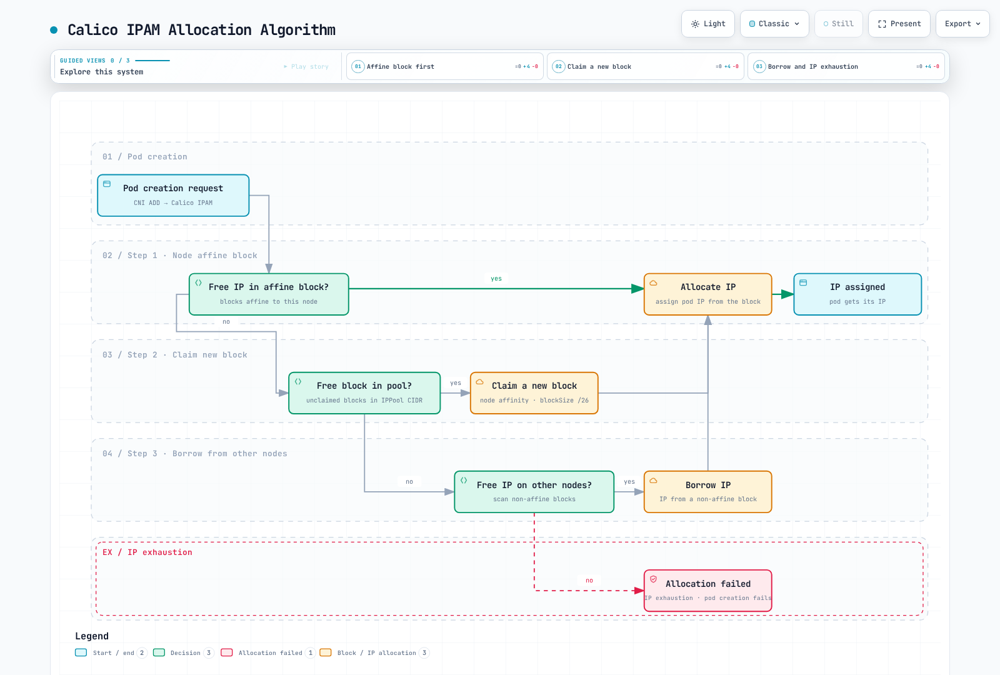
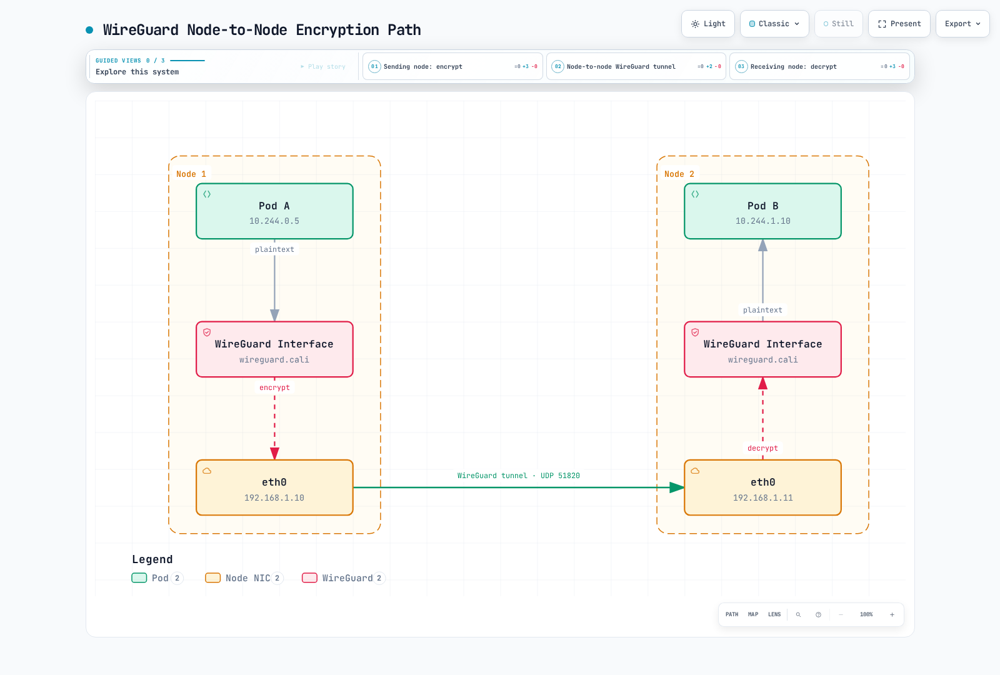

# 第7部：Calicoの高度なトピック

> **対応バージョン**: Calico 3.32.2 / Kubernetes 1.34–1.36（検証対象範囲）
> **最終更新**: 2026年9月12日

## 概要

この章では、本番環境向けの高度なCalicoトピックを扱います。IPAMの詳細、WireGuard暗号化、Egress Gateway、マルチクラスター・フェデレーション、Windowsコンテナのサポート、大規模クラスターの設計パターンを取り上げます。

## IPAMの詳細

ここでは**Calico IPAM**について説明します。host-local IPAMとクラウドプロバイダーのIPAMは別の割り当て方式です。Calico IPPoolを作成しても、別のCNIがCalico IPAMへ切り替わるわけではありません。

### ブロック、アフィニティ、割り当て上限

Calicoはノードに関連付けられたブロックからアドレスを割り当てます。IPv4の`/26`には64個、IPv6の`/122`にも64個のアドレスがありますが、どのプラットフォームでもPod用に64個を使える保証ではありません。Calicoが所有する各ブロックでは、Windows用に4個のアドレスが予約されます。


[🔍 対話型図を見る](https://www.atomai.click/kubernetes-docs/archmaps/en-networking-calico-07-advanced-topics-0.html)

> 図は割り当てのモデルを示すもので、ノードローカルキャッシュによってデータストアへの全書き込みがなくなるという意味ではありません。最後のPodが消えてもブロックのアフィニティはすぐに解除されないことがあります。トンネルやVMの割り当て、調整処理、ライフサイクル状態も関係します。

通常の自動割り当てでは、Calicoは既存のアフィニティ付きブロックを使う、別の適格ブロックを取得する、許可されていれば他ノードのブロックから借用する、といった処理を行います。`strictAffinity`、`autoAllocateBlocks`、グローバル/要求単位のブロック上限、プール選択、プラットフォーム制約により、別プールに空きアドレスが残っていても割り当てに失敗する場合があります。



[🔍 対話型図を見る](https://www.atomai.click/kubernetes-docs/archmaps/en-networking-calico-07-advanced-topics-1.html)

> この簡略図は、適格なプール、自動ブロック割り当て、許可された借用、上限による制限がないことを前提とします。Windowsは借用をサポートしません。アドレス総数を使い切った場合にしか割り当てが失敗しない、という保証としてこの図を使わないでください。

`IPAMConfiguration/default`でグローバル設定を確認します。リファレンスのWebページにはデフォルトのブロック上限が20と記載されていますが、リリース済みの**3.32.2実装と公開CRDでは、設定がない場合`maxBlocksPerHost`は0で初期化されます**。0はグローバルなブロック上限がないことを意味します。ただし要求単位/プラットフォーム単位の制約は適用され、既存クラスターでは設定済みの値が維持されます。正のグローバル上限を設定する場合、検証済みIPAM設定経路で`strictAffinity: true`も指定する必要があります。

### プール作成前にブロックサイズを選ぶ

デフォルトはIPv4で`/26`、IPv6で`/122`です。サポート範囲はIPv4で`/20`～`/32`、IPv6で`/116`～`/128`です。GPU帯域や「200ノードなら/28」という固定ルールではなく、見込むアドレス需要、ノード数、経路集約、割り当て時のオーバーヘッドを基に選択してください。

```yaml
# Fresh-pool example; do not apply over an existing pool or overlapping pools.
apiVersion: projectcalico.org/v3
kind: IPPool
metadata:
  name: demo-ipv4-pool
spec:
  cidr: 10.244.0.0/16
  blockSize: 26
  ipipMode: Never
  vxlanMode: Always
  natOutgoing: true
  nodeSelector: all()
```

`blockSize`とプールCIDRはその場で変更できません。新しいプールへの移行では、実クラスターのルーティング、Service/ノードCIDR境界、ワークロード割り当て計画を維持する必要があります。[ネットワーキングモード](03-networking-modes.md)を参照してください。以下のサブプール例と集約プールを重複させないでください。

### Host-Local IPAM

host-localはノードローカルの割り当て状態と、Kubernetesから提供されるノード単位PodCIDR設定を使います。**operatorでは`spec.cni.ipam.type: HostLocal`で選択します**。

```yaml
# Installation fragment: preserve other settings through the configuration owner.
apiVersion: operator.tigera.io/v1
kind: Installation
metadata:
  name: default
spec:
  cni:
    type: Calico
    ipam:
      type: HostLocal
```

`calicoNetwork.hostLocalIPAMEnabled`というスイッチはありません。Kubernetesコントローラー/ネットワーク設定によって、有効で相互に重複しないノードPodCIDRがあらかじめ提供されている必要があります。既存ノードを手動パッチしてもIPAM移行手順にはなりません。どちらの割り当て方式が常に即時/遅延解放、または高いスケーリング性能を持つと決めつけないでください。

### 複数プールと明示的な要求

用途を文書化した、互いに重複しないプールを使用してください。3番目の例は手動選択専用です。通常のワークロードがSNATしない範囲を自動で消費しないようにしています。

```yaml
# Alternative to demo-ipv4-pool; these sub-pools must not overlap another pool.
apiVersion: projectcalico.org/v3
kind: IPPool
metadata:
  name: production-pool
spec:
  cidr: 10.244.0.0/18
  blockSize: 26
  vxlanMode: Always
  natOutgoing: true
  nodeSelector: node-type == 'production'
---
apiVersion: projectcalico.org/v3
kind: IPPool
metadata:
  name: development-pool
spec:
  cidr: 10.244.64.0/18
  blockSize: 28
  vxlanMode: Always
  natOutgoing: true
  nodeSelector: node-type == 'development'
---
apiVersion: projectcalico.org/v3
kind: IPPool
metadata:
  name: routed-workloads-pool
spec:
  cidr: 10.244.128.0/18
  blockSize: 26
  ipipMode: Never
  vxlanMode: Never
  natOutgoing: false
  assignmentMode: Manual
  allowedUses: [Workload]
```

`natOutgoing: false`には機能する外部戻り経路が必要で、その後に上流NATが適用される場合もあります。これはEgress Gatewayや、名前空間単位の安定したSNATアドレスを作るものではありません。LoadBalancer割り当てには[BGPガイド](04-bgp-deep-dive.md)にある別の`allowedUses: [LoadBalancer]`手順を使います。

次のPodでは、あらかじめ用意した名前空間、一致するノードラベル、プレースホルダーを置き換えたレビュー済みワークロードイメージが必要です。

```yaml
apiVersion: v1
kind: Pod
metadata:
  name: production-app
  namespace: calico-demo
  annotations:
    cni.projectcalico.org/ipv4pools: '["production-pool"]'
spec:
  nodeSelector:
    node-type: production
  containers:
    - name: app
      image: registry.example.com/team/app:approved
```

annotationはIPプールを要求し、`nodeSelector`はPodをスケジュールします。レビュー済みのCalico IPAMコードでは、明示的なプール要求は互換性のためにプールのノード/名前空間セレクターを迂回します。したがって、それらのセレクターは**認可境界ではありません**。無効化されたプールや存在しないプールでは失敗します。名前空間annotationでPodのデフォルトを指定できますが、それによってプール選択がネットワークポリシーに変わるわけではありません。

### IPv6とデュアルスタック

Kubernetesクラスター、CNI/IPAM、ノードアドレス、アンダーレイが、選択したIPファミリーにすでに対応している必要があります。プールを追加したりFelixフラグを指定したりするだけでは、クラスターのIPファミリー設定は変換されません。

```yaml
# A separate fresh dual-stack example.
apiVersion: projectcalico.org/v3
kind: IPPool
metadata:
  name: dual-ipv4-pool
spec:
  cidr: 10.244.0.0/16
  blockSize: 26
  vxlanMode: Always
  natOutgoing: true
---
apiVersion: projectcalico.org/v3
kind: IPPool
metadata:
  name: dual-ipv6-pool
spec:
  cidr: fd00:10:244::/48
  blockSize: 122
  ipipMode: Never
  vxlanMode: Always
  natOutgoing: false
```

互換性のあるLinuxデータプレーンではIPv6 VXLANがサポートされますが、IPv6 IP-in-IPはサポートされません。上記ULA範囲はIPv6というだけでグローバルにルーティング可能になるわけではありません。`natOutgoing: false`には適切な戻りルーティングか、別途明示的に設計したエグレス経路が必要です。

ノードアドレスの自動検出はoperator設定（または対応するインストール環境）で行います。存在しないFelixフィールドを作らないでください。

```yaml
# Operator configuration fragment, not a replacement for the existing Installation.
apiVersion: operator.tigera.io/v1
kind: Installation
metadata:
  name: default
spec:
  calicoNetwork:
    nodeAddressAutodetectionV4:
      kubernetes: NodeInternalIP
    nodeAddressAutodetectionV6:
      kubernetes: NodeInternalIP
```

Felixの`ipv6Support`フィールドは`Enabled`ではなくbooleanです。Felixの処理を制御するもので、デュアルスタックに必要な他のすべての前提条件に代わるものではありません。

### 枯渇を調査してからアドレスを解放する

```bash
kubectl get ipamconfigurations.projectcalico.org default -o yaml
calicoctl ipam show
calicoctl ipam show --show-blocks
calicoctl ipam check --show-problem-ips -o ipam-report.json
```

プールの適格性、予約、アフィニティ、ホスト単位の上限、実際のワークロード/トンネル/VM所有状況を確認してください。サンプルコマンドが孤立と判定しただけでアドレスを解放しないでください。`calicoctl ipam release --block`はレビュー済みのサポート対象CLIオプションではありません。

解放ツールは`--from-report`に対応し、複数レポートを組み合わせられます。少なくとも1つのレポートは新しいものでなければならず、レポートによるクリーンアップには割り当てシーケンス情報が含まれます。報告された割り当てを検証したうえで、バージョンに対応した復旧手順に従ってください。枯渇の一般的な修正として`--force`、IPAMBlock/BlockAffinityの直接削除、任意の単一IP解放を避けてください。

## ノードアフィニティ付きCIDRブロックを調べる

`BlockAffinity`はCalico IPAMが管理し、状態、ノード、CIDR、削除、アフィニティ種別を示します。`Node.spec.podCIDR`とは別のものであり、借用中または移行中のアドレスがあるときは、ホスト経路すべての完全なスナップショットにもなりません。

```bash
kubectl get blockaffinities.projectcalico.org \
  -o custom-columns='NAME:.metadata.name,CIDR:.spec.cidr,NODE:.spec.node,STATE:.spec.state,DELETED:.spec.deleted,TYPE:.spec.type'
kubectl get ippools.projectcalico.org \
  -o custom-columns='NAME:.metadata.name,CIDR:.spec.cidr,BLOCK_SIZE:.spec.blockSize'

# Review active host affinities; exclude deletion states and virtual affinities.
kubectl get blockaffinities.projectcalico.org -o json | jq -r \
  '.items[] | select(.spec.state == "confirmed" and .spec.deleted != true and ((.spec.type // "") == "" or .spec.type == "host")) | [.spec.cidr, .spec.node] | @tsv'
```

これはインベントリ出力であり、そのまま実行できる`ip route add`コマンドではありません。ルーティングには、実ノードの次ホップ、現在の割り当て状態、プールの経路広告/カプセル化ルール、より具体的な経路も必要です。プレースホルダーのノードIPや、すべてのアフィニティ記録が有効な静的ルーティング計画を構成すると仮定しないでください。

**EKS Hybrid Nodes**については、[専用CNIガイド](https://docs.aws.amazon.com/eks/latest/userguide/hybrid-nodes-cni.html)でAWS保守のCiliumビルドを説明し、Calicoの例はHybrid Examplesリポジトリへ移しています。AWSの[一般的な代替CNIページ](https://docs.aws.amazon.com/eks/latest/userguide/alternate-cni-plugins.html)には、Hybrid Nodes向けのCilium/Calicoコアサポートが引き続き記載されています。これらのページは、バージョンを明示した一貫性のあるCalicoサポートマトリクスを示していません。例が移動しただけでサポート終了が確定したとは言えません。計画したデプロイメントの正確なディストリビューション、機能、サポート責任者を確認してください。ここで扱うのはCalico IPAMのインベントリであり、Hybrid環境へのインストール手順ではありません。

## WireGuard暗号化

WireGuardが保護するのは、対応機能を持ち、設定済みのノード**間**を通る、サポート対象トラフィックです。アプリケーション間TLSの代わりにはならず、同じノード上のPod間トラフィックはノード間トンネルを通りません。WireGuard非対応ノードが関わるトラフィックは、暗号化されないままの場合があります。暗号化要件を満たしたと判断する前に、実際のCNI、IPファミリー、ワークロード/ホストのトラフィック経路を確認してください。



[🔍 対話型図を見る](https://www.atomai.click/kubernetes-docs/archmaps/en-networking-calico-07-advanced-topics-2.html)

> この図で「平文」とは、ローカル経路がWireGuardトンネルで保護されていないという意味です。アプリケーションが別途TLSを使用する場合もあります。例はデフォルトのIPv4 WireGuardポート51820を示します。IPv6には別のインターフェイス/ポート設定があります。

### 必要なIPファミリーだけを有効にする

```yaml
# Example for an already compatible dual-stack Linux deployment.
apiVersion: projectcalico.org/v3
kind: FelixConfiguration
metadata:
  name: default
spec:
  wireguardEnabled: true
  wireguardEnabledV6: true
```

IPv4には`wireguardEnabled`、有効にするIPv6経路には`wireguardEnabledV6`を使います。フィールドがあるというだけでIPv6を有効にしないでください。設定の所有者を通して他のFelix設定を維持し、両方の接続先でカーネルサポートを確認してください。operator IPPoolのカプセル化値に`WireguardCrossSubnet`はありません。

実際のアンダーレイ/カプセル化経路が上書きを必要としない限り、MTU自動検出を維持してください。WireGuardのオーバーヘッドが60バイトで、IPv4アンダーレイが1500バイトなら1440が目安になります。IPv6のオーバーヘッドやプラットフォーム固有の経路は異なります。[MTUの説明](03-networking-modes.md)を参照し、別のカプセル化経路を無条件に足し合わせないでください。

`wireguardHostEncryptionEnabled`が対象にするのは、サポート対象の**ノード間で発生するホスト起点/host-network**トラフィックです。ローカルホストからPodへのホップを暗号化する設定ではありません。すべてに適用するスイッチとして使わず、プラットフォームの対応トラフィックマトリクスを確認してください。

### 鍵、Keepalive、検証

Calicoはノード鍵を管理し、ピア向けの公開鍵情報を公開します。WireGuardプロトコルはハンドシェイク中に新しいセッション鍵を導出します。これは管理者が定めるノードID鍵のローテーション方針とは別のものです。

永続keepaliveは、アイドル時にもNAT/ファイアウォールの状態を維持します。WireGuardでよく使われる25という間隔の単位は**秒**であり、鍵ローテーション間隔ではありません。レビュー済みOpen Sourceスキーマでは、`wireguardPersistentKeepAlive`も`wireguardPersistentKeepalive`もFelixのサポート対象フィールドではありません。

```bash
# On the intended node with wireguard-tools available:
WIREGUARD_INTERFACE=wireguard.cali
wg show "$WIREGUARD_INTERFACE" public-key
wg show "$WIREGUARD_INTERFACE" latest-handshakes
wg show "$WIREGUARD_INTERFACE" endpoints
wg show "$WIREGUARD_INTERFACE" transfer
```

```bash
# Kubernetes datastore: public identity information only.
kubectl get nodes -o json | jq -r \
  '.items[] | [.metadata.name, (.metadata.annotations["projectcalico.org/WireguardPublicKey"] // "-"), (.metadata.annotations["projectcalico.org/WireguardPublicKeyV6"] // "-")] | @tsv'
```

対象のIPファミリーに対応するインターフェイスを選びます。公開鍵、ハンドシェイク、バイトカウンターは診断に役立ちますが、すべてのアプリケーション通信が暗号化されている証明にはなりません。意図したトラフィック経路と、期待する暗号化トランスポートを検証してください。`calicoctl node status`はWireGuardステータス表ではありません。この確認のために秘密鍵を表示する必要はありません。

### 既存の性能記録

以前の英語ガイドと韓国語ガイドには、検証されていない異なる数値が掲載されていました。測定日、ハードウェア、アクセラレーション設定、ソフトウェアバージョン、元データは示されていません。これらは当時報告された値として保存し、現在のCalico/WireGuard性能保証として扱わないでください。

**記録A（以前の英語ガイド）**:

| 指標 | WireGuard | IPsec（AES-GCM） |
| --- | --- | --- |
| ベースラインからのスループット変化 | −5～−10% | −15～−25% |
| 追加レイテンシ | 0.1～0.3 ms | 0.5～1.0 ms |
| CPU使用率の変化 | +10～15% | +30～50% |

**記録B（以前の韓国語ガイド）**:

| 指標 | WireGuard | IPsec（AES-GCM） |
| --- | --- | --- |
| ベースラインに対するスループット | 95～98% | 85～90% |
| ベースラインからのレイテンシ変化 | +5～10% | +15～25% |
| 定性的なCPU使用率の説明 | 中 | 高 |

記録Bでは暗号化なしのベースラインを100%とし、暗号化なしのCPU使用率を「低」としています。割合の変化がパーセントポイントなのか、CPU使用率の相対変化なのかは明記されていません。これらの記録を1つの実験結果として統合してはいけません。

### WireGuardとIPsecのトレードオフ

WireGuardは意図的に選択肢を絞った暗号設計を採用します。IPsecは複数の実装、アルゴリズム、鍵管理方式を持つフレームワークです。CPUコスト、パケットオーバーヘッド、ハードウェアオフロード、ローミング、設定の複雑さは、その選択と実測経路によって変わります。出典のないソースコード行数はセキュリティ指標ではありません。レビュー済みOpen Source Felixスキーマに`ipsecEnabled`フィールドはありません。

FIPS要件では、選択した製品の最新の認証記録、バージョン、運用条件を比較してください。

## Egress Gateway

Calico EnterpriseのEgress Gatewayは、選択したクライアントのSNATを行う**中継Pod**です。製品/プラットフォーム固有の要件があり、この章冒頭のOpen SourceベースラインはEnterpriseの互換性マトリクスではありません。

通信経路は、クライアントのegress policy → ゲートウェイPodへのトンネル → ゲートウェイSNAT → ゲートウェイのegress policy → 外部ネットワークです。NetworkPolicyのAllowルールは、パケットを転送したりSNATを行ったりしません。`BGPConfiguration.serviceExternalIPs`はService経路を広告する設定であり、ワークロードのegress IDを割り当てるものではありません。

### 現行の商用設定の形

文書化されたオンプレミスCalico-CNI経路では、対応するEnterpriseインストール、準備済みの名前空間/Pod Security権限、ルーティング可能なegressアドレス、UDP 4790の接続性が必要です。GKEとWindowsは対象外です。AWSとAzureには別手順があるため、このプール設定をクラウドプロバイダーCNI構成へ流用しないでください。

既存のデフォルトFelix設定の所有者を通じて、`egressIPSupport`を一律に`EnabledPerNamespace`、または認可されている場合は`EnabledPerNamespaceOrPerPod`に設定します。**ゲートウェイリソースは`operator.tigera.io/v1`のEgressGateway**です。イメージと設定はoperatorが管理します。架空の`calico/egress-gateway` Deploymentを作成しないでください。

```yaml
# Calico Enterprise example, not an Open Source gateway installation.
apiVersion: projectcalico.org/v3
kind: IPPool
metadata:
  name: egress-demo-pool
spec:
  cidr: 203.0.113.0/28
  blockSize: 32
  nodeSelector: "!all()"
  natOutgoing: false
---
apiVersion: operator.tigera.io/v1
kind: EgressGateway
metadata:
  name: approved-egress
  namespace: calico-egress
spec:
  replicas: 2
  ipPools:
    - cidr: 203.0.113.0/28
  template:
    metadata:
      labels:
        egress-code: approved
    spec:
      nodeSelector:
        kubernetes.io/os: linux
---
apiVersion: v1
kind: Namespace
metadata:
  name: calico-demo
  annotations:
    egress.projectcalico.org/selector: egress-code == 'approved'
    egress.projectcalico.org/namespaceSelector: projectcalico.org/name == 'calico-egress'
```

説明用CIDRを、自分が管理するアドレスへ置き換え、実ネットワークに合わせてカプセル化/ルーティングを設定してください。`/32`ブロックを使えば各ゲートウェイに大きなブロックを予約せずに済みます。`!all()`は一般的な自動割り当てを止めますが、プールを明示要求すれば利用できるため、annotationの権限を制御する必要があります。

レプリカを2つ動作させるには利用可能なIPが2つ必要で、適切なノード/障害ドメインへの配置も必要です。レプリカを作るだけでは可用性は保証されません。通常はクライアントの名前空間がゲートウェイ選択のデフォルトになるため、namespace selectorは必須です。

`natOutgoing: false`なら、CalicoのそのNAT段階ではゲートウェイPod IPが維持されますが、上流NATによって変わることがあります。ゲートウェイプールのNATを有効にすると、代わりにゲートウェイノードIPが外部に見える場合があります。外部受信側が観測する送信元を確認し、意図したアドレス範囲を許可してください。ゲートウェイの置換/アップグレードで既存接続が切れることがあります。

### ポリシーとIDの境界

クライアントのegress policyが見るのは**外部宛先**です。クライアントからゲートウェイPod IPへの通信を許可しても、元の外部通信が転送または認可されるわけではありません。ゲートウェイのegress地点では、元のクライアントID/送信元ポート情報は変換済みです。宛先CIDR/ポートによるポリシーは引き続き有効ですが、その地点ではドメインベースのポリシーはサポートされません。

高度な`EgressGatewayPolicy`ルーティングには、独自の宛先/ゲートウェイ選択と`maxNextHops`フィールドがあります。旧来の`projectcalico.org/v3 EgressGateway`にあるとされた`maxGatewaysPerClient`フィールドは存在しません。

Open Sourceでは、必要に応じて独立して設定したアプリケーションプロキシやアンダーレイ/クラウドNATを使い、許可する通信を別途制御してください。bootstrap/listener/upstream設定がないEnvoy Podは、機能するegress proxyではありません。安定した送信元アドレスは外部allowlistに利用できますが、それだけでPCI DSS/HIPAA準拠やアプリケーション認可を成立させるものではありません。

## マルチクラスター接続とフェデレーション

ルーティング可能な到達性、エンドポイントID、Service検出を別々に考えてください。BGPは経路を交換しますが、KubernetesポリシーやDNSレコードを配布しません。Typhaは自分が配置された環境内で状態を配布します。以前の図に描かれていた架空の共有Federation Controllerへ報告するリーダーインスタンスではありません。

### Open Sourceのルーティング接続

重複しないアドレス、双方向ルーティング、到達可能な次ホップ、各クラスターのポリシーを準備します。NATも考慮してください。ローカルCalicoプール外のリモートPod CIDRは`natOutgoing`でマスカレードされ、受信側で観測される送信元が変わることがあります。Pod IDが保たれると決めつけず、適切な除外とルーティングを計画してください。

```yaml
# Receiving cluster only, after routing/source preservation is verified.
apiVersion: projectcalico.org/v3
kind: GlobalNetworkPolicy
metadata:
  name: default.remote-client-access
spec:
  order: 100
  namespaceSelector: kubernetes.io/metadata.name == 'calico-demo'
  selector: app == 'shared-service'
  types: [Ingress]
  ingress:
    - action: Allow
      protocol: TCP
      source:
        nets: [10.245.0.0/16]
      destination:
        ports: [8080]
```

このポリシーが選択するのはローカルの受信エンドポイントだけです。`GlobalNetworkPolicy`はクラスター/データストア全体のスコープを意味し、リモートクラスターにも自動適用されるという意味ではありません。送信元egress、受信先ingress、実際の送信元アドレスを確認してください。ポリシー配布には明示的に管理された仕組みが必要で、BGPやTyphaの副作用ではありません。

### Enterpriseフェデレーション

現行のEnterpriseガイドでは、次の機能を分けて説明しています。

| 機能 | 役割 |
| --- | --- |
| フェデレーションエンドポイントID | リモートのワークロード/ホストエンドポイント情報をローカルポリシー計算に使う |
| Federated Services Controller | リモートKubernetes APIからService/Endpoint情報を読み、選択したローカルのフェデレーションServiceを維持する |
| マルチクラスター・ネットワーキング | サポート対象のオーバーレイを提供するか、別途設定されたルーティング可能なPodネットワークを利用する |

フェデレーションエンドポイントIDは**ネットワークポリシーを複製しません**。リモートポリシーがローカルで自動適用されるわけではなく、各クラスターのポリシーはそのクラスター内で適用されます。ルーティング可能なPod IPと送信元の維持は、IDと有用なリモートServiceエンドポイントの前提条件です。

商用のフェデレーションServiceではPodではなく、annotationで**ラベルに一致するbacking Service**を選びます。

```yaml
# Commercial controller integration; backing Services already exist.
apiVersion: v1
kind: Service
metadata:
  name: catalog-federated
  namespace: calico-demo
  annotations:
    federation.tigera.io/serviceSelector: app == 'catalog'
spec:
  type: ClusterIP
  ports:
    - name: http
      protocol: TCP
      port: 8080
```

選択したクラスター間で、backing Serviceは同名の名前空間に存在し、同じポート**名とプロトコル**を公開する必要があります。フェデレーションServiceでは`spec.selector`を省略します。`targetPort`はbackingポートを選択するフィールドではありません。Endpointレコードを手動管理しないでください。

リモートAPIの認証情報、コントローラーのインストール、Kubernetesバージョン/EndpointSliceの互換性、ネットワーク到達性は別々の前提条件です。この例はそれらを構成せず、クラスター間フェイルオーバーを証明するものでもありません。製品の最新フェデレーション手順に従い、実経路をテストしてください。ガイドにある2018年当時のEndpoints出力を、現行デプロイマニフェストとしてコピーしないでください。

## Windowsコンテナのサポート

Calicoは**HNS**を通じてWindowsをサポートしますが、機能/プラットフォームには大きな制約があります。コントロールコンポーネントとTyphaにはLinuxノードも必要です。混在クラスターにしても、CalicoのeBPFデータプレーンをWindowsと組み合わせられるわけではありません。

### バージョンとプラットフォームの適合範囲

Calico 3.32の検証範囲内でKubernetes 1.36を使う例では、Windows Server 2022がKubernetesとCalicoの両方に記載されています。Kubernetes 1.36にはServer 2025も記載されていますが、Calicoの要件ページには古いServer 1809とServer 2022も引き続き含まれています。古いOSや新たに対応したすべてのKubernetes OSが、選択したCalico/プロバイダーの組み合わせで検証済みだと仮定しないでください。ホストとコンテナのベースイメージOS/buildを一致させ、保守対象で互換性のあるruntime/kubelet/kube-proxyバージョンを使います。

KubernetesのWindows Podはプロセス分離を使い、Hyper-Vコンテナ分離は使いません。Calicoの現在の文書化されたインストールは、operatorが管理するHostProcessコンテナを使います。古い3.29 ZIP/手動サービスの例や旧runtime/kubeletバージョンの手順は、現行インストールのレシピではありません。

| 項目 | 現行Calico Windowsの制約 |
| --- | --- |
| ネットワーク | CrossSubnetなしのIPv4 VXLAN、またはサポート対象の非オーバーレイBGP。IPIPは不可 |
| VXLAN | UDP 4789。このガイドではWindowsのCrossSubnet/custom VXLAN MTUをサポートしない |
| IPAM | 借用不可。Calico所有ブロックあたり4アドレスを予約するため、`/26`ではPod用60アドレス。Windows kube-proxyの単一ブロック制約も考慮する |
| ルーティング | Windowsはサポート対象のBGPピアリングを使えるが、route reflectorにはなれず、Service IPも広告できない |
| ここで非対応の機能 | IPv6/デュアルスタック、eBPF、WireGuard、host-endpoint policy、Istioアプリケーション層ポリシー |
| マネージドプラットフォーム | EKS WindowsはVPC CNI、AKSはAzure CNIを使用する。GKEと自己管理GCEクラスターを同一視しない |

### Operator設定

最初に互換性のあるWindowsノードを用意し、コントローラー/TyphaのHAプロファイルに必要なLinux容量を確認します。Windowsガイドでは、そのプロファイル用にLinux workerを3つ用意します。operator名前空間内で`kubernetes-services-endpoint`を使い、安定した直接APIエンドポイントを準備してください。kubeadmのデフォルトと決めつけず、実際のService CIDRを使います。

これは**自己管理Calico-CNI VXLAN方式**の設定例です。既存インストールのプール一覧を例で置き換えたり、EKS/Azure CNIのプロファイルにそのまま適用したりしないでください。

```yaml
# Self-managed Calico-CNI IPv4 VXLAN target configuration; preserve existing pools/settings.
apiVersion: operator.tigera.io/v1
kind: Installation
metadata:
  name: default
spec:
  serviceCIDRs:
    - 10.96.0.0/12
  cni:
    type: Calico
  calicoNetwork:
    linuxDataplane: Iptables
    windowsDataplane: HNS
    bgp: Disabled
    ipPools:
      - cidr: 10.244.0.0/16
        blockSize: 26
        encapsulation: VXLAN
        natOutgoing: Enabled
```

正しいフィールドは`spec.calicoNetwork.windowsDataplane`です。ルートの`spec.windowsDataplane`や`windowsIPAM`ではありません。このプロファイルで使うVXLAN値は`VXLAN`であり、`VXLANCrossSubnet`ではなく、BGPを無効にします。非オーバーレイBGP方式は別の設定を使います。LinuxのIPIPプールをWindowsピアと混在させないでください。

```bash
kubectl get ipamconfigurations.projectcalico.org default -o yaml
# Required for the documented mixed Windows/Calico-IPAM installation:
kubectl patch ipamconfigurations.projectcalico.org default --type=merge \
  -p '{"spec":{"strictAffinity":true}}'
```

文書化されたCalico-IPAM Windows構成ではstrict affinityが必要です。ネットワークPodを起動する前にブロックサイズを計画してください。後から変更することはサポートされません。適切なバージョン/管理元のkube-proxyがWindows上にあることも確認します。旧手動インストールからHostProcessへ移行すると、古いCalicoサービスが削除されたりファイルが置き換えられたりする場合があります。先にインベントリを取り、設定を保全してください。

```bash
kubectl get nodes -l kubernetes.io/os=windows -o wide
kubectl get pods -n calico-system -l k8s-app=calico-node-windows -o wide
kubectl logs -n calico-system -l k8s-app=calico-node-windows -c felix --tail=100
```

これは設定レビューであり、Windowsのプロビジョニングやフェイルオーバーテストではありません。両OSでPod/Service通信とポリシーをテストしてください。WindowsのNAT変更は新たにネットワーク接続されたPodだけに適用される場合があり、HNSポリシー更新によって接続がリセットされることもあります。

### HNSとパケット経路


[🔍 対話型図を見る](https://www.atomai.click/kubernetes-docs/archmaps/en-networking-calico-07-advanced-topics-7.html)

> HNS/HCSはネットワークとエンドポイントを管理し、仮想スイッチ/VFP機構がデータ経路を制御します。パケットは転送プロキシとしてCalicoのユーザー空間サービスを通るわけではありません。図の「Windows Service」枠は論理的なエージェントを表します。現在のoperatorインストールでは、これらのコンポーネントはHostProcessコンテナとして実行されます。

## Calico製品エディション

すべての可観測性/ポリシー機能がEnterprise専用と決めつけず、現行エディションと必要な機能を確認してください。

| 機能 | Open Source 3.32のベースライン | 商用版の違い |
| --- | --- | --- |
| ネットワークとポリシー | Calicoネットワーキング、グローバル/名前空間ポリシー、複数のサポート対象データプレーン | 追加の製品/プラットフォーム統合 |
| ポリシー階層/RBAC | Calico階層対応の認可を含め利用可能 | 製品管理ワークフローと追加制御 |
| HTTPポリシー | 設定済みIstio/Dikastes統合で利用可能 | 製品固有の適用経路を確認 |
| フロー可視化/UI | Goldmane/Whiskerと段階適用ポリシーのワークフローを利用可能 | 追加の分析、レポート、管理機能 |
| DNSドメインポリシー | レビュー済みOSS CRDには`domains`がない | 文書化された商用DNSポリシー |
| Egress/フェデレーション | 独立したルーティング/プロキシ設計は可能。架空のOSSゲートウェイ/Federation CRはない | サポート対象Egress Gateway、リモートID、Federated Service |
| サポート | コミュニティ/プロジェクトのサポート | 契約条件は購入したサポートプランによる |

Calico CloudはマネージドSaaS製品で、Calico Enterpriseは自己管理型です。Cloudの文書には、単一クラスターの可観測性/ポリシー管理向けFree Tierも記載されています。現行の機能、保持期間、サポート条件を確認してください。出典のない比較表から、共通の24時間365日SLA、ノード単価、同一データプレーン機能、内部SaaSデータフローを推測しないでください。

## 大規模クラスターの設計

ノード数の表だけでは本番容量を判断できません。エンドポイント数、ポリシーの複雑さ、更新頻度、クライアント接続数、CPU/RSS、収束目標を実測します。

### OperatorによるTyphaスケーリング

レビュー済みTigera Operator **1.42.6**は、集計対象ノード数に対して次の計算を使います。

```text
N <= 2: 1 replica
N <= 4: 2 replicas
otherwise: max(3, floor(N / 200) + 2)

100 nodes -> 3
500 nodes -> 4
1,000 nodes -> 7
2,000 nodes -> 12
5,000 nodes -> 27
```

これは実装による自動レプリカ目標であり、「Typha 1つあたり200ノード」という性能ベンチマークではありません。ノード数の算出からは、明示的にスケジュール不可にされたノードと該当するAKS virtual nodeケースが除外されます。結果を配置できる実Linuxノード容量も必要です。

Typhaはデータストア更新をFelixへ配布します。データストアへの書き込みを集約する役割でも、クラスター間Federation Controllerでもありません。operatorが所有するServiceAccount、RBAC、TLSマウント、配置、ライフサイクル動作を維持してください。

### サポート対象の上書き設定

現在の`typhaDeployment`上書きでは`spec.replicas`や任意のコンテナ`env`は公開されません。レプリカ数を変えるだけのために、所有中のDeploymentを不完全な手動例で置き換えないでください。設定の所有者を通じて、許可された上書きフィールドを使います。

```yaml
# Override shape only: these illustrative requests are not a capacity recommendation.
apiVersion: operator.tigera.io/v1
kind: Installation
metadata:
  name: default
spec:
  typhaDeployment:
    spec:
      template:
        spec:
          containers:
            - name: calico-typha
              resources:
                requests:
                  cpu: 500m
                  memory: 512Mi
```

実測した使用量と障害ドメインの容量からrequestを選びます。上記の値はフィールド形式を示すだけです。limit、アンチアフィニティ、トポロジー制約をまとめて確認してください。配置条件が実現不能だとレプリカがPendingのままになる場合があります。

```bash
kubectl get installation.operator.tigera.io default -o yaml
kubectl -n calico-system get deployment calico-typha -o yaml
# Requires a working resource-metrics API:
kubectl -n calico-system top pods -l k8s-app=calico-typha
```

### Route Reflector


[🔍 対話型図を見る](https://www.atomai.click/kubernetes-docs/archmaps/en-networking-calico-07-advanced-topics-6.html)

> 図は階層を示すもので、完全な耐障害性構成ではありません。各ラックには1つのRR/uplinkしか描かれておらず、ラベルも容量保証ではありません。Cluster IDと経路再配布関係を、意図した階層に合わせる必要があります。

保守対象の[BGP移行手順](04-bgp-deep-dive.md)に従います。適切なRRノードを準備し、他のフィールドを保持するノードannotationを使い、セッション/経路を明示的に確立して、実通信を検証してから既存メッシュを取り除いてください。図だけでは必要な冗長性、次ホップ、ポリシーは用意されません。

### Felixの調整項目が与える具体的な影響

| 設定領域 | 意味 |
| --- | --- |
| 経路/iptablesの更新間隔 | ローカルデータプレーン状態を再確認する。一般的なKubernetes APIポーリング間隔ではない |
| `iptablesBackend: NFT` | iptables-nftフロントエンドを選択する。Calicoネイティブの`Nftables`データプレーンとは別 |
| ログ/フローログ | サポート対象ログ経路とコストを確認する。OSSに商用専用のファイル集約フィールドを追加しない |
| ヘルスタイムアウト | 障害/Ready判定を制御する。値を大きくしても設定反映が速くなるわけではない |
| mark、経路テーブル範囲、failsafe | 共有ホストネットワーク/制御到達性に影響する。一般的なメモリ/CPU調整つまみではない |
| eBPF/DSR | プラットフォーム前提を伴う別のデータプレーン/ネットワーク経路変更。容量プリセットではない |

レビュー済みFelixConfiguration APIで`datastoreType`、`typhaAddr`、`typhaK8sServiceName`を追加できるわけではありません。以前のレシピにある`...Secs`/`...Millis`という古いフィールド名も、現行APIのフィールドではありません。設定所有者が管理する値を変える前に、現行リソースとリファレンスを確認してください。

### データストアの選択

Kubernetesデータストアを使えば、別のCalico etcdサービスを運用せずに済みます。現行のeBPFデータプレーンではこれが必要です。直接etcdを使う方式は、サポート対象の非Kubernetes環境や別途設計したインストールでは適切な場合がありますが、「5000ノード超ならetcdが必要」「etcdは常に速い」という結論は裏付けられていません。

`etcd-config`というConfigMapは、etcdプロセスが読み込まない限りetcdを調整しません。クラウドサービスのマネージドコントロールプレーンデータストアも調整できません。直接etcdを使うなら、トポロジー、TLS/認証、バックアップ、復旧、容量を個別に計画してください。

etcd調整ガイドではheartbeat/election設定とネットワーク/ディスクレイテンシの関係を説明しています。実クラスターを測定せずにquota/snapshot/timeoutの設定例を流用しないでください。コントロールプレーン設定とCalicoデータプレーン更新間隔は分けて考えます。

## スケーリング変更前の検証

1. 現在の割り当て、経路、ポリシー、クライアント接続の基準値を把握します。
2. 変更対象の所有者を通じて設定し、無関係なフィールドを維持します。
3. リソース使用量、調整遅延、Ready状態、実際の許可/拒否トラフィック経路を観測します。
4. 計画したコンポーネント/ノード/障害ドメインの喪失とロールバックをテストします。

以前のCPU/メモリ/ノード数の範囲は、未検証の計画上の推測であり、実測容量の結果ではありません。このレビューでは大規模クラスター、Windows、ゲートウェイ、データストアのデプロイを実行していません。

## 参考資料

- [Calico IPPool API](https://docs.tigera.io/calico/latest/reference/resources/ippool)
- [IPAMConfiguration API](https://docs.tigera.io/calico/latest/reference/resources/ipamconfig)
- [BlockAffinity API](https://docs.tigera.io/calico/latest/reference/resources/blockaffinity)
- [リリース済みIPAMのデフォルトと割り当て処理](https://raw.githubusercontent.com/projectcalico/calico/v3.32.2/libcalico-go/lib/ipam/ipam.go)
- [AWS Hybrid Nodes向け現行CNIサポート](https://docs.aws.amazon.com/eks/latest/userguide/hybrid-nodes-cni.html)
- [WireGuardプロトコル](https://www.wireguard.com/protocol/)
- [WireGuard keepaliveの意味](https://www.wireguard.com/quickstart/)
- [Calico暗号化](https://docs.tigera.io/calico/latest/network-policy/encrypt-cluster-pod-traffic)
- [オンプレミスのEnterprise Egress Gateway](https://docs.tigera.io/calico-enterprise/latest/networking/egress/egress-gateway-on-prem)
- [AWSのEnterprise Egress Gateway](https://docs.tigera.io/calico-enterprise/latest/networking/egress/egress-gateway-aws)
- [Enterpriseフェデレーションの範囲](https://docs.tigera.io/calico-enterprise/latest/multicluster/federation/overview)
- [Federated Services Controller](https://docs.tigera.io/calico-enterprise/latest/multicluster/federation/services-controller)
- [Calico Windows要件](https://docs.tigera.io/calico/latest/getting-started/kubernetes/windows-calico/requirements)
- [Calico Windows operator手順](https://docs.tigera.io/calico/latest/getting-started/kubernetes/windows-calico/operator)
- [Calico Windowsの制約](https://docs.tigera.io/calico/latest/getting-started/kubernetes/windows-calico/limitations)
- [Windowsネットワーキングのアーキテクチャ](https://learn.microsoft.com/en-us/virtualization/windowscontainers/container-networking/architecture)
- [Kubernetes 1.36 Windows文書ソース](https://raw.githubusercontent.com/kubernetes/website/release-1.36/content/en/docs/concepts/windows/intro.md)
- [現行Calico製品概要](https://docs.tigera.io/calico-cloud/about)
- [Operator 1.42.6スケーリング関数](https://raw.githubusercontent.com/tigera/operator/v1.42.6/pkg/common/autoscale.go)
- [Operator 1.42.6 Typha自動スケーラー](https://raw.githubusercontent.com/tigera/operator/v1.42.6/pkg/controller/installation/typha_autoscaler.go)
- [Operator API](https://docs.tigera.io/calico/latest/reference/installation/api)
- [Felix API](https://docs.tigera.io/calico/latest/reference/resources/felixconfig)
- [コンポーネントのメトリクス](https://docs.tigera.io/calico/latest/operations/monitor/monitor-component-metrics)
- [etcdの調整](https://etcd.io/docs/v3.6/tuning/)
- [etcdの設定](https://etcd.io/docs/v3.6/op-guide/configuration/)

## クイズ

[高度なトピックのクイズ](../../quizzes/networking/calico/07-advanced-topics-quiz.md)で理解度を確認してください。
