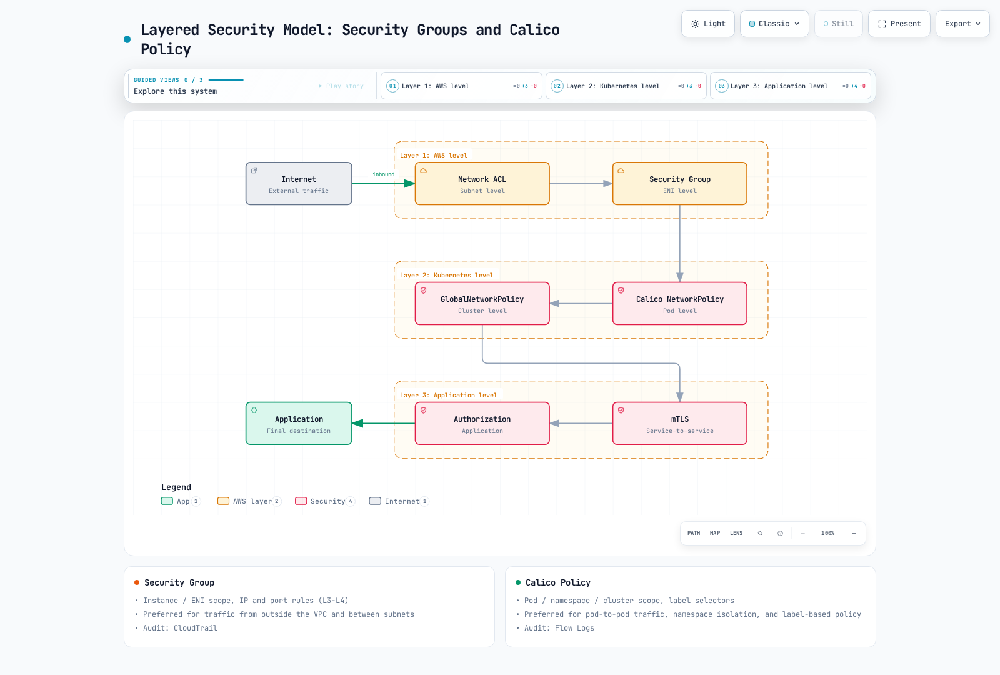

# パート 8: EKS 統合

> **確認済みベースライン**: Calico 3.32.2 / Tigera Operator 1.42.6 / Calico によりテストされた Kubernetes 1.34–1.36。**最終更新**: October 12, 2026

## 概要

このガイドでは、Amazon VPC CNI を使用する**通常の Linux EC2 worker node**上で Calico によりポリシーを適用します。VPC CNI は Pod IP を割り当てて VPC ネットワークを設定し、Calico は node の dataplane でポリシーをプログラムします。以下のインストールでは Iptables dataplane と kube-proxy を維持します。Calico networking と eBPF は、追加の前提条件がある別のデプロイメント選択肢です。

このレビュー時点で、EKS は標準サポートで 1.34–1.37、拡張サポートで 1.31–1.33 を一覧にしています（[EKS Kubernetes version lifecycle](https://docs.aws.amazon.com/eks/latest/userguide/kubernetes-versions.html)）。Calico 3.32 の公開済み Kubernetes テスト範囲は 1.34–1.36 です。EKS の提供状況、upstream Kubernetes リリース、Calico の互換性は別個に確認する必要があります。EKS が 1.37 を提供していても、1.37 が Calico 3.32 のテスト済みマトリックスに含まれるわけではありません。インストール前に対象 Region の EKS および add-on バージョンを確認してください。

## VPC CNI + Calico アーキテクチャ


[🔍 インタラクティブな図を表示](https://www.atomai.click/kubernetes-docs/archmaps/en-networking-calico-08-eks-integration-0.html)

この図はコンポーネントの責務を要約しています。packet は forwarding proxy として pause container や Felix process を通過しません。Felix は Linux kernel が評価するルールをプログラムします。`iptables / eBPF` ラベルは代替の dataplane を表しています。このガイドでは Iptables をインストールします。Typha と kube-controllers は AWS 管理の EKS control plane 内ではなく、顧客の worker capacity 上で実行されます。

| コンポーネント | この構成での責務 |
| --- | --- |
| `aws-node` / IPAMD および VPC CNI plugin | ENI/IP 割り当てを管理し、Pod 接続性を設定する |
| `calico-node` 内の Felix | ローカル endpoint 向けの policy rule をプログラムする |
| Typha | datastore 更新を Felix に配信する。operator がスケーリングを管理する |
| kube-controllers | Calico data を Kubernetes resource と整合させる |
| kube-proxy | このベースラインで Kubernetes Service forwarding を提供する |

node 間トラフィックでは、kernel が適用対象のポリシーを評価して VPC path を使用します。同一 node のトラフィックは host 内に留まることができます。drop された packet は破棄されます。policy drop が packet を送信者に戻すことはありません。適用対象の source egress control と destination ingress control の両方が接続を許可する必要があります。

## Policy Engine とインストール方法の選択

| 選択肢 | インストールされるもの | ライフサイクルとスコープ |
| --- | --- | --- |
| Amazon VPC CNI network policy | AWS の policy implementation | 互換性のある `vpc-cni` add-on を設定する。Calico はインストールしない |
| Tigera Operator manifest | Operator と Calico custom resource | release を固定し、CRD を管理してから Installation を reconcile する |
| Tigera Operator Helm chart | Helm 管理の構成を持つ同じ operator | values を render してレビューする。upgrade には既存の release を使用する |
| Direct Calico manifest | operator を使用しない Calico component | platform customization を維持し、upgrade 手順を所有する |

新しい add-on バージョンがリリースされた場合や cluster minor version が変わった場合も、EKS add-on は自動更新されません。AWS、Marketplace、community の add-on にはそれぞれ異なる support owner も存在します。`calico` という名前の add-on が存在すること、または Marketplace product がこの OSS インストールと同じであることを想定しないでください。実際の catalog、publisher、version、licensing、compute compatibility を確認してください。

**同一 endpoint には 1 つの network policy engine を使用してください。** Calico EKS ガイドでは AWS VPC CNI network policy を無効にする必要があります。migration にはポリシー、node state、可用性のレビュー済み引き継ぎが必要です。両方の engine を実行したまま flag を切り替えるだけでは migration 手順になりません。AWS は policy agent を削除した後もルールが残る可能性があると警告しており、third-party engine から migration する場合は影響を受ける node を置き換えることを推奨しています。[AWS policy considerations](https://docs.aws.amazon.com/eks/latest/userguide/cni-network-policy.html) と [disable procedure](https://docs.aws.amazon.com/eks/latest/userguide/network-policy-disable.html) を参照してください。

## 既存の VPC CNI インストールを準備する

次の command は既存の管理対象 `vpc-cni` add-on を検査します。実際の Region と cluster name を使用してください。self-managed VPC CNI インストールは、代わりにその own manifest または Helm owner を通じて変更する必要があります。

```bash
EKS_CLUSTER=my-cluster
EKS_REGION=us-east-1
EKS_VERSION=$(aws eks describe-cluster --name "$EKS_CLUSTER" \
  --region "$EKS_REGION" --query cluster.version --output text)

aws eks describe-addon-versions --addon-name vpc-cni \
  --kubernetes-version "$EKS_VERSION" --region "$EKS_REGION" \
  --query 'addons[0].addonVersions[].{version:addonVersion,compatibility:compatibilities,compute:computeTypes}'

aws eks describe-addon --cluster-name "$EKS_CLUSTER" \
  --addon-name vpc-cni --region "$EKS_REGION" > vpc-cni-current.json

VPC_CNI_VERSION=$(jq -r '.addon.addonVersion' vpc-cni-current.json)
aws eks describe-addon-configuration --addon-name vpc-cni \
  --addon-version "$VPC_CNI_VERSION" --region "$EKS_REGION" \
  --query configurationSchema --output text > vpc-cni-schema.json
```

Calico では VPC CNI が `vpc.amazonaws.com/pod-ips` を速やかに公開するよう、`ANNOTATE_POD_IP=true` が必要です。`aws-node` ServiceAccount には Pod を patch する権限が必要です。現在の VPC CNI documentation では、EKS add-on がこの権限を自動的に更新するとされています。既存の ClusterRole を上書きするのではなく、確認してください。

```bash
kubectl auth can-i patch pods --all-namespaces \
  --as=system:serviceaccount:kube-system:aws-node
```

この authorization check には、その ServiceAccount を impersonate する権限が必要です。権限がない場合、既存の rule を置き換えずに別の binding で必要な rule を追加できます。非標準のインストールでは、実際の ServiceAccount name を使用してください。

```yaml
apiVersion: rbac.authorization.k8s.io/v1
kind: ClusterRole
metadata:
  name: calico-vpc-pod-annotations
rules:
  - apiGroups: [""]
    resources: ["pods"]
    verbs: ["patch"]
---
apiVersion: rbac.authorization.k8s.io/v1
kind: ClusterRoleBinding
metadata:
  name: calico-vpc-pod-annotations
roleRef:
  apiGroup: rbac.authorization.k8s.io
  kind: ClusterRole
  name: calico-vpc-pod-annotations
subjects:
  - kind: ServiceAccount
    name: aws-node
    namespace: kube-system
```

レビュー済みの**新規または既に policy-only の構成**では、現在の add-on 設定を維持したまま次の candidate を準備します。

```bash
jq '(.addon.configurationValues // "") as $current
  | (if $current == "" then {} else ($current | fromjson) end)
  | .enableNetworkPolicy = "false"
  | .env.ANNOTATE_POD_IP = "true"
  | del(.env.NETWORK_POLICY_ENFORCING_MODE)' \
  vpc-cni-current.json > vpc-cni-calico.json
```

この command は JSON configuration value を想定しています。既存の value が YAML の場合は、candidate を準備する前に field を落とさず parse および変換してください。parse error が発生したら停止してください。取得した EKS build schema に対して candidate を検証し、diff をレビューしてください。`NETWORK_POLICY_ENFORCING_MODE` variable は AWS policy agent のものです。その agent が存在しない状態で設定を残すと Pod 作成が失敗することがあります。AWS policy が現在 active の場合、この candidate を使用する前に migration plan を完了してください。承認された構成は add-on owner を通じて適用します。

```bash
aws eks update-addon --cluster-name "$EKS_CLUSTER" \
  --addon-name vpc-cni --region "$EKS_REGION" \
  --configuration-values file://vpc-cni-calico.json \
  --resolve-conflicts PRESERVE
```

返された update status と結果の DaemonSet を検査してください。preserved conflict により目的の field が有効にならない場合があります。JSON の parse 成功や update request の受け入れを policy enforcement の証明として扱わないでください。

## Operator を使用して Calico をインストールする

新規インストールでは、以下の manifest または Helm path の**いずれか 1 つ**を選択してください。既存の release 上に 2 番目の operator をインストールしないでください。これらの例は、通常の EC2 Linux worker、到達可能な Kubernetes API/DNS、互換性のある VPC CNI、および競合する policy engine がないことを前提としています。

### Operator Manifest Path

Calico 3.32 では Calico CRD を operator manifest から分離しています。

```bash
kubectl create -f https://raw.githubusercontent.com/projectcalico/calico/v3.32.2/manifests/v1_crd_projectcalico_org.yaml
kubectl create -f https://raw.githubusercontent.com/projectcalico/calico/v3.32.2/manifests/tigera-operator.yaml
```

次を `calico-eks-installation.yaml` として保存します。

```yaml
apiVersion: operator.tigera.io/v1
kind: Installation
metadata:
  name: default
spec:
  kubernetesProvider: EKS
  cni:
    type: AmazonVPC
  calicoNetwork:
    bgp: Disabled
    linuxDataplane: Iptables
  nodeUpdateStrategy:
    type: RollingUpdate
    rollingUpdate:
      maxUnavailable: 1
---
apiVersion: operator.tigera.io/v1
kind: APIServer
metadata:
  name: default
spec: {}
---
apiVersion: operator.tigera.io/v1
kind: Goldmane
metadata:
  name: default
spec: {}
---
apiVersion: operator.tigera.io/v1
kind: Whisker
metadata:
  name: default
spec: {}
```

```bash
kubectl apply -f calico-eks-installation.yaml
kubectl get tigerastatus
kubectl get pods -n calico-system
```

API server、Goldmane flow aggregator、Whisker UI は OSS で利用できます。環境に合わせて、それらへの access と resource capacity を設定してください。`cni.type: AmazonVPC` を設定すると、IPAM/networking を VPC CNI に委譲します。`bgp: Disabled` のみでは CNI を選択しません。operator に Typha replica を管理させてください。`typhaDeployment.spec.replicas` はサポートされる Installation override ではありません。[scaling details](07-advanced-topics.md) を参照してください。

### Helm Path

これを `calico-eks-values.yaml` として保存します。`installation` は Installation API に map されます。top-level の `nodeSelector` はすべての Calico component ではなく operator Pod を制御します。Helm は未サポートの value を黙って無視することがあるため、render された resource を検査してください。

```yaml
installation:
  enabled: true
  kubernetesProvider: EKS
  cni:
    type: AmazonVPC
  calicoNetwork:
    bgp: Disabled
    linuxDataplane: Iptables
  nodeUpdateStrategy:
    type: RollingUpdate
    rollingUpdate:
      maxUnavailable: 1
apiServer:
  enabled: true
goldmane:
  enabled: true
whisker:
  enabled: true
manageCRDs: true
```

```bash
helm repo add projectcalico https://docs.tigera.io/calico/charts
helm repo update projectcalico
helm template calico projectcalico/tigera-operator \
  --version v3.32.2 --namespace tigera-operator \
  -f calico-eks-values.yaml > calico-rendered.yaml

# After reviewing the rendered configuration for the prepared cluster:
helm install calico projectcalico/tigera-operator \
  --version v3.32.2 --namespace tigera-operator --create-namespace \
  -f calico-eks-values.yaml
```

`manageCRDs: true` の場合、operator は起動後に必要な CRD を管理します。新しい field をすぐ使用する upgrade では、[Calico upgrade procedure](https://docs.tigera.io/calico/latest/operations/upgrading/kubernetes-upgrade) に従い、既存の owner を通じて対応する CRD を先に適用してください。Helm rollback のみで CRD または stored-data migration が元に戻ることは保証されません。

## 代替としての AWS Native Network Policy

AWS VPC CNI の標準 NetworkPolicy support は EKS 1.14 ではなく、**VPC CNI 1.14** で開始されました。現在の AWS ガイドでは、標準ポリシーと admin policy の両方に VPC CNI **1.21+**、互換性のある EKS/platform version、Linux kernel 5.10+ が必要です。古い launch-version の例ではなく、現在の compatibility guidance を使用してください。

AWS は現在、namespace-scoped の `networking.k8s.io/v1` NetworkPolicy とともに、Admin と Baseline tier を含む `networking.k8s.aws/v1alpha1` **ClusterNetworkPolicy** を文書化しています。これは Calico GlobalNetworkPolicy や Calico の構成可能な tier とは異なる API です。native policy を namespace-scoped rule に恒久的に限定されるものとして説明しないでください。

| 機能 | AWS native implementation | このガイドの Calico OSS |
| --- | --- | --- |
| Kubernetes NetworkPolicy | 対象となる EC2 Linux node でサポート | 管理対象 endpoint でサポート |
| Cluster policy | 独自の rule と前提条件を持つ AWS ClusterNetworkPolicy | Calico GlobalNetworkPolicy と Tier |
| Policy observability | Agent metrics/event log。CloudWatch 配信は別途設定する | Felix/Typha metrics、Goldmane、Whisker flow observability |
| Application-layer policy | L3/L4 network policy から推測しない | 個別の Dikastes/Istio integration。このインストールでは有効化されない |
| Calico での DNS/FQDN policy | Calico API implementation ではない | 文書化された domain-based policy 機能には商用 Calico edition が必要 |

native alternative では、互換性のある VPC CNI add-on/Helm 設定を通じて `enableNetworkPolicy` を構成します。`aws-node` に存在しない `ENABLE_NETWORK_POLICY` environment variable を設定するだけでは不十分です。native の `standard` startup mode は policy がプログラムされる間、最初は traffic を許可します。`strict` は deny で開始し、DNS を含む必要な path を要求します。これらの AWS 設定は Calico の startup behavior を設定しません。

native enforcement には、EC2 Linux のみ、primary Pod interface のみ、IP-family の制約、controller-owned Pod での信頼できる操作という文書化済みの制限があります。port/protocol の制限と Service-port 要件をレビューしてください。AWS 管理の PolicyEndpoint resource は controller-owned のまま維持してください。完全な setup と migration の詳細については、[maintained VPC CNI guide](../01-vpc-cni.md) を使用してください。

## Node Type と Networking Profile

| Profile | 適用可能性 |
| --- | --- |
| 通常の managed または self-managed EC2 Linux node + VPC CNI | 上記のベースライン policy-only installation。management model だけで Calico capability は決まらない |
| EC2 node + full Calico CNI | 別の Tigera 文書化済み design。Pod addressing、control-plane reachability、CNI ownership、support boundary が変わる |
| EKS Fargate | Calico の node agent も VPC CNI native network policy もこれらの Pod では実行されない。Pod 用 security group は別のサポートされた control |
| EKS Auto Mode | 組み込みの AWS networking/policy。代替 CNI と network policy plugin はサポートされない |
| EKS Hybrid Nodes | VPC CNI は互換性がない。specialized CNI guide は AWS-maintained Cilium 1.17/1.18 build を一覧にしている。以下の support qualification を参照 |
| Windows node | 個別の Windows/VPC CNI および Calico HNS 手順。Calico eBPF dataplane は使用不可。[Windows limitations](07-advanced-topics.md) を参照 |

specialized Hybrid CNI guide では AWS-maintained Cilium build を一覧にし、別の場所で Calico の例にリンクしています。一方、[general alternate-CNI page](https://docs.aws.amazon.com/eks/latest/userguide/alternate-cni-plugins.html) では依然として Hybrid Nodes 向けの core Cilium/Calico support を説明しています。例の移動から Calico support の終了を推測したり、任意の upstream version を AWS-supported と見なしたりしないでください。特定の distribution/capability support boundary を確認してください。

EC2 endpoint 上の Calico policy は Fargate peer に関連するその endpoint の traffic を制限できます。これは policy が Fargate 内で適用されることを意味しません。mixed compute cluster では、すべての worker に「full Calico support」とラベル付けするのではなく、明示的な scheduling と enforcement boundary が必要です。

full Calico CNI は、VPC CNI の `enableNetworkPolicy` を false に設定して有効化するものではありません。Tigera の fresh-cluster procedure では worker を追加する前に競合する CNI を削除します。conversion shortcut として既存の production cluster から `aws-node` を削除しないでください。文書化された overlay design では、admission webhook など API-server-to-Pod traffic についても特別な考慮が必要です。信頼された `hostNetwork` component は文書化された workaround の 1 つです。この profile を採用する前に、Pod CIDR、return path、MTU、必要に応じた node IAM/source-destination check、AWS/Tigera support boundary をレビューしてください。

Auto Mode では、VPC CNI environment variable と ENIConfig 設定は managed networking service を構成しません。NodeClass を使用してください。Auto Mode は CoreDNS を node system service として実行します。純粋な Auto Mode cluster には従来の CoreDNS Deployment は不要ですが、mixed non-Auto node では引き続き必要です。初期 DNS query は local であっても、upstream forwarding は node 外へ出る場合があります。

## IAM、IRSA、Pod Identity

基本の Calico policy-only installation は Kubernetes RBAC を使用します。`calico-node` に広範な EC2 discovery または CloudWatch IAM role は必要ありません。VPC CNI には独自の文書化済み AWS permission が必要です。別の log exporter や商用 cloud integration では、**その component の** ServiceAccount に追加の permission が必要になる場合があります。

IRSA は cluster OIDC provider と適切にスコープされた trust policy を使用して、ServiceAccount 用の AWS credential を取得します。EKS Pod Identity は、component、SDK、compute type がサポートする場合の別の選択肢です。IAM policy も存在しない `Installation.spec.nodeMetadata` value も、credential を workload に接続しません。owning component の構成に従い、operator-managed ServiceAccount と競合しないようにしてください。[VPC CNI IAM configuration](https://docs.aws.amazon.com/eks/latest/userguide/cni-iam-role.html) を参照してください。

## Security Group と Calico Policy



[🔍 インタラクティブな図を表示](https://www.atomai.click/kubernetes-docs/archmaps/en-networking-calico-08-eks-integration-3.html)

この図は概念的な layering diagram であり、固定の evaluation order ではありません。Calico は tier/order と rule semantics により policy を評価します。NetworkPolicy が常に GlobalNetworkPolicy に先行するわけではありません。CloudTrail は packet decision ではなく AWS API activity を記録します。VPC Flow Logs と構成済みの policy logging tool は異なる traffic evidence を提供します。application mTLS/authorization は別途デプロイする必要があります。

security group は ENI にアタッチされます。**Pod 用 security group** は SecurityGroupPolicy を通じて workload を選択できるため、「security group は instance のみを選択する」という説明は不正確です。SG-for-Pods を Calico policy と組み合わせるには、AWS は VPC CNI 1.11+ と `POD_SECURITY_GROUP_ENFORCING_MODE=standard` を必要とします。strict mode では、それらの Pod の traffic は Calico enforcement の対象になりません。mode の変更後に branch-ENI/instance support を確認し、影響を受ける Pod を再作成してください。SG-for-Pods は Windows と Auto Mode ではサポートされません。

VPC CNI の通常の external SNAT が有効な standard mode（`AWS_VPC_K8S_CNI_EXTERNALSNAT=false`）では、VPC を出る traffic は node の primary ENI IP と security group を使用します。Pod security group の egress rule がすべての path をカバーすると想定しないでください。[AWS の正確な条件](https://docs.aws.amazon.com/eks/latest/userguide/security-groups-for-pods.html)を参照してください。

### Namespace-Scoped Application Policy

この例では、準備済みの `calico-eks-demo` namespace 内の `app=frontend` Pod のみを選択します。同じ namespace 内の**in-cluster gateway Pod** が TCP 8080 に到達することを許可し、frontend の egress から同一 namespace の backend Pod への TCP 8080 を許可します。この例では `k8s-app=kube-dns` を持つ通常の CoreDNS Pod を想定しています。NodeLocal DNS または別の resolver には異なる destination が必要です。他の policy/tier により結果が変わるため、完全な effective policy set を検査してください。

```yaml
apiVersion: projectcalico.org/v3
kind: NetworkPolicy
metadata:
  name: frontend-policy
  namespace: calico-eks-demo
spec:
  selector: app == 'frontend'
  types: [Ingress, Egress]
  ingress:
    - action: Allow
      protocol: TCP
      source:
        selector: app == 'gateway'
      destination:
        ports: [8080]
  egress:
    - action: Allow
      protocol: TCP
      destination:
        selector: app == 'backend'
        ports: [8080]
    - action: Allow
      protocol: UDP
      destination:
        namespaceSelector: projectcalico.org/name == 'kube-system'
        selector: k8s-app == 'kube-dns'
        ports: [53]
    - action: Allow
      protocol: TCP
      destination:
        namespaceSelector: projectcalico.org/name == 'kube-system'
        selector: k8s-app == 'kube-dns'
        ports: [53]
```

destination selector と port は**同一の** `destination` mapping の下に置いてください。YAML key の重複により selector が黙って削除され、意図しない endpoint への TCP 8080 が許可される可能性があります。ALB/NLB は `app=load-balancer` を持つ Kubernetes Pod ではありません。target mode、health check、観測された source address は [load balancer guide](../03-aws-lb-controller.md) を使用して個別に考慮してください。

`all()` を選択する空の cluster-wide GlobalNetworkPolicy は、DNS、API、monitoring、application traffic を中断する可能性があります。明示的な dependency permission を設定し、まず選択済み test namespace 内で default-deny behavior を構築してください。[network policy](05-network-policy.md) を参照してください。

## Upgrade と Recovery

1. EKS control plane、node OS/kubelet、VPC CNI、kube-proxy、Calico/operator/CRD、calicoctl version を inventory します。所有する構成と policy を export します。
2. **計画した移行の両側**と互換性のある Calico version を選択します。普遍的な「常に Calico を先/後に upgrade する」ルールはありません。installation 固有の手順と CRD migration note に従ってください。
3. EKS upgrade insight、削除された API、すべての add-on compatibility をレビューします。EKS control plane を一度に 1 minor version ずつ upgrade し、次に node と該当する add-on を互換性のある version にします。
4. rolling transition 中に、negative case と新規作成 Pod を含め policy と Service behavior を確認します。configuration ownership と rollback prerequisite を明確に維持します。

```bash
aws eks describe-cluster --name "$EKS_CLUSTER" --region "$EKS_REGION" \
  --query 'cluster.{version:version,platform:platformVersion,status:status}'
kubectl get nodes -o wide
kubectl get daemonset calico-node -n calico-system -o wide
kubectl get tigerastatus
helm get values calico -n tigera-operator -o yaml
```

現在の EKS は、**in-place upgrade から 7 日以内であれば、1 つ前の minor version への条件付き rollback**をサポートします。cluster は文書化された eligibility と readiness requirement を満たす必要があります。この window は一般的な downgrade capability ではありません。通常の managed/self-managed/hybrid node と互換性のない add-on には、control plane の前に準備が必要です。Auto Mode は node rollback を処理します。Fargate には独自の workload treatment が必要です。Calico と EKS add-on は自動的に revert されず、etcd data を保持しても互換性のない resource が安全になるわけではありません。未解決の compatibility issue を隠すために `--force` を使用せず、[current rollback procedure](https://docs.aws.amazon.com/eks/latest/userguide/rollback-cluster.html) に従ってください。eligible window の外では、別のサポート対象 cluster への migration を計画してください。

古い operator manifest を適用することや `helm rollback` を実行することは、安全な Calico downgrade の証明ではありません。recovery step を選択する前に、特定 release の support と schema/data change を確認してください。`calicoctl node status` は node-local BGP state を報告するもので、policy-only EKS acceptance test ではありません。

## Cost と Performance

| 要因 | 評価する内容 |
| --- | --- |
| Worker resource | 実際の policy/endpoint churn の下で Felix、Typha、controller、flow aggregation を測定する。CPU request は独立した AWS tariff ではない |
| VPC IP capacity | Prefix delegation は address allocation と density に影響する。ENI attachment の自動 discount ではない |
| Logging/metrics | retention、ingestion、query、exporter delivery には別々の cost がある。metrics は flow log ではない |
| Cross-AZ traffic | 実際の source/destination path と service pricing を評価する。locality は availability にも影響する |
| EKS lifecycle | Extended support により cluster charge が追加されることがある。現在の support calendar を使用する |

以前の component ごとの dollar estimate には Region、instance pricing、allocation assumption がありませんでした。それらは利用可能な cost model ではありません。任意の resource limit から固定の月次 savings を主張するのではなく、観測された resource demand と関連する AWS price を使用してください。

### Prefix Delegation

通常の VPC CNI node では、`ENABLE_PREFIX_DELEGATION`、`WARM_PREFIX_TARGET`、`MINIMUM_IP_TARGET`、`WARM_IP_TARGET` を add-on の**`env`**設定、またはその owner である DaemonSet/Helm 構成で設定します。ConfigMap 内の小文字の `enable-prefix-delegation` entry では IPAMD は構成されません。

文書化された 1 つの allocation strategy から始めてください。`WARM_IP_TARGET` と `MINIMUM_IP_TARGET` は `WARM_PREFIX_TARGET` を上書きします。すべてを設定しても効果が積み重なることはありません。IPv4 prefix には連続した `/28` subnet space と適切な instance が必要です。subnet fragmentation、reservation、max-Pods/kubelet configuration、rollout plan を確認してください。[AWS prefix procedure](https://docs.aws.amazon.com/eks/latest/userguide/cni-increase-ip-addresses-procedure.html) を参照してください。

### EKS 上の Calico eBPF

Calico は eBPF dataplane 向けに EKS と互換性のある VPC CNI networking を文書化していますが、これにより Service handling が変わり、別の migration が必要です。[Part 6](06-ebpf-dataplane.md) に従ってください。kernel/platform check、直接の API-server FQDN access と bootstrap DNS、kube-proxy ownership、health port、rollback state はすべて重要です。

VPC CNI では kube-proxy の実行継続が常に必要なわけでは**ありません**。kube-proxy が共存する必要がある場合、文書化された conflict を避けるために Calico では `bpfKubeProxyIptablesCleanupEnabled: false` と `bpfKubeProxyHealthzPort: 0` の両方が必要です。generic DaemonSet selector patch は owner によって reconcile される可能性があり、無関係な selector を上書きしてはなりません。DSR はデフォルトの EKS optimization ではありません。AWS subnet/source-address check と external load balancer の制限には別途検証が必要です。このベースラインでは Iptables と kube-proxy を維持します。

generic sysctl preset、memory を任意の最小値まで減らすこと、conntrack lifetime を短縮することは、より良い performance を確立しません。実際の workload を benchmark し、return path、established connection、failure recovery を維持してください。

## eksctl Cluster Planning Example

これは**通常の managed Linux node 向けの planning example**であり、production でテスト済みの recipe や Auto Mode の conversion ではありません。provisioning 前に `describe-addon-versions` でサポートされる add-on build を確認し、承認された build を構成に固定してください。add-on version を省略すると互換性のある default が選択されますが、将来のすべての release が承認されるわけではありません。private API access には VPC 内への management path が必要です。NAT、log、worker capacity、address range には環境固有の design が必要です。

```yaml
apiVersion: eksctl.io/v1alpha5
kind: ClusterConfig
metadata:
  name: calico-eks-demo
  region: us-east-1
  version: "1.36"
iam:
  withOIDC: true
vpc:
  cidr: 10.0.0.0/16
  clusterEndpoints:
    publicAccess: false
    privateAccess: true
managedNodeGroups:
  - name: linux-workers
    instanceType: m5.large
    amiFamily: AmazonLinux2023
    desiredCapacity: 3
    minSize: 3
    maxSize: 6
    privateNetworking: true
    volumeType: gp3
    volumeSize: 100
addons:
  - name: vpc-cni
    attachPolicyARNs:
      - arn:aws:iam::aws:policy/AmazonEKS_CNI_Policy
    configurationValues: |
      enableNetworkPolicy: "false"
      env:
        ANNOTATE_POD_IP: "true"
  - name: coredns
  - name: kube-proxy
cloudWatch:
  clusterLogging:
    enableTypes: [api, audit, authenticator, controllerManager, scheduler]
```

IPv4 CNI policy は Calico ではなく VPC CNI identity に属します。ほかの IP family と identity method では IAM を見直してください。承認済み cluster の作成後、上記の annotation/RBAC check と**1 つの** Calico installation path を実行してください。

## 結果を検証する

```bash
kubectl get tigerastatus
kubectl rollout status daemonset/calico-node -n calico-system --timeout=300s
kubectl get pods -n calico-system -o wide
kubectl get pods -n calico-eks-demo -o json \
  | jq '.items[] | {name: .metadata.name, ip: .status.podIP,
      annotatedIPs: .metadata.annotations["vpc.amazonaws.com/pod-ips"]}'
kubectl get networkpolicies.projectcalico.org -n calico-eks-demo
```

controller-managed test workload を使用し、同一 node、node/AZ 間、Pod 再作成後、update 中の許可および拒否された connection を確認してください。DNS、application に必要な API/identity endpoint、Service traffic、load balancer health check を含めてください。Running Pod または Ready node は、目的の denial も startup policy gap がないことも検証しません。IPv6 は別途テストしてください。Calico の現在の EKS guide では、`ENABLE_V4_EGRESS=true` を持つ IPv6 Pod の policy enforcement を除外しています。

この文書の例はリリース済み schema と render された chart に対して確認しました。検証のために EKS cluster、IAM resource、production traffic は作成していません。

## 参考資料

- [Calico on EKS](https://docs.tigera.io/calico/latest/getting-started/kubernetes/managed-public-cloud/eks)
- [Calico requirements](https://docs.tigera.io/calico/latest/getting-started/kubernetes/requirements)
- [Calico Helm installation](https://docs.tigera.io/calico/latest/getting-started/kubernetes/helm)
- [Calico upgrades](https://docs.tigera.io/calico/latest/operations/upgrading/kubernetes-upgrade)
- [VPC CNI 1.23 configuration reference](https://github.com/aws/amazon-vpc-cni-k8s/blob/v1.23.0/README.md)
- [EKS native network policy](https://docs.aws.amazon.com/eks/latest/userguide/cni-network-policy.html)
- [EKS add-on updates](https://docs.aws.amazon.com/eks/latest/userguide/updating-an-add-on.html)
- [EKS version lifecycle](https://docs.aws.amazon.com/eks/latest/userguide/kubernetes-versions.html)
- [EKS Auto Mode networking](https://docs.aws.amazon.com/eks/latest/userguide/auto-networking.html)
- [EKS Hybrid Nodes CNI](https://docs.aws.amazon.com/eks/latest/userguide/hybrid-nodes-cni.html)

## 次のステップとクイズ

[operations](09-operations.md) に進むか、[advanced topics](07-advanced-topics.md) または [glossary](glossary.md) を確認し、[EKS Integration Quiz](../../quizzes/networking/calico/08-eks-integration-quiz.md) で理解度をテストしてください。
