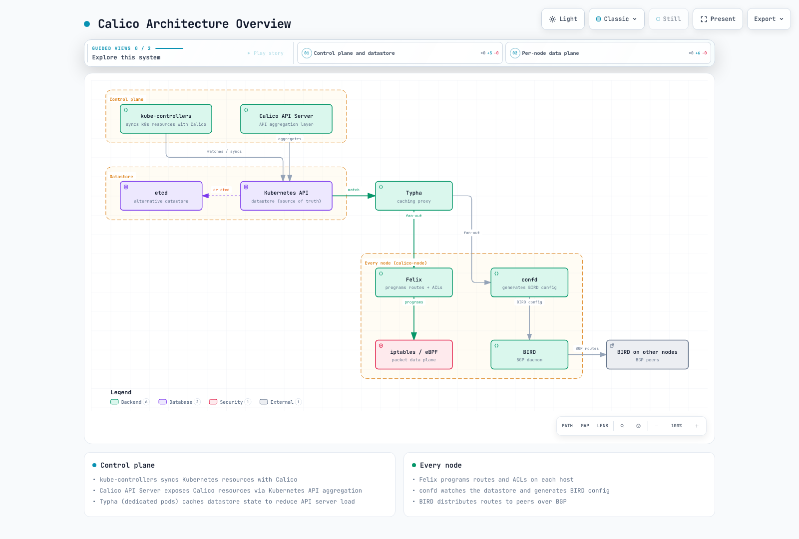

# Calico 詳解: Kubernetes ネットワーキングとポリシー

> **例のベースライン**: Calico Open Source 3.32.2
>
> **最終確認**: 2026年10月12日
>
> **最新リリース**: 10月1日にリリースされた Calico 3.33.0 が最新の Open Source リリースであり、Kubernetes 1.35–1.37 でテストされています。
>
> このシリーズのコマンドは、テスト対象範囲が 1.34–1.36 である 3.32.2 に引き続き固定されています。これらの例は 3.33.0 では検証されていません。リリースを選択する前に、[3.33.0 リリースノート](https://github.com/projectcalico/calico/releases/tag/v3.33.0)と[現在の要件](https://docs.tigera.io/calico/latest/getting-started/kubernetes/requirements)を確認してください。これは、無期限の `3.29+ / Kubernetes 1.28+` 互換性保証ではありません。

## 概要

Calico は Kubernetes 向けのネットワーキングとネットワークポリシーを提供し、追加のホストおよび VM 機能はデプロイメントと製品エディションに依存します。このシリーズでは、アーキテクチャ、カプセル化とルーティング、BGP、ポリシー、eBPF、EKS 統合、運用を扱います。日付のない成熟度やリソース使用量のランキングではなく、[現在の要件](https://docs.tigera.io/calico/latest/getting-started/kubernetes/requirements)を用いて構成を選択してください。

### 2026 年 7 月: Kubernetes 上の VM 向け Calico

Tigera の[公式発表](https://www.tigera.io/news/tigera-launches-ebpf-powered-calico-for-vms-on-kubernetes-vm-migration-that-doesnt-require-rebuilding-the-network/)の日付は **2026年7月23日** です。これは、VM/container ネットワーキング、IP 継続性、L2 ブリッジ拡張、VMware 移行向けのポリシーと可観測性について説明しています。これは製品発表であり、宣伝されているすべての機能が Calico Open Source に含まれるという約束ではありません。正確なエディション、トポロジー、機能ステータスを確認してください。[Enterprise 3.23 リリースノート](https://docs.tigera.io/calico-enterprise/latest/release-notes/)では、KubeVirt ライブマイグレーションは引き続き技術プレビューとされています。マーケティング上の利用可能性によって、その機能固有の制限がなくなることはありません。

## 互換性と機能の境界

- Calico 3.32.2 は 2026年8月30日にリリースされ、Kubernetes 1.34–1.36 でテストされています。より新しい 3.33.0 リリースは Kubernetes 1.35–1.37 でテストされています。Kubernetes 1.37 が利用可能であることだけでは、固定された 3.32.2 の例との互換性は確立されません。
- 一般的な Linux 要件は、必要なモジュールを備えたカーネル 5.10 以降です。サポート対象のアーキテクチャ、ベンダーのバックポート、個別機能に対するより高い要件については、eBPF ガイドを参照してください。
- Linux データプレーンには iptables、nftables、eBPF があります。デフォルトはインストーラー/プラットフォームに依存します。現在の自己管理 kubeadm operator インストールでは、デフォルトが eBPF になる場合があります。包括的な機能同等性の保証はありません。
- [Calico for Windows](https://docs.tigera.io/calico/latest/getting-started/kubernetes/windows-calico/limitations)は、指定された IPv4 VXLAN および BGP 構成をサポートしますが、Linux eBPF、IPIP、IPv6/dual stack、WireGuard、または Linux のすべてのポリシー機能はサポートしません。
- Open Source には、階層化ポリシー、Goldmane フロー集約、Whisker UI が含まれます。DNS/FQDN ポリシー、アプリケーションレイヤーポリシー、その他の高度な機能には、[製品比較](https://docs.tigera.io/calico/latest/about/calico-product-editions)に示されるエディションの境界があります。

## Calico と Cilium

| 要件 | Calico | Cilium |
|---|---|---|
| Linux データプレーン | 構成に応じた iptables / nftables / eBPF | eBPF。該当する L7 機能には Envoy を使用 |
| Kubernetes NetworkPolicy | サポート。加えて Calico ポリシーと tier | サポート。加えて Cilium ポリシー |
| L7 / DNS ポリシー | Enterprise/Cloud のライセンスと機能ステータスを確認 | HTTP および DNS ポリシーが利用可能。プロトコル固有の制限が適用される |
| BGP | 該当するネットワーキングモードでの BIRD ベースのルーティング | BGP コントロールプレーンによる広告。必要なルートとトポロジーを評価 |
| 可観測性 | Open Source の Goldmane/Whisker とメトリクス。有償機能により能力を追加 | Hubble とメトリクス |
| Windows | 大きな制限のあるサポート対象構成 | Cilium 1.20 エージェントには Linux が必要。Windows ベータデータプレーンではない |
| kube-proxy 置換 | eBPF データプレーンで利用可能 | 構成時に利用可能 |
| マルチクラスター / mesh | 個別の機能と統合。エディション依存 | Cluster Mesh と任意の service-mesh 機能。インストールですべてが有効になるわけではない |

どちらも本番環境の選択肢になり得ます。リソース使用量と運用の複雑さは、ルール、トラフィック、プラットフォーム、チューニングに依存します。対象環境で必要な機能を検証してください。別々の環境で動作するというだけで、1 つのクラスターに 2 つの主要 CNI をインストールしないでください。Cilium の[バージョン別要件](https://github.com/cilium/cilium/blob/v1.20.1/Documentation/operations/system_requirements.rst)と、このサイトの[Cilium service-mesh ガイド](../../service-mesh/cilium-service-mesh/README.md)は、そのプラットフォームと mesh の境界を説明しています。

## アーキテクチャ



[🔍 インタラクティブな図を表示](https://www.atomai.click/kubernetes-docs/archmaps/en-networking-calico-readme-0.html)

この図は概略的な BGP デプロイメントであり、必須のコンポーネントレイアウトではありません。以下の EKS ポリシー専用の例は Kubernetes datastore を使用し、BIRD/confd を省略します。「コントロールプレーン」は論理的な役割を表しており、EKS 管理コントロールプレーンマシンへの配置を意味するものではありません。Typha はノードごとのプロセスではなく、個別の Deployment です。

| コンポーネント | 役割とスコープ |
|---|---|
| Felix | ワークロードノードでポリシーと該当するルートをプログラム |
| BIRD / confd | そのバックエンドが有効な場合の BGP とその構成。ポリシー専用モードでは存在しない |
| Typha | 任意の datastore 更新キャッシュ/ファンアウト。operator は必ずしも 3 ではなく、インストールに応じてレプリカをスケールする |
| kube-controllers | Kubernetes リソースの調整、同期、クリーンアップ |
| Calico CNI / IPAM | Calico がネットワーキングを所有する場合のインターフェイスと Pod アドレス管理。EKS の例では Amazon VPC CNI/IPAM がこれらの役割を維持する |
| Calico API server | デフォルトモデルでは内部 CRD を介した集約 `projectcalico.org/v3` API。ネイティブ v3 CRD は別個の技術プレビュー |

有効なコンポーネントを特定するには、[アーキテクチャリファレンス](https://docs.tigera.io/calico/latest/reference/architecture/overview)と実際にレンダリングされたワークロードを使用してください。このガイドでは Kubernetes API datastore を使用します。etcd ベースの設計には、別途インストールと機能の制約があります。

## ネットワーキングモードと MTU

| モード | カプセル化とルーティング | 1500 バイトの IPv4 アンダーレイにおける Pod MTU の例 |
|---|---|---|
| IPIP | IPv4-in-IPv4。通常は BGP ルート配布を使用 | 1480 |
| VXLAN | デフォルトは UDP 4789。VXLAN Pod ルーティングに BGP は不要 | 1450 |
| 非カプセル化 | アンダーレイが Pod アドレスをルーティングする必要がある。BGP はルート配布の方法の 1 つ | 1500 |
| CrossSubnet | ノードサブネット間でのみカプセル化する IPIP または VXLAN の設定 | 必要なパスについては、引き続き必要なトンネルオーバーヘッドを確保する |

これらの MTU は例であり、普遍的な定数ではありません。IPv6 VXLAN のオーバーヘッド、ジャンボアンダーレイ、WireGuard、クラウドパスの制限により計算は変わります。IPIP は IPv4 のみをサポートし、IPv4 VXLAN は IPIP が不適切な場合にも使用できます。[MTU 構成](https://docs.tigera.io/calico/latest/networking/configuring/mtu)と[オーバーレイ要件](https://docs.tigera.io/calico/latest/networking/configuring/vxlan-ipip)を確認してください。BGP が利用可能であることだけでは、すべてのアンダーレイホップが Pod CIDR をルーティングできる証明にはなりません。同一 L2 の隣接性は、非カプセル化ルーテッドファブリックの普遍的な前提条件ではありません。モードを選択する前に、アンダーレイ、ポート、アドレスファミリー、プラットフォームを計画してください。

## EKS: Amazon VPC CNI を維持して Calico ポリシーを追加する

この例は、既存のサポート対象 Amazon VPC CNI インストールを持つ Linux EC2 ノード向けです。Pod ネットワーキングを置き換えるものではありません。Auto Mode または Fargate のインストール手順ではありません。[公式 EKS ガイド](https://docs.tigera.io/calico/latest/getting-started/kubernetes/managed-public-cloud/eks)では、次が必要です。

1. Calico をポリシーエンジンとして選択する前に、Amazon VPC CNI ネイティブのネットワークポリシー強制を無効にします。両方を実行すると競合します。既存の保護されたクラスターでは、無保護の移行を作るのではなく、ポリシーの引き継ぎを計画して検証してください。
2. VPC CNI の `ANNOTATE_POD_IP=true` を設定し、その `aws-node` ServiceAccount に Pod への `patch` アクセスを付与します。reconciliation によって元に戻されないよう、インストール済み add-on/構成の所有者を通じてこれらの設定を管理してください。以下の追加 RBAC 例を適用する前に、実際の ServiceAccount 名を確認してください。
3. `ENABLE_V4_EGRESS=true` の IPv6 Pod に対するカバレッジを主張しないでください。Calico EKS ガイドは、この組み合わせでは強制を明示的に除外しています。
4. 以下から **1 つ** のインストール方法を選択してください。これらは新規インストール例であり、既存の operator の引き継ぎやアクティブな CNI の移行のためのコマンドではありません。

```yaml
apiVersion: rbac.authorization.k8s.io/v1
kind: ClusterRole
metadata:
  name: calico-vpc-cni-pod-ip-patch
rules:
  - apiGroups: [""]
    resources: ["pods"]
    verbs: ["patch"]
---
apiVersion: rbac.authorization.k8s.io/v1
kind: ClusterRoleBinding
metadata:
  name: calico-vpc-cni-pod-ip-patch
roleRef:
  apiGroup: rbac.authorization.k8s.io
  kind: ClusterRole
  name: calico-vpc-cni-pod-ip-patch
subjects:
  - kind: ServiceAccount
    name: aws-node
    namespace: kube-system
```

### 方法 A: 固定された operator マニフェスト

```bash
set -euo pipefail
CALICO_VERSION=v3.32.2
kubectl create -f "https://raw.githubusercontent.com/projectcalico/calico/$CALICO_VERSION/manifests/v1_crd_projectcalico_org.yaml"
kubectl create -f "https://raw.githubusercontent.com/projectcalico/calico/$CALICO_VERSION/manifests/tigera-operator.yaml"
kubectl -n tigera-operator rollout status deployment/tigera-operator --timeout=300s
kubectl apply -f - <<'YAML'
apiVersion: operator.tigera.io/v1
kind: Installation
metadata:
  name: default
spec:
  kubernetesProvider: EKS
  cni:
    type: AmazonVPC
  calicoNetwork:
    bgp: Disabled
    linuxDataplane: Iptables
---
apiVersion: operator.tigera.io/v1
kind: APIServer
metadata:
  name: default
spec: {}
YAML
```

### 方法 B: 固定された Helm インストール

同じ VPC CNI の前提条件を満たしてください。Calico 3.32 では CRD のインストールを operator chart から分離しています。新規クラスターでは、小さな operator chart だけをインストールしても不十分です。これらの値を `calico-eks-values.yaml` として保存してください。

```yaml
installation:
  kubernetesProvider: EKS
  cni:
    type: AmazonVPC
  calicoNetwork:
    bgp: Disabled
    linuxDataplane: Iptables
apiServer:
  enabled: true
```

```bash
set -euo pipefail
helm repo add projectcalico https://docs.tigera.io/calico/charts
helm repo update projectcalico
helm template calico-crds projectcalico/crd.projectcalico.org.v1 --version v3.32.2   | kubectl apply --server-side -f -
helm install calico projectcalico/tigera-operator --version v3.32.2   --namespace tigera-operator --create-namespace -f calico-eks-values.yaml
```

固定された chart では、Goldmane と Whisker もデフォルトで有効になります。レンダリングされたマニフェストで、これらのコンポーネントとアクセス制御を確認してください。ネイティブの `projectcalico.org/v3` CRD は別個の技術プレビューです。ここでの例では、従来の内部 CRD と集約 API server を使用します。

### 検証してからポリシー動作をテストする

```bash
kubectl get tigerastatus
kubectl -n calico-system get pods -o wide
kubectl -n calico-system rollout status daemonset/calico-node --timeout=300s
kubectl wait --for=condition=Available apiservice/v3.projectcalico.org --timeout=300s
kubectl get felixconfigurations.projectcalico.org
```

強制に依存する前に、degraded/progressing ステータスを確認し、使い捨てワークロードを使用して許可・拒否の両方のフローをテストしてください。Ready DaemonSet はポリシーの証明ではありません。AmazonVPC ポリシー専用モードでは、空の Calico IPPool や BIRD セッションの不在は必ずしも障害ではありません。Pod IPAM とネットワーキングは引き続き AWS が提供します。

### 完全な Calico ネットワーキングとその他のインストール方法

EKS 上の完全な Calico ネットワーキングは、別途新規クラスターとして設計します。公式手順ではワークロードノードなしで開始し、それらを追加する前に CNI を変更します。実行中の VPC CNI クラスターに `cni.type: Calico` フラグメントを適用しないでください。[EKS 統合](08-eks-integration.md)と公式 EKS 手順を参照してください。既存の CNI がない自己管理クラスターでは、[オンプレミスガイド](https://docs.tigera.io/calico/latest/getting-started/kubernetes/self-managed-onprem/onpremises)を使用してください。直接マニフェストも選択肢ですが、その namespace、Typha 構成、ライフサイクルは operator インストールと異なります。Helm、operator、`calico.yaml` インストールを重ねるのではなく、所有者を 1 つ選択してください。

## 明示的なスコープを持つポリシー例

専用の `calico-demo` namespace を使用してください。次の ingress および egress の例は、その namespace のみを選択します。クラスター全体のゼロトラスト展開ではありません。既存の Calico tier と以前のポリシーは、引き続き結果を変更し得ます。

```yaml
apiVersion: v1
kind: Namespace
metadata:
  name: calico-demo
---
apiVersion: networking.k8s.io/v1
kind: NetworkPolicy
metadata:
  name: allow-frontend-to-backend
  namespace: calico-demo
spec:
  podSelector:
    matchLabels:
      app: backend
  policyTypes: [Ingress]
  ingress:
    - from:
        - podSelector:
            matchLabels:
              app: frontend
      ports:
        - protocol: TCP
          port: 8080
```

ピア `podSelector` は、**同じ namespace** 内の frontend Pod を意味します。ユーザーを認証するものでも、同じ namespace 内のすべてのトラフィックを許可するものでも、egress ポリシーを設定するものでもありません。次の独立した例では、デモ namespace からの egress を UDP/TCP 53 上の選択された CoreDNS Pod に制限し、その他の egress を拒否します。

```yaml
apiVersion: projectcalico.org/v3
kind: GlobalNetworkPolicy
metadata:
  name: calico-demo-dns-only
spec:
  namespaceSelector: kubernetes.io/metadata.name == 'calico-demo'
  selector: all()
  order: 100
  types: [Egress]
  egress:
    - action: Allow
      protocol: UDP
      destination:
        namespaceSelector: kubernetes.io/metadata.name == 'kube-system'
        selector: k8s-app == 'kube-dns'
        ports: [53]
    - action: Allow
      protocol: TCP
      destination:
        namespaceSelector: kubernetes.io/metadata.name == 'kube-system'
        selector: k8s-app == 'kube-dns'
        ports: [53]
    - action: Deny
```

まず、実際の DNS エンドポイントとラベルを確認してください。このセレクタベースの例は通常の CoreDNS Pod を対象としており、NodeLocal DNSCache または Auto Mode のシステムリゾルバポリシーではありません。ポート 53 のみでは、認可された DNS server を特定できません。アプリケーション egress も必要な場合は、最終拒否を有効にする前に、それらの明示的な許可を設計してテストしてください。後続の別の許可では、一致する先行 Calico Deny を上書きできません。

### FQDN ポリシーはエディション固有

Calico Enterprise/Cloud DNS ポリシーで使用される `destination.domains` フィールドは、**Open Source 3.32.2 の NetworkPolicy スキーマにはありません**。この Open Source インストールには適用しないでください。権利付与済みデプロイメントの場合は、[ドメインベースポリシーガイド](https://docs.tigera.io/calico-enterprise/latest/network-policy/domain-based-policy)を使用し、信頼できる DNS server を構成して DNS パスを許可してください。ドメインは慎重に制限してください。`*.amazonaws.com` は、1 つの AWS アカウントまたはサービスに対する認可ではなく、広範な許可になります。DNS から IP への認可は、HTTP Host または TLS アイデンティティを検証することと同等ではありません。

## モニタリングとヘルス

```yaml
apiVersion: projectcalico.org/v3
kind: FelixConfiguration
metadata:
  name: default
spec:
  prometheusMetricsEnabled: true
  prometheusMetricsPort: 9091
```

メトリクスは Felix ではデフォルトで無効です。このリスナーを有効にしても、Prometheus scrape job が作成されるわけでも、公開環境で安全になるわけでもありません。[メトリクスガイド](https://docs.tigera.io/calico/latest/operations/monitor/monitor-component-metrics)を使用して、プライベート検出とアクセス制御を構成してください。`flowLogsFileEnabled` は Open Source の FelixConfiguration フィールドではありません。Enterprise のファイルログ設定をコピーするのではなく、サポートされている[Goldmane/Whisker フローログパス](https://docs.tigera.io/calico/latest/observability/view-flow-logs)を使用してください。

| メトリクス | 意味 |
|---|---|
| `felix_active_local_endpoints` | アクティブなローカルワークロードおよびホストエンドポイント |
| `felix_active_local_policies` | このノード上のエンドポイントでアクティブなポリシー |
| `felix_iptables_rules` | アクティブな iptables ルール。データプレーン固有 |
| `felix_int_dataplane_failures` | 再試行される、失敗したデータプレーン更新 |
| `felix_cluster_num_hosts` | Felix のクラスター全体のホスト数。すべての Felix インスタンスで合計しないこと |
| `typha_connections_accepted` | 累積の受け入れ接続数。現在の接続数ではない |
| `typha_connections_active` | 現在開いているクライアント接続 |

[Felix](https://docs.tigera.io/calico/latest/reference/felix/prometheus)および[Typha](https://docs.tigera.io/calico/latest/reference/typha/prometheus)のメトリクスリファレンスを参照してください。これらはコンポーネントのヘルス/構成メトリクスであり、普遍的な拒否パケットカウンターではありません。Felix ヘルスのデフォルトは localhost:9099 です。有効な場合、Typha ヘルスは一般に 9098 を使用します。確認する前に、デプロイされた probe を読んでください。ノート PC 上の `curl localhost` は、ノードのヘルス server を検査しません。

## トラブルシューティング

```bash
kubectl -n calico-system get pods -o wide
kubectl -n calico-system logs -l k8s-app=calico-node -c calico-node --tail=100
kubectl get installations.operator.tigera.io default -o yaml
kubectl get networkpolicies.networking.k8s.io -A
kubectl get networkpolicies.projectcalico.org -A
kubectl get globalnetworkpolicies.projectcalico.org
kubectl get ippools.projectcalico.org -o wide
```

operator インストールでは通常 `calico-system` を使用します。直接マニフェストでは `kube-system` を使用する場合があります。完全修飾 API リソース名を使用して、Kubernetes と Calico の NetworkPolicy を区別してください。`kubectl get nodes ...status.conditions` は Calico ルーティングステータスのコマンドではありません。BIRD ステータスコマンドは BGP が有効な場合にのみ適用され、`calicoctl node status` には任意の管理者ノート PC ではなく、適切な Calico ノード環境が必要です。

| 症状 | 構成を変更する前に調査すること |
|---|---|
| Pod に IP がない | まず IPAM の所有者を特定する。ポリシー専用 EKS では VPC CNI ログ/キャパシティ、その他では Calico IPAM |
| ノード間障害 | ルート、アンダーレイ/ファイアウォールの許可、MTU、選択したカプセル化。トンネルを盲目的に有効にすると障害が悪化する可能性がある |
| ポリシーの不一致 | エンドポイントラベル、namespace、方向、tier/順序、既存のポリシー、実際のデータプレーン |
| 高 CPU | トラフィック/ルール規模とメトリクス/profile の証拠。eBPF 移行は計画された変更であり、即時の一般的な修正ではない |

必要な場合にのみ、実際のオペレーティングシステム/CPU アーキテクチャを選択し、リリースアーティファクトを検証した上で、一致するバージョンの[calicoctl](https://docs.tigera.io/calico/latest/reference/calicoctl/)を使用してください。BGP または Calico IPAM の状態がないことだけから、ポリシー専用の障害を推測しないでください。

## 詳解の内容

| パート | トピック |
|---|---|
| [1](01-introduction.md) | 導入、プロジェクトの歴史、ラボセットアップ |
| [2](02-architecture.md) | コンポーネント、datastore、パケットフロー |
| [3](03-networking-modes.md) | カプセル化、ダイレクトルーティング、MTU |
| [4](04-bgp-deep-dive.md) | BGP、route reflector、外部統合 |
| [5](05-network-policy.md) | NetworkPolicy、tier、ポリシー設計 |
| [6](06-ebpf-dataplane.md) | eBPF セットアップ、制限、トラブルシューティング |
| [7](07-advanced-topics.md) | 高度なネットワーキング/セキュリティトピック |
| [8](08-eks-integration.md) | EKS と VPC CNI の統合 |
| [9](09-operations.md) | 運用と診断 |
| [用語集](glossary.md) | 用語 |

[Calico 導入クイズ](../../quizzes/networking/calico/01-introduction-quiz.md) · [公式ドキュメント](https://docs.tigera.io/calico/latest/about/) · [最新リリース 3.33.0](https://github.com/projectcalico/calico/releases/tag/v3.33.0) · [例のベースライン 3.32.2](https://github.com/projectcalico/calico/releases/tag/v3.32.2)
