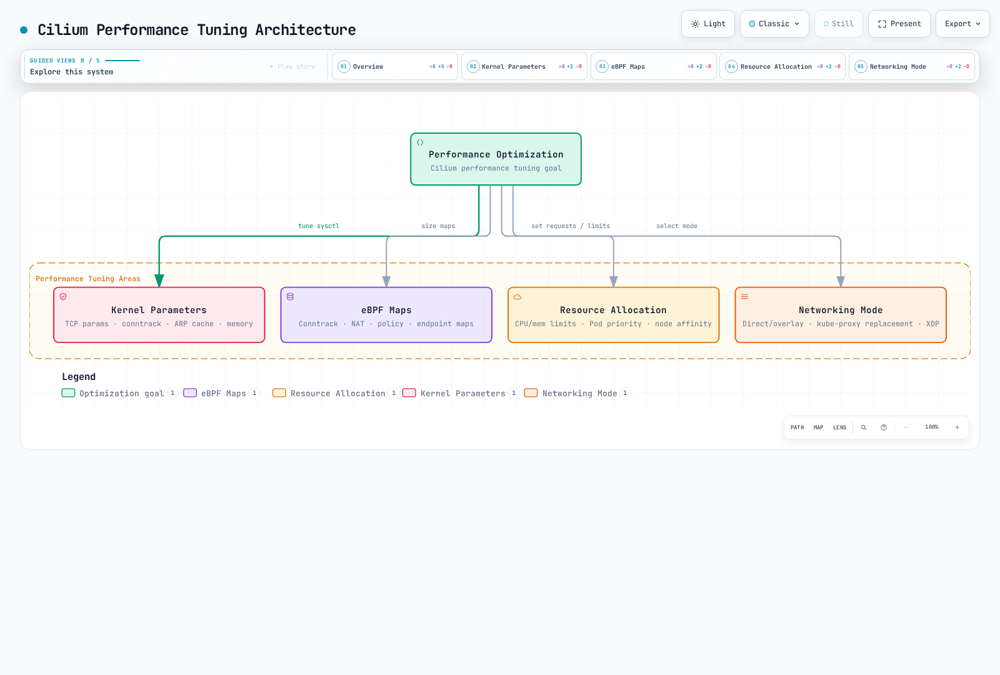

# 高度なトピックと実世界の事例

> **レビュー基準**: Cilium 1.20.2、Cilium CLI 0.20.1、Hubble CLI 1.20.2。
> **最終更新**: October 15, 2026。Cilium 1.20 の Kubernetes 互換性範囲は 1.33–1.36 です。以下の履歴測定値は元の環境を保持しています。

## ラボ環境のセットアップ

[インストールの前提条件](README.md)と、スケジュール可能な Linux ノードが少なくとも 2 つある使い捨てのテストクラスターを使用してください。結果の記録には、OS、kernel、Cilium 設定、トポロジー、MTU、policy、encryption、およびテスト workload を残してください。サポート対象の API-server バージョンスキューの範囲で kubectl を使用してください。以下のコマンドには Helm、jq、および Cilium/Hubble CLI が必要です。`kubectl top` には追加で metrics API が必要です。

### パフォーマンステスト環境のセットアップ

変更前に、既存の Deployment を記録します。

```bash
cilium version
cilium status --verbose
kubectl version
kubectl get nodes -o wide
kubectl -n kube-system get pods -l k8s-app=cilium -o wide
helm get values cilium --namespace kube-system -o yaml > cilium-current-values.yaml
```

現在の CLI は、一致するテスト workload を自身で作成できます。ネットワーク負荷の生成とテストリソースの作成が許容される場合にのみ、これを実行してください。

```bash
cilium connectivity perf --test-namespace cilium-advanced-perf \
  --namespace-labels docs-audit-lab=cilium-advanced-07 \
  --duration 10s --samples 2 --crr --udp \
  --host-net=false --pod-net=true --same-node=true --other-node=true \
  --report-dir ./cilium-advanced-perf-results
```

デフォルトの単一同時実行 run は、引数にその接尾辞がないにもかかわらず **`cilium-advanced-perf-1`** を使用します。テスト前に、その namespace が未使用であることを確認してください。`--duration` は完全な run ではなく、各 scenario/sample に適用されます。スケジューリング、セットアップ、およびケースの組み合わせによって時間が追加されます。このコマンドは、読み取り専用の診断ではなく、アクティブな workload テストです。

同一ノードとノード間の結果、TCP request/response と UDP、実際の CPU/memory/packet-loss の挙動を比較してください。一度に計画済みの変更を 1 つだけ適用して繰り返します。run の成功は、application SLO、production の容量上限、またはすべての policy path を証明するものではありません。この監査では、テストの実行やクラスターのプロビジョニングを行わずに、これらのコマンド契約を検証しました。

## パフォーマンスチューニングとトラブルシューティング

### パフォーマンスチューニングのアーキテクチャ



[インタラクティブ図を表示](https://www.atomai.click/kubernetes-docs/archmaps/en-networking-cilium-07-advanced-topics-0.html)

この図は調査領域をグループ化したものであり、すべての設定を増やしたり、security control を無効にしたりすることを推奨するものではありません。

### パフォーマンスチューニングの領域

| 領域 | 測定対象と設定が制御する内容 |
| --- | --- |
| Socket backlog | `net.core.somaxconn` は socket listen backlog を制限します。`net.ipv4.tcp_max_syn_backlog` は listener ごとの pending SYN_RECV request に関係します。server の accept 挙動と関連する network namespace を確認してください。 |
| Neighbor entry | `net.ipv4.neigh.default.gc_thresh1`、`gc_thresh2`、`gc_thresh3` は異なる garbage-collection threshold です。単一の `gc_thresh` 設定はありません。 |
| Connection tracking | Netfilter の `nf_conntrack_max` と Cilium の BPF CT map は別の mechanism です。前者を増やしても後者のサイズは変更されません。 |
| BPF map | map pressure、insertion failure、churn、memory を調査してください。CT、NAT、LB、endpoint ごとの policy map には、それぞれ異なる scope と sizing rule があります。 |
| CPU と memory | agent、operator、Envoy、Hubble を個別に測定してください。request は scheduling に影響します。CPU limit は throttling を起こす可能性があり、memory limit は OOM termination を引き起こす可能性があります。すべての limit を引き上げることは診断ではありません。 |
| Network path | native/tunnel routing、MTU、masquerading、encryption、service forwarding を特定してください。XDP acceleration はサポートされる path と driver に適用されます。kube-proxy replacement に必須ではありません。 |

パフォーマンスを比較するときは、security と routing の要件を一定に保ってください。必須の encryption や policy を除去して得られた高速な結果は、同等の構成ではありません。

### Map のサイズ設定

pressure を測定した後にのみ、以下を **候補となる変更** として保存してください。完全でバージョン管理された release values にマージし、小さな snippet で Cilium ConfigMap 全体を置き換えないでください。

```yaml
# map-sizing-values.yaml
bpf:
  mapDynamicSizeRatio: 0.005
```

`0.005` は、動的なサイズ設定に対するノード memory の名目上の **0.5%** 入力であり、5% でも、すべての Cilium memory に対する hard limit でもありません。たとえば、32 GiB × 0.005 は、map limit、丸め、その他の allocation の前で 163.84 MiB です。影響を受ける大きな map には、CT、NAT、neighbor、socket reverse-NAT map が含まれます。その他の map と userspace memory は別です。

明示的な `bpf.ctTcpMax`、`bpf.ctAnyMax`、または `bpf.natMax` 値は、これらの map の動的なサイズ設定をオーバーライドします。NAT capacity を CT capacity と互換性のある状態に保ち、解決された startup size を検証してください。map を増やすとより多くの memory を消費する可能性があります。map の置き換えは既存の connection を中断する可能性があります。

Distributed LRU (`bpf.distributedLRU.enabled`) は per-CPU pool を使用して contention を低減しますが、memory/eviction のトレードオフがあります。これには動的なサイズ設定が必要で、有効化すると map が再作成されます。公式の high-performance profile は汎用的な live toggle ではありません。このような datapath の変更は、準備された新しい node に導入するか、文書化された migration procedure を使用してください。

古い `proxy-max-memory-percentage`、`proxy-max-threads`、`enable-xdp`、`tunnel: disabled`、`kube-proxy-replacement: strict` の例は、現在の configuration recipe ではありません。前提条件を含め、`envoy.resources`、`routingMode`、boolean の `kubeProxyReplacement`、`loadBalancer.acceleration` など、サポートされる chart 設定を使用してください。

### Hubble のコストとイベント損失

より大きな event queue は burst を吸収できますが、memory を使用し、継続的な処理不足を解消したり CPU 消費を減らしたりするものではありません。

```yaml
# hubble-queue-values.yaml
hubble:
  eventQueueSize: 32768
```

繰り返し発生する trace event が処理を支配している場合は、より長い aggregation interval を別途評価してください。

```yaml
# hubble-aggregation-values.yaml
bpf:
  monitorAggregation: medium
  monitorInterval: 10s
```

実際の chart field は `bpf.events.monitorInterval` ではなく、**`bpf.monitorInterval`** です。Deployment 前に、render された `monitor-aggregation-interval` を調査してください。aggregation の増加、event-rate limit、event class の無効化はすべて、monitor、Hubble metrics、export で利用できる observation を減らします。失われた Hubble event は、それ自体が drop された application packet ではありません。observability の損失と datapath drop の両方を確認してください。

### 高度な Datapath の前提条件

| Feature | 確認する前提条件と制限 |
| --- | --- |
| netkit | この基準では Beta です。Linux 6.8+ と BPF host routing が必要です。既存の veth Pod は、agent restart 時に単純に device type を切り替えることはできません。 |
| BIG TCP | family 固有の kernel/NIC 要件があります。統合 tuning profile には Linux 6.8+ とサポートされる NIC が必要です。汎用的な MTU increase ではありません。 |
| BPF host routing | 互換性のある kube-proxy replacement と BPF masquerading が必要です。host netfilter hook をバイパスします。これらの hook に依存する Istio やその他の integration を確認してください。 |
| XDP service acceleration | native XDP 対応 device と、サポートされた外部 service-forwarding path。driver/platform のガイダンスを使用し、実行中の status を検証してください。 |
| Bandwidth Manager | Pod ごとの egress は EDT を使用し、ingress は eBPF token bucket を使用します。bandwidth annotation の `10M` は、10 MB/s ではなく 10 Mbit/s を意味します。 |
| Pod の BBR | Bandwidth Manager、Linux 5.18+、BPF host routing。新たに作成された Pod がこの設定を採用します。host-only BBR は別の option です。 |

bandwidth enforcement には、egress L7 Cilium policy および kind などの nested network namespace に関する文書化された制限があります。これらの条件は、通常の Cilium インストール要件とは異なります。単一の tuning profile を、すべての service-mesh、cloud、kernel の組み合わせが機能する証拠として使用しないでください。

### 対象を絞ったトラブルシューティングコマンド

クラスター操作には standalone の `cilium` CLI を使用し、ローカル endpoint、policy、map には **関連する agent 内の `cilium-dbg`** を使用してください。任意に最初の agent を query するのではなく、調査対象の node を選択してください。

```bash
set -euo pipefail
: "${NODE_NAME:?Set NODE_NAME to the node being investigated}"
CILIUM_POD=$(kubectl -n kube-system get pods -l k8s-app=cilium \
  --field-selector "spec.nodeName=$NODE_NAME,status.phase=Running" -o json |
  jq -er 'if (.items | length) == 1
then .items[0].metadata.name
else error("expected exactly one running Cilium Pod on the selected node")
end')
kubectl -n kube-system exec "$CILIUM_POD" -c cilium-agent -- cilium-dbg status --verbose
kubectl -n kube-system exec "$CILIUM_POD" -c cilium-agent -- cilium-dbg endpoint list
kubectl -n kube-system exec "$CILIUM_POD" -c cilium-agent -- cilium-dbg policy get
kubectl -n kube-system exec "$CILIUM_POD" -c cilium-agent -- cilium-dbg policy selectors
kubectl -n kube-system exec "$CILIUM_POD" -c cilium-agent -- cilium-dbg map list
kubectl -n kube-system exec "$CILIUM_POD" -c cilium-agent -- cilium-dbg bpf metrics list
kubectl -n kube-system logs "$CILIUM_POD" -c cilium-agent --since=10m --tail=200
```

Endpoint ID は、その agent にローカルです。その endpoint list の ID を使用してください。

```bash
: "${CILIUM_POD:?Select the owning Cilium Pod first}"
: "${ENDPOINT_ID:?Read the endpoint ID from the selected agent endpoint list}"
kubectl -n kube-system exec "$CILIUM_POD" -c cilium-agent -- \
  cilium-dbg endpoint get "$ENDPOINT_ID"
# Stream local BPF drop events; stop with Ctrl-C.
kubectl -n kube-system exec "$CILIUM_POD" -c cilium-agent -- \
  cilium-dbg monitor --type drop
```

`cilium-dbg map list` は、agent の map manager が認識する open map を一覧表示します。すべての kernel BPF map の inventory ではありません。`cilium-dbg monitor` は、出力された BPF event と任意の capture trace を表示します。すべての packet に対する lossless な tcpdump ではありません。大規模な CT-map dump は高コストになることがあります。`cilium-dbg bpf ct list global` を実行する前に、metrics と影響を受ける node を調査してください。

Hubble では、まず [Security and Visibility](06-security-visibility.md) で説明されているローカル Relay connection を確立してください。

```bash
hubble status
hubble observe --protocol tcp --verdict DROPPED --since 1h
hubble observe --protocol dns --from-label k8s:app=frontend --last 100
hubble observe --http-status '5+' --from-namespace production --last 100
```

`--type` は DNS record type A ではなく event type を選択します。query type を区別する必要がある場合は、DNS flow field を使用してください。HTTP status filter は `5xx` ではなく `5+` を使用します。保持された history と event availability が `--since 1h` を制限します。上書きされた 1 時間分の event を復元することはできません。

### 一般的なトラブルシューティングシナリオ

| 症状 | 収集する証拠 | 次の判断 |
| --- | --- | --- |
| CT/NAT pressure | Map pressure、insertion/drop reason、connection churn、実際に設定された size | size 変更前に、churn/timeout と memory headroom を調査します。 |
| OOM または CPU saturation | Container termination reason、memory/CPU history、throttling、proxy と Hubble の負荷 | 責任を持つ component を特定し、その budget または workload を変更します。 |
| 予期しない policy 結果 | 正しい namespace/label、endpoint policy revision、proxy error、Hubble verdict | direction、additive allow rule、deny precedence を確認します。通常の allow は優先順位付き firewall list ではありません。 |
| ノード間 failure | DNS、node/pod route、MTU、tunnel/encryption port、platform firewall | forward path と return path を検証します。BGP session だけでは datapath reachability を証明しません。 |
| Upgrade regression | 旧/新 values、version note、すべての component version、proxy reconnection | 準備済みでサポートされる rollback path を使用し、feature compatibility を調査します。 |

## 大規模 Deployment 戦略

capacity planning には、node/Pod density、Service と backend、identity、policy expansion、API watch traffic、IPAM allocation、flow volume を含める必要があります。policy の object count だけでは、その endpoint ごとの map cost は決まりません。

### 大規模 Deployment アーキテクチャ

```text
Management / GitOps / shared monitoring
          | config and collected telemetry
          +-----------------------+
          v                       v
  Workload cluster A       Workload cluster B
  - Cilium Operator        - Cilium Operator
  - agent on each node     - agent on each node
  - local Hubble servers   - local Hubble servers
  - Relay/export setup     - Relay/export setup
          |                       |
          +--- optional ClusterMesh metadata/data paths
```

中央の management cluster は、管理対象のすべての cluster で operator を置き換えるものではありません。各 cluster の operator と agent の size を設定してください。chart の operator replica と anti-affinity には十分な eligible node が必要です。構成された collector を通じて metrics/log を集約します。ClusterMesh には、独自の addressing、identity、trust、reachability の設計が必要です。すべての policy resource を自動的に複製するわけではありません。

`ciliumEndpointSlice.enabled` は opt-in の Cilium feature であり、Kubernetes EndpointSlice とは異なります。古い `enable-endpoint-slice` ConfigMap flag ではありません。有効化前に version と feature compatibility を評価してください。Egress Gateway は現在、CiliumEndpointSlice または ClusterMesh と組み合わせることができません。

Egress Gateway は、選択された traffic を予測可能な gateway address に **SNAT** します。元の Pod source address を保持するものではありません。AWS での platform 固有の要件を含め、gateway interface/IP と routing はすでにプロビジョニングされている必要があります。BPF masquerading、kube-proxy replacement、CRD identity allocation が必要です。新しく起動した Pod は、egress policy が有効になる前に短時間 traffic を送信できることがあります。即座に fail-closed となる source-IP guarantee と見なさないでください。

### Rollout と Recovery

desired values、policy、address-pool definition、必要な trust/key material を、適切な versioning と backup control の下に置いてください。recovery をリハーサルしてください。ConfigMap backup は完全な IPAM または cryptographic recovery plan ではありません。

minor upgrade では、まず現在の minor の最新 patch に到達し、必要な preflight を実行してから、**一度に 1 minor** ずつ移行します。upgrade guide の指示に従って初期 `upgradeCompatibility` を保持し、名前変更または削除された value を移行してください。minor version をまたいで `--reuse-values` を使用しないでください。agent、operator、その他の Cilium component は同じ version に収束する必要があります。

userspace proxy を経由する traffic は、upgrade 中に再接続する可能性があります。buffer された monitoring event が失われる可能性があります。rollback が有効になる前に、新しい feature/resource の削除または migration が必要になる場合があります。汎用的な application の blue/green Deployment や Helm rollback は、可逆的でゼロダウンタイムの CNI migration を保証するものではありません。

## 実世界のユースケーススタディ

### 文書化された履歴上のスケーラビリティ実験

公式の scalability report は、Google Cloud 上の **1,000 worker node**、3 controller node、kernel **5.4.0-1009-gcp** を記述しています。その setup は Cilium version を特定していないため、これらの結果を Cilium 1.20.2 benchmark として再分類してはなりません。この report は、独自の workload における resource consumption と convergence を論じています。現在の support matrix や capacity promise ではありません。

その health-check の変更と大規模な rollout concurrency は実験上の選択でした。引用する場合は実際のテスト条件を保持し、operational configuration は別途検証してください。

### 設計シナリオ 1: 大規模 E-commerce

多くの Service と高い request volume に対しては、eBPF service forwarding、identity/L7 policy、Hubble、任意の ClusterMesh を評価してください。同じ topology と protection requirement の下で、p95/p99 latency、throughput、error、request あたりの CPU、policy convergence を測定してください。ここでの普遍的な割合の改善を裏付ける、名前付きの implementation や再現可能な測定値はありません。

### 設計シナリオ 2: Financial Services

最小権限 policy、適切に scope を定めた transport/application encryption、制御された flow export を application/API audit record と組み合わせます。key rotation、event loss、retention、cross-cluster trust をテストしてください。Hubble flow だけでは完全な regulatory audit evidence を構成せず、audit 短縮を保証するものでもありません。

### 設計シナリオ 3: Telecommunications と Edge

現実的な traffic の下で、NIC/driver support、CPU scheduling、service-forwarding path、packet size、loss、latency を評価してください。XDP は、条件を満たす forwarding path に有益な場合があります。それ自体で 5G user-plane function を実装したり、任意の hardware で固定の packets-per-second rate を証明したりするものではありません。remote site では依然として underlay と明示的な failure/recovery テストが必要です。

## 今後のロードマップと開発の方向性

コミュニティの roadmap は、明示的に **日付の確約を行いません**。望ましい integration のリストを提供の約束として扱うのではなく、特定の capability について release note、受理された design、issue を追跡してください。

| 領域 | 調査する質問 |
| --- | --- |
| eBPF と kernel | 提案された path には、どの kernel feature、backport、NIC、architecture が必要ですか？CO-RE は不足している kernel capability を提供しません。 |
| Networking と IPv6 | 選択した release では、どの IPAM、routing、policy、external-integration の組み合わせがサポートされていますか？ |
| Security と observability | これは Cilium network policy、Beta workload authentication/encryption、Tetragon runtime enforcement、または外部の detector/storage system のどれですか？ |
| Cloud、mesh、serverless | managed platform は意図した CNI/host hook を許可していますか？mesh interception と authentication は維持されていますか？ |
| Edge、IoT、5G、AI/ML | どの追加 device、transport、runtime、accelerator integration が必要ですか？Kubernetes CNI は、すべての application 固有 capability を確立するものではありません。 |

project issue、design proposal、documentation、community discussion を通じて参加してください。commercial support と managed distribution には、それぞれの feature/support contract があります。

## 現在の BGP 設定

以前の `CiliumBGPPeeringPolicy` の例は、この基準では廃止されています。現在の設定では、cluster/node selection、peer setting、advertised prefix を、3 つの **`cilium.io/v2`** resource に分離します。BGP Control Plane、LoadBalancer IP advertisement、Egress Gateway、edge pattern の詳細は [BGP、LB、egress、edge](11-bgp-lb-egress-edge.md) を、multi-cluster については [ClusterMesh のインストールと upgrade](13-clustermesh-install-upgrade.md) を参照してください。

これは、分離された routing lab 向けの configuration model であり、完全な cloud-router setup ではありません。`PodCIDR` advertisement には cluster-pool または Kubernetes host-scope IPAM、到達可能な peer router、対応する router configuration、意図的に `cilium-bgp=lab` の label が付与された node を前提とします。`192.0.2.1` は documentation address です。`/32` を付けずに実際の peer IP に置き換えてください。multi-pool IPAM では、別の advertisement type と pool selection を使用します。

```yaml
# bgp-values.yaml
bgpControlPlane:
  enabled: true
```
```yaml
# bgp-lab.yaml
apiVersion: cilium.io/v2
kind: CiliumBGPClusterConfig
metadata:
  name: lab-bgp
spec:
  nodeSelector:
    matchLabels:
      cilium-bgp: lab
  bgpInstances:
  - name: asn-64512
    localASN: 64512
    peers:
    - name: router-64513
      peerASN: 64513
      peerAddress: 192.0.2.1
      peerConfigRef:
        name: lab-peer
---
apiVersion: cilium.io/v2
kind: CiliumBGPPeerConfig
metadata:
  name: lab-peer
spec:
  timers:
    connectRetryTimeSeconds: 120
    holdTimeSeconds: 90
    keepAliveTimeSeconds: 30
  gracefulRestart:
    enabled: true
    restartTimeSeconds: 120
  families:
  - afi: ipv4
    safi: unicast
    advertisements:
      matchLabels:
        advertise: lab
---
apiVersion: cilium.io/v2
kind: CiliumBGPAdvertisement
metadata:
  name: lab-pod-cidrs
  labels:
    advertise: lab
spec:
  advertisements:
  - advertisementType: PodCIDR
```

peer の advertisement selector は `advertise: lab` に一致し、`peerConfigRef` は `lab-peer` に解決されます。Graceful Restart には、互換性のある peer の挙動と適切な timer が必要です。失敗した datapath を維持したり、application availability を保証したりすることはできません。BGP は reachability を advertise しますが、**ローカル datapath route を install したり** DNS record を作成したりはしません。

routing lab で適切な configuration を準備して適用した後、Cilium の状態と外部 router が受信した route の両方を調査してください。

```bash
kubectl get ciliumbgpclusterconfigs,ciliumbgppeerconfigs,ciliumbgpadvertisements
cilium bgp peers
cilium bgp routes advertised ipv4 unicast
```

実際の forward/return traffic は別途テストしてください。長く存在する HTTP policy や任意の割合による向上を、古い release の新機能として説明しないでください。Cilium 1.18 または別の以前の minor から移行する場合は、正確な release note を確認してください。

## 次のステップ

個別の path を検証するには、[IPAM と policy](04-ipam-policy.md)、[L2–L7 networking](05-l2-l7-networking.md)、[security/visibility](06-security-visibility.md) の chapter を使用してください。各結果に benchmark 条件と制限を添付し、その後、段階的な rollout と recovery をリハーサルしてください。

パフォーマンステストで作成された正確な namespace を確認した後、その resource を削除してください。

```bash
set -eu
PERF_NS=cilium-advanced-perf-1
LAB_OWNER=$(kubectl get namespace "$PERF_NS" -o jsonpath='{.metadata.labels.docs-audit-lab}')
test "$LAB_OWNER" = cilium-advanced-07
kubectl delete namespace "$PERF_NS"
```

## 主な参照資料

- [チューニングガイド](https://raw.githubusercontent.com/cilium/cilium/v1.20.2/Documentation/operations/performance/tuning.rst)
- [Chart values](https://raw.githubusercontent.com/cilium/cilium/v1.20.2/install/kubernetes/cilium/values.yaml)
- [Chart ConfigMap template](https://raw.githubusercontent.com/cilium/cilium/v1.20.2/install/kubernetes/cilium/templates/cilium-configmap.yaml)
- [Map のサイズ設定](https://raw.githubusercontent.com/cilium/cilium/v1.20.2/Documentation/network/ebpf/maps.rst)
- [Map sizing implementation](https://raw.githubusercontent.com/cilium/cilium/v1.20.2/pkg/option/config.go)
- [Upgrade guide](https://raw.githubusercontent.com/cilium/cilium/v1.20.2/Documentation/operations/upgrade.rst)
- [Upgrade limitations](https://raw.githubusercontent.com/cilium/cilium/v1.20.2/Documentation/operations/upgrade-warning.rst)
- [BGP configuration](https://raw.githubusercontent.com/cilium/cilium/v1.20.2/Documentation/network/bgp-control-plane/bgp-control-plane-configuration.rst)
- [BGP operation](https://raw.githubusercontent.com/cilium/cilium/v1.20.2/Documentation/network/bgp-control-plane/bgp-control-plane-operation.rst)
- [Bandwidth Manager](https://raw.githubusercontent.com/cilium/cilium/v1.20.2/Documentation/network/kubernetes/bandwidth-manager.rst)
- [Egress Gateway](https://raw.githubusercontent.com/cilium/cilium/v1.20.2/Documentation/network/egress-gateway/egress-gateway.rst)
- [履歴上の scalability report](https://raw.githubusercontent.com/cilium/cilium/v1.20.2/Documentation/operations/performance/scalability/report.rst)
- [Community roadmap](https://raw.githubusercontent.com/cilium/cilium/v1.20.2/Documentation/community/roadmap.rst)
- [Linux IP sysctl](https://www.kernel.org/doc/html/latest/networking/ip-sysctl.html)

[メインページに戻る](README.md)

## クイズ

[トピッククイズ](../../quizzes/networking/cilium/07-advanced-topics-quiz.md)で、operational boundary と diagnostic command を復習してください。