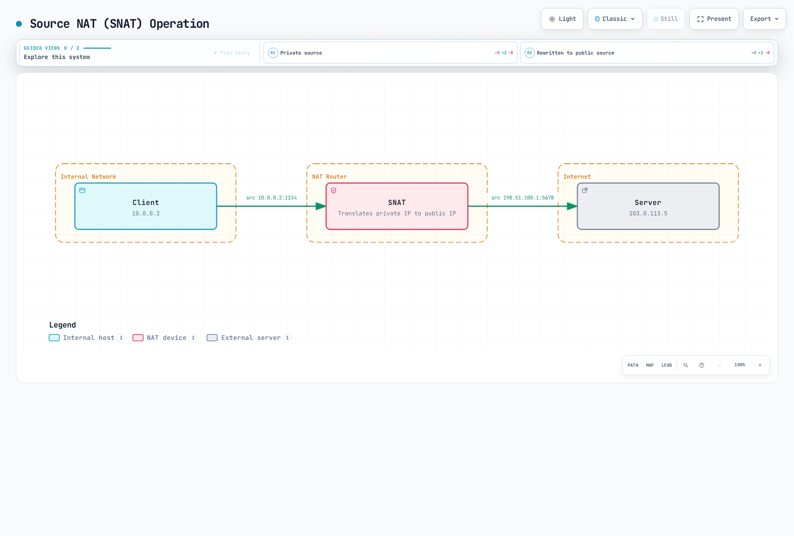
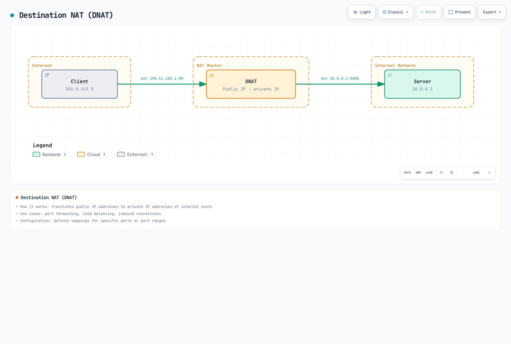
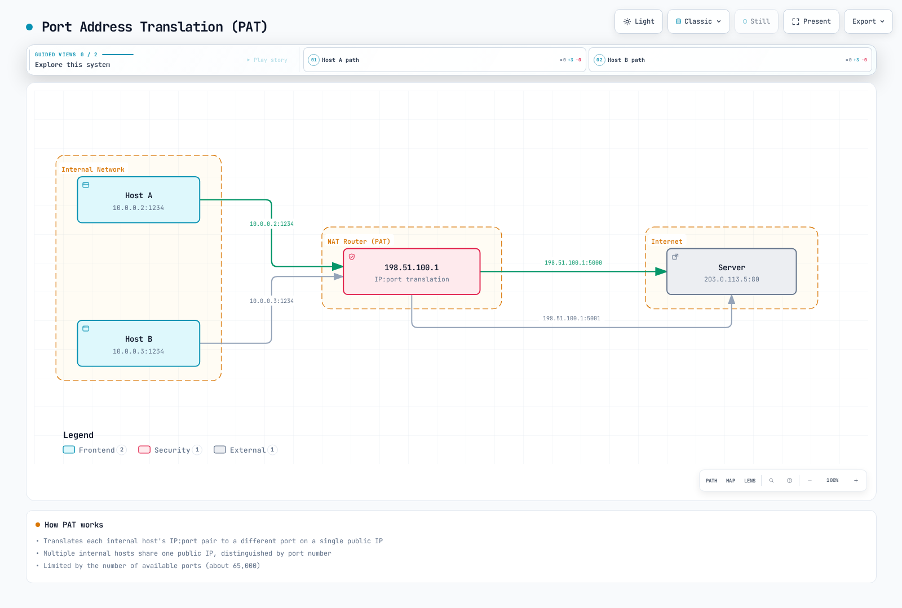

# ネットワーキング概念の詳細

> **レビュー基準**: Cilium 1.20.2。
> **最終更新**: October 15, 2026。

このドキュメントでは、Cilium を理解するために必要な中核的なネットワーキング概念を詳しく説明します。コンテナネットワーキング、オーバーレイ、NAT、ルーティング、DNS、ロードバランシング、ポリシーを扱います。例は、準備済みテスト環境向けの概念的または部分的な Helm/API 設定であり、完全なインストール手順や移行手順ではありません。[Cilium の概要](README.md)でプラットフォームおよびバージョンの前提条件を確認してください。すべてのマネージドプラットフォームが同じ CNI 機能を許可するわけではありません。

## 学習目標

このドキュメントを通じて、次を理解できます。
- OSI モデルと TCP/IP スタックの基本構造、および各層の役割
- コンテナネットワーキングの基本原理と実装方法
- オーバーレイネットワークとアンダーレイネットワークの違い
- NAT、ルーティング、DNS などの中核的なネットワーキング概念が Cilium でどのように利用されるか

## 目次

1. [OSI モデルと TCP/IP スタック](#osi-model-and-tcp-ip-stack)
2. [コンテナネットワーキングの基礎](#container-networking-basics)
3. [オーバーレイネットワーク](#overlay-networks)
4. [ネットワークアドレス変換 (NAT)](#network-address-translation-nat)
5. [ルーティングプロトコル](#routing-protocols)
6. [DNS とサービスディスカバリ](#dns-and-service-discovery)
7. [ロードバランシングの概念](#load-balancing-concepts)
8. [ネットワークセキュリティの基礎](#network-security-basics)

## OSI モデルと TCP/IP スタック

> **重要な概念**: OSI モデルは、ネットワーク通信を 7 つの抽象層に分類する概念的なフレームワークであり、複雑なネットワーキングプロセスを理解しやすくします。

OSI (Open Systems Interconnection) モデルは、ネットワーク通信を 7 つの抽象層に分類する概念的なフレームワークです。各層は特定のネットワーキング機能を担うため、複雑なネットワーキングプロセスを分解して理解しやすくなります。

### OSI モデルと TCP/IP モデルの比較


[🔍 インタラクティブ図を表示](https://www.atomai.click/kubernetes-docs/archmaps/en-networking-cilium-networking-concepts-0.html)

この対応付けは教育上の近似であり、プロトコル実装の仕様ではありません。図中の SSL は旧来の表記です。現在のシステムではサポートされている TLS バージョンを使用してください。

### OSI 7 層モデル

1. **物理層**
   - ビットストリームを電気、光、または無線信号に変換する
   - ケーブル、トランシーバー、物理シグナリングを含む。スイッチはより上位の層の機能も実装する
   - データ単位: Bit

2. **データリンク層**
   - 物理ネットワーク上のノード間のデータ転送を担う
   - MAC (Media Access Control) アドレスを用いたデバイス識別
   - エラー検出、およびリンクプロトコルが提供する場合は回復。Ethernet のエラー検出自体は破損したフレームを修正しない
   - データ単位: Frame
   - Ethernet および Wi-Fi プロトコルはこの層で動作する

3. **ネットワーク層**
   - 異なるネットワーク間のパケットルーティングを担う
   - 論理アドレッシング (IP アドレス)
   - パス決定とパケット転送
   - データ単位: Packet
   - IP (Internet Protocol) はこの層の中核プロトコルである

4. **トランスポート層**
   - エンドツーエンド通信制御
   - データの分割と再構成
   - TCP はフロー制御と再送を提供する。UDP はそれらの保証を提供しない
   - データ単位: TCP segment または UDP datagram
   - TCP (Transmission Control Protocol) と UDP (User Datagram Protocol) はこの層の主要プロトコルである

5. **セッション層**
   - 通信セッションの確立、維持、終了
   - 同期と対話制御
   - チェックポイント設定と回復
   - セッション管理はこの層で議論できるが、実際の RPC 実装が必ずしも単一の OSI 層に対応するわけではない

6. **プレゼンテーション層**
   - データ形式変換と暗号化
   - 文字エンコーディング、データ圧縮、暗号化/復号
   - エンコーディング/圧縮はこの責務を例示する。TLS は Internet プロトコルであり、OSI プレゼンテーション層の文字どおりの実装ではない

7. **アプリケーション層**
   - 必ずしもグラフィカルユーザーインターフェイスではない、アプリケーションが使用するネットワークサービスを提供する
   - メール、ファイル転送、Web ブラウジングなどのサービス
   - HTTP、FTP、SMTP、DNS はこの層の例である

### Cilium と OSI モデルの関係

Cilium は複数の OSI 層で動作します。

| OSI 層 | Cilium 機能 | 例 |
|-----------|----------------|---------|
| L2 (データリンク) | リンクレベル到達可能性、任意の L2 Announcements | 設定済み Service VIP に対する ARP/NDP 応答 |
| L3 (ネットワーク) | IP ルーティング、CIDR ベースのポリシー | Pod 間の IP ルーティング |
| L4 (トランスポート) | ポートベースのフィルタリング、コネクショントラッキング | Service ポートアクセス制御 |
| L7 (アプリケーション) | サポートされている HTTP/gRPC および DNS プロキシルール | HTTP パスポリシーまたは DNS クエリポリシー |

L2 Announcements はこの基準では Beta のままであり、コントローラー/デバイス設定が必要です。これは一般的な MAC アドレスのセキュリティポリシーインターフェイスとは異なります。

### TCP/IP スタック

TCP/IP スタックは Internet の基盤を形成するプロトコルの集合であり、しばしば 4 層のアーキテクチャとして説明され、OSI と比較されます。これは 7 層モデルの直接的な実装ではありません。

1. **ネットワークインターフェイス層**
   - OSI モデルの物理層およびデータリンク層に対応する
   - 物理ネットワーク媒体とのインターフェイスを担う
   - Ethernet や Wi-Fi などのプロトコルを含む

2. **Internet 層**
   - OSI モデルのネットワーク層に対応する
   - IP (Internet Protocol) を用いたパケットルーティング
   - ICMP (Internet Control Message Protocol) を含む。ARP はリンク境界で IPv4 の次ホップのリンク層アドレスを解決し、IPv6 は Neighbor Discovery を使用する

3. **トランスポート層**
   - OSI モデルのトランスポート層と同じ
   - TCP および UDP プロトコルを含む
   - コネクション型 (TCP) とコネクションレス型 (UDP) の通信を提供する

4. **アプリケーション層**
   - OSI モデルのセッション層、プレゼンテーション層、アプリケーション層を統合する
   - HTTP、SMTP、FTP、DNS などのプロトコルを含む
   - ユーザーアプリケーションとネットワークの間のインターフェイスを提供する

### 層別の Cilium 機能

Cilium はさまざまなネットワーク層で機能を提供します。

- **L2 (データリンク層)**: リンク到達可能性と任意の L2 Service アナウンスメント。これは一般的な MAC アドレス NetworkPolicy API や万能な ARP スプーフィング保護ではない
- **L3 (ネットワーク層)**: IP アドレスベースのルーティングとフィルタリング、IPAM
- **L4 (トランスポート層)**: ポートベースのフィルタリング、ロードバランシング、コネクショントラッキング
- **L7 (アプリケーション層)**: 設定済みの HTTP/gRPC プロキシ機能と DNS ポリシー。以前の Kafka L7 ポリシー API は削除されている

## コンテナネットワーキングの基礎

コンテナネットワーキングは、コンテナ化されたアプリケーションが相互に、また外部世界と通信できるようにする仕組みです。Kubernetes のようなコンテナオーケストレーションプラットフォームは、さまざまなネットワーキングモデルとソリューションを使用します。

### Container Network Interface (CNI)

CNI (Container Network Interface) は、コンテナランタイムとネットワークプラグイン間の標準インターフェイスを定義します。現在の Kubernetes は、CRI コンテナランタイムを使用して CNI プラグインを呼び出します。このインターフェイスにより複数のネットワーキング実装が可能になります。CNI 仕様は、すべてのプラグインに Kubernetes NetworkPolicy の実装を要求していません。

#### CNI の主要コンポーネント:

1. **プラグイン**: ネットワークインターフェイスの作成と設定を担う実行可能ファイル
2. **設定ファイル**: プラグインの動作を定義する JSON 形式のファイル
3. **IPAM (IP Address Management)**: IP アドレスの割り当てと管理を担うモジュール

#### CNI プラグインの主な責務:

- コンテナネットワーク名前空間への/からのインターフェイスの追加/削除
- IP アドレスの割り当てと解放
- ルーティングテーブルの設定
- ネットワーキング実装は、ポリシーコントローラー/データパス強制を別途提供する場合がある。ポリシーは必須の CNI 実行操作ではない

### コンテナネットワーキングモデル

コンテナネットワーキングモデルにはいくつかの種類があり、それぞれ異なるユースケースと要件に適しています。

#### 1. ブリッジネットワーキング

- コンテナを接続する仮想ブリッジをホスト上に作成する
- 各コンテナは仮想 Ethernet (veth) ペアを通じてブリッジに接続する
- 同じホスト上のコンテナ間で効率的に通信できる
- デフォルトブリッジはスタンドアロン Linux Docker の例であり、Kubernetes や Cilium のネットワーキングモデルではない


[🔍 インタラクティブ図を表示](https://www.atomai.click/kubernetes-docs/archmaps/en-networking-cilium-networking-concepts-1.html)

これは説明用アドレスを用いた Linux Docker ブリッジの例です。ホストのルーティング/NAT パスは簡略化されており、Cilium のデフォルトブリッジトポロジーではありません。

#### 2. ホストネットワーキング

- コンテナがホストのネットワーク名前空間を直接使用する
- 別個のネットワーク分離がない
- 別個のコンテナネットワーク名前空間を回避する。パフォーマンスは依然として実際のワークロードとパスに依存する
- ポート競合の可能性がある


[🔍 インタラクティブ図を表示](https://www.atomai.click/kubernetes-docs/archmaps/en-networking-cilium-networking-concepts-2.html)

ここでの「分離なし」はネットワーク名前空間を共有することを意味します。すべてのプロセス、ファイルシステム、その他のコンテナ分離境界が取り除かれることを意味するわけではありません。

#### 3. オーバーレイネットワーキング

- 複数のホストにまたがるコンテナ間通信をサポートする
- VXLAN や GENEVE などのカプセル化プロトコルを使用する
- 大規模クラスタに適している
- Cilium、Calico、Flannel などでサポートされる


[🔍 インタラクティブ図を表示](https://www.atomai.click/kubernetes-docs/archmaps/en-networking-cilium-networking-concepts-3.html)

この汎用 VXLAN 図は標準 UDP 4789 と共有 L2 サブネットを使用します。Cilium のデフォルト VXLAN ポートは 8472 です。Pod CIDR の割り当ては、この図をコピーするのではなく、選択した IPAM モードに従う必要があります。

#### 4. アンダーレイネットワーキング (Direct Routing)

- 物理ネットワークインフラストラクチャを直接利用する
- カプセル化オーバーヘッドがない
- ネットワークインフラストラクチャを制御する必要がある
- BGP などのルーティングプロトコルと統合できる


[🔍 インタラクティブ図を表示](https://www.atomai.click/kubernetes-docs/archmaps/en-networking-cilium-networking-concepts-4.html)

このエントリはホストルートを例示しています。実際のデプロイメントには、Pod アドレスに対する到達可能な次ホップと有効な転送/戻りルートが依然として必要です。

### Kubernetes ネットワーキングモデル

Kubernetes モデルは、**意図的なネットワークセグメンテーションがない限り**直接的な Pod 接続性を提供します。

1. Pod ネットワーク内で、Pod は必須のプロキシまたは NAT なしに他の Pod と通信できる。
2. Node エージェントは**その Node 上の** Pod と通信できなければならない。これは、すべてのホストがすべての Pod に到達しなければならないという包括的な要件ではない。
3. 外部接続はクラスタのルーティングおよびセキュリティポリシーに従う。無制限の Internet アクセスは必須ではない。

NetworkPolicy の強制は対応可能なネットワーク実装に依存します。インストールされたプラグインがそれを強制しない場合でも、API は存在し得ます。

#### Kubernetes ネットワークコンポーネント:

1. **Pod ネットワーク**: クラスタ内のすべての Pod を接続するネットワーク
2. **Service ネットワーク**: Pod の集合に安定したエンドポイントを提供する
3. **クラスタ DNS**: サービスディスカバリのための DNS サービス
4. **Ingress/Egress**: クラスタ外との通信を管理する

### Cilium のコンテナネットワーキングアプローチ

Cilium は eBPF を活用して、高性能でスケーラブルなコンテナネットワーキングソリューションを提供します。

1. **eBPF ベースのデータパス**: カーネル内での直接パケット処理
2. **多様なネットワーキングモードのサポート**: Overlay (VXLAN、Geneve) とネイティブルーティング。一般的な Helm のデフォルトは VXLAN を使用するトンネルモードであり、プラットフォームによるオーバーライドの対象となる
3. **高度なロードバランシング**: kube-proxy replacement 機能
4. **ネットワークポリシー**: L3-L7 レベルのきめ細かなポリシー
5. **統合 IPAM**: 多様な IP アドレス割り当て戦略のサポート

プラットフォームのオーバーライドなしの一般的な Helm インストールでは、デフォルトで cluster-pool IPAM が使用されます。operator が Node CIDR を割り当て、agent が各 Node のプールから Pod IP を割り当てます。`ipam.mode: kubernetes` は Node の `spec.podCIDR`/`spec.podCIDRs` を使用します。ENI モードは EC2 インターフェイスと VPC アドレスを使用します。これはすべての EKS コンピュートモードに対する万能な推奨ではありません。[IPAM とポリシー](04-ipam-policy.md)を参照してください。

## オーバーレイネットワーク

オーバーレイネットワークは、既存のネットワークインフラストラクチャ上に仮想ネットワーク層を構築する技術です。この技術により、物理ネットワークトポロジーとは独立して仮想ネットワークトポロジーを作成できます。コンテナ環境では、複数のホストにまたがるコンテナ間通信を可能にするために広く使用されます。

### オーバーレイネットワークの仕組み

オーバーレイネットワークはカプセル化技術を使用して動作します。元のパケットを別のパケット内にカプセル化し、物理ネットワークを通じて送信します。

1. **パケットのカプセル化**: 元のパケット (内部パケット) を新しいヘッダーおよび場合によっては新しいトレーラーで包む。
2. **トンネリング**: カプセル化されたパケットを物理ネットワーク経由で宛先ホストへ送信する。
3. **パケットのカプセル化解除**: 宛先ホストで外部ヘッダーを取り除き、元のパケットを抽出する。
4. **パケット転送**: 元のパケットを宛先コンテナへ転送する。

### 主なオーバーレイネットワークプロトコル

#### VXLAN (Virtual Extensible LAN)

VXLAN は、コンテナネットワーキングで最も広く使用されているオーバーレイプロトコルの 1 つです。

- **VXLAN Tunnel Endpoint (VTEP)**: パケットのカプセル化とカプセル化解除を担う
- **VXLAN Network Identifier (VNI)**: 16,777,216 個の可能な値を持つ 24 ビットフィールド。これは Cilium がサポートするテナント/エンドポイント容量ではない
- **UDP カプセル化**: 標準 VXLAN は UDP 4789 を使用する。Cilium のデフォルト VXLAN トンネルポートは UDP 8472
- **MAC-in-UDP カプセル化**: 元の L2 フレームを UDP パケットにカプセル化する

VXLAN パケット構造:


[🔍 インタラクティブ図を表示](https://www.atomai.click/kubernetes-docs/archmaps/en-networking-cilium-networking-concepts-5.html)

これは汎用 VXLAN ワイヤ形式です。UDP 4789 と 24 ビット VNI は標準を表します。Cilium は UDP 8472 をデフォルトとし、アイデンティティにオーバーレイメタデータを使用します。フィールド幅はクラスタ容量の保証ではありません。

#### GENEVE (Generic Network Virtualization Encapsulation)

GENEVE は VXLAN の制限を克服するよう設計された、より柔軟なオーバーレイプロトコルです。

- **拡張可能なオプションヘッダー**: 多様なメタデータをサポートする
- **プロトコル非依存**: 多様な仮想化技術で使用できる
- **UDP カプセル化**: UDP ポート 6081 経由で送信される
- **柔軟なトンネリング**: 多様なネットワーク仮想化要件をサポートする

#### IPsec

IPsec は、IP パケットレベルでセキュリティサービスを提供するプロトコルスイートです。

- **認証と暗号化**: IPsec は完全性/認証の仕組みを提供し、適切なモードでは機密性も提供する
- **トランスポートモードとトンネルモード**: 多様なデプロイメントシナリオをサポートする
- **Security Association (SA)**: 通信当事者間のセキュリティパラメータを定義する
- **Internet Key Exchange (IKE)**: 一般的な IPsec ネゴシエーション機構。代わりに Cilium の IPsec セットアップでは、管理者が提供するキー Secret と文書化されたローテーション手順を使用する

### オーバーレイネットワークの利点と欠点

#### 利点:

- **柔軟性**: 物理ネットワークトポロジーとは独立して仮想ネットワークを設定できる
- **スケーラビリティ**: 大規模なネットワークセグメントと多数のエンドポイントをサポートする
- **分離**: 正しく設定すれば論理セグメントでトラフィックを分離できる。カプセル化だけでは認証、暗号化、完全なポリシー境界にはならない
- **互換性**: 既存のネットワークインフラストラクチャと連携できる

#### 欠点:

- **オーバーヘッド**: カプセル化によるパケットサイズと処理オーバーヘッドの増加
- **MTU に関する考慮事項**: カプセル化による Maximum Transmission Unit (MTU) の縮小
- **複雑性**: トラブルシューティングとデバッグがより複雑になる場合がある
- **レイテンシー**: カプセル化は処理負荷を追加する。選択した実装とオフロードによる実際の影響を測定する

### Cilium におけるオーバーレイネットワーク

Cilium は VXLAN や Geneve などのオーバーレイプロトコルをサポートし、eBPF を活用して効率的なパケット処理を提供します。

- **eBPF 支援 VXLAN 処理**: BPF プログラムは VXLAN ヘッダーを自ら構築しない。トンネルメタデータ (`bpf_skb_set_tunnel_key`) を設定し、フローベースの `cilium_vxlan` (または `cilium_geneve`) デバイスへリダイレクトする。そこでカーネルの VXLAN/Geneve ドライバーがカプセル化とカプセル化解除を行う。[オーバーレイとネイティブルーティング](09-overlay-native-routing.md)を参照
- **効率的なルーティング**: 最適化されたパスによるパケット転送
- **暗号化オプション**: IPsec または WireGuard による暗号化オーバーレイ
- **モード選択**: サポートされているルーティングモードを選択する。トンネルモードとともに自動 Direct Node Route を有効にすると拒否される。これはフォールバック機構ではない

#### Cilium VXLAN 設定例:

**新規の準備済み IPv4 テストインストール**用 Helm 値。重複しない Pod CIDR を選択してください。これは実稼働中の IPAM 移行や ConfigMap の置き換えではありません。

```yaml
# vxlan-values.yaml
routingMode: tunnel
tunnelProtocol: vxlan
tunnelPort: 8472
autoDirectNodeRoutes: false
ipv4:
  enabled: true
ipv6:
  enabled: false
ipam:
  mode: cluster-pool
  operator:
    clusterPoolIPv4PodCIDRList:
    - 10.244.0.0/16
    clusterPoolIPv4MaskSize: 24
```

## ネットワークアドレス変換 (NAT)

ネットワークアドレス変換 (NAT) は、IP パケットの送信元または宛先アドレスを変更するプロセスです。NAT は主に、プライベートネットワーク上のデバイスがパブリック Internet と通信できるようにするため、またはネットワークアドレス空間が重複する 2 つのネットワーク間の通信を可能にするために使用されます。

### NAT の主な種類

#### 1. Source NAT (SNAT)

Source NAT はパケットの送信元 IP アドレスを変更します。通常は、プライベートネットワーク上のデバイスが Internet にアクセスするときに使用されます。

- **仕組み**: 送信元アドレス、および場合によってはそのポートを書き換える。プライベートからパブリックへの変換は一般的な用途の 1 つ
- **ユースケース**: Internet アクセス、アウトバウンド接続
- **追跡**: NAT テーブルに接続状態を保存する



[🔍 インタラクティブ図を表示](https://www.atomai.click/kubernetes-docs/archmaps/en-networking-cilium-networking-concepts-6.html)

文書用アドレス範囲は、プライベートからパブリックへの SNAT の一例を示します。SNAT は送信元変換を意味します。置換先は常にパブリックアドレスである必要はありません。

#### 2. Destination NAT (DNAT)

Destination NAT はパケットの宛先 IP アドレスを変更します。通常は、パブリック Internet からプライベートネットワーク上のサービスにアクセスするときに使用されます。

- **仕組み**: 宛先アドレス/ポートを書き換える。パブリックからプライベートへの転送は一例
- **ユースケース**: ポートフォワーディング、ロードバランシング、インバウンド接続
- **設定**: 特定のポートまたはポート範囲のマッピングを定義する



[🔍 インタラクティブ図を表示](https://www.atomai.click/kubernetes-docs/archmaps/en-networking-cilium-networking-concepts-7.html)

これは文書用アドレスを用いたパブリックからプライベートへの DNAT の一例を示します。DNAT は宛先変換であり、他のアドレスレルムにも現れます。

#### 3. Port Address Translation (PAT)

PAT は IP アドレスとポート番号の両方を変更します。これにより、複数の内部ホストが 1 つのパブリック IP アドレスを共有できます。

- **仕組み**: 内部ホストの IP:port の組み合わせを、単一のパブリック IP の異なるポートに変換する
- **ユースケース**: IP アドレス節約、多数の内部ホストのサポート
- **制限事項**: ポートおよび状態リソースは有限である。同時フロー数は、プロトコル、宛先タプル、マッピング再利用にも依存し、汎用的な 65,000 接続上限ではない



[🔍 インタラクティブ図を表示](https://www.atomai.click/kubernetes-docs/archmaps/en-networking-cilium-networking-concepts-8.html)

この例では、同じリモートサーバーに対して異なる変換後ポートを使用します。およそ 65,000 のポート空間は、すべての NAT 接続に対する汎用的な上限ではありません。プロトコル、宛先タプル、マッピング動作、状態容量が重要です。

#### 4. Twice NAT と双方向 NAT

**Twice NAT** は、トラフィックがアドレスレルムをまたぐ際に送信元と宛先の両方のアドレスを変更し、重複するアドレス空間を調整するのに役立ちます。アドレスマッピング、DNS/アプリケーションの前提、戻りパスはすべて一緒に設計する必要があります。

一方、RFC 2663 における**双方向 NAT**は、どちらのレルムからもセッションを開始できることを説明します。定義上、各パケットの両方のアドレスを変更することを意味しません。

### NAT の利点と欠点

#### 利点:

- **IP アドレス節約**: 限られた数のパブリック IP アドレスで多数の内部ホストをサポートする
- **アドレス隠蔽**: 内部アドレスを隠せる場合があるが、NAT はファイアウォールポリシーや認証の代替ではない
- **アドレスレルムの調整**: 適切な変換により重複するレルムを接続できるが、それ自体で分離を提供するものではない
- **柔軟なネットワーク設計**: 内部ネットワークを再設定せずに ISP を変更できる

#### 欠点:

- **コネクショントラッキングのオーバーヘッド**: 状態テーブルの維持に必要なリソース
- **特定のプロトコルの問題**: 一部のプロトコルは NAT と互換性がない場合がある
- **エンドツーエンド接続性の喪失**: 直接的なピアツーピア通信が困難になる
- **複雑なトラブルシューティング**: NAT 関連の問題のデバッグは複雑になる場合がある

### Kubernetes と Cilium の NAT

#### Kubernetes の NAT

Kubernetes はさまざまなシナリオで NAT を使用します。

1. **クラスタ外との通信**: アドレス到達可能性、マスカレード除外、選択したデータパスに応じて SNAT が使用される場合がある
2. **Service 実装**: パケットベースの実装は Service の宛先を変換できる。ソケットレベルのロードバランシングでは、そのようなパケットが存在する前にバックエンドを選択する場合がある
3. **NodePort Service**: 実装は Node IP:port を選択されたバックエンドへ転送する。戻りパスの動作は SNAT/DSR およびトラフィックポリシーに依存する
4. **LoadBalancer Service**: プロバイダー/コントローラーの動作はさまざまであり、パブリックアドレスから Pod への単一の DNAT ステップである必要はない

#### Cilium の NAT

Cilium は eBPF を活用して効率的な NAT 実装を提供します。

1. **eBPF ベースの NAT**: カーネル内で直接 NAT を実行する
2. **高性能なコネクショントラッキング**: 最適化された BPF map を使用した接続状態の追跡
3. **NAT 制御**: サポートされるマスカレード除外、Service 転送、Egress Gateway 機能にはそれぞれ異なる設定と前提条件がある
4. **マスカレーディング**: 設定されたパス/デバイスでの条件付き送信元変換。除外 CIDR とサポートされるモードが結果に影響する

Egress Gateway は、合致するアウトバウンドトラフィックを選択された Node 経由で送信し、設定済みゲートウェイアドレスに SNAT する別個の機能です。元の送信元 IP を変更します。インターフェイス、アドレス、戻りパスを準備する必要があります。新しい Pod はポリシー収束前にトラフィックを送信できるため、即座のフェイルクローズドな送信元 IP 保証ではありません。

#### Cilium NAT 設定例:

この Helm フラグメントは、到達可能な API エンドポイントを備えた、準備済みの kube-proxy replacement/BPF マスカレーディング環境を前提としています。最初に実際に接続されたデバイスとルートを確認してください。CIDR を SNAT から除外しても戻りルートは作成されません。NAT サイズは例であり、推奨される汎用容量ではありません。

```yaml
# masquerade-values.yaml
enableIPv4Masquerade: true
kubeProxyReplacement: true
bpf:
  masquerade: true
  natMax: 262144
ipMasqAgent:
  enabled: true
  config:
    nonMasqueradeCIDRs:
    - 10.0.0.0/8
    - 172.16.0.0/12
    - 192.168.0.0/16
    masqLinkLocal: false
```

## ルーティングプロトコル

ルーティングプロトコルは、ネットワーク内でパケットが送信元から宛先へ移動する最適なパスを決定するルールと手順を定義します。これらのプロトコルは、ネットワークトポロジーの変更への適応、トラフィックの効率的な転送、ネットワーク障害の回避において重要な役割を果たします。

### ルーティングプロトコルの分類

#### 1. Interior Gateway Protocols (IGP)

Interior Gateway Protocols は、単一の Autonomous System (AS) 内でルーティング情報を交換するために使用されます。

##### Distance Vector Protocols

- **RIP (Routing Information Protocol)**
  - メトリックとしてホップ数を使用する
  - 有効なメトリックは 15 ホップまでであり、メトリック 16 は到達不能を表す
  - 実装が簡単で、小規模ネットワークに適している
  - 定期更新はおよそ 30 秒ごとであり、タイマーのランダム化と変更時のトリガー更新を伴う

- **EIGRP (Enhanced Interior Gateway Routing Protocol)**
  - 設定可能な複合メトリック。デフォルト係数は負荷や信頼性ではなくスループット/帯域幅と遅延を使用する
  - 部分更新のみを送信する
  - 高速な収束
  - Cisco 起源のプロトコルであり、Informational RFC 7868 に文書化されている。この公開は IETF Standards Track の指定ではない

##### Link State Protocols

- **OSPF (Open Shortest Path First)**
  - Dijkstra のアルゴリズムを使用して最短パスを計算する
  - エリアベースの階層
  - 高速な収束
  - 大規模ネットワークをサポートする
  - Link State Advertisements (LSAs) を通じてトポロジー情報を交換する

- **IS-IS (Intermediate System to Intermediate System)**
  - OSPF に類似したリンクステートプロトコル
  - 大規模サービスプロバイダーネットワークで広く使用される
  - 複数のネットワーク層をサポートする
  - 効率的なルーティング更新

#### 2. Exterior Gateway Protocols (EGP)

Exterior Gateway Protocols は、異なる Autonomous System 間でルーティング情報を交換するために使用されます。

- **BGP (Border Gateway Protocol)**
  - Internet の中核ルーティングプロトコル
  - パスベクタープロトコル
  - ポリシーベースのルーティング決定
  - TCP 上の信頼性の高いセッション
  - パス属性 (AS path、local preference など) によるパス選択
  - iBGP (internal BGP) と eBGP (external BGP) のバリアント

### コンテナネットワーキングにおけるルーティングプロトコル

コンテナ環境では、従来のルーティングプロトコルがコンテナ固有のルーティング機構とともに使用されます。

#### 1. BGP を使用するコンテナネットワーキング

BGP は次の理由から、コンテナネットワーキングで人気を高めています。

- **到達可能性のアドバタイズ**: Pod または Service プレフィックスをルーターにアドバタイズする。ローカルの転送実装がトラフィックの実際の移動方法を依然として決定する
- **スケーラビリティ**: 大規模クラスタおよびマルチクラスタ環境をサポートする
- **既存ネットワークとの統合**: データセンターネットワークインフラストラクチャとの統合
- **可用性**: マルチパスと収束はルーターポリシー、タイマー、機能するデータパスに依存する。セッションだけでは高速フェイルオーバーを保証しない

#### 2. コンテナネットワークのルーティング機構

- **ホストベースルーティング**: ホストが Pod ルートを維持し、別途設定されたルートアドバタイズ機構に参加する場合がある
- **集中型ルーティング**: コントローラーがルーティング決定を集中管理する
- **分散型ルーティング**: Node 間でルーティング情報を直接交換する
- **ポリシーベースルーティング**: トラフィック特性に基づくルーティング決定

### Cilium のルーティング

Cilium は eBPF を使用してルーティングを実装し、異なるデータパスモードをサポートします。**ホストルーティングは別の軸です**: BPF ホストルーティングは Node 内の転送を最適化し、ホストスタック/netfilter の一部をバイパスできます。互換性のある kube-proxy replacement/BPF マスカレーディングが必要で、統合上の制約があります。これは Node 間でネイティブルーティングではなくトンネルルーティングを選択することを意味しません。

#### 1. ネイティブルーティング (Direct Routing)

ネイティブルーティングモードでは、Cilium はオーバーレイカプセル化なしで Pod IP を直接ルーティングします。

- **仕組み**: Pod トラフィックはオーバーレイカプセル化なしにアンダーレイルートを使用する。ネイティブモードを有効にしても BGP が自動的に有効になるわけではない
- **利点**: オーバーレイカプセル化のオーバーヘッドを回避する。実際のパフォーマンスには測定が必要
- **要件**: Node IP 間の到達可能性だけでなく、該当する Pod アドレスおよびその戻りトラフィックに対する有効なルート
- **ユースケース**: パフォーマンスが重要なワークロード、単一サブネットクラスタ

ネイティブルーティングには有効な Pod ルートが必要ですが、`routingMode: native` を選択しても BGP で自動的にアドバタイズされるわけではありません。アンダーレイ/戻りルートをプロビジョニングするか、適切なルート配布機構を設定してください。前述のホストルート図は転送原理を示しています。

#### 2. BGP ルーティング

Cilium は BGP ルーティングをサポートし、Pod IP を物理ネットワークインフラストラクチャと統合します。

- **仕組み**: Cilium は BGP ピアリングを通じて Pod CIDR をアドバタイズする
- **利点**: 既存ネットワークインフラストラクチャとの統合、高可用性
- **コンポーネント**: BGP ピアリング、ルートフィルタリング、community 属性
- **ユースケース**: データセンターネットワークとの統合、マルチクラスタ環境

#### 3. オーバーレイルーティング

Cilium は VXLAN や Geneve などのオーバーレイプロトコルを使用して、Node 間の Pod トラフィックをルーティングできます。

- **仕組み**: Node 間の送信のため Pod パケットをカプセル化する
- **利点**: ネットワークインフラストラクチャの要件を最小化し、柔軟なデプロイメントを可能にする
- **ユースケース**: クラウド環境、複雑なネットワークトポロジー

#### 4. ハイブリッドルーティング

到達可能な場合に Cilium が自動的にネイティブルートを使用し、そうでない場合にオーバーレイへフォールバックすると想定しないでください。現在のトンネルモードは `autoDirectNodeRoutes: true` と組み合わせられません。agent はその設定を拒否します。サポートされているデータパスを選択し、そのアンダーレイをプロビジョニングしてください。

`hybrid` と呼ばれる有効なロードバランサーモードは別の機能です。TCP は DSR を使用し、UDP は SNAT を使用します。これはオーバーレイ/ネイティブルーティングのフォールバックではありません。

### Cilium ルーティング設定例

#### ネイティブルーティング設定:

このネイティブルーティングフラグメントは、自動 Direct Route のために、意図した Pod CIDR と Node が共有 L2 ネットワークで到達可能であることを前提としています。他のトポロジーには適切なルーティング機構が必要です。自動フォールバックとしてトンネルモードと組み合わせてはなりません。

```yaml
# native-values.yaml
routingMode: native
autoDirectNodeRoutes: true
ipv4NativeRoutingCIDR: 10.244.0.0/16
```

#### BGP ルーティング設定:

次の機能フラグは前提条件の 1 つにすぎません。[高度なトピック](07-advanced-topics.md)で説明されている現在の `CiliumBGPClusterConfig`、`CiliumBGPPeerConfig`、`CiliumBGPAdvertisement` リソースおよび外部ルーターを設定してください。BGP アドバタイズとデータパスのルーティングモードは独立した選択です。

```yaml
# bgp-values.yaml
bgpControlPlane:
  enabled: true
```

#### オーバーレイルーティング設定:

上記の完全な VXLAN 値の例を使用してください。agent ステータスで実行中のモードとポートを確認してください。小さな ConfigMap でインストール設定を上書きしないでください。

## DNS とサービスディスカバリ

DNS (Domain Name System) とサービスディスカバリは、特に動的なコンテナ環境において、現代のネットワークアプリケーションで重要な役割を果たします。これらの仕組みはサービスの場所を抽象化し、アプリケーションがネットワークトポロジーの変更に適応できるようにします。

### DNS (Domain Name System)

DNS は人間が読めるドメイン名を IP アドレスに変換する分散システムです。

#### DNS の仕組み

1. **階層的名前空間**: ドメイン名はドットで区切られた階層構造に編成される (例: www.example.com)
2. **分散データベース**: 世界中に分散した DNS サーバーのネットワーク
3. **反復クエリと再帰クエリ**: クライアントリクエストを処理する 2 つの主な方法
4. **キャッシュ**: パフォーマンス向上のための結果の一時保存

#### DNS レコードタイプ

- **A レコード**: ドメイン名を IPv4 アドレスにマッピングする
- **AAAA レコード**: ドメイン名を IPv6 アドレスにマッピングする
- **CNAME レコード**: ドメイン名のエイリアス (canonical name)
- **MX レコード**: メールサーバーを指定する
- **SRV レコード**: 特定のサービスを提供するサーバーを指定する
- **TXT レコード**: テキスト情報を保存する (主に検証およびポリシーに使用)
- **PTR レコード**: IP アドレスからドメイン名への逆マッピング (reverse DNS)

#### DNS 解決プロセス

一般的な未キャッシュの検索では、アプリケーションのスタブリゾルバーと再帰リゾルバーが分離されます。

| ステップ | クエリ/応答 |
| --- | --- |
| 1 | スタブは、設定された再帰リゾルバーに `www.example.com` を問い合わせる。 |
| 2 | リゾルバーはルートサーバーに問い合わせ、`.com` サーバーへの参照を受け取る。 |
| 3 | リゾルバーは `.com` サーバーに問い合わせ、`example.com` の権威サーバーへの参照を受け取る。 |
| 4 | リゾルバーは権威サーバーに問い合わせ、該当する回答を取得する。 |
| 5 | リゾルバーは TTL に従ってキャッシュし、回答をスタブに返す。 |

通常、権威サーバー同士がこのシーケンスを転送することはありません。キャッシュ、エイリアス、設定済みフォワーダーにより、正確なやり取りは変わる場合があります。

### コンテナ環境におけるサービスディスカバリ

サービスディスカバリは、利用可能なサービスを自動的に検出し、ネットワーク上の場所を特定するプロセスです。コンテナ環境では、動的に作成および削除されるサービスを効果的に管理するために特に重要です。

#### サービスディスカバリのアプローチ

1. **DNS ベースのサービスディスカバリ**
   - サービスが登録されると DNS レコードを作成する
   - クライアントは標準 DNS 検索を通じてサービスを検出する
   - シンプルで広くサポートされている
   - 例: Kubernetes DNS、CoreDNS

2. **Key-Value Store ベースのサービスディスカバリ**
   - 集中型 Key-Value Store にサービス情報を保存する
   - クライアントは Store をクエリしてサービスを検出する
   - リッチなメタデータのサポート
   - 例: etcd、Consul、ZooKeeper

3. **API ベースのサービスディスカバリ**
   - 専用 API を通じてサービス情報を提供する
   - クライアントは API を呼び出してサービスを検出する
   - 複雑なクエリおよびフィルタリングのサポート
   - 例: Kubernetes API Server

4. **Mesh ベースのサービスディスカバリ**
   - Service mesh インフラストラクチャがサービスディスカバリを処理する
   - クライアント側のロードバランシングとルーティングをサポートする
   - 高度なトラフィック管理機能
   - 例: Istio、Linkerd

### Kubernetes の DNS とサービスディスカバリ

Kubernetes は、クラスタ内のサービスディスカバリのための組み込み機構を提供します。

#### Kubernetes Services

Kubernetes Services は Pod の集合に安定したエンドポイントを提供します。

- **ClusterIP**: 通常クラスタ内で使用される Service 仮想 IP。外部からの到達可能性は明示的なネットワーク設計であり、固有のセキュリティ境界ではない
- **NodePort**: トラフィックポリシー、ルーティング、ファイアウォールルールの対象となる、適格な Node アドレス上で公開される Node ポート
- **LoadBalancer**: パブリックまたは内部のいずれかとなり得るプロバイダー/コントローラー実装を要求する
- **ExternalName**: 外部 Service の DNS エイリアス

#### Kubernetes DNS

Kubernetes は、サービスディスカバリをサポートするためにクラスタ DNS サービス (通常は CoreDNS) を実行します。

- **Service DNS**: `<service-name>.<namespace>.svc.<cluster-domain>`。`cluster.local` は一般的に設定されるドメインであり、普遍的な定数ではない
- **Pod DNS**: 旧来のアドレスベースの `pod.<cluster-domain>` 形式は実装依存/レガシーである。安定した Pod 名には通常、対応する headless Service とともに hostname/subdomain を使用する
- **Headless Services**: DNS は VIP ではなくエンドポイントアドレスを返せる。readiness と `publishNotReadyAddresses` は公開されるレコードに影響する

DNS 検索と Service 転送は別物です。

| フェーズ | 責務 |
| --- | --- |
| DNS 検索 | CoreDNS は Kubernetes オブジェクト状態を用いて、通常の Service 名をその ClusterIP に解決する。その接続のアプリケーションバックエンドは選択しない。 |
| 接続 | クライアントは返された Service アドレスへトラフィックを送る。 |
| 転送 | Cilium のデータパスなどの Service 実装は、Service/EndpointSlice 由来の状態を使用して適格なバックエンドを選択する。 |
| Headless Service | DNS は Service VIP ではなくエンドポイントアドレスを返す。クライアント側の動作がどのアドレスを使用するかを決定する。 |

オブジェクト watch とデータパス更新は非同期です。DNS 応答はバックエンドヘルスプローブではありません。

#### Kubernetes サービスディスカバリの機構

1. **環境変数**: Service link は Pod 作成時に存在する Service を反映できる。ライブなディスカバリフィードではなく、無効化できる
2. **DNS**: クラスタ DNS を通じた Service 名の解決
3. **API Server**: Kubernetes API を直接クエリして Service 情報を取得する
4. **EndpointSlice オブジェクト**: Service 実装のためにバックエンドアドレス、ポート、readiness 情報を提供する

### Cilium の DNS とサービスディスカバリ

Cilium は Kubernetes のサービスディスカバリ機構と統合し、追加機能を提供します。

#### Cilium の DNS ベースポリシー

Cilium は DNS 名に基づくネットワークポリシーを定義できます。

- **DNS 名ベースのフィルタリング**: 特定のドメイン名に対するアクセス制御
- **ワイルドカードサポート**: `*.example.com` は 1 レベルのサブドメインに一致する。`**.example.com` はこのバージョンで複数レベルをサポートし、どちらも明示的一致なしに apex を含むことはない
- **FQDN ポリシー**: Fully Qualified Domain Names (FQDNs) に基づくポリシー

このポリシーのみの例では、namespace、ラベル付けされたワークロード、検証済みのリゾルバーパスが存在する必要があります。DNS の観測と TCP 443 宛先許可は別物です。DNS の `*` はすべてのクエリ名を許可します。toFQDNs はホスト名認証ではありません。

```yaml
# dns-policy.yaml
apiVersion: cilium.io/v2
kind: CiliumNetworkPolicy
metadata:
  name: dns-policy
  namespace: cilium-fqdn-demo
spec:
  endpointSelector:
    matchLabels:
      app: myapp
  egress:
  - toEndpoints:
    - matchLabels:
        k8s:io.kubernetes.pod.namespace: kube-system
        k8s:k8s-app: kube-dns
    toPorts:
    - ports:
      - port: '53'
        protocol: UDP
      - port: '53'
        protocol: TCP
      rules:
        dns:
        - matchPattern: '*'
  - toFQDNs:
    - matchName: api.example.com
    - matchPattern: '*.api.example.com'
    toPorts:
    - ports:
      - port: '443'
        protocol: TCP
```

#### Cilium のサービスディスカバリ拡張

Cilium は Kubernetes のサービスディスカバリを拡張する複数の機能を提供します。

1. **eBPF ベースの Service 実装**:
   - kube-proxy replacement
   - カーネル内の直接 Service ロードバランシング
   - パフォーマンスと機能の向上

2. **Global Services**:
   - 複数クラスタにまたがるサービスディスカバリ
   - クロスクラスタロードバランシング
   - 一致する Service 名/namespace と、明示的な共有/ClusterMesh 設定

3. **Service Affinity**:
   - Session affinity のサポート
   - ClientIP affinity はロードバランシングアルゴリズムとは別である。ソケットレベルパスではネットワーク名前空間 cookie を使用できる
   - ステートフル接続のサポート

4. **ヘルスチェック統合**:
   - バックエンド状態は Kubernetes の readiness/EndpointSlice 情報および設定済みプロキシチェックに従う
   - 変更は非同期に伝播される
   - すべての Cilium Service がアクティブなアプリケーションプローブまたは即時フェイルオーバーを行うと想定しないでください

#### Cilium Service 設定例:

Session affinity は Service で設定します。Global Services は annotation と機能する ClusterMesh を使用します。ピア Service は同じ名前と namespace を持つ必要があります。この例はアプリケーション、ClusterMesh、外部ロードバランサーを作成しません。

```yaml
# global-service.yaml
apiVersion: v1
kind: Service
metadata:
  name: api
  namespace: cilium-service-demo
  annotations:
    service.cilium.io/global: 'true'
spec:
  type: ClusterIP
  selector:
    app: api
  ports:
  - name: http
    port: 80
    targetPort: 8080
  sessionAffinity: ClientIP
  sessionAffinityConfig:
    clientIP:
      timeoutSeconds: 10800
```

## ロードバランシングの概念

ロードバランシングは、ネットワークトラフィックを複数のサーバーまたはバックエンド Service に分散してリソース使用率を最適化し、適切な容量およびバックエンドヘルス処理と組み合わせてスループット、レイテンシー、可用性の目標を支援する技術です。コンテナ環境では、動的に変化するバックエンドインスタンス間でトラフィックを効果的に分散することが特に重要です。

### ロードバランシングの種類

#### 1. L4 (トランスポート層) ロードバランシング

L4 ロードバランシングは、IP アドレスやポート番号などのトランスポート層情報に基づいてトラフィックを分散します。

- **仕組み**: TCP/UDP ヘッダー情報に基づくルーティング決定
- **利点**: 高速処理、低オーバーヘッド、暗号化トラフィックを処理可能
- **欠点**: アプリケーション層情報に基づく高度なルーティングは実行できない
- **ユースケース**: TCP/UDP ベースの Service、高性能要件


[🔍 インタラクティブ図を表示](https://www.atomai.click/kubernetes-docs/archmaps/en-networking-cilium-networking-concepts-12.html)

分岐は接続を両方のサーバーにブロードキャストするのではなく、可能なバックエンド選択を表します。L4 転送は、暗号化された HTTP ペイロードを検査せずに TLS を運べます。

#### 2. L7 (アプリケーション層) ロードバランシング

L7 ロードバランシングは、HTTP ヘッダー、URL、Cookie などのアプリケーション層情報に基づいてトラフィックを分散します。

- **仕組み**: HTTP/HTTPS リクエスト内容を検査してルーティング決定を行う
- **利点**: コンテンツベースのルーティング、高度なトラフィック管理、セキュリティ機能
- **欠点**: プロキシ処理コスト。HTTPS の HTTP コンテンツ検査には適切な TLS 終端が必要
- **ユースケース**: Web アプリケーション、マイクロサービス、API gateway


[🔍 インタラクティブ図を表示](https://www.atomai.click/kubernetes-docs/archmaps/en-networking-cilium-networking-concepts-13.html)

選択されるルートはリクエスト属性に依存します。HTTPS 上の HTTP コンテンツルーティングには、適切な TLS 終端/検査パスが必要です。

### ロードバランシングアルゴリズム

ロードバランシングアルゴリズムは、トラフィックをバックエンドサーバーにどのように分散するかを決定します。

#### 1. Round Robin

- **仕組み**: 各バックエンドサーバーに順番にリクエストを分散する
- **利点**: 単純な順次処理。リクエスト数が等しくてもバックエンドの作業量が等しいとは限らない
- **欠点**: サーバー容量の違いや現在の負荷を考慮しない
- **バリアント**: Weighted Round Robin (サーバー容量に基づいて重みを適用)

#### 2. Least Connections

- **仕組み**: アクティブ接続数が最も少ないサーバーに新しいリクエストを転送する
- **利点**: サーバー負荷を考慮し、長時間接続に有効
- **欠点**: 接続数が必ずしも負荷を正確に反映するわけではない
- **バリアント**: Weighted Least Connections (サーバー容量に基づいて重みを適用)

#### 3. IP Hash

- **仕組み**: 一貫したバックエンドサーバー選択のためにクライアント IP アドレスをハッシュ化する
- **利点**: 入力/バックエンドメンバーシップが安定している間は安定した選択を提供できる。永続的なセッションストレージではない
- **欠点**: 分散が不均一になる可能性、特定サーバーの過負荷の可能性
- **バリアント**: Source-Destination IP Hash (送信元と宛先 IP の両方を考慮)

#### 4. Least Response Time

- **仕組み**: 応答時間が最も短いサーバーにリクエストを転送する
- **利点**: パフォーマンスと可用性を考慮し、レイテンシーに敏感なアプリケーションに適している
- **欠点**: 応答時間測定のオーバーヘッド、ネットワーク変動の影響
- **バリアント**: Weighted Response Time (サーバー容量と応答時間の両方を考慮)

#### 5. Random Selection

- **仕組み**: バックエンドサーバーをランダムに選択する
- **利点**: 実装が簡単で、特別な状態追跡が不要
- **欠点**: 分散が不均一になる可能性
- **バリアント**: Weighted Random Selection (サーバー容量に基づいて確率を調整)

### ロードバランサーのデプロイメントモデル

#### 1. ハードウェアロードバランサー

- **特性**: 専用の物理機器
- **利点**: 高性能、信頼性、専用ハードウェアアクセラレーション
- **欠点**: コスト、限定的なスケーラビリティ、柔軟性の欠如
- **例**: Application delivery controller アプライアンス。一部の製品ファミリーは仮想/ソフトウェア版も提供する

#### 2. ソフトウェアロードバランサー

- **特性**: 汎用サーバー上で動作するソフトウェア
- **利点**: 柔軟性、コスト効率、プログラマビリティ
- **欠点**: 容量は実装、ハードウェア、ワークロードに依存する。ソフトウェアがすべてのアプライアンスより本質的に低速というわけではない
- **例**: NGINX、HAProxy、Envoy

#### 3. クラウドロードバランサー

- **特性**: クラウドプロバイダーが管理するサービス
- **利点**: 管理オーバーヘッドの削減、オートスケーリング、高可用性
- **欠点**: ベンダーロックイン、限定的なカスタマイズ
- **例**: AWS ELB/ALB/NLB、Google Cloud Load Balancing、Azure Load Balancer

#### 4. コンテナネイティブロードバランサー

- **特性**: コンテナ環境に最適化されたロードバランシング
- **利点**: コンテナオーケストレーションとの統合、動的サービスディスカバリ
- **欠点**: コンテナ環境に特化している
- **例**: Kubernetes Services、Istio、Cilium

### Kubernetes のロードバランシング

Kubernetes は複数レベルのロードバランシングを提供します。

#### 1. Service ロードバランシング

- **ClusterIP**: 内部クラスタロードバランシング
- **NodePort**: Node ポートを介した外部アクセス
- **LoadBalancer**: 外部ロードバランサーのプロビジョニング
- **ExternalName**: 外部 Service の DNS エイリアス

#### 2. Ingress Controllers

- L7 ロードバランシングとルーティング
- URL ベースのルーティングと TLS 終端。認証機能は Controller と設定に依存する
- 実装には Traefik、HAProxy、Istio ベースの Controller が含まれる。コミュニティ版 `ingress-nginx` は 2026 年 3 月に廃止された。残存する成果物は保守されたインストール推奨ではない

#### 3. Service Mesh

- マイクロサービス間の高度なトラフィック管理
- きめ細かなルーティング、トラフィック分割、障害注入
- 例: Istio、Linkerd、Consul service mesh。それぞれのトラフィック管理およびセキュリティ機能セットは異なる

### Cilium のロードバランシング

Cilium は eBPF を使用して効率的なロードバランシングを実装します。

#### 1. eBPF ベースのロードバランシング

- **kube-proxy Replacement**: カーネル内の直接 Service ロードバランシング
- **パフォーマンス**: サポートされる BPF パスは従来のスタックの一部を回避できる。実際のワークロードで結果を定量化する
- **スケーラビリティ**: 大規模な Service とエンドポイントをサポートする
- **コネクショントラッキングの最適化**: 効率的な状態管理


[🔍 インタラクティブ図を表示](https://www.atomai.click/kubernetes-docs/archmaps/en-networking-cilium-networking-concepts-14.html)

これはパケットパスの Service 変換を示しています。ソケットレベルのロードバランシングでは、Service-IP パケットが存在する前にバックエンドを選択する場合があります。レイテンシー改善には実際のパスでの測定が必要です。

#### 2. ロードバランシングアルゴリズム

BPF Service アルゴリズムは **random** (デフォルト) と **Maglev** です。Maglev はフロー情報をハッシュ化します。単なる送信元 IP affinity ではありません。通常のソケットレベル east-west 選択は、Maglev が適用される外部パケットパスとは異なるパスです。

`ClientIP` session affinity は Service 上で独立して設定します。その timeout は「Maglev timeout」ではありません。Maglev にはセッションを定期的に再バランスするタイマーはありません。メンバーシップ、seed、テーブルの変更により選択は再マップされる場合があり、ハッシュが一貫しているからといって削除されたバックエンドが接続を提供し続けることはできません。

#### 3. L7 ロードバランシング

Cilium は L7 (アプリケーション層) ロードバランシングもサポートします。

- **HTTP ヘッダーベースのルーティング**: 特定のヘッダー値に基づくルーティング
- **URL パスベースのルーティング**: URL パターンに基づくトラフィック分散
- **gRPC ルーティング**: gRPC メソッドとメタデータに基づくルーティング
- **Kafka**: 現在の Cilium は以前の Kafka topic L7 ポリシー/ルーティング機能を提供していない。broker に適した制御を使用する

#### 4. Global Service ロードバランシング

Cilium は複数クラスタにまたがるロードバランシングをサポートします。

- **クロスクラスタロードバランシング**: 複数クラスタにまたがるバックエンド間のトラフィック分散
- **局所性優先**: 設定されたローカル/リモート affinity はネットワークレイテンシーの自動測定ではない
- **障害処理**: エンドポイント状態とリモートキャッシュの動作に依存する。デフォルトのゼロキャッシュ TTL は古いリモート状態を保持できるため、アプリケーションフェイルオーバーをテストする必要がある

#### Cilium ロードバランシング設定例:

これらは準備済みインストール用 Helm 値です。示された hash seed は有効な **12-byte base64 のデモ値**です。デプロイメントでは、参加する Node に共通のランダム seed を生成して永続化し、seed/テーブルの変更を接続に影響する操作としてレビューしてください。[準備済みロードバランシングプロファイル](05-l2-l7-networking.md)を参照してください。

```yaml
# load-balancing-values.yaml
kubeProxyReplacement: true
loadBalancer:
  algorithm: maglev
maglev:
  tableSize: 16381
  hashSeed: AAECAwQFBgcICQoL
```

## ネットワークセキュリティの基礎

ネットワークセキュリティは、ネットワークインフラストラクチャ、アプリケーション、データを不正アクセス、誤用、障害、改変から保護する実践です。コンテナ環境では、その動的かつ分散的な性質により、ネットワークセキュリティはさらに重要になります。

### 中核的なネットワークセキュリティ概念

#### 1. 多層防御

多層防御は、個々の障害の影響を軽減するために制御を組み合わせます。共有依存関係や共通の設定ミスは、依然として複数の層に影響を及ぼす可能性があります。

- **複数のセキュリティ層**: ネットワーク、ホスト、アプリケーション、データの各レベルでの保護
- **冗長な制御**: 多様なセキュリティ機構の組み合わせ
- **障害分離**: 境界を設計およびテストする。障害の独立性は自動的に得られるものではない
- **脅威の検出と対応**: 各層での監視と対応

#### 2. 最小権限の原則

最小権限の原則は、ユーザー、プロセス、アプリケーションに、そのタスクを実行するために必要な最小限の権限だけを付与するセキュリティプラクティスです。

- **きめ細かなアクセス制御**: 必要なリソースのみにアクセスを制限する
- **権限分離**: 多様な機能に対する権限の分離
- **デフォルト拒否**: 明示的に許可されていないすべてのアクセスを拒否する
- **定期的なレビュー**: 権限の定期的な監査と調整

#### 3. ネットワークセグメンテーション

ネットワークセグメンテーションは、ネットワークをより小さなセグメントまたはゾーンに分割して、セキュリティを強化し、脅威のラテラルムーブメントを制限する技術です。

- **セキュリティゾーン**: 同様のセキュリティ要件を持つシステムのグループ化
- **マイクロセグメンテーション**: ワークロードレベルのきめ細かな制御
- **境界保護**: ゾーン間トラフィックの制御と監視
- **脅威分離**: 侵害の影響範囲を制限する

#### 4. 暗号化

暗号化は、許可されていない当事者がデータを読めないように変換するプロセスです。

- **転送中の暗号化**: ネットワーク上を移動するデータを保護する (例: サポートされている TLS)
- **保存時の暗号化**: ディスクまたはデータベースに保存されるデータを保護する
- **エンドツーエンド暗号化**: 通信パス全体にわたりデータを保護する
- **キー管理**: 暗号化キーの安全な生成、保存、ローテーション

### コンテナネットワーキングのセキュリティ脅威

コンテナ環境には固有のセキュリティ課題があります。

#### 1. ネットワークベースの攻撃

- **DDoS (Distributed Denial of Service) 攻撃**: サービス可用性を妨害するための大量トラフィック
- **ポートスキャン**: 開いているポートと脆弱性の探索
- **ARP スプーフィング**: Address Resolution Protocol を操作してネットワークトラフィックを傍受すること
- **DNS ポイズニング**: DNS 検索を悪意のある宛先にリダイレクトすること

#### 2. アプリケーション層の攻撃

- **SQL インジェクション**: 悪意のある SQL コードの挿入
- **XSS (Cross-Site Scripting)**: クライアント側スクリプトの挿入
- **CSRF (Cross-Site Request Forgery)**: 認証済みユーザーを通じた悪意のある操作の実行
- **コマンドインジェクション**: システムコマンドを実行するための悪意のある入力

#### 3. コンテナ固有の脅威

- **イメージの脆弱性**: 脆弱なコンポーネントを含むコンテナイメージ
- **権限昇格**: 境界内または境界をまたいで権限を取得すること。常にコンテナエスケープと同じ事象とは限らない
- **ラテラルムーブメント**: あるコンテナから別のコンテナへの不正アクセス
- **Volume Mount の悪用**: 機密性の高いホストパスへのアクセス

### ネットワークセキュリティ制御

#### 1. ファイアウォール

ファイアウォールは、定義されたセキュリティルールに基づいてネットワークトラフィックをフィルタリングするネットワークセキュリティシステムです。

- **パケットフィルタリング**: IP アドレス、ポート、プロトコルに基づくフィルタリング
- **ステートフルインスペクション**: 接続状態を追跡するコンテキストベースの決定
- **アプリケーション層フィルタリング**: アプリケーションプロトコルの理解と検査
- **Next-Generation Firewalls (NGFW)**: 高度な脅威検出および防止機能

#### 2. Intrusion Detection and Prevention Systems (IDS/IPS)

IDS/IPS は、ネットワークトラフィックを監視し、悪意のある活動を検出またはブロックするシステムです。

- **シグネチャベースの検出**: 既知の攻撃パターンとの照合
- **異常検出**: 正常な動作から逸脱する活動の特定
- **動作監視**: 疑わしい活動パターンの分析
- **自動対応**: 検出された脅威へのリアルタイム対応

#### 3. ネットワークポリシー

ネットワークポリシーは、ネットワーク内で許可される通信を定義するルールの集合です。

- **Ingress 制御**: 受信トラフィックの制限
- **Egress 制御**: 送信トラフィックの制限
- **きめ細かなポリシー**: ワークロードレベルの通信制御
- **ラベルベースのポリシー**: 動的環境での柔軟なポリシー適用

#### 4. 暗号化プロトコル

暗号化プロトコルは、ネットワーク上の安全な通信を提供します。

- **TLS**: Web トラフィックおよび API 通信の保護。SSL プロトコルは廃止されている
- **IPsec**: ネットワーク層の暗号化
- **WireGuard**: 現代的で効率的な VPN プロトコル
- **mTLS (mutual TLS)**: クライアントとサーバーの両方の認証

### Kubernetes のネットワークセキュリティ

Kubernetes はコンテナ化されたアプリケーションのネットワークセキュリティのために複数の機構を提供します。

#### 1. ネットワークポリシー

Kubernetes NetworkPolicy は、選択された Pod に対する L3/L4 許可を指定します。強制するネットワーク実装が必要です。該当するポリシーからの許可は組み合わされ、既存/host-network パスには独自のセマンティクスが必要です。

この L4 の例では、独自の namespace を使用し、合致する frontend/API/database ワークロードと記載された CoreDNS ラベルを前提としています。DNS Egress を含みます。後述の L7 例とは分けてください。広範な L4 許可は、重複する L7 制限をバイパスできるためです。

```yaml
# api-l4-policy.yaml
apiVersion: networking.k8s.io/v1
kind: NetworkPolicy
metadata:
  name: api-allow
  namespace: cilium-policy-l4-demo
spec:
  podSelector:
    matchLabels:
      app: api
  policyTypes:
  - Ingress
  - Egress
  ingress:
  - from:
    - podSelector:
        matchLabels:
          app: frontend
    ports:
    - protocol: TCP
      port: 8080
  egress:
  - to:
    - podSelector:
        matchLabels:
          app: database
    ports:
    - protocol: TCP
      port: 5432
  - to:
    - namespaceSelector:
        matchLabels:
          kubernetes.io/metadata.name: kube-system
      podSelector:
        matchLabels:
          k8s-app: kube-dns
    ports:
    - protocol: UDP
      port: 53
    - protocol: TCP
      port: 53
```

#### 2. Service Mesh セキュリティ

Service mesh は、マイクロサービス間の通信を管理および保護するインフラストラクチャ層です。

- **mTLS**: Service 間の暗号化通信
- **認証と認可**: Service アイデンティティの検証とアクセス制御
- **トラフィックポリシー**: きめ細かなルーティングとアクセス制御
- **可観測性**: Service 間通信の可視性

#### 3. Security Contexts

Security context は、Pod とコンテナの権限およびアクセス制御の設定を定義します。

- **権限制限**: non-root ユーザーとして実行する
- **Capability 制限**: 必要な Linux capability のみを許可する
- **読み取り専用 Root Filesystem**: コンテナ root filesystem への書き込みを制限する。マウントされた volume は書き込み可能なままであり得る
- **seccomp と AppArmor**: システムコールとアプリケーション動作を制限する

### Cilium のネットワークセキュリティ機能

Cilium は eBPF を活用して強力なネットワークセキュリティ機能を提供します。

#### 1. アイデンティティベースのセキュリティ

Cilium は、セキュリティに関連するラベルから導出されるワークロードアイデンティティポリシーを、設定された場合の明示的な CIDR/IP 制御とともにサポートします。

- **ラベルベースのポリシー**: 動的環境における一貫したセキュリティ
- **Service Account ベースのポリシー**: Kubernetes Service account に基づくアクセス制御
- **DNS ベースのポリシー**: FQDN に基づく Egress 制御
- **API 対応セキュリティ**: HTTP メソッドとパスに基づくフィルタリング

`toCIDR` は宛先範囲を選択しますが、デフォルトで CIDR セレクターは管理対象のクラスタ内 Pod/Node に一致しません。このバージョンにはそれらのケースに対する明示的な Beta opt-in があります。`world` entity は、すべての既知の cluster/ClusterMesh アイデンティティではなく外部エンドポイントを対象とします。`world` をすべてのクラスタを許可する同義語として扱うのではなく、適切なアイデンティティ/entity スコープを使用してください。

#### 2. 透過的な暗号化

Cilium はアプリケーションを変更せずにサポートされるパスを暗号化できます。Node トンネルは同一 Node のトラフィックやすべての外部宛先をカバーしません。別個の SPIRE 相互認証ハンドシェイクは、それ自体でアプリケーショントラフィックを暗号化しません。Beta ztunnel workload mTLS には独自の前提条件があります。

- **IPsec**: Node 間トラフィックのネットワーク層暗号化
- **WireGuard**: 現代的で効率的な暗号化プロトコル
- **透過的な統合**: アプリケーション変更なしに適用される暗号化
- **キーのローテーション**: 選択したモードのキーライフサイクルに従う。Cilium IPsec にはプロビジョニングされたキー材料と文書化された Secret ローテーション手順が必要

#### 3. 脅威検出と可視性

Cilium/Hubble は、調査を支援できるネットワーク観測を提供します。完全な IDS/WAF、ランタイム強制、アラート/対応ワークフローには、適切な別個の設定または統合が必要です。

- **Hubble**: ネットワークフローの監視と分析
- **Flow Logs**: Pod 間通信の詳細ログ
- **異常検出**: 外部の検出ルールで観測されたパターンを分析できる。Hubble がすべての攻撃を自動的に分類するわけではない
- **セキュリティイベントアラート**: アラート/SIEM 統合を設定し、イベント損失、ノイズ、不完全な観測を考慮する

#### 4. L3-L7 ポリシー強制

Cilium はネットワーク層からアプリケーション層まで包括的なポリシー強制を提供します。

- **L3/L4 ポリシー**: IP およびポートベースのフィルタリング
- **L7 HTTP フィルタリング**: URL、メソッド、ヘッダーベースの制御
- **L7 gRPC フィルタリング**: gRPC メソッドおよびメタデータベースの制御
- **DNS ポリシー**: FQDN ルールのためのクエリフィルタリングと DNS 観測。現在 Kafka topic L7 ポリシーはない

#### Cilium ネットワークセキュリティ設定例:

この代替 L7 ポリシーは、L4 の例とは異なる namespace を使用します。可視の平文 HTTP または適切な TLS 検査パス、実際にラベル付けされた依存先、リゾルバーへの到達可能性が必要です。`.example` の外部名はプレースホルダーであり、機能する外部 Service はプロビジョニングされません。

```yaml
# api-l7-policy.yaml
apiVersion: cilium.io/v2
kind: CiliumNetworkPolicy
metadata:
  name: secure-api
  namespace: cilium-policy-l7-demo
spec:
  endpointSelector:
    matchLabels:
      app: api
  ingress:
  - fromEndpoints:
    - matchLabels:
        k8s:io.kubernetes.pod.namespace: cilium-policy-l7-demo
        k8s:app: frontend
    toPorts:
    - ports:
      - port: '8080'
        protocol: TCP
      rules:
        http:
        - method: GET
          path: /api/v1/products
  egress:
  - toEndpoints:
    - matchLabels:
        k8s:io.kubernetes.pod.namespace: kube-system
        k8s:k8s-app: kube-dns
    toPorts:
    - ports:
      - port: '53'
        protocol: UDP
      - port: '53'
        protocol: TCP
      rules:
        dns:
        - matchPattern: '*'
  - toEndpoints:
    - matchLabels:
        k8s:io.kubernetes.pod.namespace: cilium-policy-l7-demo
        k8s:app: database
    toPorts:
    - ports:
      - port: '5432'
        protocol: TCP
  - toFQDNs:
    - matchName: api.external-service.example
    toPorts:
    - ports:
      - port: '443'
        protocol: TCP
```

### ネットワークセキュリティのベストプラクティス

#### 1. デフォルト拒否ポリシー

- 明示的に許可されたトラフィックのみを許可するデフォルト拒否ポリシーを実装する
- 必要な通信パスのみを開く
- 定期的なポリシーレビューと不要なルールの削除
- ポリシー変更の監査証跡を維持する

#### 2. 多層防御アプローチ

- 複数のセキュリティ層を実装する
- ネットワーク、ホスト、アプリケーションレベルの保護を組み合わせる
- 多様なセキュリティ機構による冗長な制御
- 単一障害点を排除する

#### 3. 最小権限ネットワーキング

- 最小限必要なネットワークアクセスのみを許可する
- Service ごとにきめ細かなポリシーを定義する
- 不要なポートとプロトコルをブロックする
- 定期的なアクセスレビューと調整

#### 4. 継続的な監視と監査

- ネットワークトラフィックとポリシー違反を監視する
- 異常と潜在的な脅威を検出する
- セキュリティイベントに対するアラートと対応
- 定期的なセキュリティ監査と脆弱性評価

## 主な参考資料

- [Cilium ルーティング](https://raw.githubusercontent.com/cilium/cilium/v1.20.2/Documentation/network/concepts/routing.rst)
- [Cilium chart 値](https://raw.githubusercontent.com/cilium/cilium/v1.20.2/install/kubernetes/cilium/values.yaml)
- [Kube-proxy replacement](https://raw.githubusercontent.com/cilium/cilium/v1.20.2/Documentation/network/kubernetes/kubeproxy-free.rst)
- [マスカレーディング](https://raw.githubusercontent.com/cilium/cilium/v1.20.2/Documentation/network/concepts/masquerading.rst)
- [BGP Control Plane](https://raw.githubusercontent.com/cilium/cilium/v1.20.2/Documentation/network/bgp-control-plane/bgp-control-plane.rst)
- [Global Services](https://raw.githubusercontent.com/cilium/cilium/v1.20.2/Documentation/network/clustermesh/global-services.rst)
- [ポリシー言語](https://raw.githubusercontent.com/cilium/cilium/v1.20.2/Documentation/security/policy/layer3.rst)
- [DNS ポリシー](https://raw.githubusercontent.com/cilium/cilium/v1.20.2/Documentation/security/dns.rst)
- [IPsec](https://raw.githubusercontent.com/cilium/cilium/v1.20.2/Documentation/security/network/encryption-ipsec.rst)
- [WireGuard](https://raw.githubusercontent.com/cilium/cilium/v1.20.2/Documentation/security/network/encryption-wireguard.rst)
- [Kubernetes ネットワークモデル](https://kubernetes.io/docs/concepts/services-networking/)
- [Services](https://kubernetes.io/docs/concepts/services-networking/service/)
- [Services と Pods の DNS](https://kubernetes.io/docs/concepts/services-networking/dns-pod-service/)
- [NetworkPolicy](https://kubernetes.io/docs/concepts/services-networking/network-policies/)
- [CNI 仕様](https://raw.githubusercontent.com/containernetworking/cni/main/SPEC.md)
- [Docker ブリッジネットワーキング](https://docs.docker.com/engine/network/drivers/bridge/)
- [Docker ホストネットワーキング](https://docs.docker.com/engine/network/drivers/host/)
- [Ingress NGINX 廃止](https://kubernetes.io/blog/2025/11/11/ingress-nginx-retirement/)
- [Internet architecture / RFC 1122](https://www.rfc-editor.org/rfc/rfc1122.txt)
- [DNS / RFC 1034](https://www.rfc-editor.org/rfc/rfc1034.txt)
- [NAT 用語 / RFC 2663](https://www.rfc-editor.org/rfc/rfc2663.txt)
- [NAT マッピング動作 / RFC 4787](https://www.rfc-editor.org/rfc/rfc4787.txt)
- [RIP v2 / RFC 2453](https://www.rfc-editor.org/rfc/rfc2453.txt)
- [EIGRP / RFC 7868](https://www.rfc-editor.org/rfc/rfc7868.txt)

## クイズ

この章で学んだことを確認するには、[トピッククイズ](../../quizzes/networking/cilium/networking-concepts-quiz.md)に挑戦してください。
