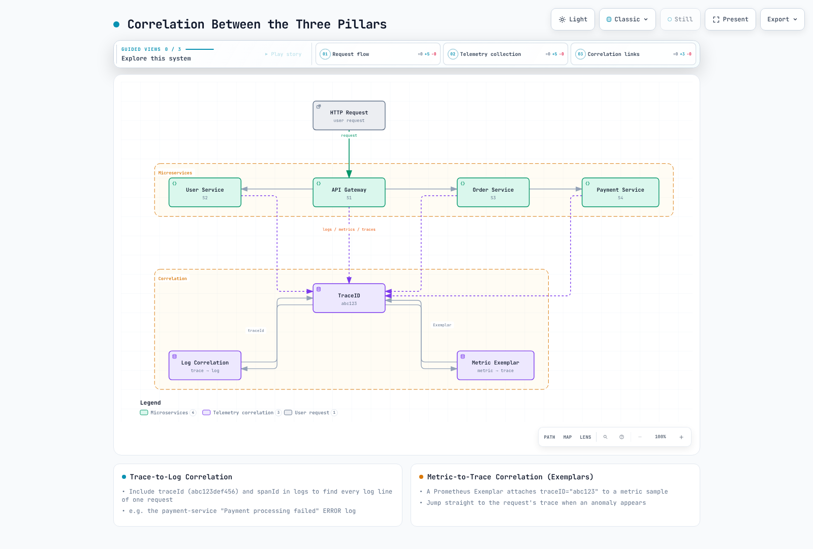

# Observability の概要

> **最終レビュー日**: 2026年9月12日

## はじめに

現代の分散システム、とりわけ Kubernetes ベースのマイクロサービスアーキテクチャでは、外部に現れる出力からシステムの内部状態を観測し、理解できることが欠かせません。これを **Observability（可観測性）** と呼びます。

## Observability と Monitoring

Monitoring は、システムの動作を収集・分析し、変化に対応する活動です。Observability は、出力を通じて内部状態をどれだけ理解できるかを表します。両者は連携します。Monitoring には、ログ、トレース、診断クエリを含めることができます。

| 観点 | Monitoring | Observability |
| --- | --- | --- |
| **焦点** | 健全性とユーザーへの影響を継続的に評価する | システムの動作を説明するのに十分な可視性を得る |
| **実践** | SLO、ダッシュボード、アラート、調査 | 計装、コンテキスト、相関付け、探索 |
| **問い** | 何が変わり、なぜ失敗しているのか | その問いに答える証拠が十分にあるか |
| **データ** | メトリクス、ログ、トレースなどの有用なシグナル | それらのシグナルの品質、網羅性、相互のつながり |
| **複雑さ** | シンプルなシステムから分散システムまで有用 | システムと運用目標に合わせて設計する |

## Observability の三つの柱

ログ、メトリクス、トレースは広く使われている三つのシグナルですが、Observability の定義を網羅するものではありません。プロファイルもコードレベルのリソース使用状況を示せます。OpenTelemetry ではシグナルごとに成熟度が異なり、プロファイルのサポートはまだ開発中です。

### 1. ログ

ログは、システム内で発生した個々のイベントの記録です。

**特徴:**
- 個別イベントの記録。改ざん耐性と保持の保証はストレージ設定によって異なる
- タイムスタンプとコンテキスト情報を含む
- 構造化形式（JSON）または非構造化形式
- 適切にイベントを網羅し、アクセス制御と保持を設計すれば、デバッグや監査に役立つ

**用途:**
- エラーと例外の追跡
- セキュリティ監査
- コンプライアンス
- 詳細なデバッグ

**ツールの役割:** Loki、Elasticsearch／OpenSearch、CloudWatch Logs は保存／検索バックエンドを提供し、Fluent Bit はレコードを収集して転送します。

### 2. メトリクス

メトリクスは、時間の経過に伴う数値測定値です。

**特徴:**
- 時系列データとして保存される
- 集計と数学的な演算ができる
- カーディナリティと収集量を管理すれば、ストレージ効率がよい
- 傾向分析に適している

**Prometheus の主なメトリクス型:**
- **Counter**: 累積して増える値。再起動時などにゼロへリセットされることがある（例: リクエスト数）
- **Gauge**: 増減する現在値（例: メモリ使用量）
- **Histogram**: 観測値の分布（例: 応答時間）。クラシック型とネイティブ型では表現とクエリ構文が異なる
- **Summary**: 観測件数と合計を記録し、実装によっては分位数を事前計算する。インスタンスごとの分位数を平均しても、フリート全体の正しい分位数にはならない

**ツール:** Prometheus、VictoriaMetrics、CloudWatch Metrics、Datadog

### 3. トレース

トレースは、スパンを通じて関連する処理がたどった経路を記述します。計装の抜け、サンプリング、伝播の失敗、データ損失があると、トレースが部分的になることがあります。

**特徴:**
- サービス間のリクエストフローを可視化する
- 各段階のレイテンシーを測る
- ボトルネックを特定する
- 依存関係を分析する

**構成要素:**
- **Trace**: 共通の TraceID でつながった関連スパン
- **Span**: 単一の作業単位
- **SpanContext**: トレースコンテキストの伝播に使う TraceID、SpanID、トレースフラグ、tracestate

**ツール:** Tempo、Jaeger、X-Ray、Zipkin、Datadog APM

## 三つの柱の相関付け

計装、収集、バックエンド間のリンクを設定すると、シグナルを相関付けられます。シグナルが存在するだけで、すべてのイベントが自動的につながるわけではありません。



[🔍 インタラクティブ図を表示](https://www.atomai.click/kubernetes-docs/archmaps/en-observability-readme-2.html)

図では説明のために ID を短縮しています。実際のデータでは、以下に示す有効な全桁の ID を使ってください。メトリクスとの相関には exemplar のメタデータを使い、通常のメトリクスラベルのカーディナリティは抑えてください。

### Trace からログへの相関付け

アクティブなトレースコンテキストがある場合は TraceID と SpanID を記録し、出力されたログイベントをスパンにリンクします。バックグラウンド処理や未計装のログには、これらの ID がないことがあります。以下はアプリケーションの JSON 例であり、完全な OTLP リクエストペイロードではありません。

```json
{
  "timestamp": "2025-02-15T10:30:00Z",
  "level": "ERROR",
  "message": "Payment processing failed",
  "traceId": "4bf92f3577b34da6a3ce929d0e0e4736",
  "spanId": "00f067aa0ba902b7",
  "service": "payment-service"
}
```

W3C 形式の TraceID は32桁、SpanID は16桁の16進数です。すべてゼロの ID は無効です。JSON には説明用の過去のイベント時刻が残っています。

### Metric から Trace への相関付け（Exemplar）

Exemplar は、特定の観測値をトレースに結び付ける独立したメタデータです。通常のメトリクス系列にリクエストごとの TraceID を付けるとカーディナリティが高くなるため、exemplar またはログフィールドを使ってください。以下は、説明用の測定値を含む、クラシック Histogram の完全な OpenMetrics テキスト例です。

```text
# HELP http_request_duration_seconds Observed HTTP request duration.
# TYPE http_request_duration_seconds histogram
# UNIT http_request_duration_seconds seconds
http_request_duration_seconds_bucket{le="0.5"} 1000 # {trace_id="4bf92f3577b34da6a3ce929d0e0e4736"} 0.42
http_request_duration_seconds_bucket{le="+Inf"} 1000
http_request_duration_seconds_sum 123.4
http_request_duration_seconds_count 1000
# EOF
```

Exemplar にはラベルセットと観測値（`0.42`）の両方が必要で、タイムスタンプは任意です。収集／ストレージが exemplar をサポートして保持する必要があります。また、データソースのリンクで `trace_id` ラベルをトレースバックエンドに対応付けます。参照先のトレースもサンプリングされ、保持されていなければなりません。

## OpenTelemetry と標準化

OpenTelemetry (OTel) は、ベンダーに依存しない API、SDK、計装、Collector ツールを提供します。サポートされるシグナルと自動計装の範囲は、言語、フレームワーク、コンポーネントのバージョンによって異なります。


[🔍 インタラクティブ図を表示](https://www.atomai.click/kubernetes-docs/archmaps/en-observability-readme-3.html)

これは一つのデプロイパターンです。アプリケーションからサポート対象のバックエンドへ直接エクスポートすることもできます。選んだシグナルに合わせて Collector の receiver、processor、exporter を設定してください。各コンポーネントの成熟度は異なります。

**OpenTelemetry の利点:**
- ベンダーに依存しない標準
- 複数言語の SDK をサポート
- 自動計装機能
- 複数バックエンドをサポート
- 活発なコミュニティ

## EKS 環境の Observability 戦略

Amazon EKS で Observability を効果的に実装するための戦略を示します。

### 1. レイヤーベースの Observability


[🔍 インタラクティブ図を表示](https://www.atomai.click/kubernetes-docs/archmaps/en-observability-readme-4.html)

これらはシグナル経路の例であり、ツールとレイヤーの対応を限定するものではありません。CloudWatch などのバックエンドは複数のレイヤーをカバーできます。ノードレベルの Collector では、選択した EKS コンピューティングモードでサポートされるアクセス権とデプロイ方式が必要です。

### 2. ツール選択の例

| 機能 | セルフホストの例 | AWS マネージドの例 | 商用プラットフォーム |
|----------|-------------|------------|------------|
| メトリクス | Prometheus、VictoriaMetrics | CloudWatch、AMP | Datadog、New Relic |
| ログ | Loki、Elasticsearch／OpenSearch | CloudWatch Logs | Splunk、Datadog |
| トレース | Tempo、Jaeger | X-Ray | Datadog APM、Dynatrace |
| 可視化 | Grafana | CloudWatch Dashboards | Datadog、Dynatrace |

### 3. コスト最適化の戦略

- **Sampling**: 保持するトレース量と調査に必要な網羅性のバランスを取る。Tail sampling は判断前にデータを受信してバッファーに保持するため、上流のコストをすべてなくすわけではない
- **保持ポリシー**: データの保持期間を最適化する
- **階層型ストレージ**: バックエンドがサポートするストレージ階層、クエリ経路、必要な保持期間を確認する
- **集約とカーディナリティ**: 診断情報がどれだけ失われるかを評価しながら、収集量とラベルの次元数を管理する

## Observability 成熟度モデル

この実務的な計画モデルを使って運用目標を見直してください。製品購入の順序や、普遍的な認定尺度を示すものではありません。シグナルの網羅性、調査速度、実行可能なアラート、コストを評価し、動作を検証したうえで自動分析を導入します。

| 評価領域 | 評価する機能 | ツール例 |
| --- | --- | --- |
| 基本的な収集 | 必要なサービス／プラットフォームのシグナルを確実に網羅 | kubectl logs、CloudWatch |
| 集中管理 | 適切な保持、アクセス制御、クエリ | Loki、Prometheus、Grafana |
| 相関付け | リクエスト、サービス、デプロイのコンテキストを通じたリンク | Tempo、exemplar、TraceID |
| 任意の自動化 | 誤検知、見落とし、対応動作を検証した分析支援 | Datadog Watchdog、Dynatrace Intelligence |

## セクションガイド

この Observability セクションは次のように構成されています。

### [Logging](./logging/README.md)
ログの収集、保存、分析に使うツールと戦略:
- Loki: ログ集約とクエリのバックエンド
- Fluent Bit: 高性能なログコレクター
- CloudWatch Logs: AWS ネイティブのログ管理

### [Metrics](./metrics/README.md)
時系列メトリクスの収集と分析:
- Prometheus: 業界標準のメトリクスシステム
- VictoriaMetrics: メトリクスの保存／クエリバックエンド
- CloudWatch Metrics: AWS ネイティブのメトリクス

### [Tracing](./tracing/README.md)
分散トレースとリクエストフローの分析:
- Tempo: Grafana の分散トレースバックエンド
- X-Ray: AWS ネイティブの分散トレース
- OpenTelemetry: 標準化された計装
- Dynatrace: AI 搭載の APM

### [Grafana (Dashboards)](./grafana/README.md)
統合された可視化とダッシュボード:
- データソースの統合
- ダッシュボードの設計パターン
- アラートの設定

### [Alerting](./alerting/README.md)
実行可能なアラート、ルーティング、対応システムとの統合。

### [Observability Optimization](./09-observability-optimization.md)
収集量、カーディナリティ、保持期間、運用コスト。

### [Integrated Labs](../labs/observability/README.md)
インフラストラクチャ、スタック、アプリケーション、負荷、トレースを段階的に演習します。

## はじめに

サービスの目標、調査したい問い、既存のプラットフォーム／Collector の機能から始めます。以下の例の順序を、それらの要件に合わせてください。

1. **メトリクスを設定する**: Prometheus、VictoriaMetrics、または適切なマネージドバックエンドを選ぶ
2. **ログ収集を設定する**: Loki と Fluent Bit をデプロイする
3. **トレースを設定する**: Tempo または X-Ray をデプロイする
4. **可視化**: 選択したプラットフォームで、必要なデータソースとダッシュボードを接続する
5. **相関付け**: TraceID ベースのリンクを設定する

## 参考資料

- [OpenTelemetry のシグナル](https://opentelemetry.io/docs/concepts/signals/)
- [OpenTelemetry Collector](https://opentelemetry.io/docs/collector/)
- [OpenTelemetry のログデータモデル](https://opentelemetry.io/docs/specs/otel/logs/data-model/)
- [W3C Trace Context](https://www.w3.org/TR/trace-context/)
- [Prometheus のメトリクス型](https://raw.githubusercontent.com/prometheus/docs/main/docs/concepts/metric_types.md)
- [OpenMetrics 仕様](https://raw.githubusercontent.com/prometheus/OpenMetrics/main/specification/OpenMetrics.md)
- [OpenTelemetry のサンプリング](https://opentelemetry.io/docs/concepts/sampling/)
- [Grafana の OpenTelemetry ドキュメント](https://grafana.com/docs/opentelemetry/)
- [Amazon EKS のモニタリングとログ](https://docs.aws.amazon.com/eks/latest/userguide/eks-observe.html)
- [AWS Observability ベストプラクティス](https://aws-observability.github.io/observability-best-practices/)
- [SRE Workbook: Monitoring](https://sre.google/workbook/monitoring/)
- [Datadog Watchdog](https://docs.datadoghq.com/watchdog/)
- [Dynatrace Intelligence](https://docs.dynatrace.com/docs/dynatrace-intelligence)
