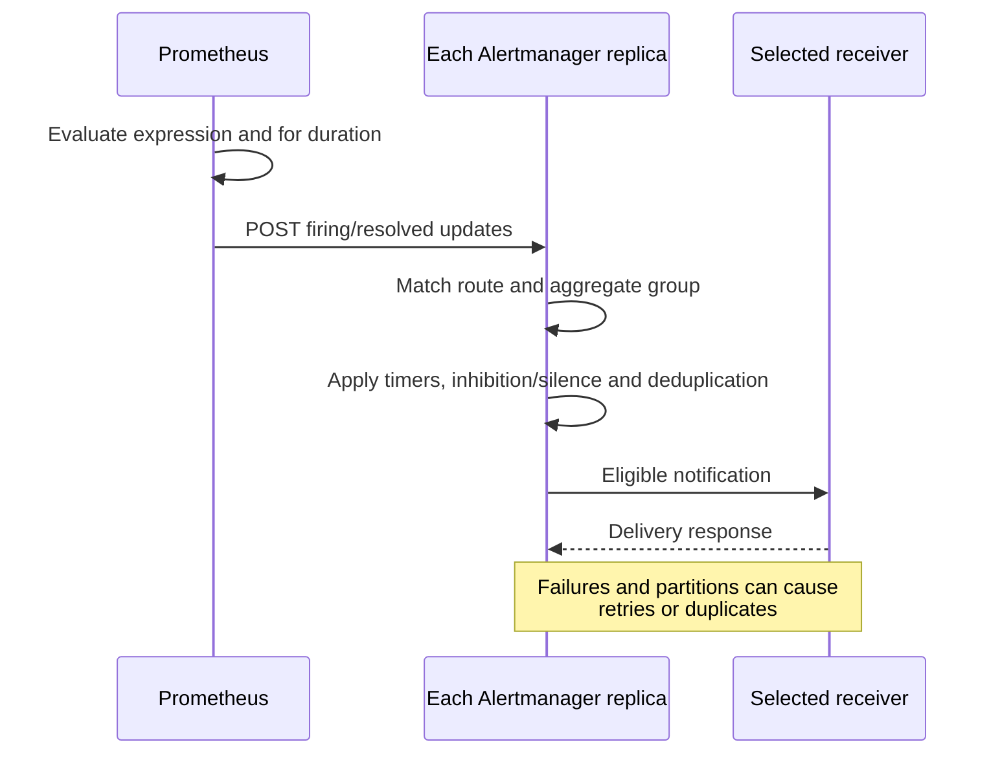
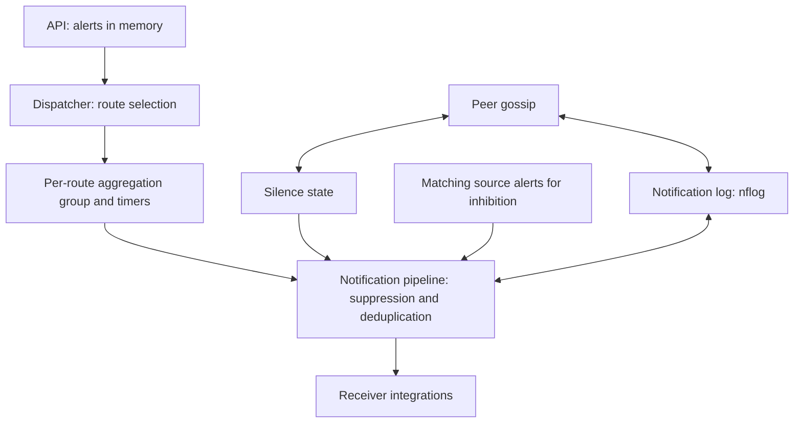
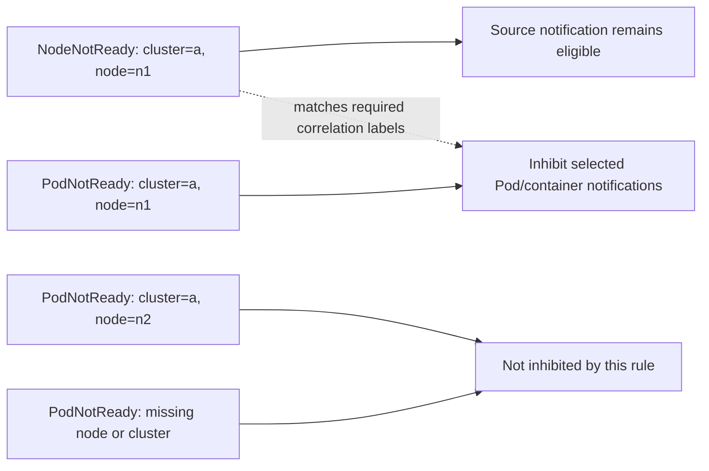
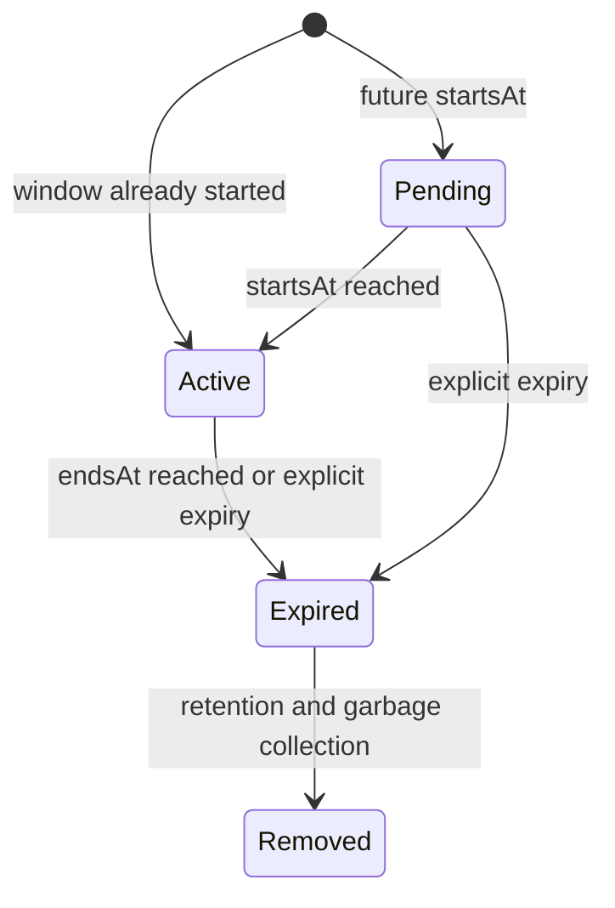

# Prometheus Alertmanager

> **レビュー基準**: Alertmanager 0.34.0、kube-prometheus-stack 90.0.0 / Operator 0.93.1、standalone chart 1.43.1
> **最終更新**: 2026年9月13日

## 目次

- [Alertmanagerの概要](#alertmanager-overview)
- [アーキテクチャ](#architecture)
- [インストールと設定](#installation-and-configuration)
- [Alert Ruleの定義](#defining-alert-rules)
- [ルーティング設定](#routing-configuration)
- [Receiverの設定](#receiver-configuration)
- [Inhibition Rule](#inhibition-rules)
- [Silence](#silencing)
- [Templateのカスタマイズ](#template-customization)
- [高可用性の設定](#high-availability-configuration)
- [AlertmanagerConfig CRD](#alertmanagerconfig-crd)
- [本番用Alert Ruleの例](#production-alert-rule-examples)
- [トラブルシューティング](#troubleshooting)

---

## Alertmanagerの概要 {#alertmanager-overview}

Prometheus Alertmanagerは、Prometheus serverから送られたAlertを処理するコンポーネントです。Alertの重複排除、グループ化、ルーティング、inhibition、silenceなどの機能を提供します。

### 主な機能

1. **グループ化**: route/groupごとにAlertをまとめて通知します。
2. **Inhibitionとsilence**: 根本にあるPrometheus ruleの条件は変更せず、通知を抑制します。
3. **ルーティング**: Receiverを選択します。1つのReceiverに複数のintegrationを含められます。
4. **高可用性**: silenceとnotification logの状態を最終的整合性で共有します。network partition時には通知を抑制するより重複配信を優先します。exactly-once配信を保証するものではありません。

### PrometheusのAlertフロー

Prometheusはruleを評価し、Alertmanagerは通知を処理します。次のシーケンスはそれぞれの責務を要約したものであり、配信時間を保証するものではありません。



## アーキテクチャ {#architecture}

### Alertmanagerの内部構造

Dispatcherは**route選択後**にgroupを作成します。Inhibition、silence/timeの判定、notification logによる重複排除は通知pipeline内で動作し、固定されたpre-group処理の連鎖ではありません。GossipはPrometheusがすべてのreplicaにAlertを送る代わりにはなりません。Alert自体はsilenceやnflogのように永続化されません。



### コンポーネントの説明

| コンポーネント | 役割 |
|-----------|------|
| **Dispatcher** | routing treeに基づいてAlertを適切なReceiverへ送る |
| **Inhibitor** | inhibition ruleに従って関連するAlertを抑制する |
| **Silencer** | silence ruleに一致するAlertを除外する |
| **Aggregation Group** | 同じgroupのAlertをまとめて処理する |
| **Notification Pipeline** | Alertの実際の送信を処理する |
| **nflog** | 送信したAlertを記録する（重複排除用） |

---

## インストールと設定 {#installation-and-configuration}

以下はKubernetes 1.35のLinux worker環境を前提とした代替例です。2種類のHelm chartと手動StatefulSetは、**それぞれ異なるインストール管理者が所有する方法**です。どれか1つを選んでください。chartのrender、設定/template、synthetic ruleのローカル実行は確認しましたが、Kubernetesへのインストール、実環境でのCNI適用、SaaSへの配信、本番容量のテストは実施していません。既存環境では、このチュートリアルで無条件に置き換えず、所有者が確認したvaluesのマージとupgrade計画を用意してください。

`monitoring` namespace、hard anti-affinity用にスケジュール可能な3ノード、適切なdefault RWO StorageClass、通知credential、承認済みnetwork pathを準備します。EKS Fargate/Auto Modeとmanaged control-plane metricsには、それぞれ異なる収集／storage上の制約があります。特に、EKSが管理するetcdは利用者がscrapeできるendpointではありません。このprofileは例の焦点を絞るためGrafanaとetcd ServiceMonitorを無効にしています。既存stackのコンポーネントを無効にする指示ではありません。

### Helmによるインストール（kube-prometheus-stack）

**新規release**には、以下の固定済みstack profileを使います。Version 90.0.0にはOperator 0.93.1とAlertmanager 0.34.0が含まれます。これは確認済みのbaselineであり、より新しいchartが存在しないという意味ではありません。インストール前にcluster RBAC、CRD、PVC、namespace、owner設定を確認してください。

```bash
helm repo add prometheus-community https://prometheus-community.github.io/helm-charts
helm repo update
helm template prometheus prometheus-community/kube-prometheus-stack   --version 90.0.0 --namespace monitoring --kube-version 1.35.0   -f kube-prometheus-stack-values.yaml > stack-rendered.yaml
# After reviewing the prerequisites and rendered resources:
helm install prometheus prometheus-community/kube-prometheus-stack   --version 90.0.0 --namespace monitoring --create-namespace   -f kube-prometheus-stack-values.yaml --wait --timeout 10m
```

### Alertmanager専用Helm Chart

これはstackに追加してインストールする手順ではなく、**standaloneを使う代替手段**です。standalone chartではトップレベルの`replicaCount`、`resources`、`persistence`、`config`を使います。stackではreplica/resources/storageに`alertmanager.alertmanagerSpec`を使います。従来の混在したvaluesは、どちらのchartも説明どおりには設定していませんでした。

```bash
helm template alertmanager prometheus-community/alertmanager   --version 1.43.1 --namespace monitoring --kube-version 1.35.0   -f alertmanager-values.yaml > alertmanager-rendered.yaml
helm install alertmanager prometheus-community/alertmanager   --version 1.43.1 --namespace monitoring --create-namespace   -f alertmanager-values.yaml --wait --timeout 10m
```

### values.yamlの例

主な設定は、以下の`alertmanager.yaml`です。Receiverのcredentialはtoken値ではなくfile referenceです。選択したworkloadの起動前に`notification-credentials`と`alertmanager-templates`を作成してください。fileの欠落、誤ったchannel、無効なprovider credentialは、Helm renderが成功しても解決しません。

意図したchannel用に、Slackで設定済みの**異なる2つのSlack incoming webhook URL**を用意します。`#alerts`用は`slack-normal-webhook-url`、`#critical-alerts`用は`slack-critical-webhook-url`です。incoming webhookの`channel` fieldを使って、設定済みchannelを上書きすることはできません。どちらのURLも`notification-credentials`内のkeyにし、stack、standalone、manualの各profileでmountします。URLとchannelの対応はprovider側の前提条件です。ローカルでのparseはSlackへの配信を検証しません。

**Stack profile（`kube-prometheus-stack-values.yaml`）:**

```yaml
grafana:
  enabled: false
alertmanager:
  enabled: true
  config:
    global:
      resolve_timeout: 5m
    route:
      receiver: default-receiver
      group_by:
      - cluster
      - alertname
      - namespace
      group_wait: 30s
      group_interval: 5m
      repeat_interval: 4h
      routes:
      - matchers:
        - severity="critical"
        receiver: critical-receiver
    receivers:
    - name: default-receiver
      slack_configs:
      - api_url_file: /etc/alertmanager/secrets/notification-credentials/slack-normal-webhook-url
        send_resolved: true
        title: '{{ template "slack.custom.title" . }}'
        text: '{{ template "slack.custom.text" . }}'
        color: '{{ template "slack.custom.color" . }}'
    - name: critical-receiver
      slack_configs:
      - api_url_file: /etc/alertmanager/secrets/notification-credentials/slack-critical-webhook-url
        send_resolved: true
        title: '{{ template "slack.custom.title" . }}'
        text: '{{ template "slack.custom.text" . }}'
        color: '{{ template "slack.custom.color" . }}'
      pagerduty_configs:
      - routing_key_file: /etc/alertmanager/secrets/notification-credentials/pagerduty-routing-key
        send_resolved: true
        severity: '{{ if eq .CommonLabels.severity "critical" }}critical{{ else if
          eq .CommonLabels.severity "warning" }}warning{{ else }}info{{ end }}'
        description: '{{ .CommonLabels.alertname }}'
        client: Alertmanager
        client_url: https://alertmanager.example.com
        details:
          cluster: '{{ .CommonLabels.cluster }}'
          namespace: '{{ .CommonLabels.namespace }}'
    inhibit_rules:
    - source_matchers:
      - severity="critical"
      - cluster=~".+"
      - namespace=~".+"
      - alertname=~".+"
      target_matchers:
      - severity="warning"
      - cluster=~".+"
      - namespace=~".+"
      - alertname=~".+"
      equal:
      - cluster
      - namespace
      - alertname
    templates:
    - /etc/alertmanager/configmaps/alertmanager-templates/*.tmpl
  podDisruptionBudget:
    enabled: true
    minAvailable: 2
  alertmanagerSpec:
    replicas: 3
    retention: 120h
    resources:
      requests:
        cpu: 100m
        memory: 256Mi
      limits:
        cpu: 500m
        memory: 512Mi
    podAntiAffinity: hard
    secrets:
    - notification-credentials
    configMaps:
    - alertmanager-templates
    storage:
      volumeClaimTemplate:
        spec:
          accessModes:
          - ReadWriteOnce
          resources:
            requests:
              storage: 10Gi
    automountServiceAccountToken: false
  serviceAccount:
    automountServiceAccountToken: false
prometheus:
  prometheusSpec:
    externalLabels:
      cluster: example-cluster
    ruleSelectorNilUsesHelmValues: false
    ruleSelector:
      matchLabels:
        release: prometheus
    ruleNamespaceSelector:
      matchLabels:
        kubernetes.io/metadata.name: monitoring
kubeEtcd:
  enabled: false
```

**Standalone profile（`alertmanager-values.yaml`）:**

```yaml
replicaCount: 3
automountServiceAccountToken: false
resources:
  requests:
    cpu: 100m
    memory: 256Mi
  limits:
    cpu: 500m
    memory: 512Mi
podAntiAffinity: hard
podDisruptionBudget:
  minAvailable: 2
persistence:
  enabled: true
  size: 10Gi
config:
  global:
    resolve_timeout: 5m
  route:
    receiver: default-receiver
    group_by:
    - cluster
    - alertname
    - namespace
    group_wait: 30s
    group_interval: 5m
    repeat_interval: 4h
    routes:
    - matchers:
      - severity="critical"
      receiver: critical-receiver
  receivers:
  - name: default-receiver
    slack_configs:
    - api_url_file: /etc/alertmanager/secrets/notification-credentials/slack-normal-webhook-url
      send_resolved: true
      title: '{{ template "slack.custom.title" . }}'
      text: '{{ template "slack.custom.text" . }}'
      color: '{{ template "slack.custom.color" . }}'
  - name: critical-receiver
    slack_configs:
    - api_url_file: /etc/alertmanager/secrets/notification-credentials/slack-critical-webhook-url
      send_resolved: true
      title: '{{ template "slack.custom.title" . }}'
      text: '{{ template "slack.custom.text" . }}'
      color: '{{ template "slack.custom.color" . }}'
    pagerduty_configs:
    - routing_key_file: /etc/alertmanager/secrets/notification-credentials/pagerduty-routing-key
      send_resolved: true
      severity: '{{ if eq .CommonLabels.severity "critical" }}critical{{ else if eq
        .CommonLabels.severity "warning" }}warning{{ else }}info{{ end }}'
      description: '{{ .CommonLabels.alertname }}'
      client: Alertmanager
      client_url: https://alertmanager.example.com
      details:
        cluster: '{{ .CommonLabels.cluster }}'
        namespace: '{{ .CommonLabels.namespace }}'
  inhibit_rules:
  - source_matchers:
    - severity="critical"
    - cluster=~".+"
    - namespace=~".+"
    - alertname=~".+"
    target_matchers:
    - severity="warning"
    - cluster=~".+"
    - namespace=~".+"
    - alertname=~".+"
    equal:
    - cluster
    - namespace
    - alertname
  templates:
  - /etc/alertmanager/configmaps/alertmanager-templates/*.tmpl
  enabled: true
extraSecretMounts:
- name: notification-credentials
  secretName: notification-credentials
  mountPath: /etc/alertmanager/secrets/notification-credentials
  readOnly: true
extraVolumes:
- name: alertmanager-templates
  configMap:
    name: alertmanager-templates
extraVolumeMounts:
- name: alertmanager-templates
  mountPath: /etc/alertmanager/configmaps/alertmanager-templates
  readOnly: true
hostUsers: true
```

`hostUsers: true`により、standalone baselineは従来のuser namespaceを使います。Pod user namespaceを有効にする場合は、別途runtime/platformを確認してください。resource request/limitと10Gi PVCは容量設定の例であり、容量試験の結果ではありません。hard anti-affinityには条件を満たす3ノードが必要です。PDBは任意のvoluntary disruptionを制限しますが、すべての障害を防ぐものではありません。

### ConfigMapによる直接設定

以下の完全なcore設定は、chart profileにも埋め込まれています。manual deploymentでは`alertmanager.yaml`として保存し、その内容をConfigMapの`alertmanager.yml` keyに格納してください。ConfigMapにはpathとrouting metadataが含まれ、**credentialは含まれません**。このmanual ownerと、Operatorが生成するSecretを混在させないでください。

```yaml
global:
  resolve_timeout: 5m
route:
  receiver: default-receiver
  group_by:
  - cluster
  - alertname
  - namespace
  group_wait: 30s
  group_interval: 5m
  repeat_interval: 4h
  routes:
  - matchers:
    - severity="critical"
    receiver: critical-receiver
receivers:
- name: default-receiver
  slack_configs:
  - api_url_file: /etc/alertmanager/secrets/notification-credentials/slack-normal-webhook-url
    send_resolved: true
    title: '{{ template "slack.custom.title" . }}'
    text: '{{ template "slack.custom.text" . }}'
    color: '{{ template "slack.custom.color" . }}'
- name: critical-receiver
  slack_configs:
  - api_url_file: /etc/alertmanager/secrets/notification-credentials/slack-critical-webhook-url
    send_resolved: true
    title: '{{ template "slack.custom.title" . }}'
    text: '{{ template "slack.custom.text" . }}'
    color: '{{ template "slack.custom.color" . }}'
  pagerduty_configs:
  - routing_key_file: /etc/alertmanager/secrets/notification-credentials/pagerduty-routing-key
    send_resolved: true
    severity: '{{ if eq .CommonLabels.severity "critical" }}critical{{ else if eq
      .CommonLabels.severity "warning" }}warning{{ else }}info{{ end }}'
    description: '{{ .CommonLabels.alertname }}'
    client: Alertmanager
    client_url: https://alertmanager.example.com
    details:
      cluster: '{{ .CommonLabels.cluster }}'
      namespace: '{{ .CommonLabels.namespace }}'
inhibit_rules:
- source_matchers:
  - severity="critical"
  - cluster=~".+"
  - namespace=~".+"
  - alertname=~".+"
  target_matchers:
  - severity="warning"
  - cluster=~".+"
  - namespace=~".+"
  - alertname=~".+"
  equal:
  - cluster
  - namespace
  - alertname
templates:
- /etc/alertmanager/configmaps/alertmanager-templates/*.tmpl
```

```bash
# The directory/files must already contain approved credentials; do not commit them.
credential_dir="$PWD/private-notification-credentials"
chmod 700 "$credential_dir"
chmod 600 "$credential_dir"/*
kubectl -n monitoring create secret generic notification-credentials \
  --from-file=slack-normal-webhook-url="$credential_dir/slack-normal-webhook-url" \
  --from-file=slack-critical-webhook-url="$credential_dir/slack-critical-webhook-url" \
  --from-file=pagerduty-routing-key="$credential_dir/pagerduty-routing-key"
# Optional integrations need their own additional files; rotate existing Secrets separately.
```

```bash
kubectl -n monitoring create configmap alertmanager-config   --from-file=alertmanager.yml=alertmanager.yaml
```

Secretのread/exec権限と通知内容そのものを保護してください。有効にするintegrationが必要とするcredential fileだけを追加します。ConfigMap projectionだけではAlertmanagerは自動reloadしません。選んだownerが確認したreload/rollout手段を使ってください。新しい設定のreloadが無効なら、最後に正常だった設定を動かし続けます。

## Alert Ruleの定義 {#defining-alert-rules}

### PrometheusRule CRD

PrometheusRuleは、Prometheus instanceの**rule labelとnamespace selector**に一致する必要があります。この例では、明示したstack valuesに一致するよう`monitoring`内で`release: prometheus`を使います。CRを作っただけでは、選択され正常にloadされたことの証明にはなりません。deployment後にactive ruleとscrape labelを照合してください。stackに既にあるruleとの重複Alertを避けてください。

```yaml
apiVersion: monitoring.coreos.com/v1
kind: PrometheusRule
metadata:
  name: kubernetes-alerts
  namespace: monitoring
  labels:
    release: prometheus
spec:
  groups:
  - name: kubernetes.rules
    interval: 30s
    rules:
    - alert: NodeNotReady
      expr: max by (node) (kube_node_status_condition{condition="Ready",status="true"})
        == 0
      for: 5m
      labels:
        severity: critical
        team: sre
      annotations:
        summary: Node {{ $labels.node }} is not ready
        description: Node {{ $labels.node }} has been not ready for more than 5 minutes.
        runbook_url: https://runbooks.example.com/node-not-ready
```

### Alert Ruleの構成要素

`alert`と`expr`でruleとそのexpressionを定義します。sample値が0でも、空でないresult vectorはactiveなAlert instanceを示します。`for`は複数回のrule evaluationをまたいで判定され、scrape intervalでも通知deadlineでもありません。`labels`はAlertのidentityとroutingに影響します。変化し得る値はlabelではなく`annotations`に入れてください。任意の`keep_firing_for`を設定すると、条件が解消しても一定時間Firingを維持します。実際にdeployするPrometheus/Operator versionで対応状況を確認してください。

### Alertの状態

`keep_firing_for`を設定せず、正のfor durationを設定した場合のPrometheus state図です。zero-for ruleは、条件に一致したevaluationですぐfireする場合があります。


[インタラクティブ図](https://www.atomai.click/kubernetes-docs/archmaps/en-observability-alerting-01-alertmanager-2.html)

## ルーティング設定 {#routing-configuration}

### Routing Treeの構造

以下の**routing-test設定**ではすべてのReceiver名を宣言していますが、integrationは空です。承認済みintegrationを接続するまで通知は配信されません。通常、最初に一致したsiblingでsibling traversalが止まります。child routeでより具体的なReceiverを選べます。

```yaml
route:
  receiver: default-receiver
  group_by:
  - cluster
  - alertname
  - namespace
  group_wait: 30s
  group_interval: 5m
  repeat_interval: 4h
  routes:
  - matchers:
    - severity="critical"
    receiver: critical-receiver
    group_wait: 10s
  - matchers:
    - service=~"foo|bar"
    receiver: service-team
    routes:
    - matchers:
      - owner="team-a"
      receiver: team-a
receivers:
- name: default-receiver
- name: critical-receiver
- name: service-team
- name: team-a
```

### Routingの流れ

continue=falseでlabelだけを使うroutingです。図は旧形式のmatch/match_re表記ですが、確認済み設定では同等のmatchersを使用しています。time windowの適用可否は別に判定されます。


[インタラクティブ図](https://www.atomai.click/kubernetes-docs/archmaps/en-observability-alerting-01-alertmanager-3.html)

### Matcher

`=`、`!=`、`=~`、`!~`を使ったquoted matcher stringを使います。1つのroute内にあるmatcherはAND条件になり、regexは完全一致するようanchorされます。labelが空または存在しない場合の動作も重要です。このreleaseでは旧`match`/`match_re` fieldも受け入れますが、deprecatedです。group timerはparent routeから継承しますが、active/mute time intervalは継承しません。

```yaml
# Alternative child-route fragments; attach to a complete configuration.
routes:
  - matchers: ['severity="critical"', 'namespace="production"']
    receiver: prod-critical
  - matchers: ['service=~"(api|web|worker).*"', 'environment=~"prod.*"']
    receiver: prod-team
```

### 高度なRoutingの例

夜間intervalは午前0時で分割し、**各**interval entryでtimezoneを指定します。従来の`18:00→09:00`という範囲はnative validationに失敗します。このflatな例では、実際にReceiverを選択するrouteにtime constraintを設定しています。時間外のcritical routeでは`continue: true`を使います。inactiveなrouteもlabelには一致し、それが後続siblingを止める場合があるため、business-hours routeをそのまま通過不能にしてはいけません。ここにある空のReceiver integrationは、意図的なtest stubです。

```yaml
route:
  receiver: 'null'
  group_by:
  - cluster
  - alertname
  - namespace
  group_wait: 30s
  group_interval: 5m
  repeat_interval: 4h
  routes:
  - matchers:
    - severity="critical"
    receiver: oncall
    active_time_intervals:
    - offhours
    continue: true
  - matchers:
    - team="infra"
    receiver: infra-team
    active_time_intervals:
    - business-hours
  - matchers:
    - team="dev"
    receiver: dev-team
    active_time_intervals:
    - business-hours
  - receiver: team-slack
    active_time_intervals:
    - business-hours
receivers:
- name: 'null'
- name: oncall
- name: infra-team
- name: dev-team
- name: team-slack
time_intervals:
- name: business-hours
  time_intervals:
  - weekdays:
    - monday:friday
    times:
    - start_time: 09:00
      end_time: '18:00'
    location: Asia/Seoul
- name: offhours
  time_intervals:
  - weekdays:
    - monday:friday
    times:
    - start_time: 00:00
      end_time: 09:00
    - start_time: '18:00'
      end_time: '24:00'
    location: Asia/Seoul
  - weekdays:
    - saturday
    - sunday
    location: Asia/Seoul
```

native label-route testではcalendarは評価されません。calendarはrelease済みtime-interval実装を使って、開始／終了境界、週末、UTC/KST offsetを別途確認しました。mutedまたはinactiveな通知がparentのfallbackへ自動的にredirectされるわけではありません。

## Receiverの設定 {#receiver-configuration}

### Slack Receiver

目的のSlack channelに既に紐付けられている保護済みincoming webhook URLには`api_url_file`を使います。通常用の例では`slack-normal-webhook-url`、critical routeでは別のcritical用fileを使います。[Slackはincoming webhookでのchannel overrideは非対応と説明しています](https://docs.slack.dev/messaging/sending-messages-using-incoming-webhooks/)。確認済みのcustom templateは承認されたfieldだけを出力します。すべてのlabel/annotationをdumpしないでください。user dataやsecretが含まれる場合があり、出力のtruncationはredactionではありません。以下は完全な設定に組み込むReceiver fragmentです。

```yaml
receivers:
- name: slack-notifications
  slack_configs:
  - api_url_file: /etc/alertmanager/secrets/notification-credentials/slack-normal-webhook-url
    send_resolved: true
    title: '{{ template "slack.custom.title" . }}'
    text: '{{ template "slack.custom.text" . }}'
    color: '{{ template "slack.custom.color" . }}'
```

### PagerDuty Receiver

Events API v2では`routing_key_file`を使います。旧Prometheus integrationは異なるservice-key方式を使うもので、同じcredentialではありません。両方を設定しないでください。severityはPagerDutyがサポートする値に対応させます。Alertmanagerの任意のseverity stringが自動的に有効になるわけではありません。以下は完全な設定に組み込むReceiver fragmentです。

```yaml
receivers:
- name: pagerduty-critical
  pagerduty_configs:
  - routing_key_file: /etc/alertmanager/secrets/notification-credentials/pagerduty-routing-key
    send_resolved: true
    severity: '{{ if eq .CommonLabels.severity "critical" }}critical{{ else if eq
      .CommonLabels.severity "warning" }}warning{{ else }}info{{ end }}'
    description: '{{ .CommonLabels.alertname }}'
    client: Alertmanager
    client_url: https://alertmanager.example.com
    details:
      cluster: '{{ .CommonLabels.cluster }}'
      namespace: '{{ .CommonLabels.namespace }}'
```

### Email Receiver

`auth_password_file`を使い、有効なSMTP trust configurationによるTLSを必須にします。addressはplaceholderです。relay policy、送信者identity、delivery/bounce monitoringを確認してください。以下は完全な設定に組み込むReceiver fragmentです。

```yaml
receivers:
- name: email-alerts
  email_configs:
  - to: team@example.com
    from: alertmanager@example.com
    smarthost: smtp.example.com:587
    auth_username: alertmanager@example.com
    auth_password_file: /etc/alertmanager/secrets/notification-credentials/smtp-password
    require_tls: true
    send_resolved: true
    headers:
      Subject: '[{{ .Status | toUpper }}] {{ .CommonLabels.alertname }}'
    html: '{{ template "email.default.html" . }}'
```

### OpsGenie Receiver

これは**既存利用者の移行参照**です。Opsgenieは2025年6月4日に販売終了しており、[Atlassianによれば](https://www.atlassian.com/licensing/opsgenie)、support/accessは2027年4月5日に終了します。新たな長期依存関係を設計する際に採用しないでください。現在の`responders`形式と保護されたkey fileを使います。以下は完全な設定に組み込むReceiver fragmentです。

```yaml
receivers:
- name: opsgenie-existing
  opsgenie_configs:
  - api_key_file: /etc/alertmanager/secrets/notification-credentials/opsgenie-api-key
    api_url: https://api.opsgenie.com/
    send_resolved: true
    message: '{{ .CommonLabels.alertname }}'
    priority: '{{ if eq .CommonLabels.severity "critical" }}P1{{ else if eq .CommonLabels.severity
      "warning" }}P3{{ else }}P5{{ end }}'
    responders:
    - name: sre-team
      type: team
```

### Webhook Receiver

Basic authenticationにはHTTPSが必要です。`insecure_skip_verify: false`でも`http://` URLは暗号化されません。所有するReceiver、一致するTLS certificate/trust、mountしたcredential fileを用意してください。`max_alerts: 10`ではpayloadがAlertを省略して`truncatedAlerts`を返す場合があり、consumer側で処理する必要があります。Receiverには単なる汎用health responseではなく、Alertmanager webhook contractの実装が必要です。以下は完全な設定に組み込むReceiver fragmentです。

```yaml
receivers:
- name: webhook-receiver
  webhook_configs:
  - url: https://alert-webhook.monitoring.svc:8443/alerts
    send_resolved: true
    max_alerts: 10
    http_config:
      basic_auth:
        username: alertmanager
        password_file: /etc/alertmanager/secrets/notification-credentials/webhook-password
      tls_config:
        ca_file: /etc/alertmanager/secrets/notification-credentials/webhook-ca.crt
        insecure_skip_verify: false
```

### 複数Receiverの設定

`continue`を使わなくても、1つのReceiverから複数のintegrationへ通知できます。providerごとにfailureとretryは独立します。1つのproviderの成功は、すべてのproviderへの配信成功を意味しません。この例では列挙したすべてのprovider用fileとSMTP/TLS設定が必要です。以下は完全な設定に組み込むReceiver fragmentです。

```yaml
receivers:
- name: team-all
  slack_configs:
  - api_url_file: /etc/alertmanager/secrets/notification-credentials/slack-normal-webhook-url
    send_resolved: true
    title: '{{ template "slack.custom.title" . }}'
    text: '{{ template "slack.custom.text" . }}'
    color: '{{ template "slack.custom.color" . }}'
  email_configs:
  - to: team@example.com
    from: alertmanager@example.com
    smarthost: smtp.example.com:587
    auth_username: alertmanager@example.com
    auth_password_file: /etc/alertmanager/secrets/notification-credentials/smtp-password
    require_tls: true
    send_resolved: true
    headers:
      Subject: '[{{ .Status | toUpper }}] {{ .CommonLabels.alertname }}'
    html: '{{ template "email.default.html" . }}'
  pagerduty_configs:
  - routing_key_file: /etc/alertmanager/secrets/notification-credentials/pagerduty-routing-key
    send_resolved: true
    severity: '{{ if eq .CommonLabels.severity "critical" }}critical{{ else if eq
      .CommonLabels.severity "warning" }}warning{{ else }}info{{ end }}'
    description: '{{ .CommonLabels.alertname }}'
    client: Alertmanager
    client_url: https://alertmanager.example.com
    details:
      cluster: '{{ .CommonLabels.cluster }}'
      namespace: '{{ .CommonLabels.namespace }}'
```

## Inhibition Rule {#inhibition-rules}

### Inhibitionの概念

Inhibitionは一致する**通知**を抑制しますが、ruleの評価や保存済みAlertは変更しません。関係の適用範囲を空でないlabelで限定してください。nodeのconditionだけを根拠に、クラスター内のすべてのService Alertを抑制してはいけません。



### Inhibition Ruleの設定

最初のruleでは、kube-state-metricsの`node` labelを持つ`NodeNotReady`を使います。以下のPod ruleでは`kube_pod_info`を使ってnode情報を追加し、そのmetricがない場合も情報を付加しないAlertとして維持します。存在しないlabelは空値と同じように比較されます。等値比較の前に`cluster`/`node`が空でないことを必須にしてください。ローカルtestで、旧設定が無関係なAlertまで抑制することを再現し、guardがそれを防ぐことを確認しました。

`ClusterDown`には、監視対象のclusterから送信できなくなった場合でも独立して届くsource Alertが必要です。Database ruleには、関係のないscrape `instance` labelではなく、安定した共通の`database_id`が必要です。これらの入力を定義してからruleを有効にしてください。

```yaml
route:
  receiver: 'null'
receivers:
- name: 'null'
inhibit_rules:
- source_matchers:
  - alertname="NodeNotReady"
  - cluster=~".+"
  - node=~".+"
  target_matchers:
  - alertname=~"PodNotReady|PodCrashLooping|ContainerOOMKilled"
  - cluster=~".+"
  - node=~".+"
  equal:
  - cluster
  - node
- source_matchers:
  - severity="critical"
  - cluster=~".+"
  - namespace=~".+"
  - alertname=~".+"
  target_matchers:
  - severity="warning"
  - cluster=~".+"
  - namespace=~".+"
  - alertname=~".+"
  equal:
  - cluster
  - namespace
  - alertname
- source_matchers:
  - alertname="ClusterDown"
  - cluster=~".+"
  target_matchers:
  - alertname=~"Node.*"
  - cluster=~".+"
  equal:
  - cluster
- source_matchers:
  - alertname="DatabaseDown"
  - cluster=~".+"
  - database_id=~".+"
  target_matchers:
  - alertname=~"DatabaseConnection.*|DatabaseTimeout.*"
  - cluster=~".+"
  - database_id=~".+"
  equal:
  - cluster
  - database_id
```

### Inhibitionの優先順位

listの順番は**優先順位の仕組みではありません**。適用可能なinhibition ruleはいずれもtargetを抑制できます。重複しないsource/target matcherと空でないcorrelation labelを使ってinfrastructure→node→serviceの依存関係をモデル化し、その後、無関係なnode/clusterやlabel欠落をtestしてください。広範な`alertname=~".*"`と`datacenter` labelの欠落が組み合わさると、無関係なincidentをmuteする場合があります。severityだけから因果関係を推測しないでください。

## Silence {#silencing}

### Silenceの作成

Silenceの作成／expiryは通知の動作を変更します。endpoint、正確なmatcher、作成者、理由、有限の期間を確認してください。`--end`には意図して選んだ将来時刻をRFC3339形式で指定します。以前の固定された2025年の期間では、現在のAlertをsilenceできません。サポートされるTLS/authentication設定でHTTP accessを保護してください。`amtool --http.config.file`には保護されたclient設定fileを指定できます。

#### amtool CLIの使用

```bash
# Use an approved authenticated endpoint, or an authorized local port-forward.
: "${ALERTMANAGER_URL:?Set the reviewed Alertmanager URL}"
amtool --alertmanager.url="$ALERTMANAGER_URL" silence add   'alertname="PodCrashLooping"' 'namespace="development"'   --duration=2h --comment="Approved deployment window" --author="operator"
amtool --alertmanager.url="$ALERTMANAGER_URL" silence query
# Copy the specific UUID from the approved operation, never a blanket selection.
: "${SILENCE_ID:?Set the exact silence UUID}"
amtool --alertmanager.url="$ALERTMANAGER_URL" silence expire "$SILENCE_ID"
```

#### APIを使ったSilenceの作成

このhelperの出力を`silence.json`として保存して確認し、設定済みauthenticationを使って承認済みの`/api/v2/silences` endpointにPOSTします。credential値をcommand argumentに含めたり、運用データを含むraw API payloadを共有したりしないでください。

```python
# Generates a payload only; it makes no API call.
import datetime
import json
now = datetime.datetime.now(datetime.timezone.utc)
print(json.dumps({
    "matchers": [
        {"name": "alertname", "value": "HighCPU", "isRegex": False, "isEqual": True},
        {"name": "namespace", "value": "development", "isRegex": False, "isEqual": True}
    ],
    "startsAt": now.isoformat(),
    "endsAt": (now + datetime.timedelta(hours=2)).isoformat(),
    "createdBy": "operator",
    "comment": "Approved maintenance window"
}, indent=2))
```

### Silence管理のベストプラクティス

承認済みのmaintenance/deployment期間と、範囲を限定した調査期間をできるだけ短く設定します。「修正まで」でも有限の終了時刻とownerによる確認が必要です。4時間はteam policyの一例であり、Alertmanagerの制限ではありません。expiry後は抑制が止まりますが、期限切れrecordはretention/GCまで残ります。ローカルAPI testでこの動作を確認しました。Expiry reminderには別途設定したworkflowが必要です。



## Templateのカスタマイズ {#template-customization}

### Go Templateの基本

通知templateは`Data`を受け取ります。rootでは`.CommonLabels`、`.CommonAnnotations`、`.GroupLabels`、`.Alerts`を使います。`range .Alerts`内ではdotが個々のAlertになり、`.Labels`、`.Annotations`、`.StartsAt`などを参照できます。Prometheus rule annotation template（`$labels`、`$value`）とは異なります。信頼できないdataのescapingを迂回するために`safeHtml`/`safeUrl`を使わないでください。templateはmountし、設定に記載する必要があります。

### Slack Templateの例

`slack.tmpl`として保存します。Whitespace trimmingにより、colorの結果は有効な単一のcolor stringになります。承認済みfieldだけを出力します。このtemplateは任意の機密annotation値をsanitizeしません。

```text
{{ define "slack.custom.title" -}}
[{{ .Status | toUpper }}{{ if eq .Status "firing" }}:{{ len .Alerts.Firing }}{{ end }}] {{ .CommonLabels.alertname }}
{{- end }}
{{ define "slack.custom.text" -}}
{{ range .Alerts -}}
*Alert:* {{ .Labels.alertname }}
*Severity:* {{ .Labels.severity }}
*Cluster:* {{ .Labels.cluster }}
*Namespace:* {{ .Labels.namespace }}
*Summary:* {{ printf "%.100s" .Annotations.summary }}
*Started:* {{ .StartsAt.Format "2006-01-02 15:04:05 MST" }}
{{ end -}}
{{- end }}
{{ define "slack.custom.color" -}}
{{ if eq .Status "firing" }}{{ if eq .CommonLabels.severity "critical" }}#ff0000{{ else }}#ff9900{{ end }}{{ else }}#36a64f{{ end }}
{{- end }}
{{ define "custom.message" -}}
{{ .CommonLabels.alertname | title }}
{{ range .Alerts -}}
{{ .Labels.namespace | toUpper }}: {{ printf "%.100s" .Annotations.description }}
{{ .StartsAt.Format "2006-01-02 15:04" }}
{{ end -}}
{{ printf "%.2f%%" 95.5 }}
{{- end }}
```

### Template Function

`if`、`range`、pipe、`toUpper`、`title`、`printf`、`date`などのfunctionを使います。Go templateにはJavaScript風のternary expressionはありません。`printf "%.100s"`は文字列をrune単位で制限します。byte `slice`は韓国語のUTF-8を分割する可能性があります。上記templateはroot contextとAlertごとのcontext、数値formatを示します。

本番payloadではなく、synthetic notification Dataでtestしてください。

このsynthetic template専用inputを`synthetic-notification.json`として保存します。timestampはAlertを作成または送信するものではありません。

```json
{
  "receiver": "local-test",
  "status": "firing",
  "groupLabels": {
    "alertname": "HighCPU"
  },
  "commonLabels": {
    "alertname": "HighCPU",
    "severity": "critical"
  },
  "commonAnnotations": {},
  "externalURL": "https://alertmanager.example.com",
  "alerts": [
    {
      "status": "firing",
      "labels": {
        "alertname": "HighCPU",
        "namespace": "demo",
        "cluster": "example-cluster",
        "severity": "critical"
      },
      "annotations": {
        "summary": "Synthetic example",
        "description": "Synthetic example"
      },
      "startsAt": "2026-09-13T00:00:00Z",
      "endsAt": "2026-09-13T01:00:00Z",
      "generatorURL": "",
      "fingerprint": "synthetic"
    }
  ]
}
```

```bash
amtool template render --template.glob=slack.tmpl   --template.data=synthetic-notification.json   --template.text='{{ template "slack.custom.title" . }}'
```

### ConfigMapによるTemplate管理

stack profileは`alertmanagerSpec.configMaps`を通じてこのConfigMapをmountします。standalone profileでは明示的なvolumeを使います。どちらも`/etc/alertmanager/configmaps/alertmanager-templates/*.tmpl`を設定します。対応するmount/pathなしでConfigMapを作成しても何も起きません。選択したインストールownerを通じてreloadしてください。

```yaml
apiVersion: v1
kind: ConfigMap
metadata:
  name: alertmanager-templates
  namespace: monitoring
data:
  slack.tmpl: '{{ define "slack.custom.title" -}}

    [{{ .Status | toUpper }}{{ if eq .Status "firing" }}:{{ len .Alerts.Firing }}{{
    end }}] {{ .CommonLabels.alertname }}

    {{- end }}

    {{ define "slack.custom.text" -}}

    {{ range .Alerts -}}

    *Alert:* {{ .Labels.alertname }}

    *Severity:* {{ .Labels.severity }}

    *Cluster:* {{ .Labels.cluster }}

    *Namespace:* {{ .Labels.namespace }}

    *Summary:* {{ printf "%.100s" .Annotations.summary }}

    *Started:* {{ .StartsAt.Format "2006-01-02 15:04:05 MST" }}

    {{ end -}}

    {{- end }}

    {{ define "slack.custom.color" -}}

    {{ if eq .Status "firing" }}{{ if eq .CommonLabels.severity "critical" }}#ff0000{{
    else }}#ff9900{{ end }}{{ else }}#36a64f{{ end }}

    {{- end }}

    {{ define "custom.message" -}}

    {{ .CommonLabels.alertname | title }}

    {{ range .Alerts -}}

    {{ .Labels.namespace | toUpper }}: {{ printf "%.100s" .Annotations.description
    }}

    {{ .StartsAt.Format "2006-01-02 15:04" }}

    {{ end -}}

    {{ printf "%.2f%%" 95.5 }}

    {{- end }}

    '
```

## 高可用性の設定 {#high-availability-configuration}

### Clusteringのアーキテクチャ

正常に収束したHA環境の例であり、すべてのreplicaがAlertを受け取ります。図の単一配信は常に保証されるものではありません。partitionやretryによって重複が発生する場合があります。


[インタラクティブ図](https://www.atomai.click/kubernetes-docs/archmaps/en-observability-alerting-01-alertmanager-6.html)

### StatefulSetの設定

これは、前述のConfigMap、template、credential Secretを使う**manual deploymentの代替手段**です。API/UIとgossip portは内部Serviceですが、ClusterIPだからといって認証されるわけではありません。本番環境では適切なnetwork accessを適用し、[サポート対象のTLS/authentication設定](https://github.com/prometheus/alertmanager/blob/v0.34.0/docs/https.md)を確認してください。Gossipはデフォルトで暗号化されません。experimentalなmutual-TLS transportはTCPのみの異なる動作です。以下のbaselineは通常のTCP/UDP gossipであり、安全な本番topologyとして検証済みではありません。

Podの並列起動、まだReadyでないpeerを見つけるためのheadless DNS、2つのgossip protocol、永続状態を明示しています。`publishNotReadyAddresses`はpeer discoveryを助けますが、NotReadyのmemberをhealthyにするわけではありません。Alert自体は永続化されないため、Prometheusによる再送信が必要です。StorageClass/AZ binding、disruption、resource sizingを確認してください。

```yaml
apiVersion: apps/v1
kind: StatefulSet
metadata:
  name: alertmanager-demo
  namespace: monitoring
spec:
  serviceName: alertmanager-demo
  podManagementPolicy: Parallel
  replicas: 3
  selector:
    matchLabels:
      app: alertmanager-demo
  template:
    metadata:
      labels:
        app: alertmanager-demo
    spec:
      automountServiceAccountToken: false
      securityContext:
        runAsNonRoot: true
        runAsUser: 65534
        runAsGroup: 65534
        fsGroup: 65534
        seccompProfile:
          type: RuntimeDefault
      affinity:
        podAntiAffinity:
          requiredDuringSchedulingIgnoredDuringExecution:
          - labelSelector:
              matchLabels:
                app: alertmanager-demo
            topologyKey: kubernetes.io/hostname
      containers:
      - name: alertmanager
        image: quay.io/prometheus/alertmanager:v0.34.0
        args:
        - --config.file=/etc/alertmanager/config-main/alertmanager.yml
        - --storage.path=/alertmanager
        - --data.retention=120h
        - --cluster.listen-address=0.0.0.0:9094
        - --cluster.peer=alertmanager-demo-0.alertmanager-demo.monitoring.svc:9094
        - --cluster.peer=alertmanager-demo-1.alertmanager-demo.monitoring.svc:9094
        - --cluster.peer=alertmanager-demo-2.alertmanager-demo.monitoring.svc:9094
        ports:
        - name: http
          containerPort: 9093
        - name: gossip-tcp
          containerPort: 9094
          protocol: TCP
        - name: gossip-udp
          containerPort: 9094
          protocol: UDP
        securityContext:
          allowPrivilegeEscalation: false
          readOnlyRootFilesystem: true
          capabilities:
            drop:
            - ALL
        readinessProbe:
          httpGet:
            path: /-/ready
            port: http
          periodSeconds: 5
        livenessProbe:
          httpGet:
            path: /-/healthy
            port: http
          initialDelaySeconds: 10
          periodSeconds: 10
        volumeMounts:
        - name: config
          mountPath: /etc/alertmanager/config-main
          readOnly: true
        - name: templates
          mountPath: /etc/alertmanager/configmaps/alertmanager-templates
          readOnly: true
        - name: credentials
          mountPath: /etc/alertmanager/secrets/notification-credentials
          readOnly: true
        - name: storage
          mountPath: /alertmanager
        resources:
          requests:
            cpu: 100m
            memory: 256Mi
          limits:
            cpu: 500m
            memory: 512Mi
      volumes:
      - name: config
        configMap:
          name: alertmanager-config
      - name: templates
        configMap:
          name: alertmanager-templates
      - name: credentials
        secret:
          secretName: notification-credentials
  volumeClaimTemplates:
  - metadata:
      name: storage
    spec:
      accessModes:
      - ReadWriteOnce
      resources:
        requests:
          storage: 10Gi
---
apiVersion: v1
kind: Service
metadata:
  name: alertmanager-demo
  namespace: monitoring
spec:
  clusterIP: None
  publishNotReadyAddresses: true
  selector:
    app: alertmanager-demo
  ports:
  - name: http
    port: 9093
    targetPort: http
  - name: gossip-tcp
    port: 9094
    targetPort: gossip-tcp
    protocol: TCP
  - name: gossip-udp
    port: 9094
    targetPort: gossip-udp
    protocol: UDP
---
apiVersion: policy/v1
kind: PodDisruptionBudget
metadata:
  name: alertmanager-demo
  namespace: monitoring
spec:
  minAvailable: 2
  selector:
    matchLabels:
      app: alertmanager-demo
```

### Prometheusとの統合設定

このfragmentは**manual Prometheus owner**の完全な設定にマージしてください。DNS discoveryまたはすべてのreplicaの明示的なlistのどちらかを選び、重複する両方のlistを使わないでください。通知をreplica間でload-balanceしないでください。Operator stackは独自のalerting discoveryを管理します。

`prometheus_replica`は、同等なHA Prometheus serverを区別する設定済みlabelである場合に限って削除します。cluster/tenant labelは残してください。無差別にlabelを削除すると、無関係なAlertが統合される場合があります。この例はIPv4 DNS A recordを使います。IPv6では、デプロイ済みのaddress family設定を使ってください。

```yaml
global:
  external_labels:
    cluster: example-cluster
alerting:
  alert_relabel_configs:
  - action: labeldrop
    regex: prometheus_replica
  alertmanagers:
  - dns_sd_configs:
    - names:
      - alertmanager-demo.monitoring.svc.cluster.local
      type: A
      port: 9093
```

## AlertmanagerConfig CRD

### Namespaceスコープの設定

同梱されるOperator 0.93.1 CRDは**v1alpha1**を引き続きserve/storeします。object labelを以下の選択用overlayに合わせ、承認されたnamespaceを明示して選択してください。Default/on-namespace matchingは、取り込んだroute/inhibitionをobjectのnamespace内に制限します。clientが指定したAlert labelの認証を行うものではありません。CRD/Secretへの書き込み権限と、信頼できるAlert取り込み経路を保護してください。Global `alertmanagerConfiguration`は別のmodeであり、ここでは扱いません。

```yaml
apiVersion: v1
kind: Namespace
metadata:
  name: team-a
  labels:
    monitoring.example.com/alert-configs: 'true'
---
apiVersion: monitoring.coreos.com/v1alpha1
kind: AlertmanagerConfig
metadata:
  name: team-a-config
  namespace: team-a
  labels:
    alertmanagerConfig: enabled
spec:
  route:
    receiver: team-a-slack
    groupBy:
    - alertname
    - namespace
    matchers:
    - name: namespace
      value: team-a
      matchType: '='
    routes:
    - receiver: team-a-critical
      matchers:
      - name: severity
        value: critical
        matchType: '='
  receivers:
  - name: team-a-slack
    slackConfigs:
    - apiURL:
        name: slack-webhook-secret
        key: normal-webhook-url
      sendResolved: true
  - name: team-a-critical
    slackConfigs:
    - apiURL:
        name: slack-webhook-secret
        key: critical-webhook-url
      sendResolved: true
    pagerdutyConfigs:
    - routingKey:
        name: pagerduty-secret
        key: routing-key
      sendResolved: true
  inhibitRules:
  - sourceMatch:
    - name: severity
      value: critical
      matchType: '='
    - name: cluster
      value: .+
      matchType: =~
    - name: alertname
      value: .+
      matchType: =~
    targetMatch:
    - name: severity
      value: warning
      matchType: '='
    - name: cluster
      value: .+
      matchType: =~
    - name: alertname
      value: .+
      matchType: =~
    equal:
    - cluster
    - namespace
    - alertname
```

### Secretの参照

team-aの例では、`#team-a-alerts`と`#team-a-critical`向けに異なるURLを作成します。それぞれを`slack-webhook-secret`の`normal-webhook-url`と`critical-webhook-url` keyに保存します。AlertmanagerConfigは異なるkeyを選択します。channel fieldを変えて1つのwebhookの送信先を切り替えるわけではありません。

namespaceを先に作成し、その後、選択された設定がreconcileされる前にSecretを作成します。Secretの名前/keyはAlertmanagerConfigと一致させ、同じnamespaceに置いてください。ローカルのcredential fileは非公開にし、既存Secretのrotationは別途行います。

```bash
# team-a namespace is declared in team-a-alertmanagerconfig.yaml.
# Supply protected files, without exposing values in argv or committed YAML.
kubectl -n team-a create secret generic slack-webhook-secret \
  --from-file=normal-webhook-url=private-team-a/slack-normal-webhook-url \
  --from-file=critical-webhook-url=private-team-a/slack-critical-webhook-url
kubectl -n team-a create secret generic pagerduty-secret   --from-file=routing-key=private-team-a/pagerduty-routing-key
```

### AlertmanagerによるAlertmanagerConfigの選択

これはAlertmanager API objectではなく、**kube-prometheus-stack用values overlay**です。選択したstack profileにマージしてください。以前の`team-a`と`enabled`のlabel不一致では、設定は選択されませんでした。明示的なnamespace labelにより、誤って全namespaceを選ぶことを避けます。

```yaml
alertmanager:
  alertmanagerSpec:
    alertmanagerConfigSelector:
      matchLabels:
        alertmanagerConfig: enabled
    alertmanagerConfigNamespaceSelector:
      matchLabels:
        monitoring.example.com/alert-configs: 'true'
    alertmanagerConfigMatcherStrategy:
      type: OnNamespace
```

## 本番用Alert Ruleの例 {#production-alert-rule-examples}

### Node Alert

node-exporterのscrape failureは、nodeが物理的に停止した証拠ではありません。`NodeExporterUnavailable`はこの違いを表します。filesystemの空き容量はKubernetesのDiskPressure conditionとは異なるため、rule名を`NodeFilesystemSpaceLow`としています。実際のjob/instance/device labelとread-only filesystemを確認してください。thresholdはpolicyの例であり、すべてに適用できる本番limitではありません。

```yaml
apiVersion: monitoring.coreos.com/v1
kind: PrometheusRule
metadata:
  name: node-alerts
  namespace: monitoring
  labels:
    release: prometheus
spec:
  groups:
  - name: node.rules
    rules:
    - alert: NodeExporterUnavailable
      expr: up{job="node-exporter"} == 0
      for: 5m
      labels:
        severity: critical
        team: sre
      annotations:
        summary: Node-exporter scrape unavailable for {{ $labels.instance }}
        description: The node-exporter target has not been scraped successfully for
          at least 5 minutes; inspect the exporter, access and network path. Physical
          node failure is not established.
    - alert: NodeHighCPU
      expr: 100 - (avg by(instance) (rate(node_cpu_seconds_total{mode="idle"}[5m]))
        * 100) > 80
      for: 10m
      labels:
        severity: warning
        team: sre
      annotations:
        summary: High CPU usage on {{ $labels.instance }}
        description: CPU usage is {{ $value | printf "%.2f" }}%
    - alert: NodeHighMemory
      expr: (1 - (node_memory_MemAvailable_bytes / node_memory_MemTotal_bytes)) *
        100 > 90
      for: 10m
      labels:
        severity: warning
        team: sre
      annotations:
        summary: High memory usage on {{ $labels.instance }}
        description: Memory usage is {{ $value | printf "%.2f" }}%
    - alert: NodeFilesystemSpaceLow
      expr: "(100 * node_filesystem_avail_bytes{fstype!~\"tmpfs|overlay\"}\n / node_filesystem_size_bytes{fstype!~\"\
        tmpfs|overlay\"} < 15)\nand (node_filesystem_size_bytes{fstype!~\"tmpfs|overlay\"\
        } > 0)\nand (node_filesystem_readonly{fstype!~\"tmpfs|overlay\"} == 0)"
      for: 5m
      labels:
        severity: warning
        team: sre
      annotations:
        summary: Low disk space on {{ $labels.instance }}
        description: Disk {{ $labels.mountpoint }} has only {{ $value | printf "%.2f"
          }}% free
    - alert: NodeNetworkErrors
      expr: 'rate(node_network_receive_errs_total[5m]) > 10

        or

        rate(node_network_transmit_errs_total[5m]) > 10'
      for: 5m
      labels:
        severity: warning
        team: sre
      annotations:
        summary: Network errors on {{ $labels.instance }}
    interval: 30s
```

### PodとContainerのAlert

`PodCrashLooping`では、UID/nodeのenrichmentを行う**前**に、各metric seriesへ`max_over_time(waiting_reason[5m])`を適用し、その結果のobservation conditionが`10m`続くことを求めます。retry gapで瞬間的なwaiting reasonが消える場合があります。bounded windowは5分未満のgapを補います。1回だけのwaiting sampleは10分のholdが満たされる前に期限切れになります。これはwaitingが連続して10分間続いたことではなく、観測が繰り返されていることを検出します。最後の観測から最大5分にscrape/evaluationの遅延を加えた時間だけ、解除が遅れる場合があります。

ReadinessはPod phaseだけではありません。ruleは完了済み／削除中のPodを除外し、CrashLoopBackOffと通常のrestartを区別して、最近のrestartと最後のOOM reasonを組み合わせます。last-termination/deletion metricはkube-state-metrics 2.20.0でexperimentalです。利用可能か確認してください。Node enrichmentはPod UIDでjoinし、infoがない場合もAlertを維持します。memory limitは正の値である必要があります。CFS periodのthrottling percentageはCPU timeの割合ではありません。

```yaml
apiVersion: monitoring.coreos.com/v1
kind: PrometheusRule
metadata:
  name: pod-alerts
  namespace: monitoring
  labels:
    release: prometheus
spec:
  groups:
  - name: pod.rules
    rules:
    - alert: PodNotReady
      expr: "(((max by (namespace, pod, uid) (kube_pod_status_ready{condition=\"true\"\
        } == 0)\n and on (namespace, pod, uid)\n max by (namespace, pod, uid) (kube_pod_status_phase{phase=~\"\
        Pending|Running|Unknown\"} == 1))\n unless on (namespace, pod, uid) (kube_pod_deletion_timestamp\
        \ > 0)) * on (namespace, pod, uid) group_left (node) max by (namespace, pod,\
        \ uid, node) (kube_pod_info))\nor on (namespace, pod, uid) ((max by (namespace,\
        \ pod, uid) (kube_pod_status_ready{condition=\"true\"} == 0)\n and on (namespace,\
        \ pod, uid)\n max by (namespace, pod, uid) (kube_pod_status_phase{phase=~\"\
        Pending|Running|Unknown\"} == 1))\n unless on (namespace, pod, uid) (kube_pod_deletion_timestamp\
        \ > 0))"
      for: 15m
      labels:
        severity: warning
        team: sre
      annotations:
        summary: Pod {{ $labels.namespace }}/{{ $labels.pod }} is not ready
        description: A non-terminal, non-deleting Pod remained not ready for 15 minutes.
    - alert: PodCrashLooping
      expr: '((max by (namespace, pod, container, uid) (max_over_time(kube_pod_container_status_waiting_reason{reason="CrashLoopBackOff"}[5m]))
        == 1) * on (namespace, pod, uid) group_left (node) max by (namespace, pod,
        uid, node) (kube_pod_info))

        or on (namespace, pod, container, uid) (max by (namespace, pod, container,
        uid) (max_over_time(kube_pod_container_status_waiting_reason{reason="CrashLoopBackOff"}[5m]))
        == 1)'
      for: 10m
      labels:
        severity: warning
        team: sre
      annotations:
        summary: Recurring CrashLoopBackOff observations for {{ $labels.namespace
          }}/{{ $labels.pod }}
        description: CrashLoopBackOff was observed within each rolling 5-minute window
          for at least 10 minutes. Retry gaps are bridged; recovery can take up to
          5 minutes plus scrape/evaluation delay to clear.
    - alert: ContainerOOMKilled
      expr: "(((max by (namespace, pod, container, uid) (increase(kube_pod_container_status_restarts_total[5m]))\
        \ > 0)\n and on (namespace, pod, container, uid)\n (max by (namespace, pod,\
        \ container, uid) (kube_pod_container_status_last_terminated_reason{reason=\"\
        OOMKilled\"}) == 1)) * on (namespace, pod, uid) group_left (node) max by (namespace,\
        \ pod, uid, node) (kube_pod_info))\nor on (namespace, pod, container, uid)\
        \ ((max by (namespace, pod, container, uid) (increase(kube_pod_container_status_restarts_total[5m]))\
        \ > 0)\n and on (namespace, pod, container, uid)\n (max by (namespace, pod,\
        \ container, uid) (kube_pod_container_status_last_terminated_reason{reason=\"\
        OOMKilled\"}) == 1))"
      for: 0m
      labels:
        severity: warning
        team: sre
      annotations:
        summary: 'Recent restart with last termination reason OOMKilled: {{ $labels.namespace
          }}/{{ $labels.pod }}/{{ $labels.container }}'
        description: A five-minute restart increase plus the last reason is evidence
          of a recent OOM-related restart, not an exact OOM event counter.
    - alert: ContainerCPUThrottled
      expr: '(100 * sum by (namespace, pod, container) (rate(container_cpu_cfs_throttled_periods_total{container!="",container!="POD"}[5m]))
        / sum by (namespace, pod, container) (rate(container_cpu_cfs_periods_total{container!="",container!="POD"}[5m]))
        > 25)

        and on (namespace, pod, container) (sum by (namespace, pod, container) (rate(container_cpu_cfs_periods_total{container!="",container!="POD"}[5m]))
        > 0)'
      for: 10m
      labels:
        severity: warning
        team: sre
      annotations:
        summary: Container CPU throttling periods are high
        description: '{{ $value | printf "%.2f" }}% of measured CFS periods were throttled;
          this is not percentage of CPU time.'
    - alert: ContainerMemoryNearLimit
      expr: '(100 * max by (namespace, pod, container) (container_memory_working_set_bytes{container!="",container!="POD"})
        / max by (namespace, pod, container) (kube_pod_container_resource_limits{resource="memory",unit="byte"})
        > 90)

        and on (namespace, pod, container) (max by (namespace, pod, container) (kube_pod_container_resource_limits{resource="memory",unit="byte"})
        > 0)'
      for: 5m
      labels:
        severity: warning
        team: sre
      annotations:
        summary: Container {{ $labels.container }} memory usage is near limit
        description: Working set is {{ $value | printf "%.2f" }}% of the positive
          configured memory limit.
    interval: 30s
```

### API Server Alert

確認済みのstack ServiceMonitorでは`job="apiserver"`を使います。実際のtarget labelを確認してください。scrapeが成功しない理由には、discovery/RBAC/TLS/network failureもあり、必ずしもAPI serverの障害を示すわけではありません。error ratioはtotal requestがある場合だけ、存在しない5xx numeratorを補い、trafficが0の場合は除外します。割合の値には100を掛けます。client-certificate histogramはKubernetes 1.35 sourceではALPHAで、request certificateを観測します。直近のquantileはcertificateの完全な一覧でも、AWS IAM credentialの期限切れを監視するものでもありません。

```yaml
apiVersion: monitoring.coreos.com/v1
kind: PrometheusRule
metadata:
  name: apiserver-alerts
  namespace: monitoring
  labels:
    release: prometheus
spec:
  groups:
  - name: apiserver.rules
    rules:
    - alert: KubeAPIServerScrapeUnavailable
      expr: absent(up{job="apiserver"} == 1)
      for: 5m
      labels:
        severity: critical
        team: sre
      annotations:
        summary: No successful API server scrape is observed
        description: Missing targets, credentials, networking or endpoint failure
          require investigation; this alone does not prove the control plane is down.
    - alert: KubeAPIServerLatencyHigh
      expr: "histogram_quantile(0.99,\n  sum(rate(apiserver_request_duration_seconds_bucket{job=\"\
        apiserver\",verb!~\"WATCH|CONNECT\"}[5m]))\n  by (verb, resource, le)\n) >\
        \ 1"
      for: 10m
      labels:
        severity: warning
        team: sre
      annotations:
        summary: API server latency is high
        description: 99th percentile latency for {{ $labels.verb }} {{ $labels.resource
          }} is {{ $value | printf "%.2f" }}s
    - alert: KubeAPIServerErrors
      expr: '(100 * (sum by (job) (rate(apiserver_request_total{job="apiserver",code=~"5.."}[5m]))
        or on (job) (0 * sum by (job) (rate(apiserver_request_total{job="apiserver"}[5m]))))
        / sum by (job) (rate(apiserver_request_total{job="apiserver"}[5m])) > 1)

        and on (job) (sum by (job) (rate(apiserver_request_total{job="apiserver"}[5m]))
        > 0)'
      for: 10m
      labels:
        severity: warning
        team: sre
      annotations:
        summary: API server error rate is high
        description: Error rate is {{ $value | printf "%.2f" }}%
    - alert: KubeClientCertificateExpiration
      expr: "(histogram_quantile(0.01,\n  sum by (job, instance, le) (rate(apiserver_client_certificate_expiration_seconds_bucket{job=\"\
        apiserver\"}[5m]))\n) < 604800)\nand on (job, instance)\n(sum by (job, instance)\
        \ (rate(apiserver_client_certificate_expiration_seconds_count{job=\"apiserver\"\
        }[5m])) > 0)"
      for: 0m
      labels:
        severity: warning
        team: sre
      annotations:
        summary: Recently observed client certificate remaining lifetime is low
        description: The estimated 1st percentile of recent request certificate observations
          is below 7 days; this is not a complete certificate inventory or AWS IAM
          credential expiry check.
    interval: 30s
```

### etcd Alert

これらの任意ruleは、期待する3 memberと`job="etcd"`を持つ、明示的にscrapeされた**self-managed etcd** deployment向けです。EKS-managed etcdの確認用としてdeployしないでください。確認した3.6.5 sourceには`etcd_server_id`があります。観測済みのIDを個別に数え、dataがない場合も処理してください。scrape数がRaft quorumを証明するとは主張しません。database pressureは固定の6GB thresholdではなく、設定された正のquotaに基づきます。物理割り当て量と論理的な使用量は異なります。

```yaml
apiVersion: monitoring.coreos.com/v1
kind: PrometheusRule
metadata:
  name: etcd-alerts
  namespace: monitoring
  labels:
    release: prometheus
spec:
  groups:
  - name: etcd.rules
    rules:
    - alert: EtcdObservedMembersMissing
      expr: 'count(count by (server_id) (etcd_server_id{job="etcd"})) < 3

        or on () absent(etcd_server_id{job="etcd"})'
      for: 5m
      labels:
        severity: critical
        team: sre
      annotations:
        summary: Fewer than the expected three etcd server IDs are observed
        description: This example assumes three configured members and job=etcd. Scrape
          loss or missing metrics is not proof of Raft membership or quorum failure.
    - alert: EtcdNoLeader
      expr: etcd_server_has_leader{job="etcd"} == 0
      for: 1m
      labels:
        severity: critical
        team: sre
      annotations:
        summary: etcd cluster has no leader
    - alert: EtcdHighCommitDuration
      expr: histogram_quantile(0.99, rate(etcd_disk_backend_commit_duration_seconds_bucket{job="etcd"}[5m]))
        > 0.25
      for: 10m
      labels:
        severity: warning
        team: sre
      annotations:
        summary: etcd commit duration is high
        description: 99th percentile commit duration is {{ $value | printf "%.3f"
          }}s
    - alert: EtcdHighFsyncDuration
      expr: histogram_quantile(0.99, rate(etcd_disk_wal_fsync_duration_seconds_bucket{job="etcd"}[5m]))
        > 0.5
      for: 10m
      labels:
        severity: warning
        team: sre
      annotations:
        summary: etcd fsync duration is high
    - alert: EtcdDatabaseSizeLarge
      expr: '(100 * etcd_mvcc_db_total_size_in_bytes{job="etcd"} / etcd_server_quota_backend_bytes{job="etcd"}
        > 80)

        and (etcd_server_quota_backend_bytes{job="etcd"} > 0)'
      for: 5m
      labels:
        severity: warning
        team: sre
      annotations:
        summary: etcd backend database allocation is near its configured quota
        description: Physical allocation is {{ $value | printf "%.2f" }}% of the positive
          backend quota. Check fragmentation and current etcd maintenance guidance.
    interval: 30s
```

## トラブルシューティング {#troubleshooting}

### よくある問題と解決策

#### Alertが送信されない

選択・loadされたrule、firing state、Alertmanager discovery、Receiver/file設定、suppression、delivery failureを確認します。生成されたAlertmanager設定やSecretをlogにdumpしないでください。provider credentialが含まれる可能性があります。共有前に範囲を限定したcomponent logを確認し、機密情報を伏せてください。状態の確認には設定済みの認証付きAPIを使います。

```bash
# Read-only checks against explicitly selected existing workloads.
: "${CONTEXT:?Set the approved kubectl context}"
kubectl --context="$CONTEXT" -n monitoring get pods,svc
: "${ALERTMANAGER_POD:?Select the actual Pod name}"
kubectl --context="$CONTEXT" -n monitoring logs "$ALERTMANAGER_POD"   -c alertmanager --tail=100 --since=10m
# Local validation of a reviewed configuration file, without printing credentials:
amtool check-config alertmanager.yaml
amtool config routes test --config.file=routing-tree.yaml   --verify.receivers=critical-receiver severity=critical service=foo owner=team-a
```

#### Alertが重複する

同等なPrometheus replicaが意図したreplica labelだけで異なることを確認し、そのlabelはnotification path上でのみdropします。cluster membership/nflog、partition、retry、group変更、repeat/retention timingを調べてください。`group_by`に`pod`を追加するとgroup数が増えるため、万能な重複対策ではありません。

#### Alertが誤ったReceiverに送られる

まず正確なlabel setと期待するReceiverをローカルでtestし、time windowと実際の配信は個別に確認します。first-match/continueの動作、継承されるgroup parameter、継承されないactive/mute intervalを確認してください。

### amtoolコマンドリファレンス

ローカルのconfig/routes/template検査は、認証付きAPI readやsilenceの変更とは別です。正確なIDを確認せず、広範なqueryを直接silence expiryにpipeしないでください。

```bash
amtool check-config alertmanager.yaml
amtool config routes test --config.file=routing-tree.yaml   --verify.receivers=team-a severity=warning service=foo owner=team-a
: "${ALERTMANAGER_URL:?Set the approved endpoint}"
amtool --alertmanager.url="$ALERTMANAGER_URL" alert query alertname=HighCPU
amtool --alertmanager.url="$ALERTMANAGER_URL" silence query
```

### Metricの検証

最初の6つの説明は、syntheticなローカルトラフィックを使ってAlertmanager 0.34.0の実際の`/metrics` HELP outputと照合しました。counterは累積値です。incidentの調査には適切なrate/increase期間を使い、resetを考慮してください。通知の試行を配信成功と表示しないでください。

| Metric | 意味 |
|---|---|
| `alertmanager_alerts_received_total` | 受信したAlert数 |
| `alertmanager_alerts_invalid_total` | 無効な受信Alert数 |
| `alertmanager_notifications_total` | **試行した**通知数。成功数のcounterではない |
| `alertmanager_notifications_failed_total` | 失敗した通知数。integration labelとretry動作を確認する |
| `alertmanager_alerts` | stateごとのAlert数 |
| `alertmanager_silences` | 該当する場合は期限切れrecordを含む、stateごとのsilence数 |
| `alertmanager_cluster_members` | gossip有効時のcluster member数。single-instanceでgossipを無効にしたfixtureでは存在しない |

### Debuggingのヒント

provider routeを有効にする前にsynthetic Alertと、自分が所有するlocal/test Receiverを使ってください。本番Alert payloadをpublic request-bin serviceへ転送しないでください。`localhost` Receiverが指すのはAlertmanager processのnetwork namespaceであり、自分のPCではありません。debug logは運用情報を漏えいする可能性があります。出力量を制限し、ownerの設定を通じて元に戻してください。

shellのAPI requestをYAML fence内に書かないでください。test AlertのPOSTや設定reloadは、明示的な変更操作です。承認されたtest endpointに対してのみ実行してください。Webhook responseはfixtureにrequestが到達したことを示しますが、本番のincident対応全体を証明するものではありません。

## 参考資料

- [Alertmanager 0.34の設定](https://github.com/prometheus/alertmanager/blob/v0.34.0/docs/configuration.md)
- [高可用性](https://github.com/prometheus/alertmanager/blob/v0.34.0/docs/high_availability.md)
- [Notification templateのdata](https://github.com/prometheus/alertmanager/blob/v0.34.0/docs/notifications.md)
- [Prometheus Operatorのalerting](https://prometheus-operator.dev/docs/developer/alerting/)
- [kube-prometheus-stack 90のvalues](https://github.com/prometheus-community/helm-charts/blob/kube-prometheus-stack-90.0.0/charts/kube-prometheus-stack/values.yaml)
- [Standalone Alertmanager 1.43.1のvalues](https://github.com/prometheus-community/helm-charts/blob/alertmanager-1.43.1/charts/alertmanager/values.yaml)
- [kube-state-metrics 2.20のPod metrics](https://github.com/kubernetes/kube-state-metrics/blob/v2.20.0/docs/metrics/workload/pod-metrics.md)

## クイズ

[Alertmanagerクイズ](../../quizzes/observability/alerting/01-alertmanager-quiz.md)で理解度を確認してください。
