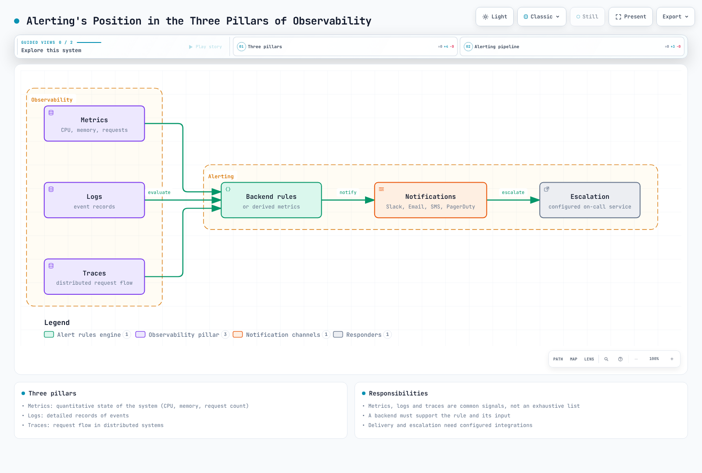
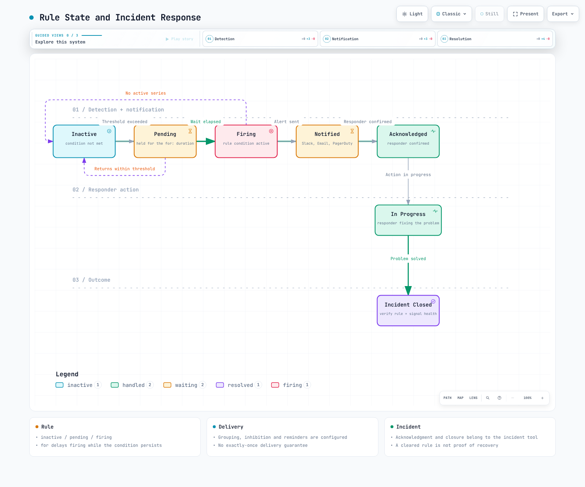
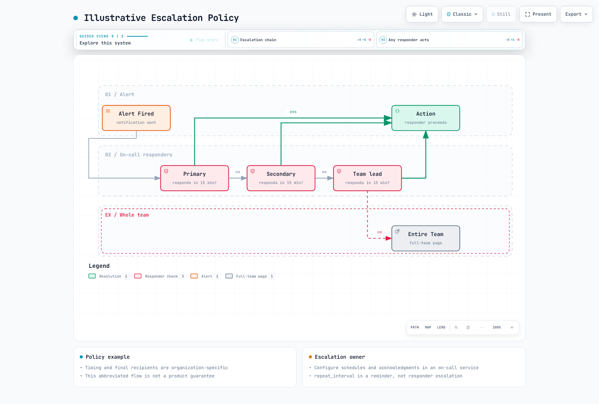
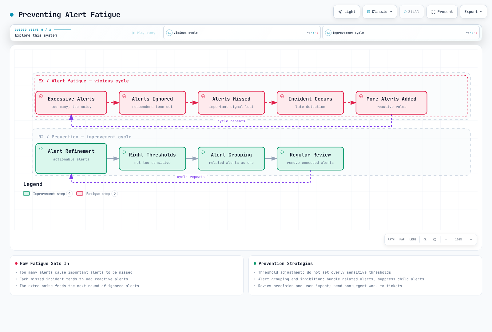
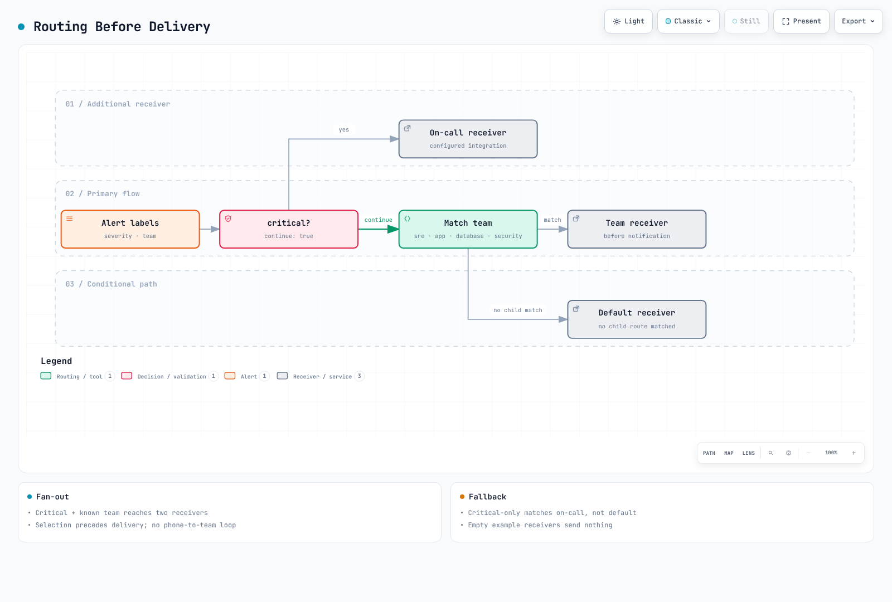
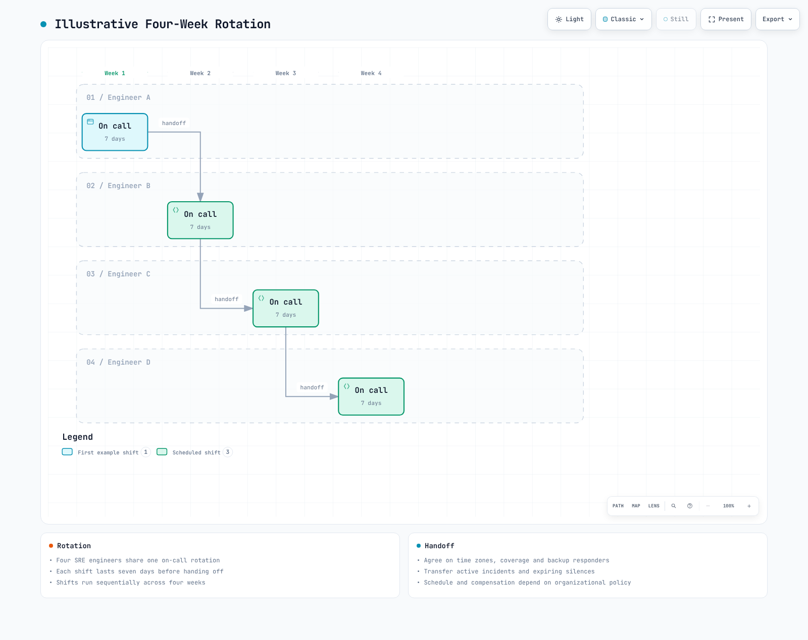
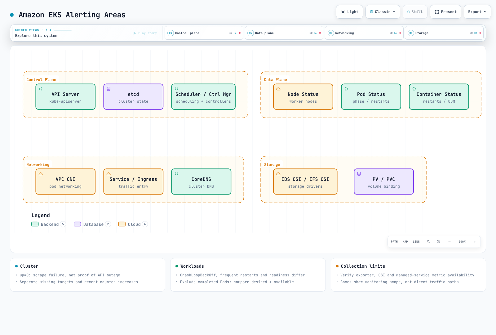
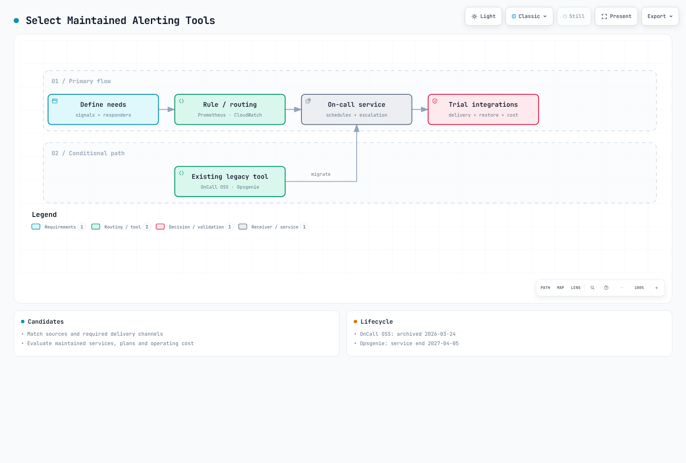
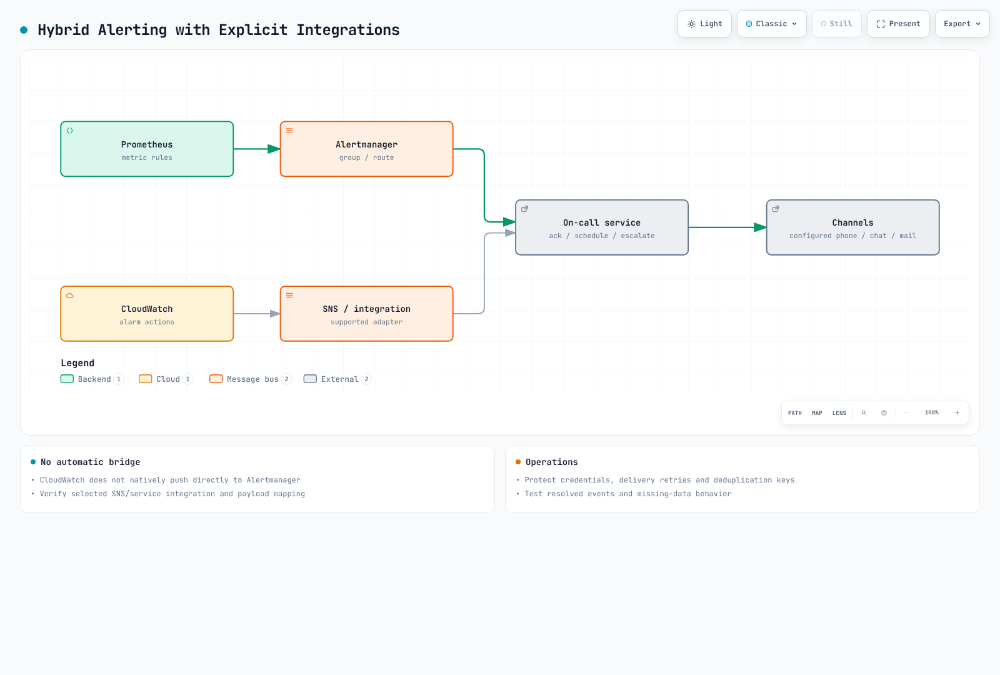

# アラートの概要

> **最終更新**: 2026年9月13日


> 確認基準: Prometheus 3.14.0 と Alertmanager 0.34.0。例は単一クラスターと重複を除去した時系列データを前提としています。実際のジョブ、ラベル、エクスポーター、メトリクスの提供状況を確認してから、しきい値を調整してください。確認したのはローカルでのルールとルーティング設定のみです。クラスター上での動作確認や通知チャネルへの送信は行っていません。


## 目次

- [アラートの役割と重要性](#the-role-and-importance-of-alerting)
- [アラートのライフサイクル](#alert-lifecycle)
- [アラート設計の原則](#alert-design-principles)
- [アラートのルーティングとエスカレーション](#alert-routing-and-escalation)
- [オンコールローテーション](#on-call-rotation)
- [EKS 環境のアラート戦略](#alerting-strategy-for-eks-environments)
- [ソリューションの比較](#solution-comparison)

---

<span id="the-role-and-importance-of-alerting"></span>

## アラートの役割と重要性

### オブザーバビリティの 3 つの柱におけるアラートの位置付け

メトリクス、ログ、トレースは一般的なオブザーバビリティのシグナルです。プロファイルなど、ほかのシグナルもあります。ルール評価エンジンがこれら3種類すべてを直接評価するとは限りません。



[🔍 インタラクティブな図を表示](https://www.atomai.click/kubernetes-docs/archmaps/en-observability-alerting-readme-0.html)

- **メトリクス**: CPU、メモリ、リクエスト数など、システムの状態を定量的に表すデータ
- **ログ**: イベントの詳細な記録
- **トレース**: 分散システムにおけるリクエストの流れ

Prometheus のルールはメトリクスを評価します。ログやトレースからアラートを生成するには、バックエンド固有のルールや、ログ・トレースから導出したメトリクスを使います。検知、通知、人による確認応答は別の段階です。通知が実際に届いたかどうかも別途監視する必要があります。

### アラートが必要な理由

1. **プロアクティブな問題対応**: ユーザーが問題を経験する前に問題を検出する
2. **ダウンタイムの最小化**: 迅速な検出と対応によりサービスの可用性を向上させる
3. **コスト削減**: 自動監視により人件費を削減する
4. **SLA/SLO の遵守**: サービスレベル目標を達成するための不可欠な要素
5. **インシデントの記録**: 問題発生の履歴を追跡および分析する

### 良いアラートと悪いアラート

| 観点 | 良いアラート | 悪いアラート |
|--------|-------------|------------|
| **実行可能性** | 即時の対応が必要 | 情報のみで、対応不要 |
| **明確性** | 問題が何か明確 | 曖昧で不明確 |
| **緊急度** | 緊急度が重大度に一致する | すべてが緊急扱い |
| **頻度** | 適切な頻度 | 頻度が高すぎる、または低すぎる |
| **重複** | 関連アラートがグループ化される | 同じ問題に対して数十件のアラート |

---

<span id="alert-lifecycle"></span>

## アラートのライフサイクル

この図はルールの状態とインシデント対応を組み合わせています。Prometheus のルール状態は inactive、pending、firing です。確認応答や対応中の状態はオンコールツール側で管理します。インシデントをクローズしても、発火中のルールは解除されません。また、時系列データが消失するとルールが非アクティブになる場合があるため、データの消失をサービス復旧の証拠として扱わないでください。



[🔍 インタラクティブな図を表示](https://www.atomai.click/kubernetes-docs/archmaps/en-observability-alerting-readme-1.html)

### 1. 検知

- **しきい値ベース**: 特定の値が設定済みのしきい値を超えたとき
- **変化率ベース**: 変化率が異常なとき
- **異常検知**: 機械学習ベースの異常パターン検知
- **ログパターン**: 特定のログパターンが発生したとき

```yaml
groups:
  - name: node-alerts
    rules:
      - alert: HighCPUUsage
        expr: 100 * (1 - avg by (cluster, instance) (rate(node_cpu_seconds_total{mode="idle"}[5m]))) > 80
        for: 5m
        labels:
          severity: warning
          team: sre
        annotations:
          summary: "High CPU usage detected"
          description: "CPU usage is above 80% for 5 minutes on {{ $labels.instance }}"
```

### 2. 通知

- **通知チャネルの選択**: Slack、メール、SMS、PagerDuty など
- **ルーティング**: アラートの種類に応じて適切な受信先へ届ける
- **グルーピング**: 関連するアラートをまとめる
- **重複排除**: 重複通知を減らします。ただし exactly-once（厳密に1回だけの配信）は保証されず、`repeat_interval` による再通知や再試行が行われる場合もあります

### 3. エスカレーション

- **時間ベース**: 指定時間内に応答がない場合、次の対応者へエスカレーションする
- **重大度ベース**: 重大度に応じて異なるエスカレーション経路を使う
- **自動エスカレーション**: オンコールサービス側で設定します。Alertmanager の `repeat_interval` は確認応答を判定せず、対応者を交代させる機能もありません



[🔍 インタラクティブな図を表示](https://www.atomai.click/kubernetes-docs/archmaps/en-observability-alerting-readme-2.html)

### 4. 解決

- **手動解決**: 対応者がインシデント管理ツールでインシデントをクローズします。ルールの状態は別途確認します
- **自動解決**: ルールとメトリクス収集の状態を確認してから、連携先のポリシーに従ってインシデントの状態を更新します
- **解決通知**: 問題が修正されたときに解決通知を送信します

---

<span id="alert-design-principles"></span>

## アラート設計の原則

### 1. 実行可能なアラート

オンコール担当者を呼び出すアラートには、受け手が直ちに実行できる対応を示す必要があります。情報提供のイベントや長期的な作業は、チケットやダッシュボードに送るとよいでしょう。

**悪い例:**
```
Alert: Database connection count increased
```

**良い例:**
```
Alert: Database connection pool exhausted
Action Required: Confirm user impact; inspect pool saturation and connection leaks using the runbook
Runbook: https://example.com/runbooks/replace-db-runbook
```

### 2. アラート疲れの防止

アラートが多すぎると、重要なアラートを見逃すおそれがあります。



[🔍 インタラクティブな図を表示](https://www.atomai.click/kubernetes-docs/archmaps/en-observability-alerting-readme-3.html)

**アラート疲れを防ぐ戦略:**

1. **しきい値の調整**: 過敏すぎるしきい値を設定しない
2. **アラートのグループ化**: 関連するアラートを 1 つにまとめる
3. **抑制**: 親アラートが発火したときに子アラートを抑制する
4. **定期的なレビュー**: 不要なアラートを削除する
5. **段階的な導入**: 新しいアラートは最初に低い重大度で開始する

### 3. 重大度レベル

以下の応答時間は組織内の運用例です。製品の SLA でも、あらゆる組織に当てはまる推奨値でもありません。

| 重大度 | 説明 | 応答時間 | 例 |
|----------|-------------|---------------|----------|
| **Critical** | サービス全体の停止 | 即時（5 分以内） | サービス全体の停止、データ損失リスク |
| **High** | 主要機能の障害 | 15 分以内 | 決済システムエラー、ログイン失敗 |
| **Warning** | 問題の兆候 | 1 時間以内 | ディスク使用率 80%、応答遅延の増加 |
| **Info** | 情報通知 | 営業時間内 | デプロイ完了、バックアップ成功 |

```yaml
groups:
  - name: disk-alerts
    rules:
      - alert: DiskSpaceCritical
        expr: |
          (100 * node_filesystem_avail_bytes{fstype!~"tmpfs|overlay|squashfs"}
            / node_filesystem_size_bytes{fstype!~"tmpfs|overlay|squashfs"} < 5)
          and node_filesystem_readonly == 0
          and node_filesystem_size_bytes > 0
        for: 5m
        labels:
          severity: critical
          team: sre
        annotations:
          summary: "Disk space critical"
      - alert: DiskSpaceWarning
        expr: |
          (100 * node_filesystem_avail_bytes{fstype!~"tmpfs|overlay|squashfs"}
            / node_filesystem_size_bytes{fstype!~"tmpfs|overlay|squashfs"} < 20)
          and node_filesystem_readonly == 0
          and node_filesystem_size_bytes > 0
        for: 10m
        labels:
          severity: warning
          team: sre
        annotations:
          summary: "Disk space low"
```

### 4. アラートのドキュメント化

すべてのアラートには、以下の情報を含める必要があります。

- **説明**: アラートの意味
- **影響**: この問題がサービスに与える影響
- **対応手順**: 問題を解決するための段階的なガイド
- **運用手順書へのリンク**: 詳細な対応手順を記したドキュメント

```yaml
annotations:
  summary: "Investigate the affected operation"
  description: "Check the rule expression, its units, labels, and collection health."
  impact: "Document the affected user operation before paging."
  action: "Use the owning team's reviewed runbook; do not scale resources blindly."
  runbook_url: "https://example.com/runbooks/replace-with-reviewed-runbook"
```

---

<span id="alert-routing-and-escalation"></span>

## アラートのルーティングとエスカレーション

### ルーティング戦略

アラートは、さまざまな条件に基づいて適切な受信先へ届けます。



[🔍 インタラクティブな図を表示](https://www.atomai.click/kubernetes-docs/archmaps/en-observability-alerting-readme-5.html)

### ルーティングツリーの設計

これは通知を行わずにルーティングを検証するための、完全な設定例です。`receiver` が空なのは意図的です。本番で使う前に、レビュー済みの連携先と Secret ファイルを設定してください。critical アラートはオンコール担当者と、一致したチームの両方に送られます。チームラベルがない場合は `default` にフォールバックしますが、critical 条件だけに一致した場合は `default` にも送られません。グルーピングによる遅延があるため、即時に電話がかかる保証はありません。disk critical は、同じ `instance`、`device`、`mountpoint` の warning だけを抑制します。

```yaml
route:
  receiver: default-receiver
  group_by: [alertname, cluster, namespace, service]
  group_wait: 30s
  group_interval: 5m
  repeat_interval: 4h
  routes:
    - matchers: ['severity="critical"']
      receiver: critical-oncall
      continue: true
    - matchers: ['team="sre"']
      receiver: sre-team
    - matchers: ['team="app"']
      receiver: dev-team
    - matchers: ['team="database"']
      receiver: dba-team
    - matchers: ['team="security"']
      receiver: security-team
receivers:
  - name: default-receiver
  - name: critical-oncall
  - name: sre-team
  - name: dev-team
  - name: dba-team
  - name: security-team
inhibit_rules:
  - source_matchers: ['alertname="DiskSpaceCritical"', 'instance!=""', 'device!=""', 'mountpoint!=""']
    target_matchers: ['alertname="DiskSpaceWarning"', 'instance!=""', 'device!=""', 'mountpoint!=""']
    equal: [cluster, instance, device, mountpoint]
```

### エスカレーションポリシー

以下は運用例です。オンコールサービスでタイムゾーン、確認応答の猶予時間、代替担当者、再通知の動作を設定し、訓練で確かめてください。

| 手順 | 時間 | 対象 | 通知チャネル |
|------|------|--------|---------|
| 1 | 0 分 | 一次オンコール担当者 | Slack、PagerDuty |
| 2 | 15 分 | 二次オンコール担当者 | Slack、PagerDuty、SMS |
| 3 | 30 分 | チームリーダー | Slack、PagerDuty、電話 |
| 4 | 45 分 | エンジニアリングマネージャー | 電話 |
| 5 | 60 分 | CTO/エンジニアリング担当VP | 電話 |

---

<span id="on-call-rotation"></span>

## オンコールローテーション

### オンコールの概念

オンコール担当者とは、定められた期間中にシステムの問題へ対応する責任者です。



[🔍 インタラクティブな図を表示](https://www.atomai.click/kubernetes-docs/archmaps/en-observability-alerting-readme-8.html)


### オンコールのベストプラクティス

1. **明確な引き継ぎ日程**: 毎週または隔週で担当を交代する
2. **引き継ぎ手順**: 担当交代時に対応中の問題を共有する
3. **代替担当者**: 主担当者が対応できない場合に備える
4. **適切な補償**: オンコール手当または代休
5. **燃え尽きの防止**: 適切なローテーションサイクル

### オンコールツールの要件

- **当番表の管理**: カレンダー連携、シフト管理
- **臨時変更**: 一時的な担当者の変更
- **エスカレーション**: 自動エスカレーション
- **モバイル対応**: 場所を問わずアラートを受信できること
- **レポート**: オンコール対応の分析

---

<span id="alerting-strategy-for-eks-environments"></span>

## EKS 環境のアラート戦略

### EKS 固有の監視対象



[🔍 インタラクティブな図を表示](https://www.atomai.click/kubernetes-docs/archmaps/en-observability-alerting-readme-4.html)

### レイヤー別のアラート戦略

#### 1. クラスター単位のアラート

ルール内の job 名は、実際にデプロイされている監視対象に合わせてください。`up=0` はスクレイプの失敗を示しますが、API が全面停止していることまでは示しません。absent を使うルールが監視するのは、1つのメトリクス収集範囲です。複数クラスター構成では、想定する監視対象の一覧とクラスターラベルが必要です。累積値である Cluster Autoscaler のエラーカウンターには `increase` を使います。増加が5分間観測されても、その5分間ずっとエラーが発生していたとは限りません。このルールは Karpenter や EKS Auto Mode にはそのまま適用できません。

```yaml
groups:
  - name: eks-cluster
    rules:
      - alert: EKSAPIServerScrapeFailed
        expr: up{job="kubernetes-apiservers"} == 0
        for: 1m
        labels:
          severity: critical
          team: sre
        annotations:
          summary: "Prometheus cannot scrape the configured API server target"
      - alert: EKSAPIServerTargetMissing
        expr: absent(up{job="kubernetes-apiservers"})
        for: 5m
        labels:
          severity: warning
          team: sre
        annotations:
          summary: "No API server target series in this Prometheus"
      - alert: EKSNodeNotReady
        expr: kube_node_status_condition{condition="Ready",status="true"} == 0
        for: 5m
        labels:
          severity: critical
          team: sre
        annotations:
          summary: "Node {{ $labels.node }} is not ready"
      - alert: EKSClusterAutoscalerRecentErrors
        expr: increase(cluster_autoscaler_errors_total[10m]) > 0
        for: 5m
        labels:
          severity: warning
          team: sre
        annotations:
          summary: "Cluster Autoscaler recorded failed loops in the last 10 minutes"
```

#### 2. ワークロード単位のアラート

CrashLoopBackOff の時系列データは、再試行の合間に一時的に消えることがあります。このルールは、直近5分間の観測データが10分にわたって繰り返し存在した場合に発火します。継続中の Waiting 状態ではなく、繰り返し観測された事象を検出します。最後に観測されてからも最大5分間はアラートが有効な場合があります。組み込みのルールテストでは、短い一時的な事象、再試行の繰り返し、復旧を区別します。

```yaml
groups:
  - name: eks-workloads
    rules:
      - alert: PodCrashLooping
        expr: max_over_time(kube_pod_container_status_waiting_reason{reason="CrashLoopBackOff"}[5m]) >= 1
        for: 10m
        labels:
          severity: warning
          team: app
        annotations:
          summary: "Pod {{ $labels.namespace }}/{{ $labels.pod }} repeatedly observed in CrashLoopBackOff"
      - alert: PodFrequentRestarts
        expr: increase(kube_pod_container_status_restarts_total[15m]) > 3
        for: 5m
        labels:
          severity: warning
          team: app
        annotations:
          summary: "Pod {{ $labels.namespace }}/{{ $labels.pod }} has frequent restarts"
      - alert: PodNotReady
        expr: |
          (kube_pod_status_ready{condition="true"} == 0)
          and on (namespace, pod, uid)
          (kube_pod_status_phase{phase=~"Pending|Running|Unknown"} == 1)
        for: 15m
        labels:
          severity: warning
          team: app
        annotations:
          summary: "Active pod {{ $labels.namespace }}/{{ $labels.pod }} is not ready"
      - alert: DeploymentReplicasMismatch
        expr: |
          kube_deployment_spec_replicas
            > on (namespace, deployment) kube_deployment_status_replicas_available
        for: 10m
        labels:
          severity: warning
          team: app
        annotations:
          summary: "Deployment {{ $labels.namespace }}/{{ $labels.deployment }} has fewer available replicas than desired"
```

#### 3. リソース単位のアラート

CFS の例は経過時間に対する割合ではなく、**throttled periods / total periods** を測定します。cAdvisor がこれらのメトリクスを出力していることを確認してください。メモリ上限が設定されていない場合、値がゼロまたは非常に大きく見えることがあるため、メモリのルールは明示的な上限があるコンテナだけを対象にします。PVC の統計情報は CSI ドライバーとボリューム種別によって異なります。分母がゼロのデータは除外しますが、メトリクスがないことは正常性の証明になりません。

```yaml
groups:
  - name: eks-resources
    rules:
      - alert: ContainerCPUThrottling
        expr: |
          (
            sum by (namespace, pod, container) (
              rate(container_cpu_cfs_throttled_periods_total{container!="",container!="POD"}[5m]))
            / sum by (namespace, pod, container) (
              rate(container_cpu_cfs_periods_total{container!="",container!="POD"}[5m]))
          ) > 0.25
          and sum by (namespace, pod, container) (
            rate(container_cpu_cfs_periods_total{container!="",container!="POD"}[5m])) > 0
        for: 5m
        labels:
          severity: warning
          team: app
        annotations:
          summary: "More than 25% of CFS periods throttled for {{ $labels.pod }}/{{ $labels.container }}"
      - alert: ContainerMemoryNearLimit
        expr: |
          (
            container_memory_working_set_bytes{container!="",container!="POD"}
            / container_spec_memory_limit_bytes{container!="",container!="POD"}
          ) > 0.9
          and container_spec_memory_limit_bytes{container!="",container!="POD"} > 0
        for: 5m
        labels:
          severity: warning
          team: app
        annotations:
          summary: "Container {{ $labels.pod }}/{{ $labels.container }} memory is near its reported limit"
      - alert: PVCAlmostFull
        expr: |
          (kubelet_volume_stats_used_bytes / kubelet_volume_stats_capacity_bytes > 0.85)
          and kubelet_volume_stats_capacity_bytes > 0
        for: 5m
        labels:
          severity: warning
          team: sre
        annotations:
          summary: "PVC {{ $labels.namespace }}/{{ $labels.persistentvolumeclaim }} is almost full"
```

### AWS サービスとの連携に関するアラート

EKS 1.28 以降では、一部のコントロールプレーンメトリクスが AWS/EKS から提供されますが、すべての内部コンポーネントがスクレイプ可能になるわけではありません。認証エラーを調査するには、コントロールプレーンのログを別途有効にしてください。可用性は、メトリクス収集の状態、API リクエストの失敗、外部プローブを使って評価します。

| AWS サービス | 監視項目 | アラートツール |
|-------------|------------------|------------|
| EKS コントロールプレーン | API Server の可用性、認証エラー | CloudWatch |
| EC2（ノード） | インスタンスの状態、システムチェック | CloudWatch |
| EBS | ボリュームの状態、IOPS 使用率 | CloudWatch |
| EFS | スループット、接続数 | CloudWatch |
| ALB / NLB | ALB の HTTP リクエスト数・エラー数・応答時間、NLB のフロー・TCP リセット・ターゲットの状態 | CloudWatch: 製品固有のメトリクスを使用 |
| VPC / NAT Gateway | NAT メトリクス、別途有効化した Flow Logs の accepted/rejected レコード | CloudWatch のメトリクス／Logs。Flow Logs 自体はアラーム評価エンジンではありません |

---

<span id="solution-comparison"></span>

## ソリューションの比較

### 主なアラートソリューションの比較表

| 製品 | 役割と運用上の制約 |
|---------|--------------------------------|
| Alertmanager | オープンソースのグルーピング、ルーティング、抑制、再通知を行います。ホスティングと運用が必要で、オンコール当番表や確認応答に基づくエスカレーション機能はありません |
| CloudWatch Alarms | AWS メトリクスや対応するクエリを評価し、状態を変更して設定済みアクションを呼び出します。当番表は別途必要です |
| Grafana OnCall OSS | 2026年3月24日にアーカイブ済み。新規の本番デプロイで標準の選択肢にはできません |
| Grafana Cloud IRM / PagerDuty | オンコールやエスカレーションの候補です。現在のプラン、通知チャネル、リージョン、契約を確認してください |
| Opsgenie | 2025年6月4日に販売終了。サポートとサービスは2027年4月5日に終了する予定です。既存ユーザーには移行計画が必要です |

### ソリューション選択ガイド



[🔍 インタラクティブな図を表示](https://www.atomai.click/kubernetes-docs/archmaps/en-observability-alerting-readme-6.html)

#### 状況別の推奨ソリューション

1. Prometheus を中心に使う場合: Alertmanager でグルーピングとルーティングを行い、必要な通知チャネルと連携します。
2. AWS メトリクスを中心に使う場合: SNS または対応するインシデント管理サービスとの連携も含め、CloudWatch Alarms の利用を検討します。
3. 24時間体制で対応する場合: 人員配置、代替要員、タイムゾーン、確認応答、エスカレーション、コストを考慮し、継続的に保守されているオンコールサービスを選びます。
4. Grafana OnCall OSS/Opsgenie を利用中の場合: 機能、履歴、当番表、連携設定を移行できるか検証します。

### ハイブリッドアプローチ

複数のソリューションを組み合わせることもできます。CloudWatch から Alertmanager に自動で直接通知する機能はありません。この例では、SNS またはオンコールサービスがサポートする連携を使います。Alertmanager 経由でルーティングするには、アダプター、認証、重複通知と解決通知の処理を別途設計する必要があります。



[🔍 インタラクティブな図を表示](https://www.atomai.click/kubernetes-docs/archmaps/en-observability-alerting-readme-7.html)

**構成例:**

1. **Prometheus + Alertmanager**: メトリクス収集と主なアラート処理
2. **CloudWatch**: AWS サービスのメトリクス収集
3. **継続的に保守されているオンコールサービス**: オンコール管理とエスカレーション
4. **Slack**: リアルタイムアラートとコラボレーション

---

## 次のステップ

このセクションでは、アラートの基本概念と運用方針を説明しました。各ソリューションの詳しい設定方法は、以下のドキュメントを参照してください。

- [Prometheus Alertmanager](./01-alertmanager.md): オープンソースのアラート管理
- [CloudWatch Alarms](./02-cloudwatch-alarms.md): AWS ネイティブのアラート
- [Grafana OnCall](./03-grafana-oncall.md): 既存環境の確認と移行時の検討事項

---

## 参考資料

- [Prometheus Alerting Best Practices](https://prometheus.io/docs/practices/alerting/)
- [Google SRE Book - Practical Alerting](https://sre.google/sre-book/practical-alerting/)
- [AWS CloudWatch Alarms Documentation](https://docs.aws.amazon.com/AmazonCloudWatch/latest/monitoring/AlarmThatSendsEmail.html)
- [Grafana OnCall Documentation](https://grafana.com/docs/oncall/latest/)
- [PagerDuty Incident Response](https://response.pagerduty.com/)

- [Alertmanager configuration](https://prometheus.io/docs/alerting/latest/configuration/)
- [EKS control-plane metrics](https://docs.aws.amazon.com/eks/latest/userguide/cloudwatch.html)
- [Opsgenie lifecycle and migration](https://www.atlassian.com/software/opsgenie)
