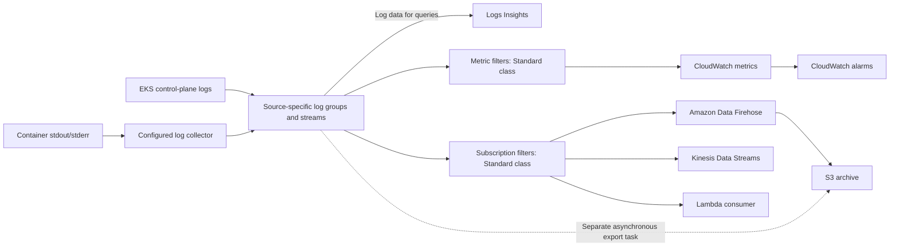

# CloudWatch Logs

> **最終更新**: 2026年9月13日
> **確認した例**: AWS provider 6.69.1、オプションの CloudWatch Observability Helm chart 6.6.0、手動構成の AWS for Fluent Bit 3.4.15/Fluent Bit 5.0.9。ローカル設定、SDK、合成ペイロードのみを確認しています。AWS リソース、ログ配信、Insights クエリ、アラームは実行していません。

Amazon CloudWatch Logs はログの取り込み、保存、分析を管理します。ログを送る側、ID、ネットワーク、保持期間、クォータ、後段の利用者は引き続き設定が必要です。EKS コントロールプレーン、ワークロード、EKS Auto Mode の管理コンポーネントのログは、それぞれ別の収集経路です。

## 目次

1. [概要](#overview)
2. [EKS コントロールプレーンのログ](#eks-control-plane-logging)
3. [Container Insights](#container-insights)
4. [Fluent Bit の統合](#fluentbit-integration)
5. [CloudWatch Logs Insights](#cloudwatch-logs-insights)
6. [サブスクリプションフィルター](#subscription-filters)
7. [コストの最適化](#cost-optimization)

## 概要 {#overview}

<span id="cloudwatch-logs-features"></span>

### 機能とログクラス

| 項目 | 確認すること |
|---|---|
| マネージドサービス | 検索クラスターの運用は不要ですが、コレクターと配信連携の担当者は必要です |
| 容量 | イベントサイズ、API、サブスクリプション、宛先にクォータがあり、無制限に取り込めるわけではありません |
| セキュリティ | IAM、暗号化、データ保護、プライベート接続はそれぞれ別に設定します |
| 配信時期 | 配信とアラートは非同期です。再試行、重複、配信漏れを考慮してください |
| Standard クラス | この章で使うメトリクスフィルターとサブスクリプションをサポートします |
| Infrequent Access | 取り込み料金が低く、機能も異なります。サブスクリプションフィルター、メトリクスフィルター、EMF は利用できません |
| Delivery クラス | Lambda ログを S3/Firehose に配信する別の選択肢です。CloudWatch での保持期間は固定の2日間で、Logs Insights クエリは利用できません |

ロググループのクラスは作成後に変更できません。Infrequent Access は現在、S3 エクスポート、Logs Insights、データ保護などをサポートしています。そのため、これらを一切サポートしないという古い一律の説明は正しくありません。収集方式を変える前に、最新の機能表を確認してください。

<span id="terminology"></span>

### 主な用語



サブスクリプションフィルターの宛先に S3 バケット ARN を指定することは**できません**。Firehose 経由の継続的な S3 配信と、非同期の S3 エクスポートタスクは別の経路です。また、CloudWatch Logs のバッチは Firehose の OpenSearch 宛先には配信できません。代わりに、文書化されている CloudWatch から OpenSearch への連携を使用します。Firehose に直接送るアプリケーションレコードは、入力仕様が異なります。

| 用語 | 意味 |
|---|---|
| ロググループ | 保持、アクセス、設定をまとめる境界。例: `/aws/eks/example-eks/cluster` |
| ログストリーム | グループ内にあるログイベントの列 |
| ログイベント | タイムスタンプとメッセージ。サービスの上限が適用されます |
| 保持期間 | サポート対象の離散的な保持期間。未設定なら期限はありません |

## EKS コントロールプレーンのログ {#eks-control-plane-logging}

### ログの種類

ログの種類は `api`、`audit`、`authenticator`、`controllerManager`、`scheduler` の5つです。それぞれ API サーバーの診断、監査イベント、IAM 認証、コントローラーマネージャーの診断、スケジューリングを対象とします。ワーカーノードとアプリケーションのログは別です。

コントロールプレーンのログは既定で無効です。診断、セキュリティ、保持の要件に応じて種類を選んでください。API が以前の表にある「必須」の選択肢を要求するわけではありません。通常、配信には数分かかり、ベストエフォートです。有効化しても、すでにローテーションされた過去のログは復元されません。

<span id="enable-via-aws-cli"></span>

### 有効化して更新状況を確認する

既存クラスターの場合、次の内容を `control-plane-logging.json` として保存します。

```json
{
  "clusterLogging": [
    {
      "types": [
        "api",
        "audit",
        "authenticator",
        "controllerManager",
        "scheduler"
      ],
      "enabled": true
    }
  ]
}
```

```bash
DOCS_CLUSTER=example-eks
DOCS_REGION=ap-northeast-2

aws eks describe-cluster --name "$DOCS_CLUSTER" --region "$DOCS_REGION" \
  --query 'cluster.{version:version,logging:logging}'

UPDATE_ID=$(aws eks update-cluster-config \
  --name "$DOCS_CLUSTER" --region "$DOCS_REGION" \
  --logging file://control-plane-logging.json --query update.id --output text)

aws eks describe-update --name "$DOCS_CLUSTER" --region "$DOCS_REGION" \
  --update-id "$UPDATE_ID" --query 'update.{status:status,errors:errors}'
```

更新ステータスが `Successful` になる必要があります。リクエストが受け付けられただけでは不十分です。ログ設定の更新では、クラスターの各サブネットに最大5個の空き IP アドレスが必要になる場合があります。種類を無効にする場合は、既存ログを暗黙にオフにする別の例をコピーせず、その変更を明示的に確認してください。

<span id="configure-with-terraform"></span>

### Terraform の所有権と保持期間

Terraform 管理のクラスターでは、既存クラスターリソースを所有する設定の `enabled_cluster_log_types` を変更します。ログを有効にする目的だけで `aws_eks_cluster` リソースを追加したり、廃止された Kubernetes 1.29 の作成例をコピーしたりしないでください。

次の別ファイルでは、ロググループと手動コレクターのポリシーを管理します。

```hcl
terraform {
  required_providers {
    aws = {
      source  = "hashicorp/aws"
      version = "6.69.1"
    }
  }
}

variable "region" {
  type    = string
  default = "ap-northeast-2"
}

variable "account_id" {
  type = string
  validation {
    condition     = can(regex("^[0-9]{12}$", var.account_id))
    error_message = "Use the owning account ID."
  }
}

variable "cluster_name" {
  type    = string
  default = "example-eks"
}

provider "aws" {
  region = var.region
}

resource "aws_cloudwatch_log_group" "application" {
  name              = "/aws/containerinsights/${var.cluster_name}/application"
  log_group_class   = "STANDARD"
  retention_in_days = 30

  lifecycle {
    prevent_destroy = true
  }
}

resource "aws_cloudwatch_log_group" "control_plane" {
  name              = "/aws/eks/${var.cluster_name}/cluster"
  log_group_class   = "STANDARD"
  retention_in_days = 30

  lifecycle {
    prevent_destroy = true
  }
}

resource "aws_iam_policy" "collector" {
  name_prefix = "fluent-bit-cloudwatch-"
  policy = jsonencode({
    Version = "2012-10-17"
    Statement = [{
      Effect   = "Allow"
      Action   = ["logs:CreateLogStream", "logs:PutLogEvents"]
      Resource = "${aws_cloudwatch_log_group.application.arn}:*"
    }]
  })
}

output "collector_policy_arn" {
  value = aws_iam_policy.collector.arn
}
```

グループがすでに存在する場合は、現在の所有者を使うか、適用前に予定した state にインポートしてください。たとえば、コントロールプレーングループのインポート ID は `/aws/eks/example-eks/cluster` です。同じグループを「監査」グループとして再宣言しないでください。5種類すべてのコントロールプレーンログが、このグループと保持期間を共有します。

30日という値は例であり、法的要件ではありません。`prevent_destroy` は Terraform による破棄を防ぎますが、保持期間の短縮や Terraform 外での削除は防ぎません。CloudWatch は保存したログを暗号化します。カスタマー管理 KMS キーには、独自のキーポリシーと運用計画が必要です。

### ロググループの構成

```text
/aws/eks/example-eks/cluster
  kube-apiserver-...          API server
  kube-apiserver-audit-...    Audit
  authenticator-...          IAM authentication
  kube-controller-manager-... Controller manager
  kube-scheduler-...         Scheduler
```

ストリームの接尾辞はローテーションします。古い図にあった `/aws/eks/cluster/logs` は、実際のコントロールプレーングループの命名規則ではありません。

## Container Insights

<span id="container-insights-overview"></span>
<span id="installation-methods"></span>
<span id="cloudwatch-agent-fluentbit-recommended"></span>
<span id="install-via-helm-chart"></span>
<span id="irsa-setup"></span>

### インストール方法の選択

現在の **Amazon CloudWatch Observability EKS アドオン**、またはその **amazon-cloudwatch-observability** Helm chart を使用します。以前の ADOT exporter chart や、置換されていないクイックスタート URL は、これらと同じインストール方法ではありません。

アドオンの場合は、実際のクラスターと互換性のあるバージョンを調べ、選んだ設定スキーマを確認し、文書化された IAM 関連付けを設定します。chart のバージョンは EKS アドオンのバージョン文字列とは異なります。

```bash
K8S_VERSION=$(aws eks describe-cluster --name "$DOCS_CLUSTER" \
  --region "$DOCS_REGION" --query cluster.version --output text)
aws eks describe-addon-versions \
  --addon-name amazon-cloudwatch-observability \
  --kubernetes-version "$K8S_VERSION" --region "$DOCS_REGION"
```

次の `cloudwatch-values.yaml` は任意の Helm 例です。従来の Container Insights 経路とコンテナログを選び、Application Signals と別系統の OTel Container Insights パイプラインは無効にしています。

```yaml
clusterName: example-eks
region: ap-northeast-2
containerInsights:
  enabled: true
containerLogs:
  enabled: true
applicationSignals:
  enabled: false
otelContainerInsights:
  enabled: false
  logs:
    enabled: false
```

```bash
helm repo add aws-observability https://aws-observability.github.io/helm-charts
helm repo update aws-observability
helm upgrade --install cloudwatch-observability \
  aws-observability/amazon-cloudwatch-observability \
  --version 6.6.0 --namespace amazon-cloudwatch --create-namespace \
  --values cloudwatch-values.yaml
```

IAM 権限は**インストール前に**設定してください。この chart では Fluent Bit DaemonSet が `cloudwatch-agent` ServiceAccount を使います。選択した Pod Identity 関連付けに合うよう、名前と namespace を一致させてください。公式の関連付けとロール信頼ポリシーの要件に従います。名前が異なる ServiceAccount 向けの IRSA ロールでは、手作業で作った `fluent-bit` Pod は認可されません。この chart を EKS 管理のアドオンに重ねてインストールしたり、同じログに複数のコレクターを動かしたりしないでください。

<span id="collected-logs"></span>

### 収集されるログとプラットフォーム

| 一般的なグループ接尾辞 | 内容と制約 |
|---|---|
| `application` | `/aws/containerinsights/CLUSTER/application` にあるコンテナの stdout/stderr |
| `dataplane` | 設定された kubelet/runtime/VPC CNI/kube-proxy のソース。実際のコンポーネントはプラットフォームによって異なります |
| `host` | 設定された Linux ファイル/journal または Windows イベントログ。すべての OS に `/var/log/messages`、`/var/log/secure`、`/var/log/dmesg` があるわけではありません |
| `performance` | 多くは EMF のパフォーマンスイベントで、アプリケーションログメッセージとは互換性がありません |

サポートされているアドオン/chart には Linux と Windows の経路がありますが、Application Signals は EKS Windows でサポートされません。Fargate はこの手動 DaemonSet ではなく、プラットフォームのログルーターを使います。Hybrid Nodes と Auto Mode は別途確認してください。従来の EC2 ホストパスがすべての環境にあると仮定しないでください。

EKS Auto Mode の AWS 管理 Karpenter、EBS CSI、ロードバランサーコントローラー、IPAM のログは、別の **vended log delivery** 設定を使います。ログの種類は `AUTO_MODE_COMPUTE_LOGS`、`AUTO_MODE_BLOCK_STORAGE_LOGS`、`AUTO_MODE_LOAD_BALANCING_LOGS`、`AUTO_MODE_IPAM_LOGS` です。文書化された `PutDeliverySource` → `PutDeliveryDestination` → `CreateDelivery` の流れでは、ロググループ、S3、Firehose を宛先にできます。これは `PutSubscriptionFilter` や5種類のコントロールプレーンログ有効化とは別の機能です。

## Fluent Bit の統合 {#fluentbit-integration}

<span id="fluentbit-configmap"></span>
<span id="fluentbit-daemonset"></span>

### 手動でアプリケーションログを収集する

これは、対象となる Linux EC2 ノード用の**アプリケーションログ専用の代替プロファイル**です。Container Insights の完全なメトリクスパイプラインをインストールするものではなく、あらゆるホスト/dataplane ログを収集する保証もありません。

先に application グループを作成するか、既存のものを使います。上記のコレクターポリシーは、そのグループでのストリーム作成とイベント書き込みを許可しますが、意図的にグループ作成や保持期間変更は許可しません。そのため、この手動プロファイルに `cloudwatch:PutMetricData`、`s3:PutObject`、包括的な `logs:*` 権限は不要です。

OIDC 信頼条件が `system:serviceaccount:logging:fluent-bit-cloudwatch`、audience が `sts.amazonaws.com` に一致する承認済み IRSA ロールを用意し、生成したポリシーをアタッチします。`eksctl --role-only` の手順でロールを作成し、ServiceAccount はマニフェストで管理できます。ロール ARN、クラスター名、Region は一貫して置き換えてください。

```yaml
apiVersion: v1
kind: Namespace
metadata:
  name: logging
---
apiVersion: v1
kind: ServiceAccount
metadata:
  name: fluent-bit-cloudwatch
  namespace: logging
  annotations:
    eks.amazonaws.com/role-arn: arn:aws:iam::123456789012:role/FluentBitCloudWatchLogsRole
---
apiVersion: rbac.authorization.k8s.io/v1
kind: ClusterRole
metadata:
  name: fluent-bit-cloudwatch-metadata
rules:
- apiGroups:
  - ''
  resources:
  - namespaces
  - pods
  verbs:
  - get
  - list
  - watch
---
apiVersion: rbac.authorization.k8s.io/v1
kind: ClusterRoleBinding
metadata:
  name: fluent-bit-cloudwatch-metadata
roleRef:
  apiGroup: rbac.authorization.k8s.io
  kind: ClusterRole
  name: fluent-bit-cloudwatch-metadata
subjects:
- kind: ServiceAccount
  name: fluent-bit-cloudwatch
  namespace: logging
---
apiVersion: v1
kind: ConfigMap
metadata:
  name: fluent-bit-cloudwatch-config
  namespace: logging
data:
  fluent-bit.conf: |
    [SERVICE]
        Flush         5
        Grace         30
        Log_Level     info
        HTTP_Server   Off
        storage.path  /buffers/storage

    [INPUT]
        Name              tail
        Tag               application.*
        Path              /var/log/containers/*.log
        Exclude_Path      /var/log/containers/fluent-bit-cloudwatch-*_logging_fluent-bit-*.log
        multiline.parser  docker, cri
        DB                /buffers/tail.db
        Mem_Buf_Limit     50MB
        Skip_Long_Lines   On
        Read_from_Head    Off
        storage.type      filesystem

    [FILTER]
        Name                kubernetes
        Match               application.*
        Kube_Tag_Prefix     application.var.log.containers.
        Use_Kubelet         Off
        Merge_Log           On
        Merge_Log_Key       log_processed
        Keep_Log            On
        Labels              Off
        Annotations         Off
        K8S-Logging.Parser  Off
        K8S-Logging.Exclude Off

    [OUTPUT]
        Name                     cloudwatch_logs
        Match                    application.*
        region                   ap-northeast-2
        log_group_name           /aws/containerinsights/example-eks/application
        log_stream_prefix        ${HOST_NAME}-
        auto_create_group        false
        Retry_Limit              5
        storage.total_limit_size 1G
---
apiVersion: apps/v1
kind: DaemonSet
metadata:
  name: fluent-bit-cloudwatch
  namespace: logging
spec:
  selector:
    matchLabels:
      app: fluent-bit-cloudwatch
  template:
    metadata:
      labels:
        app: fluent-bit-cloudwatch
    spec:
      serviceAccountName: fluent-bit-cloudwatch
      nodeSelector:
        kubernetes.io/os: linux
      tolerations:
      - operator: Exists
        effect: NoSchedule
      containers:
      - name: fluent-bit
        image: public.ecr.aws/aws-observability/aws-for-fluent-bit:3.4.15@sha256:88e1b56cedb230486afeca6eeb26c5f6bd59c48879d0054d1674d5a58838c607
        args:
        - -c
        - /fluent-bit/custom/fluent-bit.conf
        securityContext:
          runAsUser: 0
          allowPrivilegeEscalation: false
          readOnlyRootFilesystem: true
          capabilities:
            drop:
            - ALL
          seccompProfile:
            type: RuntimeDefault
        resources:
          requests:
            cpu: 100m
            memory: 128Mi
          limits:
            memory: 512Mi
        volumeMounts:
        - name: logs
          mountPath: /var/log
          readOnly: true
        - name: buffers
          mountPath: /buffers
        - name: config
          mountPath: /fluent-bit/custom
          readOnly: true
        - name: tmp
          mountPath: /tmp
        command:
        - /fluent-bit/bin/fluent-bit
        env:
        - name: HOST_NAME
          valueFrom:
            fieldRef:
              fieldPath: spec.nodeName
      volumes:
      - name: logs
        hostPath:
          path: /var/log
          type: Directory
      - name: buffers
        hostPath:
          path: /var/lib/fluent-bit-cloudwatch
          type: DirectoryOrCreate
      - name: config
        configMap:
          name: fluent-bit-cloudwatch-config
      - name: tmp
        emptyDir: {}
      terminationGracePeriodSeconds: 45
```

ネイティブプラグイン名は `cloudwatch_logs` で、以前の Go プラグインは `cloudwatch` です。イメージの既定コマンドはエントリポイントスクリプトなので、この手動マニフェストは設定を指定してネイティブ Fluent Bit バイナリを明示的に起動します。

Tail DB とファイルシステムバッファーは書き込み可能で、読み取り専用のログマウントとは分離しています。Grace は30秒、Pod の終了猶予は45秒ですが、それですべてのバッファーデータが配信される保証はありません。ノード消失、ディスク満杯、長い行、有限の再試行回数、再起動時のオフセットによりログが失われる場合があります。`Read_from_Head Off` は未確認ファイルに影響します。永続的なオフセットも重要です。

このプロファイルは、ホストネットワーク経由で kubelet にアクセスするのではなく、API サーバーからメタデータを取得します。アプリケーションの annotation でパース方法を変えたりログを除外したりはできません。カスタムコレクターに予約済みの `extra_user_agent: container-insights` を設定して、管理対象のインストールであるかのように見せないでください。

### レコード仕様とホスト側のソース

CloudWatch に送られる、メタデータを追加したイベントの例です。

```json
{"log":"{\"level\":\"error\",\"message\":\"upstream request failed\",\"error_type\":\"upstream_timeout\",\"http\":{\"response_time_ms\":1250,\"status_code\":503}}","stream":"stderr","kubernetes":{"namespace_name":"production","pod_name":"api-example","container_name":"api"},"log_processed":{"level":"error","message":"upstream request failed","error_type":"upstream_timeout","http":{"response_time_ms":1250,"status_code":503}}}
```

アプリケーションのフィールドは `log_processed` の下にあり、信頼できる Kubernetes メタデータは `kubernetes` の下にあります。生の `log` 文字列にもアプリケーションデータが重複して入るため、収集前に禁止フィールドをマスキングしてください。以下のクエリ、サブスクリプション、メトリクスフィルターの例は、この正確な JSON エンベロープと小文字の `level: error` を使います。

Linux journal を収集する場合は、永続 journal が `/var/log/journal` にあるか、一時的な journal が `/run/log/journal` にあるかを確認してください。`systemd` input、適切な unit filter、読み取り専用マウント、別の書き込み可能な DB、出力グループ、IAM 権限を設定します。Docker の古い `/var/lib/docker/containers` を無条件にマウントしたり、containerd/Bottlerocket/AL2023 ノードに存在しないテキストファイルを前提にしたりしないでください。こうしたプラットフォーム固有のホスト設定は、この手動プロファイルには含まれません。

## CloudWatch Logs Insights

以下の例は SQL ではなく **Logs Insights QL** を使います。対象ロググループと範囲を絞った時間帯を選んでください。ローカルレビューでは公開済みの構文と仕様を確認しましたが、マネージドクエリサービスは呼び出していません。

### 基本的なクエリ構文

```text
fields @timestamp, @message
| filter @message like /(?i)error/
| sort @timestamp desc
| limit 100
```

大文字小文字を区別しない正規表現には `/(?i)error/` を使います。JavaScript の `/error/i` のような接尾辞は使えません。テキスト一致では、アプリケーションの構造化された error level ではない単語にも一致する場合があります。

コレクターが送る JSON エンベロープの場合:

```text
fields jsonParse(@message) as record
| filter record.log_processed.level = "error"
| fields @timestamp, record.log_processed.message as message
| sort @timestamp desc
| limit 100
```

`user_id=12345` を含む実際のテキストフィールドの場合:

```text
fields @timestamp, @message
| parse @message /user_id=(?<user_id>\d+)/
| filter user_id = "12345"
| limit 100
```

JSON のキー順や空白が任意でも動くと想定した glob に頼らないでください。`jsonParse` と明示的なネストフィールドを使えば、想定するレコード構造が明確になります。

### EKS ログのクエリ例

API サーバーの診断では、重複する監査ストリームの接頭辞を除外します。

```text
fields @timestamp, @logStream, @message
| filter @logStream like /^kube-apiserver-/
| filter @logStream not like /^kube-apiserver-audit-/
| filter @message like /(?i)error/
| sort @timestamp desc
| limit 50
```

特定の Kubernetes username の監査アクティビティ:

```text
fields jsonParse(@message) as audit
| filter @logStream like /^kube-apiserver-audit-/
| filter audit.user.username = "example-user"
| fields @timestamp, audit.verb as verb, audit.objectRef as objectRef
| sort @timestamp desc
| limit 100
```

Authenticator の診断:

```text
fields @timestamp, @message
| filter @logStream like /^authenticator-/
| filter @message like /(?i)(AccessDenied|Forbidden|unauthorized)/
| sort @timestamp desc
| limit 100
```

Pod の作成/削除に関する監査イベント:

```text
fields jsonParse(@message) as audit
| filter @logStream like /^kube-apiserver-audit-/
| filter audit.verb in ["create", "delete"]
| filter audit.objectRef.resource = "pods"
| fields @timestamp, audit.verb as verb, audit.objectRef.name as pod
| sort @timestamp desc
| limit 100
```

これらは診断用の検索例です。監査ログがすべての操作を記録することや、テキストの一致が根本原因を示すことを証明するものではありません。

### アプリケーションログのクエリ

namespace ごとのエラー:

```text
fields jsonParse(@message) as record
| filter record.log_processed.level = "error"
| stats count(*) as error_count by record.kubernetes.namespace_name as namespace
| sort error_count desc
```

定義済みの数値ミリ秒フィールドで遅いレスポンスを調べる例:

```text
fields jsonParse(@message) as record
| filter record.kubernetes.container_name = "api"
| filter record.log_processed.http.response_time_ms > 1000
| fields @timestamp, record.log_processed.http.response_time_ms as response_time_ms
| sort response_time_ms desc
| limit 100
```

時間単位のイベント数:

```text
stats count(*) as log_count by bin(1h) as bucket
| sort bucket asc
```

`stats` の後は定義した bucket alias をソートします。元のイベント単位の `@timestamp` はグループ化した出力には残りません。

エラー種別の上位項目:

```text
fields jsonParse(@message) as record
| filter record.log_processed.level = "error"
| stats count(*) as error_count by record.log_processed.error_type as error_type
| sort error_count desc
| limit 10
```

範囲を限定したカテゴリーの方が、すべての一意な全文メッセージでグループ化するより通常は解釈しやすくなります。リクエスト ID や任意のメッセージを、無制限に増えるメトリクスディメンションにしないでください。

### 高度なクエリ

```text
fields jsonParse(@message) as record
| filter ispresent(record.log_processed.http.response_time_ms)
| stats pct(record.log_processed.http.response_time_ms, 50) as p50_ms,
        pct(record.log_processed.http.response_time_ms, 90) as p90_ms,
        pct(record.log_processed.http.response_time_ms, 99) as p99_ms
  by bin(5m) as bucket
| sort bucket asc
```

QL の集計関数は `percentile` ではなく `pct` です。送信元は数値のミリ秒を出力する必要があります。古い nginx の例ではワイルドカード数が合わず、フィールド位置も根拠なく作られていました。

```text
fields @timestamp, @message, @logStream
| filter @message like /Back-off restarting failed container/
| stats count(*) as backoff_log_events by @logStream
| sort backoff_log_events desc
```

これは一致した**ログイベント**を数えるもので、コンテナの再起動数ではありません。kubelet のイベント/メッセージは存在しない場合、繰り返される場合、集約される場合があります。実際の再起動数を調べるには、適切な Kubernetes 再起動メトリクスを使ってください。

`SOURCE` はコンソールのクエリエディターではなく CLI/API クエリでサポートされています:

```text
SOURCE logGroups(accountIdentifier:['111122223333'], namePrefix:['/aws/containerinsights/prod-', '/aws/containerinsights/stage-'])
| fields @timestamp, @message, @logStream
| filter @message like /(?i)error/
| sort @timestamp desc
| limit 100
```

`accountIdentifier` は単数形です。クロスアカウントクエリには承認済みの monitoring/source-account 設定と権限が必要です。別のアカウントやグループに言及しても、そのアクセスは作成されません。アカウントや prefix を選ばないと、クエリ範囲が大幅に広がる場合があります。

## サブスクリプションフィルター {#subscription-filters}

サブスクリプションフィルターは、新しく一致したイベントを非同期に転送します。配信は少なくとも1回で、重複する場合があります。再試行可能な宛先障害は最大24時間再試行されますが、再試行できないエラーや障害の長期化では配信が失われる可能性があります。クォータ、`DeliveryErrors`、`DeliveryThrottling` を監視してください。サブスクリプションは過去の全ログをバックフィルしません。

これらの例の Lambda、Kinesis、Firehose への直接の宛先は、ロググループと同じアカウントに属します。クロスアカウント配信には、サポートされた logical destination とその destination policy を使います。任意のクロスアカウント Lambda ARN では代用できません。

<span id="export-to-s3"></span>

### Firehose 経由で S3 にアーカイブする

この任意のファイルは、上記のグループ、既存のプライベート S3 バケット、承認済みの Firehose 配信ロールを使います。

```hcl
variable "firehose_delivery_role_arn" {
  type = string
}

variable "archive_bucket_arn" {
  type = string
}

resource "aws_cloudwatch_log_group" "firehose" {
  name              = "/aws/kinesisfirehose/cloudwatch-archive"
  retention_in_days = 30
}

resource "aws_cloudwatch_log_stream" "firehose" {
  name           = "S3Delivery"
  log_group_name = aws_cloudwatch_log_group.firehose.name
}

resource "aws_kinesis_firehose_delivery_stream" "archive" {
  name        = "cloudwatch-archive"
  destination = "extended_s3"

  extended_s3_configuration {
    role_arn            = var.firehose_delivery_role_arn
    bucket_arn          = var.archive_bucket_arn
    prefix              = "cloudwatch/year=!{timestamp:yyyy}/month=!{timestamp:MM}/day=!{timestamp:dd}/"
    error_output_prefix = "errors/!{firehose:error-output-type}/year=!{timestamp:yyyy}/"
    buffering_size      = 64
    buffering_interval  = 300
    compression_format  = "UNCOMPRESSED"

    cloudwatch_logging_options {
      enabled         = true
      log_group_name  = aws_cloudwatch_log_group.firehose.name
      log_stream_name = aws_cloudwatch_log_stream.firehose.name
    }
  }
}

resource "aws_iam_role" "logs_to_firehose" {
  name_prefix = "cloudwatch-to-firehose-"
  assume_role_policy = jsonencode({
    Version = "2012-10-17"
    Statement = [{
      Effect    = "Allow"
      Principal = { Service = "logs.amazonaws.com" }
      Action    = "sts:AssumeRole"
      Condition = {
        StringEquals = { "aws:SourceAccount" = var.account_id }
        ArnLike      = { "aws:SourceArn" = "arn:aws:logs:${var.region}:${var.account_id}:*" }
      }
    }]
  })
}

resource "aws_iam_role_policy" "logs_to_firehose" {
  role = aws_iam_role.logs_to_firehose.id
  policy = jsonencode({
    Version = "2012-10-17"
    Statement = [{
      Effect   = "Allow"
      Action   = ["firehose:PutRecord", "firehose:PutRecordBatch"]
      Resource = aws_kinesis_firehose_delivery_stream.archive.arn
    }]
  })
}

resource "aws_cloudwatch_log_subscription_filter" "archive" {
  name            = "application-archive"
  log_group_name  = aws_cloudwatch_log_group.application.name
  filter_pattern  = ""
  destination_arn = aws_kinesis_firehose_delivery_stream.archive.arn
  role_arn        = aws_iam_role.logs_to_firehose.arn

  depends_on = [aws_iam_role_policy.logs_to_firehose]
}
```

配信ロールには、レビュー済みの Firehose 信頼ポリシー、bucket/prefix へのアクセス、必要に応じた KMS 権限、宛先ログの権限が必要です。CloudWatch から Firehose へのロールは別です。デプロイ担当者にはスコープを絞った `iam:PassRole` が必要です。配信エラーログを同じパイプラインに再び流さないでください。

CloudWatch のサブスクリプションレコードは、すでに gzip 圧縮されています。ここでの `UNCOMPRESSED` は**Firehose による追加圧縮**を無効にする指定です。受信データをプレーンテキストにしたり、CloudWatch のエンベロープを削除したりはしません。コンシューマーは実際のアーカイブ形式を処理する必要があります。

展開済みの出力が必要なら、Firehose の文書化された展開機能を意図して設定します。任意のメッセージ抽出を有効にすると、`owner`、`logGroup`、`logStream` などのエンベロープメタデータが削除されます。vended-log 入力と、CloudWatch サブスクリプション展開用に設定した stream を混在させないでください。また、この設定によって未サポートの CloudWatch→Firehose→OpenSearch 経路が使えるようになると考えないでください。

### Lambda で処理する

次の例は上記の構造化エンベロープを処理し、制御メッセージを無視し、生のログテキストではなくエラーの**要約**を送信します。`log_processor.py` として保存してください。

```python
import base64
import gzip
import hashlib
import io
import json
import os

import boto3

# Example processing limit, not an AWS service quota.
MAX_UNCOMPRESSED_BYTES = 8 * 1024 * 1024


def summarize(event):
    compressed = base64.b64decode(event["awslogs"]["data"], validate=True)
    with gzip.GzipFile(fileobj=io.BytesIO(compressed)) as stream:
        payload = stream.read(MAX_UNCOMPRESSED_BYTES + 1)
    if len(payload) > MAX_UNCOMPRESSED_BYTES:
        raise ValueError("Batch exceeds this example's processing limit")
    batch = json.loads(payload)
    if batch.get("messageType") == "CONTROL_MESSAGE":
        return None
    if batch.get("messageType") != "DATA_MESSAGE":
        raise ValueError("Unsupported subscription message type")

    errors = []
    unparsed = 0
    for item in batch["logEvents"]:
        try:
            record = json.loads(item["message"])
            application = record["log_processed"]
            if not isinstance(application, dict):
                raise ValueError("Expected an application object")
        except (ValueError, KeyError, TypeError):
            unparsed += 1
            continue
        if application.get("level") == "error":
            errors.append(item)
    if not errors:
        return None

    # Raw messages are intentionally excluded from the notification.
    event_keys = [
        hashlib.sha256(
            json.dumps([batch["owner"], batch["logGroup"], batch["logStream"], item["id"]],
                       ensure_ascii=True).encode("utf-8")
        ).hexdigest()
        for item in errors[:20]
    ]
    return {
        "errorCount": len(errors),
        "unparsedRecords": unparsed,
        "sampleEventKeys": event_keys,
    }


def lambda_handler(event, context):
    summary = summarize(event)
    if summary is None:
        return {"notified": False}
    topic_arn = os.environ["ALERT_TOPIC_ARN"]  # Non-secret destination identifier.
    message = json.dumps(summary, ensure_ascii=True)
    if len(message.encode("utf-8")) > 262144:
        raise ValueError("SNS message is too large")
    boto3.client("sns").publish(
        TopicArn=topic_arn,
        Subject="CloudWatch Logs error batch",
        Message=message,
    )
    return {"notified": True, "errorCount": summary["errorCount"]}
```

`ALERT_TOPIC_ARN` は、承認済みの同一 Region の topic を示す秘密ではない宛先 ID です。Lambda 実行ロールには、範囲を限定した `sns:Publish`、独自のログ権限、該当する KMS 権限が必要です。その logging group から同じサブスクリプションへ再帰的にログを送ってはいけません。

8 MiB の処理上限はこの例で決めた値であり、AWS のクォータではありません。無効なエンベロープはエラーになります。想定したアプリケーションスキーマに合わないレコードは、構造化エラーとして扱われません。パース失敗を監視し、障害処理を設定し、デプロイ前にリプレイを試験してください。SNS の SMS 以外のメッセージ上限は1,000文字ではなく **UTF-8 のバイト数**です。固定の subject も subject の上限内に収まります。

イベントキーは調査に役立ちますが、**永続的な重複排除にはなりません**。呼び出しを繰り返すと通知も重複することがあります。本番のコンシューマーでは、明示的な冪等性と障害宛先の判断が必要です。

<span id="create-alerts-with-metric-filters"></span>

### メトリクスフィルターとアラーム

次の任意のファイルは、すでにデプロイ済みで修飾されていない Lambda function ARN を接続し、カウントメトリクス/アラームを作成します。コレクターとクエリで使うのと同じ JSON フィールドを使います。

```hcl
variable "processor_function_arn" {
  type = string
}

variable "alerts_topic_arn" {
  type = string
}

resource "aws_lambda_permission" "cloudwatch" {
  statement_id   = "AllowOwnedCloudWatchLogGroup"
  action         = "lambda:InvokeFunction"
  function_name  = var.processor_function_arn
  principal      = "logs.${var.region}.amazonaws.com"
  source_arn     = "${aws_cloudwatch_log_group.application.arn}:*"
  source_account = var.account_id
}

resource "aws_cloudwatch_log_subscription_filter" "processor" {
  name            = "structured-errors"
  log_group_name  = aws_cloudwatch_log_group.application.name
  filter_pattern  = "{ $.log_processed.level = \"error\" }"
  destination_arn = var.processor_function_arn

  depends_on = [aws_lambda_permission.cloudwatch]
}

resource "aws_cloudwatch_log_metric_filter" "errors" {
  name           = "StructuredErrorCount"
  log_group_name = aws_cloudwatch_log_group.application.name
  pattern        = "{ $.log_processed.level = \"error\" }"

  metric_transformation {
    name          = "ErrorCount"
    namespace     = "Example/Logs"
    value         = "1"
    default_value = "0"
    unit          = "Count"
  }
}

resource "aws_cloudwatch_metric_alarm" "high_error_count" {
  alarm_name          = "ExampleHighErrorCount"
  comparison_operator = "GreaterThanThreshold"
  evaluation_periods  = 2
  datapoints_to_alarm = 2
  metric_name         = "ErrorCount"
  namespace           = "Example/Logs"
  period              = 300
  statistic           = "Sum"
  threshold           = 100
  treat_missing_data  = "missing"
  alarm_description   = "More than 100 matching error events in each of two 5-minute periods"
  alarm_actions       = [var.alerts_topic_arn]
}
```

この権限設定は Lambda サブスクリプションより先に適用され、ロググループ ARN と source account に制限されます。SNS のアラーム宛先にも適切な topic policy が必要です。function のデプロイ、実行ロールポリシー、topic subscriptions、エンドツーエンドの通知は別途必要です。

このアラームはエラー率ではなく**エラー件数**です。5分間の期間が2回あり、それぞれで一致イベントが100件を超えた場合に該当します。`default_value = 0` はログが届いているものの一致がない場合に適用されます。ログが届かない場合は欠損データになり得ます。`treat_missing_data = "missing"` は無通信を正常として扱いません。メトリクスフィルターは過去のイベントをバックフィルせず、重複は件数に影響することがあります。

<span id="_3-archive-to-s3"></span>

### エクスポートタスクと S3 ライフサイクル

期間を限定した履歴のエクスポートには、CloudWatch の別個の S3 export task API と、バケット/KMS の権限を使います。エクスポート可能になるまで最大12時間遅れる場合があり、順序は保証されません。サービスは継続的なアーカイブに定期的な export task を使うことを推奨していません。

アーカイブのライフサイクルルールは、バケットの単一の設定所有者が管理します。既存ルールを2つ目の Terraform resource で置き換えず、レビュー済みの prefix 範囲ルールをその設定に統合してください。Standard-IA または Glacier tier を選ぶ前に、小さいオブジェクトの移行動作、最低保存期間、取り出しコスト、Object Lock を検討します。

## コストの最適化 {#cost-optimization}

### コストの内訳

取り込み、保存データ、クエリスキャン、vended delivery、変換、後段サービスについて、現在の Region/class/tier 料金を確認します。Firehose、S3、KMS、Lambda、カスタムメトリクス、アラームが常に無料とは限りません。以前の表は Seoul の料金や無料の「Logs to S3」経路を裏付けていませんでした。

以下は**仮定に基づく計算であり、現在のリージョン料金ではありません**。

| 仮定 | 月額計算 |
|---|---|
| 1日100GBを30日間、仮定の $0.50/GB で取り込み | 3,000 × $0.50 = $1,500 |
| 30日間の定常状態で保持。保存割合を0.5、$0.03/GB-month と仮定 | 平均1,500GB × $0.03 = $45 |
| 1日200GBを30日間、仮定の $0.005/GB でスキャン | 6,000 × $0.005 = $30 |
| これらの仮定のみで計算した小計 | **$1,575** |

これは初月のストレージ増加、圧縮ベンチマーク、完全な請求額を示すものではありません。元の $1,576 という合計は、クエリ値の日次/月次を混在させていました。実測した平均保持バイト数、スキャン量、現在の料金、その他すべての課金項目を使ってください。

<span id="cost-reduction-strategies"></span>
<span id="_1-log-filtering"></span>
<span id="_2-retention-period-optimization"></span>
<span id="_4-adjust-log-levels"></span>

### フィルター、保持期間、ログレベル

診断とセキュリティの要件上、破棄してよいレコードだけをフィルタリングします。Fluent Bit の classic configuration は YAML ではありません。このレコード構造で namespace を絞るには、存在しないフラットフィールド `kubernetes_namespace_name` ではなく、`$kubernetes['namespace_name']` のような record accessor を使います。

health-check path に言及しているというだけで役立つエラーを捨てる、広範な部分文字列フィルターは避けてください。レビュー済みのイベント種別など明示的なフィールドを優先し、破棄する例だけでなく保持すべき例も確認してください。

開発、本番、監査で異なる保持期間を設定することは適切な場合がありますが、保持期間を変えるとデータが削除されることがあります。同じグループ内のコントロールプレーンストリームはすべて、そのグループのポリシーを共有します。アプリケーションのログレベルはアプリケーション側の仕様です。アプリケーションが読み取り実装しない限り、ConfigMap に `LOG_LEVEL: INFO` を置いても何も起こりません。一時的に詳細度を上げる場合は、アクセス制御、有効期限、容量予算が必要です。

### コストの監視

`LogGroupName` dimension と `Sum` statistic を指定して、`IncomingBytes` や `IncomingLogEvents` などの `AWS/Logs` metrics を使います。これらは取り込み量を示すもので、請求全体ではありません。`@billedDuration` は Lambda のフィールドであり、CloudWatch Logs の保存または取り込み料金のメトリクスではありません。

```bash
aws logs describe-log-groups --region "$DOCS_REGION" \
  --log-group-name-prefix /aws/containerinsights/example-eks/ \
  --query 'logGroups[].{name:logGroupName,retention:retentionInDays,class:logGroupClass,storedBytes:storedBytes}'

# Example complete month; End is exclusive.
aws ce get-dimension-values --region us-east-1 \
  --time-period Start=2026-08-01,End=2026-09-01 \
  --dimension SERVICE --search-string CloudWatch
```

Cost Explorer のフィルターには返された billing-service の値を使い、パイプライン全体を見積もる際は関連サービスも含めてください。`storedBytes` はロググループの属性であり、同名の `AWS/Logs` metric が保証されているわけではありません。コスト見積もりのために全ログをクエリすると、そのクエリ自体に料金がかかることがあります。

## 検証と参考資料

この監査では、ローカルの Terraform/Helm 設定、Kubernetes schema、SDK payload type、合成 Lambda event、二言語の例、クイズの回答、Markdown のレンダリングを確認しました。これらの確認は、実環境での IAM、コレクター配信、マネージド QL 実行、Firehose アーカイブ、アラーム配信、実際の料金を証明するものではありません。

- [EKS コントロールプレーンログ](https://docs.aws.amazon.com/eks/latest/userguide/control-plane-logs.html)
- [CloudWatch Observability アドオンと Helm のインストール](https://docs.aws.amazon.com/AmazonCloudWatch/latest/monitoring/install-CloudWatch-Observability-EKS-addon.html)
- [Auto Mode 管理コンポーネントのログ配信](https://docs.aws.amazon.com/eks/latest/userguide/auto-managed-component-logs.html)
- [ログクラス](https://docs.aws.amazon.com/AmazonCloudWatch/latest/logs/CloudWatch_Logs_Log_Classes.html) と [クォータ](https://docs.aws.amazon.com/AmazonCloudWatch/latest/logs/cloudwatch_limits_cwl.html)
- [Fluent Bit ネイティブ CloudWatch output](https://raw.githubusercontent.com/fluent/fluent-bit-docs/master/pipeline/outputs/cloudwatch.md)
- [QL の filter](https://docs.aws.amazon.com/AmazonCloudWatch/latest/logs/CWL_QuerySyntax-Filter.html)、[stats](https://docs.aws.amazon.com/AmazonCloudWatch/latest/logs/CWL_QuerySyntax-Stats.html)、[関数](https://docs.aws.amazon.com/AmazonCloudWatch/latest/logs/CWL_QuerySyntax-operations-functions.html)、[SOURCE](https://docs.aws.amazon.com/AmazonCloudWatch/latest/logs/CWL_QuerySyntax-Source.html)
- [サブスクリプションの例](https://docs.aws.amazon.com/AmazonCloudWatch/latest/logs/SubscriptionFilters.html) と [宛先 API](https://docs.aws.amazon.com/AmazonCloudWatchLogs/latest/APIReference/API_PutSubscriptionFilter.html)
- [CloudWatch Logs から Firehose への制約](https://docs.aws.amazon.com/firehose/latest/dev/writing-with-cloudwatch-logs.html)、[展開](https://docs.aws.amazon.com/firehose/latest/dev/writing-with-cloudwatch-logs-decompression.html)、[メッセージ抽出](https://docs.aws.amazon.com/firehose/latest/dev/Message_extraction.html)
- [メトリクスフィルター](https://docs.aws.amazon.com/AmazonCloudWatch/latest/logs/MonitoringLogData.html)、[S3 エクスポートタスク](https://docs.aws.amazon.com/AmazonCloudWatch/latest/logs/S3Export.html)、[CloudWatch Logs のサービスメトリクス](https://docs.aws.amazon.com/AmazonCloudWatch/latest/logs/CloudWatch-Logs-Monitoring-CloudWatch-Metrics.html)
- [SNS Publish API](https://docs.aws.amazon.com/sns/latest/api/API_Publish.html) と [CloudWatch の最新料金](https://aws.amazon.com/cloudwatch/pricing/)

## クイズ

[CloudWatch Logs クイズ](../../quizzes/observability/logging/03-cloudwatch-logs-quiz.md)で違いを確認してください。
