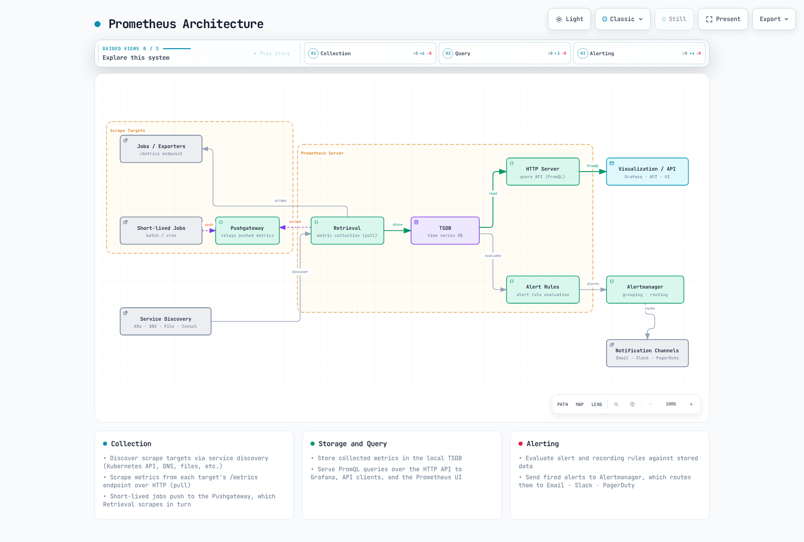
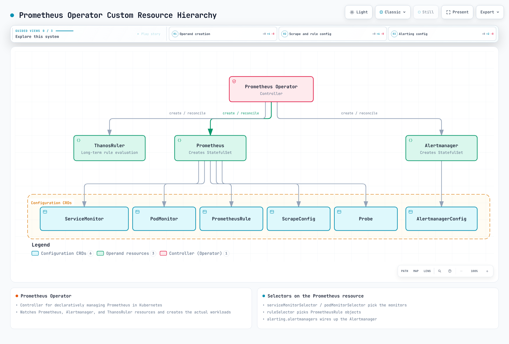

# Prometheus

> **最終更新日**: 2026年11月19日。ローカルでの設定／クエリ確認については以下に記載しています。クラスターまたはクラウドへのデプロイは実施していません。

## 目次

- [概要とバージョン](#introduction-and-versions)
- [アーキテクチャとコンポーネント](#architecture-and-components)
- [PromQL](#promql)
- [ディスカバリーとOperatorセレクター](#discovery-and-operator-selectors)
- [kube-prometheus-stackのインストール](#kube-prometheus-stack-installation)
- [ルールとAlertmanager](#rules-and-alertmanager)
- [Remote writeとAMP](#remote-write-and-amp)
- [パフォーマンス、HA、トラブルシューティング](#performance-ha-and-troubleshooting)

## 概要とバージョン {#introduction-and-versions}

Prometheusは、SoundCloudで開発されたCNCF監視ツールキットです。数値時系列データを収集し、ローカルTSDBに保存し、PromQLと記録／アラートルールを評価して、Alertmanagerにアラートを送信します。通常の収集にはHTTPスクレイピングを使用します。Remote writeやオプションのバッチ統合により、ほかのデータ配信経路も追加できます。イベントログ、トレースストア、またはリクエストごとの厳密な課金台帳ではありません。

ローカルのデータ保持期間は設定可能で、30日を超える期間にもできます。別のストアを使用するかどうかは、保持期間、容量、共有クエリ、障害／復旧要件に応じて決定します。

この章では、2026年9月6日にリリースされた公式の**kube-prometheus-stack 90.0.0**パッケージを使用します。コンポーネントのバージョンは、検証済みの組み合わせとして確認しました。

| コンポーネント | パッケージのデフォルト |
|---|---|
| Prometheus Operator | 0.93.1 |
| Prometheus | 3.14.0、distrolessイメージ |
| Alertmanager | 0.34.0 |
| Grafana | 13.2.1、サブチャート13.2.2 |
| kube-state-metrics | 2.20.0、サブチャート8.4.2 |
| node-exporter | 1.12.1、サブチャート4.56.3 |

Chartの`kubeVersion`ガードは`>=1.25.0-0`です。これは完全な互換性マトリックスではなく、Kubernetes 1.25以降のすべてのバージョンが引き続きサポートされるという意味でもありません。実際のクラスター、コンポーネントのサポート状況、Admissionポリシー、ストレージドライバーを確認してください。

このプロファイルは、**Linux EC2を基盤とするEKSワーカー**を対象としています。FargateにはDaemonSetがありません。Auto Mode、Hybrid Nodes、Windowsでは、プラットフォーム固有のコレクター／ストレージ確認が必要です。

### 2026年11月の更新

- [Prometheus 3.16.0](https://github.com/prometheus/prometheus/releases/tag/v3.16.0)は2026年11月4日にリリースされました。主な内容は、smoothedおよびanchored（extended-range）ベクトルセレクターの安定化と常時有効化、`--enable-feature=query-cost`による実験的なPromQLクエリコスト推定と設定可能な実行制限、実験的関数フラグによる実験的な`integral()`関数、Agentモードでの`metadata-wal-records`のサポートです。この章の例は3.14.0で検証しており、3.16では再実行していません。

### 2026年9月の更新

- [9月11日のKubernetesブログ記事](https://kubernetes.io/blog/2026/09/11/kubernetes-v1-37-native-histograms-beta/)によると、Kubernetesコンポーネントメトリクス向けの[Prometheusネイティブヒストグラム](https://prometheus.io/docs/specs/native_histograms/)サポート（KEP-5808）はBetaに昇格し、v1.37でデフォルト有効になりました。高解像度でカーディナリティの低いバケットが固定の`le`バケットに置き換わり、ストレージとスクレイプのオーバーヘッドを減らしながら、レイテンシーメトリクスの精度を高めます。この機能を活用するには、スクレイピングを行うPrometheus側でもネイティブヒストグラムを取り込む設定が必要です。また、既存のクラシックヒストグラム向けクエリ／ダッシュボードは別途見直す必要があります。

### 2026年7月の過去の更新

- [7月14日のKubernetesエクスポーター記事](https://kubernetes.io/blog/2026/07/14/custom-metrics-exporter-kubernetes/)では、アプリケーションのインストルメンテーションとカスタムエクスポーターについて説明しています。HPAで使用するには、適切なメトリクスAPI／アダプターも必要です。スクレイピングだけでは、任意のメトリクスがHPAに接続されるわけではありません。
- [7月21日のAMP発表](https://aws.amazon.com/about-aws/whats-new/2026/07/amazon-managed-service-prometheus-1500m-metrics-workspace/)では、ワークスペースあたり最大15億のアクティブシリーズと20万件の記録／アラートルールについて説明しています。これは発表されたスケーリング上限であり、デフォルトのクォータが自動的に付与されることや、承認が保証されることを意味しません。対象のワークスペース／アカウントについて、現在のクォータを確認してください。

## アーキテクチャとコンポーネント {#architecture-and-components}



[インタラクティブな図](https://www.atomai.click/kubernetes-docs/archmaps/en-observability-metrics-01-prometheus-0.html)

Pushgatewayへの経路は、適切なサービスレベルのバッチジョブ向けのオプションであり、すべての短命なPodに適用するものではありません。グループにはライフサイクル管理が必要です。[メトリクスの概要](README.md)を参照してください。`up`が示すのはスクレイプの正常性であり、アプリケーションの可用性ではありません。

| コンポーネント | 役割と前提条件 |
|---|---|
| Prometheus | ディスカバリー、スクレイピング、ローカルTSDB、クエリAPI、ルール評価 |
| kube-state-metrics | APIオブジェクトの状態。ServiceAccount、RBAC、スクレイプエンドポイントが必要 |
| node-exporter | ホストOSメトリクス。ホストへのアクセス／マウントとプラットフォームのサポートを確認する必要あり |
| kubelet/cAdvisor | コンテナの測定値。サービング証明書、認可、エンドポイントの可用性を確認 |
| metrics-server / adapters | オートスケーリング用のリソース／カスタムメトリクスAPI。履歴TSDBストレージとは別 |
| Alertmanager | アラートをグループ化、重複排除、抑制し、設定済みのレシーバーにルーティング |
| Grafana | データソースをクエリ／可視化。認証とデータベース／ストレージには個別の設定が必要 |

このChartはエクスポーターと関連リソースを提供します。不完全な単独のDeployment／DaemonSetスニペットでは不足しているServiceAccount、RBAC、Serviceが提供されないため、監視スタックを重複して作成しないでください。

### TSDBと設定レイヤー

直近のサンプルはhead／WALを使用し、圧縮済みブロックにはチャンク、インデックス、メタデータが含まれます。Tombstoneは削除済みの範囲を示します。WALの再生はクラッシュ復旧に役立ちますが、バックアップの代わりにはならず、ボリュームの喪失に耐えられるわけでも、すべてのイベントの復旧を保証するわけでもありません。

| レイヤー | 適切な設定 |
|---|---|
| プロセスフラグ | `--storage.tsdb.path`、`--storage.tsdb.retention.time`、`--storage.tsdb.retention.size` |
| Prometheus設定 | `global`、`scrape_configs`、`rule_files`、`remote_write` |
| Operatorの`Prometheus.spec` | `retention`、`retentionSize`、`storage`、`replicas`、`shards` |
| このChartのvalues | `prometheus.prometheusSpec.retention`、`storageSpec`および以下のvalues |

古い形式の`storage.tsdb.path/retention.time/...` YAMLは、有効なプロセス設定ではありません。**別途単独でインストールする場合**の基本的なフラグは次のようになります。

```sh
prometheus --config.file=prometheus.yml \
  --storage.tsdb.path=/prometheus \
  --storage.tsdb.retention.time=15d \
  --storage.tsdb.retention.size=15GB
```

Operatorによるインストールでは、所有元となるHelm valuesを設定してください。保持サイズはディスク全体に対する厳密な上限ではありません。WAL、head、インデックス、圧縮処理のための空き領域を確保してください。サポートされているローカル／ブロックストレージを使用してください。任意のNFSをサポート対象の代替として使うことはできません。

## PromQL

以下の例では、`job="example-app"`と、Chartのnode-exporter／kube-state-metricsのジョブラベルを想定しています。実際のターゲットに合わせて調整してください。`example_queue_depth`と`temperature_celsius`はアプリケーションで定義されるGaugeであり、組み込みのKubernetesメトリクスではありません。

### セレクター、範囲、レート

Instantセレクターは、lookback／stalenessルールを使って条件を満たすサンプルを見つけます。「現在」の値が、評価時刻ちょうどの観測値であるとは限りません。Rangeセレクターはサンプルの時間範囲を選びます。サブクエリは保存された生サンプルをN個ごとに選ぶのではなく、指定した分解能で式を評価します。

| 用途 | PromQL |
|---|---|
| Instantセレクター | `http_requests_total{job="example-app"}` |
| 正の条件／正規表現によるフィルタリング | `http_requests_total{job="example-app",method="GET",status=~"2[0-9]{2}"}` |
| 否定の正規表現 | `http_requests_total{job="example-app",status!~"5[0-9]{2}"}` |
| Range vector | `http_requests_total{job="example-app"}[5m]` |
| 分解能5分の1時間サブクエリ | `rate(http_requests_total{job="example-app"}[5m])[1h:5m]` |
| 1時間前のレート期間 | `rate(http_requests_total{job="example-app"}[5m] offset 1h)` |
| 1秒あたりの平均カウンターレート | `rate(http_requests_total{job="example-app"}[5m])` |
| 直近の使用可能な2サンプルから求めるレート | `irate(http_requests_total{job="example-app"}[5m])` |
| 外挿されたカウンター増加量 | `increase(http_requests_total{job="example-app"}[1h])` |

否定マッチャーは、そのラベルを持たないシリーズも選択する場合があります。`rate()`と`increase()`は観測されたリセットを処理して外挿しますが、見逃した増分をすべて復元できるわけではありません。**集約より先にrateを適用してください**。`irate()`は最新のサンプルに敏感であり、安定したアラート条件には通常あまり適しません。

Range vectorは範囲関数への入力であり、そのまま範囲クエリのグラフとして使用できるものではありません。たとえば、評価済みのレート系列をリクエストするときは`rate(counter[5m])`を使います。

### 集約、Gauge、時刻

| 用途 | PromQL |
|---|---|
| メソッド別のリクエストレート | `sum by (method) (rate(http_requests_total{job="example-app"}[5m]))` |
| instanceを除いて集約 | `sum without (instance) (rate(http_requests_total{job="example-app"}[5m]))` |
| 重複を排除したRunningインジケーターの合計 | `sum(max by (namespace,pod,uid) (kube_pod_status_phase{job="kube-state-metrics",phase="Running"}))` |
| 使用可能メモリの最大値 | `max(node_memory_MemAvailable_bytes{job="node-exporter"})` |
| 空の／インフラ用containerラベルを除いたPod CPU上位 | `topk(5, sum by (namespace,pod) (rate(container_cpu_usage_seconds_total{job="kubelet",container!="",container!="POD"}[5m])))` |
| 現在のキュー深度Gauge間の分位点 | `quantile(0.95, example_queue_depth{job="example-app"})` |
| レート間の標準偏差 | `stddev(rate(http_requests_total{job="example-app"}[5m]))` |
| 外挿されたGaugeの変化量 | `delta(temperature_celsius{job="example-app"}[1h])` |
| 1秒あたりのGauge傾き | `deriv(temperature_celsius{job="example-app"}[1h])` |
| 20°Cからの絶対偏差 | `abs(temperature_celsius{job="example-app"} - 20)` |
| 切り上げ | `ceil(example_queue_depth{job="example-app"})` |
| 範囲に制限 | `clamp(example_queue_depth{job="example-app"}, 0, 100)` |
| 平方根 | `sqrt(example_queue_depth{job="example-app"})` |
| 自然対数 | `ln(example_queue_depth{job="example-app"})` |
| Unix秒で表した評価時刻 | `time()` |
| 選択されたサンプルのタイムスタンプ | `timestamp(up{job="example-app"})` |
| サンプルのUTC時刻 | `hour(timestamp(up{job="example-app"}))` |

`kube_pod_status_phase{phase="Running"}`のシリーズを数えると、値が0のものも数えます。重複するエクスポーターIDを除いた後で0／1のインジケーターを合計すると、0のインジケーターしか存在しない場合は0になります。一方、テレメトリが存在しない場合は、引き続き欠損のままです。

Gaugeの`quantile()`の例は、シリーズ間で値を比較します。ヒストグラムのリクエストレイテンシーp95を計算したり、Summaryのp99値を統合したりするものではありません。数学関数には入力値の範囲に関する制約があります。たとえば、0以下の対数は意識して処理する必要があります。関連関数には`floor`、`round`、`clamp_min`、`clamp_max`があります。

この業務時間フィルターは**UTC**であり、ブラウザー／クラスターのタイムゾーンではありません。

```promql
sum(rate(http_requests_total{job="example-app"}[5m])) and on() (hour() >= 9 < 18)
```

### 分布と予測

```promql
histogram_quantile(0.95, sum by (le) (rate(http_request_duration_seconds_bucket{job="example-app"}[5m])))
```

```promql
histogram_quantile(0.99, sum by (le,method) (rate(http_request_duration_seconds_bucket{job="example-app"}[5m])))
```

```promql
sum(rate(http_request_duration_seconds_sum{job="example-app"}[5m])) / sum(rate(http_request_duration_seconds_count{job="example-app"}[5m]))
```

互換性のあるクラシックバケットを集約し、`le`を保持してください。分位点はバケット内で補間されます。Summaryの分位点も近似値であり、平均してフリート全体のパーセンタイルを求めることはできません。sum/countを使えば、フリート全体の平均を計算できます。

`predict_linear()`は、当てはめたGaugeの傾向を外挿します。負の予測値は調査すべき理由になりますが、将来のディスク障害を保証するものではありません。

```promql
predict_linear(node_filesystem_avail_bytes{job="node-exporter",mountpoint="/",fstype!~"tmpfs|overlay"}[6h], 86400)
```

Prometheus 3では、`holt_winters`の名称が`double_exponential_smoothing`に変更されました。これは**Holt線形平滑化であり、季節性を考慮した三重指数平滑化の予測ではありません**。Gaugeのfloatサンプルが必要です。オプションの式は次のとおりです。`double_exponential_smoothing(example_queue_depth{job="example-app"}[1h], 0.5, 0.5)`。評価を行うサーバーには`--enable-feature=promql-experimental-functions`が必要です。ローカル監査ではパーサー構文を確認しましたが、実験的な値評価に合格したとは主張していません。

### 運用例

| 用途 | PromQL |
|---|---|
| CPUの非アイドル率 | `100 * (1 - avg by (instance) (rate(node_cpu_seconds_total{job="node-exporter",mode="idle"}[5m])))` |
| MemAvailableとして報告されていない割合 | `100 * (1 - node_memory_MemAvailable_bytes{job="node-exporter"} / node_memory_MemTotal_bytes{job="node-exporter"})` |
| 3回を超える推定再起動増加量 | `increase(kube_pod_container_status_restarts_total{job="kube-state-metrics"}[1h]) > 3` |
| ファイルシステムの使用不可領域の割合 | `100 * (1 - node_filesystem_avail_bytes{job="node-exporter",mountpoint="/"} / node_filesystem_size_bytes{job="node-exporter",mountpoint="/"})` |
| 受信＋送信バイト数／秒 | `rate(node_network_receive_bytes_total{job="node-exporter",device="eth0"}[5m]) + rate(node_network_transmit_bytes_total{job="node-exporter",device="eth0"}[5m])` |

エラー率については、正常なサービスに5xxシリーズが存在しない場合があります。以下のゼロフォールバックは、合致する総トラフィックのグループにのみ適用されます。データの欠損しているサービスに正常なデータを作り出すものではありません。

```promql
100 * (sum by (namespace, service) (rate(http_requests_total{job="example-app",status=~"5[0-9]{2}"}[5m])) or on (namespace, service) (0 * (sum by (namespace, service) (rate(http_requests_total{job="example-app"}[5m]))))) / (sum by (namespace, service) (rate(http_requests_total{job="example-app"}[5m])))
```

正常なトラフィックが観測されると0になり、すべてが5xxのトラフィックなら100になります。分母が0の場合は未定義のままです。テレメトリが欠損している場合も欠損のままです。収集の失敗は別途監視してください。

## ディスカバリーとOperatorセレクター {#discovery-and-operator-selectors}



[インタラクティブな図](https://www.atomai.click/kubernetes-docs/archmaps/en-observability-metrics-01-prometheus-1.html)

この図のPrometheus／Alertmanagerノードは**カスタムリソース**を表します。Operatorがそれらを読み取り、StatefulSetなどの実際のワークロードを調整します。オブジェクトやPrometheusサーバーが、それぞれ独立してStatefulSetを作成するわけではありません。

| 選択段階 | 選択されるオブジェクト |
|---|---|
| Prometheusの`serviceMonitorNamespaceSelector` | ServiceMonitorオブジェクトを含むNamespace |
| Prometheusの`serviceMonitorSelector` | それらのServiceMonitorオブジェクトに付けられたラベル |
| ServiceMonitorの`namespaceSelector` / `selector` | ターゲットとなるServiceのNamespaceとラベル |
| ServiceMonitorエンドポイントの`port` | **Serviceのポート名**。任意のコンテナポート番号ではない |
| PodMonitorのセレクター／エンドポイントの`port` | Podのラベルと、宣言されたコンテナポート名 |

RBAC、ディスカバリー、ネットワーク／TLSアクセスは、それぞれ別の要件です。セレクターは認可の代わりにはなりません。Helmの`*SelectorNilUsesHelmValues`ブール値が影響するのはラベルセレクターのデフォルトであり、すべてのターゲットNamespaceではありません。

### 一貫性のあるアプリケーションのスクレイプ設定

`example-app`に既存のインストルメント済みDeploymentがあり、Podラベルが`app: example-app`、`metrics`という名前のポートが宣言されていて、`/metrics`を提供しているものとします。以下のServiceはアプリケーションを作成しません。

```yaml
# service.yaml
apiVersion: v1
kind: Service
metadata:
  name: example-app
  namespace: example-app
  labels:
    app: example-app
    metrics-job: example-app
spec:
  selector:
    app: example-app
  ports:
  - name: http-metrics
    port: 8080
    targetPort: metrics
```

```yaml
# servicemonitor.yaml
apiVersion: monitoring.coreos.com/v1
kind: ServiceMonitor
metadata:
  name: example-app
  namespace: monitoring
  labels:
    release: kube-prom
spec:
  jobLabel: metrics-job
  selector:
    matchLabels:
      app: example-app
  namespaceSelector:
    matchNames:
    - example-app
  endpoints:
  - port: http-metrics
    path: /metrics
    interval: 30s
    scrapeTimeout: 10s
    relabelings:
    - sourceLabels:
      - __meta_kubernetes_service_name
      targetLabel: service
    - sourceLabels:
      - __meta_kubernetes_namespace
      targetLabel: namespace
    - sourceLabels:
      - __meta_kubernetes_pod_name
      targetLabel: pod
```

ServiceMonitorの`release: kube-prom`はインストールに一致します。その`jobLabel`はServiceの`metrics-job: example-app`を参照し、アプリケーションクエリ用のjobラベルを設定します。

PodMonitorは、同じPodに対する**代替手段**です。重複してデータを取り込まないよう、エンドポイントに対して意図した収集経路を1つ選択してください。

```yaml
# podmonitor.yaml
apiVersion: monitoring.coreos.com/v1
kind: PodMonitor
metadata:
  name: example-app-pods
  namespace: monitoring
  labels:
    release: kube-prom
spec:
  selector:
    matchLabels:
      app: example-app
  namespaceSelector:
    matchNames:
    - example-app
  podMetricsEndpoints:
  - port: metrics
    interval: 30s
    path: /metrics
    relabelings:
    - targetLabel: job
      replacement: example-app
    - targetLabel: service
      replacement: example-app
```

### ほかのディスカバリー経路

- 単独／AgentのPodディスカバリーでは、[概要に記載された名前付きポートの設定](README.md#metric-collection-models)を使うと、ディスカバリーで取得したIPv4／IPv6アドレスを保持できます。`prometheus.io/scheme`などのアノテーションは、実際の設定で参照されない限り効果がありません。
- Serviceのblackboxプローブには、インストール済みのエクスポーター、定義済みのプローブモジュール、適切なターゲットURL／スキーム、`Probe`／スクレイプ設定が必要です。`up`が示すのはエクスポーターのスクレイピング状況です。プローブの成功は別のシグナルです。
- Nodeのディスカバリーがアクセスするのはkubeletエンドポイントであり、自動的にnode-exporterにアクセスするわけではありません。サービング証明書、正しいCA、ノードメトリクス用RBACを確認してください。Kubernetes APIのCAが、任意のノード証明書への信頼を保証するわけではありません。
- ノードに対する無制限の`labelmap`ではなく、審査済みのNamespace／Service／チームラベルを使用してください。IDラベルを削除しても、集約にはなりません。

## kube-prometheus-stackのインストール {#kube-prometheus-stack-installation}

以下はクラスターを変更するOperatorコマンドであり、**監査時に実行したコマンドではありません**。意図したコンテキストと所有対象のreleaseを使ってください。既存のインストールがある場合は、監視スタックを重複してインストールするのではなく、実際のvalues、CRD、ストレージ、アップグレードノートを確認してください。

このプロファイルの前提条件は次のとおりです。

- 認可されたHelm／Kubernetesアクセスと、Linux EC2ノードの十分なリソース。
- 動作するデフォルトのブロックストレージStorageClass／CSIドライバー、またはすべてのPVCについて個別に審査されたStorageClass名。`gp3`が必ず存在するとは限りません。
- 既存の`monitoring`Namespace、Secrets Store CSIドライバー、Linux EC2ノード上のAWSプロバイダー（ASCP）。AWS Secrets Manager（`ap-northeast-2`）で`observability/grafana-admin`を準備し、JSON文字列キー`admin-password`を設定してください。Kubernetes Secretに同期しないでください。
- `metrics-demo-grafana` ServiceAccountには、そのシークレットを対象とするスコープを限定したIRSAロールが必要です。以下のIAMロールARNの例を置き換え、対応するSecretProviderClassを適用してください。[ID、KMS、マウント、ローテーションの前提条件](https://github.com/Atom-oh/kubernetes-docs/blob/5ff787faed758902c12a74e8429466f434bb26ae/examples/observability/secret-profiles/README.md)を参照してください。
- 検証済みのkubelet TLS信頼。証明書検証を有効にするこのプロファイルでは、証明書の発行者が異なる場合に検証を無効化するのではなく、適切なCAを指定してください。

サイズ設定は説明用です。Prometheusの各レプリカはそれぞれ独自のPVCを取得します。保持サイズはWAL／head／圧縮処理の使用量を制限しません。GrafanaはPVCベースのデータベースを使用する単一レプリカのままです。レプリカ数を増やすだけでは、共有データベースによるHAにはなりません。

```yaml
# kube-prometheus-stack 90.0.0; replace the example IRSA role ARN before use.
fullnameOverride: metrics-demo
kubeControllerManager:
  enabled: false
kubeScheduler:
  enabled: false
kubeEtcd:
  enabled: false
kubeProxy:
  enabled: false
kubelet:
  serviceMonitor:
    tlsConfig:
      insecureSkipVerify: false
prometheus:
  serviceAccount:
    create: true
    name: metrics-demo-prometheus
  prometheusSpec:
    replicas: 1
    shards: 1
    retention: 15d
    retentionSize: 15GB
    storageSpec:
      volumeClaimTemplate:
        spec:
          accessModes:
          - ReadWriteOnce
          resources:
            requests:
              storage: 20Gi
    resources:
      requests:
        cpu: 500m
        memory: 2Gi
      limits:
        memory: 4Gi
    externalLabels:
      cluster: eks-metrics-demo
    serviceMonitorSelectorNilUsesHelmValues: true
    serviceMonitorNamespaceSelector: &id001
      matchExpressions:
      - key: kubernetes.io/metadata.name
        operator: In
        values:
        - monitoring
        - example-app
    podMonitorSelectorNilUsesHelmValues: true
    podMonitorNamespaceSelector: *id001
    ruleSelectorNilUsesHelmValues: true
    ruleNamespaceSelector:
      matchLabels:
        kubernetes.io/metadata.name: monitoring
alertmanager:
  alertmanagerSpec:
    replicas: 1
    storage:
      volumeClaimTemplate:
        spec:
          accessModes:
          - ReadWriteOnce
          resources:
            requests:
              storage: 5Gi
grafana:
  fullnameOverride: metrics-demo-grafana
  replicas: 1
  persistence:
    enabled: true
    size: 10Gi
  sidecar:
    dashboards:
      searchNamespace: monitoring
      skipReload: true
      initDashboards: true
      provider:
        updateIntervalSeconds: 30
    datasources:
      searchNamespace: monitoring
      skipReload: true
      initDatasources: true
  serviceAccount:
    create: true
    name: metrics-demo-grafana
    annotations:
      eks.amazonaws.com/role-arn: arn:aws:iam::111122223333:role/metrics-grafana-secrets
  env:
    GF_SECURITY_ADMIN_USER: admin
    GF_SECURITY_ADMIN_PASSWORD: $__file{/mnt/grafana-secrets/admin-password}
  grafana.ini:
    security:
      admin_user: admin
      admin_password: $__file{/mnt/grafana-secrets/admin-password}
  extraVolumes:
  - name: grafana-secrets
    csi:
      driver: secrets-store.csi.k8s.io
      readOnly: true
      volumeAttributes:
        secretProviderClass: metrics-grafana-admin
  extraVolumeMounts:
  - name: grafana-secrets
    mountPath: /mnt/grafana-secrets
    readOnly: true
```

このEKSプロファイルでは、ここでは公開されることを前提としていない、マネージドコントロールプレーンコンポーネントとkube-proxyエンドポイントのMonitorを無効にしています。Kubernetes自体を無効にするものではありません。`monitoring`／`example-app`のServiceMonitorには、一致するreleaseラベルが必要です。ルールは`monitoring`から選択されます。

Grafanaの`GF_SECURITY_ADMIN_PASSWORD`には、パスワード値ではなく、**リテラルのfile-provider式**が渡されます。これにより、Chartの自動認証情報環境変数参照を抑制します。Grafana 13.2.1は、環境変数による上書き後に設定内の`$__file{...}`を評価します。`__FILE`エントリーポイントやシェルによってファイル内容がエクスポートされることはありません。読み取り専用のCSIファイルはUID/GID 472で読み取り可能である必要があります（`fsGroup: 472`、モード`0440`）。このファイルをマウントするのは、Grafanaのメインコンテナのみです。ファイルプロバイダーが前後の空白を取り除くため、前後に空白を含まないパスワードを使用してください。

ダッシュボード／データソースのinitコンテナは、起動前にプロビジョニングファイルを配置します。サイドカーはファイルを引き続き監視しますが、`skipReload: true`を使用するため、管理者認証情報は必要ありません。Grafanaは30秒ごとにダッシュボードファイルをポーリングします。**データソースを更新するには、制御されたPodの再起動が必要です**。`admin_password`が初期化するのは新しいデータベースのみです。AWSシークレットの変更、CSIローテーション、再起動では、既存のPVC／データベースの管理者パスワードはリセットされません。承認済みのパスワード変更／SSO手順を使用して、シークレットの内容を調整してください。PVCは保持してください。

`grafana-secret-provider.yaml`を含む、完全な[再利用可能プロファイル](https://github.com/Atom-oh/kubernetes-docs/blob/5ff787faed758902c12a74e8429466f434bb26ae/examples/observability/secret-profiles/README.md)を使用してください。ローカルでのレンダリング／テストでは設定とマウントを確認しますが、実際のCSI権限、ログイン、ローテーションは確認しません。主な仕様については、[Grafanaの設定](https://grafana.com/docs/grafana/latest/setup-grafana/configure-grafana/)と[AWS ASCP](https://github.com/aws/secrets-store-csi-driver-provider-aws/blob/main/README.md)を参照してください。

リポジトリのルートから、前提条件を準備した後、一度だけインストールしてください。

```sh
PROFILE=examples/observability/secret-profiles
kubectl apply -f "$PROFILE/grafana-secret-provider.yaml"
helm repo add prometheus-community https://prometheus-community.github.io/helm-charts
helm repo update prometheus-community
helm template kube-prom prometheus-community/kube-prometheus-stack \
  --version 90.0.0 --namespace monitoring -f "$PROFILE/prometheus-values.yaml" \
  > grafana-reviewed-render.yaml
# Review resources, prerequisites and ownership before this cluster-changing command.
helm upgrade --install kube-prom prometheus-community/kube-prometheus-stack \
  --version 90.0.0 --namespace monitoring -f "$PROFILE/prometheus-values.yaml" \
  --wait --timeout 15m
```

CRDの確立、Operatorの健全性、PVCのバインド、実際のターゲットを確認してください。選択したアプリケーションのMonitor／ルールは、CRDが確立した後にのみ適用してください。

ChartのCRDアップグレード処理はバージョンによって異なります。すべてのCRD移行が通常のHelmアップグレードで処理されると想定せず、アップグレードノートを確認してください。Chart 90では、Grafanaの依存関係もcommunityリポジトリに変更されています。既存の認証／プロビジョニング設定を検証し、アップグレード時はデータベース／PVCのバックアップを保持してください。

## ルールとAlertmanager {#rules-and-alertmanager}

以下で選択するPrometheusRuleには、アラートと記録ルールの例が含まれています。CPUの記録ルールでは`rate`と比率の単位を一貫して使用します。エラーの式はパーセンテージなので、しきい値は1であり、アノテーションにはパーセンテージが表示されます。

```yaml
# prometheusrule.yaml
apiVersion: monitoring.coreos.com/v1
kind: PrometheusRule
metadata:
  name: example-rules
  namespace: monitoring
  labels:
    release: kube-prom
spec:
  groups:
  - name: example-alerts
    interval: 30s
    rules:
    - alert: NodeMemoryHigh
      expr: 100 * (1 - node_memory_MemAvailable_bytes{job="node-exporter"} / node_memory_MemTotal_bytes{job="node-exporter"})
        > 90
      for: 5m
      labels:
        severity: warning
        team: infrastructure
      annotations:
        summary: Node {{ $labels.instance }} memory availability is low
        description: '{{ printf "%.2f" $value }}% is not reported as MemAvailable.'
    - alert: PodRestartingFrequently
      expr: increase(kube_pod_container_status_restarts_total{job="kube-state-metrics"}[1h]) > 5
      for: 10m
      labels:
        severity: warning
      annotations:
        summary: Pod {{ $labels.namespace }}/{{ $labels.pod }} is restarting
        description: '{{ printf "%.2f" $value }} estimated restarts in one hour.'
    - alert: ProjectedDiskExhaustion
      expr: predict_linear(node_filesystem_avail_bytes{job="node-exporter",mountpoint="/",fstype!~"tmpfs|overlay"}[6h],
        86400) < 0
      for: 1h
      labels:
        severity: warning
      annotations:
        summary: Projected disk exhaustion on {{ $labels.instance }}
        description: The fitted six-hour trend projects negative free space in 24 hours; inspect the filesystem
          and workload.
    - alert: HighErrorRate
      expr: (100 * (sum by (namespace, service) (rate(http_requests_total{job="example-app",status=~"5[0-9]{2}"}[5m]))
        or on (namespace, service) (0 * (sum by (namespace, service) (rate(http_requests_total{job="example-app"}[5m])))))
        / (sum by (namespace, service) (rate(http_requests_total{job="example-app"}[5m])))) > 1
      for: 5m
      labels:
        severity: warning
        team: backend
      annotations:
        summary: High error rate on {{ $labels.namespace }}/{{ $labels.service }}
        description: '{{ printf "%.2f" $value }}% of requests are 5xx, above the 1% threshold.'
  - name: example-recording
    rules:
    - record: instance:node_cpu_utilization:ratio_rate5m
      expr: 100 * (1 - avg by (instance) (rate(node_cpu_seconds_total{job="node-exporter",mode="idle"}[5m])))
        / 100
    - record: instance:node_memory_not_available:ratio
      expr: max by (instance) ((1 - node_memory_MemAvailable_bytes{job="node-exporter"} / node_memory_MemTotal_bytes{job="node-exporter"}))
```

`for`は、発火するまでの評価期間にわたり、同じアラートラベルセットが式の条件を満たし続けることを意味します。データの欠損やラベルの変化によって、Pending状態が中断される場合があります。これはAlertmanagerの通知遅延や繰り返し間隔ではありません。予測アラートが表すのは予測であり、障害を保証するものではありません。

### AlertmanagerConfigとNamespaceの境界

Operator 0.93.1のパッケージ済みAlertmanagerConfig CRDが提供するAPIバージョンは**v1alpha1**です。以下の例では、管理者が所有する**グローバル設定**として使用します。参照するSecretは`monitoring`に存在している必要があります。通知を有効にする前に、アドレス、チャンネル、プロバイダーの送信先を置き換えるか承認してください。

Operator APIでは`alertmanagerConfiguration`はexperimentalとしてマークされています。バージョンの境界を維持し、アップグレードをテストしてください。通常の、選択対象となるNamespaceスコープのAlertmanagerConfigには、通常Namespaceマッチャーが追加されます。`monitoring`内の設定が、すべてのNamespaceからのアプリケーションアラートを自動的に受け取るわけではありません。グローバル設定では、意図的により広い管理境界を使用します。

```yaml
# alertmanagerconfig.yaml
apiVersion: monitoring.coreos.com/v1alpha1
kind: AlertmanagerConfig
metadata:
  name: main-config
  namespace: monitoring
spec:
  route:
    receiver: default
    groupBy:
    - alertname
    - namespace
    - severity
    groupWait: 30s
    groupInterval: 5m
    repeatInterval: 4h
    routes:
    - receiver: pagerduty-critical
      matchers:
      - name: severity
        matchType: '='
        value: critical
      groupWait: 10s
      repeatInterval: 1h
    - receiver: slack-backend
      matchers:
      - name: team
        matchType: '='
        value: backend
    - receiver: slack-warnings
      matchers:
      - name: severity
        matchType: '='
        value: warning
      groupWait: 1m
  inhibitRules:
  - sourceMatch:
    - name: severity
      matchType: '='
      value: critical
    targetMatch:
    - name: severity
      matchType: '='
      value: warning
    equal:
    - alertname
    - cluster
    - namespace
    - service
    - instance
    - pod
    - container
  receivers:
  - name: default
    emailConfigs:
    - to: alerts@example.com
      from: alertmanager@example.com
      smarthost: smtp.example.com:587
      authUsername: alertmanager
      authPassword:
        name: alertmanager-smtp
        key: password
      requireTLS: true
  - name: slack-backend
    slackConfigs:
    - apiURL:
        name: alertmanager-slack
        key: webhook-url
      channel: '#team-backend-alerts'
      sendResolved: true
  - name: slack-warnings
    slackConfigs:
    - apiURL:
        name: alertmanager-slack
        key: webhook-url
      channel: '#alerts'
      sendResolved: true
  - name: pagerduty-critical
    pagerdutyConfigs:
    - routingKey:
        name: alertmanager-pagerduty
        key: routing-key
      sendResolved: true
```

デフォルトでは、兄弟ルートは最初に一致したルートで処理を停止します。Criticalルートを先頭に置き、backendルートを一般的なwarningルートの前に置いているため、backendルートにも到達できます。複数の通知を意図する場合にのみ、`continue`を慎重に設定してください。抑制では、アラート名だけでなくリソースIDも照合します。あるサービス／ノードのcriticalアラートが、無関係なwarningを抑制してはなりません。アラートファミリーにとって意味のある一致ラベル項目を選んでください。両方のアラートでラベルが欠損している場合は、一致とみなされます。

CRの`groupBy`は、ネイティブのAlertmanager設定では`group_by`になります。グループ化が制御するのは通知バッチであり、同一のアラートの重複排除とは異なります。`groupWait`、`groupInterval`、`repeatInterval`は、PrometheusRuleの`for`とは別に通知タイミングを制御します。

参照するSecretとAlertmanagerConfigを作成した後、追加のvaluesファイルを同じ固定バージョンのreleaseにマージしてください。

```yaml
# alerting-values.yaml
alertmanager:
  alertmanagerSpec:
    alertmanagerConfiguration:
      name: main-config
```

```sh
helm upgrade --install kube-prom prometheus-community/kube-prometheus-stack \
  --version 90.0.0 --namespace monitoring \
  -f values.yaml -f alerting-values.yaml --wait --timeout 15m
```

ネイティブのルーティング確認では、通知を送信せずにレシーバー名を確認しました。Secretの取得、プロバイダーの認証、実際の通知配信については、引き続き管理された検証が必要です。

## Remote writeとAMP {#remote-write-and-amp}

Remote writeは、サンプルを非同期に設定済みのバックエンドへ転送します。アラートを配信したり、無制限のバッファリングを保証したり、バックアップの代わりになったりするものではありません。バックログ、再試行、レシーバーの上限を監視してください。審査済みの集約／破棄ポリシーによる影響が明らかでない限り、ヒストグラム分布全体を保持してください。

### スコープを限定したAMPへの取り込み

以下のアカウントとワークスペースの識別子は、**架空のプレースホルダー**です。承認されたRegion／アカウント／ワークスペースを、エンドポイント、IAMリソース、ロールアノテーションで一貫して使用してください。取り込みロールには、そのワークスペースに対する`aps:RemoteWrite`のみが必要です。クエリ権限は適切なクエリクライアントに付与し、コレクターに自動的に付与しないでください。

```json
{
  "Version": "2012-10-17",
  "Statement": [
    {
      "Effect": "Allow",
      "Action": "aps:RemoteWrite",
      "Resource": "arn:aws:aps:ap-northeast-2:111122223333:workspace/ws-11111111-1111-4111-8111-111111111111"
    }
  ]
}
```

環境の既存IaC所有者を通じてロールを作成／管理してください。IRSAの例では、信頼ポリシーに対象クラスターのIAM OIDCプロバイダーを指定し、audience `sts.amazonaws.com`とsubject `system:serviceaccount:monitoring:metrics-demo-prometheus`の両方を必須にする必要があります。OIDC発行者URLがあるだけでは、IAMプロバイダー／信頼ポリシーの存在は証明されません。

このプロファイルのServiceAccountとアノテーションはHelmが管理します。同じServiceAccountを別の所有者が作成することも避けてください。既存のアカウントを再利用する場合は、所有権とChartの`create`設定を調整してください。EKS Pod Identityは別の認証情報配信方式です。互換性のない前提を混在させず、個別に設定／検証してください。

```yaml
# amp-values.yaml
prometheus:
  serviceAccount:
    create: true
    name: metrics-demo-prometheus
    annotations:
      eks.amazonaws.com/role-arn: arn:aws:iam::111122223333:role/metrics-prometheus-amp
  prometheusSpec:
    replicas: 2
    shards: 1
    podAntiAffinity: hard
    podAntiAffinityTopologyKey: kubernetes.io/hostname
    replicaExternalLabelName: __replica__
    externalLabels:
      cluster: eks-metrics-demo
    remoteWrite:
    - url: https://aps-workspaces.ap-northeast-2.amazonaws.com/workspaces/ws-11111111-1111-4111-8111-111111111111/api/v1/remote_write
      sigv4:
        region: ap-northeast-2
      queueConfig:
        capacity: 10000
        maxSamplesPerSend: 2000
        maxShards: 10
```

ID／ワークスペースを確認した後、同じreleaseでベースのvaluesにオプションのAMPファイルをマージしてください。ハードなノード間アンチアフィニティを指定して2つのレプリカを配置するには、条件を満たすノードが少なくとも2つあり、レプリカごとにPVCが機能している必要があります。

AMPのHA重複排除では、`cluster`と`__replica__`が想定されています。Operatorの`replicaExternalLabelName`が、サポート対象のPodごとのIDを付与します。手作業で追加したレプリカラベルでは代替できません。既存のメトリクスラベルとHAラベルの衝突を確認してください。

この例では意図的に`shards: 1`を使用しています。シャーディングはターゲットセットを分割し、レプリケーションはターゲットセットのコピーを作成します。シャーディングを導入する場合、各シャードのHAレプリカグループには、重複排除用の個別のIDと、完全なクエリを実現する設計が必要です。独立したシャードを同一のHA IDで送信し、データが破棄されないと想定してはいけません。

これらのクエリの対象はローカルクラスターです。クラスター横断でAMPをクエリする場合は、対象クラスターのスコープを含めるか、明示的に集約してください。

### ほかのレシーバー

VictoriaMetricsの単一ノードでは、通常、設定済みのHTTPポート上の`/api/v1/write`を受け付けます。クラスターのvminsertエンドポイントでは`/insert/<tenant>/prometheus/api/v1/write`を使用します。vmauthまたは別の承認済みアクセスレイヤーで、意図したルーティング／認証を提供する必要があります。テナントIDは認証情報ではありません。Mimirなどのほかのレシーバーには、それぞれ独自のURL、ID、HA仕様があります。

1秒未満のヒストグラムバケットをすべて破棄したり、制御プレーン全体のレイテンシー系メトリクスを評価せずに削除したりする古いルールをコピーしないでください。失われる分位点／SLOへの影響を評価してください。キューのデフォルト値は出発点であり、本番環境で最適であると測定済みの値ではありません。

## パフォーマンス、HA、トラブルシューティング {#performance-ha-and-troubleshooting}

### 測定結果に基づく調整

headのシリーズ／チャンク、カーディナリティの変化、スクレイプ負荷、同時クエリはメモリに影響します。履歴の保持期間を短くすることが、アクティブなheadやクエリによるOOMの普遍的な解決策になるわけではありません。制限を変更する前に、実際の使用量とクエリのワークロードを調べてください。

この任意のvalues断片は、サイズの推奨ではなく、クエリ制限の例です。

```yaml
# tuning-values.yaml
prometheus:
  prometheusSpec:
    query:
      maxConcurrency: 10
      maxSamples: 50000000
      timeout: 2m
```

タイムアウトを延ばしたり`maxSamples`を増やしたりすると、リソースへの負荷が高まる可能性があります。両方の制限を引き上げる前に、負荷の高い式、範囲、集約、記録ルールを確認してください。

**単独の**スクレイプ設定では、以下の例のように1つのジョブを制限し、審査済みのデバッグ系メトリクスを1つ削除できます。

```yaml
# scrape-limits.yaml
scrape_configs:
- job_name: example-app
  scrape_interval: 30s
  scrape_timeout: 10s
  sample_limit: 10000
  static_configs:
  - targets:
    - example-app.example-app.svc:8080
  metric_relabel_configs:
  - source_labels:
    - __name__
    regex: example_debug_payload_total
    action: drop
```

`sample_limit`は、メトリクスの再ラベル付け後に適用される、スクレイプデータの受け入れ上限です。これを超えるとスクレイプ全体が失敗します。エンドポイントのサンプル数が1万件にきれいに切り詰められるわけではありません。スクレイプ間隔を延ばすと解像度が下がり、検知が遅くなります。また、すべての`go_.*`／`process_.*`メトリクスを削除すると、ランタイム診断情報が失われます。

`labeldrop`を使うと、以前は異なっていたサンプルが同じシリーズにまとまる場合がありますが、合計されるわけではありません。IDラベルを削除する前に、一意性を維持し、レシーバー／カーディナリティへの影響を評価してください。カーディナリティクエリの対象は、意図したジョブに限定します。

```promql
topk(10, count by (__name__) ({job="example-app"}))
```

サポートされていないTSDBフラグや、文字列形式の`additionalArgs`をOperator CRにコピーしないでください。`additionalArgs`は名前付き引数オブジェクトを使用します。また、CRスキーマが有効であることは、選択したPrometheusバイナリーにそのフラグが存在する証明にはなりません。バージョン固有の根拠なしに、内部のブロック／チャンク動作を上書きすることは避けてください。

### HAの境界

Prometheusの`replicas`と`shards`はPod数を増やしますが、解決する問題は異なります。アンチアフィニティには十分な数のノードが必要であり、ゾーン障害への耐性には適切な配置とストレージも必要です。1つのシャードをクエリしても、すべてのターゲットのデータが得られるわけではありません。

コレクターのHAによって、Alertmanager、Grafana、PVC、リモートストレージまで自動的に高可用性になるわけではありません。Alertmanagerのレプリカには、機能するピア接続と独立した配置／ストレージが必要です。GrafanaのHAには、適切な共有データベース／認証設計が必要です。レシーバー固有の重複排除ラベルとアラートIDは、一貫性を保ってください。

### 所有対象のreleaseに基づくトラブルシューティング

コンテキスト、releaseのID、生成されたリソース名を確認してください。以下の名前は、例の`fullnameOverride: metrics-demo`に対応するものであり、すべてのChartインストールに当てはまるわけではありません。

```sh
kubectl config current-context
helm status kube-prom --namespace monitoring
kubectl get prometheus,alertmanager,servicemonitor,podmonitor,prometheusrule \
  --namespace monitoring
kubectl get pods,pvc --namespace monitoring
kubectl get pods --namespace monitoring -l app.kubernetes.io/name=prometheus -o wide
kubectl top pod --namespace monitoring
```

`kubectl top`には、動作するResource Metrics APIが必要です。これはPrometheusのメモリ圧迫のあらゆる原因を測定するものではありません。

プライベートAPIを確認する場合は、ポートフォワードをloopbackにバインドし、別のターミナルでそのプロセスを実行し続けてください。

```sh
kubectl port-forward --namespace monitoring --address 127.0.0.1 \
  service/metrics-demo-prometheus 9090:9090
```

```sh
curl --fail --silent --show-error --max-time 10 \
  http://127.0.0.1:9090/api/v1/targets \
  | jq '.data.activeTargets[] | select(.health != "up") | {labels, scrapeUrl, lastError}'
curl --fail --silent --show-error --max-time 10 http://127.0.0.1:9090/api/v1/status/tsdb
curl --fail --silent --show-error --max-time 10 http://127.0.0.1:9090/api/v1/status/flags
curl --fail --silent --show-error --max-time 10 http://127.0.0.1:9090/api/v1/status/runtimeinfo
curl --fail --silent --show-error --max-time 10 http://127.0.0.1:9090/api/v1/rules
curl --fail --silent --show-error --max-time 10 http://127.0.0.1:9090/api/v1/alerts
```

| 症状 | リソースを変更する前に確認すること |
|---|---|
| OOMKilled | コンテナの制限、headシリーズ／変化、クエリの同時実行数／範囲、サンプル数、ワークロードのピーク |
| PVC Pending | 実際のStorageClass／CSIの可用性、アクセスモード、容量、ゾーンのスケジューリング |
| ターゲットが見つからない | 2つのMonitorセレクター、Namespaceの選択、Serviceラベル／ポート、Podラベル、Operatorの調整 |
| ターゲットが停止 | ターゲットURL、CA／SAN／認証、RBAC／ネットワーク経路、エンドポイント応答。エラーは存在しないことの証拠ではない |
| 通知がない | ルールの状態、ラベルの安定性、選択された／グローバル設定、Namespaceの適用、ルート順序／抑制、Secret、プロバイダーの状態 |
| Remoteのバックログ | 認証情報／Region／ワークスペース、レシーバーのエラー／クォータ、キュー／WAL容量、重複ラベルの仕様 |

distrolessのPrometheusイメージには、シェル、`wget`、`curl`が必ず含まれているとは限りません。`kubectl exec ... wget`が動作すると想定しないでください。Podのネットワークコンテキストからテストする場合は、承認済みの診断ツールを使用してください。設定／ターゲット／ログの出力は運用データとして扱い、機密性のあるエンドポイントや認証情報を公開しないようにしてください。

## 検証と参照先

ローカル監査では、固定バージョンのHelmベース／alerting／AMPプロファイルをレンダリングし、リリース済みCRDの構造を検証し、合成サンプル上で主要なPromQL／ルールを評価し、ネイティブのAlertmanagerルーティングを確認しました。ディスカバリー、Admission／CEL、ストレージのバインド、IAMの適用、外部シークレット、通知配信は実行していません。実験的な平滑化についてはパーサーのみで検証しました。有効な機能フラグを指定しても、値のテスト用フィクスチャはリリース済みpromtoolテストエンジンに受け付けられませんでした。

- [Chart 90.0.0のリリース](https://github.com/prometheus-community/helm-charts/releases/tag/kube-prometheus-stack-90.0.0)と[バージョン別アップグレードノート](https://github.com/prometheus-community/helm-charts/blob/kube-prometheus-stack-90.0.0/charts/kube-prometheus-stack/README.md)
- [Operator 0.93.1 APIリファレンス](https://github.com/prometheus-operator/prometheus-operator/blob/v0.93.1/Documentation/api-reference/api.md)
- [Prometheus 3.14の設定](https://github.com/prometheus/prometheus/blob/v3.14.0/docs/configuration/configuration.md)、[関数](https://github.com/prometheus/prometheus/blob/v3.14.0/docs/querying/functions.md)、[ストレージ](https://github.com/prometheus/prometheus/blob/v3.14.0/docs/storage.md)
- [AMPへの取り込み](https://docs.aws.amazon.com/prometheus/latest/userguide/AMP-onboard-ingest-metrics-existing-Prometheus.html)、[HA重複排除](https://docs.aws.amazon.com/prometheus/latest/userguide/AMP-ingest-dedupe.html)、[クォータ](https://docs.aws.amazon.com/prometheus/latest/userguide/AMP_quotas.html)
- [メトリクスの概要](README.md)と[Prometheusクイズ](../../quizzes/observability/metrics/01-prometheus-quiz.md)
