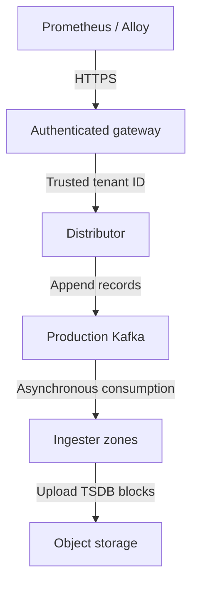
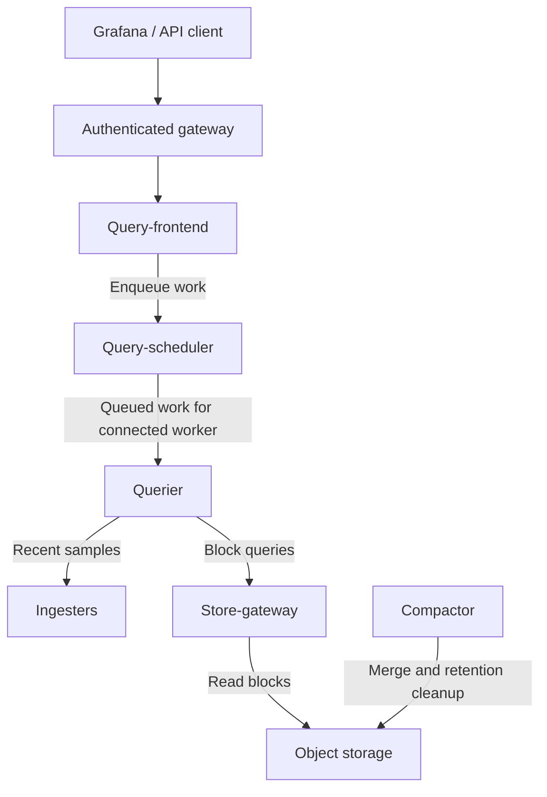

# Grafana Mimir

> **レビュー基準**: Mimir 3.2.1 / mimir-distributed Helm chart 6.2.0
> **最終更新**: 2026年9月12日

Grafana Mimir は、テナント単位での取り込み、クエリ、長期ブロックストレージに対応する Prometheus 互換のメトリクスバックエンドです。容量、クエリ互換性、運用コストは、選択したアーキテクチャ、設定、ワークロードによって変わります。データ保持期間もスケーリングも無制限ではありません。

## Mimir、Cortex、Thanos

Mimir と Cortex は、関連する経緯を持つ別々のプロジェクトです。Mimir の存在を、Cortex が利用できなくなったという告知だと解釈しないでください。Thanos は Sidecar と remote-write Receiver の両方をサポートしており、すべての Thanos デプロイで Sidecar が必須というわけではありません。

| プロジェクト | 比較するデプロイ方式 |
| --- | --- |
| Mimir | テナント対応の remote write、オブジェクトストレージ、現在の Kafka ベース ingest-storage アーキテクチャ |
| Cortex | Prometheus 互換の独立したマルチテナントバックエンド。バージョンとストレージ設定は個別に確認 |
| Thanos | Sidecar 連携または Receive による取り込み、共有クエリとオブジェクトストレージのコンポーネント |

同じワークロードを使い、障害復旧、実際のクエリ動作、ストレージ・リクエスト・転送コスト、チームの運用能力を比較してください。根拠のない「高速／中速」ランキングはベンチマークの証拠にはなりません。[Cortex](https://cortexmetrics.io/docs/) と [Thanos Receive](https://thanos.io/tip/components/receive.md/) を参照してください。

## コアアーキテクチャ

### Ingest storage と従来の書き込みパス

Mimir 3.0 以降、ingest storage は Stable であり、推奨アーキテクチャです。Distributor は受信サンプルを検証し、レコードを Kafka に追加します。書き込みが成功として応答されるのは、設定された耐久性・レプリケーション条件のもとで Kafka への書き込みが成功した後です。これは、ブロックがすでに S3 に保存されたことを意味しません。



各 Ingester は1つのパーティションを消費します。読み取りパスの可用性のため、異なるゾーンの Ingester が同じパーティションを消費することもあります。パーティション割り当ては、Ingester インスタンス ID の数値サフィックスに依存します。Kafka のパーティション容量と保持期間は、予定する Ingester の ordinal、バックログ、復旧期間をカバーする必要があります。Broker のレプリケーション/ISR、永続化、障害復旧も別途設定してください。

Ingester はメモリ内 TSDB とローカル WAL を保持し、定期的にブロック（既定では2時間分）を作成してアップロードします。ローカル TSDB の保持期間は、Querier と Store-gateway がアップロード済みブロックを検出する時間を確保するもので、長期保持期間とは異なります。永続ディスクは復旧に役立ちますが、WAL とオブジェクトストレージを組み合わせても、あらゆる障害や期限切れの Kafka バックログから必ず復旧できるわけではありません。

**従来型**（classic）アーキテクチャでは、Distributor から Ingester クォーラムへ直接書き込みます。Ingester のレプリケーション係数は Kafka の書き込みレプリケーション設定とは別です。既存デプロイでは従来型を引き続き利用できますが、バイナリの既定値と Helm の既定値は異なります。Chart 6.x は ingest storage を有効にしますが、調査対象の3.2.1バイナリでは `ingest_storage.enabled` の既定値は false です。稼働中のインストールをフラグ1つで切り替えず、[アーキテクチャ](https://grafana.com/docs/mimir/latest/get-started/about-grafana-mimir-architecture/about-ingest-storage-architecture/)と[移行手順](https://grafana.com/docs/mimir/latest/set-up/migrate/migrate-ingest-storage/)を参照してください。

### クエリパスとコンポーネント



この図はリクエストと作業の関係を示しています。クエリ結果は Frontend 経由で返されます。Frontend は作業を分割・シャード化し、結果キャッシュを利用して応答を統合します。Scheduler は作業を Querier にキューイングします。Querier は Ingester と Store-gateway から必要なデータを取得します。ブロックの引き継ぎ時には両方から重複期間のデータを取得する場合があり、最近のデータと履歴データが完全に分離した時間帯に分かれているわけではありません。

Kafka からの消費は非同期のため、既定の読み取りパスは書き込み直後の読み取り整合性を保証しません。クライアントは `X-Read-Consistency: strong` を要求できます。この場合 Ingester は伝播したパーティションオフセットを待つため、タイムアウトやレイテンシに影響します。あらゆる Broker または Ingester の障害時に保証されるものではありません。

| コンポーネント | 役割 |
| --- | --- |
| Distributor | 書き込みを検証・制限し、Kafka または従来型モードでは Ingester へ送信 |
| Ingester | Kafka パーティションを消費し、ローカル TSDB/WAL を維持し、最近のサンプルを提供してブロックをアップロード |
| Store-gateway | オブジェクトストレージ、ローカルのインデックスヘッダー、設定済みキャッシュを使ってブロックデータを提供 |
| Compactor | ブロックを統合し、複製サンプルを重複排除し、条件に合う保持データのクリーンアップを実行 |
| Query-frontend / scheduler / querier | クエリを計画・キャッシュ・キューイングし、処理を実行 |
| Ruler / Alertmanager | 任意のルール評価とアラート処理。ストレージ、ID、HA は別途設定が必要 |

Compaction に `compactor.downsampling_enabled` という架空の設定項目はありません。Recording rule は派生時系列を作成できますが、自動的にダウンサンプリングしたり、元の生データを削除したりはしません。

## マルチテナンシーと認証

`X-Scope-OrgID` はテナントを識別するものであり、**認証ではありません**。呼び出し元を認証し、テナントへのアクセスを認可し、信頼できないテナントヘッダーを上書きして、許可したリクエストだけを転送する Gateway を使用してください。バックエンドサービスへの直接アクセスも制限します。信頼できる Proxy が明示的にマッピングを実装している場合に限り、Basic 認証のユーザー名をテナント ID として使用できます。Chart の既定のルーティング Gateway だけでは、この認可ポリシーは確立されません。

以下の Prometheus の例は、HTTPS Gateway とマウント済みの認証情報ファイルがすでに存在することを前提とします。Gateway は認証済み ID からテナントを決定するため、この例でクライアントはテナントヘッダーを選びません。

```yaml
remote_write:
  - url: https://metrics.example.internal/api/v1/push
    authorization:
      type: Bearer
      credentials_file: /etc/prometheus/credentials/mimir-token
```

クライアントがテナントヘッダーを直接指定する方法は、別途信頼されたテスト経路でのみ使用してください。テナントごとのオブジェクトキーや制限を設けても、未認証の呼び出し元が他のテナントを選択することは防げません。マルチテナンシーを無効にすると、すべてのリクエストが共有テナントに割り当てられますが、保護が追加されるわけではありません。[認証と認可](https://grafana.com/docs/mimir/latest/manage/secure/authentication-and-authorization/)を参照してください。

### テナント制限とランタイム設定

メイン設定の `limits` は既定値を定義します。テナントごとの `overrides` は、メイン Mimir 設定のトップレベルではなく、別のランタイム設定ファイルに記述します。この Chart では、以下の例のようにトップレベルの `runtimeConfig.overrides` を使います。ランタイムファイルは再起動せずに対応する制限を上書きできますが、起動時設定のすべてが再読み込み可能になるわけではありません。[ランタイム設定](https://grafana.com/docs/mimir/latest/configure/about-runtime-configuration/)へのアクセスと再読み込み結果を検証してください。

## EKS での Helm 設定

Chart **6.2.0** の appVersion は **3.2.0**、Kubernetes 要件は `^1.32.0-0` です。この例では、2026年9月10日にリリースされた **3.2.1** パッチイメージを明示的に選択します。Chart の Kubernetes 要件は EKS のサポート・ライフサイクル一覧ではありません。選択した EKS バージョン、CSI Driver、Admission Policy、Rollout Operator の依存関係を確認してください。週次開発 Chart は別のリリース系列です。

### 依存関係の準備

以下はレビュー用の**レンダリング可能な設定**であり、本番デプロイのテストではありません。適用する前に、次を準備してください。

- 例に示すクライアント証明書認証を受け入れ、適切な Broker レプリケーション・保持設定と、認可済みの Producer/Consumer 操作が可能な外部本番 Kafka クラスターと Topic。例の Bootstrap アドレス/ポートを実際のエンドポイントに置き換えてください。別の SASL/MSK 設定には、対応する Mimir オプションと ID 設定が必要です。
- `monitoring` Namespace の Secret `mimir-kafka-client-tls`。`ca.crt`、`tls.crt`、`tls.key` を格納します。この共有 TLS 設定を読み込むすべての Mimir プロセスがこれらのファイルを必要とします。Kafka を直接消費しないコンポーネントも含まれます。
- 既存の S3 Bucket 3個と、以下で説明する認可済み `mimir-storage` ServiceAccount。Mimir はこれらの Bucket を作成しません。
- 実際の AZ Label、適切な既存 StorageClass、十分なスケジュール可能ノードと PVC 容量。`gp3` は StorageClass 名の例です。EKS Auto Mode と EBS CSI Add-on では Provisioner が異なるため、クラスターのストレージ管理者に合った Class を選択してください。
- Distributor と Query-frontend への認証済み外部ルーティング。この例は未認証の Chart Routing Gateway を無効にし、代替となる公開 Ingress を作成しません。

Rollout Operator は有効です。インストール/アップグレードの前に、CRD、Webhook、権限、所有関係を確認してください。以下の `--include-crds` はローカル出力に CRD を含めます。ゾーン認識 Rollout の動作を確認せずに、既存デプロイで Operator を無効化しないでください。3ゾーン構成では実際の Zone Selector が必要です。論理名だけでは地理的な冗長性は作れません。

### Values とローカルレンダリング

以下を `mimir-values.yaml` として保存します。YAML Anchor は同じ証明書 Mount と AZ 定義を再利用します。Replica 数、Volume サイズ、Rate/Query 制限は、ワークロードの計測に基づいて調整する例です。3ゾーンのレンダリング設定では、各ゾーンに Ingester と Store-gateway が1つずつ、合計3つずつ配置されます。Compactor が1つであることは、あらゆる意味での HA を保証しません。

```yaml
image:
  tag: 3.2.1
serviceAccount:
  create: false
  name: mimir-storage
minio:
  enabled: false
kafka:
  enabled: false
gateway:
  enabled: false
distributor:
  replicas: 2
  extraVolumes: &kafka-volumes
  - name: kafka-client-tls
    secret:
      secretName: mimir-kafka-client-tls
  extraVolumeMounts: &kafka-mounts
  - name: kafka-client-tls
    mountPath: /etc/mimir/kafka-tls
    readOnly: true
ingester:
  replicas: 3
  persistentVolume:
    enabled: true
    storageClass: gp3
    size: 50Gi
  zoneAwareReplication:
    enabled: true
    topologyKey: kubernetes.io/hostname
    zones: &az-zones
    - name: zone-a
      nodeSelector:
        topology.kubernetes.io/zone: ap-northeast-2a
    - name: zone-b
      nodeSelector:
        topology.kubernetes.io/zone: ap-northeast-2b
    - name: zone-c
      nodeSelector:
        topology.kubernetes.io/zone: ap-northeast-2c
  extraVolumes: *kafka-volumes
  extraVolumeMounts: *kafka-mounts
store_gateway:
  replicas: 3
  persistentVolume:
    enabled: true
    storageClass: gp3
    size: 20Gi
  zoneAwareReplication:
    enabled: true
    topologyKey: kubernetes.io/hostname
    zones: *az-zones
  extraVolumes: *kafka-volumes
  extraVolumeMounts: *kafka-mounts
compactor:
  replicas: 1
  persistentVolume:
    enabled: true
    storageClass: gp3
    size: 50Gi
  extraVolumes: *kafka-volumes
  extraVolumeMounts: *kafka-mounts
querier:
  replicas: 2
  extraVolumes: *kafka-volumes
  extraVolumeMounts: *kafka-mounts
query_frontend:
  replicas: 2
  extraVolumes: *kafka-volumes
  extraVolumeMounts: *kafka-mounts
query_scheduler:
  enabled: true
  replicas: 2
  extraVolumes: *kafka-volumes
  extraVolumeMounts: *kafka-mounts
ruler:
  enabled: false
alertmanager:
  enabled: false
rollout_operator:
  enabled: true
chunks-cache:
  enabled: true
index-cache:
  enabled: true
metadata-cache:
  enabled: true
results-cache:
  enabled: true
mimir:
  structuredConfig:
    common:
      storage:
        backend: s3
        s3:
          endpoint: s3.ap-northeast-2.amazonaws.com
          region: ap-northeast-2
    blocks_storage:
      s3:
        bucket_name: example-mimir-blocks
    ruler_storage:
      s3:
        bucket_name: example-mimir-rules
    alertmanager_storage:
      s3:
        bucket_name: example-mimir-alerts
    ingest_storage:
      enabled: true
      kafka:
        address: kafka.metrics.example.internal:9093
        topic: mimir-ingest
        auto_create_topic_enabled: false
        tls_enabled: true
        tls_ca_path: /etc/mimir/kafka-tls/ca.crt
        tls_cert_path: /etc/mimir/kafka-tls/tls.crt
        tls_key_path: /etc/mimir/kafka-tls/tls.key
    frontend:
      split_queries_by_interval: 24h
    querier:
      max_concurrent: 20
      max_samples: 50000000
      timeout: 2m
    limits:
      ingestion_rate: 100000
      ingestion_burst_size: 200000
      max_global_series_per_user: 5000000
      compactor_blocks_retention_period: 365d
      max_total_query_length: 30d
      max_query_parallelism: 32
      query_sharding_total_shards: 16
      align_queries_with_step: false
runtimeConfig:
  overrides:
    tenant-1:
      ingestion_rate: 50000
      ingestion_burst_size: 100000
      max_global_series_per_user: 1000000
overrides_exporter:
  extraVolumes: *kafka-volumes
  extraVolumeMounts: *kafka-mounts
```

```bash
helm repo add grafana https://grafana.github.io/helm-charts
helm repo update grafana
helm template mimir grafana/mimir-distributed \
  --version 6.2.0 --namespace monitoring --include-crds \
  --kube-version 1.36.2 -f mimir-values.yaml > mimir-rendered.yaml
```

`--kube-version` はオフラインレンダリング用の指定であり、クラスターのアップグレードや稼働環境との互換性テストではありません。適用前に、レンダリングされた Service、Selector、PVC、Security Context、CRD、ワークロード設定を確認してください。組み込みの単一ノード Kafka と MinIO はデモ用です。それぞれの `enabled` を false にするのは組み込みデプロイを無効化するだけであり、Mimir の ingest storage や S3 バックエンドは無効になりません。

この例では Ruler と Alertmanager は無効です。どちらかを有効にする場合は、Replica、ストレージ、セキュリティ、共有設定内の証明書 Mount が別途必要です。[本番環境の設定](https://grafana.com/docs/helm-charts/mimir-distributed/latest/run-production-environment-with-helm/)を参照してください。

### 既存の従来型インストール

Chart 5.x から 6.x への変更では Gateway と Rollout Operator の要件も変わります。従来型アーキテクチャを維持するには、ingest storage の無効化と Ingester Push RPC の許可の両方が必要です。以下はその選択肢を示す断片であり、移行手順全体ではありません。新しい Kafka インストールへそのままマージしないでください。

```yaml
kafka:
  enabled: false
mimir:
  structuredConfig:
    ingest_storage:
      enabled: false
    ingester:
      push_grpc_method_enabled: true
```

[5.x から 6.x への移行ガイド](https://grafana.com/docs/helm-charts/mimir-distributed/latest/migration-guides/migrate-helm-chart-5.x-to-6.0/)とレビュー済み values diff を使用してください。Chart のアップグレードによってデータが補完されたり、Kafka の耐久性が作られたり、可用性が保たれたり、古い Webhook が安全に削除されたりするとは限りません。

## S3 とワークロード ID

### Bucket と IRSA

この例では、ブロック、ルール、Alertmanager 状態に別々の Bucket を使います。ブロックは、Ruler または Alertmanager Store と Bucket **およびストレージプレフィックス**を共有できません。この競合配置は対応するストレージターゲットで拒否されます。Distributor だけの起動時チェックでは、すべてのストレージロールが検証されるわけではありません。別の、サポートされている `storage_prefix` を使う方法もあります。設定済みの実際の配置に `blocks/` のライフサイクルフィルターが一致するとは限りません。

EKS クラスターの OIDC Provider と、信頼ポリシーで `sub` を `system:serviceaccount:monitoring:mimir-storage` に、`aud` を `sts.amazonaws.com` に制限した IRSA Role を準備します。Chart の `serviceAccount.create: false` と `name: mimir-storage` は準備済みアカウントに合わせます。Role Annotation と Projected Token の受け渡しを確認してください。Kubernetes RBAC は S3 権限を付与しません。

例の3つの Bucket に対する最小権限 S3 Policy の形を示します。Bucket 名を置き換え、KMS と Key Policy の要件は別途確認してください。

```json
{
  "Version": "2012-10-17",
  "Statement": [
    {
      "Effect": "Allow",
      "Action": ["s3:ListBucket"],
      "Resource": ["arn:aws:s3:::example-mimir-blocks", "arn:aws:s3:::example-mimir-rules", "arn:aws:s3:::example-mimir-alerts"]
    },
    {
      "Effect": "Allow",
      "Action": ["s3:GetObject", "s3:PutObject", "s3:DeleteObject"],
      "Resource": ["arn:aws:s3:::example-mimir-blocks/*", "arn:aws:s3:::example-mimir-rules/*", "arn:aws:s3:::example-mimir-alerts/*"]
    }
  ]
}
```

調査した S3 Provider Chain は IRSA の Web Identity Token File と Role ARN をサポートしています。この values file に静的な Access Key/Secret は含めず、`extraEnvFrom` でも注入しません。実際の STS/S3 アクセスを検証し、ノード認証情報への意図しないフォールバックを防いでください。選択した Credential Provider のサポートと設定を確認せずに、IRSA と EKS Pod Identity を同等とみなさないでください。S3 Block Public Access を有効にし、暗号化、バージョニング、Object Lock、バックアップ要件を確認します。

[Mimir のオブジェクトストレージ](https://grafana.com/docs/mimir/latest/configure/configure-object-storage-backend/)と [EKS ServiceAccount 用 IAM Role](https://docs.aws.amazon.com/eks/latest/userguide/associate-service-account-role.html)を参照してください。

### ライフサイクルと保持

`limits.compactor_blocks_retention_period: 365d` は保持ポリシーを設定します。クリーンアップは非同期かつブロック単位で行われ、スキャン・マーク・削除のスケジュール、ブロックの時間範囲、`compactor.deletion_delay` が物理削除に影響します。厳密な削除期限でも、規制要件への自動準拠でもありません。削除遅延はバックアップや取り消しを保証せず、現行オブジェクトを削除しても非現行 Version やバックアップはすべて消去されません。

Mimir が使用中のブロックを削除する、競合する S3 Expiration Rule を追加しないでください。不完全な Multipart Upload のクリーンアップは、別の Bucket 管理オプションです。ストレージクラスの移行では、Object サイズ、最小保存期間、リクエスト/取得コスト、Compaction による書き換えを分析してください。「90日後に STANDARD_IA」へ移す固定ルールが常に適切とは限りません。[S3 の移行に関する考慮事項](https://docs.aws.amazon.com/AmazonS3/latest/userguide/lifecycle-transition-general-considerations.html)を参照してください。

## クエリ、キャッシュ、パフォーマンス

### 現在の設定キー

Mimir のメイン Query Frontend 設定は `frontend`、Helm ワークロード設定は `query_frontend` です。別の名前空間の設定項目です。現在の例では `querier.max_samples`、`limits.max_total_query_length`、`limits.query_sharding_total_shards`、`limits.align_queries_with_step` を使います。旧来の `query_frontend.query_sharding.enabled/total_shards`、`align_querier_with_step`、`max_fetched_samples_per_query` の例を有効な代替設定として使用しないでください。

要求されたタイムスタンプと PromQL の意味を厳密に保つ必要がある場合は、Step Alignment を無効のままにしてください。Step を揃えるとキャッシュ再利用率を高められることがありますが、クエリの意味が変わります。クエリ並列度、Shard 数、サンプル数、Timeout を増やすと、ボトルネックの解消ではなくメモリ使用量と下流負荷の増加につながる場合があります。

### キャッシュの役割

| Chart の Cache | 設定上の役割 |
| --- | --- |
| `results-cache` | Frontend のクエリ結果。部分的な Cache Hit でも未キャッシュの処理は残る |
| `index-cache` | ブロックの Index、Postings、Series 情報 |
| `chunks-cache` | ブロックの Chunk データ |
| `metadata-cache` | オブジェクトストレージのメタデータ操作 |

Metadata または Index Cache の Hit だけでクエリ全体の応答が完成するわけではありません。「Hit して順に返せば完了」という3段階処理でもありません。ローカルの Index Header ファイルや TSDB/WAL Disk は Memcached とは異なります。変更前に Hit 率、レイテンシ、メモリ・Item サイズ、Eviction、Cold Cache 時の動作を確認してください。[Query Frontend](https://grafana.com/docs/mimir/latest/references/architecture/components/query-frontend/)と [Store-gateway](https://grafana.com/docs/mimir/latest/references/architecture/components/store-gateway/)を参照してください。

### 容量と可用性

取り込みサンプル、時系列/カーディナリティ、Ingester のメモリ/WAL/Disk、Kafka バックログ、Frontend のキュー、Querier のメモリ/CPU、Store-gateway の Cache Miss、Compactor の進捗を計測してください。Chart の小規模/大規模向けサイジングプランは出発点であり、容量の保証ではありません。Replica 数や並列度を増やす前に、クエリの形とテナント制限を確認してください。

耐久性と可用性については、Kafka の書き込みレプリケーション、Ingester のパーティション/ゾーン網羅性、Store-gateway の配置、スケジュール可能容量、オブジェクトストレージ、Frontend/Scheduler の Replica、Rollout 動作を個別に確認してください。Cache のレプリケーションはデータ耐久性ではありません。Rate/Cardinality 制限はデータを拒否することがありますが、拒否したサンプルを自動保存・集約するわけではありません。

取り込み量を減らすには、レビュー済みの Collector 側 Relabeling やデータに適した Recording Rule を使います。Mimir はテナント単位のランタイム上書きを含め、`limits.drop_labels` もサポートしています。これは取り込む Label Set を変更するもので、任意のカーディナリティを安全に減らす機能ではありません。識別用 Label を削除すると別々だった Series が統合されることがあるため、デプロイ前に衝突とクエリ/アラートの意味をテストしてください。

## VictoriaMetrics との比較

| 項目 | Mimir | VictoriaMetrics |
| --- | --- | --- |
| オープンソースライセンス | AGPL-3.0 | Apache-2.0。Enterprise 機能と区別する |
| デプロイ | Binary Target を選択。この例は Microservices 構成 | Single-node と Cluster モード |
| ストレージ | 本番ブロックにはオブジェクトストレージ。ローカル開発用の Filesystem Backend もある | レビュー対象の Single/Cluster アーキテクチャではローカルストレージパス。Backup パスは別途 |
| クエリ動作 | 機能/設定上の制限が文書化された PromQL 互換 API | 意味上の違いが文書化された MetricsQL |
| テナント | Tenant ID と、強制される認証/認可レイヤー | Tenant/Account Path と、強制される認証/認可レイヤー |
| コスト/性能 | 取り込み、クエリ、Kafka、Cache、オブジェクトリクエスト、運用を計測 | 同等のワークロード、レプリケーション、Disk、運用を計測 |

Grafana との連携やテナント機能の必要性だけで、普遍的な勝者が決まるわけではありません。移行後のクエリ同等性、保持、障害復旧、チームの運用能力、総コストを検証してください。[レビュー済みの VictoriaMetrics ガイド](02-victoriametrics.md)を参照してください。

## モニタリングとトラブルシューティング

バージョンに合った Mimir Mixin/Integration でデプロイを監視してください。現在の `cortex_ingester_active_series`、`cortex_distributor_received_samples_total`、`cortex_ingest_storage_reader_last_consumed_offset`、Compactor の進捗メトリクスを確認します。Counter や Offset 単独では Lag、Throughput、SLO を示しません。Grafana Agent ベースの非推奨 Meta-monitoring 経路を新規構成の既定にしないでください。現行ドキュメントでは Alloy/Kubernetes Monitoring Integration が案内されています。

以下の Compactor Alert は、Pinned Mixin に存在するメトリクスを使った例です。一定期間内の失敗回数を数えるもので、必ずしも連続した試行回数ではありません。集約 Label は実際の Scrape 構成に合わせ、Target 消失の監視は別途追加してください。

```yaml
groups:
  - name: mimir-example
    rules:
      - alert: MimirCompactorRepeatedFailures
        expr: sum by (cluster, namespace, pod) (increase(cortex_compactor_runs_failed_total{reason!="shutdown"}[2h])) >= 2
        for: 5m
        labels:
          severity: warning
```

レンダリングされた Release 名と Namespace に対して、権限を持つ Operator は localhost の Port Forwarding 経由で Query-frontend を調べられます。

```bash
kubectl -n monitoring get pods
kubectl -n monitoring get pvc
kubectl -n monitoring port-forward service/mimir-query-frontend 18080:8080
```

別の Terminal で実行します。

```bash
curl --fail --silent --show-error http://127.0.0.1:18080/ready
curl --fail --silent --show-error http://127.0.0.1:18080/api/v1/status/buildinfo
```

`buildinfo` は Build Metadata を返すもので、遅いクエリを示すものではありません。Timeout の調査では、Queueing、クエリ統計/Logging、上限を設けた Query Sample を確認してください。Ingester OOM では、Instance 制限を変える前に実際の Series/Cardinality と Buffer を調べます。Compactor の遅延では、リソースを増やす前に Object 権限、Disk、失敗、バックログを確認してください。`/config`、`/runtime_config`、テナント統計、Ring、メトリクス Endpoint を保護し、公開診断 Endpoint として露出させないでください。Ring Endpoint はコンポーネントごとに異なります。Kafka 使用時は Partition Ring も重要です。

## 検証と参考資料

Chart 6.2.0 をレンダリングし、Mimir 3.2.1 の8つのデプロイ対象コンポーネントに対して `-print.config` を使い Parse/Validate しました。このオプションはサービス初期化の前に終了します。準備済み Secret Volume 用の Path を、ローカルテスト証明書の Path に置き換えています。これは設定構造と検証動作を確認したものです。Kafka/mTLS/IRSA/S3 接続、PVC Provisioning、Runtime Reload、HA、負荷性能を検証したものではありません。クラウドリソースは作成していません。

- [設定リファレンス](https://grafana.com/docs/mimir/latest/configure/configuration-parameters/)
- [Mimir Helm Chart](https://grafana.com/docs/helm-charts/mimir-distributed/latest/)
- [Mimir のデプロイモード](https://grafana.com/docs/mimir/latest/references/architecture/deployment-modes/)
- [HTTP API リファレンス](https://grafana.com/docs/mimir/latest/references/http-api/)

## クイズ

この章の理解度を確認するには、[Grafana Mimir クイズ](../../quizzes/observability/metrics/03-mimir-quiz.md)に挑戦してください。
