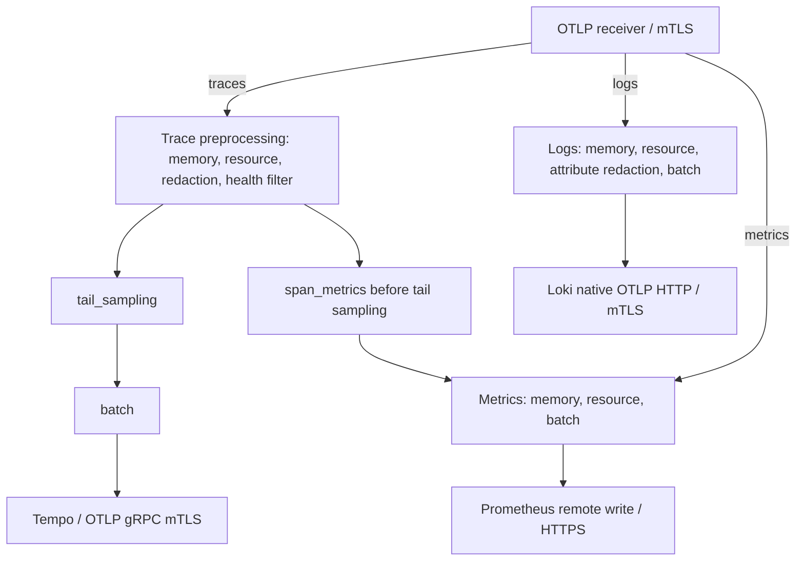

# OpenTelemetry

> **レビューの基準**: Collector Contrib 0.160.0、Operator 0.158.0、以下の言語バージョン  
> **最終更新日**: 2026年10月26日

## はじめに

OpenTelemetry（OTel）は、クラウドネイティブソフトウェア向けのオブザーバビリティフレームワークです。トレース、メトリクス、ログという3つのシグナルを生成、収集、管理するためのベンダー中立な標準を提供します。2026年7月24日付のCNCFの振り返り記事では、コントリビューションの伸び率はKubernetesに次ぐと評されました。プロジェクトの成熟度と、個々のSDK／コンポーネントの安定性は別のものです。

### 2026年7月の更新：CNCFの卒業

OpenTelemetryは**2026年5月**にCNCFの**卒業済み**（graduated）ステータスを取得しました。7月24日の記事は、これを振り返るものです。これはKubernetesやPrometheusなどのプロジェクトも取得している、財団が定める最高の成熟度レベルです。卒業は、プロジェクトのガバナンス、セキュリティ慣行、採用状況が本番利用に向けて審査されたことを示します。振り返り記事では、GenAIのセマンティック規約、ブラウザー／モバイルのオブザーバビリティ、Schemaのガバナンスと展開ツールについて論じています。背景とロードマップについては、CNCFのブログ記事[「OpenTelemetry has graduated… Now what?」](https://www.cncf.io/blog/2026/07/24/opentelemetry-has-graduated-now-what/)を参照してください。

## OpenTelemetryとは？

OpenTelemetryは、OpenTracingプロジェクトとOpenCensusプロジェクトの統合から生まれました。


[🔍 インタラクティブな図を表示](https://www.atomai.click/kubernetes-docs/archmaps/en-observability-tracing-03-opentelemetry-0.html)

## コアコンセプト

### 3つのシグナル

この章では、トレース、メトリクス、ログに焦点を当てます。プロファイリングも進化中のシグナルの1つであり、サポート状況と安定性は実装によって異なります。トレース／ログのIDやメトリクスのエグザンプラーには、適切な計装とバックエンド設定が必要です。

| シグナル | 説明 | ユースケース |
|--------|-------------|-----------|
| **トレース** | 分散リクエストのトレース | レイテンシ分析、依存関係のマッピング |
| **メトリクス** | 数値による測定値 | リソース使用量、SLI/SLO |
| **ログ** | イベントの記録 | デバッグ、監査 |

### コアコンポーネント


[🔍 インタラクティブな図を表示](https://www.atomai.click/kubernetes-docs/archmaps/en-observability-tracing-03-opentelemetry-2.html)

図にはシグナルごとにバックエンドの選択肢が示されています。有効になるのは設定されたExporterだけです。以下の基本例では、すべてのベンダー向けExporterが自動的に有効になるわけではありません。


## OpenTelemetry SDK

Collector、Operator、Java agent、各言語のSDKは、それぞれ独立したバージョン番号を持ちます。これらのLinuxワークロードテンプレートはKubernetes 1.35のSchemaに対して確認済みです。アプリケーションイメージ、Namespace、証明書、宛先Serviceは、それぞれの所有者が準備する必要があります。より広範なOperatorの互換性マトリクスによって、ネイティブサイドカーなど、レシピ固有の要件がなくなるわけではありません。ローカルでの確認だけでは、デプロイ済みのEKSアプリケーションであることは確認できません。

| コンポーネント | 基準と範囲 |
|---|---|
| スタンドアロンCollector Contrib | 0.160.0。実際のバイナリを使ってコンポーネントとSchemaを確認 |
| Operator | 0.158.0。互換性表ではKubernetes 1.25～1.36およびcert-manager v1が対象 |
| Java agent | 2.31.1、SDK 1.65.0を対象。OperatorのデフォルトJavaイメージと同じバージョンではない |
| Python | SDK／Exporter 1.44.0、instrumentation／distro 0.65b0。Python ≥3.10 |
| Node.js CommonJSの例 | SDK-node 0.220.0、auto-instrumentations-node 0.78.0、resources 2.9.0、API 1.9.1 |

OperatorのデフォルトはCollector 0.158.0です。以下のスタンドアロン0.160.0ワークロードは、Operator管理下のCollectorをアップグレードするものではありません。サポート対象のEKSバージョンとの重複範囲を確認してください。最新のKubernetesリリースが、必ずしもOperatorの互換性マトリクスに含まれるとは限りません。

### 自動計装

2026年10月12日時点で、EKSの標準サポート対象には1.34～1.37が含まれます。1.35のSchema基準はこの一覧とOperatorの互換性マトリクスの範囲内ですが、実稼働プラットフォーム／アドオンでの受け入れ確認に代わるものではありません。

ゼロコード計装は、サポート対象ライブラリにフックします。任意のビジネスオペレーションを検出するものではありません。プロセスごとに、あらかじめ用意したagent／launcherを直接使うか、Operatorの注入を使うか、いずれかを選択してください。すでに設定済みのproviderに対して、2つ目のSDKを初期化しないでください。以下のアプリケーションイメージは、起動コマンドや依存関係も含め、独自にビルドするイメージのプレースホルダーです。

`ecommerce` Namespaceを用意し、その中に`ca.crt`、`tls.crt`、`tls.key`を含む`otel-client-tls` Secretを作成してください。クライアント証明書はCollectorに受け入れられる必要があり、Collectorの証明書は`otel-collector.otel.svc.cluster.local`に一致する必要があります。Secretのファイルは読み取り専用でマウントされます。イメージに合わせてUID／GIDのアクセス権を調整してください。環境変数に含まれるのは証明書の**パス**のみで、鍵の内容やベアラートークンは含まれません。これらのテンプレートは、TLS上のOTLP HTTP/protobufをポート4318で使用します。

#### Javaの自動計装

ピン留めしたagentをアプリケーションのビルドにダウンロードし、リリースアセットのチェックサムを検証してください。2.31.1のJARは25,107,554バイトあり、KubernetesのConfigMap上限である1 MiBを超えています。JARをイメージに含めるか、Operatorの注入を使用してください。ConfigMapはagentバイナリの配布手段ではありません。


```bash
curl --fail --location --output opentelemetry-javaagent.jar \
  https://github.com/open-telemetry/opentelemetry-java-instrumentation/releases/download/v2.31.1/opentelemetry-javaagent.jar
printf '%s  %s\n' \
  bbf83c151b6400709e2f225bdd07a04f839d9d13b8b93464241333fd25d3e3ba \
  opentelemetry-javaagent.jar | sha256sum --check -
```

```dockerfile
# Add to the application's existing Dockerfile; not a complete image build.
COPY opentelemetry-javaagent.jar /opt/otel/opentelemetry-javaagent.jar
```
agentのオプションは、既存の`JAVA_TOOL_OPTIONS`と統合してください。アプリケーションのJVMオプションを破棄しないでください。DeploymentのselectorとPodのラベルは一致させる必要があります。


```yaml
apiVersion: apps/v1
kind: Deployment
metadata:
  name: order-service
  namespace: ecommerce
spec:
  replicas: 1
  selector:
    matchLabels:
      app: order-service
  template:
    metadata:
      labels:
        app: order-service
    spec:
      automountServiceAccountToken: false
      securityContext:
        fsGroup: 10001
      containers:
      - name: app
        image: registry.example.com/order-service:otel-demo
        env:
        - name: OTEL_SERVICE_NAME
          value: order-service
        - name: OTEL_RESOURCE_ATTRIBUTES
          value: service.namespace=ecommerce,deployment.environment.name=demo
        - name: OTEL_EXPORTER_OTLP_ENDPOINT
          value: https://otel-collector.otel.svc.cluster.local:4318
        - name: OTEL_EXPORTER_OTLP_PROTOCOL
          value: http/protobuf
        - name: OTEL_EXPORTER_OTLP_CERTIFICATE
          value: /var/run/otel-client/ca.crt
        - name: OTEL_EXPORTER_OTLP_CLIENT_CERTIFICATE
          value: /var/run/otel-client/tls.crt
        - name: OTEL_EXPORTER_OTLP_CLIENT_KEY
          value: /var/run/otel-client/tls.key
        - name: OTEL_TRACES_EXPORTER
          value: otlp
        - name: OTEL_METRICS_EXPORTER
          value: otlp
        - name: OTEL_LOGS_EXPORTER
          value: none
        - name: OTEL_TRACES_SAMPLER
          value: parentbased_always_on
        - name: OTEL_METRIC_EXPORT_INTERVAL
          value: '60000'
        - name: JAVA_TOOL_OPTIONS
          value: -javaagent:/opt/otel/opentelemetry-javaagent.jar
        volumeMounts:
        - name: otel-client-tls
          mountPath: /var/run/otel-client
          readOnly: true
      volumes:
      - name: otel-client-tls
        secret:
          secretName: otel-client-tls
          defaultMode: 288
```
#### Pythonの自動計装

Flaskアプリケーションの場合、ビルド環境に対応するパッケージをインストールし、解決されたアプリケーション依存関係をロックしてください。他のフレームワークには、それぞれ対応する計装パッケージが必要です。この例ではHTTP Exporterを明示的に選択し、PythonのHTTPデフォルトがgRPCポート4317に送信されないようにしています。


```bash
python -m pip install \
  opentelemetry-api==1.44.0 opentelemetry-sdk==1.44.0 \
  opentelemetry-distro==0.65b0 \
  opentelemetry-instrumentation-flask==0.65b0 \
  opentelemetry-exporter-otlp-proto-http==1.44.0
```

```yaml
apiVersion: apps/v1
kind: Deployment
metadata:
  name: payment-service
  namespace: ecommerce
spec:
  replicas: 1
  selector:
    matchLabels:
      app: payment-service
  template:
    metadata:
      labels:
        app: payment-service
    spec:
      automountServiceAccountToken: false
      securityContext:
        fsGroup: 10001
      containers:
      - name: app
        image: registry.example.com/payment-service:otel-demo
        env:
        - name: OTEL_SERVICE_NAME
          value: payment-service
        - name: OTEL_RESOURCE_ATTRIBUTES
          value: service.namespace=ecommerce,deployment.environment.name=demo
        - name: OTEL_EXPORTER_OTLP_ENDPOINT
          value: https://otel-collector.otel.svc.cluster.local:4318
        - name: OTEL_EXPORTER_OTLP_PROTOCOL
          value: http/protobuf
        - name: OTEL_EXPORTER_OTLP_CERTIFICATE
          value: /var/run/otel-client/ca.crt
        - name: OTEL_EXPORTER_OTLP_CLIENT_CERTIFICATE
          value: /var/run/otel-client/tls.crt
        - name: OTEL_EXPORTER_OTLP_CLIENT_KEY
          value: /var/run/otel-client/tls.key
        - name: OTEL_TRACES_EXPORTER
          value: otlp
        - name: OTEL_METRICS_EXPORTER
          value: otlp
        - name: OTEL_LOGS_EXPORTER
          value: none
        - name: OTEL_TRACES_SAMPLER
          value: parentbased_always_on
        - name: OTEL_METRIC_EXPORT_INTERVAL
          value: '60000'
        volumeMounts:
        - name: otel-client-tls
          mountPath: /var/run/otel-client
          readOnly: true
        command:
        - opentelemetry-instrument
        - python
        - app.py
      volumes:
      - name: otel-client-tls
        secret:
          secretName: otel-client-tls
          defaultMode: 288
```
#### Node.jsの自動計装


```bash
npm install --save-exact \
  @opentelemetry/api@1.9.1 @opentelemetry/resources@2.9.0 \
  @opentelemetry/sdk-node@0.220.0 \
  @opentelemetry/auto-instrumentations-node@0.78.0
# Commit package-lock.json and use npm ci for subsequent application builds.
```
これを`tracing.cjs`として保存し、アプリケーション／フレームワークのモジュールを読み込む前にロードしてください。これはCommonJSの例です。ESMでのロードには、言語ガイドにある別のセットアップが必要です。SDKは、以下で明示するOTELのExporter／TLS環境変数を読み取ります。プログラムでメトリクスリーダーを設定する場合、現行の設定では非推奨の単数形オプションに代わり`metricReaders`を使います。アプリケーション側でリクエストのドレインを行った後に、`shutdownTelemetry()`を組み込んでください。


```javascript
// Load before application/framework modules in a CommonJS application.
const { NodeSDK } = require('@opentelemetry/sdk-node');
const { envDetector } = require('@opentelemetry/resources');
const { getNodeAutoInstrumentations } = require('@opentelemetry/auto-instrumentations-node');

const sdk = new NodeSDK({
  resourceDetectors: [envDetector],
  instrumentations: [
    getNodeAutoInstrumentations({
      '@opentelemetry/instrumentation-fs': { enabled: false },
      '@opentelemetry/instrumentation-http': {
        ignoreIncomingRequestHook: (request) =>
          String(request.url || '').split('?')[0] === '/health',
      },
    }),
  ],
});

// OTEL_* variables configure exporters, protocol, TLS and metric interval.
sdk.start();

// Call after the application's own request-draining step on shutdown.
module.exports = { shutdownTelemetry: () => sdk.shutdown() };
```

```yaml
apiVersion: apps/v1
kind: Deployment
metadata:
  name: notification-service
  namespace: ecommerce
spec:
  replicas: 1
  selector:
    matchLabels:
      app: notification-service
  template:
    metadata:
      labels:
        app: notification-service
    spec:
      automountServiceAccountToken: false
      securityContext:
        fsGroup: 10001
      containers:
      - name: app
        image: registry.example.com/notification-service:otel-demo
        env:
        - name: OTEL_SERVICE_NAME
          value: notification-service
        - name: OTEL_RESOURCE_ATTRIBUTES
          value: service.namespace=ecommerce,deployment.environment.name=demo
        - name: OTEL_EXPORTER_OTLP_ENDPOINT
          value: https://otel-collector.otel.svc.cluster.local:4318
        - name: OTEL_EXPORTER_OTLP_PROTOCOL
          value: http/protobuf
        - name: OTEL_EXPORTER_OTLP_CERTIFICATE
          value: /var/run/otel-client/ca.crt
        - name: OTEL_EXPORTER_OTLP_CLIENT_CERTIFICATE
          value: /var/run/otel-client/tls.crt
        - name: OTEL_EXPORTER_OTLP_CLIENT_KEY
          value: /var/run/otel-client/tls.key
        - name: OTEL_TRACES_EXPORTER
          value: otlp
        - name: OTEL_METRICS_EXPORTER
          value: otlp
        - name: OTEL_LOGS_EXPORTER
          value: none
        - name: OTEL_TRACES_SAMPLER
          value: parentbased_always_on
        - name: OTEL_METRIC_EXPORT_INTERVAL
          value: '60000'
        volumeMounts:
        - name: otel-client-tls
          mountPath: /var/run/otel-client
          readOnly: true
        command:
        - node
        - --require
        - ./tracing.cjs
        - app.cjs
      volumes:
      - name: otel-client-tls
        secret:
          secretName: otel-client-tls
          defaultMode: 288
```
これらの例では、意図的に`OTEL_LOGS_EXPORTER=none`を設定しています。ログExporterを有効にしても、アプリケーションの標準出力を追跡することはありません。適切なロギングブリッジ／ハンドラー、またはログCollectorをインストールし、まずペイロードの露出を確認してください。`parentbased_always_on`サンプラーは、サンプリングされていない親を引き続き尊重します。代わりに10%のヘッドサンプリングを選択すると、tail Collectorでは破棄済みのスパンを復元できません。

### 手動計装

agentまたはアプリケーションで初期化されたOpenTelemetryインスタンス／providerを再利用してください。SDK providerがなければ、API呼び出しは何も行わない場合があります。これらのビジネスワークフローのスパンはINTERNALです。計装済みのHTTP／データベースクライアントは、それぞれ独自のCLIENTスパンを作成してコンテキストを伝播します。CLIENTスパンを手動で作成しただけでは、リクエストの送信もトレースコンテキストの注入も行われません。

#### Javaの手動計装

在庫／支払いのコールバックはアプリケーション側で用意します。注文ID、顧客ID、金額、トランザクションID、生の例外メッセージは記録しません。これはアプリケーションのオペレーションであり、決済サービスの実装や、テスト済みのSpringデプロイメントを示すものではありません。


```java
import io.opentelemetry.api.OpenTelemetry;
import io.opentelemetry.api.trace.Span;
import io.opentelemetry.api.trace.SpanKind;
import io.opentelemetry.api.trace.StatusCode;
import io.opentelemetry.api.trace.Tracer;
import io.opentelemetry.context.Scope;

public final class OrderTelemetry {
    private final Tracer tracer;

    public OrderTelemetry(OpenTelemetry telemetry) {
        this.tracer = telemetry.getTracer("example.order-workflow", "1.0.0");
    }

    public void processOrder(Runnable validateInventory, Runnable processPayment) {
        Span parent = tracer.spanBuilder("processOrder")
                .setSpanKind(SpanKind.INTERNAL).startSpan();
        try (Scope ignored = parent.makeCurrent()) {
            parent.addEvent("validation.started");
            child("checkInventory", validateInventory);
            child("processPayment", processPayment);
            parent.addEvent("processing.completed");
        } catch (RuntimeException error) {
            parent.setStatus(StatusCode.ERROR);
            parent.setAttribute("error.type", error.getClass().getName());
            throw error;
        } finally {
            parent.end();
        }
    }

    private void child(String name, Runnable operation) {
        Span span = tracer.spanBuilder(name).setSpanKind(SpanKind.INTERNAL).startSpan();
        try (Scope ignored = span.makeCurrent()) {
            operation.run();
        } catch (RuntimeException error) {
            span.setStatus(StatusCode.ERROR);
            span.setAttribute("error.type", error.getClass().getName());
            throw error;
        } finally {
            span.end();
        }
    }
}
```
#### Pythonの手動計装

この同期デコレーターは、結果とエラーをそのまま保ちながら、ネストされたスパンを終了します。生の例外イベントの重複を避けるため、エラーの型だけを記録します。非同期関数には、非同期対応のラッパーが必要です。パラメーター化されたデータベース検索、検証、永続化、イベント発行のコールバックは、独自に用意してください。ローカルでの検証には、合成コールバックとメモリ内Exporterを使用しました。


```python
"""Manual spans for synchronous application callbacks; no database is created."""
from functools import wraps
from contextlib import contextmanager
from opentelemetry import trace
from opentelemetry.trace import SpanKind, Status, StatusCode

# Reuse the SDK provider initialized by auto-instrumentation or the application.
tracer = trace.get_tracer("example.user-workflow", "1.0.0")

@contextmanager
def operation(name):
    with tracer.start_as_current_span(
        name, kind=SpanKind.INTERNAL,
        record_exception=False, set_status_on_exception=False,
    ) as span:
        try:
            yield span
        except Exception as error:
            span.set_status(Status(StatusCode.ERROR))
            span.set_attribute("error.type", type(error).__name__)
            raise

def traced(name):
    def decorate(function):
        @wraps(function)
        def wrapped(*args, **kwargs):
            with operation(name):
                return function(*args, **kwargs)
        return wrapped
    return decorate

@traced("get_user")
def get_user(user_id, lookup):
    # lookup is supplied by the application, with parameterized queries.
    # The ID and SQL text are not added to telemetry.
    with operation("lookup_user"):
        result = lookup(user_id)
    trace.get_current_span().set_attribute("app.user.found", result is not None)
    return result

@traced("create_user")
def create_user(user_data, validate, save, publish):
    # These callbacks are the application's own implementations.
    with operation("validate_user_data"):
        validate(user_data)
    with operation("save_user"):
        result = save(user_data)
    with operation("publish_user_event"):
        publish(result)
    return result
```
実際のデータベース／メッセージ計装では、`db.system.name`、`db.operation.name`、`messaging.destination.name`など、実装済みの規約バージョンに従ってください。ユーザーIDをSQLのテレメトリー文字列にコピーしたり、生のクエリをメトリクスのラベルとして使ったりしないでください。上記のビジネスコールバックは、PostgreSQLやKafkaが実行された証拠にはなりません。

## OTEL Collector

### アーキテクチャ




以下の設定におけるシグナルの経路です。トレース前処理のボックスは、2つの別個のトレースパイプラインで行う同等の処理をまとめて示しています。スパンメトリクスはtail samplingの前に分岐します。受信メトリクスとログは、それぞれ独自のパイプラインを使用します。

### Collectorの設定

`otel-collector-config.yaml`として保存してください。これはラボ用の、サンプリング／集約を行う単一のアクティブなステートフルインスタンスであり、高可用性や処理能力を保証するものではありません。別のトレースパイプラインで、**tail samplingの前に**メトリクスを生成します。ヘッドサンプリングやフィルタリングで破棄されたスパンは、これらのメトリクスにも含まれません。これらのカウンターが数えるのは観測したスパンであり、一意なエンドユーザーのリクエストではありません。リクエストSLIには、適切なスパン種別と、値の範囲を制限したディメンションを選んでください。0.160.0では、累積スパンメトリクスのカウンターは最初に0をエクスポートします。最初の値をトラフィックなしと解釈する前に、その後のフラッシュを評価してください。

OTLP対応のTempo、Prometheus互換のremote-writeレシーバー、LokiのネイティブOTLP取り込みを、運用者が用意するTLS／認証ゲートウェイとともに準備してください。以下のゲートウェイ名は、このガイドで作成するServiceではありません。Prometheus自体を使う場合は、remote-writeレシーバーを有効にする必要があります（`--web.enable-remote-write-receiver`）。LokiのExporterのベースURLは`/otlp`で終わり、HTTP Exporterは`/v1/logs`を付加します。必要に応じて、Lokiの構造化メタデータと信頼できるテナントのマッピングを設定してください。テナントヘッダーは認証ではありません。

環境変数は、既存の証明書とエンドポイントを指定します。設定されたすべてのレシーバーは相互TLSを使用します。ブラウザー向けのワイルドカードCORSも、公開プロファイリングエンドポイントも有効にしていません。ここで指定している属性の削除は限定的な制御であり、ログ本文、スパンイベント、リソース属性、任意のペイロードを完全に秘匿するものではありません。SDK側でもデータを最小限にしてください。


```yaml
# otel-collector-config.yaml
receivers:
  otlp:
    protocols:
      grpc:
        endpoint: 0.0.0.0:4317
        max_recv_msg_size_mib: 16
        tls:
          cert_file: ${env:OTEL_SERVER_CERT}
          key_file: ${env:OTEL_SERVER_KEY}
          client_ca_file: ${env:OTEL_CLIENT_CA}
      http:
        endpoint: 0.0.0.0:4318
        tls:
          cert_file: ${env:OTEL_SERVER_CERT}
          key_file: ${env:OTEL_SERVER_KEY}
          client_ca_file: ${env:OTEL_CLIENT_CA}

processors:
  memory_limiter:
    check_interval: 1s
    limit_mib: 384
    spike_limit_mib: 96
  resource/cluster:
    attributes:
      - key: k8s.cluster.name
        value: ${env:K8S_CLUSTER_NAME}
        action: insert
  attributes/redact:
    actions:
      - key: http.request.header.authorization
        action: delete
      - key: user.email
        action: delete
      - key: user.id
        action: delete
      - key: customer.id
        action: delete
      - key: db.statement
        action: delete
      - key: db.query.text
        action: delete
  filter/health:
    error_mode: propagate
    traces:
      span:
        - 'attributes["http.route"] == "/health"'
        - 'attributes["http.route"] == "/ready"'
        - 'attributes["http.route"] == "/metrics"'
  tail_sampling:
    decision_wait: 10s
    num_traces: 10000
    expected_new_traces_per_sec: 100
    policies:
      - name: errors
        type: status_code
        status_code:
          status_codes: [ERROR]
      - name: slow
        type: latency
        latency:
          threshold_ms: 1000
      - name: selected-services
        type: string_attribute
        string_attribute:
          key: service.name
          values: [payment-service, order-service]
      - name: baseline
        type: probabilistic
        probabilistic:
          sampling_percentage: 10
  batch:
    timeout: 5s
    send_batch_size: 512
    send_batch_max_size: 1024

connectors:
  span_metrics:
    histogram:
      unit: s
      explicit:
        buckets: [5ms, 10ms, 25ms, 50ms, 100ms, 250ms, 500ms, 1s, 2s, 5s]
    dimensions:
      - name: http.request.method
      - name: http.response.status_code
    aggregation_cardinality_limit: 1000
    metrics_flush_interval: 15s

exporters:
  otlp_grpc/tempo:
    endpoint: ${env:TEMPO_OTLP_GRPC_ENDPOINT}
    tls:
      ca_file: ${env:BACKEND_CA}
      cert_file: ${env:BACKEND_CLIENT_CERT}
      key_file: ${env:BACKEND_CLIENT_KEY}
  prometheus_remote_write:
    endpoint: ${env:PROMETHEUS_REMOTE_WRITE_ENDPOINT}
    tls:
      ca_file: ${env:BACKEND_CA}
      cert_file: ${env:BACKEND_CLIENT_CERT}
      key_file: ${env:BACKEND_CLIENT_KEY}
  otlp_http/loki:
    endpoint: ${env:LOKI_OTLP_HTTP_ENDPOINT}
    tls:
      ca_file: ${env:BACKEND_CA}
      cert_file: ${env:BACKEND_CLIENT_CERT}
      key_file: ${env:BACKEND_CLIENT_KEY}

extensions:
  health_check:
    endpoint: 0.0.0.0:13133
    path: /health

service:
  extensions: [health_check]
  pipelines:
    traces:
      receivers: [otlp]
      processors: [memory_limiter, resource/cluster, attributes/redact, filter/health, tail_sampling, batch]
      exporters: [otlp_grpc/tempo]
    traces/span-metrics:
      receivers: [otlp]
      processors: [memory_limiter, resource/cluster, attributes/redact, filter/health]
      exporters: [span_metrics]
    metrics:
      receivers: [otlp, span_metrics]
      processors: [memory_limiter, resource/cluster, batch]
      exporters: [prometheus_remote_write]
    logs:
      receivers: [otlp]
      processors: [memory_limiter, resource/cluster, attributes/redact, batch]
      exporters: [otlp_http/loki]
  telemetry:
    logs:
      level: info
      encoding: json
    metrics:
      readers:
        - pull:
            exporter:
              prometheus:
                host: 127.0.0.1
                port: 8888
```
サンプリング対象とする正のポリシーはOR条件であり、優先順位の順序ではありません。選択したサービスは、基準となる確率とは独立して保持できます。レイテンシの判定は厳密に`>1000 ms`です。タイマーによる判断は、トレースが完了していることを保証しません。また、ヘルスフィルターは一致するスパンを、エラーがあっても意図的に削除します。個々のスパンをフィルタリングすると、不完全なトレースが残る場合があります。

ハードメモリ上限は384 MiB、ソフト上限は288 MiBであり、テンプレートのコンテナー上限512 MiBまで余裕を残しています。それでも、拒否、再試行、キュー、バーストについては測定が必要です。ここに示すバッチ／トレース／カーディナリティの上限はデモ用の設定であり、ベンチマーク結果ではありません。

### 単一インスタンスのワークロードと設定

`otel` Namespaceを準備し、`tls.crt`、`tls.key`、`ca.crt`を含む`otel-ingest-tls`／`otel-backend-tls` Secretを作成してください。該当するService／ゲートウェイ名に一致する証明書SAN、適切な信頼バンドル、正しいサーバー／クライアント用途の証明書を使用してください。UID／GID 10001でアクセスできるようにファイル権限を調整してください。ConfigMapにはテキスト形式の設定のみを格納し、秘密鍵は格納しません。`Recreate`は停止時間を伴いますが、この単一インスタンスのサンプラーにおいて通常のローリング更新による一時的な重複を避けます。再起動後もメモリ内のトレースが保持されるわけではありません。


```bash
: "${KUBE_CONTEXT:?Set the reviewed cluster context}"
kubectl --context "$KUBE_CONTEXT" -n otel create configmap otel-collector-config \
  --from-file=otel-collector-config.yaml --dry-run=client -o yaml > otel-collector-configmap.yaml
# Inspect the namespace, Secrets, endpoints and workloads before any real apply.
```

```yaml
apiVersion: v1
kind: ServiceAccount
metadata:
  name: otel-collector
  namespace: otel
automountServiceAccountToken: false
---
apiVersion: apps/v1
kind: Deployment
metadata:
  name: otel-collector
  namespace: otel
spec:
  selector:
    matchLabels:
      app: otel-collector
  template:
    metadata:
      labels:
        app: otel-collector
    spec:
      serviceAccountName: otel-collector
      automountServiceAccountToken: false
      nodeSelector:
        kubernetes.io/os: linux
      securityContext:
        runAsNonRoot: true
        runAsUser: 10001
        fsGroup: 10001
        seccompProfile:
          type: RuntimeDefault
      containers:
      - name: collector
        image: otel/opentelemetry-collector-contrib:0.160.0
        args:
        - --config=/conf/otel-collector-config.yaml
        env:
        - name: GOMEMLIMIT
          value: 384MiB
        - name: OTEL_SERVER_CERT
          value: /var/run/otel/ingest/tls.crt
        - name: OTEL_SERVER_KEY
          value: /var/run/otel/ingest/tls.key
        - name: OTEL_CLIENT_CA
          value: /var/run/otel/ingest/ca.crt
        - name: BACKEND_CA
          value: /var/run/otel/backend/ca.crt
        - name: BACKEND_CLIENT_CERT
          value: /var/run/otel/backend/tls.crt
        - name: BACKEND_CLIENT_KEY
          value: /var/run/otel/backend/tls.key
        - name: OTEL_UPSTREAM_ENDPOINT
          value: otel-collector.otel.svc.cluster.local:4317
        - name: K8S_CLUSTER_NAME
          value: REPLACE_WITH_CLUSTER_NAME
        - name: TEMPO_OTLP_GRPC_ENDPOINT
          value: tempo-gateway.tempo.svc.cluster.local:4317
        - name: PROMETHEUS_REMOTE_WRITE_ENDPOINT
          value: https://prometheus-gateway.monitoring.svc.cluster.local/api/v1/write
        - name: LOKI_OTLP_HTTP_ENDPOINT
          value: https://loki-gateway.loki.svc.cluster.local/otlp
        ports:
        - name: otlp-grpc
          containerPort: 4317
        - name: otlp-http
          containerPort: 4318
        resources:
          requests:
            cpu: 100m
            memory: 256Mi
          limits:
            cpu: 500m
            memory: 512Mi
        securityContext:
          allowPrivilegeEscalation: false
          readOnlyRootFilesystem: true
          capabilities:
            drop:
            - ALL
        volumeMounts:
        - name: config
          mountPath: /conf
          readOnly: true
        - name: ingest-tls
          mountPath: /var/run/otel/ingest
          readOnly: true
        - name: backend-tls
          mountPath: /var/run/otel/backend
          readOnly: true
        readinessProbe:
          httpGet:
            path: /health
            port: 13133
        livenessProbe:
          httpGet:
            path: /health
            port: 13133
          initialDelaySeconds: 15
      volumes:
      - name: config
        configMap:
          name: otel-collector-config
      - name: ingest-tls
        secret:
          secretName: otel-ingest-tls
          defaultMode: 288
      - name: backend-tls
        secret:
          secretName: otel-backend-tls
          defaultMode: 288
  replicas: 1
  strategy:
    type: Recreate
---
apiVersion: v1
kind: Service
metadata:
  name: otel-collector
  namespace: otel
spec:
  type: ClusterIP
  selector:
    app: otel-collector
  ports:
  - name: otlp-grpc
    port: 4317
    targetPort: otlp-grpc
  - name: otlp-http
    port: 4318
    targetPort: otlp-http
```
### 任意の収集とエンリッチメント

| 要件 | 別途必要な設定 |
|---|---|
| レガシーなJaeger／Zipkinクライアント | それぞれのレシーバーコンポーネントは引き続き利用できます。必要なプロトコル／ポートだけを有効にし、パイプライン内のレシーバーIDと一致させてください。Jaegerへのエクスポートには、削除されたJaeger ExporterではなくOTLPを使用してください。 |
| Collector自身のメトリクス | `service.telemetry.metrics.readers`で現行のPrometheus readerを設定します。従来の`address`フィールドは削除されています。意図的に設計した監視経路を通じて、ループバックエンドポイントをスクレイプしてください。 |
| Kubernetesクラスターメトリクス | アクティブな`k8s_cluster`レシーバーを1つ実行するか、leader-elector拡張機能を設定してください。API認証情報とレビュー済みのRBACを用意したうえで、メトリクスパイプラインに接続します。上記のデフォルトのトークンなしワークロードでは、これらの前提条件は満たされません。 |
| ノード／コンテナのログまたはホストメトリクス | 適切なレシーバー、マウント、権限を追加してください。DaemonSetを使うだけでは収集できません。 |
| EC2／EKSのリソース検出 | 必要な検出機能と、メタデータ／APIへのアクセスを意図的に設定してください。ワークロードのアイデンティティをCollectorホストのアイデンティティに置き換えないでください。 |
| スパンから生成するメトリクス | 明示的な時間単位と範囲を制限したディメンションを指定し、`span_metrics`コネクターを使用してください。従来のspanmetricsプロセッサーは削除されています。 |

[Collectorガイド](../logging/05-collectors.md)と[Kubernetesクラスターレシーバー](https://github.com/open-telemetry/opentelemetry-collector-contrib/tree/v0.160.0/receiver/k8sclusterreceiver)を参照してください。未使用のレシーバー／プロセッサーを宣言しただけで有効になると思い込まないでください。

## EKSのデプロイパターン

これらは別々のデプロイパターンであり、無差別に適用する一連のスタックではありません。ステートレスなリレーは、3つすべてのシグナルを上記の単一サンプリング層に転送します。任意のロードバランシングを行うノード／サイドカー／HPA層にtail samplingやスパン集約を配置しないでください。複数のサンプリングインスタンスを使用するには、トレースIDを考慮したルーティングと、エンドポイント変更、処理中のトレース、再起動、ストレージに関する計画が必要です。ServiceやHPAだけでは、これらは実現できません。

`otel-relay-config.yaml`を保存し、同じクライアント側ConfigMap生成手順で`otel-relay-config`を作成してください。`OTEL_UPSTREAM_ENDPOINT`とクライアント証明書は、別途準備した上流Collectorを指定します。リレーはサンプリング判断に関してはステートレスです。ただし、メモリ内のバッチ／エクスポートキューには、障害時やシャットダウン時の制限があります。


```yaml
receivers:
  otlp:
    protocols:
      grpc:
        endpoint: 0.0.0.0:4317
        max_recv_msg_size_mib: 16
        tls:
          cert_file: ${env:OTEL_SERVER_CERT}
          key_file: ${env:OTEL_SERVER_KEY}
          client_ca_file: ${env:OTEL_CLIENT_CA}
      http:
        endpoint: 0.0.0.0:4318
        tls:
          cert_file: ${env:OTEL_SERVER_CERT}
          key_file: ${env:OTEL_SERVER_KEY}
          client_ca_file: ${env:OTEL_CLIENT_CA}
processors:
  memory_limiter:
    check_interval: 1s
    limit_mib: 384
    spike_limit_mib: 96
  batch:
    timeout: 5s
    send_batch_size: 512
    send_batch_max_size: 1024
exporters:
  otlp_grpc/upstream:
    endpoint: ${env:OTEL_UPSTREAM_ENDPOINT}
    tls:
      ca_file: ${env:BACKEND_CA}
      cert_file: ${env:BACKEND_CLIENT_CERT}
      key_file: ${env:BACKEND_CLIENT_KEY}
extensions:
  health_check:
    endpoint: 0.0.0.0:13133
    path: /health
service:
  extensions:
  - health_check
  pipelines:
    traces:
      receivers:
      - otlp
      processors:
      - memory_limiter
      - batch
      exporters:
      - otlp_grpc/upstream
    metrics:
      receivers:
      - otlp
      processors:
      - memory_limiter
      - batch
      exporters:
      - otlp_grpc/upstream
    logs:
      receivers:
      - otlp
      processors:
      - memory_limiter
      - batch
      exporters:
      - otlp_grpc/upstream
  telemetry:
    logs:
      level: info
      encoding: json
    metrics:
      readers:
      - pull:
          exporter:
            prometheus:
              host: 127.0.0.1
              port: 8888
```
### DaemonSetパターン

DaemonSetは対象となるLinuxノード上で実行されます。EKS Fargateでは実行されません。承認済みノードに合わせてselector／tolerationを設定してください。ここでは包括的なtolerationもhostPortの予約も行っていません。`internalTrafficPolicy: Local`は、このServiceへのトラフィックを呼び出し元ノード上の準備完了エンドポイントにのみルーティングします。該当するエンドポイントがなければ、トラフィックは破棄されます。Fargateクライアント向けのフォールバック機構ではありません。アプリケーションは、このエンドポイントにテレメトリーを明示的に送信する必要があります。


```yaml
apiVersion: apps/v1
kind: DaemonSet
metadata:
  name: otel-agent
  namespace: otel
spec:
  selector:
    matchLabels:
      app: otel-agent
  template:
    metadata:
      labels:
        app: otel-agent
    spec:
      serviceAccountName: otel-collector
      automountServiceAccountToken: false
      nodeSelector:
        kubernetes.io/os: linux
      securityContext:
        runAsNonRoot: true
        runAsUser: 10001
        fsGroup: 10001
        seccompProfile:
          type: RuntimeDefault
      containers:
      - name: collector
        image: otel/opentelemetry-collector-contrib:0.160.0
        args:
        - --config=/conf/otel-relay-config.yaml
        env:
        - name: GOMEMLIMIT
          value: 384MiB
        - name: OTEL_SERVER_CERT
          value: /var/run/otel/ingest/tls.crt
        - name: OTEL_SERVER_KEY
          value: /var/run/otel/ingest/tls.key
        - name: OTEL_CLIENT_CA
          value: /var/run/otel/ingest/ca.crt
        - name: BACKEND_CA
          value: /var/run/otel/backend/ca.crt
        - name: BACKEND_CLIENT_CERT
          value: /var/run/otel/backend/tls.crt
        - name: BACKEND_CLIENT_KEY
          value: /var/run/otel/backend/tls.key
        - name: OTEL_UPSTREAM_ENDPOINT
          value: otel-collector.otel.svc.cluster.local:4317
        ports:
        - name: otlp-grpc
          containerPort: 4317
        - name: otlp-http
          containerPort: 4318
        resources:
          requests:
            cpu: 100m
            memory: 256Mi
          limits:
            cpu: 500m
            memory: 512Mi
        securityContext:
          allowPrivilegeEscalation: false
          readOnlyRootFilesystem: true
          capabilities:
            drop:
            - ALL
        volumeMounts:
        - name: config
          mountPath: /conf
          readOnly: true
        - name: ingest-tls
          mountPath: /var/run/otel/ingest
          readOnly: true
        - name: backend-tls
          mountPath: /var/run/otel/backend
          readOnly: true
        readinessProbe:
          httpGet:
            path: /health
            port: 13133
        livenessProbe:
          httpGet:
            path: /health
            port: 13133
          initialDelaySeconds: 15
      volumes:
      - name: config
        configMap:
          name: otel-relay-config
      - name: ingest-tls
        secret:
          secretName: otel-ingest-tls
          defaultMode: 288
      - name: backend-tls
        secret:
          secretName: otel-backend-tls
          defaultMode: 288
---
apiVersion: v1
kind: Service
metadata:
  name: otel-agent
  namespace: otel
spec:
  type: ClusterIP
  selector:
    app: otel-agent
  ports:
  - name: otlp-grpc
    port: 4317
    targetPort: otlp-grpc
  - name: otlp-http
    port: 4318
    targetPort: otlp-http
  internalTrafficPolicy: Local
```
### サイドカーパターン

以下の設定を含む個別の`otel-sidecar-config` ConfigMapを使用してください。同じPodのみが、ループバック上の平文OTLPレシーバーを使用します。上流トラフィックには相互TLSを使用します。この構成のサイドカーは、256 MiBの上限に対してハード上限192 MiB／ソフト上限144 MiBです。アプリイメージには、選択したSDK／agentを含める必要があります。エンドポイント変数を設定するだけでは計装は追加されません。このKubernetes 1.35のSchema例では、ネイティブサイドカー（`initContainers`と`restartPolicy: Always`を使用。1.33でGA）を使います。アプリの起動前にstartup probeが実行され、通常のシャットダウンではサイドカーより先にアプリコンテナーが停止します。バックエンドへの配信と、突然の障害からの復旧については、別途確認が必要です。


```yaml
receivers:
  otlp:
    protocols:
      grpc:
        endpoint: 127.0.0.1:4317
      http:
        endpoint: 127.0.0.1:4318
processors:
  memory_limiter:
    check_interval: 1s
    limit_mib: 192
    spike_limit_mib: 48
  batch:
    timeout: 5s
    send_batch_size: 512
    send_batch_max_size: 1024
exporters:
  otlp_grpc/upstream:
    endpoint: ${env:OTEL_UPSTREAM_ENDPOINT}
    tls:
      ca_file: ${env:BACKEND_CA}
      cert_file: ${env:BACKEND_CLIENT_CERT}
      key_file: ${env:BACKEND_CLIENT_KEY}
extensions:
  health_check:
    endpoint: 0.0.0.0:13133
    path: /health
service:
  extensions:
  - health_check
  pipelines:
    traces:
      receivers:
      - otlp
      processors:
      - memory_limiter
      - batch
      exporters:
      - otlp_grpc/upstream
    metrics:
      receivers:
      - otlp
      processors:
      - memory_limiter
      - batch
      exporters:
      - otlp_grpc/upstream
    logs:
      receivers:
      - otlp
      processors:
      - memory_limiter
      - batch
      exporters:
      - otlp_grpc/upstream
  telemetry:
    logs:
      level: info
      encoding: json
    metrics:
      readers:
      - pull:
          exporter:
            prometheus:
              host: 127.0.0.1
              port: 8888
```

```yaml
apiVersion: apps/v1
kind: Deployment
metadata:
  name: order-with-sidecar
  namespace: otel
spec:
  selector:
    matchLabels:
      app: order-with-sidecar
  template:
    metadata:
      labels:
        app: order-with-sidecar
    spec:
      serviceAccountName: otel-collector
      automountServiceAccountToken: false
      nodeSelector:
        kubernetes.io/os: linux
      securityContext:
        runAsNonRoot: true
        runAsUser: 10001
        fsGroup: 10001
        seccompProfile:
          type: RuntimeDefault
      containers:
      - name: app
        image: registry.example.com/order-service:otel-demo
        env:
        - name: OTEL_SERVICE_NAME
          value: order-service
        - name: OTEL_EXPORTER_OTLP_ENDPOINT
          value: http://127.0.0.1:4318
        - name: OTEL_EXPORTER_OTLP_PROTOCOL
          value: http/protobuf
      volumes:
      - name: config
        configMap:
          name: otel-sidecar-config
      - name: backend-tls
        secret:
          secretName: otel-backend-tls
          defaultMode: 288
      initContainers:
      - name: collector
        image: otel/opentelemetry-collector-contrib:0.160.0
        args:
        - --config=/conf/otel-sidecar-config.yaml
        env:
        - name: GOMEMLIMIT
          value: 192MiB
        - name: BACKEND_CA
          value: /var/run/otel/backend/ca.crt
        - name: BACKEND_CLIENT_CERT
          value: /var/run/otel/backend/tls.crt
        - name: BACKEND_CLIENT_KEY
          value: /var/run/otel/backend/tls.key
        - name: OTEL_UPSTREAM_ENDPOINT
          value: otel-collector.otel.svc.cluster.local:4317
        ports:
        - name: otlp-grpc
          containerPort: 4317
        - name: otlp-http
          containerPort: 4318
        resources:
          requests:
            cpu: 100m
            memory: 64Mi
          limits:
            cpu: 500m
            memory: 256Mi
        securityContext:
          allowPrivilegeEscalation: false
          readOnlyRootFilesystem: true
          capabilities:
            drop:
            - ALL
        volumeMounts:
        - name: config
          mountPath: /conf
          readOnly: true
        - name: backend-tls
          mountPath: /var/run/otel/backend
          readOnly: true
        readinessProbe:
          httpGet:
            path: /health
            port: 13133
        livenessProbe:
          httpGet:
            path: /health
            port: 13133
          initialDelaySeconds: 15
        restartPolicy: Always
        startupProbe:
          httpGet:
            path: /health
            port: 13133
          periodSeconds: 2
          failureThreshold: 30
  replicas: 1
```
### ゲートウェイパターン

このHPAがスケールするのは、ステートフルなサンプラーではなく、ステートレスな**リレー**です。Metrics Serverと、適切なrequests／処理能力が前提条件です。レプリカ数3、優先的なアンチアフィニティ、3～10という範囲は、例示の選択であり、高可用性やスループットを証明するものではありません。FargateまたはAuto ModeでDeploymentベースのCollectorを検討する場合は、実行方法、ストレージ、ネットワーク、レシーバー要件を確認してから判断してください。


```yaml
apiVersion: apps/v1
kind: Deployment
metadata:
  name: otel-relay
  namespace: otel
spec:
  selector:
    matchLabels:
      app: otel-relay
  template:
    metadata:
      labels:
        app: otel-relay
    spec:
      serviceAccountName: otel-collector
      automountServiceAccountToken: false
      nodeSelector:
        kubernetes.io/os: linux
      securityContext:
        runAsNonRoot: true
        runAsUser: 10001
        fsGroup: 10001
        seccompProfile:
          type: RuntimeDefault
      containers:
      - name: collector
        image: otel/opentelemetry-collector-contrib:0.160.0
        args:
        - --config=/conf/otel-relay-config.yaml
        env:
        - name: GOMEMLIMIT
          value: 384MiB
        - name: OTEL_SERVER_CERT
          value: /var/run/otel/ingest/tls.crt
        - name: OTEL_SERVER_KEY
          value: /var/run/otel/ingest/tls.key
        - name: OTEL_CLIENT_CA
          value: /var/run/otel/ingest/ca.crt
        - name: BACKEND_CA
          value: /var/run/otel/backend/ca.crt
        - name: BACKEND_CLIENT_CERT
          value: /var/run/otel/backend/tls.crt
        - name: BACKEND_CLIENT_KEY
          value: /var/run/otel/backend/tls.key
        - name: OTEL_UPSTREAM_ENDPOINT
          value: otel-collector.otel.svc.cluster.local:4317
        ports:
        - name: otlp-grpc
          containerPort: 4317
        - name: otlp-http
          containerPort: 4318
        resources:
          requests:
            cpu: 100m
            memory: 256Mi
          limits:
            cpu: 500m
            memory: 512Mi
        securityContext:
          allowPrivilegeEscalation: false
          readOnlyRootFilesystem: true
          capabilities:
            drop:
            - ALL
        volumeMounts:
        - name: config
          mountPath: /conf
          readOnly: true
        - name: ingest-tls
          mountPath: /var/run/otel/ingest
          readOnly: true
        - name: backend-tls
          mountPath: /var/run/otel/backend
          readOnly: true
        readinessProbe:
          httpGet:
            path: /health
            port: 13133
        livenessProbe:
          httpGet:
            path: /health
            port: 13133
          initialDelaySeconds: 15
      volumes:
      - name: config
        configMap:
          name: otel-relay-config
      - name: ingest-tls
        secret:
          secretName: otel-ingest-tls
          defaultMode: 288
      - name: backend-tls
        secret:
          secretName: otel-backend-tls
          defaultMode: 288
      affinity:
        podAntiAffinity:
          preferredDuringSchedulingIgnoredDuringExecution:
          - weight: 100
            podAffinityTerm:
              labelSelector:
                matchLabels:
                  app: otel-relay
              topologyKey: kubernetes.io/hostname
  replicas: 3
---
apiVersion: v1
kind: Service
metadata:
  name: otel-relay
  namespace: otel
spec:
  type: ClusterIP
  selector:
    app: otel-relay
  ports:
  - name: otlp-grpc
    port: 4317
    targetPort: otlp-grpc
  - name: otlp-http
    port: 4318
    targetPort: otlp-http
---
apiVersion: autoscaling/v2
kind: HorizontalPodAutoscaler
metadata:
  name: otel-relay
  namespace: otel
spec:
  scaleTargetRef:
    apiVersion: apps/v1
    kind: Deployment
    name: otel-relay
  minReplicas: 3
  maxReplicas: 10
  metrics:
  - type: Resource
    resource:
      name: cpu
      target:
        type: Utilization
        averageUtilization: 70
  - type: Resource
    resource:
      name: memory
      target:
        type: Utilization
        averageUtilization: 80
```

## Kubernetes Operator

Operator 0.158.0には独自の互換性マトリクスがあります。そのリリースマニフェストは、cert-manager v1があらかじめインストールされていることを前提としています。古い1.13.3の例をインストールするのではなく、[cert-managerガイド](../../security/10-cert-manager.md)にある、保守されている互換リリースを使用してください。既存のオーナー管理下のインストールをアップグレードする前に、0.158.0のCRD変更とデフォルトのネットワークポリシーを確認してください。

### Operatorのインストール


```bash
curl --fail --location --output opentelemetry-operator.yaml \
  https://github.com/open-telemetry/opentelemetry-operator/releases/download/v0.158.0/opentelemetry-operator.yaml
printf '%s  %s\n' \
  3c258efb3d64834a857ce4ed5256af2883dc9c77a300eee465df833ab2354c8e \
  opentelemetry-operator.yaml | sha256sum --check -
# After prerequisites and ownership/upgrade review; this changes the cluster:
: "${KUBE_CONTEXT:?Set the reviewed cluster context}"
kubectl --context "$KUBE_CONTEXT" apply -f opentelemetry-operator.yaml
```
### Instrumentation CR

リソースとアプリの例は、どちらも`ecommerce`にあります。ピン留めしたOperatorは、バージョン指定済みのデフォルト計装イメージを提供します。注入されたイメージを確認し、それらすべてを`latest`に置き換えないでください。Java／Python用のデフォルトは、上記で直接インストールしたバージョンとは異なります。各プロセスでは、計装経路を1つだけ使用してください。TLS Secretのマウントは、引き続きアプリケーション側の責任です。


```yaml
apiVersion: opentelemetry.io/v1alpha1
kind: Instrumentation
metadata:
  name: otel-instrumentation
  namespace: ecommerce
spec:
  exporter:
    endpoint: https://otel-collector.otel.svc.cluster.local:4318
  propagators:
  - tracecontext
  - baggage
  sampler:
    type: parentbased_always_on
  env:
  - name: OTEL_RESOURCE_ATTRIBUTES
    value: service.namespace=ecommerce,deployment.environment.name=demo
  - name: OTEL_EXPORTER_OTLP_PROTOCOL
    value: http/protobuf
  - name: OTEL_EXPORTER_OTLP_CERTIFICATE
    value: /var/run/otel-client/ca.crt
  - name: OTEL_EXPORTER_OTLP_CLIENT_CERTIFICATE
    value: /var/run/otel-client/tls.crt
  - name: OTEL_EXPORTER_OTLP_CLIENT_KEY
    value: /var/run/otel-client/tls.key
  - name: OTEL_TRACES_EXPORTER
    value: otlp
  - name: OTEL_METRICS_EXPORTER
    value: otlp
  - name: OTEL_LOGS_EXPORTER
    value: none
  - name: OTEL_METRIC_EXPORT_INTERVAL
    value: '60000'
```
ここではW3C Trace Contextとbaggageを選択しています。B3は、言語のpropagatorパッケージと接続先がサポートする場合に限り、相互運用の選択肢として任意で使用できます。baggageに認証情報や個人データを含めないでください。伝播によって、サービス間や信頼境界を越えて送られる場合があります。

### 自動計装の注入

annotationはDeploymentのmetadataだけでなく、Podテンプレートに付ける必要があります。`otel-instrumentation`はPodと同じNamespace内の名前付きリソースを選択します。別のNamespaceを明示的に選択する場合は、`namespace/name`を指定できます。Namespace全体に適用するannotationもありますが、すべてのPodでJava、Python、Node.jsを無差別に有効にしないでください。注入は新しいPodが受け入れられる時に行われ、実行中のPodに遡及して適用されることはありません。


```yaml
apiVersion: apps/v1
kind: Deployment
metadata:
  name: order-injected
  namespace: ecommerce
spec:
  replicas: 1
  selector:
    matchLabels:
      app: order-injected
  template:
    metadata:
      labels:
        app: order-injected
      annotations:
        instrumentation.opentelemetry.io/inject-java: otel-instrumentation
    spec:
      automountServiceAccountToken: false
      securityContext:
        fsGroup: 10001
      containers:
      - name: app
        image: registry.example.com/order-injected:otel-demo
        env:
        - name: OTEL_SERVICE_NAME
          value: order-injected
        - name: OTEL_RESOURCE_ATTRIBUTES
          value: service.namespace=ecommerce,deployment.environment.name=demo
        - name: OTEL_EXPORTER_OTLP_ENDPOINT
          value: https://otel-collector.otel.svc.cluster.local:4318
        - name: OTEL_EXPORTER_OTLP_PROTOCOL
          value: http/protobuf
        - name: OTEL_EXPORTER_OTLP_CERTIFICATE
          value: /var/run/otel-client/ca.crt
        - name: OTEL_EXPORTER_OTLP_CLIENT_CERTIFICATE
          value: /var/run/otel-client/tls.crt
        - name: OTEL_EXPORTER_OTLP_CLIENT_KEY
          value: /var/run/otel-client/tls.key
        - name: OTEL_TRACES_EXPORTER
          value: otlp
        - name: OTEL_METRICS_EXPORTER
          value: otlp
        - name: OTEL_LOGS_EXPORTER
          value: none
        - name: OTEL_TRACES_SAMPLER
          value: parentbased_always_on
        - name: OTEL_METRIC_EXPORT_INTERVAL
          value: '60000'
        volumeMounts:
        - name: otel-client-tls
          mountPath: /var/run/otel-client
          readOnly: true
      volumes:
      - name: otel-client-tls
        secret:
          secretName: otel-client-tls
          defaultMode: 288
```
Java、Python、Node.js、.NET、Go、Apache HTTPD、Nginxには、それぞれ異なる前提条件があります。このリリースでは、Goの自動計装には対象実行ファイルのパスが必要で、UID 0の特権コンポーネントが注入されます。一般的なRestricted-PSS／Fargate向けのレシピではありません。Operatorの機能設定と各言語のガイドを確認してください。Python／.NET／GoのHTTPデフォルトを、対応するプロトコル設定なしにgRPCエンドポイントへ向けないでください。

## 複数バックエンドの設定

この設定断片はレビュー済みの基本設定にマージしてください。単独では動作しません。各バックエンドには、それぞれのエンドポイント、信頼設定、認証が必要です。AWS X-Rayは、設定されたRegionとワークロードのアイデンティティを使用します。IAMの信頼設定／権限の詳細については、[X-Rayガイド](./02-xray.md)に従ってください。属性のインデックス作成を無効にしても、データは秘匿されません。Datadogのapiオブジェクトは、キー（文字列としてクォート）とsiteを含むSecret管理のapi.yamlから取得します。読み取り専用のSecretマウントをワークロードに追加してください。基本ワークロードにはマウントされていません。環境変数にはキーを設定しません。この監査では、AWS／Datadog／Jaegerへのサービス呼び出しは実行していません。


```yaml
exporters:
  awsxray:
    region: ap-northeast-2
    index_all_attributes: false
    telemetry:
      enabled: false
  datadog:
    api: ${file:/var/run/secrets/datadog/api.yaml}
  otlp_grpc/jaeger:
    endpoint: ${env:JAEGER_OTLP_GRPC_ENDPOINT}
    tls:
      ca_file: ${env:BACKEND_CA}
      cert_file: ${env:BACKEND_CLIENT_CERT}
      key_file: ${env:BACKEND_CLIENT_KEY}
service:
  pipelines:
    traces:
      exporters:
      - otlp_grpc/tempo
      - awsxray
      - datadog
      - otlp_grpc/jaeger
```
ファンアウトによって、アトミックな配信や、各バックエンドでの同一の保持が実現するわけではありません。

### 2026年7月の更新：AIエージェントのトラフィックにおけるネットワーク境界の観測

[7月8日のCNCF記事](https://www.cncf.io/blog/2026/07/08/network-boundary-for-ai-agents-using-nginx-and-opentelemetry/)では、NGINXとOTelを使用した単一ノードのプロトタイプが紹介されています。その境界は、単にプロキシ変数を設定するだけでなく、別の送信経路を遮断するネットワークルールに依存します。スパンが記述するのは、設定されたプロキシから見えるトラフィックです。TLS処理、サンプリング、Collectorでの保持、プロキシのセキュリティは引き続き重要です。これはネットワーク制御の1つの層であり、エージェントの判断が正しい、または安全であることを示すものではありません。

### 2026年8月の更新：遅いSQLクエリを信頼性メトリクスに変換

[8月21日のCNCF記事](https://www.cncf.io/blog/2026/08/21/how-to-turn-slow-queries-into-actionable-reliability-metrics-with-opentelemetry/)とその[ラボ](https://github.com/causely-oss/slow-query-lab)では、クエリ時間、トラフィックで重み付けした影響、スパンから生成するメトリクスを、異常の基準値と比較しています。記事にある過去の例はあくまで例として扱い、クラスターの処理能力の測定値として扱わないでください。記事自体が、生のSQLをメトリクスラベルに含めること、機微なパラメーター、カーディナリティ、基準値のウォームアップについて警告しています。ラボの設定を採用する前に、ディメンションをサニタイズして範囲を制限してください。レイテンシ異常は症状であり、根本原因の証明ではありません。

### 2026年10月の更新：OTelのシグナルとしてのSoftware Carbon Intensity（SCI）

[10月15日のCNCF記事](https://www.cncf.io/blog/2026/10/15/carbon-as-a-first-class-signal-bringing-software-carbon-intensity-to-opentelemetry/)で、KeplerメンテナーでCNCFアンバサダーのDiana Todeaは、Observability Summit Europe 2026の基調講演を踏まえ、Green Software FoundationのSoftware Carbon Intensity（SCI）標準をOpenTelemetryのセマンティック規約として扱い、炭素排出量をワークロードやServiceに結び付け、観測可能なシグナルとすることを提案しています。これは標準化に関する議論が続いている、方向性を示す提案です。特定のOTelリリースに含まれる機能でも、完成したセマンティック規約でもありません。導入を計画する前に、上流での進捗を確認してください。

### 2026年10月の更新：OTelストリームを使ったインシデント検出の再構築

[9月30日のCNCF記事](https://www.cncf.io/blog/2026/09/30/from-40-seconds-to-under-10-rebuilding-incident-detection-on-opentelemetry-apache-kafka-and-apache-flink-on-kubernetes/)では、AtlassianがOpenTelemetry、Apache Kafka、Kubernetes上のApache Flinkを使って自動インシデント作成プラットフォームを18か月かけて再構築し、イベントからメトリクスまでのレイテンシを40秒超から10秒未満に短縮したことを説明しています。記事自身が述べているように、対象範囲内の再現率は約60%から86%に上昇しましたが、調子の悪い月には64%に戻り、適合率も依然として目標に届いていません。数値はその組織の測定値として扱い、アーキテクチャによって保証される結果とは見なさないでください。この記事は、共有キュー上でノイジーネイバーを分離する方法やコストなど、トレードオフに関する議論が特に参考になります。

### 2026年10月の更新：CollectorでAIエージェントのテレメトリーをフィルタリング

[10月22日のCNCF記事](https://www.cncf.io/blog/2026/10/22/filtering-and-reducing-ai-agent-telemetry-with-the-opentelemetry-collector/)では、AIコーディングエージェントのOpenTelemetryネイティブなテレメトリーがバックエンドに届く前に、Collectorで整形する方法を紹介しています。筆者の例では、すべてのコンテンツフラグを有効にしたClaude Codeの小さなタスク1件から、テレメトリーのレコードが181件（JSONで289 KB）生成されました。その大半はプロンプトやファイル内容のペイロードであり、ダッシュボード、アラート、クエリのいずれも読み取っていません。提案されている方法は、まず必要な答えを得るための問いを明確にし、実行回数、コスト、トークン使用量、ツール呼び出しの結果など、カウンターと短い属性に絞り、そのほかのデータをCollectorパイプラインで破棄することです。数値は、1人の筆者が1つのエージェントとタスクを測定した結果であり、サイジングの指針ではありません。安全に破棄できるフィールドは、独自のクエリと保持要件によって異なります。

## ベストプラクティス

### 1. リソース属性を標準化する

| 属性 | 例／取得元 |
|---|---|
| `service.name`、`service.version`、`service.namespace` | `order-service`、`1.2.3`、`ecommerce`。アプリケーション設定 |
| `deployment.environment.name` | `demo`。非推奨の`deployment.environment`に代わる属性 |
| `cloud.provider`、`cloud.region`、`cloud.availability_zone` | Collectorホストからの推測ではなく、検証済みのデプロイメントメタデータ |
| `k8s.cluster.name`、`k8s.namespace.name`、`k8s.pod.name`、`k8s.deployment.name` | 適切に設定されたKubernetesエンリッチメントまたはワークロードメタデータ |

これは属性の一覧であり、CollectorプロセッサーのYAMLではありません。Resourceはデータの生成元を識別します。すべてのリソース属性をメトリクスラベルにコピーしないでください。Pod名、ユーザーID、生のクエリテキストは、カーディナリティを高める可能性があります。プロファイルは進化中の追加シグナルです。このガイドはトレース、メトリクス、ログに焦点を当てており、すべてのSDKが一様に安定しているとは主張しません。

### 2. サンプリング戦略

高度な例（エラー、2秒超のレイテンシ、重要なサービスの50%条件、基準サンプリング5%）では、それぞれの正のルールをOR条件として扱い、最初に一致したものを優先したり、割り当て済みのクォータと見なしたりしないでください。別のルールによってトレースが保持される場合もあります。排他的なクラス分けやスパンレートの予算が必要な場合は、そのポリシーを明示的に設計してテストしてください。ヘッドサンプリング、スパンの破棄、シャードの変更、遅延到着については、別途考慮が必要です。


```yaml
# Replace the base policies list; positive rules are OR conditions, not priorities.
processors:
  tail_sampling:
    policies:
    - name: errors
      type: status_code
      status_code:
        status_codes:
        - ERROR
    - name: slow
      type: latency
      latency:
        threshold_ms: 2000
    - name: critical-services
      type: and
      and:
        and_sub_policy:
        - name: service-name
          type: string_attribute
          string_attribute:
            key: service.name
            values:
            - payment-service
            - order-service
        - name: probabilistic
          type: probabilistic
          probabilistic:
            sampling_percentage: 50
    - name: default
      type: probabilistic
      probabilistic:
        sampling_percentage: 5
```
### 3. セキュリティ上の考慮事項

`client_ca_file`を指定しないサーバーTLSは、クライアント証明書の要求と同じではありません。両方向の通信を保護し、証明書名とライフサイクルを検証して、Service／ネットワーク／バックエンドへのアクセスを制限してください。サイドカーの例にある、同一Pod内のループバック平文通信は別の信頼境界です。ブラウザーテレメトリーには独自のオリジン／認証／レート制限の設計が必要であり、ワイルドカードCORSを使うべきではありません。

attributesプロセッサーの`hash`アクションはSHA-1を使用します。予測可能なIDやSQLテキストをハッシュ化しても匿名化にはなりません。辞書による復元やデータの関連付けが可能なままです。機微な値は収集自体を避け、エクスポート前に明示的に特定したフィールドを削除してください。ログ本文、スパンイベント、リソース属性はそれぞれ別個に確認してください。詳細なdebug Exporterやプロファイリングエンドポイントはデータを漏えいする可能性があるため、管理された一時的な診断手段として使用してください。

### 検証と制限

ローカル検証では、合成OTLPトラフィックとmTLSのループバックエンドポイントを使い、実際のCollector 0.160.0を使用しました。トレース／ログの処理と、tail sampling前のスパンメトリクスも確認しました。remote-writeの確認で確認できたのは、テスト用の受信先へのHTTPS配信であり、実際のPrometheusへの取り込み結果ではありません。Pythonの手動スパンにはSDK 1.44.0とメモリ内Exporterを使用しました。Kubernetes／InstrumentationのSchemaとNode.jsの構文を確認しましたが、Java／Node.jsアプリケーションの起動、ゼロコード注入、実際のバックエンド製品、EKS、IAM、自動スケーリングは実行していません。

### 公式リファレンス

- [Collector 0.160.0のコンポーネント](https://github.com/open-telemetry/opentelemetry-collector-releases/blob/v0.160.0/distributions/otelcol-contrib/manifest.yaml)
- [Operator 0.158.0の互換性](https://github.com/open-telemetry/opentelemetry-operator/blob/v0.158.0/docs/getting-started/compatibility.md)
- [Operatorの自動計装](https://github.com/open-telemetry/opentelemetry-operator/blob/v0.158.0/docs/auto-instrumentation/README.md)
- [Java agent 2.31.1](https://github.com/open-telemetry/opentelemetry-java-instrumentation/releases/tag/v2.31.1)
- [OTLP Exporterの設定](https://opentelemetry.io/docs/languages/sdk-configuration/otlp-exporter/)
- [Collectorのスケーリング](https://opentelemetry.io/docs/collector/scaling/)
- [Tail sampling](https://github.com/open-telemetry/opentelemetry-collector-contrib/tree/v0.160.0/processor/tailsamplingprocessor)
- [Span metrics connector](https://github.com/open-telemetry/opentelemetry-collector-contrib/tree/v0.160.0/connector/spanmetricsconnector)
- [Memory limiter](https://github.com/open-telemetry/opentelemetry-collector/tree/v0.160.0/processor/memorylimiterprocessor)
- [LokiネイティブOTLP](https://grafana.com/docs/loki/latest/send-data/otel/)
- [W3C Trace Context](https://www.w3.org/TR/trace-context/)
- [Kubernetesネイティブサイドカー](https://kubernetes.io/docs/concepts/workloads/pods/sidecar-containers/)
- [EKS Kubernetesのライフサイクル](https://docs.aws.amazon.com/eks/latest/userguide/kubernetes-versions.html)
- [OpenTracingのCNCFにおける節目](https://www.cncf.io/projects/opentracing/)
- [OpenCensus Goリポジトリ](https://github.com/census-instrumentation/opencensus-go)

## クイズ

[OpenTelemetryクイズ](../../quizzes/observability/tracing/03-opentelemetry-quiz.md)で知識を確認してください。
