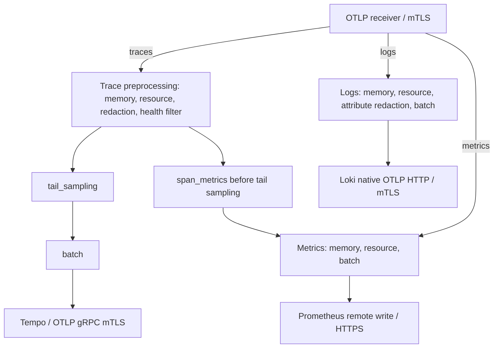

# OpenTelemetry

> **レビュー基準**: Collector Contrib 0.160.0、Operator 0.158.0、以下の言語バージョン  
> **最終更新日**: 2026年10月19日

## はじめに

OpenTelemetry（OTel）は、クラウドネイティブソフトウェア向けのオブザーバビリティフレームワークです。トレース、メトリクス、ログという3つのシグナルを生成、収集、管理するためのベンダー中立な標準を提供します。2026年7月24日付のCNCFの振り返り記事では、コントリビューションの勢いでKubernetesに次ぐプロジェクトと評されました。プロジェクトの成熟度と、個々のSDK／コンポーネントの安定性は別のものです。

### 2026年7月の更新: CNCFの卒業

OpenTelemetryは**2026年5月**にCNCFの**卒業**（graduated）ステータスを達成しました。7月24日の記事は、その振り返りです。これは財団における最高の成熟度レベルで、KubernetesやPrometheusなどのプロジェクトも同じステータスです。卒業は、プロジェクトのガバナンス、セキュリティ慣行、導入状況が本番利用に適しているか審査されたことを示します。振り返りでは、GenAIのセマンティック規約、ブラウザー／モバイルのオブザーバビリティ、Schemaのガバナンス、ロールアウト用ツールについて論じています。背景とロードマップについては、CNCFブログ記事「[OpenTelemetry has graduated… Now what?](https://www.cncf.io/blog/2026/07/24/opentelemetry-has-graduated-now-what/)」を参照してください。

## OpenTelemetryとは？

OpenTelemetryは、OpenTracingプロジェクトとOpenCensusプロジェクトの統合から生まれました。


[🔍 インタラクティブな図を表示](https://www.atomai.click/kubernetes-docs/archmaps/en-observability-tracing-03-opentelemetry-0.html)

## コアコンセプト

### 3つのシグナル

この章ではトレース、メトリクス、ログを扱います。プロファイリングも発展途上のシグナルの1つですが、サポート状況と安定性は実装によって異なります。トレース／ログのIDやメトリクスのエグザンプラーを利用するには、適切な計装とバックエンドの設定が必要です。

| シグナル | 説明 | ユースケース |
|--------|-------------|-----------|
| **トレース** | 分散リクエストのトレーシング | レイテンシ分析、依存関係のマッピング |
| **メトリクス** | 数値による測定値 | リソース使用量、SLI/SLO |
| **ログ** | イベントの記録 | デバッグ、監査 |

### コアコンポーネント


[🔍 インタラクティブな図を表示](https://www.atomai.click/kubernetes-docs/archmaps/en-observability-tracing-03-opentelemetry-2.html)

図にはシグナルごとのバックエンドの選択肢が示されています。有効になるのは設定済みのエクスポーターのみです。以下の基本例では、すべてのベンダーが自動的に有効になるわけではありません。


## OpenTelemetry SDK

Collector、Operator、Java agent、各言語のSDKには、それぞれ独立したバージョン番号があります。以下のLinuxワークロードテンプレートは、Kubernetes 1.35のSchemaに照らして確認済みです。アプリケーションイメージ、名前空間、証明書、接続先Serviceは、それぞれの所有者が準備する必要があります。Operator全体の互換性マトリクスを確認しても、ネイティブサイドカーなど、レシピ固有の要件がなくなるわけではありません。ローカルでの確認は、EKSにアプリケーションがデプロイ済みであることを示すものではありません。

| コンポーネント | 基準と範囲 |
|---|---|
| スタンドアロンCollector Contrib | 0.160.0。実際のバイナリでコンポーネントとSchemaを確認済み |
| Operator | 0.158.0。互換性表ではKubernetes 1.25～1.36およびcert-manager v1を対象としている |
| Java agent | 2.31.1、対象SDKは1.65.0。OperatorのデフォルトJavaイメージと同じバージョンではない |
| Python | SDK/exporter 1.44.0、instrumentation/distro 0.65b0。Python ≥3.10 |
| Node.js CommonJSの例 | SDK-node 0.220.0、auto-instrumentations-node 0.78.0、resources 2.9.0、API 1.9.1 |

OperatorのデフォルトはCollector 0.158.0です。以下のスタンドアロン版0.160.0のワークロードは、Operator管理のCollectorをアップグレードするものではありません。サポート対象のEKSバージョンとの共通範囲を確認してください。最新のKubernetesリリースが、必ずOperatorの互換性マトリクスに含まれるとは限りません。

### 自動計装

2026年10月12日時点で、EKSの標準サポート対象には1.34～1.37が含まれます。Schemaの基準である1.35はこの範囲とOperatorの互換性マトリクスの両方に含まれていますが、実際のプラットフォーム／アドオンでの受け入れ確認は別途必要です。

ゼロコード計装は、サポート対象ライブラリにフックします。任意のビジネスオペレーションを自動検出するものではありません。プロセスごとに、あらかじめ準備したagent／launcherを直接使うか、Operatorによるインジェクションを選択してください。すでに設定済みのproviderに、2つ目のSDKを初期化しないでください。以下のアプリケーションイメージは、起動コマンドと依存関係を含め、独自にビルドするイメージのプレースホルダーです。

`ecommerce`名前空間を準備し、そこに`ca.crt`、`tls.crt`、`tls.key`を含む`otel-client-tls` Secretを作成します。クライアント証明書はCollectorに受け入れられる必要があります。また、Collectorの証明書は`otel-collector.otel.svc.cluster.local`と一致している必要があります。Secretのファイルは読み取り専用でマウントされます。イメージに応じてUID/GIDのアクセス権を調整してください。環境変数に含まれるのは証明書の**パス**だけであり、鍵の内容やBearer tokenではありません。これらのテンプレートでは、TLSの4318番ポートでOTLP HTTP/protobufを使用します。

#### Javaの自動計装

バージョンを固定したagentをアプリケーションのビルドにダウンロードし、リリースアセットのチェックサムを確認してください。2.31.1のJARは25,107,554バイトで、KubernetesのConfigMap上限である1 MiBを超えています。イメージに含めるか、Operatorによるインジェクションを利用してください。ConfigMapはagentバイナリの配布手段ではありません。


```bash
curl --fail --location --output opentelemetry-javaagent.jar \
  https://github.com/open-telemetry/opentelemetry-java-instrumentation/releases/download/v2.31.1/opentelemetry-javaagent.jar
printf '%s  %s\n' \
  bbf83c151b6400709e2f225bdd07a04f839d9d13b8b93464241333fd25d3e3ba \
  opentelemetry-javaagent.jar | sha256sum --check -
```

```dockerfile
# Add to the application's existing Dockerfile; not a complete image build.
COPY opentelemetry-javaagent.jar /opt/otel/opentelemetry-javaagent.jar
```
agentのオプションは、既存の`JAVA_TOOL_OPTIONS`と統合してください。アプリケーションのJVMオプションを破棄しないでください。DeploymentのselectorとPodのラベルは一致している必要があります。


```yaml
apiVersion: apps/v1
kind: Deployment
metadata:
  name: order-service
  namespace: ecommerce
spec:
  replicas: 1
  selector:
    matchLabels:
      app: order-service
  template:
    metadata:
      labels:
        app: order-service
    spec:
      automountServiceAccountToken: false
      securityContext:
        fsGroup: 10001
      containers:
      - name: app
        image: registry.example.com/order-service:otel-demo
        env:
        - name: OTEL_SERVICE_NAME
          value: order-service
        - name: OTEL_RESOURCE_ATTRIBUTES
          value: service.namespace=ecommerce,deployment.environment.name=demo
        - name: OTEL_EXPORTER_OTLP_ENDPOINT
          value: https://otel-collector.otel.svc.cluster.local:4318
        - name: OTEL_EXPORTER_OTLP_PROTOCOL
          value: http/protobuf
        - name: OTEL_EXPORTER_OTLP_CERTIFICATE
          value: /var/run/otel-client/ca.crt
        - name: OTEL_EXPORTER_OTLP_CLIENT_CERTIFICATE
          value: /var/run/otel-client/tls.crt
        - name: OTEL_EXPORTER_OTLP_CLIENT_KEY
          value: /var/run/otel-client/tls.key
        - name: OTEL_TRACES_EXPORTER
          value: otlp
        - name: OTEL_METRICS_EXPORTER
          value: otlp
        - name: OTEL_LOGS_EXPORTER
          value: none
        - name: OTEL_TRACES_SAMPLER
          value: parentbased_always_on
        - name: OTEL_METRIC_EXPORT_INTERVAL
          value: '60000'
        - name: JAVA_TOOL_OPTIONS
          value: -javaagent:/opt/otel/opentelemetry-javaagent.jar
        volumeMounts:
        - name: otel-client-tls
          mountPath: /var/run/otel-client
          readOnly: true
      volumes:
      - name: otel-client-tls
        secret:
          secretName: otel-client-tls
          defaultMode: 288
```
#### Pythonの自動計装

Flaskアプリケーションの場合は、ビルド環境に互換性のあるパッケージをインストールし、解決済みのアプリケーション依存関係をロックしてください。他のフレームワークでは、それぞれに対応したinstrumentationパッケージが必要です。この例ではHTTP exporterを明示的に選択し、PythonのHTTPデフォルトがgRPCの4317番ポートに送信されないようにしています。


```bash
python -m pip install \
  opentelemetry-api==1.44.0 opentelemetry-sdk==1.44.0 \
  opentelemetry-distro==0.65b0 \
  opentelemetry-instrumentation-flask==0.65b0 \
  opentelemetry-exporter-otlp-proto-http==1.44.0
```

```yaml
apiVersion: apps/v1
kind: Deployment
metadata:
  name: payment-service
  namespace: ecommerce
spec:
  replicas: 1
  selector:
    matchLabels:
      app: payment-service
  template:
    metadata:
      labels:
        app: payment-service
    spec:
      automountServiceAccountToken: false
      securityContext:
        fsGroup: 10001
      containers:
      - name: app
        image: registry.example.com/payment-service:otel-demo
        env:
        - name: OTEL_SERVICE_NAME
          value: payment-service
        - name: OTEL_RESOURCE_ATTRIBUTES
          value: service.namespace=ecommerce,deployment.environment.name=demo
        - name: OTEL_EXPORTER_OTLP_ENDPOINT
          value: https://otel-collector.otel.svc.cluster.local:4318
        - name: OTEL_EXPORTER_OTLP_PROTOCOL
          value: http/protobuf
        - name: OTEL_EXPORTER_OTLP_CERTIFICATE
          value: /var/run/otel-client/ca.crt
        - name: OTEL_EXPORTER_OTLP_CLIENT_CERTIFICATE
          value: /var/run/otel-client/tls.crt
        - name: OTEL_EXPORTER_OTLP_CLIENT_KEY
          value: /var/run/otel-client/tls.key
        - name: OTEL_TRACES_EXPORTER
          value: otlp
        - name: OTEL_METRICS_EXPORTER
          value: otlp
        - name: OTEL_LOGS_EXPORTER
          value: none
        - name: OTEL_TRACES_SAMPLER
          value: parentbased_always_on
        - name: OTEL_METRIC_EXPORT_INTERVAL
          value: '60000'
        volumeMounts:
        - name: otel-client-tls
          mountPath: /var/run/otel-client
          readOnly: true
        command:
        - opentelemetry-instrument
        - python
        - app.py
      volumes:
      - name: otel-client-tls
        secret:
          secretName: otel-client-tls
          defaultMode: 288
```
#### Node.jsの自動計装


```bash
npm install --save-exact \
  @opentelemetry/api@1.9.1 @opentelemetry/resources@2.9.0 \
  @opentelemetry/sdk-node@0.220.0 \
  @opentelemetry/auto-instrumentations-node@0.78.0
# Commit package-lock.json and use npm ci for subsequent application builds.
```
これを`tracing.cjs`として保存し、アプリケーション／フレームワークのモジュールより前に読み込んでください。これはCommonJSの例です。ESMで読み込む場合は、言語ガイドにある別の設定が必要です。SDKは、以下で明示するOTEL exporter／TLS環境変数を読み取ります。メトリクスリーダーをプログラムで設定する場合、現在の設定では非推奨の単数形オプションに代わって`metricReaders`を使用します。アプリケーション独自のリクエスト排出処理の後に`shutdownTelemetry()`を組み込んでください。


```javascript
// Load before application/framework modules in a CommonJS application.
const { NodeSDK } = require('@opentelemetry/sdk-node');
const { envDetector } = require('@opentelemetry/resources');
const { getNodeAutoInstrumentations } = require('@opentelemetry/auto-instrumentations-node');

const sdk = new NodeSDK({
  resourceDetectors: [envDetector],
  instrumentations: [
    getNodeAutoInstrumentations({
      '@opentelemetry/instrumentation-fs': { enabled: false },
      '@opentelemetry/instrumentation-http': {
        ignoreIncomingRequestHook: (request) =>
          String(request.url || '').split('?')[0] === '/health',
      },
    }),
  ],
});

// OTEL_* variables configure exporters, protocol, TLS and metric interval.
sdk.start();

// Call after the application's own request-draining step on shutdown.
module.exports = { shutdownTelemetry: () => sdk.shutdown() };
```

```yaml
apiVersion: apps/v1
kind: Deployment
metadata:
  name: notification-service
  namespace: ecommerce
spec:
  replicas: 1
  selector:
    matchLabels:
      app: notification-service
  template:
    metadata:
      labels:
        app: notification-service
    spec:
      automountServiceAccountToken: false
      securityContext:
        fsGroup: 10001
      containers:
      - name: app
        image: registry.example.com/notification-service:otel-demo
        env:
        - name: OTEL_SERVICE_NAME
          value: notification-service
        - name: OTEL_RESOURCE_ATTRIBUTES
          value: service.namespace=ecommerce,deployment.environment.name=demo
        - name: OTEL_EXPORTER_OTLP_ENDPOINT
          value: https://otel-collector.otel.svc.cluster.local:4318
        - name: OTEL_EXPORTER_OTLP_PROTOCOL
          value: http/protobuf
        - name: OTEL_EXPORTER_OTLP_CERTIFICATE
          value: /var/run/otel-client/ca.crt
        - name: OTEL_EXPORTER_OTLP_CLIENT_CERTIFICATE
          value: /var/run/otel-client/tls.crt
        - name: OTEL_EXPORTER_OTLP_CLIENT_KEY
          value: /var/run/otel-client/tls.key
        - name: OTEL_TRACES_EXPORTER
          value: otlp
        - name: OTEL_METRICS_EXPORTER
          value: otlp
        - name: OTEL_LOGS_EXPORTER
          value: none
        - name: OTEL_TRACES_SAMPLER
          value: parentbased_always_on
        - name: OTEL_METRIC_EXPORT_INTERVAL
          value: '60000'
        volumeMounts:
        - name: otel-client-tls
          mountPath: /var/run/otel-client
          readOnly: true
        command:
        - node
        - --require
        - ./tracing.cjs
        - app.cjs
      volumes:
      - name: otel-client-tls
        secret:
          secretName: otel-client-tls
          defaultMode: 288
```
これらの例では、意図的に`OTEL_LOGS_EXPORTER=none`を設定しています。ログexporterを有効にしても、アプリケーションの標準出力を末尾から読み取るわけではありません。適切なロギングブリッジ／ハンドラーまたはログコレクターをインストールし、まずペイロードの露出を確認してください。`parentbased_always_on`サンプラーも、サンプリングされていない親の状態を尊重します。代わりに10%のヘッドサンプリングを選択した場合、tail Collectorが破棄されたスパンを復元することはできません。

### 手動計装

agentまたはアプリケーションが初期化したOpenTelemetryインスタンス／providerを再利用してください。SDK providerがなければ、API呼び出しは何もしない場合があります。以下のビジネスワークフローのスパンはINTERNALです。計装済みのHTTP／データベースクライアントは独自のCLIENTスパンを作成し、コンテキストを伝搬します。CLIENTスパンを手動で作成するだけでは、リクエストの送信にもトレースコンテキストの注入にもなりません。

#### Javaの手動計装

在庫／決済のコールバックはアプリケーション側で用意します。注文ID、顧客ID、金額、トランザクションID、生の例外メッセージは記録されません。以下はアプリケーションのオペレーションであり、決済サービスの実装でも、テスト済みのSpringデプロイメントでもありません。


```java
import io.opentelemetry.api.OpenTelemetry;
import io.opentelemetry.api.trace.Span;
import io.opentelemetry.api.trace.SpanKind;
import io.opentelemetry.api.trace.StatusCode;
import io.opentelemetry.api.trace.Tracer;
import io.opentelemetry.context.Scope;

public final class OrderTelemetry {
    private final Tracer tracer;

    public OrderTelemetry(OpenTelemetry telemetry) {
        this.tracer = telemetry.getTracer("example.order-workflow", "1.0.0");
    }

    public void processOrder(Runnable validateInventory, Runnable processPayment) {
        Span parent = tracer.spanBuilder("processOrder")
                .setSpanKind(SpanKind.INTERNAL).startSpan();
        try (Scope ignored = parent.makeCurrent()) {
            parent.addEvent("validation.started");
            child("checkInventory", validateInventory);
            child("processPayment", processPayment);
            parent.addEvent("processing.completed");
        } catch (RuntimeException error) {
            parent.setStatus(StatusCode.ERROR);
            parent.setAttribute("error.type", error.getClass().getName());
            throw error;
        } finally {
            parent.end();
        }
    }

    private void child(String name, Runnable operation) {
        Span span = tracer.spanBuilder(name).setSpanKind(SpanKind.INTERNAL).startSpan();
        try (Scope ignored = span.makeCurrent()) {
            operation.run();
        } catch (RuntimeException error) {
            span.setStatus(StatusCode.ERROR);
            span.setAttribute("error.type", error.getClass().getName());
            throw error;
        } finally {
            span.end();
        }
    }
}
```
#### Pythonの手動計装

同期デコレーターは、ネストしたスパンを終了しながら、戻り値とエラーをそのまま維持します。生の例外イベントが重複しないよう、エラーの型だけを記録します。非同期関数には、非同期対応のラッパーが必要です。パラメーター化されたデータベース検索、検証、永続化、イベント公開のコールバックは独自に用意してください。ローカルでの検証には、合成コールバックとメモリー内exporterを使用しました。


```python
"""Manual spans for synchronous application callbacks; no database is created."""
from functools import wraps
from contextlib import contextmanager
from opentelemetry import trace
from opentelemetry.trace import SpanKind, Status, StatusCode

# Reuse the SDK provider initialized by auto-instrumentation or the application.
tracer = trace.get_tracer("example.user-workflow", "1.0.0")

@contextmanager
def operation(name):
    with tracer.start_as_current_span(
        name, kind=SpanKind.INTERNAL,
        record_exception=False, set_status_on_exception=False,
    ) as span:
        try:
            yield span
        except Exception as error:
            span.set_status(Status(StatusCode.ERROR))
            span.set_attribute("error.type", type(error).__name__)
            raise

def traced(name):
    def decorate(function):
        @wraps(function)
        def wrapped(*args, **kwargs):
            with operation(name):
                return function(*args, **kwargs)
        return wrapped
    return decorate

@traced("get_user")
def get_user(user_id, lookup):
    # lookup is supplied by the application, with parameterized queries.
    # The ID and SQL text are not added to telemetry.
    with operation("lookup_user"):
        result = lookup(user_id)
    trace.get_current_span().set_attribute("app.user.found", result is not None)
    return result

@traced("create_user")
def create_user(user_data, validate, save, publish):
    # These callbacks are the application's own implementations.
    with operation("validate_user_data"):
        validate(user_data)
    with operation("save_user"):
        result = save(user_data)
    with operation("publish_user_event"):
        publish(result)
    return result
```
実際のデータベース／メッセージ計装では、実装済みの規約バージョンに従ってください。たとえば、`db.system.name`、`db.operation.name`、`messaging.destination.name`などです。ユーザーIDをSQLテレメトリ文字列にコピーしたり、生のクエリをメトリクスラベルに使用したりしないでください。上記のビジネスコールバックは、PostgreSQLやKafkaが実行されたことを示すものではありません。

## OTEL Collector

### アーキテクチャ




以下の設定におけるシグナルの経路です。トレース前処理のボックスは、2つの独立したトレースパイプラインにおける同等の処理をまとめて示しています。スパンメトリクスはtail samplingより前に分岐します。受信したメトリクスとログは、それぞれ独自のパイプラインを通ります。

### Collectorの設定

`otel-collector-config.yaml`として保存します。これはラボ向けの、サンプリング／集約を行う単一のアクティブなステートフルインスタンスであり、高可用性や処理能力を保証するものではありません。別のトレースパイプラインが、**tail samplingより前に**メトリクスを生成します。ヘッドサンプリングされたスパンやフィルターで除外されたスパンは、これらのメトリクスにも含まれません。これらのカウンターが数えるのは観測されたスパンであり、固有のエンドユーザーリクエストではありません。リクエストSLIには、適切なスパン種別と上限のあるディメンションを選んでください。0.160.0では、累積スパンメトリクスカウンターの初回エクスポート値は0です。初回の値をトラフィックなしと解釈する前に、その後のフラッシュを評価してください。

OTLP対応のTempo、Prometheus互換のremote-write receiver、LokiネイティブのOTLP取り込みを準備し、運用者が提供するTLS／認証ゲートウェイを用意してください。以下のゲートウェイ名は、このガイドで作成するServiceではありません。Prometheus自体を使う場合は、remote-write receiverを有効にする必要があります（`--web.enable-remote-write-receiver`）。Loki exporterのベースURLは`/otlp`で終わり、HTTP exporterが`/v1/logs`を追加します。必要に応じて、Lokiの構造化メタデータと信頼できるテナントマッピングを設定してください。テナントヘッダーは認証ではありません。

環境変数は、既存の証明書とエンドポイントを指定します。設定済みのreceiverはすべて相互TLSを使用します。ワイルドカードのブラウザーCORSや公開されたプロファイリングエンドポイントは有効にしていません。指定した属性の削除は限定的な制御であり、ログ本文、スパンイベント、リソース属性、任意のペイロードを完全にマスキングするものではありません。SDK側でもデータを最小限にしてください。


```yaml
# otel-collector-config.yaml
receivers:
  otlp:
    protocols:
      grpc:
        endpoint: 0.0.0.0:4317
        max_recv_msg_size_mib: 16
        tls:
          cert_file: ${env:OTEL_SERVER_CERT}
          key_file: ${env:OTEL_SERVER_KEY}
          client_ca_file: ${env:OTEL_CLIENT_CA}
      http:
        endpoint: 0.0.0.0:4318
        tls:
          cert_file: ${env:OTEL_SERVER_CERT}
          key_file: ${env:OTEL_SERVER_KEY}
          client_ca_file: ${env:OTEL_CLIENT_CA}

processors:
  memory_limiter:
    check_interval: 1s
    limit_mib: 384
    spike_limit_mib: 96
  resource/cluster:
    attributes:
      - key: k8s.cluster.name
        value: ${env:K8S_CLUSTER_NAME}
        action: insert
  attributes/redact:
    actions:
      - key: http.request.header.authorization
        action: delete
      - key: user.email
        action: delete
      - key: user.id
        action: delete
      - key: customer.id
        action: delete
      - key: db.statement
        action: delete
      - key: db.query.text
        action: delete
  filter/health:
    error_mode: propagate
    traces:
      span:
        - 'attributes["http.route"] == "/health"'
        - 'attributes["http.route"] == "/ready"'
        - 'attributes["http.route"] == "/metrics"'
  tail_sampling:
    decision_wait: 10s
    num_traces: 10000
    expected_new_traces_per_sec: 100
    policies:
      - name: errors
        type: status_code
        status_code:
          status_codes: [ERROR]
      - name: slow
        type: latency
        latency:
          threshold_ms: 1000
      - name: selected-services
        type: string_attribute
        string_attribute:
          key: service.name
          values: [payment-service, order-service]
      - name: baseline
        type: probabilistic
        probabilistic:
          sampling_percentage: 10
  batch:
    timeout: 5s
    send_batch_size: 512
    send_batch_max_size: 1024

connectors:
  span_metrics:
    histogram:
      unit: s
      explicit:
        buckets: [5ms, 10ms, 25ms, 50ms, 100ms, 250ms, 500ms, 1s, 2s, 5s]
    dimensions:
      - name: http.request.method
      - name: http.response.status_code
    aggregation_cardinality_limit: 1000
    metrics_flush_interval: 15s

exporters:
  otlp_grpc/tempo:
    endpoint: ${env:TEMPO_OTLP_GRPC_ENDPOINT}
    tls:
      ca_file: ${env:BACKEND_CA}
      cert_file: ${env:BACKEND_CLIENT_CERT}
      key_file: ${env:BACKEND_CLIENT_KEY}
  prometheus_remote_write:
    endpoint: ${env:PROMETHEUS_REMOTE_WRITE_ENDPOINT}
    tls:
      ca_file: ${env:BACKEND_CA}
      cert_file: ${env:BACKEND_CLIENT_CERT}
      key_file: ${env:BACKEND_CLIENT_KEY}
  otlp_http/loki:
    endpoint: ${env:LOKI_OTLP_HTTP_ENDPOINT}
    tls:
      ca_file: ${env:BACKEND_CA}
      cert_file: ${env:BACKEND_CLIENT_CERT}
      key_file: ${env:BACKEND_CLIENT_KEY}

extensions:
  health_check:
    endpoint: 0.0.0.0:13133
    path: /health

service:
  extensions: [health_check]
  pipelines:
    traces:
      receivers: [otlp]
      processors: [memory_limiter, resource/cluster, attributes/redact, filter/health, tail_sampling, batch]
      exporters: [otlp_grpc/tempo]
    traces/span-metrics:
      receivers: [otlp]
      processors: [memory_limiter, resource/cluster, attributes/redact, filter/health]
      exporters: [span_metrics]
    metrics:
      receivers: [otlp, span_metrics]
      processors: [memory_limiter, resource/cluster, batch]
      exporters: [prometheus_remote_write]
    logs:
      receivers: [otlp]
      processors: [memory_limiter, resource/cluster, attributes/redact, batch]
      exporters: [otlp_http/loki]
  telemetry:
    logs:
      level: info
      encoding: json
    metrics:
      readers:
        - pull:
            exporter:
              prometheus:
                host: 127.0.0.1
                port: 8888
```
サンプリングを行う正のポリシーはOR条件であり、優先順位の順に並ぶ段階ではありません。選択されたサービスは、ベースラインの確率とは独立して保持できます。レイテンシ条件は厳密な`>1000 ms`比較です。タイマーによる判定は、トレースが完了したことを証明するものではありません。また、ヘルスフィルターはエラーがある場合でも一致するスパンを意図的に除去します。個々のスパンをフィルタリングすると、不完全なトレースが残る場合があります。

ハードメモリ上限は384 MiB、ソフト上限は288 MiBです。これにより、テンプレート内のコンテナ上限512 MiBに対して余裕が確保されます。それでも、拒否、再試行、キュー、バーストは測定が必要です。ここでのバッチ／トレース／カーディナリティの上限はデモ用の設定であり、ベンチマーク結果ではありません。

### 単一インスタンスのワークロードと設定

`otel`名前空間を作成し、`tls.crt`、`tls.key`、`ca.crt`を含む`otel-ingest-tls`／`otel-backend-tls` Secretを準備します。関連するService／ゲートウェイ名と一致する証明書SAN、適切な信頼バンドル、サーバー／クライアントの用途が正しい証明書を使用してください。UID/GID 10001からアクセスできるよう調整します。ConfigMapに含めるのはテキスト形式の設定であり、秘密鍵ではありません。この単一インスタンスのsamplerでは、`Recreate`により通常のローリング更新で一時的に複数Podが重なることを避けられますが、ダウンタイムが発生します。また、再起動をまたいでメモリー内のトレースを保持することはできません。


```bash
: "${KUBE_CONTEXT:?Set the reviewed cluster context}"
kubectl --context "$KUBE_CONTEXT" -n otel create configmap otel-collector-config \
  --from-file=otel-collector-config.yaml --dry-run=client -o yaml > otel-collector-configmap.yaml
# Inspect the namespace, Secrets, endpoints and workloads before any real apply.
```

```yaml
apiVersion: v1
kind: ServiceAccount
metadata:
  name: otel-collector
  namespace: otel
automountServiceAccountToken: false
---
apiVersion: apps/v1
kind: Deployment
metadata:
  name: otel-collector
  namespace: otel
spec:
  selector:
    matchLabels:
      app: otel-collector
  template:
    metadata:
      labels:
        app: otel-collector
    spec:
      serviceAccountName: otel-collector
      automountServiceAccountToken: false
      nodeSelector:
        kubernetes.io/os: linux
      securityContext:
        runAsNonRoot: true
        runAsUser: 10001
        fsGroup: 10001
        seccompProfile:
          type: RuntimeDefault
      containers:
      - name: collector
        image: otel/opentelemetry-collector-contrib:0.160.0
        args:
        - --config=/conf/otel-collector-config.yaml
        env:
        - name: GOMEMLIMIT
          value: 384MiB
        - name: OTEL_SERVER_CERT
          value: /var/run/otel/ingest/tls.crt
        - name: OTEL_SERVER_KEY
          value: /var/run/otel/ingest/tls.key
        - name: OTEL_CLIENT_CA
          value: /var/run/otel/ingest/ca.crt
        - name: BACKEND_CA
          value: /var/run/otel/backend/ca.crt
        - name: BACKEND_CLIENT_CERT
          value: /var/run/otel/backend/tls.crt
        - name: BACKEND_CLIENT_KEY
          value: /var/run/otel/backend/tls.key
        - name: OTEL_UPSTREAM_ENDPOINT
          value: otel-collector.otel.svc.cluster.local:4317
        - name: K8S_CLUSTER_NAME
          value: REPLACE_WITH_CLUSTER_NAME
        - name: TEMPO_OTLP_GRPC_ENDPOINT
          value: tempo-gateway.tempo.svc.cluster.local:4317
        - name: PROMETHEUS_REMOTE_WRITE_ENDPOINT
          value: https://prometheus-gateway.monitoring.svc.cluster.local/api/v1/write
        - name: LOKI_OTLP_HTTP_ENDPOINT
          value: https://loki-gateway.loki.svc.cluster.local/otlp
        ports:
        - name: otlp-grpc
          containerPort: 4317
        - name: otlp-http
          containerPort: 4318
        resources:
          requests:
            cpu: 100m
            memory: 256Mi
          limits:
            cpu: 500m
            memory: 512Mi
        securityContext:
          allowPrivilegeEscalation: false
          readOnlyRootFilesystem: true
          capabilities:
            drop:
            - ALL
        volumeMounts:
        - name: config
          mountPath: /conf
          readOnly: true
        - name: ingest-tls
          mountPath: /var/run/otel/ingest
          readOnly: true
        - name: backend-tls
          mountPath: /var/run/otel/backend
          readOnly: true
        readinessProbe:
          httpGet:
            path: /health
            port: 13133
        livenessProbe:
          httpGet:
            path: /health
            port: 13133
          initialDelaySeconds: 15
      volumes:
      - name: config
        configMap:
          name: otel-collector-config
      - name: ingest-tls
        secret:
          secretName: otel-ingest-tls
          defaultMode: 288
      - name: backend-tls
        secret:
          secretName: otel-backend-tls
          defaultMode: 288
  replicas: 1
  strategy:
    type: Recreate
---
apiVersion: v1
kind: Service
metadata:
  name: otel-collector
  namespace: otel
spec:
  type: ClusterIP
  selector:
    app: otel-collector
  ports:
  - name: otlp-grpc
    port: 4317
    targetPort: otlp-grpc
  - name: otlp-http
    port: 4318
    targetPort: otlp-http
```
### オプションの収集とエンリッチメント

| 要件 | 別途必要な設定 |
|---|---|
| レガシーJaeger／Zipkinクライアント | それらのreceiverコンポーネントは引き続き利用できます。必要なプロトコル／ポートだけを有効にし、パイプライン内のreceiver IDを一致させてください。Jaegerへのエクスポートには、削除されたJaeger exporterではなくOTLPを使用してください。 |
| Collectorのセルフメトリクス | `service.telemetry.metrics.readers`で現在のPrometheus readerを設定します。古い`address`フィールドは削除されています。意図して設計した監視経路を通じて、ループバックエンドポイントをスクレイプしてください。 |
| Kubernetesクラスターメトリクス | アクティブな`k8s_cluster` receiverを1つ実行するか、そのleader-elector拡張機能を設定します。API認証情報とレビュー済みのRBACを用意し、メトリクスパイプラインに接続してください。上記のトークンを使用しないワークロードのデフォルト設定では、これらの前提条件は満たされません。 |
| ノード／コンテナのログまたはホストメトリクス | 適切なreceiver、マウント、権限を追加してください。DaemonSetだけでは収集できません。 |
| EC2/EKSのリソース検出 | 必要なdetectorとメタデータ／APIへのアクセスを意図的に設定してください。ワークロードIDをCollectorホストのIDに置き換えないでください。 |
| スパンから生成するメトリクス | 明示的な継続時間単位と上限のあるディメンションを指定し、`span_metrics` connectorを使用します。古いspanmetrics processorは削除されています。 |

[Collectorガイド](../logging/05-collectors.md)と[Kubernetes cluster receiver](https://github.com/open-telemetry/opentelemetry-collector-contrib/tree/v0.160.0/receiver/k8sclusterreceiver)を参照してください。使用していないreceiver／processorを宣言しただけで、有効になっていると考えないでください。

## EKSのデプロイパターン

これらは代替となるデプロイパターンであり、無差別にすべて適用するための一式ではありません。ステートレスなrelayが、3つすべてのシグナルを上記の単一サンプリング層に転送します。tail samplingとスパン集約を、任意のロードバランサー配下にあるノード／サイドカー／HPAの階層に置かないでください。複数のサンプリングインスタンスを使うには、trace IDを認識するルーティングと、エンドポイントの変更、処理中のトレース、再起動、ストレージに関する計画が必要です。ServiceやHPAだけでは、そのどれも実現できません。

`otel-relay-config.yaml`を保存し、同じクライアント側ConfigMap生成手順で`otel-relay-config`を作成します。`OTEL_UPSTREAM_ENDPOINT`とクライアント証明書は、別途準備した上流Collectorを指定します。relayはサンプリング判断についてステートレスですが、メモリー内のバッチ／エクスポートキューには障害やシャットダウン時の制限があります。


```yaml
receivers:
  otlp:
    protocols:
      grpc:
        endpoint: 0.0.0.0:4317
        max_recv_msg_size_mib: 16
        tls:
          cert_file: ${env:OTEL_SERVER_CERT}
          key_file: ${env:OTEL_SERVER_KEY}
          client_ca_file: ${env:OTEL_CLIENT_CA}
      http:
        endpoint: 0.0.0.0:4318
        tls:
          cert_file: ${env:OTEL_SERVER_CERT}
          key_file: ${env:OTEL_SERVER_KEY}
          client_ca_file: ${env:OTEL_CLIENT_CA}
processors:
  memory_limiter:
    check_interval: 1s
    limit_mib: 384
    spike_limit_mib: 96
  batch:
    timeout: 5s
    send_batch_size: 512
    send_batch_max_size: 1024
exporters:
  otlp_grpc/upstream:
    endpoint: ${env:OTEL_UPSTREAM_ENDPOINT}
    tls:
      ca_file: ${env:BACKEND_CA}
      cert_file: ${env:BACKEND_CLIENT_CERT}
      key_file: ${env:BACKEND_CLIENT_KEY}
extensions:
  health_check:
    endpoint: 0.0.0.0:13133
    path: /health
service:
  extensions:
  - health_check
  pipelines:
    traces:
      receivers:
      - otlp
      processors:
      - memory_limiter
      - batch
      exporters:
      - otlp_grpc/upstream
    metrics:
      receivers:
      - otlp
      processors:
      - memory_limiter
      - batch
      exporters:
      - otlp_grpc/upstream
    logs:
      receivers:
      - otlp
      processors:
      - memory_limiter
      - batch
      exporters:
      - otlp_grpc/upstream
  telemetry:
    logs:
      level: info
      encoding: json
    metrics:
      readers:
      - pull:
          exporter:
            prometheus:
              host: 127.0.0.1
              port: 8888
```
### DaemonSetパターン

DaemonSetは、対象となるLinuxノード上で実行されます。EKS Fargate上では実行されません。承認済みノード向けにselector／tolerationを設定してください。ここでは包括的なtolerationもhostPort予約も設定していません。`internalTrafficPolicy: Local`では、このServiceは呼び出し元と同じノード上のReadyなエンドポイントだけにルーティングし、そのようなエンドポイントがなければトラフィックを破棄します。Fargateクライアント向けのフォールバック機能ではありません。アプリケーションから、このエンドポイントにテレメトリを明示的に送信する必要があります。


```yaml
apiVersion: apps/v1
kind: DaemonSet
metadata:
  name: otel-agent
  namespace: otel
spec:
  selector:
    matchLabels:
      app: otel-agent
  template:
    metadata:
      labels:
        app: otel-agent
    spec:
      serviceAccountName: otel-collector
      automountServiceAccountToken: false
      nodeSelector:
        kubernetes.io/os: linux
      securityContext:
        runAsNonRoot: true
        runAsUser: 10001
        fsGroup: 10001
        seccompProfile:
          type: RuntimeDefault
      containers:
      - name: collector
        image: otel/opentelemetry-collector-contrib:0.160.0
        args:
        - --config=/conf/otel-relay-config.yaml
        env:
        - name: GOMEMLIMIT
          value: 384MiB
        - name: OTEL_SERVER_CERT
          value: /var/run/otel/ingest/tls.crt
        - name: OTEL_SERVER_KEY
          value: /var/run/otel/ingest/tls.key
        - name: OTEL_CLIENT_CA
          value: /var/run/otel/ingest/ca.crt
        - name: BACKEND_CA
          value: /var/run/otel/backend/ca.crt
        - name: BACKEND_CLIENT_CERT
          value: /var/run/otel/backend/tls.crt
        - name: BACKEND_CLIENT_KEY
          value: /var/run/otel/backend/tls.key
        - name: OTEL_UPSTREAM_ENDPOINT
          value: otel-collector.otel.svc.cluster.local:4317
        ports:
        - name: otlp-grpc
          containerPort: 4317
        - name: otlp-http
          containerPort: 4318
        resources:
          requests:
            cpu: 100m
            memory: 256Mi
          limits:
            cpu: 500m
            memory: 512Mi
        securityContext:
          allowPrivilegeEscalation: false
          readOnlyRootFilesystem: true
          capabilities:
            drop:
            - ALL
        volumeMounts:
        - name: config
          mountPath: /conf
          readOnly: true
        - name: ingest-tls
          mountPath: /var/run/otel/ingest
          readOnly: true
        - name: backend-tls
          mountPath: /var/run/otel/backend
          readOnly: true
        readinessProbe:
          httpGet:
            path: /health
            port: 13133
        livenessProbe:
          httpGet:
            path: /health
            port: 13133
          initialDelaySeconds: 15
      volumes:
      - name: config
        configMap:
          name: otel-relay-config
      - name: ingest-tls
        secret:
          secretName: otel-ingest-tls
          defaultMode: 288
      - name: backend-tls
        secret:
          secretName: otel-backend-tls
          defaultMode: 288
---
apiVersion: v1
kind: Service
metadata:
  name: otel-agent
  namespace: otel
spec:
  type: ClusterIP
  selector:
    app: otel-agent
  ports:
  - name: otlp-grpc
    port: 4317
    targetPort: otlp-grpc
  - name: otlp-http
    port: 4318
    targetPort: otlp-http
  internalTrafficPolicy: Local
```
### サイドカーパターン

以下の設定を使い、別の`otel-sidecar-config` ConfigMapを用意してください。ループバックの平文OTLP receiverを使うのは同じPod内だけです。上流へのトラフィックには相互TLSを使用します。この構成では、256 MiBのサイドカーに対して、ハード上限を192 MiB、ソフト上限を144 MiBに設定しています。アプリケーションイメージには、選択したSDK／agentを含める必要があります。エンドポイント変数を設定するだけでは、計装は追加されません。このKubernetes 1.35のSchema例では、ネイティブサイドカー（`restartPolicy: Always`を指定した`initContainers`、1.33でGA）を使用しています。アプリケーションの起動前にstartup probeが実行され、通常のシャットダウンではサイドカーより先にアプリケーションコンテナが停止します。バックエンドへの配送と突発的な障害からの復旧は、それぞれ別途確認が必要です。


```yaml
receivers:
  otlp:
    protocols:
      grpc:
        endpoint: 127.0.0.1:4317
      http:
        endpoint: 127.0.0.1:4318
processors:
  memory_limiter:
    check_interval: 1s
    limit_mib: 192
    spike_limit_mib: 48
  batch:
    timeout: 5s
    send_batch_size: 512
    send_batch_max_size: 1024
exporters:
  otlp_grpc/upstream:
    endpoint: ${env:OTEL_UPSTREAM_ENDPOINT}
    tls:
      ca_file: ${env:BACKEND_CA}
      cert_file: ${env:BACKEND_CLIENT_CERT}
      key_file: ${env:BACKEND_CLIENT_KEY}
extensions:
  health_check:
    endpoint: 0.0.0.0:13133
    path: /health
service:
  extensions:
  - health_check
  pipelines:
    traces:
      receivers:
      - otlp
      processors:
      - memory_limiter
      - batch
      exporters:
      - otlp_grpc/upstream
    metrics:
      receivers:
      - otlp
      processors:
      - memory_limiter
      - batch
      exporters:
      - otlp_grpc/upstream
    logs:
      receivers:
      - otlp
      processors:
      - memory_limiter
      - batch
      exporters:
      - otlp_grpc/upstream
  telemetry:
    logs:
      level: info
      encoding: json
    metrics:
      readers:
      - pull:
          exporter:
            prometheus:
              host: 127.0.0.1
              port: 8888
```

```yaml
apiVersion: apps/v1
kind: Deployment
metadata:
  name: order-with-sidecar
  namespace: otel
spec:
  selector:
    matchLabels:
      app: order-with-sidecar
  template:
    metadata:
      labels:
        app: order-with-sidecar
    spec:
      serviceAccountName: otel-collector
      automountServiceAccountToken: false
      nodeSelector:
        kubernetes.io/os: linux
      securityContext:
        runAsNonRoot: true
        runAsUser: 10001
        fsGroup: 10001
        seccompProfile:
          type: RuntimeDefault
      containers:
      - name: app
        image: registry.example.com/order-service:otel-demo
        env:
        - name: OTEL_SERVICE_NAME
          value: order-service
        - name: OTEL_EXPORTER_OTLP_ENDPOINT
          value: http://127.0.0.1:4318
        - name: OTEL_EXPORTER_OTLP_PROTOCOL
          value: http/protobuf
      volumes:
      - name: config
        configMap:
          name: otel-sidecar-config
      - name: backend-tls
        secret:
          secretName: otel-backend-tls
          defaultMode: 288
      initContainers:
      - name: collector
        image: otel/opentelemetry-collector-contrib:0.160.0
        args:
        - --config=/conf/otel-sidecar-config.yaml
        env:
        - name: GOMEMLIMIT
          value: 192MiB
        - name: BACKEND_CA
          value: /var/run/otel/backend/ca.crt
        - name: BACKEND_CLIENT_CERT
          value: /var/run/otel/backend/tls.crt
        - name: BACKEND_CLIENT_KEY
          value: /var/run/otel/backend/tls.key
        - name: OTEL_UPSTREAM_ENDPOINT
          value: otel-collector.otel.svc.cluster.local:4317
        ports:
        - name: otlp-grpc
          containerPort: 4317
        - name: otlp-http
          containerPort: 4318
        resources:
          requests:
            cpu: 100m
            memory: 64Mi
          limits:
            cpu: 500m
            memory: 256Mi
        securityContext:
          allowPrivilegeEscalation: false
          readOnlyRootFilesystem: true
          capabilities:
            drop:
            - ALL
        volumeMounts:
        - name: config
          mountPath: /conf
          readOnly: true
        - name: backend-tls
          mountPath: /var/run/otel/backend
          readOnly: true
        readinessProbe:
          httpGet:
            path: /health
            port: 13133
        livenessProbe:
          httpGet:
            path: /health
            port: 13133
          initialDelaySeconds: 15
        restartPolicy: Always
        startupProbe:
          httpGet:
            path: /health
            port: 13133
          periodSeconds: 2
          failureThreshold: 30
  replicas: 1
```
### ゲートウェイパターン

このHPAがスケールするのは、ステートフルなsamplerではなく、ステートレスな**relay**です。前提条件として、Metrics Serverと適切なrequests／処理能力が必要です。3レプリカ、優先アンチアフィニティ、3～10の範囲は例示的な選択であり、高可用性やスループットの証明ではありません。DeploymentベースのCollectorをFargateまたはAuto Modeで検討する場合は、実行方法、ストレージ、ネットワーク、receiverの要件を確認してください。


```yaml
apiVersion: apps/v1
kind: Deployment
metadata:
  name: otel-relay
  namespace: otel
spec:
  selector:
    matchLabels:
      app: otel-relay
  template:
    metadata:
      labels:
        app: otel-relay
    spec:
      serviceAccountName: otel-collector
      automountServiceAccountToken: false
      nodeSelector:
        kubernetes.io/os: linux
      securityContext:
        runAsNonRoot: true
        runAsUser: 10001
        fsGroup: 10001
        seccompProfile:
          type: RuntimeDefault
      containers:
      - name: collector
        image: otel/opentelemetry-collector-contrib:0.160.0
        args:
        - --config=/conf/otel-relay-config.yaml
        env:
        - name: GOMEMLIMIT
          value: 384MiB
        - name: OTEL_SERVER_CERT
          value: /var/run/otel/ingest/tls.crt
        - name: OTEL_SERVER_KEY
          value: /var/run/otel/ingest/tls.key
        - name: OTEL_CLIENT_CA
          value: /var/run/otel/ingest/ca.crt
        - name: BACKEND_CA
          value: /var/run/otel/backend/ca.crt
        - name: BACKEND_CLIENT_CERT
          value: /var/run/otel/backend/tls.crt
        - name: BACKEND_CLIENT_KEY
          value: /var/run/otel/backend/tls.key
        - name: OTEL_UPSTREAM_ENDPOINT
          value: otel-collector.otel.svc.cluster.local:4317
        ports:
        - name: otlp-grpc
          containerPort: 4317
        - name: otlp-http
          containerPort: 4318
        resources:
          requests:
            cpu: 100m
            memory: 256Mi
          limits:
            cpu: 500m
            memory: 512Mi
        securityContext:
          allowPrivilegeEscalation: false
          readOnlyRootFilesystem: true
          capabilities:
            drop:
            - ALL
        volumeMounts:
        - name: config
          mountPath: /conf
          readOnly: true
        - name: ingest-tls
          mountPath: /var/run/otel/ingest
          readOnly: true
        - name: backend-tls
          mountPath: /var/run/otel/backend
          readOnly: true
        readinessProbe:
          httpGet:
            path: /health
            port: 13133
        livenessProbe:
          httpGet:
            path: /health
            port: 13133
          initialDelaySeconds: 15
      volumes:
      - name: config
        configMap:
          name: otel-relay-config
      - name: ingest-tls
        secret:
          secretName: otel-ingest-tls
          defaultMode: 288
      - name: backend-tls
        secret:
          secretName: otel-backend-tls
          defaultMode: 288
      affinity:
        podAntiAffinity:
          preferredDuringSchedulingIgnoredDuringExecution:
          - weight: 100
            podAffinityTerm:
              labelSelector:
                matchLabels:
                  app: otel-relay
              topologyKey: kubernetes.io/hostname
  replicas: 3
---
apiVersion: v1
kind: Service
metadata:
  name: otel-relay
  namespace: otel
spec:
  type: ClusterIP
  selector:
    app: otel-relay
  ports:
  - name: otlp-grpc
    port: 4317
    targetPort: otlp-grpc
  - name: otlp-http
    port: 4318
    targetPort: otlp-http
---
apiVersion: autoscaling/v2
kind: HorizontalPodAutoscaler
metadata:
  name: otel-relay
  namespace: otel
spec:
  scaleTargetRef:
    apiVersion: apps/v1
    kind: Deployment
    name: otel-relay
  minReplicas: 3
  maxReplicas: 10
  metrics:
  - type: Resource
    resource:
      name: cpu
      target:
        type: Utilization
        averageUtilization: 70
  - type: Resource
    resource:
      name: memory
      target:
        type: Utilization
        averageUtilization: 80
```

## Kubernetes Operator

Operator 0.158.0には独立した互換性マトリクスがあります。リリースマニフェストは、cert-manager v1がすでに準備されていることを前提としています。古い1.13.3の例ではなく、[cert-managerガイド](../../security/10-cert-manager.md)にある、保守されている互換性のあるリリースを使用してください。既存の所有者管理のインストールをアップグレードする前に、CRDの変更と0.158.0のデフォルトのネットワークポリシーを確認してください。

### Operatorのインストール


```bash
curl --fail --location --output opentelemetry-operator.yaml \
  https://github.com/open-telemetry/opentelemetry-operator/releases/download/v0.158.0/opentelemetry-operator.yaml
printf '%s  %s\n' \
  3c258efb3d64834a857ce4ed5256af2883dc9c77a300eee465df833ab2354c8e \
  opentelemetry-operator.yaml | sha256sum --check -
# After prerequisites and ownership/upgrade review; this changes the cluster:
: "${KUBE_CONTEXT:?Set the reviewed cluster context}"
kubectl --context "$KUBE_CONTEXT" apply -f opentelemetry-operator.yaml
```
### Instrumentation CR

リソースとアプリケーションの例は、どちらも`ecommerce`にあります。バージョンを固定したOperatorが、そのバージョンに対応したデフォルトのinstrumentationイメージを提供します。インジェクションされるイメージを確認し、すべてを`latest`に置き換えないでください。Java／Pythonのデフォルトは、上記で直接インストールしたバージョンとは異なります。プロセスごとに、計装の方法は1つだけ使用してください。TLS Secretのマウントは、引き続きアプリケーション側の責任です。


```yaml
apiVersion: opentelemetry.io/v1alpha1
kind: Instrumentation
metadata:
  name: otel-instrumentation
  namespace: ecommerce
spec:
  exporter:
    endpoint: https://otel-collector.otel.svc.cluster.local:4318
  propagators:
  - tracecontext
  - baggage
  sampler:
    type: parentbased_always_on
  env:
  - name: OTEL_RESOURCE_ATTRIBUTES
    value: service.namespace=ecommerce,deployment.environment.name=demo
  - name: OTEL_EXPORTER_OTLP_PROTOCOL
    value: http/protobuf
  - name: OTEL_EXPORTER_OTLP_CERTIFICATE
    value: /var/run/otel-client/ca.crt
  - name: OTEL_EXPORTER_OTLP_CLIENT_CERTIFICATE
    value: /var/run/otel-client/tls.crt
  - name: OTEL_EXPORTER_OTLP_CLIENT_KEY
    value: /var/run/otel-client/tls.key
  - name: OTEL_TRACES_EXPORTER
    value: otlp
  - name: OTEL_METRICS_EXPORTER
    value: otlp
  - name: OTEL_LOGS_EXPORTER
    value: none
  - name: OTEL_METRIC_EXPORT_INTERVAL
    value: '60000'
```
ここではW3C Trace Contextとbaggageを選択しています。B3は、言語のpropagatorパッケージと相手側が対応している場合に限り、相互運用性のためのオプションとして選択できます。baggageに認証情報や個人データを入れないでください。伝搬によって、サービス境界や信頼境界を越える可能性があります。

### 自動計装のインジェクション

アノテーションはDeploymentのmetadataだけでなく、Podテンプレートに指定します。`otel-instrumentation`はPodと同じ名前空間内にある、名前が一致するリソースを選択します。別の名前空間を指定する場合は`namespace/name`を使えます。名前空間全体にアノテーションを付ける方法もありますが、すべてのPodにJava、Python、Node.jsを無差別に有効にしないでください。インジェクションが行われるのは新しいPodが受け入れられるときであり、実行中のPodに遡って適用されることはありません。


```yaml
apiVersion: apps/v1
kind: Deployment
metadata:
  name: order-injected
  namespace: ecommerce
spec:
  replicas: 1
  selector:
    matchLabels:
      app: order-injected
  template:
    metadata:
      labels:
        app: order-injected
      annotations:
        instrumentation.opentelemetry.io/inject-java: otel-instrumentation
    spec:
      automountServiceAccountToken: false
      securityContext:
        fsGroup: 10001
      containers:
      - name: app
        image: registry.example.com/order-injected:otel-demo
        env:
        - name: OTEL_SERVICE_NAME
          value: order-injected
        - name: OTEL_RESOURCE_ATTRIBUTES
          value: service.namespace=ecommerce,deployment.environment.name=demo
        - name: OTEL_EXPORTER_OTLP_ENDPOINT
          value: https://otel-collector.otel.svc.cluster.local:4318
        - name: OTEL_EXPORTER_OTLP_PROTOCOL
          value: http/protobuf
        - name: OTEL_EXPORTER_OTLP_CERTIFICATE
          value: /var/run/otel-client/ca.crt
        - name: OTEL_EXPORTER_OTLP_CLIENT_CERTIFICATE
          value: /var/run/otel-client/tls.crt
        - name: OTEL_EXPORTER_OTLP_CLIENT_KEY
          value: /var/run/otel-client/tls.key
        - name: OTEL_TRACES_EXPORTER
          value: otlp
        - name: OTEL_METRICS_EXPORTER
          value: otlp
        - name: OTEL_LOGS_EXPORTER
          value: none
        - name: OTEL_TRACES_SAMPLER
          value: parentbased_always_on
        - name: OTEL_METRIC_EXPORT_INTERVAL
          value: '60000'
        volumeMounts:
        - name: otel-client-tls
          mountPath: /var/run/otel-client
          readOnly: true
      volumes:
      - name: otel-client-tls
        secret:
          secretName: otel-client-tls
          defaultMode: 288
```
Java、Python、Node.js、.NET、Go、Apache HTTPD、Nginxでは、それぞれ異なる前提条件があります。このリリースでは、Goの自動計装に対象実行ファイルのパスが必要であり、特権付きのUID 0コンポーネントがインジェクションされます。一般的なRestricted-PSS／Fargate向けの手順ではありません。Operatorの機能設定と言語ごとのガイドを確認してください。Python／.NET／GoのHTTPデフォルトを、対応するプロトコルを設定せずにgRPCエンドポイントへ向けないでください。

## マルチバックエンドの設定

この断片をレビュー済みの基本設定に統合してください。単独では使用できません。各バックエンドに、それぞれのエンドポイント、信頼設定、認可設定が必要です。AWS X-Rayは、設定したRegionとワークロードIDを使用します。IAMの信頼／権限の詳細は、[X-Rayガイド](./02-xray.md)を参照してください。属性インデックスを無効にしても、データはマスキングされません。Datadogのapiオブジェクトは、`key`（引用符で囲んだ文字列）と`site`を含む、Secretで管理された`api.yaml`から読み込まれます。Secretを読み取り専用でワークロードにマウントしてください。基本のワークロードにはマウントされていません。環境変数にキーは設定しません。この監査では、AWS／Datadog／Jaegerサービスへの呼び出しは実行していません。


```yaml
exporters:
  awsxray:
    region: ap-northeast-2
    index_all_attributes: false
    telemetry:
      enabled: false
  datadog:
    api: ${file:/var/run/secrets/datadog/api.yaml}
  otlp_grpc/jaeger:
    endpoint: ${env:JAEGER_OTLP_GRPC_ENDPOINT}
    tls:
      ca_file: ${env:BACKEND_CA}
      cert_file: ${env:BACKEND_CLIENT_CERT}
      key_file: ${env:BACKEND_CLIENT_KEY}
service:
  pipelines:
    traces:
      exporters:
      - otlp_grpc/tempo
      - awsxray
      - datadog
      - otlp_grpc/jaeger
```
複数のバックエンドへの同時配信は、アトミックな配送も、バックエンド間で同じ保持期間になることも保証しません。

### 2026年7月の更新: AIエージェントのトラフィックに対するネットワーク境界の監視

[7月8日のCNCF記事](https://www.cncf.io/blog/2026/07/08/network-boundary-for-ai-agents-using-nginx-and-opentelemetry/)では、NGINXとOTelを使った単一ノードのプロトタイプが紹介されています。その境界は、単にプロキシ変数を設定するだけでなく、別の送信経路を遮断するネットワークルールに依存します。スパンが示すのは、設定したプロキシから見えるトラフィックです。TLSの処理、サンプリング、Collectorでの保持、プロキシのセキュリティも引き続き重要です。これはネットワーク制御の一層にすぎず、エージェントの判断が正しい、または安全であることを保証するものではありません。

### 2026年8月の更新: 遅いSQLクエリを信頼性メトリクスにまとめる

[8月21日のCNCF記事](https://www.cncf.io/blog/2026/08/21/how-to-turn-slow-queries-into-actionable-reliability-metrics-with-opentelemetry/)と[ラボ](https://github.com/causely-oss/slow-query-lab)では、クエリ時間、トラフィックで重み付けした影響、スパンから生成したメトリクスを、異常の基準値と比較しています。記事にある過去の例は例として扱い、クラスターの処理能力を測定した値として扱わないでください。記事自体も、生のSQLをメトリクスラベルに含めること、機密パラメーター、カーディナリティ、基準値のウォームアップについて警告しています。ラボの設定を採用する前に、ディメンションをサニタイズして上限を設けてください。レイテンシの異常は症状であり、根本原因の証明ではありません。

### 2026年10月の更新: OTelシグナルとしてのSoftware Carbon Intensity（SCI）

[10月15日のCNCF記事](https://www.cncf.io/blog/2026/10/15/carbon-as-a-first-class-signal-bringing-software-carbon-intensity-to-opentelemetry/)で、KeplerのメンテナーでありCNCFアンバサダーでもあるDiana Todea氏は、Observability Summit Europe 2026の基調講演を発展させ、Green Software FoundationのSoftware Carbon Intensity（SCI）標準をOpenTelemetryのセマンティック規約として扱い、炭素排出をワークロードやサービスに結び付けて観測可能なシグナルにすることを提案しています。これは標準化に関する議論が続く、方向性を示す提案です。特定のOTelリリースに搭載された機能でも、完成したセマンティック規約でもありません。導入を計画する前に、上流プロジェクトの進捗を確認してください。

### 2026年10月の更新: OTelストリームを基盤としたインシデント検出の再構築

[9月30日のCNCF記事](https://www.cncf.io/blog/2026/09/30/from-40-seconds-to-under-10-rebuilding-incident-detection-on-opentelemetry-apache-kafka-and-apache-flink-on-kubernetes/)で、Atlassianは、OpenTelemetry、Apache Kafka、Apache FlinkをKubernetes上で利用して自動インシデント作成プラットフォームを18か月かけて再構築し、イベントからメトリクスまでのレイテンシを40秒超から10秒未満に短縮したと説明しています。記事自身が述べているように、対象範囲内での再現率は約60%から86%に上昇しましたが、調子の悪かった月には64%に低下し、適合率は依然として目標を下回っています。これらの数値はその組織での測定結果であり、アーキテクチャが保証する成果ではありません。共有キュー上でノイジーネイバーを分離する方法やコストなど、トレードオフの議論が記事の特に参考になる点です。

## ベストプラクティス

### 1. リソース属性を標準化する

| 属性 | 例／情報源 |
|---|---|
| `service.name`、`service.version`、`service.namespace` | `order-service`、`1.2.3`、`ecommerce`。アプリケーション設定 |
| `deployment.environment.name` | `demo`。非推奨の`deployment.environment`に代わる属性 |
| `cloud.provider`、`cloud.region`、`cloud.availability_zone` | Collectorホストから推測せず、確認済みのデプロイメントメタデータを使用 |
| `k8s.cluster.name`、`k8s.namespace.name`、`k8s.pod.name`、`k8s.deployment.name` | 正しく設定したKubernetesエンリッチメント、またはワークロードメタデータ |

これは属性の一覧であり、Collector processorのYAMLではありません。Resourceはデータの生成元を示します。すべてのリソース属性をメトリクスラベルにコピーしないでください。Pod名、ユーザーID、生のクエリテキストはカーディナリティを高くする可能性があります。プロファイルは発展途上の追加シグナルです。このガイドではトレース、メトリクス、ログに重点を置いており、すべてのSDKが一様に安定しているとは主張していません。

### 2. サンプリング戦略

高度な例（エラー、2秒を超えるレイテンシ、重要なサービスに対する50%の条件、5%のベースライン）では、それぞれの正のルールをOR条件として扱ってください。先に一致したルールが優先されるわけでも、サンプリング枠が予約されるわけでもありません。他のルールによってトレースが保持される場合もあります。排他的な分類やスパン数の予算が必要な場合は、そのポリシーを明示的に設計してテストしてください。ヘッドサンプリング、破棄されたスパン、シャードの変更、到着の遅れは、引き続き別の制約となります。


```yaml
# Replace the base policies list; positive rules are OR conditions, not priorities.
processors:
  tail_sampling:
    policies:
    - name: errors
      type: status_code
      status_code:
        status_codes:
        - ERROR
    - name: slow
      type: latency
      latency:
        threshold_ms: 2000
    - name: critical-services
      type: and
      and:
        and_sub_policy:
        - name: service-name
          type: string_attribute
          string_attribute:
            key: service.name
            values:
            - payment-service
            - order-service
        - name: probabilistic
          type: probabilistic
          probabilistic:
            sampling_percentage: 50
    - name: default
      type: probabilistic
      probabilistic:
        sampling_percentage: 5
```
### 3. セキュリティ上の考慮事項

`client_ca_file`を指定しないサーバーTLSは、クライアント証明書を必須にする設定とは異なります。両方向を保護し、証明書名とライフサイクルを検証して、Service／ネットワーク／バックエンドへのアクセスを制限してください。サイドカーの例にある同一Pod内のループバック平文通信は、別の信頼境界です。ブラウザーテレメトリには、ワイルドカードCORSではなく、独自のオリジン／認証／レート制限の設計が必要です。

attributes processorの`hash`アクションではSHA-1が使用されます。推測しやすいIDやSQLテキストをハッシュ化しても匿名化にはなりません。辞書攻撃による復元や、データ同士の関連付けは依然として可能です。機密値はそもそも収集しないことを優先し、その後、明示的に特定したフィールドをエクスポート前に削除してください。ログ本文、スパンイベント、リソース属性は個別に確認します。詳細なdebug exporterやプロファイリングエンドポイントはデータを露出させる可能性があるため、一時的かつ管理された診断に限って使用してください。

### 検証と制限

ローカル検証では、実際のCollector 0.160.0を使い、mTLSのループバックエンドポイント経由で合成OTLPトラフィックを流しました。トレース／ログの処理と、tail sampling前のスパンメトリクスも検証しました。remote-writeの確認では、テストシンクへのHTTPS配送を確認しましたが、稼働中のPrometheusへの取り込み結果を確認したものではありません。Pythonの手動スパンにはSDK 1.44.0とメモリー内exporterを使用しました。Kubernetes／InstrumentationのSchemaとNode.jsの構文は確認済みです。Java／Nodeアプリケーションの起動、ゼロコードインジェクション、実際のバックエンド製品、EKS、IAM、自動スケーリングは実行していません。

### 公式リファレンス

- [Collector 0.160.0のコンポーネント](https://github.com/open-telemetry/opentelemetry-collector-releases/blob/v0.160.0/distributions/otelcol-contrib/manifest.yaml)
- [Operator 0.158.0の互換性](https://github.com/open-telemetry/opentelemetry-operator/blob/v0.158.0/docs/getting-started/compatibility.md)
- [Operatorによる自動計装](https://github.com/open-telemetry/opentelemetry-operator/blob/v0.158.0/docs/auto-instrumentation/README.md)
- [Java agent 2.31.1](https://github.com/open-telemetry/opentelemetry-java-instrumentation/releases/tag/v2.31.1)
- [OTLP exporterの設定](https://opentelemetry.io/docs/languages/sdk-configuration/otlp-exporter/)
- [Collectorのスケーリング](https://opentelemetry.io/docs/collector/scaling/)
- [Tail sampling](https://github.com/open-telemetry/opentelemetry-collector-contrib/tree/v0.160.0/processor/tailsamplingprocessor)
- [Span metrics connector](https://github.com/open-telemetry/opentelemetry-collector-contrib/tree/v0.160.0/connector/spanmetricsconnector)
- [Memory limiter](https://github.com/open-telemetry/opentelemetry-collector/tree/v0.160.0/processor/memorylimiterprocessor)
- [LokiネイティブOTLP](https://grafana.com/docs/loki/latest/send-data/otel/)
- [W3C Trace Context](https://www.w3.org/TR/trace-context/)
- [Kubernetesネイティブサイドカー](https://kubernetes.io/docs/concepts/workloads/pods/sidecar-containers/)
- [EKS Kubernetesのライフサイクル](https://docs.aws.amazon.com/eks/latest/userguide/kubernetes-versions.html)
- [OpenTracingのCNCFマイルストーン](https://www.cncf.io/projects/opentracing/)
- [OpenCensus Goリポジトリ](https://github.com/census-instrumentation/opencensus-go)

## クイズ

[OpenTelemetryクイズ](../../quizzes/observability/tracing/03-opentelemetry-quiz.md)で理解度を確認してください。
