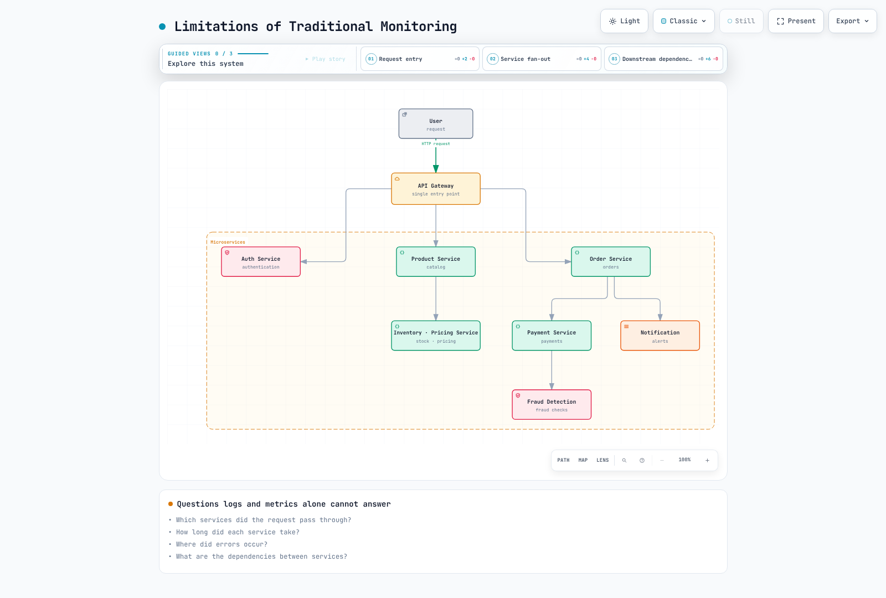
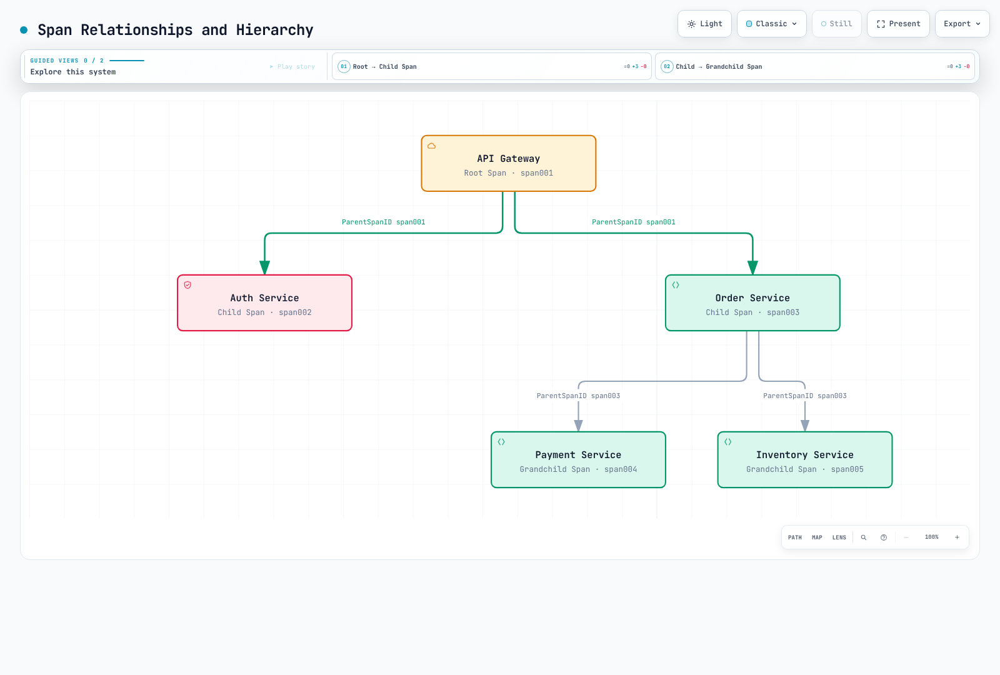
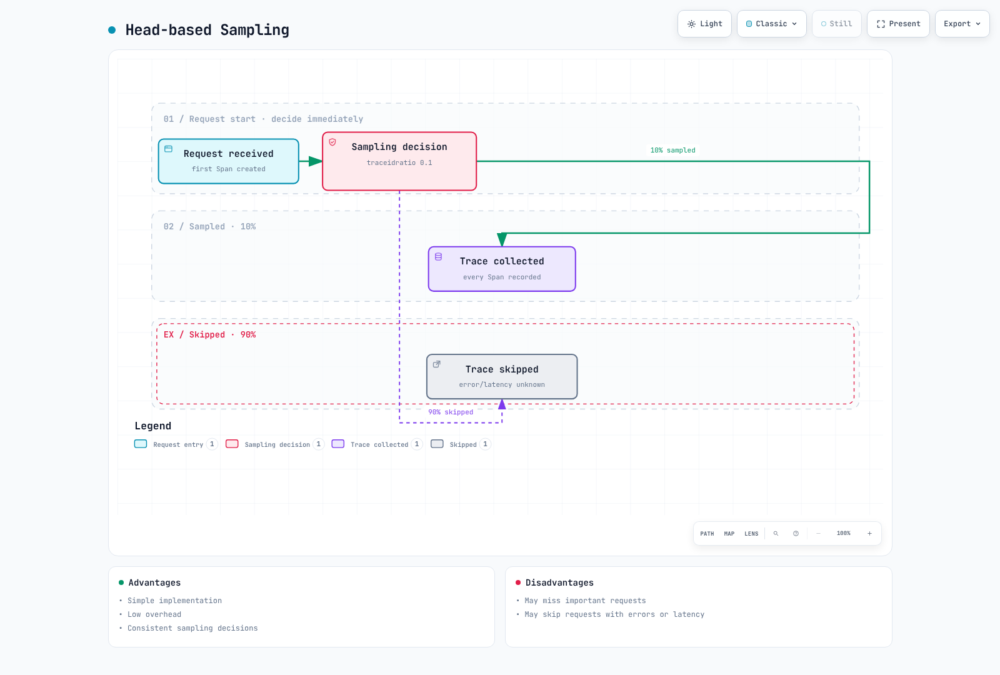
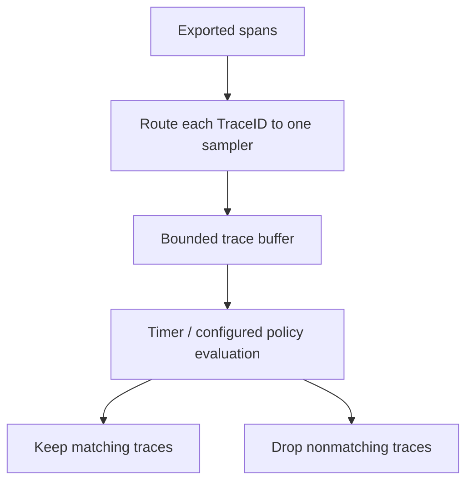
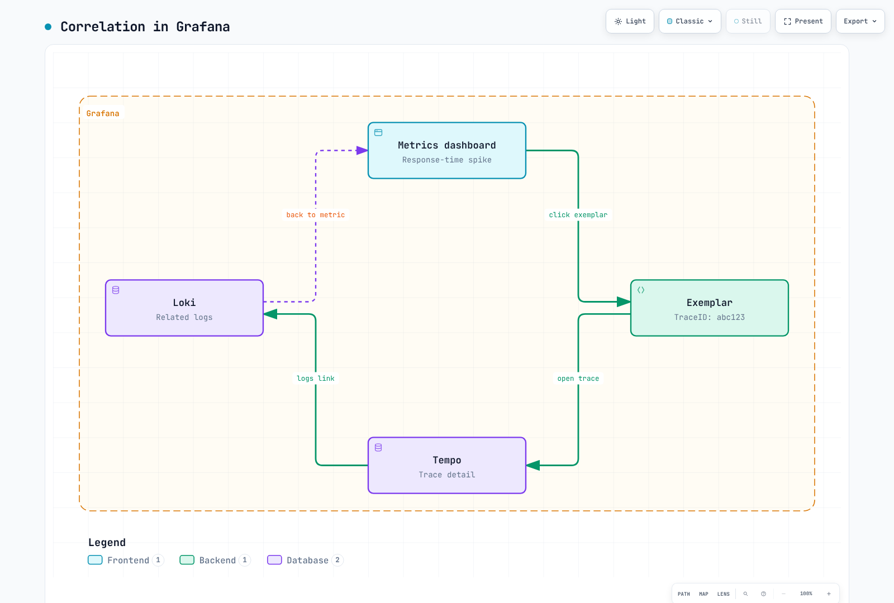

# 分散トレーシングの概要

> **最終更新日**: 2026年9月13日

## はじめに

分散トレーシングは、プロセスをまたいで計測した処理を記録し、伝播されたコンテキストで相互に関連付けます。保存されたトレースは、すべての操作やリクエストを記録した証拠ではなく、**実際に観測できたスパンの集合**です。計測の実装、サンプリング、エクスポート、保存、保持期間によって、確認できる情報が決まります。

## 分散トレーシングが必要な理由

### 従来のモニタリングの限界

ログとメトリクスに共通のコンテキストがないと、リクエストの経路や所要時間を再構成しにくいことがあります。トレースは処理間の因果関係を示し、こうした情報を補います。

- どのサービスが計測対象の処理に関与したか。
- どの操作が遅かったか、または失敗したか。
- どの処理が重複し、待機し、再試行したか。
- 診断の裏付けとなるログやリソースメトリクスは何か。



[インタラクティブな図を表示](https://www.atomai.click/kubernetes-docs/archmaps/en-observability-tracing-readme-0.html)

この図は、信号を相関付けると何が分かるかを示しています。適切なログの相関付けでは答えられないという意味でも、トレースだけで根本原因を証明できるという意味でもありません。

## コアコンセプト

### 1. Trace

トレースは、同じTraceIDを持つスパンをまとめます。親子関係は、そのトレース内で因果的につながる処理を表します。計測漏れやデータ損失があると、記録に抜けが生じます。

ルートスパンの開始からの相対時間をミリ秒で示した、次の**説明用タイムライン**を見てみましょう。

| Span | 開始 | 終了 | 所要時間 |
|---|---:|---:|---:|
| APIゲートウェイ（ルート） | 0 | 650 | 650 |
| ユーザーサービス | 20 | 70 | 50 |
| 注文サービス | 100 | 600 | 500 |
| 決済サービス（注文サービスの子） | 250 | 550 | 300 |
| 通知サービス（注文サービスの子） | 500 | 600 | 100 |

観測された時間幅は650ミリ秒です。親スパンの所要時間には子の処理が含まれ、子同士が重なる場合もあるため、スパンの所要時間をすべて足すと1,600ミリ秒になります。「クリティカルパス」を求めるときに、子の処理を含む親スパンの所要時間を子孫スパンに加算してはいけません。非同期処理や時計のずれも考慮し、実際の開始・終了時刻と処理間の依存関係を分析してください。

### 2. Span

スパンは、計測対象となる1つの操作を表します。

| フィールド | 意味 | 例 |
|---|---|---|
| TraceID | トレースの識別子 | `4bf92f3577b34da6a3ce929d0e0e4736` |
| SpanID | このスパンの識別子 | `00f067aa0ba902b7` |
| ParentSpanID | 親スパンの識別子。ルートスパンにはない | `b7ad6b7169203331` |
| Name | 種類を絞った操作名 | `GET /api/users/{id}` |
| Start / end | タイムスタンプ。差分が所要時間 | `2025-02-15T10:30:00Z`（説明用の時刻） |
| Attributes | 型付きの属性情報 | `http.response.status_code=200` |
| Events | スパンに関連付けた時刻付きイベント | 記録された例外イベント |
| Status | `UNSET`、`OK`、`ERROR`のいずれか | 計測ライブラリで指定がない限り、HTTPリクエストが成功したスパンの状態は`UNSET`のままにする |

OpenTelemetryでは、すべてのアプリケーションログをスパンイベントのコピーとして扱うのではなく、**属性**と**イベント**を使います。初期属性やリンクはスパンの作成時に設定でき、その後もイベント、属性、状態を追加・更新できます。スパンの開始時点では所要時間は分かりません。例外の記録とエラー状態の設定は、別々のAPI操作です。

### 3. Span の関係と階層



[インタラクティブな図を表示](https://www.atomai.click/kubernetes-docs/archmaps/en-observability-tracing-readme-3.html)

図中の`span001`～`span005`は有効なワイヤ形式のSpanIDではなく、**説明のためのラベル**です。スパンが持てる親は最大1つです。**リンク**を使うと、同じトレースまたは別のトレースに属するスパンを関連付けられます。非同期メッセージング、バッチ処理、複数の原因から生じる処理で役立ちますが、この単純なツリー図には示していません。

### 4. SpanContext

SpanContextは、変更されないトレース識別情報と伝播情報です。次のYAMLは概念を示すものであり、SDKの設定ファイルではありません。

```yaml
SpanContext:
  trace_id: "4bf92f3577b34da6a3ce929d0e0e4736"
  span_id: "00f067aa0ba902b7"
  trace_flags: "01"
  trace_state: "vendor=value"
  is_remote: false
```

OpenTelemetryのTraceIDは16バイトで、32桁の小文字16進数として表示されます。SpanIDは8バイトで、16桁です。有効なSpanContextのIDはゼロ以外です。`is_remote`は、抽出したリモートの親スパンとローカルで作成したスパンを区別します。`01`はサンプリング済みを示すビットを立てますが、バックエンドにトレースが保存された証拠にはなりません。

BaggageはSpanContextや`tracestate`とは別の情報です。認証情報や個人情報を伝播するコンテキストに含めないでください。また、呼び出し元が指定したTraceIDを認証情報として扱ってはいけません。

## コンテキスト伝播

コンテキスト伝播は、サービスなどの境界を越えて識別情報を運びます。それだけで処理を計測したり、スパンをエクスポートしたりするわけではありません。フレームワークまたはSDKの伝播機能を使い、ヘッダーへの注入と抽出、有効なコンテキストの適切な設定と解除を行ってください。

### W3C Trace Context（推奨）

```http
traceparent: 00-4bf92f3577b34da6a3ce929d0e0e4736-00f067aa0ba902b7-01
tracestate: vendor=value
```

バージョン`00`では、各フィールドを次の形式で表します。

```text
version(2 hex)-trace_id(32 hex)-parent_id(16 hex)-trace_flags(2 hex)
```

通信上の`parent_id`は、**送信側スパンのSpanID**です。受信側が子スパンを作成するとき、そのIDをリモートの親として使います。送信側自身のParentSpanIDではありません。長さが不正なID、16進数以外を含むID、すべてゼロのIDを例に使ってはいけません。任意の文字列からヘッダーを組み立てず、実装の検証規則に従ってください。

### B3 伝播（Zipkin 互換）

B3では、64ビットまたは128ビットのTraceIDと、64ビットのSpanIDを使えます。次の2つの例は、同じサンプリング済みコンテキストを伝えます。

```http
b3: 4bf92f3577b34da6a3ce929d0e0e4736-00f067aa0ba902b7-1
```

```http
X-B3-TraceId: 4bf92f3577b34da6a3ce929d0e0e4736
X-B3-SpanId: 00f067aa0ba902b7
X-B3-Sampled: 1
```

省略可能なParentSpanIDには固有の規則があるため、ここでは示していません。B3にはサンプリング情報だけを伝える形式とデバッグ形式もあります。HTTPヘッダー名では大文字と小文字を区別しませんが、ほかのトランスポートでは名前の正規化が必要な場合があります。B3の両形式がある場合は、仕様に従い単一ヘッダー形式が優先されます。

### 伝播形式の比較

| 形式 | 一般的なフィールド | 選定時の考慮事項 |
|---|---|---|
| W3C Trace Context | `traceparent`、`tracestate` | 標準に基づく相互運用性 |
| B3単一ヘッダー形式 | `b3` | 既存のZipkin/B3連携 |
| B3複数ヘッダー形式 | `X-B3-*` | 既存の連携との互換性。各フィールドを個別に確認できる |
| Jaeger旧形式 | `uber-trace-id` | 古い形式との互換性。インストール済みの伝播機能を確認する |

送信側と受信側を同じ形式に設定し、HTTP、gRPC、メッセージングの境界をテストしてください。親コンテキストの抽出結果が食い違うような、競合する伝播形式の併用は避けてください。ヘッダーが標準化されていても、プロキシ、キュー、非同期タスクがその情報を引き継ぐとは限りません。

## サンプリング戦略

サンプリングは、保存するデータ量と処理負荷を減らせます。一方、トレースから答えられる質問も変わります。判断するタイミング、確率やポリシー、データが欠けた場合の挙動を明示してください。

### ヘッドベースサンプリング



[インタラクティブな図を表示](https://www.atomai.click/kubernetes-docs/archmaps/en-observability-tracing-readme-4.html)

10%/90%という割合は設定された確率であり、少数回の実行で必ずその比率どおりになるわけではありません。この図は、計測、伝播、配信が機能することを前提としています。「収集済み」と表示されても、すべての子スパンが必ず利用できるとは限りません。

標準の環境変数に対応したSDKまたは自動設定機能では、次のように指定します。

```bash
export OTEL_TRACES_SAMPLER=parentbased_traceidratio
export OTEL_TRACES_SAMPLER_ARG=0.1
```

ParentBasedは親スパンのサンプリング判断を引き継ぎます。比率は、設定した委譲先を使うルートスパンに適用されます。そのため、ローカルのルート比率がゼロでも、サンプリング済みのリモート親から子スパンがサンプリングされることがあります。利用する言語SDKがこの設定に対応しているか確認してください。架空の`sampling: {type, ratio}`というYAMLを、汎用的なSDK設定として示してはいけません。

ヘッドベースサンプリングは比較的単純ですが、後で起きるエラーや遅延を判断材料にできません。サンプリングしなかったリクエストが、後になって重要だと分かることもあります。上流で一度も記録またはエクスポートされなかったスパンは、テールベースサンプリングでも復元できません。

### テールベースサンプリング

テールベースサンプリングは、ポリシーに照らして**受信済みの**トレースデータを評価します。すべてのスパンがそろったことを確実に知らせる通知を受け取るわけではありません。



Collector Contrib **0.160.0**は、このプロセッサ設定の一部をサポートします。トレース処理パイプライン全体に組み込んでください。

```yaml
processors:
  tail_sampling:
    decision_wait: 10s
    num_traces: 10000
    policies:
    - name: errors
      type: status_code
      status_code:
        status_codes:
        - ERROR
    - name: slow-requests
      type: latency
      latency:
        threshold_ms: 1000
    - name: probabilistic
      type: probabilistic
      probabilistic:
        sampling_percentage: 10
```

既定の`trace-complete`戦略では、タイマーによる評価時に、それまでに蓄積したスパンを使います。`decision_wait`の計測はトレースデータの受信時に始まり、リクエストの完了を保証しません。現在のプロセッサには別の`span-ingest`戦略もあります。対応するポリシーと評価タイミングは異なります。

状態ポリシーは、アプリケーションのエラー文字列すべてではなく、観測されたスパン状態`ERROR`に一致します。レイテンシーポリシーは、受信したトレース内で最も早い開始時刻と最も遅い終了時刻を使います。確率ポリシーが追加の対象トレースを保持する場合もあるため、通常のトレースが常に破棄されるわけではありません。

同じTraceIDを持つすべてのスパンを、同じサンプラーのインスタンスに振り分けてください。到着の遅れ、判断キャッシュ、再起動、上流でのサンプリングやエクスポートの失敗、トレース数とバイト数の上限、バッファーからの追い出しを考慮してください。`num_traces`はプロセスのメモリ上限ではありません。トラフィック量とスパンのサイズを基に容量を決め、破棄、追い出し、遅延スパンのメトリクスを監視してください。**テールベースサンプリングでも、重要なリクエストを取りこぼさないとは保証できません。**

### サンプリング戦略の比較

| 戦略 | 判断情報 | トレードオフ |
|---|---|---|
| ヘッドベース | スパン作成時または親の判断時に得られる情報 | バッファー要件は小さいが、後で判明する結果を取りこぼす可能性がある |
| テールベース | 受信したスパンと設定済みのポリシー／タイミング | より多くの状態管理と振り分けが必要。不完全なトレースも残りうる |
| 適応型 | 観測したトラフィックや予算に応じて変化するポリシー | 製品／実装によって異なる。制御ループと上限を検証する |

どの方式が一律に「中精度」「高精度」といえるものではありません。保存されたデータが、目的とする診断上または統計上の問いに答えられるかを評価してください。エラーを含むトレースをすべてサンプリングすると、エラー率に意図的な偏りが生じる可能性があります。

## トレース・ログ・メトリクスの相関付け

### TraceIDを使ったログとの関連付け {#linking-logs-via-traceid}

フレームワークがサポートするログ計測機能を優先してください。SLF4J MDCを手動で使う場合は、処理が例外を送出した場合にも、以前のコンテキストを復元してください。

```java
import java.util.Map;
import org.slf4j.MDC;
import io.opentelemetry.api.trace.Span;
import io.opentelemetry.api.trace.SpanContext;

public final class TraceMdc {
    private TraceMdc() {}

    public static void run(Runnable operation) {
        Map<String, String> previous = MDC.getCopyOfContextMap();
        try {
            SpanContext context = Span.current().getSpanContext();
            if (context.isValid()) {
                MDC.put("traceId", context.getTraceId());
                MDC.put("spanId", context.getSpanId());
            } else {
                MDC.remove("traceId");
                MDC.remove("spanId");
            }
            operation.run();
        } finally {
            if (previous == null) {
                MDC.clear();
            } else {
                MDC.setContextMap(previous);
            }
        }
    }
}
```

必要なOpenTelemetry／SLF4J依存関係と互換性のあるログ出力先を用意し、`TraceMdc.run(() -> logger.info("Processing order"));`を使ってください。エンコーダーや出力パターンに`traceId`と`spanId`を含めます。MDCに値を設定しただけでは、ログ出力には現れません。

有効性を確認することで、無効なコンテキストからすべてゼロのIDをログに記録するのを防ぎます。MDCはスレッドローカルです。OpenTelemetryのコンテキストとMDCを非同期処理へ引き継ぐには、フレームワークに適した仕組みを使ってください。このヘルパーが扱うのは同期ログの範囲であり、任意のスレッド間引き継ぎを解決するものではありません。

### エグザンプラーを使ったメトリクスとの関連付け

これはYAMLではなく、**OpenMetricsの公開形式テキスト**です。エグザンプラーにはラベルと観測値が含まれ、必要に応じてタイムスタンプを続けられます。

```text
# TYPE http_request_duration_seconds histogram
http_request_duration_seconds_bucket{le="0.5"} 1 # {trace_id="4bf92f3577b34da6a3ce929d0e0e4736"} 0.42
http_request_duration_seconds_bucket{le="+Inf"} 1
http_request_duration_seconds_sum 0.42
http_request_duration_seconds_count 1
# EOF
```

このエグザンプラーは、ヒストグラムのバケット内にある代表的な0.42秒の観測値です。このリクエストが正確なp99境界だったことを示すものではありません。エクスポーターやリモート書き込みでの保持、バックエンドでのエグザンプラー保存、Grafanaデータソースとのリンクがすべて正しく機能する必要があります。トレースのサンプリングや保持設定によって、対応するトレースを参照できないエグザンプラーが残る場合もあります。

### Grafana での相関付け



[インタラクティブな図を表示](https://www.atomai.click/kubernetes-docs/archmaps/en-observability-tracing-readme-6.html)

古い図にある短い`abc123`は省略形であり、有効なW3C TraceIDではありません。実データではID全体を使ってください。`trace_id`／`traceId`／`traceID`、データソースUID、時間範囲の余白、リソースとログのラベル対応をそろえます。実際のリクエストを1件、すべてのシグナルにわたって検証してください。画面間のリンクがあるだけでは、相関付けの成功は証明できません。

## ソリューションの比較

### 分散トレーシングソリューションの比較

| ソリューション | 評価する方式や機能 | 導入とコストに関する考慮事項 |
|---|---|---|
| [Tempo](https://github.com/grafana/tempo/tree/v3.0.3) | TraceQLとGrafana連携 | コンピューティング、データ取り込み、保存、クエリ、リクエスト、ネットワーク。コストは「保存料だけ」ではない |
| [AWS X-Ray](https://docs.aws.amazon.com/xray/latest/devguide/aws-xray.html) | AWSが管理するリクエストのトレースとフィルタリング | 対応する計測／OTel経路、IAM、クォータ、保持期間、利用料金 |
| [Jaeger](https://www.jaegertracing.io/docs/2.20/architecture/) | クエリ／UIと、構成可能なコレクター／保存基盤 | 対応する保存先、取り込み構成、コレクタープロセッサーを選ぶ。ヘッドサンプリングだけに限定されるわけではない |
| [Datadog APM](https://docs.datadoghq.com/tracing/) | マネージドAPM、検索、分析 | Agent／OTelの対応付け、保持、インデックス、サンプリング、実際のプラン条件 |
| [Dynatrace](https://docs.dynatrace.com/docs/observe/application-observability/distributed-tracing) | OneAgent／OTelによる取り込み、Grail／DQLのトレース分析機能 | 導入形態、権限、保持、処理、実際の消費量とプラン条件 |

サンプリングはSDK、コレクター、バックエンド固有のコンポーネントで実行できます。「OTelネイティブ対応」であっても、シグナル属性、スパンリンク、サンプリングポリシー、リソース上限が製品間ですべて同じとは限りません。AI支援機能は周辺プラットフォームやプランに依存します。保存基盤の恒久的な「対応／非対応」の性質として単純化しないでください。

### 選定ガイド

相互運用性、調査の進め方、セキュリティとデータの保管場所、運用の担当、予想データ量から検討を始めてください。実際の取り込みから検索までを試作し、同じ保持期間と信頼性要件で総運用コストを比較します。オープンソースであることや既存のGrafana環境が、最低コストを保証するわけではありません。

## ベストプラクティス

### 1. インストルメンテーション戦略

サポートされているライブラリを使い、HTTP／gRPC、データベースクライアント、メッセージング、外部APIなど、意味のあるサービス境界を計測してください。診断上の具体的な問いに答える場合は、内部処理、キャッシュ、ファイル操作にもスパンを追加します。小さな関数ごとに機械的にスパンを作成したり、機密性の高いリクエストやクエリの本文を記録したりしないでください。

エクスポートとあわせて、コンテキスト伝播、スパンの種類、エラー状態の扱い、非同期処理のリンクも計画してください。計測範囲とサンプリング判断は別々に管理します。

### 2. Span の命名規則

選択したセマンティック規約に従い、値の種類が増えすぎない名前を付けてください。

```text
GET /api/users/{id}
SELECT users
GET
send orders
```

Redis形式の`GET`という名前に、`user:123`のような実際のキーを埋め込んではいけません。機密情報を含まない適切なコンテキストは属性に保存します。ランダムID、SQLの実値、URL全体をスパン名に含めないでください。

### 3. Tag の標準化

現在の規約を使う場合は、SDKが出力するスキーマと移行モードを確認してください。

```yaml
attributes:
  http.request.method: GET
  http.response.status_code: 200
  http.route: /api/users/{id}
  db.system.name: postgresql
  db.operation.name: SELECT
resource:
  service.name: user-service
  service.version: 1.2.3
```

これは属性の例であり、汎用の計測設定ではありません。古いデータでは`http.method`、`http.status_code`、`db.system`、`db.operation`、`db.statement`などを使っている場合があります。クエリ名を変更しても、既存データの形式は変わりません。`db.query.text`を記録するのは、レビュー済みのサニタイズ方針がある場合に限ってください。実際の値や認証情報を含まない、有用な要約を優先します。

## 次のステップ

- [Grafana Tempo](./01-tempo.md)
- [AWS X-Ray](./02-xray.md)
- [OpenTelemetry](./03-opentelemetry.md)
- [Dynatrace](./04-dynatrace.md)

## 参照資料と検証範囲

- [W3C Trace Context](https://www.w3.org/TR/trace-context/)
- [B3 伝播](https://github.com/openzipkin/b3-propagation)
- [OpenTelemetry Trace API](https://opentelemetry.io/docs/specs/otel/trace/api/)
- [SDK 環境変数](https://opentelemetry.io/docs/specs/otel/configuration/sdk-environment-variables/)
- [Collector 0.160 の tail sampling](https://github.com/open-telemetry/opentelemetry-collector-contrib/blob/v0.160.0/processor/tailsamplingprocessor/README.md)
- [OpenMetrics 仕様](https://github.com/prometheus/OpenMetrics/blob/main/specification/OpenMetrics.md)
- [SLF4J MDC API](https://www.slf4j.org/apidocs/org/slf4j/MDC.html)
- [HTTP semantic conventions](https://opentelemetry.io/docs/specs/semconv/http/http-spans/)
- [Database semantic conventions](https://opentelemetry.io/docs/specs/semconv/db/database-spans/)

ローカル検証では、OpenTelemetry Python API／SDK／B3 1.44.0、prometheus-clientのOpenMetricsパーサー、Collector Contrib 0.160.0を合成データとともに使用しました。Java MDCのコードはAPIとJavaの言語仕様に照らして確認しましたが、Javaランタイムでは実行していません。実際の分散アプリケーション、ベンダーのバックエンド、トレース単位で振り分けるクラスター、性能ベンチマーク、クラウドへのデプロイはテストしていません。

## クイズ

- [Tempo クイズ](../../quizzes/observability/tracing/01-tempo-quiz.md)
- [X-Ray クイズ](../../quizzes/observability/tracing/02-xray-quiz.md)
- [OpenTelemetry クイズ](../../quizzes/observability/tracing/03-opentelemetry-quiz.md)
- [Dynatrace クイズ](../../quizzes/observability/tracing/04-dynatrace-quiz.md)
