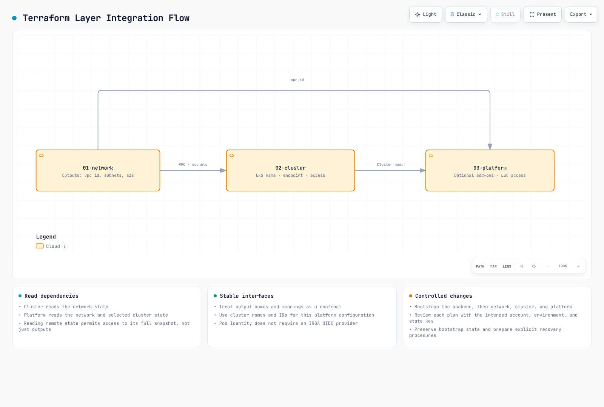

# インフラストラクチャのセットアップ

> **検証対象の基準**: Terraform 1.16.6、AWS Provider 6.69.1、EKS module 21.29.0、VPC module 6.7.3、Pod Identity module 2.9.0
> **最終レビュー**: 2026年10月16日。ローカルでのスキーマ/モックプラン検証であり、実AWSへのデプロイ結果ではありません。

< [目次](./README.md) | [次へ: NLBの重み付けルーティングとBlue/Greenクラスター](02-infrastructure-advanced.md) >

この例では、**アカウント/環境ごとのstateバケットと、1つのリージョン内のBlue/Greenクラスター**を扱います。組み込みのAuto Modeプールは、構成された複数のAZを使用できます。色の名前やサブネットタグによって、ワーカーが単一AZに固定されるわけではありません。単一AZのワーカーセルが必要な場合は、[ゾーン運用ガイド](15-zonal-operations-guide.md)を参照し、NodePool/NodeClassの配置、ルーティング、復旧容量を別途設計してください。

例のファイルは、独立した`eks-terraform/`プロジェクトに作成します。Terraformは親の`00-shared`ディレクトリにある`.tf`ファイルを自動継承しません。各ルートの宣言を使い、重複するvariables/localsを併置しないでください。既存のv20/v5 stateを使っている場合は、アップグレード前にモジュールの移行ガイドと実際のプランを確認します。各ルートの`.terraform.lock.hcl`を保持し、モジュールのバージョンも個別に固定してください。

APIエンドポイントはデフォルトでプライベートです。kubectlによる検証やGitOpsコントローラーの実行には、VPC内のRunnerやVPNなど、実際にAPIへ接続できる経路が必要です。このガイドでは、その接続経路を構築しません。

***

## 概要

このガイドでは、Auto Modeを有効にしたAmazon EKSクラスターをデプロイするためのTerraform参照アーキテクチャを紹介します。3層構成では、変更頻度、所有権、影響範囲に応じてインフラストラクチャを分離し、運用上の安全性を保ちながら各チームが独立して作業できるようにします。

**主な設計原則:**

* **関心事の分離**: 各レイヤーで所有者と変更パターンを分けます
* **影響範囲の最小化**: stateの分離で変更対象を絞れますが、依存先の障害が他のレイヤーに影響する場合はあります
* **stateの分離**: レイヤーごとに独立したTerraform stateファイルを使います
* **GitOps対応**: TerraformはAWSインフラストラクチャを管理し、KubernetesリソースはArgoCDで管理します

***

## 1. 3層アーキテクチャの概要

### なぜレイヤーを分けるのか

従来のモノリシックなTerraform構成には、次のような運用上の課題があります。

1. **Plan/Apply時間の長期化**: 変更のたびにすべてのリソースを評価する必要があります
2. **影響範囲**: 1つの設定ミスがインフラストラクチャ全体に影響する可能性があります
3. **チーム間の競合**: 複数のチームが同じstateファイルを取り合うことがあります
4. **変更リスク**: ネットワークの変更をアプリケーションの変更とまとめると、デプロイのリスクが高まります

3層アーキテクチャでは、安定性と所有権に応じてインフラストラクチャを階層化し、これらの課題に対処します。

### レイヤーの特性（変更頻度の例）

| レイヤー | 名称 | 変更頻度 | 主な所有者 | 影響範囲 | 依存関係 |
| --- | --- | --- | --- | --- | --- |
| 01 | ネットワーク | 四半期ごと | インフラチーム | 大 | なし |
| 02 | クラスター | 毎月 | プラットフォームチーム | 中 | 01-network |
| 03 | プラットフォーム | 毎週 | プラットフォーム/アプリチーム | DNS/アクセスの変更がクラスターに影響する場合がある | 01-network、02-cluster |

### ディレクトリ構成

```
eks-terraform/
├── 00-shared/
│   ├── variables.tf          # Common variables across all layers
│   ├── bootstrap/main.tf     # Local state creates the S3 backend
│   └── providers.tf.template # Provider configuration template
├── 01-network/
│   ├── main.tf               # VPC, subnets, NAT Gateway
│   ├── variables.tf          # Network-specific variables
│   ├── outputs.tf            # VPC ID, subnet IDs for downstream
│   ├── backend.tf            # S3 backend: network/terraform.tfstate
│   └── providers.tf
├── 02-cluster/
│   ├── main.tf               # EKS cluster with Auto Mode
│   ├── data.tf               # Remote state from 01-network
│   ├── variables.tf          # Cluster-specific variables
│   ├── outputs.tf            # Cluster endpoint, OIDC provider
│   ├── backend.tf            # S3 backend: cluster/terraform.tfstate
│   └── providers.tf
└── 03-platform/
    ├── main.tf               # Add-ons, Pod Identity, RBAC
    ├── data.tf               # Remote state from 01-network, 02-cluster
    ├── variables.tf          # Platform-specific variables
    ├── outputs.tf            # Add-on ARNs, role mappings
    ├── backend.tf            # S3 backend: platform/terraform.tfstate
    └── providers.tf
```

新しいプロジェクトの`.gitignore`に、ここに示すパスを追加してください。各ルートの`.terraform.lock.hcl`はバージョン管理に含めます。

```text
.terraform/
.terraform-data/
.bootstrap-state/
*.tfstate
*.tfstate.*
*.tfplan
```

### 変更フロー図


[🔍 インタラクティブな図を見る](https://www.atomai.click/kubernetes-docs/archmaps/en-ops-01-infrastructure-setup-0.html)

***

## 2. 00-shared: 共通設定

共有レイヤーには、すべてのレイヤーで使う構成テンプレートと共通変数が含まれます。ここに示すのは命名例であり、親ディレクトリの設定が自動的にインポートされるわけではありません。

### S3バックエンドの設定

最初に、Terraform stateを管理するS3バケットを作成します。

> **注記**: Terraform 1.10以降、S3バックエンドでは`use_lockfile = true`により、S3の条件付き書き込みを使ったネイティブなstateロックを利用できます。これにより、stateロック用のDynamoDBテーブルは不要になります。

```hcl
# 00-shared/bootstrap/main.tf
# Run this once to create backend infrastructure

terraform {
  backend "local" {}
  required_version = ">= 1.10.0"
  required_providers {
    aws = {
      source  = "hashicorp/aws"
      version = "6.69.1"
    }
  }
}

provider "aws" {
  region = var.region
}

variable "region" {
  description = "AWS region"
  type        = string
  default     = "ap-northeast-2"
}

variable "project_name" {
  description = "Project name for resource naming"
  type        = string
  default     = "eks-platform"
}

variable "environment" {
  description = "Environment name"
  type        = string
  default     = "prod"
}

locals {
  bucket_name = "${var.project_name}-${var.environment}-${data.aws_caller_identity.current.account_id}-tfstate"
}

# S3 bucket for Terraform state
resource "aws_s3_bucket" "terraform_state" {
  bucket = local.bucket_name

  lifecycle {
    prevent_destroy = true
  }

  tags = {
    Name        = local.bucket_name
    Environment = var.environment
    ManagedBy   = "terraform"
  }
}

resource "aws_s3_bucket_versioning" "terraform_state" {
  bucket = aws_s3_bucket.terraform_state.id
  versioning_configuration {
    status = "Enabled"
  }
}

resource "aws_s3_bucket_server_side_encryption_configuration" "terraform_state" {
  bucket = aws_s3_bucket.terraform_state.id

  rule {
    apply_server_side_encryption_by_default {
      sse_algorithm = "aws:kms"
    }
    bucket_key_enabled = true
  }
}

resource "aws_s3_bucket_public_access_block" "terraform_state" {
  bucket = aws_s3_bucket.terraform_state.id

  block_public_acls       = true
  block_public_policy     = true
  ignore_public_acls      = true
  restrict_public_buckets = true
}

output "state_bucket_name" {
  value = aws_s3_bucket.terraform_state.id
}

data "aws_caller_identity" "current" {}
```

### 共通変数

```hcl
# 00-shared/variables.tf
# Common variables used across all layers

variable "region" {
  description = "AWS region for all resources"
  type        = string
  default     = "ap-northeast-2"
}

variable "environment" {
  description = "Environment name (dev, staging, prod)"
  type        = string
  default     = "prod"

  validation {
    condition     = contains(["dev", "staging", "prod"], var.environment)
    error_message = "Environment must be dev, staging, or prod."
  }
}

variable "project_name" {
  description = "Project name used for resource naming"
  type        = string
  default     = "eks-platform"

  validation {
    condition     = can(regex("^[a-z][a-z0-9-]{2,20}$", var.project_name))
    error_message = "Project name must be lowercase, start with letter, 3-21 chars."
  }
}

variable "common_tags" {
  description = "Common tags applied to all resources"
  type        = map(string)
  default = {
    ManagedBy = "terraform"
    Project   = "eks-platform"
  }
}

locals {
  # Standard naming convention
  name_prefix = "${var.project_name}-${var.environment}"

  # Merge common tags with environment
  tags = merge(var.common_tags, {
    Environment = var.environment
  })

  # Backend configuration
}
```

***

## 3. 01-network: VPCの構成

ネットワークレイヤーは、基盤となるVPCインフラストラクチャを構築します。このレイヤーは変更頻度が低く、影響範囲が大きいため、慎重な計画が必要です。

### 設計上の考慮事項

この構成では、異なる2つのAZを使います。Blue/Greenはデプロイ環境を表すものであり、Auto Modeのデフォルトプールを単一AZに限定するものではありません。Pod割り当て、warm pool、エンドポイント用ENI、将来の拡張、その他のVPC利用者を考慮してCIDRを設計してください。例にある`/16`は、本番環境に一律に推奨される値でも、IP枯渇を防ぐ保証でもありません。

### 主な設定

```hcl
# 01-network/main.tf

terraform {
  required_version = ">= 1.10.0"
  required_providers {
    aws = {
      source  = "hashicorp/aws"
      version = "6.69.1"
    }
  }
}

provider "aws" {
  region = var.region

  default_tags {
    tags = local.tags
  }
}

locals {
  name_prefix = "${var.project_name}-${var.environment}"

  tags = {
    Environment = var.environment
    Project     = var.project_name
    ManagedBy   = "terraform"
    Layer       = "network"
  }

  # Availability zones for blue/green clusters
  azs = var.availability_zones

  # Subnet CIDR allocation
  # VPC: 10.0.0.0/16 (65,536 IPs)
  # Public subnets:  10.0.0.0/20, 10.0.16.0/20  (4,096 IPs each)
  # Private subnets: 10.0.128.0/18, 10.0.192.0/18 (16,384 IPs each)
  public_subnets  = [cidrsubnet(var.vpc_cidr, 4, 0), cidrsubnet(var.vpc_cidr, 4, 1)]
  private_subnets = [cidrsubnet(var.vpc_cidr, 2, 2), cidrsubnet(var.vpc_cidr, 2, 3)]
}

module "vpc" {
  source  = "terraform-aws-modules/vpc/aws"
  version = "6.7.3"

  name = "${local.name_prefix}-vpc"
  cidr = var.vpc_cidr

  azs             = local.azs
  public_subnets  = local.public_subnets
  private_subnets = local.private_subnets

  # NAT Gateway configuration
  enable_nat_gateway     = true
  single_nat_gateway     = false # One per AZ for HA
  one_nat_gateway_per_az = true

  # DNS settings
  enable_dns_hostnames = true
  enable_dns_support   = true

  # VPC Flow Logs
  enable_flow_log                      = true
  create_flow_log_cloudwatch_log_group = true
  create_flow_log_cloudwatch_iam_role  = true
  flow_log_max_aggregation_interval    = 60

  # Public subnet tags for EKS load balancers
  public_subnet_tags = {
    "kubernetes.io/role/elb" = "1"
    Type                     = "public"
  }

  # Private subnet tags for EKS internal load balancers
  private_subnet_tags = {
    "kubernetes.io/role/internal-elb" = "1"
    Type                              = "private"
  }

  tags = local.tags
}

# Additional subnet tags for specific clusters
# Blue cluster (ap-northeast-2a)
# Green cluster (ap-northeast-2c)
# VPC endpoints reduce NAT traffic; compare endpoint hourly/data costs for the actual workload
module "vpc_endpoints" {
  source  = "terraform-aws-modules/vpc/aws//modules/vpc-endpoints"
  version = "6.7.3"

  vpc_id = module.vpc.vpc_id

  endpoints = {
    eks_auth = {
      service             = "eks-auth"
      private_dns_enabled = true
      subnet_ids          = module.vpc.private_subnets
      security_group_ids  = [aws_security_group.vpc_endpoints.id]
    }

    s3 = {
      service      = "s3"
      service_type = "Gateway"
      route_table_ids = concat(
        module.vpc.private_route_table_ids,
        module.vpc.public_route_table_ids
      )
      tags = { Name = "${local.name_prefix}-s3-endpoint" }
    }
    ecr_api = {
      service             = "ecr.api"
      private_dns_enabled = true
      subnet_ids          = module.vpc.private_subnets
      security_group_ids  = [aws_security_group.vpc_endpoints.id]
      tags                = { Name = "${local.name_prefix}-ecr-api-endpoint" }
    }
    ecr_dkr = {
      service             = "ecr.dkr"
      private_dns_enabled = true
      subnet_ids          = module.vpc.private_subnets
      security_group_ids  = [aws_security_group.vpc_endpoints.id]
      tags                = { Name = "${local.name_prefix}-ecr-dkr-endpoint" }
    }
    sts = {
      service             = "sts"
      private_dns_enabled = true
      subnet_ids          = module.vpc.private_subnets
      security_group_ids  = [aws_security_group.vpc_endpoints.id]
      tags                = { Name = "${local.name_prefix}-sts-endpoint" }
    }
    logs = {
      service             = "logs"
      private_dns_enabled = true
      subnet_ids          = module.vpc.private_subnets
      security_group_ids  = [aws_security_group.vpc_endpoints.id]
      tags                = { Name = "${local.name_prefix}-logs-endpoint" }
    }
  }

  tags = local.tags
}

# Security group for VPC endpoints
resource "aws_security_group" "vpc_endpoints" {
  name        = "${local.name_prefix}-vpc-endpoints-sg"
  description = "Security group for VPC endpoints"
  vpc_id      = module.vpc.vpc_id

  ingress {
    description = "HTTPS from VPC"
    from_port   = 443
    to_port     = 443
    protocol    = "tcp"
    cidr_blocks = [var.vpc_cidr]
  }

  tags = merge(local.tags, {
    Name = "${local.name_prefix}-vpc-endpoints-sg"
  })
}
```

### 変数

```hcl
# 01-network/variables.tf

variable "region" {
  description = "AWS region"
  type        = string
  default     = "ap-northeast-2"
}

variable "environment" {
  description = "Environment name"
  type        = string
  default     = "prod"
}

variable "project_name" {
  description = "Project name"
  type        = string
  default     = "eks-platform"
}

variable "vpc_cidr" {
  description = "VPC CIDR block"
  type        = string
  default     = "10.0.0.0/16"

  validation {
    condition     = can(cidrnetmask(var.vpc_cidr))
    error_message = "VPC CIDR must be a valid IPv4 CIDR block."
  }
}

variable "availability_zones" {
  description = "Two distinct standard Availability Zones in the selected region"
  type        = list(string)
  default     = ["ap-northeast-2a", "ap-northeast-2c"]
  validation {
    condition     = length(var.availability_zones) == 2 && length(distinct(var.availability_zones)) == 2
    error_message = "Choose two distinct Availability Zones for this layout."
  }
}
```

### 出力

```hcl
# 01-network/outputs.tf

output "vpc_id" {
  description = "VPC ID"
  value       = module.vpc.vpc_id
}

output "vpc_cidr" {
  description = "VPC CIDR block"
  value       = module.vpc.vpc_cidr_block
}

output "private_subnet_ids" {
  description = "Private subnet IDs"
  value       = module.vpc.private_subnets
}

output "public_subnet_ids" {
  description = "Public subnet IDs"
  value       = module.vpc.public_subnets
}

output "private_subnet_cidrs" {
  description = "Private subnet CIDR blocks"
  value       = module.vpc.private_subnets_cidr_blocks
}

output "public_subnet_cidrs" {
  description = "Public subnet CIDR blocks"
  value       = module.vpc.public_subnets_cidr_blocks
}

output "nat_gateway_ids" {
  description = "NAT Gateway IDs"
  value       = module.vpc.natgw_ids
}

output "azs" {
  description = "Availability zones used"
  value       = module.vpc.azs
}

# Zone-specific outputs for blue/green clusters
output "blue_zone" {
  description = "Blue cluster availability zone"
  value       = module.vpc.azs[0]
}

output "green_zone" {
  description = "Green cluster availability zone"
  value       = module.vpc.azs[1]
}

output "blue_private_subnet_id" {
  description = "Blue cluster private subnet ID"
  value       = module.vpc.private_subnets[0]
}

output "green_private_subnet_id" {
  description = "Green cluster private subnet ID"
  value       = module.vpc.private_subnets[1]
}

output "blue_public_subnet_id" {
  description = "Blue cluster public subnet ID"
  value       = module.vpc.public_subnets[0]
}

output "green_public_subnet_id" {
  description = "Green cluster public subnet ID"
  value       = module.vpc.public_subnets[1]
}

output "vpc_endpoints_sg_id" {
  description = "VPC endpoints security group ID"
  value       = aws_security_group.vpc_endpoints.id
}
```

### バックエンドの設定

```hcl
# 01-network/backend.tf

terraform {
  backend "s3" {
    key          = "network/terraform.tfstate"
    encrypt      = true
    use_lockfile = true
  }
}
```

***

## 4. 02-cluster: EKS Auto Mode

クラスターレイヤーではAuto Modeを有効にしたEKSをデプロイします。Auto Modeは、コンピューティング、ネットワーク、ストレージの管理を自動化し、クラスター運用を簡素化します。

### EKS Auto Modeの概要

EKS Auto Modeには次の機能があります。

* **Compute Auto Mode**: ノードの自動プロビジョニングとスケーリング
* **Network Auto Mode**: IP管理を自動化するマネージドVPC CNI
* **Storage Auto Mode**: マネージドのブロックストレージ統合。StorageClassは明示的に作成します

EKS Auto Modeの詳細は、[EKS Auto Modeの開始方法](../eks-auto-mode/01-getting-started.md)を参照してください。

### データソース

```hcl
# 02-cluster/data.tf

# Reference network layer outputs
data "terraform_remote_state" "network" {
  backend = "s3"

  config = {
    bucket = "${var.project_name}-${var.environment}-${data.aws_caller_identity.current.account_id}-tfstate"
    key    = "network/terraform.tfstate"
    region = var.region
  }
}

# Current AWS account and region
data "aws_caller_identity" "current" {}
data "aws_region" "current" {}

# EKS cluster auth for kubectl provider
```

### 主な設定

```hcl
# 02-cluster/main.tf

terraform {
  required_version = ">= 1.10.0"
  required_providers {
    aws = {
      source  = "hashicorp/aws"
      version = "6.69.1"
    }
  }
}

provider "aws" {
  region = var.region

  default_tags {
    tags = local.tags
  }
}

locals {
  name_prefix  = "${var.project_name}-${var.environment}"
  cluster_name = "${local.name_prefix}-${var.cluster_color}"

  tags = {
    Environment  = var.environment
    Project      = var.project_name
    ManagedBy    = "terraform"
    Layer        = "cluster"
    ClusterColor = var.cluster_color
  }

  # Network outputs from layer 01
  vpc_id             = data.terraform_remote_state.network.outputs.vpc_id
  private_subnet_ids = data.terraform_remote_state.network.outputs.private_subnet_ids
  public_subnet_ids  = data.terraform_remote_state.network.outputs.public_subnet_ids

  # Select subnet based on cluster color
  cluster_subnet_id = var.cluster_color == "blue" ? data.terraform_remote_state.network.outputs.blue_private_subnet_id : data.terraform_remote_state.network.outputs.green_private_subnet_id
}

module "eks" {
  source  = "terraform-aws-modules/eks/aws"
  version = "21.29.0"

  name               = local.cluster_name
  kubernetes_version = var.cluster_version

  # Network configuration
  vpc_id     = local.vpc_id
  subnet_ids = local.private_subnet_ids

  # Cluster endpoint access
  endpoint_public_access  = false
  endpoint_private_access = true

  # EKS Auto Mode Configuration
  compute_config = {
    enabled    = true
    node_pools = ["general-purpose", "system"]
  }

  # Enable Auto Mode for networking
  # Enable Auto Mode for storage
  # Control plane logging
  cloudwatch_log_group_retention_in_days = var.log_retention_days

  enabled_log_types = [
    "api",
    "audit",
    "authenticator",
    "controllerManager",
    "scheduler"
  ]

  # Encryption configuration
  iam_role_use_name_prefix      = false
  node_iam_role_use_name_prefix = false
  create_kms_key                = false
  encryption_config = {
    provider_key_arn = aws_kms_key.eks.arn
    resources        = ["secrets"]
  }

  # Access configuration - using Access Entries (recommended)
  authentication_mode = "API_AND_CONFIG_MAP"

  # Cluster access entries
  access_entries = {
    # Cluster admin
    admin = {
      kubernetes_groups = []
      principal_arn     = var.cluster_admin_arn
      policy_associations = {
        admin = {
          policy_arn = "arn:aws:eks::aws:cluster-access-policy/AmazonEKSClusterAdminPolicy"
          access_scope = {
            type = "cluster"
          }
        }
      }
    }
  }

  tags = local.tags
}

# KMS key for EKS secrets encryption
resource "aws_kms_key" "eks" {
  description             = "KMS key for EKS ${local.cluster_name} secrets encryption"
  deletion_window_in_days = 7
  enable_key_rotation     = true

  tags = merge(local.tags, {
    Name = "${local.cluster_name}-eks-secrets"
  })
}

resource "aws_kms_alias" "eks" {
  name          = "alias/${local.cluster_name}-eks-secrets"
  target_key_id = aws_kms_key.eks.key_id
}

# CloudWatch Log Group for EKS control plane logs
# Security group rules for cluster
resource "aws_security_group_rule" "cluster_ingress_vpc" {
  description       = "Allow VPC traffic to cluster API"
  type              = "ingress"
  from_port         = 443
  to_port           = 443
  protocol          = "tcp"
  cidr_blocks       = [data.terraform_remote_state.network.outputs.vpc_cidr]
  security_group_id = module.eks.cluster_security_group_id
}
```

### 変数

```hcl
# 02-cluster/variables.tf

variable "region" {
  description = "AWS region"
  type        = string
  default     = "ap-northeast-2"
}

variable "environment" {
  description = "Environment name"
  type        = string
  default     = "prod"
}

variable "project_name" {
  description = "Project name"
  type        = string
  default     = "eks-platform"
}

variable "cluster_color" {
  description = "Cluster color identifier (blue or green)"
  type        = string
  default     = "blue"

  validation {
    condition     = contains(["blue", "green"], var.cluster_color)
    error_message = "Cluster color must be blue or green."
  }
}

variable "cluster_version" {
  description = "EKS cluster version"
  type        = string
  default     = "1.36"
}

variable "cluster_admin_arn" {
  description = "IAM ARN for cluster admin access"
  type        = string
}

variable "log_retention_days" {
  description = "CloudWatch log retention in days"
  type        = number
  default     = 30
}
```

### 出力

```hcl
# 02-cluster/outputs.tf

output "cluster_name" {
  description = "EKS cluster name"
  value       = module.eks.cluster_name
}

output "cluster_endpoint" {
  description = "EKS cluster API endpoint"
  value       = module.eks.cluster_endpoint
}

output "cluster_certificate_authority_data" {
  description = "Base64 encoded cluster CA certificate"
  value       = module.eks.cluster_certificate_authority_data
  sensitive   = true
}

output "cluster_arn" {
  description = "EKS cluster ARN"
  value       = module.eks.cluster_arn
}

output "cluster_version" {
  description = "EKS cluster Kubernetes version"
  value       = module.eks.cluster_version
}

output "cluster_security_group_id" {
  description = "EKS cluster security group ID"
  value       = module.eks.cluster_security_group_id
}

output "node_security_group_id" {
  description = "EKS node security group ID"
  value       = module.eks.node_security_group_id
}

output "oidc_provider_arn" {
  description = "OIDC provider ARN for IRSA"
  value       = module.eks.oidc_provider_arn
}

output "oidc_provider_url" {
  description = "OIDC provider URL"
  value       = module.eks.cluster_oidc_issuer_url
}

output "cluster_primary_security_group_id" {
  description = "EKS cluster primary security group ID"
  value       = module.eks.cluster_primary_security_group_id
}

output "kms_key_arn" {
  description = "KMS key ARN for secrets encryption"
  value       = aws_kms_key.eks.arn
}

output "cluster_color" {
  description = "Cluster color identifier"
  value       = var.cluster_color
}
```

### バックエンドの設定

```hcl
# 02-cluster/backend.tf

terraform {
  backend "s3" {
    encrypt      = true
    use_lockfile = true
  }
}
```

***

## 5. 03-platform: アドオンとPod Identity

Auto Modeに組み込まれたPod Identityエージェント、ノードネットワーク、ブロックストレージ統合を、通常のaws-node/EBS CSI/エージェントアドオンで重複させないでください。[現在のAuto Mode](https://docs.aws.amazon.com/eks/latest/userguide/auto-networking.html)では、**ノードローカルのCoreDNSがシステムサービスとして動作します**。Auto Modeのみのクラスターでは、CoreDNS Deploymentは不要です。Auto Mode以外のノードを含む混在クラスターではDeploymentを維持し、`enable_coredns_addon=true`を設定して互換性のあるバージョンを固定します。この例のデフォルト値は`false`です。[公式手順](https://docs.aws.amazon.com/eks/latest/userguide/create-storage-class.html)に従い、`ebs.csi.eks.amazonaws.com`を使ったAuto Mode用StorageClassをGitOpsで作成してください。

このPod Identityの例では、**External Secretsコントローラーが、名前を明示したSecrets Manager/SSMの値を読み取れるようにします**。関連付けを作成しても、ESOやそのServiceAccountはインストール/作成されません。GitOpsで同じnamespace/ServiceAccountを構成し、サポートされるSDKのデフォルト認証情報チェーンを使ってください。ListSecretsによる検出は、この最小権限ポリシーの対象外です。カスタマー管理KMSキーを使う場合は、必要なキーARNに対する`kms:Decrypt`権限と、キーポリシー内の許可も必要です。

イメージのpullにはkubelet/ノードロールの権限を使い、アプリケーションのPod Identityは使いません。ArgoCDから対象EKSへの認証と、OCI/ECRトークンの更新は、[ArgoCDのインストール](../gitops/argocd/01-installation.md)および[アプリケーション](../gitops/argocd/02-applications.md)に従って別途構成してください。クラスター層の管理者がaccess entryを所有します。同じプリンシパルをプラットフォーム層で重複作成しないでください。


プラットフォームレイヤーでは、EKSアドオン、Pod Identityの関連付け、アプリケーションチーム向けのaccess entryを管理します。チームの参加やアプリケーション要件の変化に伴い、このレイヤーは頻繁に変更されます。

### データソース

```hcl
# 03-platform/data.tf

# Reference network layer
data "terraform_remote_state" "network" {
  backend = "s3"

  config = {
    bucket = "${var.project_name}-${var.environment}-${data.aws_caller_identity.current.account_id}-tfstate"
    key    = "network/terraform.tfstate"
    region = var.region
  }
}

# Reference cluster layer
data "terraform_remote_state" "cluster" {
  backend = "s3"

  config = {
    bucket = "${var.project_name}-${var.environment}-${data.aws_caller_identity.current.account_id}-tfstate"
    key    = "cluster/${var.cluster_color}/terraform.tfstate"
    region = var.region
  }
}

# Current AWS account
data "aws_caller_identity" "current" {}
data "aws_region" "current" {}

# EKS cluster auth
```

### 主な設定

```hcl
# 03-platform/main.tf

terraform {
  required_version = ">= 1.10.0"
  required_providers {
    aws = {
      source  = "hashicorp/aws"
      version = "6.69.1"
    }
  }
}

provider "aws" {
  region = var.region

  default_tags {
    tags = local.tags
  }
}

locals {
  name_prefix  = "${var.project_name}-${var.environment}"
  cluster_name = data.terraform_remote_state.cluster.outputs.cluster_name

  tags = {
    Environment  = var.environment
    Project      = var.project_name
    ManagedBy    = "terraform"
    Layer        = "platform"
    ClusterColor = var.cluster_color
  }
}

#------------------------------------------------------------------------------
# EKS Add-ons
#------------------------------------------------------------------------------

# Optional CoreDNS Deployment for mixed clusters; pure Auto Mode uses node-local CoreDNS
resource "aws_eks_addon" "coredns" {
  count = var.enable_coredns_addon ? 1 : 0
  cluster_name = local.cluster_name
  addon_name   = "coredns"

  addon_version               = var.coredns_addon_version
  resolve_conflicts_on_create = "NONE"
  resolve_conflicts_on_update = "PRESERVE"

  tags = local.tags
}

#------------------------------------------------------------------------------
# Pod Identity Associations
#------------------------------------------------------------------------------

# External Secrets Operator Pod Identity
resource "aws_eks_pod_identity_association" "external_secrets" {
  cluster_name    = local.cluster_name
  namespace       = "external-secrets"
  service_account = "external-secrets"
  role_arn        = aws_iam_role.external_secrets.arn

  tags = local.tags
}

resource "aws_iam_role" "external_secrets" {
  name = "${local.cluster_name}-external-secrets-role"

  assume_role_policy = jsonencode({
    Version = "2012-10-17"
    Statement = [
      {
        Effect = "Allow"
        Principal = {
          Service = "pods.eks.amazonaws.com"
        }
        Action = [
          "sts:AssumeRole",
          "sts:TagSession"
        ]
        Condition = {
          StringEquals = {
            "aws:RequestTag/eks-cluster-arn"            = "arn:aws:eks:${var.region}:${data.aws_caller_identity.current.account_id}:cluster/${local.cluster_name}"
            "aws:RequestTag/kubernetes-namespace"       = "external-secrets"
            "aws:RequestTag/kubernetes-service-account" = "external-secrets"
          }
        }
      }
    ]
  })

  tags = local.tags
}

# External Secrets Secrets Manager access
resource "aws_iam_role_policy" "external_secrets_sm" {
  name = "secrets-manager-access"
  role = aws_iam_role.external_secrets.id

  policy = jsonencode({
    Version = "2012-10-17"
    Statement = [
      {
        Effect = "Allow"
        Action = [
          "secretsmanager:GetSecretValue",
          "secretsmanager:DescribeSecret",
        ]
        Resource = "arn:aws:secretsmanager:${var.region}:${data.aws_caller_identity.current.account_id}:secret:${var.project_name}/*"
      },
      {
        Effect = "Allow"
        Action = [
          "ssm:GetParameter",
          "ssm:GetParameters",
          "ssm:GetParametersByPath"
        ]
        Resource = "arn:aws:ssm:${var.region}:${data.aws_caller_identity.current.account_id}:parameter/${var.project_name}/*"
      }
    ]
  })
}

#------------------------------------------------------------------------------
# Access Entries for Teams
#------------------------------------------------------------------------------

# Developer access (namespace-scoped)
resource "aws_eks_access_entry" "developers" {
  for_each = var.developer_roles

  cluster_name  = local.cluster_name
  principal_arn = each.value.arn
  type          = "STANDARD"

  tags = local.tags
}

resource "aws_eks_access_policy_association" "developers" {
  for_each = var.developer_roles

  cluster_name  = local.cluster_name
  principal_arn = each.value.arn
  policy_arn    = "arn:aws:eks::aws:cluster-access-policy/AmazonEKSEditPolicy"

  access_scope {
    type       = "namespace"
    namespaces = each.value.namespaces
  }

  depends_on = [aws_eks_access_entry.developers]
}

# Read-only access for monitoring
resource "aws_eks_access_entry" "readonly" {
  for_each = var.readonly_roles

  cluster_name  = local.cluster_name
  principal_arn = each.value
  type          = "STANDARD"

  tags = local.tags
}

resource "aws_eks_access_policy_association" "readonly" {
  for_each = var.readonly_roles

  cluster_name  = local.cluster_name
  principal_arn = each.value
  policy_arn    = "arn:aws:eks::aws:cluster-access-policy/AmazonEKSViewPolicy"

  access_scope {
    type = "cluster"
  }

  depends_on = [aws_eks_access_entry.readonly]
}
# If named secrets or SecureString parameters use customer-managed KMS keys,
# grant this ESO role kms:Decrypt on the required key ARNs and allow it in the key policy.
```

### 変数

```hcl
# 03-platform/variables.tf

variable "region" {
  description = "AWS region"
  type        = string
  default     = "ap-northeast-2"
}

variable "environment" {
  description = "Environment name"
  type        = string
  default     = "prod"
}

variable "project_name" {
  description = "Project name"
  type        = string
  default     = "eks-platform"
}

variable "cluster_color" {
  description = "Cluster color identifier"
  type        = string
  default     = "blue"
}

variable "developer_roles" {
  description = "Developer IAM roles and their namespace access"
  type = map(object({
    arn        = string
    namespaces = list(string)
  }))
  default = {}
}

variable "readonly_roles" {
  description = "Read-only IAM role ARNs"
  type        = map(string)
  default     = {}
}

variable "enable_coredns_addon" {
  description = "Retain a CoreDNS deployment for non-Auto Mode nodes in a mixed cluster"
  type = bool
  default = false
}

variable "coredns_addon_version" {
  description = "Pin a CoreDNS EKS addon version verified for this Kubernetes version and region"
  type        = string
  default     = null
  validation {
    condition     = !var.enable_coredns_addon || can(regex("^v[0-9]+\\.[0-9]+\\.[0-9]+-eksbuild\\.[0-9]+$", var.coredns_addon_version))
    error_message = "Select a compatible vX.Y.Z-eksbuild.N version with describe-addon-versions."
  }
}
```

### 出力

```hcl
# 03-platform/outputs.tf

output "external_secrets_role_arn" {
  description = "External Secrets IAM role ARN"
  value       = aws_iam_role.external_secrets.arn
}


output "coredns_addon_version" {
  value = var.enable_coredns_addon ? aws_eks_addon.coredns[0].addon_version : null
}
```

### バックエンドの設定

```hcl
# 03-platform/backend.tf

terraform {
  backend "s3" {
    encrypt      = true
    use_lockfile = true
  }
}
```

***

## 6. レイヤー間の連携

### Remote Stateパターン

`terraform_remote_state`データソースはルートのoutputを公開しますが、読み取り側はstate全体のスナップショットにアクセスできます。outputだけを分離するセキュリティ境界ではありません。信頼境界をまたぐ場合は、SSMパラメータなどの別経路を使い、必要な値だけを公開することを検討してください。

```hcl
# Pattern: Consuming outputs from another layer
data "terraform_remote_state" "network" {
  backend = "s3"

  config = {
    bucket = "${var.project_name}-${var.environment}-${data.aws_caller_identity.current.account_id}-tfstate"
    key    = "network/terraform.tfstate"
    region = "ap-northeast-2"
  }
}

# Usage
locals {
  vpc_id = data.terraform_remote_state.network.outputs.vpc_id
}
```

### Output/データフロー



[🔍 インタラクティブな図を見る](https://www.atomai.click/kubernetes-docs/archmaps/en-ops-01-infrastructure-setup-1.html)

### State管理のベストプラクティス

1. **一貫したバケット命名を使う**: `{project}-{env}-{account-id}-tfstate`
2. **レイヤーと色ごとに整理する**: `network/`、`cluster/blue/`、`platform/green/`
3. **バージョニングを有効にする**: stateが破損した場合の復旧に使います
4. **暗号化を有効にする**: state内の機密値を保護します
5. **S3ネイティブロックを使う**（Terraform 1.10以降）: DynamoDBを使わず、S3の条件付き書き込みでstateをロックするため、backend設定で`use_lockfile = true`を有効にします

### Stateファイルの構成

```
s3://eks-platform-prod-ACCOUNT_ID-tfstate/
├── network/
│   └── terraform.tfstate
├── cluster/
│   ├── blue/
│   │   └── terraform.tfstate
│   └── green/
│       └── terraform.tfstate
└── platform/
    ├── blue/
    │   └── terraform.tfstate
    └── green/
        └── terraform.tfstate
```

***

## 7. 検証

### デプロイ順序

これは新規プロジェクト向けの手順です。AWS CLI、Terraform、jq、デプロイ権限が必要です。まずDOCS_ADMIN_ARNに実在する管理者IAM ARNを設定してください。以下のコマンドはリソースを作成するため、terraform applyのプランを毎回確認し、明示的に実行を承認します。Auto Modeのみの構成ではCoreDNSアドオンを無効にします。混在クラスターに拡張する場合に限り、アドオンのバージョンを取得して固定するためDOCS_ENABLE_COREDNS_ADDON=trueを設定してください。生成されるinputには必須値だけが含まれます。プラン作成前に、必要な追加タグやチーム権限をマージしてください。

バケット/リージョンは生成されたbackend JSONから取得します。TF_DATA_DIRにより、アカウント、環境、ルート、クラスターの色ごとにデータディレクトリを分離します。この例では、各クラスターを個別のstateで管理します。bootstrap stateを保護してバックアップしてください。また、bootstrap state、`.terraform-data/`、planファイルをGitの対象から除外します。既存stateの移行手順としてこの例を再利用しないでください。

```bash
set -euo pipefail
# Run from the NEW eks-terraform project containing the documented files.
DOCS_ROOT="$PWD"
DOCS_ENV="dev"
DOCS_REGION="ap-northeast-2"
DOCS_PROJECT="eks-platform"
DOCS_K8S_VERSION="1.36"
: "${DOCS_ADMIN_ARN:?Set an existing IAM administrator role ARN}"
DOCS_ACCOUNT_ID="$(aws sts get-caller-identity --query Account --output text)"
mkdir -p environments ".bootstrap-state/$DOCS_ACCOUNT_ID"
chmod 700 .bootstrap-state ".bootstrap-state/$DOCS_ACCOUNT_ID"

jq -n --arg region "$DOCS_REGION" --arg env "$DOCS_ENV" --arg project "$DOCS_PROJECT" \
  '{region:$region, environment:$env, project_name:$project}' \
  > "environments/$DOCS_ENV.tfvars.json"

# Pure Auto Mode uses node-local CoreDNS. Set true only for mixed/non-Auto nodes.
DOCS_ENABLE_COREDNS_ADDON="${DOCS_ENABLE_COREDNS_ADDON:-false}"
case "$DOCS_ENABLE_COREDNS_ADDON" in true|false) ;; *) exit 2 ;; esac
if [[ "$DOCS_ENABLE_COREDNS_ADDON" == true ]]; then
  DOCS_COREDNS_VERSION="$(aws eks describe-addon-versions --region "$DOCS_REGION" \
    --addon-name coredns --kubernetes-version "$DOCS_K8S_VERSION" --output json | \
    jq -er --arg version "$DOCS_K8S_VERSION" '
      [.addons[0].addonVersions[]
       | select(any(.compatibilities[]; .clusterVersion == $version and .defaultVersion == true))
       | .addonVersion] | first // empty
    ')"
  jq -n --arg version "$DOCS_COREDNS_VERSION" \
    '{enable_coredns_addon:true, coredns_addon_version:$version}' \
    > "environments/$DOCS_ENV.platform.tfvars.json"
else
  jq -n '{enable_coredns_addon:false}' > "environments/$DOCS_ENV.platform.tfvars.json"
fi

jq -n --arg admin "$DOCS_ADMIN_ARN" --arg version "$DOCS_K8S_VERSION" \
  '{cluster_admin_arn:$admin, cluster_version:$version}' > "environments/$DOCS_ENV.cluster.tfvars.json"

# Isolate local bootstrap state by account and environment.
export TF_DATA_DIR="$DOCS_ROOT/.terraform-data/$DOCS_ACCOUNT_ID/$DOCS_ENV/bootstrap"
terraform -chdir=00-shared/bootstrap init \
  -backend-config="path=$DOCS_ROOT/.bootstrap-state/$DOCS_ACCOUNT_ID/$DOCS_ENV.tfstate"
terraform -chdir=00-shared/bootstrap plan -var-file="../../environments/$DOCS_ENV.tfvars.json"
# Review the plan. This apply presents its own plan and asks for confirmation.
terraform -chdir=00-shared/bootstrap apply -var-file="../../environments/$DOCS_ENV.tfvars.json"
DOCS_STATE_BUCKET="$(terraform -chdir=00-shared/bootstrap output -raw state_bucket_name)"
jq -n --arg bucket "$DOCS_STATE_BUCKET" --arg region "$DOCS_REGION" \
  '{bucket:$bucket, region:$region}' > "environments/$DOCS_ENV.backend.json"

apply_layer() {
  local layer="$1" key="$2" suffix="$3"
  shift 3
  export TF_DATA_DIR="$DOCS_ROOT/.terraform-data/$DOCS_ACCOUNT_ID/$DOCS_ENV/$suffix"
  terraform -chdir="$layer" init \
    -backend-config="../environments/$DOCS_ENV.backend.json" -backend-config="key=$key"
  terraform -chdir="$layer" validate
  terraform -chdir="$layer" plan -var-file="../environments/$DOCS_ENV.tfvars.json" "$@"
  # Review the new plan and explicitly confirm apply.
  terraform -chdir="$layer" apply -var-file="../environments/$DOCS_ENV.tfvars.json" "$@"
}

apply_layer 01-network network/terraform.tfstate network

for DOCS_COLOR in blue green; do
  apply_layer 02-cluster "cluster/$DOCS_COLOR/terraform.tfstate" "cluster/$DOCS_COLOR"     -var-file="../environments/$DOCS_ENV.cluster.tfvars.json" -var="cluster_color=$DOCS_COLOR"
  apply_layer 03-platform "platform/$DOCS_COLOR/terraform.tfstate" "platform/$DOCS_COLOR"     -var-file="../environments/$DOCS_ENV.platform.tfvars.json" -var="cluster_color=$DOCS_COLOR"
done
```

### 検証コマンド

構成した管理者プリンシパルのAWS CLI認証情報で実行してください。EKS access policyは、IAMの`eks:DescribeCluster`権限の代わりにはなりません。Terraform実行者への自動的な管理者権限付与は無効です。必要に応じて管理者プロファイルまたは許可済みのAssumeRole設定を使ってください。以下の検証はデフォルトの2クラスター構成を対象とするため、無効にしたクラスターは対象から外します。StorageClassは、別途GitOpsで設定した後に確認してください。

```bash
for DOCS_COLOR in blue green; do
  DOCS_CLUSTER_NAME="${DOCS_PROJECT}-${DOCS_ENV}-${DOCS_COLOR}"
  DOCS_CONTEXT="${DOCS_COLOR}-${DOCS_ENV}"
  aws eks update-kubeconfig --region "$DOCS_REGION" \
    --name "$DOCS_CLUSTER_NAME" --alias "$DOCS_CONTEXT"
  kubectl --context "$DOCS_CONTEXT" get nodes
  kubectl --context "$DOCS_CONTEXT" get nodepools
  kubectl --context "$DOCS_CONTEXT" get pods -n kube-system
  aws eks list-pod-identity-associations --region "$DOCS_REGION" \
    --cluster-name "$DOCS_CLUSTER_NAME"
done
```

### スモークテストスクリプト

以下のスクリプトは、明示した各kube-contextに一意な名前の一時namespaceとDNS Jobを作成します。ワークロードのスケジューリングとクラスター内DNSを検証するものであり、外部LBトラフィックやすべてのアプリケーション依存関係を検証するものではありません。クリーンアップ時にnamespaceのUIDを確認し、失敗時はゼロ以外の終了コードを返します。Docker Hubを利用できない場合は、DOCS_TEST_IMAGEで承認済みのミラーイメージを指定してください。

```bash
#!/usr/bin/env bash
set -euo pipefail

if (( $# == 0 )); then
  echo "Usage: $0 <kube-context> [<kube-context> ...]" >&2
  exit 2
fi
command -v kubectl >/dev/null
command -v jq >/dev/null
DOCS_TEST_IMAGE="${DOCS_TEST_IMAGE:-docker.io/library/busybox@sha256:73aaf090f3d85aa34ee199857f03fa3a95c8ede2ffd4cc2cdb5b94e566b11662}"

smoke_cluster() (
  set -euo pipefail
  context="$1"
  namespace=""
  namespace_uid=""
  cleanup() {
    [[ -n "$namespace" ]] || return 0
    current_uid="$(kubectl --context "$context" get namespace "$namespace" \
      --ignore-not-found -o jsonpath='{.metadata.uid}')" || return 1
    [[ -n "$current_uid" ]] || return 0
    if [[ "$current_uid" != "$namespace_uid" ]]; then
      echo "Cleanup skipped: namespace identity changed: $namespace" >&2
      return 0
    fi
    kubectl --context "$context" delete namespace "$namespace" --timeout=120s
  }
  trap 'result=$?; cleanup || result=1; exit "$result"' EXIT

  kubectl --context "$context" version -o json | jq -er '.serverVersion.gitVersion'
  # Mixed clusters retain the Deployment; pure Auto Mode can have none.
  coredns_deployment="$(kubectl --context "$context" get deployment coredns \
    -n kube-system --ignore-not-found -o name)"
  if [[ -n "$coredns_deployment" ]]; then
    kubectl --context "$context" rollout status deployment/coredns -n kube-system --timeout=600s
  fi
  kubectl --context "$context" get nodepools -o json | jq -e '
    any(.items[]; any(.status.conditions[]?; .type == "Ready" and .status == "True"))
  ' >/dev/null

  record="$(kubectl --context "$context" create -f - -o json <<'JSON'
{"apiVersion":"v1","kind":"Namespace","metadata":{"generateName":"docs-smoke-","labels":{"pod-security.kubernetes.io/enforce":"restricted"}}}
JSON
  )"
  namespace="$(jq -er '.metadata.name' <<<"$record")"
  namespace_uid="$(jq -er '.metadata.uid' <<<"$record")"

  jq -n --arg namespace "$namespace" --arg image "$DOCS_TEST_IMAGE" '{
    apiVersion: "batch/v1", kind: "Job",
    metadata: {name: "dns-check", namespace: $namespace},
    spec: {
      backoffLimit: 0, activeDeadlineSeconds: 300,
      template: {spec: {
        restartPolicy: "Never", automountServiceAccountToken: false,
        securityContext: {runAsNonRoot: true, runAsUser: 65534, seccompProfile: {type: "RuntimeDefault"}},
        containers: [{name: "check", image: $image,
          command: ["sh", "-ec", "nslookup kubernetes.default.svc.cluster.local"],
          securityContext: {allowPrivilegeEscalation: false, readOnlyRootFilesystem: true, capabilities: {drop: ["ALL"]}},
          resources: {requests: {cpu: "10m", memory: "16Mi"}, limits: {cpu: "100m", memory: "64Mi"}}
        }]
      }}
    }
  }' | kubectl --context "$context" create -f -

  if ! kubectl --context "$context" wait --for=condition=complete job/dns-check \
    -n "$namespace" --timeout=360s; then
    kubectl --context "$context" describe pods -n "$namespace" >&2 || true
    kubectl --context "$context" logs job/dns-check -n "$namespace" --tail=100 >&2 || true
    exit 1
  fi
  kubectl --context "$context" logs job/dns-check -n "$namespace" --tail=30
  kubectl --context "$context" get pods -n kube-system -o json | jq -e '
    all(.items[]; .status.phase == "Succeeded" or
      any(.status.conditions[]?; .type == "Ready" and .status == "True"))
  ' >/dev/null
  echo "Workload scheduling and cluster DNS passed: $context"
)

for context in "$@"; do
  smoke_cluster "$context"
done
```

スクリプトを`smoke-test.sh`として保存し、作成したcontextを明示的に選択してください。

```bash
bash smoke-test.sh "blue-${DOCS_ENV}" "green-${DOCS_ENV}"
```

### Terraformの検証

デプロイ手順と同じ初期化済みデータディレクトリを使用してください。planではAWSリソースやremote stateを読み取り、stateロックを取得することがありますが、提案されたインフラストラクチャ変更を適用することはありません。

```bash
export TF_DATA_DIR="$DOCS_ROOT/.terraform-data/$DOCS_ACCOUNT_ID/$DOCS_ENV/network"
terraform -chdir=01-network validate
terraform -chdir=01-network fmt -check
for DOCS_COLOR in blue green; do
  for DOCS_LAYER in cluster platform; do
    DOCS_DIR="02-cluster"
    [[ "$DOCS_LAYER" == platform ]] && DOCS_DIR="03-platform"
    export TF_DATA_DIR="$DOCS_ROOT/.terraform-data/$DOCS_ACCOUNT_ID/$DOCS_ENV/$DOCS_LAYER/$DOCS_COLOR"
    terraform -chdir="$DOCS_DIR" validate
    terraform -chdir="$DOCS_DIR" fmt -check
  done
done
```

***

## 主な設計原則

### TerraformはAWSインフラストラクチャのみを管理する

このアーキテクチャでは、責務を明確に分けます。

| レイヤー | Terraformが管理 | GitOpsが管理 |
| --- | --- | --- |
| ネットワーク | VPC、サブネット、NAT、エンドポイント | - |
| クラスター | EKS、KMS、CloudWatch | - |
| プラットフォーム | アドオン、IAMロール、Access Entry | - |
| Kubernetes | - | NodePool、Deployment、Service |

Kubernetesリソース（NodePool定義、アプリケーションDeployment）は、ArgoCD GitOpsで管理します。詳細は[GitOpsパイプラインの構成](04-gitops-multi-cluster.md)を参照してください。

### 関連資料

* [EKS Auto Modeの開始方法](../eks-auto-mode/01-getting-started.md)
* [EKSセキュリティのベストプラクティス](../eks/05-eks-security.md)
* [NLBの重み付けルーティングとBlue/Greenクラスター](02-infrastructure-advanced.md)
* [GitOpsパイプラインの構成](04-gitops-multi-cluster.md)

***

< [目次](./README.md) | [次へ: NLBの重み付けルーティングとBlue/Greenクラスター](02-infrastructure-advanced.md) >
